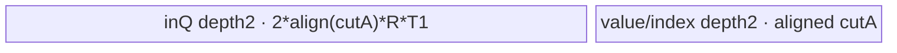
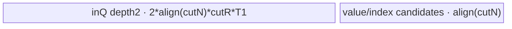
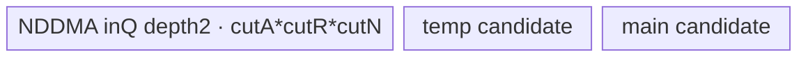
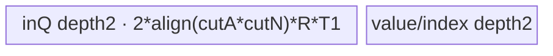

# MaxDim 950 ACLNN 算子知识

## 算子速览

| 项目 | 内容 |
|---|---|
| 实际入口 | `aclnnMaxDimGetWorkspaceSize` + `aclnnMaxDim`，公开 ACLNN；底层语义算子为 `ArgMaxWithValue`，不是只返回索引的 `ArgMax` |
| 计算语义 | 沿 `dim` 求最大值，并同时返回第一次出现最大值的归约轴坐标 `indices` 与最大值 `out` |
| 输入输出 | `self`/`out`: FLOAT16/BFLOAT16/FLOAT/INT32/INT64/BOOL；`indices`: INT32/INT64；ND，rank 0--8，普通输入 rank 1--8 |
| 执行类型 | 主节点 AIV_VECTOR；ARA 的 102/104/105/106、CUT_A_NEXT_A 与 ARA_GATHER 可使用 NDDMA；BOOL 前后各增加一个 AIV_VECTOR Cast；无 Cube/AIC/MIX_CV |
| Kernel 路线 | R-001 COPY；R-002 AR；R-003 AR_GATHER；R-004 RA；R-005--R-010 ARA mode 101--106；R-011 ARA_CUT_A_NEXT；R-012 ARA_GATHER；R-013/R-014 GROUP_REDUCE；R-015/R-016 BOOL Cast |
| 核心资源 | GM 输入/两输出；AIV UB 的双缓冲 TQue、临时 TBuf/寄存器；NDDMA `MultiCopy`；GROUP workspace 与核间 `SyncAll`；executor workspace |
| 来源闭包 | source_closed：ACLNN→Contiguous 边界→可选 Cast→`ArgMaxWithValue` Host/Tiling→`arg_max_with_value`→可选 Cast→ViewCopy 边界完整闭合；Contiguous/ViewCopy 为框架边界 |
| 验证状态 | 已完成源码闭包检查；本次知识提取未执行编译、真机、数值或性能测试。 |

## 接口与语义

### 计算语义

令输入逻辑坐标拆为 `(a,r,n)`，其中 `A=prod(shape[0:dim])`、`R=shape[dim]`、`N=prod(shape[dim+1:])`。对每个 `(a,n)`：

```text
out[a,n]     = max_{0 <= r < R} self[a,r,n]
indices[a,n] = min { r | self[a,r,n] == out[a,n] }
```

相同最大值选择较小 `r`：段内比较保留先出现值，段合并用 `GE` 保留旧段，并在相等 lane 上归约最小索引。`keepdim=true` 时归约维保留为 1，否则删除；标量输入允许 `dim=-1/0`，输出仍为标量。BOOL 经 `BOOL→FLOAT` 后归约，结果再按“等于 0 为 false，否则 true”转回 BOOL，因此其数值语义仍是 false < true。

### 输入、输出与属性

| 参数 | shape/layout | dtype | 约束、默认值与语义 |
|---|---|---|---|
| `self` | ND；非连续可接受；rank 1--8，标量单独支持 | FLOAT16/BFLOAT16/FLOAT/INT32/INT64/BOOL | 非空时归约维必须存在；空 tensor 在 ACLNN 层直接返回 workspace 0，不启动 kernel |
| `dim` | scalar attr | INT64 | 普通 rank `d`：`[-d,d-1]`；标量：`-1` 或 `0`；负值规范化到正轴 |
| `keepdim` | scalar attr | BOOL | 控制两个输出是否保留长度 1 的归约维 |
| `indices` | 与推导 shape 一致，ND；非连续可接受 | INT32/INT64 | 返回归约轴内第一次最大值坐标；950 kernel 直接产生请求 dtype |
| `out` | 与推导 shape 一致，ND；非连续可接受 | 与 `self` 相同 | 返回最大值；BOOL 内部暂以 FLOAT 计算后转回 BOOL |

### 入口与版本

公开入口由 `docs/aclnnMaxDim.md` 与 `op_api/aclnn_max_dim.cpp` 共同确认。固定 Commit 的 `ArgMaxWithValue` OpDef、arch35 tiling、ascend950 binary config 与 CMake 都只闭合 950/Ascend950 的最新实现；文档虽列出 A2/A3，但该 Commit 没有相应平台 Host/Tiling/Kernel 构建闭包，因此本卡只发布 950，不补造 A2/A3 实现。`ArgMax`（只返回索引）是另一逻辑算子，不在本卡范围。

## Host/Launcher 执行流程

### 参数校验与前处理

`aclnnMaxDimGetWorkspaceSize` 依次检查 `self/out/indices` 非空、950 dtype 集合、`out.dtype==self.dtype`、三者 rank 不超过 8、`dim` 范围和推导输出 shape。空 `self` 直接置 workspace 为 0 并结束。非空输入先进入 `l0op::Contiguous`；BOOL 输入调用 `Cast(..., FLOAT)`，其他 950 dtype 不做前置 Cast。`l0op::ArgMaxWithValue` 分配内部 values/indices，950 使用用户请求的 index dtype；随后两个 `Cast` 调用在同 dtype 时由 `cast.cpp` 返回原 tensor，不发 kernel，BOOL 的 values 才发 FLOAT→BOOL Cast。最后用 `ViewCopy` 写入用户的 `indices/out`。

### 参数、Workspace 与生命周期

主节点 POD 由 `ArgOpsTilingForAscendC`/`FillTilingData` 生产；Host 折叠出 `A/R/N`，读取 AIV core 数、UB、VReg 大小。主节点 `workspace[0]=workSpaceSize+16 MiB`：普通路线 `workSpaceSize=0`，GROUP 路线前缀是核间中间结果，末尾 16 MiB 是系统保留。Cast 节点各自使用 `CastTilingData`，workspace 同样申报 16 MiB。ACLNN executor 持有中间 tensor、POD 与各节点 workspace，`aclnnMaxDim` 在调用者 stream 上通过 `CommonOpExecutorRun` 顺序执行并在返回后释放；固定仓的通用 executor 内部 slice offset 不在本算子目录公开，不能推测。

### 启动图与失败传播

```text
aclnnMaxDimGetWorkspaceSize
  -> CheckParams / InferShape
  -> Contiguous(self)                         # 框架边界
  -> [BOOL only] Cast BOOL->FLOAT             # AIV_ONLY, CastTilingData
  -> Max2AiCore -> ArgMaxWithValue launcher
       -> ArgOpsTilingForAscendC
       -> arg_max_with_value<<<blockDim>>>     # MIX_AIV_1_0, ArgMaxWithValueTilingData
  -> [BOOL only] Cast FLOAT->BOOL              # AIV_ONLY, CastTilingData
  -> ViewCopy(indices), ViewCopy(values)       # 框架边界
aclnnMaxDim(workspace, workspaceSize, executor, stream)
  -> CommonOpExecutorRun; 任一节点失败向 ACLNN 返回错误
```

主节点 `blockDim=realCoreNum`（空域 tiling 可置 1，但公开 ACLNN 已提前短路），GROUP 设 `scheduleMode=1` 以支持 `SyncAll`。边上 `indices`/`values` 的 layout 是推导的连续内部 shape；ViewCopy 消费它们并负责用户输出 stride。BOOL 的前置 Cast 产生连续 FLOAT GM 中间量，主节点消费；后置 Cast 消费 FLOAT values 并产生 BOOL GM 中间量。所有边均由 executor 拥有并按同 stream 节点顺序存活；具体 byte offset 属通用 executor 边界，固定仓不可见。

## Route 与参数设计

### 分核与资源计算

Host 先计算 `A/R/N`。当 `A*R*N*sizeof(index_dtype)<4096` 时强制一核。其余 route 按输出元素、A 或 N 均分到 `min(work, aivCoreNum)` 个核，`blkFactor/blkTailFactor` 描述首轮 former/tail；CUT_A_NEXT 还给出第二维 `blkFactor2nd/blkTailFactor2nd/blkNum2nd`。tile 大小由 `UB/vReg`、32/128/256-byte 对齐、`uint16_t` 的 `cutA/cutR/cutN` 上限共同限制。BF16 多数归约 route 在 UB 中提升 FLOAT；INT64 使用成对寄存器与 64-bit 内部索引。

### Route 选择

| 顺序 | Route | Key/模板 | 精确选择条件与优先级 | 不适用去向 |
|---:|---|---|---|---|
| 1 | R-015/R-016 BOOL Cast | Cast selector 5/2 | `self.dtype==BOOL`，分别在主节点前后 | 非 BOOL 不发 Cast kernel |
| 2 | R-001 COPY | 10003 | 初始 `R==1`，且未被后续高性能 override | 继续高性能选择 |
| 3 | R-004 RA | 20003 | `A==1 && (N>=coreNum*256 \|\| (N>1 && R<256))` | 下一 guard |
| 4 | R-003 AR_GATHER | 20001 | `N==1 && R*effectiveByte<vRegSize && A*effectiveByte>=coreNum*vRegSize` | 下一 guard |
| 5 | R-012 ARA_GATHER | 20002 | 初始 ARA，`A*N*effectiveByte>=coreNum*vRegSize` 且 `R*byte<vRegSize` 或大 RA footprint 条件 | 下一 guard |
| 6 | R-013/R-014 GROUP | 30001 | `R*effectiveByte>=coreNum*256 && R<INT32_MAX` 且输出并行度低：`N==1&&A<core` 或 `N>1&&A*N<2*core` | 下一 guard；最终轴 A 接近满核时回退 AR |
| 7 | R-011 ARA_CUT_A_NEXT | 10012 | 仍为 ARA，`A*N*byte>=coreNum*128 && N*byte>=128`，或 mode104 的 `TryRouteAraMode4` 成功 | 保持 ARA |
| 8 | R-002 AR | 10001 | `N==1`；GROUP 后若 `A>0.85*coreNum` 也回退此 route | ARA |
| 9 | R-005/R-006 ARA 101/102 | 10002 | `A>=core` 且 `R*N<=ubElement`；按 `N*byte<32` 选 101，否则 102 | 103--106 |
| 10 | R-007 ARA 103 | 10002 | `A>=core`、RA 不全装 UB 且 `N*byte<=32` | 104--106 |
| 11 | R-008 ARA 104 | 10002 | 同时切 R/N 的中间形状且未转 10012/GROUP | 105/106 |
| 12 | R-009 ARA 105 | 10002 | R 可全装、按 N 分片 | 106 |
| 13 | R-010 ARA 106 | 10002 | R 不可全装的最终 fallback；按单个 N 输出切 R | tiling 失败 |

```text
R==1 ? COPY : (N==1 ? AR : ARA)
  -> RA override
  -> AR_GATHER override
  -> ARA_GATHER override
  -> GROUP_REDUCE override
  -> ARA_CUT_A_NEXT override
  -> final-axis GROUP with A>0.85*cores ? AR
  -> if ARA: choose aRaMode 101..106 from UB/N-byte predicates
  -> FillTilingData -> key -> entry router
```

### 模板/实现执行矩阵

| Route | key/selector | dtype/shape/platform 完整命中条件 | 执行拓扑与 Kernel 节点 | 实际模板/body | 内存与同步特征 | tail/fallback |
|---|---|---|---|---|---|---|
| R-001 COPY | 10003 | R=1 且无 override | 单 AIV | `ArgMaxWithValueCopy<T1,T3,true,false>` | 值复制、索引清零 | A/N tail |
| R-002 AR | 10001 | N=1 | 单 AIV | `ArgMaxWithValueAr<T1,T2,T3,true,false>` | 连续 R 归约；可切 R | A/R tail |
| R-003 AR_GATHER | 20001 | 小 R、A 足够大 | 单 AIV | `ArgMaxWithValueArGather` | 整批 `[A,R]`，寄存器 gather | A tail |
| R-004 RA | 20003 | A=1、N 并行度高 | 单 AIV | `ArgMaxWithValueRa` | strided DataCopyPad；可切 R | N/R tail |
| R-005--R-010 ARA | 10002, mode101--106 | A/R/N 与 UB predicates | 单 AIV，部分 NDDMA | `ArgMaxWithValueArA` 的六个 Process body | gather 或 NDDMA transpose；可切 R/N | 各维 tail |
| R-011 CUT_A_NEXT | 10012 | A/N 均足够大 | 单 AIV+NDDMA | `ArgMaxWithValueArACutAAndNextA` | 2D 核映射，A/R/N tile | 二维核尾块 |
| R-012 ARA_GATHER | 20002 | A*N 足、RA footprint guard | 单 AIV+NDDMA/strided copy | `ArgMaxWithValueAraGather` | A>1 时 `[A,R,N]→[R,A,N]` | A/N tail |
| R-013 GROUP-AR | 30001, isRaSplit=0 | 输出低并行、每核 R 片，workspace guard | 单 kernel 两阶段 | `GroupReduce::ProcessTemplate` | workspace→SyncAll→core0 合并 | R tail |
| R-014 GROUP-RA | 30001, isRaSplit=1 | `N*effectiveByte>=128 \|\| blkFactor*effectiveByte<256` | 单 kernel 两阶段 | `GroupReduce::ProcessRaSplit` | workspace→SyncAll→多核分块合并 | R/N tail |
| R-015 BOOL→FLOAT | Cast id=5 | BOOL public input | 前置 AIV | `CastTwo<int8_t,half,float>` | 双缓冲+half TBuf | former/tail core |
| R-016 FLOAT→BOOL | Cast id=2 | BOOL public output | 后置 AIV | `CastDstBool<float>` | compare mask+zero TBuf | former/tail core |

### 隐藏性能 Guard

| Guard | Host/Tiling 条件 | Device/资源原因 | 影响 Route | 不满足时去向 | 源码符号 |
|---|---|---|---|---|---|
| 小 tensor 单核 | `A*R*N*sizeof(index_dtype)<4096` | 避免小工作量多核 | 全部主 route | 正常核数 | `ArgOpsTilingForAscendC` |
| 32-byte gather 门槛 | `N*byte<32`/`<=32` | 窄 N 用寄存器 gather，宽 N 用 NDDMA | R-005/R-006/R-007 | NDDMA route | `DoArgOpsTilingWithARA` |
| CUT_A_NEXT | `A*N*byte>=core*128 && N*byte>=128` | 二维输出可提供并行且 DMA 块足够宽 | R-011 | R-005--R-010 | `ArgOpsTilingHighPerformance` |
| Group workspace | `R*effectiveByte>=core*256`, `R<INT32_MAX`, 输出并行度低 | 以 workspace 换取 R 维多核并行 | R-013/R-014 | 原 route | `DoArgOpsTilingGroupReduce` |
| Group 回退 | `N==1 && A>0.85*coreNum` | A 已足以满核，不付核间合并成本 | R-013 | R-002 | `ArgOpsTilingForAscendC` |
| RA split | `N*effectiveByte>=128 \|\| blkFactor*effectiveByte<256` | 决定 workspace 行布局和第二阶段并行 | R-014 | R-013 | `DoArgOpsTilingGroupReduce` |
| workspace 非空 | entry `workspace==nullptr` 直接 return | GROUP 和系统 workspace 协议要求有效地址 | 全部主 route | 无计算 | `arg_max_with_value` |

### POD/ABI

`BEGIN_TILING_DATA_DEF` 只公开字段顺序和类型；固定仓没有展开宏后的 `sizeof/alignof/offsetof`，所以下表 ABI 布局统一记为“宏生成，offset/sizeof 不可见”，不得自行按 C++ 自然对齐猜测。

| 结构 | 字段 | 类型/位宽 | ABI 布局 | 单位 | Host/launcher producer | Device consumer | 边界 |
|---|---|---|---|---|---|---|---|
| ArgMaxWithValueTilingData | `aSize` | uint64/64 | 宏生成，不可见 | element groups | `FillTilingData` | 全 route 地址/循环 | shape 乘积 |
| 同上 | `cutASize` | uint16/16 | 同上 | elements | 同上 | A tile | ≤65535 |
| 同上 | `rSize` | uint64/64 | 同上 | elements | 同上 | 归约长度 | GROUP 要求 <INT32_MAX |
| 同上 | `cutRSize` | uint16/16 | 同上 | elements | 同上 | R tile | ≤65535 |
| 同上 | `nextASize` | uint64/64 | 同上 | elements | 同上 | N stride | shape 乘积 |
| 同上 | `cutNextASize` | uint16/16 | 同上 | elements | 同上 | N tile | ≤65535 |
| 同上 | `realCoreNum` | uint64/64 | 同上 | cores | 同上 | core guard/merge | ≤AIV core num |
| 同上 | `blkFactor` | uint64/64 | 同上 | route work units | 同上 | former core span | 依 route 解释 |
| 同上 | `blkTailFactor` | uint64/64 | 同上 | work units | 同上 | tail core span | 依 route 解释 |
| 同上 | `blkFactor2nd` | uint64/64 | 同上 | work units | 同上 | R-011 second axis | inactive 为 0 |
| 同上 | `blkTailFactor2nd` | uint64/64 | 同上 | work units | 同上 | R-011 tail | inactive 为 0 |
| 同上 | `blkNum2nd` | uint64/64 | 同上 | blocks | 同上 | R-011 block mapping | inactive 为 0 |
| 同上 | `tilingKey` | uint64/64 | 同上 | enum | 同上 | 辅助分支 | 与 runtime key 一致 |
| 同上 | `aRaMode` | uint64/64 | 同上 | enum 101--106 | 同上 | R-005--R-010 Process | 非 ARA inactive |
| 同上 | `loopANum` | uint16/16 | 同上 | loops | 同上 | GROUP | inactive 为 0 |
| 同上 | `cutAPerLoop` | uint16/16 | 同上 | A rows | 同上 | GROUP | UB 上界 |
| 同上 | `isRaSplit` | uint8/8 | 同上 | bool | 同上 | GROUP branch | 0/1 |
| 同上 | `gatherBlockSize` | uint16/16 | 同上 | elements | 同上 | GROUP RA gather | `min(128/byte,N)` |
| 同上 | `workSpaceSize` | uint64/64 | 同上 | bytes | 同上 | workspace region | 256-byte aligned |
| CastTilingData | `blockNum` | int64/64 | 宏生成，不可见 | cores | `CastTiling::PostTiling` | Cast Process | ≥1 for nonempty |
| 同上 | `ubFormer` | int64/64 | 同上 | elements | `GetUbFormer` | UB capacity/loop | dtype formula |
| 同上 | `blockFormer` | int64/64 | 同上 | elements/core | `DoOpTiling` | GM base | 8-element aligned |
| 同上 | `ubLoopOfFormerBlock` | int64/64 | 同上 | loops | 同上 | Cast Process | former core |
| 同上 | `ubLoopOfTailBlock` | int64/64 | 同上 | loops | 同上 | Cast Process | tail core |
| 同上 | `ubTailOfFormerBlock` | int64/64 | 同上 | elements | 同上 | final UB tile | ≤ubFormer |
| 同上 | `ubTailOfTailBlock` | int64/64 | 同上 | elements | 同上 | final UB tile | ≤ubFormer |
| 同上 | `regCopyInStep` | int64/64 | 同上 | elements | 同上 | generic Cast | BOOL routes不使用 |
| 同上 | `regCopyOutStep` | int64/64 | 同上 | elements | 同上 | generic Cast | BOOL routes不使用 |
| 同上 | `ubFormerRegLoop` | int64/64 | 同上 | loops | 同上 | generic Cast | BOOL routes不使用 |
| 同上 | `ubTailOfFormerRegLoop` | int64/64 | 同上 | elements | 同上 | generic Cast | BOOL routes不使用 |
| 同上 | `ubTailOfTailRegLoop` | int64/64 | 同上 | elements | 同上 | generic Cast | BOOL routes不使用 |

### Route 源码闭包

| Route | Key/selector | Host/Tiling producer | POD/参数 | Kernel entry/router 节点 | Kernel body/直接依赖 | 构建接线 |
|---|---|---|---|---|---|---|
| R-001 | 10003 | `ArgOpsTilingForAscendC` | Arg POD | `arg_max_with_value` | `arg_max_with_value_copy.h` | `CMakeLists.txt` + binary config |
| R-002 | 10001 | 同上/AR tiling | 同上 | 同上 | `arg_max_with_value_ar.h` + base | 同上 |
| R-003 | 20001 | HighPerformance/AR_GATHER | 同上 | 同上 | `arg_max_with_value_ar_gather.h` + base | 同上 |
| R-004 | 20003 | HighPerformance/RA | 同上 | 同上 | `arg_max_with_value_ra.h` + base | 同上 |
| R-005--R-010 | 10002/mode101--106 | `DoArgOpsTilingWithARA` | 同上，`aRaMode` | 同上 | `arg_max_with_value_ara.h` + base | 同上 |
| R-011 | 10012 | ARA high-performance/`TryRouteAraMode4` | 同上，second-axis fields | 同上 | `arg_max_with_value_ara_cut_a_and_next_a.h` + base | 同上 |
| R-012 | 20002 | HighPerformance/ARA_GATHER | 同上 | 同上 | `arg_max_with_value_ara_gather.h` + base | 同上 |
| R-013/R-014 | 30001 | `DoArgOpsTilingGroupReduce` | 同上，group fields | 同上 | `arg_max_with_value_group_reduce.h` + base | 同上 |
| R-015/R-016 | Cast id 5/2 | `CastTiling` | Cast POD | `cast` | `cast_struct.h` + `cast_impl.h` | Cast module in ops-math |

## Kernel 实现

### 公共执行流程

`arg_max_with_value` 检查 workspace、声明 `KERNEL_TYPE_MIX_AIV_1_0`、读取 POD，再按 tiling key 实例化 body。`ORIG_DTYPE_X==INT64` 时内部索引 `T2=int64_t`，其余为 `int32_t`；外部 `T3=DTYPE_INDICE`，CopyOut 必要时转换。公共 reduction helper 以类型最小值初始化；FP/BF16 路径处理 NaN，段内/段间都保持第一次最大值。BF16 除 R-011 的可见实现外通常在 UB 提升 FLOAT 后比较，输出时 ROUND 回 BF16。所有 route 以 TQue 的 EnQue/DeQue/FreeTensor 建立 MTE/Vector 顺序，尾块使用真实 `blockLen` 或 mask。BOOL 的两个 Cast 是独立 AIV_ONLY 节点，不与主 kernel 融合。

### Route R-001：COPY

#### 适用条件

##### 选择证据

| 层级 | 文件 | 符号 | 源码谓词/参数 | 结果/下一跳 |
|---|---|---|---|---|
| Tiling | `op_host/arch35/arg_common_base_tiling_arch35.cpp` | `ArgOpsTilingForAscendC` | `R==1` 且无高性能 override | key 10003 |
| Router | `op_kernel/arg_max_with_value_apt.cpp` | `arg_max_with_value` | `TILING_KEY_COPY` | `ArgMaxWithValueCopy` |

#### Device 数据流

##### 函数级调用链

```text
arg_max_with_value -> ArgMaxWithValueCopy::Init -> Process
  -> CopyIn(values) -> Copy/zero indices -> CopyOut(values,indices)
```

##### 源码等价伪码

```text
for core-owned A*N tile:
  DataCopyPad x -> value queue
  Copy value unchanged; Duplicate index=0
  DataCopyPad queues -> values/indices GM with exact tail bytes
```

#### 内存与数据搬运

##### 资源与搬运表

| 层级/缓冲区 | offset/地址公式 | extent/容量公式 | dtype/layout | producer | consumer | owner/lifetime | 对齐/复用 |
|---|---|---|---|---|---|---|---|
| values queue | core/tile offset | `2*align32(cutA)*sizeof(T1)` | T1 contiguous | CopyIn | CopyOut | kernel/iteration | depth 2 |
| indices queue | same logical offset | `1024*sizeof(T3)` | T3 zeros | Duplicate | CopyOut | kernel/iteration | depth 1 |

##### 分层内存布局


##### 字节账与复用顺序

```text
UB_total = 2*align32(cutA)*sizeof(T1) + 1024*sizeof(T3)
workspace_total = 16 MiB system reserve
```

| 复用子区 | 写入者 | 读取者/消费点 | 下一次覆盖 | 同步或释放依据 | 安全条件 |
|---|---|---|---|---|---|
| valuesQ slot | CopyIn | CopyOut | next tile | queue DeQue/FreeTensor | depth-2 protocol |

#### 同步、精度与尾块

##### 同步与数值边界表

| 阶段 | primitive/机制 | producer | consumer/等待点 | 保护对象 | 精度/尾块 |
|---|---|---|---|---|---|
| copy | queue + MTE2/MTE3 event | GM→UB | UB→GM | values slot | bitwise value copy，尾块精确 bytes；index 恒 0 |

#### 关键实现

##### 符号证据表

| 阶段 | 文件 | 符号/模板实例 | 实现事实 |
|---|---|---|---|
| Host/Tiling producer | `op_host/arch35/arg_common_base_tiling_arch35.cpp` | COPY tiling | R=1，按 A*N 分核 |
| Kernel entry/router | `op_kernel/arg_max_with_value_apt.cpp` | `TILING_KEY_COPY` | 映射 Copy body |
| Device body/helper | `op_kernel/arch35/arg_max_with_value_copy.h` | `ArgMaxWithValueCopy::Process` | 值复制、索引 0 |

### Route R-002：AR 连续归约

#### 适用条件

##### 选择证据

| 层级 | 文件 | 符号 | 源码谓词/参数 | 结果/下一跳 |
|---|---|---|---|---|
| Tiling | `op_host/arch35/arg_common_base_tiling_arch35.cpp` | AR tiling | `N==1`，未命中 gather/group | key 10001 |
| Router | `op_kernel/arg_max_with_value_apt.cpp` | router | key 10001 | `ArgMaxWithValueAr` |

#### Device 数据流

##### 函数级调用链

```text
ArgMaxWithValueAr::Process -> CopyIn [A,R tile]
  -> ArgMaxV1/ArgMaxV1Int64 -> UpdateResult(if cut R) -> CopyOut
```

##### 源码等价伪码

```text
for A batches of at most cutA (output batch capped at 1024):
  for R segment: reduce contiguous R, adding segment R offset to indices
  merge segment candidate with old candidate; equality keeps old/lower index
  write value and requested index dtype
```

#### 内存与数据搬运

##### 资源与搬运表

| 层级/缓冲区 | offset/地址公式 | extent/容量公式 | dtype/layout | producer | consumer | owner/lifetime | 对齐/复用 |
|---|---|---|---|---|---|---|---|
| inputQ | `(a*R+r)` | `2*(align32(cutA*cutR)+VL)*sizeof(T1)` | `[A,R]` | DataCopyPad | ArgMaxV1 | iteration | depth2 |
| outputs | A offset | `2*1024*sizeof(T1)+2*1024*sizeof(index-buffer)` | value/index | reduction | CopyOut | iteration | depth2 |
| BF16/cast TBuf | local | route Init formula | FLOAT values/index cast | Cast/helper | output | kernel | conditional |

##### 分层内存布局


##### 字节账与复用顺序

```text
UB_total = InitBuffer(inQ)+InitBuffer(outV)+InitBuffer(outI)+conditional BF16/index-cast TBuf
cutA/cutR chosen so UB_total <= platform UB and cut fields <= uint16
workspace_total = 16 MiB reserve
```

| 复用子区 | 写入者 | 读取者/消费点 | 下一次覆盖 | 同步或释放依据 | 安全条件 |
|---|---|---|---|---|---|
| output candidate | first R segment | UpdateResult/CopyOut | next A batch | queue lifetime | all R segments merged first |

#### 同步、精度与尾块

##### 同步与数值边界表

| 阶段 | primitive/机制 | producer | consumer/等待点 | 保护对象 | 精度/尾块 |
|---|---|---|---|---|---|
| segment merge | Vector/`PipeBarrier<ALL>` for INT64 scalar path | new candidate | UpdateResult | value/index pair | equality keeps earlier; BF16 FLOAT compare then ROUND |
| tail | masked reduction/DataCopyPad | partial R/A | output | valid lanes | R/A exact tail |

#### 关键实现

##### 符号证据表

| 阶段 | 文件 | 符号/模板实例 | 实现事实 |
|---|---|---|---|
| Host/Tiling producer | `op_host/arch35/arg_common_base_tiling_arch35.cpp` | AR calculations | cutA/cutR/1024 cap |
| Kernel entry/router | `op_kernel/arg_max_with_value_apt.cpp` | `ArgMaxWithValueAr<T1,T2,T3,true,false>` | INT64 选 T2=int64 |
| Device body/helper | `op_kernel/arch35/arg_max_with_value_ar.h` | `Process` | 连续 R reduction/分段合并 |

### Route R-003：AR_GATHER

#### 适用条件

##### 选择证据

| 层级 | 文件 | 符号 | 源码谓词/参数 | 结果/下一跳 |
|---|---|---|---|---|
| Tiling | `op_host/arch35/arg_common_base_tiling_arch35.cpp` | HighPerformance | `N==1 && R*effectiveByte<vRegSize && A*effectiveByte>=core*vRegSize` | 20001 |
| Router | `op_kernel/arg_max_with_value_apt.cpp` | router | key 20001 | AR_GATHER body |

#### Device 数据流

##### 函数级调用链

```text
ArgMaxWithValueArGather::Process -> contiguous DataCopy [cutA,R]
  -> MicroAPI DataCopyGather -> ArgMax over R per lane -> CopyOut
```

##### 源码等价伪码

```text
for A tile: load [cutA,R]; gather same R position for multiple A rows into vector lanes;
reduce each row; emit values and indices; handle A tail.
```

#### 内存与数据搬运

##### 资源与搬运表

| 层级/缓冲区 | offset/地址公式 | extent/容量公式 | dtype/layout | producer | consumer | owner/lifetime | 对齐/复用 |
|---|---|---|---|---|---|---|---|
| inputQ | A tile*R | `2*align32(cutA)*R*sizeof(T1)` | `[A,R]` | GM copy | gather | iteration | depth2 |
| output queues | A tile | `2*align32(cutA)*(sizeof(T1)+sizeof(T2/T3))` | A vectors | reduction | GM copy | iteration | depth2 |

##### 分层内存布局



##### 字节账与复用顺序

```text
UB_total = inputQ + valueQ + indexQ + conditional BF16/cast buffers
workspace_total = 16 MiB
```

| 复用子区 | 写入者 | 读取者/消费点 | 下一次覆盖 | 同步或释放依据 | 安全条件 |
|---|---|---|---|---|---|
| inQ slot | CopyIn | gather/reduce | next A tile | DeQue/FreeTensor | R fits vReg guard |

#### 同步、精度与尾块

##### 同步与数值边界表

| 阶段 | primitive/机制 | producer | consumer/等待点 | 保护对象 | 精度/尾块 |
|---|---|---|---|---|---|
| gather/reduce | queue + MicroAPI gather | MTE2 | vector | `[A,R]` | same tie/NaN policy；A tail masked |

#### 关键实现

##### 符号证据表

| 阶段 | 文件 | 符号/模板实例 | 实现事实 |
|---|---|---|---|
| Host/Tiling producer | `op_host/arch35/arg_common_base_tiling_arch35.cpp` | AR_GATHER guard | small R, enough A |
| Kernel entry/router | `op_kernel/arg_max_with_value_apt.cpp` | key 20001 | body mapping |
| Device body/helper | `op_kernel/arch35/arg_max_with_value_ar_gather.h` | `Process` | gather converts access orientation |

### Route R-004：RA

#### 适用条件

##### 选择证据

| 层级 | 文件 | 符号 | 源码谓词/参数 | 结果/下一跳 |
|---|---|---|---|---|
| Tiling | `op_host/arch35/arg_common_base_tiling_arch35.cpp` | HighPerformance | `A==1 && (N>=core*256 \|\| (N>1&&R<256))` | 20003 |
| Router | `op_kernel/arg_max_with_value_apt.cpp` | router | key 20003 | RA body |

#### Device 数据流

##### 函数级调用链

```text
ArgMaxWithValueRa::Process -> strided CopyIn [R,cutN]
  -> ArgMaxRa -> UpdateResult(if cut R) -> CopyOut [cutN]
```

##### 源码等价伪码

```text
split N among cores; for each N tile, copy blockCount=R rows with GM stride N-cutN;
reduce R for every N lane; merge R segments; store contiguous N outputs.
```

#### 内存与数据搬运

##### 资源与搬运表

| 层级/缓冲区 | offset/地址公式 | extent/容量公式 | dtype/layout | producer | consumer | owner/lifetime | 对齐/复用 |
|---|---|---|---|---|---|---|---|
| inputQ | `r*N+nTile` | `2*align32(cutN)*cutR*sizeof(T1)` | `[R,cutN]` packed | DataCopyPad | ArgMaxRa | iteration | depth2 |
| outputQ | N tile | depth2, `align32(cutN)`，切 R 时容纳双候选 | values/indices | reduction | CopyOut | iteration | aligned |

##### 分层内存布局



##### 字节账与复用顺序

```text
UB_total = InitBuffer(inQ)+two output queues+conditional BF16/index buffers
workspace_total = 16 MiB
```

| 复用子区 | 写入者 | 读取者/消费点 | 下一次覆盖 | 同步或释放依据 | 安全条件 |
|---|---|---|---|---|---|
| second candidate half | later R segment | UpdateResult | next R segment | local barrier/queue | first candidate retained until merge |

#### 同步、精度与尾块

##### 同步与数值边界表

| 阶段 | primitive/机制 | producer | consumer/等待点 | 保护对象 | 精度/尾块 |
|---|---|---|---|---|---|
| strided copy | DataCopyPad | GM | Vector | N tile | blockLen uses actual N tail; R segment merge preserves first |

#### 关键实现

##### 符号证据表

| 阶段 | 文件 | 符号/模板实例 | 实现事实 |
|---|---|---|---|
| Host/Tiling producer | `op_host/arch35/arg_common_base_tiling_arch35.cpp` | RA tiling | N split and optional R split |
| Kernel entry/router | `op_kernel/arg_max_with_value_apt.cpp` | key 20003 | RA body |
| Device body/helper | `op_kernel/arch35/arg_max_with_value_ra.h` | `ArgMaxWithValueRa::Process` | strided `[R,N]` reduction |

### Route R-005：ARA mode 101（窄 N Gather，全 R）

#### 适用条件

##### 选择证据

| 层级 | 文件 | 符号 | 源码谓词/参数 | 结果/下一跳 |
|---|---|---|---|---|
| Tiling | `op_host/arch35/arg_common_base_tiling_arch35.cpp` | `DoArgOpsTilingWithARA` | `A>=core && R*N<=ubElement && N*byte<32` | key10002, mode101 |
| Router | `op_kernel/arch35/arg_max_with_value_ara.h` | `Process` | `aRaMode==101` | gather body |

#### Device 数据流

##### 函数级调用链

```text
ArgMaxWithValueArA::Process(mode101) -> CopyIn contiguous [A,R,N]
  -> ArgMaxGatherV1 per A -> CopyOut [A,N]
```

##### 源码等价伪码

```text
for core-owned A rows: load full R*N; for each A gather narrow-N elements across R;
reduce and emit N values/indices; process A tail.
```

#### 内存与数据搬运

##### 资源与搬运表

| 层级/缓冲区 | offset/地址公式 | extent/容量公式 | dtype/layout | producer | consumer | owner/lifetime | 对齐/复用 |
|---|---|---|---|---|---|---|---|
| inputQ | `a*R*N` | `2*align32(cutA*R*N)*sizeof(T1)` | `[A,R,N]` | contiguous copy | gather | tile | depth2 |
| outputs | `a*N` | queues each allocated for `2*1024` elements plus conditional buffers | value/index | reduce | GM | tile | depth1 declarations |

##### 分层内存布局


##### 字节账与复用顺序

```text
UB_total = common ARA queues/TBuf; R*N<=ubElement guarantees full row fits
workspace_total = 16 MiB
```

| 复用子区 | 写入者 | 读取者/消费点 | 下一次覆盖 | 同步或释放依据 | 安全条件 |
|---|---|---|---|---|---|
| inQ slot | CopyIn | gather | next A tile | queue free | full R*N resident |

#### 同步、精度与尾块

##### 同步与数值边界表

| 阶段 | primitive/机制 | producer | consumer/等待点 | 保护对象 | 精度/尾块 |
|---|---|---|---|---|---|
| gather | TQue/MicroAPI | MTE2 | reduction | narrow N | BF16→FLOAT；A tail exact |

#### 关键实现

##### 符号证据表

| 阶段 | 文件 | 符号/模板实例 | 实现事实 |
|---|---|---|---|
| Host/Tiling producer | `op_host/arch35/arg_common_base_tiling_arch35.cpp` | mode101 branch | full R*N and N<32B |
| Kernel entry/router | `op_kernel/arg_max_with_value_apt.cpp` | key10002 | ArA body |
| Device body/helper | `op_kernel/arch35/arg_max_with_value_ara.h` | mode101 Process body | gather reduction |

### Route R-006：ARA mode 102（NDDMA，全 R）

#### 适用条件

##### 选择证据

| 层级 | 文件 | 符号 | 源码谓词/参数 | 结果/下一跳 |
|---|---|---|---|---|
| Tiling | `op_host/arch35/arg_common_base_tiling_arch35.cpp` | ARA selector | `A>=core && R*N<=ubElement && N*byte>=32` | key10002, mode102 |
| Device | `op_kernel/arch35/arg_max_with_value_ara.h` | `CopyInXWithNDDMA` | mode102 | transpose `[A,R,N]→[A,N,R]` |

#### Device 数据流

##### 函数级调用链

```text
Process(mode102) -> CopyInXWithNDDMA -> DataCopy<NDDMA_DIM_NUM>
  -> ArgMaxV1 on packed R -> CopyOut
```

##### 源码等价伪码

```text
NDDMA loops: N(src stride1,dst stride R), R(src stride N,dst stride1), A(src/dst stride R*N);
reduce packed R for every (A,N); write outputs.
```

#### 内存与数据搬运

##### 资源与搬运表

| 层级/缓冲区 | offset/地址公式 | extent/容量公式 | dtype/layout | producer | consumer | owner/lifetime | 对齐/复用 |
|---|---|---|---|---|---|---|---|
| NDDMA inputQ | A tile GM base | `2*align32(cutA*R*N)*sizeof(T1)` | packed `[A,N,R]` | MultiCopy | ArgMaxV1 | tile | depth2 |
| outputs | A*N | common ARA output queues | value/index | reduce | GM | tile | tail aware |

##### 分层内存布局


##### 字节账与复用顺序

```text
UB_total = common ARA queues/TBuf; full R*N fits ubElement
dynamic_ub = N/A; NDDMA writes the allocated TQue tensor
workspace_total = 16 MiB
```

| 复用子区 | 写入者 | 读取者/消费点 | 下一次覆盖 | 同步或释放依据 | 安全条件 |
|---|---|---|---|---|---|
| packed input slot | NDDMA | reduction | next tile | EnQue/DeQue/FreeTensor | MultiCopy completes before consumer |

#### 同步、精度与尾块

##### 同步与数值边界表

| 阶段 | primitive/机制 | producer | consumer/等待点 | 保护对象 | 精度/尾块 |
|---|---|---|---|---|---|
| transpose | NDDMA+queue | GM | Vector | full tile | no numeric change；A tail passed as `copyNum` |

#### 关键实现

##### 符号证据表

| 阶段 | 文件 | 符号/模板实例 | 实现事实 |
|---|---|---|---|
| Host/Tiling producer | `op_host/arch35/arg_common_base_tiling_arch35.cpp` | mode102 | wide N/full R |
| Kernel entry/router | `op_kernel/arg_max_with_value_apt.cpp` | key10002 | ARA body |
| Device body/helper | `op_kernel/arch35/arg_max_with_value_ara.h` | `CopyInXWithNDDMA` | three-dimensional layout transform |

### Route R-007：ARA mode 103（窄 N Gather，切 R）

#### 适用条件

##### 选择证据

| 层级 | 文件 | 符号 | 源码谓词/参数 | 结果/下一跳 |
|---|---|---|---|---|
| Tiling | `op_host/arch35/arg_common_base_tiling_arch35.cpp` | ARA selector | `A>=core`, full `R*N` 不装 UB，`N*byte<=32` | mode103 |
| Device | `op_kernel/arch35/arg_max_with_value_ara.h` | mode103 body | `aRaMode==103` | R-segment gather |

#### Device 数据流

##### 函数级调用链

```text
ProcessWithCutR -> ProcessOneRaWithGather
  -> CopyInAndComputeWithGather each R segment -> UpdateResult -> CopyOut
```

##### 源码等价伪码

```text
for A tile: reduce first cutR segment into main candidate;
for middle/tail R segments reduce into temp candidate, then UpdateResult;
write N results per A.
```

#### 内存与数据搬运

##### 资源与搬运表

| 层级/缓冲区 | offset/地址公式 | extent/容量公式 | dtype/layout | producer | consumer | owner/lifetime | 对齐/复用 |
|---|---|---|---|---|---|---|---|
| common inputQ | segment base | `2*align32(cutA*cutR*N)*sizeof(T1)` | `[A,Rseg,N]` | copy | gather | segment | depth2 |
| tempValue/tempIndice | local | `processSize*(BF16?4:sizeof(T1))` + `processSize*sizeof(T2)` | candidate | later segment | UpdateResult | A tile | dynamic InitBuffer |

##### 分层内存布局


##### 字节账与复用顺序

```text
UB_total = common ARA buffers + tempValue + tempIndice
workspace_total = 16 MiB
```

| 复用子区 | 写入者 | 读取者/消费点 | 下一次覆盖 | 同步或释放依据 | 安全条件 |
|---|---|---|---|---|---|
| temp candidate | current R segment | UpdateResult | next R segment | vector completion | main candidate separate |

#### 同步、精度与尾块

##### 同步与数值边界表

| 阶段 | primitive/机制 | producer | consumer/等待点 | 保护对象 | 精度/尾块 |
|---|---|---|---|---|---|
| merge | UpdateResult | temp | main | value/index | BF16 FLOAT temp；R tail exact |

#### 关键实现

##### 符号证据表

| 阶段 | 文件 | 符号/模板实例 | 实现事实 |
|---|---|---|---|
| Host/Tiling producer | `op_host/arch35/arg_common_base_tiling_arch35.cpp` | mode103 | narrow N, cut R |
| Kernel entry/router | `op_kernel/arg_max_with_value_apt.cpp` | key10002 | ARA body |
| Device body/helper | `op_kernel/arch35/arg_max_with_value_ara.h` | `ProcessOneRaWithGather` | segmented merge |

### Route R-008：ARA mode 104（NDDMA，切 R 与 N）

#### 适用条件

##### 选择证据

| 层级 | 文件 | 符号 | 源码谓词/参数 | 结果/下一跳 |
|---|---|---|---|---|
| Tiling | `op_host/arch35/arg_common_base_tiling_arch35.cpp` | ARA selector/`TryRouteAraMode4` | 需同时切 R/N，且未转 key10012/30001 | mode104 |
| Device | `op_kernel/arch35/arg_max_with_value_ara.h` | `ProcessWithCutRA` | mode104 | NDDMA R/N tiles |

#### Device 数据流

##### 函数级调用链

```text
ProcessWithCutRA -> ProcessOnce/ProcessOnceWithTail
  -> NDDMA CopyIn -> reduce R segment -> UpdateResult -> CopyOut N tile
```

##### 源码等价伪码

```text
for output N tile and A work chunk:
  for R segment: NDDMA pack the [Rseg,Ntile] slab, reduce, merge candidate;
  distinguish divisible-N and N-tail loops; write valid N.
```

#### 内存与数据搬运

##### 资源与搬运表

| 层级/缓冲区 | offset/地址公式 | extent/容量公式 | dtype/layout | producer | consumer | owner/lifetime | 对齐/复用 |
|---|---|---|---|---|---|---|---|
| NDDMA inputQ | `(a*R+r)*N+n` | common ARA input capacity | packed tile | MultiCopy | reduce | segment | depth2 |
| temp/main candidates | N tile | two candidate regions | value/index | segment reduce | UpdateResult | output tile | separate until merge |

##### 分层内存布局



##### 字节账与复用顺序

```text
UB_total = common ARA buffers + tempValue + tempIndice
workspace_total = 16 MiB
```

| 复用子区 | 写入者 | 读取者/消费点 | 下一次覆盖 | 同步或释放依据 | 安全条件 |
|---|---|---|---|---|---|
| NDDMA slot | CopyIn | reduce | next R/N tile | queue release | tail sizes passed to MultiCopy |

#### 同步、精度与尾块

##### 同步与数值边界表

| 阶段 | primitive/机制 | producer | consumer/等待点 | 保护对象 | 精度/尾块 |
|---|---|---|---|---|---|
| NDDMA/merge | queue+UpdateResult | packed segment | main | value/index | R and N tails both explicit |

#### 关键实现

##### 符号证据表

| 阶段 | 文件 | 符号/模板实例 | 实现事实 |
|---|---|---|---|
| Host/Tiling producer | `op_host/arch35/arg_common_base_tiling_arch35.cpp` | mode104/route conversion | may become 10012/30001 |
| Kernel entry/router | `op_kernel/arg_max_with_value_apt.cpp` | key10002 | ARA body |
| Device body/helper | `op_kernel/arch35/arg_max_with_value_ara.h` | `ProcessWithCutRA` | cut R/N NDDMA |

### Route R-009：ARA mode 105（NDDMA，切 N）

#### 适用条件

##### 选择证据

| 层级 | 文件 | 符号 | 源码谓词/参数 | 结果/下一跳 |
|---|---|---|---|---|
| Tiling | `op_host/arch35/arg_common_base_tiling_arch35.cpp` | ARA selector | R 可全装且按 N 分片 | mode105 |
| Device | `op_kernel/arch35/arg_max_with_value_ara.h` | mode105 body | `aRaMode==105` | full-R NDDMA per N tile |

#### Device 数据流

##### 函数级调用链

```text
Process(mode105) -> NDDMA CopyIn [A,R,Ntile]
  -> reduce full R -> CopyOut N tile
```

##### 源码等价伪码

```text
for N tile: pack full R for owned A/output positions with NDDMA; reduce once; emit N tile.
```

#### 内存与数据搬运

##### 资源与搬运表

| 层级/缓冲区 | offset/地址公式 | extent/容量公式 | dtype/layout | producer | consumer | owner/lifetime | 对齐/复用 |
|---|---|---|---|---|---|---|---|
| inputQ | N tile offset | `2*align32(cutA*R*cutN)*sizeof(T1)` | packed full R | NDDMA | reduction | tile | depth2 |
| outputQ | A*N tile | common queues | value/index | reduction | GM | tile | N tail |

##### 分层内存布局


##### 字节账与复用顺序

```text
UB_total = common ARA InitBuffer set; no R candidate temp needed
workspace_total = 16 MiB
```

| 复用子区 | 写入者 | 读取者/消费点 | 下一次覆盖 | 同步或释放依据 | 安全条件 |
|---|---|---|---|---|---|
| input slot | NDDMA | full-R reduce | next N tile | queue protocol | R fits chosen tile |

#### 同步、精度与尾块

##### 同步与数值边界表

| 阶段 | primitive/机制 | producer | consumer/等待点 | 保护对象 | 精度/尾块 |
|---|---|---|---|---|---|
| full-R | NDDMA+Vector | GM | output | N tile | N tail explicit；standard tie policy |

#### 关键实现

##### 符号证据表

| 阶段 | 文件 | 符号/模板实例 | 实现事实 |
|---|---|---|---|
| Host/Tiling producer | `op_host/arch35/arg_common_base_tiling_arch35.cpp` | mode105 | full R, split N |
| Kernel entry/router | `op_kernel/arg_max_with_value_apt.cpp` | key10002 | ARA body |
| Device body/helper | `op_kernel/arch35/arg_max_with_value_ara.h` | mode105 Process | NDDMA full-R tile |

### Route R-010：ARA mode 106（单 N，切 R fallback）

#### 适用条件

##### 选择证据

| 层级 | 文件 | 符号 | 源码谓词/参数 | 结果/下一跳 |
|---|---|---|---|---|
| Tiling | `op_host/arch35/arg_common_base_tiling_arch35.cpp` | ARA selector | 其余 ARA；R 不可全装 | mode106 |
| Device | `op_kernel/arch35/arg_max_with_value_ara.h` | mode106 body | `aRaMode==106` | per-output R segmentation |

#### Device 数据流

##### 函数级调用链

```text
Process(mode106) -> for each (A,N): NDDMA CopyIn one N across R segment
  -> reduce -> UpdateResult -> CopyOut scalar
```

##### 源码等价伪码

```text
for each owned output scalar: for R segments pack a single N column, reduce and merge;
store one value/index; continue to next output.
```

#### 内存与数据搬运

##### 资源与搬运表

| 层级/缓冲区 | offset/地址公式 | extent/容量公式 | dtype/layout | producer | consumer | owner/lifetime | 对齐/复用 |
|---|---|---|---|---|---|---|---|
| inputQ | `(a*R+r)*N+n` | `2*align32(cutR)*sizeof(T1)` within common allocation | packed R column | NDDMA | reduce | scalar output | depth2 |
| candidates | scalar/vector aligned | common output/temp buffers | value/index | reduce | merge/GM | scalar output | reused next output |

##### 分层内存布局


##### 字节账与复用顺序

```text
UB_total = common ARA buffers + segment candidate buffers
workspace_total = 16 MiB
```

| 复用子区 | 写入者 | 读取者/消费点 | 下一次覆盖 | 同步或释放依据 | 安全条件 |
|---|---|---|---|---|---|
| candidate | R segment | UpdateResult | next segment/output | local ordering | emit only after all R segments |

#### 同步、精度与尾块

##### 同步与数值边界表

| 阶段 | primitive/机制 | producer | consumer/等待点 | 保护对象 | 精度/尾块 |
|---|---|---|---|---|---|
| fallback | NDDMA/Vector | R segment | merge | scalar result | R tail exact；lowest-index tie |

#### 关键实现

##### 符号证据表

| 阶段 | 文件 | 符号/模板实例 | 实现事实 |
|---|---|---|---|
| Host/Tiling producer | `op_host/arch35/arg_common_base_tiling_arch35.cpp` | mode106 fallback | final ARA fallback |
| Kernel entry/router | `op_kernel/arg_max_with_value_apt.cpp` | key10002 | ARA body |
| Device body/helper | `op_kernel/arch35/arg_max_with_value_ara.h` | mode106 Process | one N, cut R |

### Route R-011：ARA_CUT_A_NEXT_A

#### 适用条件

##### 选择证据

| 层级 | 文件 | 符号 | 源码谓词/参数 | 结果/下一跳 |
|---|---|---|---|---|
| Tiling | `op_host/arch35/arg_common_base_tiling_arch35.cpp` | HighPerformance/`TryRouteAraMode4` | `A*N*byte>=core*128 && N*byte>=128`，或 mode104 细分成功 | key10012 |
| Router | `op_kernel/arg_max_with_value_apt.cpp` | router | key10012 | CutAAndNextA body |

#### Device 数据流

##### 函数级调用链

```text
ArgMaxWithValueArACutAAndNextA::Process
  -> 2D block mapping(A block,N block)
  -> NDDMA CopyIn A/R/N tile -> ArgMaxAra -> UpdateResult(if cut R) -> strided CopyOut
```

##### 源码等价伪码

```text
aBlock=blockIdx%blkNumA; nBlock=blockIdx/blkNumA;
for A tile and N tile: use loop-mode/NDDMA to pack [A,Rseg,Ntile];
reduce R, merge segments, write each A row at output stride N.
```

#### 内存与数据搬运

##### 资源与搬运表

| 层级/缓冲区 | offset/地址公式 | extent/容量公式 | dtype/layout | producer | consumer | owner/lifetime | 对齐/复用 |
|---|---|---|---|---|---|---|---|
| inputQ | 2D block GM base | `2*cutA*cutR*align32(cutN)*sizeof(T1)` | packed `[A,R,Ntile]` | NDDMA | ArgMaxAra | tile | depth2 |
| output queues | `(a*N+n)` | `2*cutA*align32(cutN)*(sizeof(T1)+sizeof(T3))` | `[A,Ntile]` | reduce | strided GM copy | tile | depth2 |
| temp value/index | local | one candidate plane each, internal T2 for index | candidate | later R segment | UpdateResult | tile | conditional cast TBuf |

##### 分层内存布局


##### 字节账与复用顺序

```text
UB_total = inputQ + outputValueQ + outputIndexQ + tempValue + tempIndex + conditional cast buffer
workspace_total = 16 MiB
```

| 复用子区 | 写入者 | 读取者/消费点 | 下一次覆盖 | 同步或释放依据 | 安全条件 |
|---|---|---|---|---|---|
| temp candidate | R segment reduce | UpdateResult | next R segment | local ordering | main plane separate |

#### 同步、精度与尾块

##### 同步与数值边界表

| 阶段 | primitive/机制 | producer | consumer/等待点 | 保护对象 | 精度/尾块 |
|---|---|---|---|---|---|
| 2D DMA | NDDMA+TQue | GM | Vector | A/R/N tile | A/N block tails and R tail explicit |
| precision | `ArgMaxAra<T1,...>` | input | candidate | values | 固定实现此 route 的 BF16 body 未见 FLOAT 提升，不得与其他 route 等同 |

#### 关键实现

##### 符号证据表

| 阶段 | 文件 | 符号/模板实例 | 实现事实 |
|---|---|---|---|
| Host/Tiling producer | `op_host/arch35/arg_common_base_tiling_arch35.cpp` | A/N 2D split | second-axis POD fields |
| Kernel entry/router | `op_kernel/arg_max_with_value_apt.cpp` | key10012 | body mapping |
| Device body/helper | `op_kernel/arch35/arg_max_with_value_ara_cut_a_and_next_a.h` | `Process` | 2D core + NDDMA + R merge |

### Route R-012：ARA_GATHER

#### 适用条件

##### 选择证据

| 层级 | 文件 | 符号 | 源码谓词/参数 | 结果/下一跳 |
|---|---|---|---|---|
| Tiling | `op_host/arch35/arg_common_base_tiling_arch35.cpp` | HighPerformance | 初始 ARA，`A*N*effectiveByte>=core*vRegSize` 且小 R 或大 RA footprint guard | key20002 |
| Device | `op_kernel/arch35/arg_max_with_value_ara_gather.h` | `Process` | `cutA>1`/`==1` | NDDMA transpose/strided copy |

#### Device 数据流

##### 函数级调用链

```text
ArgMaxWithValueAraGather::Process
  -> cutA>1: MultiCopy [A,R,N] -> [R,A,N]
     else: DataCopyPad blockCount=R
  -> ArgMaxRa -> CopyOut
```

##### 源码等价伪码

```text
if multiple A rows per tile: NDDMA transpose so each R plane contains packed A*N lanes;
else strided-copy N slice over R; RA-reduce R for each output lane; emit A*N.
```

#### 内存与数据搬运

##### 资源与搬运表

| 层级/缓冲区 | offset/地址公式 | extent/容量公式 | dtype/layout | producer | consumer | owner/lifetime | 对齐/复用 |
|---|---|---|---|---|---|---|---|
| inputQ | A/N tile | `2*align32(cutA*cutN)*R*sizeof(T1)` | packed `[R,A,N]` | NDDMA/strided copy | ArgMaxRa | tile | depth2 |
| output queues | A*N tile | depth2 aligned A*N | values/indices | reduce | GM | tile | aligned |

##### 分层内存布局



##### 字节账与复用顺序

```text
UB_total = inputQ + valueQ + indexQ + conditional BF16/index buffers
workspace_total = 16 MiB
```

| 复用子区 | 写入者 | 读取者/消费点 | 下一次覆盖 | 同步或释放依据 | 安全条件 |
|---|---|---|---|---|---|
| packed plane | MultiCopy/DataCopyPad | RA reduce | next tile | queue free | cutA branch fixes layout |

#### 同步、精度与尾块

##### 同步与数值边界表

| 阶段 | primitive/机制 | producer | consumer/等待点 | 保护对象 | 精度/尾块 |
|---|---|---|---|---|---|
| pack/reduce | NDDMA or MTE2 + queue | GM | Vector | R planes | BF16 FLOAT path；A/N tail exact |

#### 关键实现

##### 符号证据表

| 阶段 | 文件 | 符号/模板实例 | 实现事实 |
|---|---|---|---|
| Host/Tiling producer | `op_host/arch35/arg_common_base_tiling_arch35.cpp` | ARA_GATHER guard | high output parallelism |
| Kernel entry/router | `op_kernel/arg_max_with_value_apt.cpp` | key20002 | body mapping |
| Device body/helper | `op_kernel/arch35/arg_max_with_value_ara_gather.h` | `MultiCopy`/`Process` | two pack variants |

### Route R-013：GROUP_REDUCE AR 合并

#### 适用条件

##### 选择证据

| 层级 | 文件 | 符号 | 源码谓词/参数 | 结果/下一跳 |
|---|---|---|---|---|
| Tiling | `op_host/arch35/arg_common_base_tiling_arch35.cpp` | `DoArgOpsTilingGroupReduce` | GROUP guard 且 `isRaSplit==0` | key30001, scheduleMode1 |
| Device | `op_kernel/arch35/arg_max_with_value_group_reduce.h` | `ProcessTemplate` | not RA split | core0 second phase |

#### Device 数据流

##### 函数级调用链

```text
all cores: reduce owned R range -> CopyOutWorkSpace(core*outAAlign)
  -> SyncAll
core0: CopyInMultiCoreResult -> ComputeResult over cores -> CopyOut final GM
```

##### 源码等价伪码

```text
phase1 each core reduces its contiguous R partition for all output positions;
write values workspace then indices workspace;
SyncAll; core0 loads realCoreNum candidates per output, chooses max/lowest R index, writes final.
```

#### 内存与数据搬运

##### 资源与搬运表

| 层级/缓冲区 | offset/地址公式 | extent/容量公式 | dtype/layout | producer | consumer | owner/lifetime | 对齐/复用 |
|---|---|---|---|---|---|---|---|
| values workspace | `core*outAAlign` elements | `realCoreNum*outAAlign*sizeof(valueWsT)` | `[core,out]`; BF16 uses FLOAT | phase1 cores | core0 | executor/kernel | 256B total align |
| indices workspace | after values region | `realCoreNum*outAAlign*sizeof(T2)` | `[core,out]` | phase1 cores | core0 | executor/kernel | disjoint region |
| UB queues/TBuf | local | input and two candidate/output planes from InitBuffer | route dtype | MTE/Vector | workspace/final | kernel | queue/event |

##### 分层内存布局


##### 字节账与复用顺序

```text
workspace_prefix = align256(realCoreNum*outAAlign*(sizeof(valueWsT)+sizeof(T2)))
workspace_total = workspace_prefix + 16 MiB
UB_total = GroupReduce::InitBuffer allocations; tiling rejects/falls back if not fitting
```

| 复用子区 | 写入者 | 读取者/消费点 | 下一次覆盖 | 同步或释放依据 | 安全条件 |
|---|---|---|---|---|---|
| per-core workspace slice | one core | core0 phase2 | never in kernel | `SyncAll` | slices disjoint and scheduleMode=1 |

#### 同步、精度与尾块

##### 同步与数值边界表

| 阶段 | primitive/机制 | producer | consumer/等待点 | 保护对象 | 精度/尾块 |
|---|---|---|---|---|---|
| cross-core | `SyncAll` | all phase1 cores | core0 phase2 | workspace | mandatory scheduleMode1 |
| final merge | vector/INT64 helper | core candidates | GM | result pair | global R offset retained；BF16 workspace FLOAT |

#### 关键实现

##### 符号证据表

| 阶段 | 文件 | 符号/模板实例 | 实现事实 |
|---|---|---|---|
| Host/Tiling producer | `op_host/arch35/arg_common_base_tiling_arch35.cpp` | Group tiling | workspace, scheduleMode, isRaSplit |
| Kernel entry/router | `op_kernel/arg_max_with_value_apt.cpp` | key30001 | Group body |
| Device body/helper | `op_kernel/arch35/arg_max_with_value_group_reduce.h` | `ProcessTemplate`/`ProcessMultiCoreResult` | core0 merge after barrier |

### Route R-014：GROUP_REDUCE RA 分布式合并

#### 适用条件

##### 选择证据

| 层级 | 文件 | 符号 | 源码谓词/参数 | 结果/下一跳 |
|---|---|---|---|---|
| Tiling | `op_host/arch35/arg_common_base_tiling_arch35.cpp` | Group tiling | GROUP guard 且 `N*effectiveByte>=128 \|\| blkFactor*effectiveByte<256` | `isRaSplit=1` |
| Device | `op_kernel/arch35/arg_max_with_value_group_reduce.h` | `ProcessRaSplit` | isRaSplit | all-core phase2 |

#### Device 数据流

##### 函数级调用链

```text
all cores: for each A reduce owned R range over N -> CopyOutWorkSpaceRow
  -> SyncAll -> ProcessMultiCoreResultAllCore (distributed N chunks) -> final GM
```

##### 源码等价伪码

```text
phase1 writes each (A,core) candidate row with N aligned to 128B and a matching index row;
SyncAll; distribute aligned N chunks among cores, merge candidates over core dimension, write valid N.
```

#### 内存与数据搬运

##### 资源与搬运表

| 层级/缓冲区 | offset/地址公式 | extent/容量公式 | dtype/layout | producer | consumer | owner/lifetime | 对齐/复用 |
|---|---|---|---|---|---|---|---|
| values workspace | `(a*cores+core)*nextAAlign` | `A*cores*align128(N*sizeof(valueWsT))` | `[A,core,Nalign]` | phase1 | phase2 cores | executor/kernel | each row 128B |
| indices workspace | after values | `A*cores*align128(N*sizeof(T2))` | same | phase1 | phase2 | executor/kernel | total 256B aligned |
| UB | per core | input cutR*N and dual candidates | route dtype | MTE/Vector | workspace/final | kernel | gatherBlock=`min(128/byte,N)` |

##### 分层内存布局


##### 字节账与复用顺序

```text
workspace_prefix = align256(A*cores*(align128(N*sizeof(valueWsT))+align128(N*sizeof(T2))))
workspace_total = workspace_prefix + 16 MiB
```

| 复用子区 | 写入者 | 读取者/消费点 | 下一次覆盖 | 同步或释放依据 | 安全条件 |
|---|---|---|---|---|---|
| `[A,core,Nalign]` row | owning core | phase2 chunk owner | never | SyncAll | row offsets disjoint |

#### 同步、精度与尾块

##### 同步与数值边界表

| 阶段 | primitive/机制 | producer | consumer/等待点 | 保护对象 | 精度/尾块 |
|---|---|---|---|---|---|
| cross-core | `SyncAll` | all phase1 cores | all phase2 cores | workspace rows | scheduleMode1; N padding not emitted |
| R merge | UpdateResult | per-core candidates | final chunk | value/index | original R offset; BF16 FLOAT workspace |

#### 关键实现

##### 符号证据表

| 阶段 | 文件 | 符号/模板实例 | 实现事实 |
|---|---|---|---|
| Host/Tiling producer | `op_host/arch35/arg_common_base_tiling_arch35.cpp` | Group RA branch | aligned workspace and gatherBlock |
| Kernel entry/router | `op_kernel/arg_max_with_value_apt.cpp` | key30001 | Group body |
| Device body/helper | `op_kernel/arch35/arg_max_with_value_group_reduce.h` | `ProcessRaSplit` | two-phase distributed merge |

### Route R-015：BOOL→FLOAT 前置 Cast

#### 适用条件

##### 选择证据

| 层级 | 文件 | 符号 | 源码谓词/参数 | 结果/下一跳 |
|---|---|---|---|---|
| API | `op_api/aclnn_max_dim.cpp` | `aclnnMaxDimGetWorkspaceSize` | `self.dtype==BOOL` | `l0op::Cast(...,FLOAT)` |
| Selector | `cast/op_kernel/arch35/cast_struct.h` | `GetCastPolicy<BOOL,FLOAT>` | mapping | id5 `CastTwo<int8_t,half,float>` |

#### Device 数据流

##### 函数级调用链

```text
cast entry(AIV_ONLY) -> CastTwo<int8_t,half,float>::Init/Process
  -> CopyIn -> Cast<int8,half>(NONE) -> Cast<half,float>(NONE) -> CopyOut
```

##### 源码等价伪码

```text
split flat tensor among cores; for each ubFormer tile:
load int8 BOOL; cast to half temporary; cast half to float; store; process former/tail loops.
```

#### 内存与数据搬运

##### 资源与搬运表

| 层级/缓冲区 | offset/地址公式 | extent/容量公式 | dtype/layout | producer | consumer | owner/lifetime | 对齐/复用 |
|---|---|---|---|---|---|---|---|
| inputQ | `core*blockFormer+tile` | `2*ubFormer*sizeof(int8)` | flat BOOL | GM | first Cast | tile | depth2 |
| midTypeBuf | local | `ubFormer*sizeof(half)` | half | first Cast | second Cast | kernel | TBuf |
| outputQ | same element offset | `2*ubFormer*sizeof(float)` | flat FLOAT | second Cast | GM | tile | depth2 |

##### 分层内存布局


##### 字节账与复用顺序

```text
UB_total = ubFormer*(2*1 + 2 + 2*4) bytes
Host ubFormer = floor((UB-160)*4/(8+32+16)) with alignment adjustments
workspace_total = 16 MiB
```

| 复用子区 | 写入者 | 读取者/消费点 | 下一次覆盖 | 同步或释放依据 | 安全条件 |
|---|---|---|---|---|---|
| midTypeBuf | first Cast | second Cast | next tile | same Compute order | len≤ubFormer |

#### 同步、精度与尾块

##### 同步与数值边界表

| 阶段 | primitive/机制 | producer | consumer/等待点 | 保护对象 | 精度/尾块 |
|---|---|---|---|---|---|
| two cast | queue+sequential Vector | int8 | float | tile | BOOL 0/1 exactly representable；tail blockLen exact |

#### 关键实现

##### 符号证据表

| 阶段 | 文件 | 符号/模板实例 | 实现事实 |
|---|---|---|---|
| Host/Tiling producer | `cast/op_host/arch35/cast_tiling.cpp` | `GetUbFormer`/`DoOpTiling` | core/tile formulas |
| Kernel entry/router | `cast/op_kernel/cast_apt.cpp` | `cast`, AIV_ONLY | policy dispatch |
| Device body/helper | `cast/op_kernel/arch35/cast_impl.h` | `CastTwo<int8_t,half,float>` | two-stage cast |

### Route R-016：FLOAT→BOOL 后置 Cast

#### 适用条件

##### 选择证据

| 层级 | 文件 | 符号 | 源码谓词/参数 | 结果/下一跳 |
|---|---|---|---|---|
| API | `op_api/aclnn_max_dim.cpp` | output Cast | original dtype BOOL | FLOAT→BOOL Cast |
| Selector | `cast/op_kernel/arch35/cast_struct.h` | policy | FLOAT,BOOL | id2 `CastDstBool<float>` |

#### Device 数据流

##### 函数级调用链

```text
cast entry(AIV_ONLY) -> CastDstBool<float>::Process
  -> CopyIn -> CompareScalar(EQ,0) -> Select(0 for equal,1 otherwise) -> CopyOut
```

##### 源码等价伪码

```text
for flat output tile: mask=(x==0); y=mask?0:1; store valid tail bytes.
```

#### 内存与数据搬运

##### 资源与搬运表

| 层级/缓冲区 | offset/地址公式 | extent/容量公式 | dtype/layout | producer | consumer | owner/lifetime | 对齐/复用 |
|---|---|---|---|---|---|---|---|
| inputQ | core/tile flat offset | `2*ubFormer*sizeof(float)` | FLOAT | GM | CompareScalar | tile | depth2 |
| maskBuf | local | `align32(ceil(ubFormer/8))` | bit mask | CompareScalar | Select | kernel | 32B aligned |
| boolZeroBuf | local | `ubFormer*sizeof(int8)` | zeros | Init Duplicate | Select | kernel | persistent |
| outputQ | same offset | `2*ubFormer*sizeof(int8)` | BOOL | Select | GM | tile | depth2 |

##### 分层内存布局


##### 字节账与复用顺序

```text
UB_total = 2*ubFormer*4 + 2*ubFormer + align32(ceil(ubFormer/8)) + ubFormer
Host DST_BOOL ubFormer = floor((UB-192)*4/(inputBits+13)) with alignment adjustments
workspace_total = 16 MiB
```

| 复用子区 | 写入者 | 读取者/消费点 | 下一次覆盖 | 同步或释放依据 | 安全条件 |
|---|---|---|---|---|---|
| maskBuf | CompareScalar | Select | next tile | Compute sequence | mask covers `len` only |

#### 同步、精度与尾块

##### 同步与数值边界表

| 阶段 | primitive/机制 | producer | consumer/等待点 | 保护对象 | 精度/尾块 |
|---|---|---|---|---|---|
| bool mapping | Compare+Select | FLOAT max | BOOL | output tile | exactly 0→false, all other values→true；exact tail bytes |

#### 关键实现

##### 符号证据表

| 阶段 | 文件 | 符号/模板实例 | 实现事实 |
|---|---|---|---|
| Host/Tiling producer | `cast/op_host/arch35/cast_tiling.cpp` | DST_BOOL tiling | UB/core partition |
| Kernel entry/router | `cast/op_kernel/cast_apt.cpp` | `cast`, AIV_ONLY | policy dispatch |
| Device body/helper | `cast/op_kernel/arch35/cast_impl.h` | `CastDstBool<float>` | EQ-zero mask/Select |

## 算子特定优化

### Trick T-001：NDDMA 把跨 R 的 N 列预排成连续归约行

#### 触发与源码依据

- 适用 Route：R-006、R-008、R-009、R-010；R-011/R-012 使用同类多维搬运布局机制。
- 触发条件：ARA 选择器避开窄 N gather；以 R-006 为例是 `A>=core && R*N<=ubElement && N*byte>=32`。
- Golden 来源：[`arg_max_with_value_ara.h:979-1006`](../../../../../../../cann-ops-raw/ascendc/ops-math/165d41f02a43a62324b434cb6bda7c533b14da3e/math/arg_max_with_value/op_kernel/arch35/arg_max_with_value_ara.h#L979-L1006)

**官方源码（固定 Commit 连续逐字摘录）**：

```cpp
loopInfo.loopSize[0] = tiling_->nextASize;
loopInfo.loopSrcStride[0] = 1;
loopInfo.loopDstStride[0] = tiling_->rSize;

loopInfo.loopSize[1] = tiling_->rSize;
loopInfo.loopSrcStride[1] = tiling_->nextASize;
loopInfo.loopDstStride[1] = 1;

loopInfo.loopSize[2] = copyNum;
loopInfo.loopSrcStride[2] = tiling_->rSize * tiling_->nextASize;
loopInfo.loopDstStride[2] = tiling_->rSize * tiling_->nextASize;
```

#### 机制与设计原因

源 layout 是 `[A,R,N]`，固定一个 `(A,N)` 时 R 元素的源 stride 为 N。三维 `MultiCopy` 保持 A 平面顺序，同时交换 R/N 在 UB 的步长：N 成外层、R 的目标 stride 变成 1。归约 helper 随后读取连续 R，避免在 Vector reduction 中逐元素处理 GM stride。Host 用 32-byte N footprint 区分 gather 与 NDDMA，CUT_A_NEXT 还要求 N 块至少 64/128-byte，保证二维切分和 DMA 块宽满足源码 guard。

#### 迁移边界

- 适用：同为 `[outer,reduce,inner]` 且希望将 reduce 轴在 UB 连续化的 AIV 归约。
- 前提：950 NDDMA API、完整 source/destination stride、tile 总字节可装 UB，tail 必须传实际 loop size。
- 失效：`N*byte<32` 的窄 N 改用 R-005/R-007 gather；二维并行条件不够则不得套用 R-011。
- 未验证：本次知识提取未执行编译、真机、数值或性能测试。

#### 错误做法

把 `loopDstStride[0]` 仍设为 1 会保留 `[R,N]` 布局，后续按连续 R 读取将归约错误的元素；源码的真实替代是窄 N gather 或保持精确的 NDDMA transpose 参数。

### Trick T-002：单 Kernel workspace 两阶段跨核归约

#### 触发与源码依据

- 适用 Route：R-013、R-014。
- 触发条件：R 足够长而输出并行度不足，且 `R<INT32_MAX`；Host 选择 key 30001 并设置 `scheduleMode=1`。
- Golden 来源：[`arg_max_with_value_group_reduce.h:274-280`](../../../../../../../cann-ops-raw/ascendc/ops-math/165d41f02a43a62324b434cb6bda7c533b14da3e/math/arg_max_with_value/op_kernel/arch35/arg_max_with_value_group_reduce.h#L274-L280)

**官方源码（固定 Commit 连续逐字摘录）**：

```cpp
outQueueIndice_.EnQue(indiceUb);
outQueueValues_.EnQue(valuesUb);
// move to workspace
CopyOutWorkSpace(blockIdx_ * outAAlign_, outASize_);
SyncAll();
// process multi-core result
ProcessMultiCoreResult();
```

#### 机制与设计原因

第一阶段把原本缺少输出维并行度的长 R 拆到多个核，每核写独占 workspace candidate。`SyncAll` 使第二阶段读取前形成全核可见点。小输出的 R-013 只让 core0 合并；N 足够宽或单核 R 片过窄时，R-014 将第二阶段 N chunk 再分给所有核。BF16 candidate 在 workspace 中用 FLOAT，避免第一、二阶段之间提前舍入。

#### 迁移边界

- 适用：输出维不足、归约轴很长且支持同 kernel 全核同步的 AIV 归约。
- 前提：Host 必须设置 `scheduleMode=1`；workspace slice 必须按 route 的 value/index layout 与 128/256-byte 对齐；所有参与核都到达 barrier。
- 失效：最终轴 `A>0.85*coreNum` 时源码回退 R-002；R 太短或输出工作足够时保持无 workspace route。
- 未验证：本次知识提取未执行编译、真机、数值或性能测试。

#### 错误做法

删除 `SyncAll` 或复用其他核尚未完成写入的 workspace 会让第二阶段读到未完成 candidate；不设置 `scheduleMode=1` 也破坏源码明确建立的全核同步协议。

## 模板与实现对比

| 对比维度 | R-001/R-002/R-003 | R-004/R-005--R-012 | R-013/R-014 | R-015/R-016 | 设计选择依据 |
|---|---|---|---|---|---|
| 命中条件/优先级 | R=1、final-axis 或小 R gather | N 并行与一般 ARA shape | 长 R、输出低并行 | 仅 BOOL | shape、UB/VReg、核数逐级 override |
| 模板与 dtype | Copy/AR/ARGather；T2 按 X | RA/ArA 家族；T2 按 X | GroupReduce；BF16 ws FLOAT | CastTwo/CastDstBool | index 输出 T3 独立为 I32/I64 |
| 循环与分核 | A 或 A*N 分核 | N、A、二维 A/N 分核；R 可切 | R 分核后第二阶段合并 | flat element 分核 | 选择可提供最大并行的逻辑轴 |
| Queue/TBuf/寄存器/dynamic UB/通信 window | TQue+reduction registers | TQue、candidate TBuf、部分 NDDMA | TQue/TBuf+GM workspace | TQue+half/mask/zero TBuf | dynamic UB/通信 window 均 N/A |
| 内存总占用与复用 | 无 operator prefix workspace | 无 prefix workspace | aligned candidate prefix | 各节点无 prefix | 每节点仍有 16 MiB 系统 reserve |
| 搬运/Vector/SIMT/NDDMA/通信 API | DataCopyPad/gather | strided DataCopyPad/MultiCopy | DataCopyPad+SyncAll | Cast/Compare/Select | 全部 VV；无 SIMT/Cube |
| 同步、精度与 tail | queue；BF16多为FLOAT | queue/NDDMA；R-011 BF16差异 | 全核 barrier；BF16 ws FLOAT | queue；BOOL exact | 所有维 tail 使用实际长度 |
| fallback/失败边界 | AR可接 Group fallback | mode104可转 R-011/Group | A接近满核回 AR | 非BOOL identity不发 kernel | 未知 key 无 body；null workspace主节点 return |

## 平台差异

| 项目 | A2 | A3 | 950 |
|---|---|---|---|
| 支持状态 | 公开文档列支持，但固定 Commit 的本算子目录无对应 OpDef/Tiling/Kernel/build 闭包，不建卡 | 同左，不建卡 | 固定 Commit 完整支持 Ascend950 |
| Host/Launcher | 固定仓不可见 | 固定仓不可见 | `IsRegBase` 直接使用请求 index dtype；BOOL 前后 Cast |
| Kernel/资源 | 固定仓不可见 | 固定仓不可见 | arch35 AIV/VReg/NDDMA；主 entry `MIX_AIV_1_0`，Cast `AIV_ONLY` |

## 限制与失败边界

- `self/out/indices` 不能为空指针；`out.dtype` 必须等于 `self.dtype`；支持 dtype 与 rank/dim/shape 必须满足接口表。
- 公开 ACLNN 的空 `self` 返回 workspace 0 且不执行；因此 kernel tiling 中 `realCoreNum=0, blockDim=1` 的空域路径不是该入口的可达计算路径。
- 主 entry 收到 null workspace 会直接返回；executor 正常路径始终申报至少 16 MiB 系统 reserve。
- 固定 binary config 只实例化 `{BF16,F16,F32,I32,I64} × {index I32,I64}`；BOOL 通过 FLOAT 实例间接闭合，不存在 BOOL 主 kernel 实例。
- 相同 dtype 的后置 index/value Cast 在 `cast.cpp` 中返回原 tensor，不启动 Cast kernel；不能把它们计为常规多 Kernel 拓扑。
- Contiguous 和 ViewCopy 的具体 kernel、executor workspace slice offset 属固定仓通用框架边界；本卡只记录可见的调用顺序、shape/dtype 与 owner，未推测内部 ABI。
- entry 对未识别 tiling key 没有 fallback body；Host 必须只生成列出的 8 个 key。POD 宏展开后的 offset/sizeof 固定仓不可见。
- ARA mode104 可被 `TryRouteAraMode4` 改成 key10012，也可能在特定 footprint 下改 Group；迁移时必须保留判断顺序。
- R-011 的 BF16 body 与其他主 route 的 FLOAT UB 提升路径不同；未执行数值测试，不宣称跨 route bitwise 一致。
- A2/A3 的接口文档不能替代当前 Commit 缺失的实现闭包，因此没有创建 `max_dim.md`。

## 源码索引

### 链路索引

| 链路阶段 | 文件 | 关键符号 | 支撑内容 |
|---|---|---|---|
| 入口声明/约束 | `math/arg_max_with_value/docs/aclnnMaxDim.md` | `aclnnMaxDimGetWorkspaceSize`/`aclnnMaxDim` | 公开 API、dtype/shape/平台约束 |
| 入口实现 | `math/arg_max_with_value/op_api/aclnn_max_dim.cpp` | `CheckParams`/workspace entry | 校验、Cast、调用顺序、空域 |
| 入口实现 | `math/arg_max_with_value/op_api/argmax_with_value.cpp` | `ArgMaxWithValue`/`Max2AiCore` | shape/view、AICore launcher node |
| Host/Tiling/Launcher | `math/arg_max_with_value/op_host/arg_max_with_value_def.cpp` | `ArgMaxWithValue` OpDef | Ascend950 dtype/layout/opFile config |
| Host/Tiling/Launcher | `math/arg_max_with_value/op_host/arch35/arg_common_base_tiling_arch35.h` | tiling POD/enums | 字段、key、ARA mode ABI |
| Host/Tiling/Launcher | `math/arg_max_with_value/op_host/arch35/arg_common_base_tiling.cpp` | `TilingPrepareForArgWithValueOps` | AIV core/UB/VReg compile info |
| Host/Tiling/Launcher | `math/arg_max_with_value/op_host/arch35/arg_common_base_tiling_arch35.cpp` | `ArgOpsTilingForAscendC` | 完整 route/分核/UB/workspace/POD producer |
| Kernel entry/body | `math/arg_max_with_value/op_kernel/arg_max_with_value_apt.cpp` | `arg_max_with_value` | task type、key router、模板实例 |
| Kernel entry/body | `math/arg_max_with_value/op_kernel/arch35/arg_max_with_value_base.h` | reduction helpers | tie、NaN、BF16/INT64、CopyOut |
| Kernel entry/body | `math/arg_max_with_value/op_kernel/arch35/arg_max_with_value_copy.h` | `ArgMaxWithValueCopy` | R-001 |
| Kernel entry/body | `math/arg_max_with_value/op_kernel/arch35/arg_max_with_value_ar.h` | `ArgMaxWithValueAr` | R-002 |
| Kernel entry/body | `math/arg_max_with_value/op_kernel/arch35/arg_max_with_value_ar_gather.h` | `ArgMaxWithValueArGather` | R-003 |
| Kernel entry/body | `math/arg_max_with_value/op_kernel/arch35/arg_max_with_value_ra.h` | `ArgMaxWithValueRa` | R-004 |
| Kernel entry/body | `math/arg_max_with_value/op_kernel/arch35/arg_max_with_value_ara.h` | `ArgMaxWithValueArA` | R-005--R-010 |
| Kernel entry/body | `math/arg_max_with_value/op_kernel/arch35/arg_max_with_value_ara_cut_a_and_next_a.h` | `ArgMaxWithValueArACutAAndNextA` | R-011 |
| Kernel entry/body | `math/arg_max_with_value/op_kernel/arch35/arg_max_with_value_ara_gather.h` | `ArgMaxWithValueAraGather` | R-012 |
| Kernel entry/body | `math/arg_max_with_value/op_kernel/arch35/arg_max_with_value_group_reduce.h` | `ArgMaxWithValueGroupReduce` | R-013/R-014 |
| 入口实现 | `math/cast/op_api/cast.cpp` | `Cast` | same-dtype identity 与 BOOL Cast node |
| Host/Tiling/Launcher | `math/cast/op_host/arch35/cast_tiling.h` | `CastTilingData` | Cast POD |
| Host/Tiling/Launcher | `math/cast/op_host/arch35/cast_tiling.cpp` | `CastTiling` | Cast UB/分核/workspace |
| Kernel entry/body | `math/cast/op_kernel/cast_apt.cpp` | `cast` | AIV_ONLY selector |
| Kernel entry/body | `math/cast/op_kernel/arch35/cast_struct.h` | BOOL/FLOAT policies | id 5/id 2 mapping |
| Kernel entry/body | `math/cast/op_kernel/arch35/cast_impl.h` | `CastTwo`/`CastDstBool` | R-015/R-016 body |
| 构建接线 | `math/arg_max_with_value/CMakeLists.txt` | `SUPPORT_COMPUTE_UNIT` | ascend950/mc62 arch35 build wiring |
| 构建接线 | `scripts/kernel/binary_config/ascendc_config.json` | `ArgMaxWithValue` | Ascend950 kernel instances |

每行只写一个文件，并确保该文件存在于 Frontmatter `sources`。

### 实现复用检查

| 检查项 | 可复用事实 | 不得改变的约束 | 源码符号 |
|---|---|---|---|
| ABI/POD | A/R/N 折叠、key/mode 与 group fields 可复用 | 字段顺序/位宽；宏 offset 不可猜；uint16 tile 上限 | `ArgMaxWithValueTilingData`/`CastTilingData` |
| 调用顺序 | Contiguous→可选前 Cast→Arg→可选后 Cast→ViewCopy | BOOL 两 Cast 顺序、same-dtype Cast identity、同 stream executor | `aclnnMaxDimGetWorkspaceSize` |
| workspace/内存 | 非 Group 只有系统 reserve；Group 有 aligned prefix | R-013/R-014 的不同 layout、BF16 FLOAT ws、owner/lifetime | `RunArgMaxTiling`/Group Init |
| 同步 | queue 协议与 Group `SyncAll` 可复用 | Group 必须 scheduleMode1，所有核到 barrier，slice 不重叠 | `ProcessTemplate`/`ProcessRaSplit` |
| 精度与尾块 | lowest-index tie、BF16提升、INT64 paired path | R-011 BF16差异；R/N/A tail offset；BOOL EQ-zero mapping | base helpers/Cast bodies |
| 失败边界 | Host guard 与 route fallback 可复用 | 未知 key无 fallback；null workspace return；A2/A3不可由文档补造 | tiling selector/entry router |
