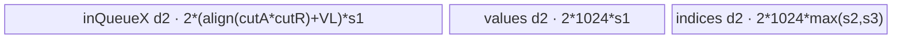
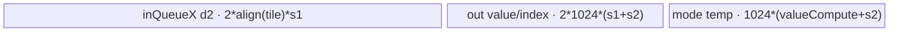
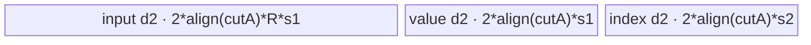
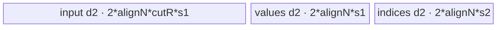

# MinDim 950 ACLNN 算子知识

## 算子速览

| 项目 | 内容 |
|---|---|
| 实际入口 | `aclnnMinDimGetWorkspaceSize` + `aclnnMinDim`，公开 ACLNN 两段式接口；内部节点为 `l0op::ArgMinWithValue`。 |
| 计算语义 | 沿 `dim` 同时返回最小值 `out` 与其索引 `indices`；这不是仅返回索引的 `ArgMin`。 |
| 输入输出 | `self/out` 为 ND，950 支持 FLOAT/FLOAT16/INT64/BOOL/BFLOAT16/INT32；公开文档约束 `indices` 为 INT32；秩 1～8。 |
| 执行类型 | 算子拥有的核心节点为单 AIV Kernel；R-004/R-006 在 AIV body 内使用 NDDMA 搬运，所有 Route 均无 Cube/AIC/MIX_CV。 |
| Kernel 路线 | R-001 COPY、R-002 AR、R-003 ARA、R-004 ARA 双轴切核、R-005 AR Gather、R-006 ARA Gather、R-007 RA、R-008 GroupReduce。 |
| 核心资源 | GM 输入/双输出、AIV UB 的 `TQue/TBuf/RegTensor`；R-008 使用 GM workspace 与 `SyncAll`；Tiling 始终在算子 workspace 后加 16 MiB 系统保留。 |
| 来源闭包 | `source_closed`：公开 ACLNN、executor 组图、Host/Tiling/POD、八个 key、entry/body/helper、workspace/同步与 ascend950 构建接线均闭合。 |
| 验证状态 | 已完成源码闭包检查；本次知识提取未执行编译、真机、数值或性能测试。 |

## 接口与语义

### 计算语义

令输入连续存储视为 `[A, R, N]`，其中 `R=self.shape[dim]`，`A=prod(shape[:dim])`，`N=prod(shape[dim+1:])`。每个 `(a,n)` 输出：

```text
out[a,n]     = min(self[a, 0:R, n])
indices[a,n] = argmin_r(self[a,r,n])
```

`dim<0` 在 Host/Tiling 归一化为 `rank+dim`。`keepdim=false` 删除归约轴，`keepdim=true` 将该轴置 1；二者只改变 view shape，不改变 Device 的 `[A,R,N]` 折叠。MicroAPI 比较使用 `LE` 保留先前候选，等值时保持较小索引；浮点路径还显式检测既有候选的 NaN，使首个进入候选的 NaN 不被后续值覆盖。

### 输入、输出与属性

| 参数 | shape/layout | dtype | 约束、默认值与语义 |
|---|---|---|---|
| `self` | ND，1～8 维，允许非连续 | FLOAT/FLOAT16/INT64/BOOL/BFLOAT16/INT32 | 与 `out` dtype 相同；空 Tensor 在 ACLNN 层直接成功且 workspace 为 0。 |
| `dim` | 标量属性 | INT64 | `[-rank, rank)`；标量输入特例接受 `[-1,0]`。 |
| `keepdim` | 标量属性 | BOOL | 是否保留长度 1 的归约轴。 |
| `out` | 与归约结果 shape 相同，ND，允许非连续 | 与 `self` 相同 | 最小值输出。 |
| `indices` | 与 `out` shape 相同，ND，允许非连续 | 公开 API 为 INT32 | 归约轴内的零基索引。底层 OpDef/binary 也实例化 INT64，但不扩大公开 ACLNN 契约。 |
| `workspaceSize/executor` | Host 出参 | `uint64_t*` / `aclOpExecutor**` | 第一段接口返回整个 executor 图所需 workspace 与 owner。 |
| `workspace/workspaceSize/executor/stream` | Device 执行参数 | 指针/整数/句柄 | 第二段由 `CommonOpExecutorRun` 按 stream 顺序执行。 |

### 入口与版本

固定仓只有 `aclnnMinDim` 这一公开版本族；未发现更高版本。第一段严格按 `CheckNotNull → CheckDtypeValid → CheckShape → CheckDim` 校验，然后建立 `Contiguous → 可选 Cast → ArgMinWithValue → Cast(indices/out) → ViewCopy(indices/out)` executor 图。950 `IsRegBase()` 为真，底层索引 dtype 取调用者 `indices->GetDataType()`；公开文档仍只承诺 INT32。BOOL 始终先转 FLOAT，950 INT64 不做前置 Cast。框架 `Contiguous/Cast/ViewCopy` 的生成式 POD 与 body 是明确框架边界；核心 ArgMinWithValue 的 Host/Tiling/Kernel 完整可见。

## Host/Launcher 执行流程

### 参数校验与前处理

1. `CheckNotNull` 拒绝 `self/out/indices==nullptr`；`CheckDtypeValid` 在 `IsRegBase()` 分支选择 950 六 dtype 列表，并要求 `self/out` 同 dtype。
2. `CheckShape` 对三张 Tensor 执行最大秩 8 检查；`CheckDim` 对普通张量要求 `[-rank,rank-1]`，标量特例为 `[-1,0]`。
3. 空 `self` 直接返回 `workspaceSize=0` 和空 executor，不启动 Device 节点。
4. `Contiguous(self)` 物化连续输入；BOOL 经 `Cast(..., DT_FLOAT)`。950 INT64 原样进入核心算子。
5. `l0op::ArgMinWithValue` 分配 `indices/out` 临时张量，推导输出 shape，并用 `ADD_TO_LAUNCHER_LIST_AICORE` 添加核心节点。
6. 临时结果经目标 dtype Cast 与两个 `ViewCopy` 写回用户输出；任一步返回空指针或 shape 不一致均中止组图。

### 参数、Workspace 与生命周期

`TilingPrepareForArgWithValueOps` 生产 `with_value=true`、`vRegSize=GetVRegSize(context)`、`coreNum=GetCoreNumAiv()` 和 UB 字节数。`ArgOpsTiling` 将它们传给 `ArgOpsTilingForAscendC`。核心 Tiling 设置：

```text
blockDim = realCoreNum == 0 ? 1 : realCoreNum
workspace[0] = workSpaceSize + 16 * 1024 * 1024 bytes
scheduleMode = 1 only for GROUP_REDUCE
```

R-001～R-007 的 `workSpaceSize=0`，但 entry 在 `workspace==nullptr` 时直接返回，因此 executor 必须提供 16 MiB 保留区。R-008 的算法区位于 workspace 起始处，之后仍有 16 MiB 保留。ACLNN 返回的总 workspace 还包含框架 Contiguous/Cast/ViewCopy 节点；其汇总公式封装在 `aclOpExecutor::GetWorkspaceSize()`，固定仓未展开各框架 slice 的 offset。

### 启动图与失败传播

```text
aclnnMinDimGetWorkspaceSize
  -> Contiguous(self)                         # 框架边界
  -> Cast(self, FLOAT) if self.dtype == BOOL  # 框架边界
  -> ArgMinWithValue(indices_tmp, out_tmp)    # 单 AIV 核心节点
  -> Cast(indices_tmp, requested dtype)       # 框架边界
  -> Cast(out_tmp, requested dtype)           # 框架边界
  -> ViewCopy(indices_tmp, indices)            # 框架边界
  -> ViewCopy(out_tmp, out)                    # 框架边界
aclnnMinDim(workspace, executor, stream)
  -> CommonOpExecutorRun                      # 同一 stream 按 executor 顺序执行
```

核心节点 entry 为 `arg_min_with_value(x, indice, values, workspace, tiling)`，`blockDim=realCoreNum`，POD 为 `ArgMaxWithValueTilingData`。所有节点由同一 executor 持有，临时 Tensor/框架 workspace 有效期覆盖第二段执行；任一组图 API 失败立即返回，Device 阶段由 `CommonOpExecutorRun` 传播错误。R-008 在同一个 Kernel 内先由各 block 写 workspace，再 `SyncAll()`，后续 block 读出归并；不是多 Kernel。

## Route 与参数设计

### 分核与资源计算

Host 将 shape 折叠为 `A/R/N`，`elementPerBlock=32/sizeof(T1)`。小于 4096 字节的数据把可用核数降为 1。普通分核使用前 `blkTailFactor` 个核各处理 `blkFactor+1` 单位，其余各处理 `blkFactor`；offset 为 `blockIdx*blkFactor + min(blockIdx,blkTailFactor)`。R-004 使用二维 grid：`aBlockIdx=blockIdx%blockNumA`、`nextABlockIdx=blockIdx/blockNumA`。tile 字段均为 `uint16_t`，Host 在写入前以 `UINT16_MAX`、VL/32B 对齐和 UB 公式限制。

`ubElement=(UB/2 - 1024*(effectiveValueBytes+effectiveIndexBytes)*2 - 256)/effectiveValueBytes` 是 AR/ARA 的保守元素预算；BF16 的 effective value bytes 加倍以容纳 FP32 中间量。每个 Route 的实际 `InitBuffer` 字节账见后文。

### Route 选择

| 顺序 | Route | Key/模板 | 精确选择条件与优先级 | 不适用去向 |
|---:|---|---|---|---|
| 1 | R-001 COPY | `10003` | `R==1`，`SetShapeInfoHighPerf` 立即返回 | 否则建立 AR/ARA 初始 key |
| 2 | R-007 RA | `20003` | `A==1 && (N>=C*256 \|\| (N>1 && R<256))` | 保留初始 key |
| 3 | R-005 AR Gather | `20001` | `N==1 && R*e<V && A*e>=C*V` | 保留 AR |
| 4 | R-006 ARA Gather | `20002` | `A>1 && N>1 && A*N*e>=C*V && (R*e<V \|\| (R*N*e>=UB/2 && R<maxSize))` | 保留 ARA |
| 5 | R-008 GroupReduce | `30001` | 后置覆盖：`R*e>=C*256 && R<INT32_MAX && ((N==1 && A<C)\|\|(N>1 && A*N<2*C))`；若 `N==1 && A>0.85*C` 又回退 R-002 | 保留前一 key |
| 6 | R-004 ARA 双轴切核 | `10012` | 当前仍为 ARA 且 `A*N*e>=C*128 && N*e>=128`；或 ARA mode104 的二次选择命中 | R-003 |
| 7 | R-003 ARA | `10002` | `R>1 && N>1` 且未被上述覆盖；内部按 mode101～106 再分 tile/body 子路径 | Tiling 失败 |
| 8 | R-002 AR | `10001` | `R>1 && N==1` 且未被 Gather/GroupReduce 覆盖 | Tiling 失败 |

其中 `C=coreNum`、`V=vRegSize`、`e=effective value bytes`、`maxSize=(UB/2-1024*(e+ei))/256`。ARA mode104 二次选择：`cutN!=N && N*e>=32 && R>=4*C` 时，若 `cutN*e>=64` 转 R-004；否则只有 `R/C*N*e>=4096` 才转 R-008。

```text
if R == 1: COPY
else:
  key = (N == 1 ? AR : ARA)
  apply RA / AR_GATHER / ARA_GATHER specialization in that order
  apply GROUP_REDUCE override
  apply ARA_CUT_A_AND_NEXT_A override
  if last-axis GROUP_REDUCE and A > 0.85*C: key = AR
  compute key-specific split; ARA mode104 may retry dual-axis or GroupReduce
```

### 模板/实现执行矩阵

| Route | key/selector | dtype/shape/platform 完整命中条件 | 执行拓扑与 Kernel 节点 | 实际模板/body | 内存与同步特征 | tail/fallback |
|---|---|---|---|---|---|---|
| R-001 COPY | 10003 | 950，`R=1` | 单 AIV | `ArgMaxWithValueCopy<T1,T3,true,true>` | 输入 queue 直接转输出；索引 Duplicate 0 | `cutASize` 与 1024 尾块 |
| R-002 AR | 10001 | `N=1`，未命中后置路线 | 单 AIV | `ArgMaxWithValueAr<T1,T2,T3,true,true>` | AR 连续搬运，必要时切 R 并 `UpdateResult` | `cutRSize==R`/切 R |
| R-003 ARA | 10002 | `A>0,N>1,R>1`，未命中特化 | 单 AIV+部分 NDDMA | `ArgMaxWithValueArA<...>` | mode101～106；NDDMA 将 A/R/N tile 整形成归约友好布局 | A/N/R 各自尾块 |
| R-004 双轴 | 10012 | 大 A、N 或 mode104 二次选择 | 单 AIV | `ArgMaxWithValueArACutAAndNextA<...>` | 2D 分核，LoopMode strided DMA，R 分片归并 | A/N/R 三重尾块 |
| R-005 AR Gather | 20001 | 小 R、大 A、N=1 | 单 AIV | `ArgMaxWithValueArGather<...>` | 整块连续载入，register gather-reduce | A tile 尾块 |
| R-006 ARA Gather | 20002 | 高并行 A*N 且满足 Gather 条件 | 单 AIV+NDDMA | `ArgMaxWithValueAraGather<...>` | cutA 路径 NDDMA `[A,R,N]→[R,A*N]`；cutN 路径 strided DMA | A 或 N 尾块 |
| R-007 RA | 20003 | `A=1` 且 N 足够大或 R 小 | 单 AIV | `ArgMaxWithValueRa<...>` | 每核覆盖 N，R 行间 strided CopyIn | N/R 尾块 |
| R-008 GroupReduce | 30001 | 大 R、输出域小且 R<INT32_MAX | 单 AIV，两阶段核内全核协作 | `ArgMaxWithValueGroupReduce<...>` | 各核 partial→workspace→`SyncAll`→跨核归并 | AR/RA split；chunk tail |

### 隐藏性能 Guard

| Guard | Host/Tiling 条件 | Device/资源原因 | 影响 Route | 不满足时去向 | 源码符号 |
|---|---|---|---|---|---|
| 空域 | `A*N*R==0` | 不应执行归约/搬运 | 全部 | `blockDim=1` 但 ACLNN 更早直接返回 | `SetShapeInfo`, ACLNN empty branch |
| 小数据单核 | `A*R*N*indexDtypeSize<4096` | 降低分核开销 | 全部 | 正常多核 | `CalcSplitInfo` |
| tile 位宽 | `cutA/cutR/cutN<=UINT16_MAX` | POD 与 Device loop 是 `uint16_t` | 全部 | Host 截断前先重切 | 各 `CalcSplitInfoFor*` |
| VL/块对齐 | tile 按 `vRegSize/e` 或 32B 向下/向上对齐 | MicroAPI mask 与 DMA block 要求 | R-002～R-008 | 更小 tile/保底 mode106 | `CalcCutRA`, `CalcUnitUbSpace` |
| GroupReduce R 域 | `R<INT32_MAX` | partial 索引/累加 offset 以 int32 参与 | R-008 | 原 AR/ARA/RA 路线 | `SetShapeInfoHighPerf` |
| workspace 非空 | `workspace!=nullptr` | entry 所有 key 共用早退 guard | 全部 | Kernel 无输出直接 return | `arg_min_with_value` |
| R-008 UB 分型 | `N*e>=128 \|\| blkFactor*e<256` | 决定 RA split 与 gather block | R-008 | AR split；若 AR UB 不足再 RA split | `CalcSplitInfoForGroupReduce` |
| 未知 key | entry 的 if/else 无最终 else | 无对应模板实例 | 全部 | 静默无输出 | `arg_min_with_value` |

### POD/ABI

`REGISTER_TILING_DATA_CLASS(ArgMinWithValue, ArgMaxWithValueTilingData)` 使 Host 与 Device 共享同一宏生成结构。固定仓能证明字段声明顺序和源码类型，但宏展开后的 `sizeof/alignof/offsetof` 未物化，因此 ABI 布局列明确标为不可见。

| 结构 | 字段 | 类型/位宽 | ABI 布局 | 单位 | Host/launcher producer | Device consumer | 边界 |
|---|---|---|---|---|---|---|---|
| `ArgMaxWithValueTilingData` | `aSize` | uint64/64 | 宏声明第1字段；offset不可见 | 元素组数 | `SetShapeInfo` 前轴乘积 | 全部 body 地址公式 | 乘积溢出未显式检查 |
| 同上 | `cutASize` | uint16/16 | 第2；offset不可见 | A 元素 | key-specific split | A tile loop/UB | 至少1 |
| 同上 | `rSize` | uint64/64 | 第3；offset不可见 | R 元素 | 归约轴长度 | 全部归约循环 | 非空路径 >0 |
| 同上 | `cutRSize` | uint16/16 | 第4；offset不可见 | R 元素 | key-specific split | R tile/mask | 至少1，至多65535 |
| 同上 | `nextASize` | uint64/64 | 第5；offset不可见 | N 元素 | 后轴乘积 | strided地址 | 乘积溢出未显式检查 |
| 同上 | `cutNextASize` | uint16/16 | 第6；offset不可见 | N 元素 | key-specific split | N tile/NDDMA | 至少1 |
| 同上 | `realCoreNum` | uint64/64 | 第7；offset不可见 | AIV核 | 分核函数 | block guard、R-008 Sync范围 | 空域为0 |
| 同上 | `blkFactor` | uint64/64 | 第8；offset不可见 | 每核工作单位 | 商 | block offset | Route单位不同 |
| 同上 | `blkTailFactor` | uint64/64 | 第9；offset不可见 | 核/余数 | 模 | former/tail core | `<realCoreNum` |
| 同上 | `blkFactor2nd` | uint64/64 | 第10；offset不可见 | N单位/核 | R-004 二维分核 | R-004 | 其他 Route inactive |
| 同上 | `blkTailFactor2nd` | uint64/64 | 第11；offset不可见 | N单位 | R-004 | R-004 tail | 其他 Route inactive |
| 同上 | `blkNum2nd` | uint64/64 | 第12；offset不可见 | 核数 | 默认1；当前固定 body 不读取 | 固定仓未见读取 | inactive |
| 同上 | `tilingKey` | uint64/64 | 第13；offset不可见 | 枚举 | `SetShapeInfoHighPerf`/retry | entry router | 八个合法值 |
| 同上 | `aRaMode` | uint64/64 | 第14；offset不可见 | 枚举101～106 | `CalcSplitInfoForArA` | R-003 switch | 仅R-003有效 |
| 同上 | `loopANum` | uint16/16 | 第15；offset不可见 | A循环 | GroupReduce split | R-008 | 其他 inactive |
| 同上 | `cutAPerLoop` | uint16/16 | 第16；offset不可见 | A元素 | GroupReduce split | R-008 | 其他 inactive |
| 同上 | `isRaSplit` | uint8/8 | 第17；offset不可见 | 布尔 | GroupReduce split | R-008 Process | 0/1 |
| 同上 | `gatherBlockSize` | uint16/16 | 第18；offset不可见 | N元素 | GroupReduce split | R-008 final chunks | 其他 inactive |
| 同上 | `workSpaceSize` | uint64/64 | 第19；offset不可见 | 字节 | GroupReduce workspace公式 | workspace tensor binding | R-001～007为0 |

### Route 源码闭包

| Route | Key/selector | Host/Tiling producer | POD/参数 | Kernel entry/router 节点 | Kernel body/直接依赖 | 构建接线 |
|---|---|---|---|---|---|---|
| R-001 COPY | 10003 | `SetShapeInfo`, `CalcSplitInfoForCopyOnly` | shared POD | `arg_min_with_value` | `ArgMaxWithValueCopy` + base | ascend950 OpDef/CMake/config |
| R-002 AR | 10001 | `CalcSplitInfoForAr` | shared POD | 同上 | `ArgMaxWithValueAr` + base | 同上 |
| R-003 ARA | 10002 | `CalcSplitInfoForArAAndTryMode4` | shared POD | 同上 | `ArgMaxWithValueArA` + base | 同上 |
| R-004 双轴 | 10012 | `CalcSplitInfoForArACutAAndNextA` | shared POD | 同上 | `ArgMaxWithValueArACutAAndNextA` + base | 同上 |
| R-005 AR Gather | 20001 | `CalcSplitInfoForGatherRa` | shared POD | 同上 | `ArgMaxWithValueArGather` + base | 同上 |
| R-006 ARA Gather | 20002 | `CalcSplitInfoForGatherArA` | shared POD | 同上 | `ArgMaxWithValueAraGather` + base | 同上 |
| R-007 RA | 20003 | `CalcSplitInfoForRa` | shared POD | 同上 | `ArgMaxWithValueRa` + base | 同上 |
| R-008 GroupReduce | 30001 | `CalcSplitInfoForGroupReduce` | shared POD | 同上 | `ArgMaxWithValueGroupReduce` + base | 同上 |

## Kernel 实现

### 公共执行流程

entry 先拒绝空 workspace，声明 `KERNEL_TYPE_MIX_AIV_1_0`，解析 POD 并创建 `TPipe`。`ORIG_DTYPE_X==INT64` 时内部索引 `T2=int64_t`，否则 `T2=int32_t`；每个实例均传 `withValue=true,isMin=true`。BF16 路线先 `Cast(..., float, CAST_NONE)`，在 FP32 中比较/归并，再 `CAST_ROUND` 回 BF16。其他 dtype 原类型比较。公共 MicroAPI 用 mask 限定尾 lane，`LE` 选择已有最小值并保留较小索引；跨 R tile 由 `UpdateResult` 同步选择 value/index。

### Route R-001：COPY

#### 适用条件

##### 选择证据

| 层级 | 文件 | 符号 | 源码谓词/参数 | 结果/下一跳 |
|---|---|---|---|---|
| Tiling | `arg_common_base_tiling_arch35.cpp` | `SetShapeInfo` | `R==1` | key 10003 |
| Router | `arg_min_with_value_apt.cpp` | `arg_min_with_value` | `TILING_KEY_COPY` | `ArgMaxWithValueCopy<...,true,true>` |

#### Device 数据流

##### 函数级调用链

```text
arg_min_with_value -> ArgMaxWithValueCopy::Init -> Process
  -> CopyInX -> MTE2_MTE3 event -> CopyOut(values)
  -> Duplicate(indices,0) -> CopyOut(indices)
```

##### 源码等价伪码

```text
if blockIdx >= realCoreNum: return
for each cutASize tile of this core: DMA x[offset:offset+n] to inQueue; wait MTE2_MTE3; DMA to values
allocate 1024-index UB; fill zero; DMA full/tail chunks to indices
```

#### 内存与数据搬运

##### 资源与搬运表

| 层级/缓冲区 | offset/地址公式 | extent/容量公式 | dtype/layout | producer | consumer | owner/lifetime | 对齐/复用 |
|---|---|---|---|---|---|---|---|
| `inQueueX` | core offset + tile | `2*align(cutA,32/s1)*s1` | T1/flat | GM x | GM values | TPipe/tile | depth2，VECIN/VECOUT绑定 |
| `outQueueIndice` | 0 | `1024*s3` | T3/flat | Duplicate | GM indices | TPipe/core | depth1，跨多个GM chunk复用 |

##### 分层内存布局


##### 字节账与复用顺序

```text
UB_total = 2*align(cutA,32/s1)*s1 + 1024*s3 <= UB
dynamic_ub = N/A
workspace_total = 16 MiB system reserve
```

| 复用子区 | 写入者 | 读取者/消费点 | 下一次覆盖 | 同步或释放依据 | 安全条件 |
|---|---|---|---|---|---|
| `inQueueX` slot | CopyInX | CopyOut | next tile | EnQue/DeQue/FreeTensor + MTE2_MTE3 | depth2 slot已释放 |

#### 同步、精度与尾块

##### 同步与数值边界表

| 阶段 | primitive/机制 | producer | consumer/等待点 | 保护对象 | 精度/尾块 |
|---|---|---|---|---|---|
| x直拷 | queue + `MTE2_MTE3` | DataCopyPad in | values out | 同一slot | 不做数值运算；blockLen取有效tail |
| indices | Duplicate | DataCopyPad | 1024 index UB | 全为0 | tailIndices调整blockLen |

#### 关键实现

##### 符号证据表

| 阶段 | 文件 | 符号/模板实例 | 实现事实 |
|---|---|---|---|
| Host/Tiling producer | `arg_common_base_tiling_arch35.cpp` | `CalcSplitInfoForCopyOnly` | 核分配与cutA |
| Kernel entry/router | `arg_min_with_value_apt.cpp` | key10003 | isMin实例化 |
| Device body/helper | `arg_max_with_value_copy.h` | `Process/CopyInX/CopyOut` | 值直拷、索引置0 |

### Route R-002：AR

#### 适用条件

##### 选择证据

| 层级 | 文件 | 符号 | 源码谓词/参数 | 结果/下一跳 |
|---|---|---|---|---|
| Tiling | `arg_common_base_tiling_arch35.cpp` | `SetShapeInfo`, `CalcSplitInfoForAr` | `N==1,R>1`，未被 Gather/Group覆盖 | key10001，切A或R |
| Router | `arg_min_with_value_apt.cpp` | key AR | dtype分支 | `ArgMaxWithValueAr<T1,T2,T3,true,true>` |

#### Device 数据流

##### 函数级调用链

```text
ArgMaxWithValueAr::Process -> ProcessWithoutCutR/ProcessWithCutR
  -> CopyInX/CopyInXCutR -> ArgMaxV1[Intr64] -> UpdateResult -> CopyOut
```

##### 源码等价伪码

```text
for output row b owned by core:
  for rTile in [0,R) step cutR:
    DMA contiguous x[(b*R+rTile):]
    local (min,index)=ArgMaxV1(tile,startR)
    if first tile store; else UpdateResult(existing,candidate), equality keeps existing
  cast BF16 value back / index width if needed; DMA one output pair
```

#### 内存与数据搬运

##### 资源与搬运表

| 层级/缓冲区 | offset/地址公式 | extent/容量公式 | dtype/layout | producer | consumer | owner/lifetime | 对齐/复用 |
|---|---|---|---|---|---|---|---|
| inQueueX | `(blockOffset+loopOffset+b)*R+rTile*cutR` | `2*(align(cutA*cutR,32/s1)+VL)*s1` | T1/AR | GM | ArgMaxV1 | tile | depth2 |
| out values/indices | output offset | each `2*1024*s1`, index `2*1024*max(s2,s3)` | flat | reduce | GM | 1024-row chunk | second half stores candidate tile |
| BF16 buffers | 0 | input aligned FP32 + `2*1024*4` | FP32 | Cast | reduce/update | conditional | BF16 only |

##### 分层内存布局



##### 字节账与复用顺序

```text
UB_total = inQueueX + outValues + outIndices + conditional BF16/cast buffers
UB_total <= Host CalcSplitInfoForAr budget
dynamic_ub=N/A; workspace_total=16 MiB
```

| 复用子区 | 写入者 | 读取者/消费点 | 下一次覆盖 | 同步或释放依据 | 安全条件 |
|---|---|---|---|---|---|
| output second 1024 region | later R tile reduce | UpdateResult | next R tile | vector call order | first half result仍存活 |

#### 同步、精度与尾块

##### 同步与数值边界表

| 阶段 | primitive/机制 | producer | consumer/等待点 | 保护对象 | 精度/尾块 |
|---|---|---|---|---|---|
| tile | TQue | DataCopyPad | ArgMaxV1 | input tile | MicroAPI tail mask |
| cross-tile | program order / PIPE_ALL for scalar int64 fallback | local reduce | UpdateResult | pair一致性 | index加startR；BF16 FP32归并 |

#### 关键实现

##### 符号证据表

| 阶段 | 文件 | 符号/模板实例 | 实现事实 |
|---|---|---|---|
| Host/Tiling producer | `arg_common_base_tiling_arch35.cpp` | `CalcSplitInfoForAr` | cutA/cutR/UB |
| Kernel entry/router | `arg_min_with_value_apt.cpp` | AR instantiation | T2按value dtype选 |
| Device body/helper | `arg_max_with_value_ar.h`, `arg_max_with_value_base.h` | `ProcessCutRTemp`, `ArgMaxV1`, `UpdateResult` | R分片归并 |

### Route R-003：ARA

#### 适用条件

##### 选择证据

| 层级 | 文件 | 符号 | 源码谓词/参数 | 结果/下一跳 |
|---|---|---|---|---|
| Tiling | `arg_common_base_tiling_arch35.cpp` | `CalcSplitInfoForArA` | ARA且未转特化 | mode101～106 |
| Router | `arg_min_with_value_apt.cpp` | key ARA | 10002 | `ArgMaxWithValueArA` |

#### Device 数据流

##### 函数级调用链

```text
ArgMaxWithValueArA::Process
  -> mode101 GatherARAWithCutA | 102 CutA | 103 Gather+CutR
     | 104 CutRA | 105 CutNextA | 106 CutR
  -> CopyInX*/NDDMA -> ArgMaxGatherV1/ArgMaxV1 -> UpdateResult -> CopyOut
```

##### 源码等价伪码

```text
switch aRaMode:
  choose A/N/R tile nesting without changing [A,R,N] semantics
  NDDMA paths gather strided R rows into contiguous UB tiles
  reduce each R tile with startR; UpdateResult merges candidate pairs
  write only valid A*N tail, not aligned lanes
```

#### 内存与数据搬运

##### 资源与搬运表

| 层级/缓冲区 | offset/地址公式 | extent/容量公式 | dtype/layout | producer | consumer | owner/lifetime | 对齐/复用 |
|---|---|---|---|---|---|---|---|
| inQueueX | `(a*R+r)*N+n` | `2*align(cutA*cutR*cutN,32/s1)*s1` | T1/packed tile | DMA/NDDMA | vector reduce | tile | depth2 |
| out pair | A*N output | each `2*1024*s1/s2` | flat | reduce | GM | chunk | depth1 physical, 2*capacity |
| tempValue/tempIndice | 0 | `1024*(BF16?4:s1)` + `1024*s2` | pair | later R tile | UpdateResult | mode103/104 | conditional allocation |

##### 分层内存布局



##### 字节账与复用顺序

```text
UB_total = input d2 + output pair + conditional BF16/cast + mode103/104 temp pair
UB_total <= mode-specific ubElement/CalcCutRA budget
dynamic_ub=N/A; workspace_total=16 MiB
```

| 复用子区 | 写入者 | 读取者/消费点 | 下一次覆盖 | 同步或释放依据 | 安全条件 |
|---|---|---|---|---|---|
| temp pair | later R tile | UpdateResult | following R tile | function order | UpdateResult完成后覆盖 |

#### 同步、精度与尾块

##### 同步与数值边界表

| 阶段 | primitive/机制 | producer | consumer/等待点 | 保护对象 | 精度/尾块 |
|---|---|---|---|---|---|
| NDDMA | queue ordering | multi-copy | vector | packed tile | loopSize/stride精确描述有效域 |
| reduce | mask+UpdateResult | per tile | final output | value/index pair | A/N/R tail分别计算 |

#### 关键实现

##### 符号证据表

| 阶段 | 文件 | 符号/模板实例 | 实现事实 |
|---|---|---|---|
| Host/Tiling producer | `arg_common_base_tiling_arch35.cpp` | `CalcSplitInfoForArA` | 六mode选择 |
| Kernel entry/router | `arg_min_with_value_apt.cpp` | ARA | key/body |
| Device body/helper | `arg_max_with_value_ara.h` | `Process`, `CopyInXCutRa`, `Compute*` | tile网络与NDDMA |

### Route R-004：ARA 双轴切核

#### 适用条件

##### 选择证据

| 层级 | 文件 | 符号 | 源码谓词/参数 | 结果/下一跳 |
|---|---|---|---|---|
| Tiling | `arg_common_base_tiling_arch35.cpp` | `CalcSplitInfoForArACutAAndNextA` | key10012 | 二维A×N block分配 |
| Router | `arg_min_with_value_apt.cpp` | key10012 | 950 | `ArgMaxWithValueArACutAAndNextA` |

#### Device 数据流

##### 函数级调用链

```text
InitLoopParams -> Process -> ProcessInALoop -> ProcessInANextALoop
  -> CopyInX(SetLoopModePara) -> ComputeVF -> UpdateResult -> CopyOutValueAndIndices
```

##### 源码等价伪码

```text
map blockIdx to aBlock and nBlock
for aTile, nTile:
  align nTile to 32/min(s1,s3)
  for rTile: strided DMA A rows and R blocks into [aTile,rTile,nAlign]; reduce; merge
  cast internal index if needed; strided DMA valid nTile for every a row
```

#### 内存与数据搬运

##### 资源与搬运表

| 层级/缓冲区 | offset/地址公式 | extent/容量公式 | dtype/layout | producer | consumer | owner/lifetime | 对齐/复用 |
|---|---|---|---|---|---|---|---|
| inQueueX | `a*R*N+r*N+n` | `2*cutA*cutR*nAlign*s1` | `[cutA,cutR,nAlign]` | LoopMode DMA | ArgMaxAra | tile | depth2 |
| out queues | `a*N+n` | `2*cutA*nAlign*(s1+s3)` | `[cutA,nAlign]` | reduce/cast | GM | tile | depth2 |
| temp pair/cast | 0 | `cutA*nAlign*(s1+s2+[s2 if s2!=s3])` | local | later r tile | UpdateResult/cast | tile | TBuf |

##### 分层内存布局


##### 字节账与复用顺序

```text
UB_total = 2*cutA*cutR*nAlign*s1 + 2*cutA*nAlign*(s1+s3) + cutA*nAlign*(s1+s2+conditional s2)
UB_total <= Host oneRAUbSize construction
dynamic_ub=N/A; workspace_total=16 MiB
```

| 复用子区 | 写入者 | 读取者/消费点 | 下一次覆盖 | 同步或释放依据 | 安全条件 |
|---|---|---|---|---|---|
| temp pair | rTile reduce | UpdateResult | next rTile | program order | 同一a/n tile内完成 |

#### 同步、精度与尾块

##### 同步与数值边界表

| 阶段 | primitive/机制 | producer | consumer/等待点 | 保护对象 | 精度/尾块 |
|---|---|---|---|---|---|
| LoopMode DMA | Set/ResetLoopModePara | MTE2 | queue consumer | A-strided tile | dst padding不输出 |
| R归并 | UpdateResult | temp pair | current pair | value/index | startR绝对索引，A/N/R三尾块 |

#### 关键实现

##### 符号证据表

| 阶段 | 文件 | 符号/模板实例 | 实现事实 |
|---|---|---|---|
| Host/Tiling producer | `arg_common_base_tiling_arch35.cpp` | `CalcSplitInfoForArACutAAndNextA` | 2D分核与UB公式 |
| Kernel entry/router | `arg_min_with_value_apt.cpp` | key10012 | body映射 |
| Device body/helper | `arg_max_with_value_ara_cut_a_and_next_a.h` | `InitAllBuffer`, `CopyInX`, `ComputeVF` | LoopMode/NDDMA等价搬运 |

### Route R-005：AR Gather

#### 适用条件

##### 选择证据

| 层级 | 文件 | 符号 | 源码谓词/参数 | 结果/下一跳 |
|---|---|---|---|---|
| Tiling | `arg_common_base_tiling_arch35.cpp` | `SetShapeInfoHighPerf` | `N=1,R*e<V,A*e>=C*V` | 20001 |
| Router | `arg_min_with_value_apt.cpp` | key AR_GATHER | dtype | `ArgMaxWithValueArGather` |

#### Device 数据流

##### 函数级调用链

```text
Process -> CopyIn(contiguous cutA*R) -> ArgMaxGatherRa -> CopyOut
```

##### 源码等价伪码

```text
for cutA rows: DMA one contiguous block; register gather each short R row; output cutA pairs; handle last rows
```

#### 内存与数据搬运

##### 资源与搬运表

| 层级/缓冲区 | offset/地址公式 | extent/容量公式 | dtype/layout | producer | consumer | owner/lifetime | 对齐/复用 |
|---|---|---|---|---|---|---|---|
| input | `(blockOffset+loopOffset)*R` | `2*align(cutA)*R*s1` | AR | GM | GatherRa | tile | depth2 |
| outputs | row offset | `2*align(cutA)*(s1+s2)` | flat | GatherRa | GM | tile | depth2 |
| BF16/cast | 0 | `align(cutA)*(R*4+4+[s3])` | local | Cast | compute/out | conditional | TBuf |

##### 分层内存布局



##### 字节账与复用顺序

```text
UB_total = queue bytes + conditional BF16/cast bytes <= UB/2 selector budget
dynamic_ub=N/A; workspace_total=16 MiB
```

| 复用子区 | 写入者 | 读取者/消费点 | 下一次覆盖 | 同步或释放依据 | 安全条件 |
|---|---|---|---|---|---|
| input slot | DMA | GatherRa | next tile | queue free | consume完成 |

#### 同步、精度与尾块

##### 同步与数值边界表

| 阶段 | primitive/机制 | producer | consumer/等待点 | 保护对象 | 精度/尾块 |
|---|---|---|---|---|---|
| gather | queue+MicroAPI mask | input DMA | reduce | short R rows | BF16 FP32；cutA tail |

#### 关键实现

##### 符号证据表

| 阶段 | 文件 | 符号/模板实例 | 实现事实 |
|---|---|---|---|
| Host/Tiling producer | `arg_common_base_tiling_arch35.cpp` | `CalcSplitInfoForGatherRa` | VL对齐cutA |
| Kernel entry/router | `arg_min_with_value_apt.cpp` | 20001 | body |
| Device body/helper | `arg_max_with_value_ar_gather.h`, base | `Compute`, `ArgMaxGatherRa` | 短R归约 |

### Route R-006：ARA Gather

#### 适用条件

##### 选择证据

| 层级 | 文件 | 符号 | 源码谓词/参数 | 结果/下一跳 |
|---|---|---|---|---|
| Tiling | `arg_common_base_tiling_arch35.cpp` | `SetShapeInfoHighPerf`, `CalcSplitInfoForGatherArA` | Gather谓词；按A或A*N分核 | 20002 |
| Router | `arg_min_with_value_apt.cpp` | ARA_GATHER | 20002 | `ArgMaxWithValueAraGather` |

#### Device 数据流

##### 函数级调用链

```text
Process -> (cutA>1 ? ProcessCutAWithNDDMA : ProcessWithCutNextA)
  -> CopyInWithNDDMA/CopyInCutNextA -> ArgMaxRa -> CopyOut
```

##### 源码等价伪码

```text
if cutA>1: NDDMA loops [N,R,A], src strides [1,N,R*N], dst [1,align(A*N),N]; reduce R over packed A*N
else: DMA R blocks of cutN elements with srcStride=(N-cutN)*s1; reduce R; output valid N tail
```

#### 内存与数据搬运

##### 资源与搬运表

| 层级/缓冲区 | offset/地址公式 | extent/容量公式 | dtype/layout | producer | consumer | owner/lifetime | 对齐/复用 |
|---|---|---|---|---|---|---|---|
| input | `(a*R)*N+n` | `2*align(cutA*cutN)*R*s1` | NDDMA packed | GM | ArgMaxRa | tile | depth2 |
| outputs | `a*N+n` | `2*align(cutA*cutN)*(s1+s2)` | flat | reduce | GM | tile | depth2 |
| NDDMA descriptor | registers | 3 dimensions | loop/stride | body | DataCopy | call | no GM workspace |

##### 分层内存布局


##### 字节账与复用顺序

```text
UB_total = input d2 + output d2 + conditional FP32/cast buffers <= CalcUnitUbSpace budget
dynamic_ub=N/A; workspace_total=16 MiB
```

| 复用子区 | 写入者 | 读取者/消费点 | 下一次覆盖 | 同步或释放依据 | 安全条件 |
|---|---|---|---|---|---|
| NDDMA input slot | DataCopy | ArgMaxRa | next tile | EnQue/DeQue/FreeTensor | queue slot释放 |

#### 同步、精度与尾块

##### 同步与数值边界表

| 阶段 | primitive/机制 | producer | consumer/等待点 | 保护对象 | 精度/尾块 |
|---|---|---|---|---|---|
| NDDMA | queue | 3D copy | vector | packed A*N | loopTail或aTail更新align/mask |

#### 关键实现

##### 符号证据表

| 阶段 | 文件 | 符号/模板实例 | 实现事实 |
|---|---|---|---|
| Host/Tiling producer | `arg_common_base_tiling_arch35.cpp` | `CalcSplitInfoForGatherArA` | A vs A*N split |
| Kernel entry/router | `arg_min_with_value_apt.cpp` | 20002 | body |
| Device body/helper | `arg_max_with_value_ara_gather.h` | `CopyInWithNDDMA`, `ComputeRA` | 3D搬运与归约 |

### Route R-007：RA

#### 适用条件

##### 选择证据

| 层级 | 文件 | 符号 | 源码谓词/参数 | 结果/下一跳 |
|---|---|---|---|---|
| Tiling | `arg_common_base_tiling_arch35.cpp` | `SetShapeInfoHighPerf`, `CalcSplitInfoForRa` | `A=1` RA谓词 | 20003 |
| Router | `arg_min_with_value_apt.cpp` | RA | 20003 | `ArgMaxWithValueRa` |

#### Device 数据流

##### 函数级调用链

```text
Process -> ProcessWithCutA/ProcessWithCutR -> CopyIn(R rows, cutN columns)
  -> ArgMaxRa -> UpdateResult -> CopyOut
```

##### 源码等价伪码

```text
each core owns contiguous N columns
for nTile: DMA blockCount=rTile, blockLen=nValid*s1, srcStride=(N-nValid)*s1
reduce rows; if R cut, merge pair into first aligned output half; write nValid
```

#### 内存与数据搬运

##### 资源与搬运表

| 层级/缓冲区 | offset/地址公式 | extent/容量公式 | dtype/layout | producer | consumer | owner/lifetime | 对齐/复用 |
|---|---|---|---|---|---|---|---|
| input | `nOffset+rIndex*N` | `2*align(cutN)*cutR*s1` | `[R,alignN]` | strided DMA | ArgMaxRa | tile | depth2 |
| output pair | nOffset | `2*alignN*(s1+s2)`，切R时容量再容纳candidate半区 | flat | reduce | GM | tile | depth2 |

##### 分层内存布局



##### 字节账与复用顺序

```text
UB_total = queue bytes + conditional BF16/cast <= CalcSplitInfoForRa budget
dynamic_ub=N/A; workspace_total=16 MiB
```

| 复用子区 | 写入者 | 读取者/消费点 | 下一次覆盖 | 同步或释放依据 | 安全条件 |
|---|---|---|---|---|---|
| aligned output second half | later R tile | UpdateResult | next tile | program order | first half不覆盖 |

#### 同步、精度与尾块

##### 同步与数值边界表

| 阶段 | primitive/机制 | producer | consumer/等待点 | 保护对象 | 精度/尾块 |
|---|---|---|---|---|---|
| R tile | queue/mask | DMA | ArgMaxRa | `[R,n]` tile | startR加回绝对索引；N/R tail |

#### 关键实现

##### 符号证据表

| 阶段 | 文件 | 符号/模板实例 | 实现事实 |
|---|---|---|---|
| Host/Tiling producer | `arg_common_base_tiling_arch35.cpp` | `CalcSplitInfoForRa` | cutN/cutR |
| Kernel entry/router | `arg_min_with_value_apt.cpp` | 20003 | body |
| Device body/helper | `arg_max_with_value_ra.h`, base | `ProcessWithCutR`, `ArgMaxRa`, `UpdateResult` | strided N并行 |

### Route R-008：GroupReduce

#### 适用条件

##### 选择证据

| 层级 | 文件 | 符号 | 源码谓词/参数 | 结果/下一跳 |
|---|---|---|---|---|
| Tiling | `arg_common_base_tiling_arch35.cpp` | `SetShapeInfoHighPerf`, `CalcSplitInfoForGroupReduce` | 大R、小输出域、R<INT32_MAX | 30001，scheduleMode1 |
| Router | `arg_min_with_value_apt.cpp` | GROUP_REDUCE | 30001 | `ArgMaxWithValueGroupReduce` |

#### Device 数据流

##### 函数级调用链

```text
Process -> ProcessTemplate(AR/ARA) or ProcessRaSplit
  -> local partial reduce -> CopyOutWorkSpace[/Row]
  -> SyncAll
  -> ProcessMultiCoreResult[/AllCore] -> CopyIn workspace -> ComputeResult -> CopyOut GM
```

##### 源码等价伪码

```text
core k reduces its contiguous R share to partial value/index for each output
store values and indices in disjoint aligned workspace regions
SyncAll()
AR split: core0 reads all core partials and writes final A*N
RA split: output chunks are redistributed across blocks; each block gathers same (a,nChunk) from all cores and writes final
```

#### 内存与数据搬运

##### 资源与搬运表

| 层级/缓冲区 | offset/地址公式 | extent/容量公式 | dtype/layout | producer | consumer | owner/lifetime | 对齐/复用 |
|---|---|---|---|---|---|---|---|
| value workspace AR | `core*outAAlign` | `C*outAAlign*valueComputeBytes` | core-major | partial | final reducer | executor/kernel | 256B total align |
| index workspace AR | `C*outAAlign + core*outAAlign` in T2 view | `C*outAAlign*s2` | core-major | partial | final reducer | same | follows value region |
| RA workspace | `a*C*nextAAlign128 + core*nextAAlign128` | `A*C*(value128+index128)` | A/core/N | partial | output chunks | same | each row 128B aligned |
| UB queues | route-local | input d2 + partial/final queues + index gather queue | local | GM/workspace | vector | TPipe | conditional BF16/cast |

##### 分层内存布局


##### 字节账与复用顺序

```text
AR workspace = align256(outAAlign*2*sizeof(int32)*C * (T1==int64 ? 2 : 1))
RA workspace = align256(A*C*(align128(N*valueComputeBytes)+align128(N*s2)))
workspace_total = selected algorithm workspace + 16 MiB
UB_total = InitBuffer branch exact queues/TBuf <= fixedNeed + inputNeed selector formulas
```

| 复用子区 | 写入者 | 读取者/消费点 | 下一次覆盖 | 同步或释放依据 | 安全条件 |
|---|---|---|---|---|---|
| workspace partial rows | each core | final gather | kernel结束 | `SyncAll` | 所有partial写完后读取 |
| UB final gather | workspace DMA | ComputeResult | next chunk | queue/Event | final output提交后复用 |

#### 同步、精度与尾块

##### 同步与数值边界表

| 阶段 | primitive/机制 | producer | consumer/等待点 | 保护对象 | 精度/尾块 |
|---|---|---|---|---|---|
| 跨核 | `SyncAll` + scheduleMode1 | all partial writers | all final readers | workspace | 必须所有核参与；block guard在同步后的chunk阶段才可早退 |
| BF16 workspace | `MTE2_V` event | FP32 workspace DMA | vector reducer | xBuf32 | 始终FP32 partial/final，最后CAST_ROUND |
| final | MicroAPI mask | C rows | GM output | value/index pair | chunk尾 `actualNextA` |

#### 关键实现

##### 符号证据表

| 阶段 | 文件 | 符号/模板实例 | 实现事实 |
|---|---|---|---|
| Host/Tiling producer | `arg_common_base_tiling_arch35.cpp` | `CalcGroupReduceArBranch/RaBranch` | split、workspace、schedule |
| Kernel entry/router | `arg_min_with_value_apt.cpp` | 30001 | GroupReduce body |
| Device body/helper | `arg_max_with_value_group_reduce.h` | `Process`, `SyncAll`, `ProcessMultiCoreResultAllCore` | 两阶段归并 |

## 算子特定优化

### Trick T-001：按 shape/资源选择八个真实数据布局

#### 触发与源码依据

- 适用 Route：R-001～R-008
- 触发条件：后置优先级决策树，尤其大 R、小输出域的 GroupReduce 条件。
- Golden 来源：[`arg_common_base_tiling_arch35.cpp:292-304`](../../../../../../../cann-ops-raw/ascendc/ops-math/165d41f02a43a62324b434cb6bda7c533b14da3e/math/arg_max_with_value/op_host/arch35/arg_common_base_tiling_arch35.cpp#L292-L304)

**官方源码（固定 Commit 连续逐字摘录）**：

```cpp
if ((tilingData_.get_rSize() * eleLenInBytes_ >= coreNum_ * VL_SIZE) &&
    (tilingData_.get_rSize() < MAX_VALUE_INT32) &&
    ((tilingData_.get_nextASize() == 1 && tilingData_.get_aSize() < coreNum_) ||
     (tilingData_.get_nextASize() > 1 && allASize < coreNum_ * VALUE_TWO))) {
    uint64_t outAAlign = Ops::Base::CeilDiv(allASize, elementPerBlock_) * elementPerBlock_;
    uint64_t workSpaceSize = outAAlign * VALUE_TWO * sizeof(int32_t) * coreNum_;
    if (ge::DT_INT64 == valueDtype_) {
        workSpaceSize = workSpaceSize * VALUE_TWO;
    }
    workSpaceSize_ = Ops::Base::CeilDiv(workSpaceSize, VL_SIZE) * VL_SIZE; // 向上256B对齐
    tilingKey_ = static_cast<uint64_t>(ArgMaxWithValueTilingMode::GROUP_REDUCE);
}
```

#### 机制与设计原因

Host 不让单一 AR/ARA body 覆盖所有 shape：短 R 选 Gather/RA 扩大寄存器有效 lane，大 R 且输出少时沿 R 分核，`SyncAll` 后归并 partial。key 同时决定 POD tile、UB布局和 body，消除 Device 上的大范围运行时分支。

#### 迁移边界

- 适用：同时返回 value/index 的 reduction。
- 前提：950 AIV、R 可安全转换为 partial index 范围，且 workspace/全核同步可用。
- 失效：`R>=INT32_MAX` 或输出域过大时必须回 AR/ARA/RA。
- 未验证：本次知识提取未执行编译、真机、数值或性能测试。

#### 错误做法

把 GroupReduce 无条件用于任意 R 会越过源码的 `R<INT32_MAX` 保护并扩大 workspace；固定仓没有证明这种改写正确。

### Trick T-002：NDDMA 将 ARA 的 strided reduction 打包成连续向量域

#### 触发与源码依据

- 适用 Route：R-006（R-003另有同类NDDMA子路径）
- 触发条件：R-006 `cutASize>1`。
- Golden 来源：[`arg_max_with_value_ara_gather.h:328-350`](../../../../../../../cann-ops-raw/ascendc/ops-math/165d41f02a43a62324b434cb6bda7c533b14da3e/math/arg_max_with_value/op_kernel/arch35/arg_max_with_value_ara_gather.h#L328-L350)

**官方源码（固定 Commit 连续逐字摘录）**：

```cpp
// 最大连续块的dstStride=cutASize*nextASize要做block对齐
loopInfo.loopSize[1] = rSize_;
loopInfo.loopSrcStride[1] = nextASize_;
loopInfo.loopDstStride[1] = ubFactorAlignCutA_;

loopInfo.loopSize[2] = copyNum;
loopInfo.loopSrcStride[2] = rSize_ * nextASize_;
loopInfo.loopDstStride[2] = nextASize_;

T1 constValue = 0;
static constexpr MultiCopyConfig config = { false, 0, 0, false };
MultiCopyParams<T1, NDDMA_DIM_NUM> paramsMain = { loopInfo, constValue };
DataCopy<T1, NDDMA_DIM_NUM, config>(xUb, xGm_[(blockOffset_ + loopOffset_) * rSize_], paramsMain);
```

#### 机制与设计原因

三维 copy 以 N 为最内层连续维，跨 R 的源步长为 N，目标步长为对齐后的 A×N，从而一次建立可被 `ArgMaxRa` 连续消费的 UB 布局；避免逐输出元素的零散 GM 访问。loopSize/stride 均由 POD 的 `R/N/cutA` 与 32B 对齐产生。

#### 迁移边界

- 适用：中间轴 reduction 且后轴连续。
- 前提：3D NDDMA 可用，目标 stride 容纳 `align(cutA*N)`。
- 失效：`cutA==1` 时源码改走 `DataCopyPad` 的 R-block strided 路径。
- 未验证：本次知识提取未执行编译、真机、数值或性能测试。

#### 错误做法

若把 `loopDstStride[1]` 设为未对齐的 `cutA*N`，会破坏 body 对 `ubFactorAlignCutA_` 的地址解释；固定仓没有提供这种布局的 fallback。

### Trick T-003：BF16 全程 FP32 比较，仅在最终输出降精度

#### 触发与源码依据

- 适用 Route：R-002、R-003、R-005、R-006、R-007、R-008
- 触发条件：`T1=bfloat16_t`。
- Golden 来源：[`arg_max_with_value_ar_gather.h:172-188`](../../../../../../../cann-ops-raw/ascendc/ops-math/165d41f02a43a62324b434cb6bda7c533b14da3e/math/arg_max_with_value/op_kernel/arch35/arg_max_with_value_ar_gather.h#L172-L188)

**官方源码（固定 Commit 连续逐字摘录）**：

```cpp
Cast(xUb32, srcUb, RoundMode::CAST_NONE, processNum * rSize_);
this->template ArgMaxGatherRa<float, uint32_t, int32_t>(
    (__local_mem__ float *)outUb32.GetPhyAddr(),
    (__local_mem__ T2 *)indiceUb.GetPhyAddr(),
    (__local_mem__ float *)xUb32.GetPhyAddr(), processNum, rSize_);
```

#### 机制与设计原因

BF16 输入先无舍入扩展到 FP32，所有 tile 内与跨 tile 比较都在 FP32 中完成，最后 `CastToBF16(...,CAST_ROUND)` 写值输出。Host 的 effective bytes 与 `AddExtraBufferNeed` 同步计入这些 FP32 TBuf，防止 tile 预算低估。

#### 迁移边界

- 适用：BF16 reduction value/index pair。
- 前提：Host 与 Device 同时预留 `xBuf32/outBuf32`。
- 失效：COPY 路线 `R=1` 无比较，不需要升精度。
- 未验证：本次知识提取未执行编译、真机、数值或性能测试。

#### 错误做法

只修改 Device Cast 而不修改 Host UB预算会使 `InitBuffer` 超出 selector 证明范围；源码的 Host 与 Device 对 BF16 都有成对分支。

## 模板与实现对比

| 对比维度 | R-001 COPY | R-002/003 通用 AR/ARA | R-004/005/006/007 特化 | R-008 GroupReduce | 设计选择依据 |
|---|---|---|---|---|---|
| 命中条件/优先级 | R=1最高 | 默认保底 | shape/VL/UB覆盖 | 后置大R覆盖 | 保持完整决策顺序 |
| 模板与 dtype | 原dtype直拷 | T2随T1位宽 | 相同isMin实例 | 相同+workspace | 公开T3为INT32 |
| 循环与分核 | A*N | A或A*N | 2D、Gather、N并行 | R分核+输出chunk | 提高有效并行域 |
| Queue/TBuf/寄存器/dynamic UB/通信 window | 2 queues | d2 queues+temp | NDDMA/寄存器 | queues+GM workspace | 无SIMT/通信window |
| 内存总占用与复用 | 最小 | output后半复用 | packed tile/temp pair | partial workspace | Host公式约束 |
| 搬运/Vector/SIMT/NDDMA/通信 API | DataCopyPad | DataCopyPad+MicroAPI | NDDMA/LoopMode+MicroAPI | workspace DMA+MicroAPI | 全部AIV，无SIMT |
| 同步、精度与 tail | MTE event | queue/update | queue/NDDMA | SyncAll+event | BF16 FP32；mask tail |
| fallback/失败边界 | 无 | Tiling失败 | 回通用路线只在Host选择时发生 | R域/UB不满足回通用 | entry未知key静默无输出 |

## 平台差异

| 项目 | A2 | A3 | 950 |
|---|---|---|---|
| 支持状态 | 公开文档称支持，但固定仓无 A2 活动 OpDef/Kernel/build 全链路，不能据此发布本卡 | 公开文档称支持，但固定仓无 A3 活动 OpDef/Kernel/build 全链路，不能据此发布本卡 | 公开文档、OpDef、binary config、Host/Kernel/CMake 全部闭合 |
| Host/Launcher | ACLNN 前端代码可见，实际后端来源固定仓不可见 | 同左 | `IsRegBase` 六dtype；ArgMinWithValue AICore launcher |
| Kernel/资源 | 固定仓不可见 | 固定仓不可见 | 八条 AIV route，NDDMA 子路径，GroupReduce workspace |

## 限制与失败边界

- 公开 ACLNN 文档把 `indices` 限定为 INT32；底层 OpDef/binary 的 INT64 实例不应被用来扩大公开接口。
- `self/out/indices` 只检查最大秩，不在 ACLNN 代码中显式验证 output dtype/shape 的所有关系；shape 在核心结果后以 `CheckShapeAndScalarSame` 验证，indices dtype 公开约束由调用者承担。
- `A/R/N` 乘积和部分 workspace 乘法没有显式溢出检查；超大 shape 不得假定安全。
- 所有核心 key 都要求非空 workspace；空指针会在 entry 静默返回。未知 key 也无显式错误分支。
- 框架 Contiguous/Cast/ViewCopy 的内部 POD、逐 slice workspace 与 Device body 固定仓不可见；这里只把它们作为 executor 框架边界。
- A2/A3 虽有公开支持声明，但固定提交仅给出 ascend950 的活动 OpDef、binary config 与核心 Kernel 接线，故未生成无后缀卡。
- 本次知识提取未执行编译、单元测试、真机、数值或性能测试。

## 源码索引

### 链路索引

| 链路阶段 | 文件 | 关键符号 | 支撑内容 |
|---|---|---|---|
| 入口声明/约束 | `math/arg_min_with_value/docs/aclnnMinDim.md` | ACLNN prototypes | 公开语义、dtype、平台 |
| 入口实现 | `math/arg_min_with_value/op_api/aclnn_min_dim.cpp` | `aclnnMinDimGetWorkspaceSize/aclnnMinDim` | 校验、executor图、workspace |
| 入口实现 | `math/arg_min_with_value/op_api/argmin_with_value.cpp` | `ArgMinWithValue/Min2AiCore` | shape与AICore launcher |
| Host/Tiling/Launcher | `math/arg_min_with_value/op_host/arch35/arg_min_with_value_tiling.cpp` | `IMPL_OP_OPTILING` | Tiling注册 |
| Host/Tiling/Launcher | `math/arg_max_with_value/op_host/arch35/arg_common_base_tiling.cpp` | `ArgOpsTiling/TilingPrepareForArgWithValueOps` | 平台资源producer |
| Host/Tiling/Launcher | `math/arg_max_with_value/op_host/arch35/arg_common_base_tiling_arch35.h` | `ArgMaxWithValueTilingData` | POD与枚举 |
| Host/Tiling/Launcher | `math/arg_max_with_value/op_host/arch35/arg_common_base_tiling_arch35.cpp` | `ArgCommonBaseTiling::*` | selector、tile、workspace |
| Kernel entry/body | `math/arg_min_with_value/op_kernel/arg_min_with_value_apt.cpp` | `arg_min_with_value` | AIV声明、key router、isMin实例 |
| Kernel entry/body | `math/arg_max_with_value/op_kernel/arch35/arg_max_with_value_base.h` | `ArgMaxWithValueBase` | MicroAPI reduction、tie、cast |
| Kernel entry/body | `math/arg_max_with_value/op_kernel/arch35/arg_max_with_value_ar.h` | `ArgMaxWithValueAr` | R-002 |
| Kernel entry/body | `math/arg_max_with_value/op_kernel/arch35/arg_max_with_value_ara.h` | `ArgMaxWithValueArA` | R-003 |
| Kernel entry/body | `math/arg_max_with_value/op_kernel/arch35/arg_max_with_value_ara_cut_a_and_next_a.h` | `ArgMaxWithValueArACutAAndNextA` | R-004 |
| Kernel entry/body | `math/arg_max_with_value/op_kernel/arch35/arg_max_with_value_ar_gather.h` | `ArgMaxWithValueArGather` | R-005 |
| Kernel entry/body | `math/arg_max_with_value/op_kernel/arch35/arg_max_with_value_ara_gather.h` | `ArgMaxWithValueAraGather` | R-006 |
| Kernel entry/body | `math/arg_max_with_value/op_kernel/arch35/arg_max_with_value_ra.h` | `ArgMaxWithValueRa` | R-007 |
| Kernel entry/body | `math/arg_max_with_value/op_kernel/arch35/arg_max_with_value_copy.h` | `ArgMaxWithValueCopy` | R-001 |
| Kernel entry/body | `math/arg_max_with_value/op_kernel/arch35/arg_max_with_value_group_reduce.h` | `ArgMaxWithValueGroupReduce` | R-008 |
| 构建接线 | `math/arg_min_with_value/op_host/arg_min_with_value_def.cpp` | `AICore().AddConfig` | ascend950 OpDef |
| 构建接线 | `math/arg_min_with_value/CMakeLists.txt` | `add_all_modules_sources` | arch35与arg_max依赖 |
| 构建接线 | `scripts/kernel/binary_config/ascendc_config.json` | ArgMinWithValue row | ascend950 binary活动配置 |

### 实现复用检查

| 检查项 | 可复用事实 | 不得改变的约束 | 源码符号 |
|---|---|---|---|
| ABI/POD | 19字段共享结构 | 字段顺序、uint16 tile、inactive字段 | `ArgMaxWithValueTilingData` |
| 调用顺序 | 前处理→核心→后处理 | executor同stream顺序，空输入早退 | ACLNN GetWorkspaceSize |
| workspace/内存 | GroupReduce partial布局 | value/index region、128/256B对齐、16MiB保留 | GroupReduce tiling/body |
| 同步 | queue、HardEvent、SyncAll | R-008 partial之后必须全核同步 | `ProcessTemplate/ProcessRaSplit` |
| 精度与尾块 | BF16 FP32、LE tie、mask | value/index同步选择、startR绝对化 | base helpers |
| 失败边界 | Host失败关闭 | workspace非空、合法key、平台仅950闭合 | entry/router/build |
