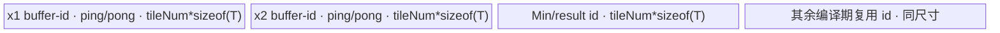
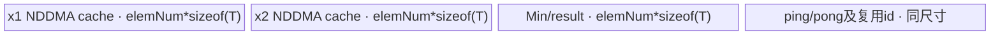
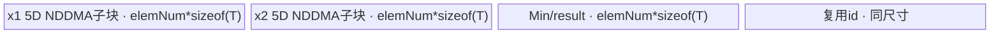
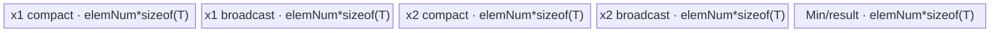

# MinN 950 ACLNN 算子知识

## 算子速览

| 项目 | 内容 |
|---|---|
| 实际入口 | `aclnnMinNGetWorkspaceSize` / `aclnnMinN`，公开 ACLNN 两段式接口；固定仓未出现更高版本入口。 |
| 计算语义 | 对非空 Tensor 列表做保持列表顺序的左折叠：`r0=tensors[0]`，`ri=min(r(i-1), tensors[i])`，最终写入 `out`；不是二元、可类型提升的 `aclnnMinimum` 语义。 |
| 输入输出 | 输入列表非空；各 Tensor 与 `out` 同 dtype，ND，输入最大 8 维，逐步广播后的最终 shape 必须等于 `out`；950 支持 FP16/FP32/BF16/INT8/UINT8/INT32/INT64。 |
| 执行类型 | `Contiguous/ViewCopy` 是框架数据搬运边界；每个 `Minimum` 核由 `KERNEL_TYPE_AIV_ONLY` 固定为 AIV，节点内按 Route 使用 AIV_VECTOR、NDDMA+AIV_VECTOR 或 UB Broadcast+AIV_VECTOR。无 Cube/AIC/MIX_CV。 |
| Kernel 路线 | R-001 单输入直通；R-002 一维 Advance；R-003 五维内 NDDMA；R-004 超五维 NDDMA 外循环；R-005 UB Broadcast（rank 1/2/3/4/动态）。 |
| 核心资源 | executor 持有连续化结果和 `n-1` 个逐步广播结果；每个 `Minimum` 节点分配一个编译期 buffer-id 池，池容量为 `elemNum * sizeof(T) * bufferNum`；Tiling 为节点声明 16 MiB workspace，但 `minimum` entry 不读取该指针。 |
| 来源闭包 | source_closed：公开 API→左折叠 launcher→950 `Minimum` Host/Tiling→POD→全部 Host 可达 `schMode`→AIV-only entry/body→NDDMA/UB Broadcast/Vector helper→950 构建与 binary 接线闭合。 |
| 验证状态 | 已完成源码闭包检查；本次知识提取未执行编译、真机、数值或性能测试。 |

## 接口与语义

### 计算语义

设列表长度为 `n>=1`，第 `i` 个输入广播到逐步结果 shape 后的元素为 `x_i[p]`：

```text
r_0[p] = x_0[p]
r_i[p] = min(r_(i-1)[p], x_i[p]), i=1..n-1
out[p] = r_(n-1)[p]
```

API 源码严格按列表顺序构造任务，故这里记录左折叠顺序，不把浮点 `min` 擅自改写成任意树归约。所有输入 dtype 与输出 dtype 必须相同，MinN 不执行 `aclnnMinimum` 的类型提升、Cast 或 BOOL→LogicalAnd 分支。`n=1` 时没有 `Minimum` 算术节点，结果经 `Contiguous`/`ViewCopy` 写回。`out` 为空 Tensor 时第一段接口直接返回零 workspace，不创建 Device 任务。

### 输入、输出与属性

| 参数 | shape/layout | dtype | 约束、默认值与语义 |
|---|---|---|---|
| `tensors` | `aclTensorList`；各项 ND，单项 rank≤8；允许非连续 | 950：FP16、FP32、BF16、INT8、UINT8、INT32、INT64 | 指针、列表元素均非空；列表不得为空；各项 dtype 与 `out` 相同；按 `BroadcastInferShape` 从第 0 项起逐项合并。 |
| `out` | ND；shape 等于全部输入逐步广播后的 shape；允许非连续 | 与列表每项完全相同 | 指针非空；空输出是成功短路；由最终 `ViewCopy` 处理用户 stride。 |
| `workspaceSize` | 标量指针 | `uint64_t*` | 第一段输出 executor 计划所需总空间；空输出固定写 0。 |
| `executor` | Host 对象 | `aclOpExecutor**` | 持有连续化、逐个 `Minimum` 和最终 `ViewCopy` 的任务及临时 Tensor。 |
| `workspace/workspaceSize/stream` | Device 工作区与 ACL stream | ABI 参数 | 第二段交给 `CommonOpExecutorRun`；任务按同一 executor/stream 的既定顺序提交。 |

### 入口与版本

公开文档和 `aclnn_minn.h` 均声明同一对两段式接口。固定提交中没有 `aclnnMinNV2` 等更高版本。文档明确 950、A2、A3 都支持；本卡只覆盖 950。`aclnn_minn.cpp` 的 RegBase dtype 表包含 UINT8，而 A2/A3 表不含 UINT8，与公开文档的平台差异一致。

MinN 调用内部 `l0op::Minimum` 只是实现节点，不把逻辑算子合并成 `Minimum`：MinN 要求 Tensor 列表同 dtype 并执行 `n-1` 次有序左折叠；`aclnnMinimum` 是独立的二元、可类型提升接口。

## Host/Launcher 执行流程

### 参数校验与前处理

`CheckParams` 顺序不可交换：

1. `CheckNotNull` 检查列表、列表内每个 Tensor、`out`、`workspaceSize`；失败返回 `ACLNN_ERR_PARAM_NULLPTR`。
2. `GetDtypeSupportList` 在 950 的 RegBase 分支选择 7 个 dtype；逐项检查支持性、记录非 ND storage format 警告并强制输入/输出 dtype 相同；失败返回 `ACLNN_ERR_PARAM_INVALID`。
3. `CheckMaxDimension` 对每个输入和 `out` 应用最大 8 维检查。
4. `CheckInAndOutShape` 先拒绝空列表，再从输入 0 开始调用 `BroadcastInferShape`；最终 shape 必须等于 `out`。
5. `out->IsEmpty()` 时写 `workspaceSize=0`、释放 executor，成功返回。
6. `Contiguous(tensors[0])` 建立首个连续输入。对 `i=1..n-1`：先 `Contiguous(tensors[i])`，再把当前累计结果与该连续输入加入一个 `Minimum` 任务，结果成为下一轮 `firstContiguous`。
7. `ViewCopy(minOut, out)` 处理用户输出的非连续布局；任一内部返回空指针都终止第一段接口。

`Contiguous` 对已连续输入只建 reshape view；对非连续输入可进入 transpose/as-strided 等框架搬运。950 对应 entry 均标为 AIV-only，内部可使用 SIMT/NDDMA，但这是模板允许的 VV 框架边界，不含 Cube/MIX_CV。

### 参数、Workspace 与生命周期

列表长度为 `n`：

- Host 最多建立 `n` 个 `Contiguous` 结果、`n-1` 个 `executor->AllocTensor(broadcastShape, dtype)` 的 `Minimum` 结果，以及一个 `ViewCopy` 任务；已连续输入可能只是 view，不一定物化。
- 第 `i` 个 `Minimum` 的左输入是上一步累计结果，右输入是 `tensors[i]` 的连续结果，输出 extent 为该二者广播 shape 的元素数乘 `sizeof(dtype)`；owner 是 executor，至少存活到下一节点消费完。
- 每个 950 `Minimum` Tiling 将 `workspaces[0]` 设为 `16*1024*1024` 字节；entry ABI 接收 `workspace`，但 body 未读取。executor 是否在顺序节点间复用该片以及各临时 Tensor 的物理 offset 属框架规划边界，固定仓未给出数值。
- 第二段 `CommonOpExecutorRun(workspace, workspaceSize, executor, stream)` 使用调用者提供的同一 workspace 与 stream；executor 的失败会作为 ACLNN 状态返回，后续任务不应被视为已完成。

### 启动图与失败传播

```text
aclnnMinNGetWorkspaceSize
  -> Contiguous(tensors[0]) -> r0
  -> for i = 1..n-1:
       Contiguous(tensors[i]) -> ci
       Minimum(r(i-1), ci) -> ri           # 一个 AIV-only Device 节点
  -> ViewCopy(r(n-1), out)
  -> executor.GetWorkspaceSize()

aclnnMinN(workspace, size, executor, stream)
  -> CommonOpExecutorRun                   # 按 executor/stream 顺序执行上述任务
```

| producer / consumer | 交接介质 | offset / extent / layout | ordering | owner/lifetime | 失败传播 |
|---|---|---|---|---|---|
| `Contiguous(tensors[0])` → 第一个 `Minimum`，或 `n=1` 时 → `ViewCopy` | executor Tensor/view | 物理 offset 由框架分配；逻辑 extent 为输入 view shape×dtype，连续 ND | executor 任务顺序、同一 stream | executor；到唯一消费者完成 | 空指针使第一段立即失败。 |
| `Contiguous(tensors[i])` → `Minimum_i` | executor Tensor/view | 物理 offset 固定仓不可见；连续 ND，逻辑 extent 为输入 i 元素数 | 同上 | executor；到 `Minimum_i` 完成 | 同上。 |
| `Minimum_(i-1)` → `Minimum_i` | executor 分配的 GM 临时 Tensor | offset 固定仓不可见；extent=`prod(stepBroadcastShape)*sizeof(T)`，ND contiguous | 同一 executor/stream 的 producer→consumer | executor；至少到下一 Minimum 完成 | producer/launch 失败阻断后续节点。 |
| 最后 `Minimum`/r0 → `ViewCopy` | GM Tensor → 用户 `out` | 输入连续；输出按用户 view stride/offset；具体搬运 Route 为框架边界 | 同一 stream | executor 输入、用户输出 | `ViewCopy` 返回空使第一段失败；执行错误由 executor 返回。 |

## Route 与参数设计

### 分核与资源计算

每个二元 `Minimum` 先将输入 shape 左补 1 到输出 rank，再按各输入在每轴是否广播生成 bit flag；相邻轴只有在所有输入广播模式相同，或前轴是全 1 的退化轴时才合并。合轴结果记输出 `D[0..L-1]`、输出连续 stride `S_o`、输入 stride `S_0/S_1`，广播轴的输入 stride 为 0。

若 `L=1`，选择 Advance：

```text
aliveNum = OpDag::GetBufferNum<true, true>()
tileNum0 = floor((UB / aliveNum) / 512B) * 512B / sizeof(T)
若 coreNum*(512/sizeof(T)) > dimLen: tileNum = 512/sizeof(T)
否则若 coreNum*tileNum0 > dimLen: tileNum = floor((dimLen/coreNum)/(512/sizeof(T))) * (512/sizeof(T))
ubOuter = ceil(dimLen/tileNum)
blockFormer = ceil(ubOuter/coreNum); 若 blockFormer==1 则置 2，开启核内 ping-pong
blockNum = ceil(ubOuter/blockFormer)
```

若 `L>1`：

```text
bufferNum = isUbBroadcast ? OpDag::GetBufferNum<false,true>() : OpDag::GetBufferNum<true,true>()
maxElemNum = floor((UB*8)/(bufferNum*sizeof(T)*8), 256B/sizeof(T) 对齐)
从尾轴向前累乘，选首个超过 maxElemNum 的 ubSplitAxis
ubFormer = maxElemNum / product(D[ubSplitAxis+1..])
ubOuter = ceil(D[ubSplitAxis]/ubFormer)
ubTail = D[ubSplitAxis]-(ubOuter-1)*ubFormer
fusedProduct = product(D[0..ubSplitAxis-1])*ubOuter
blockFormer = ceil(fusedProduct/coreNum)
blockNum = ceil(fusedProduct/blockFormer)
blockTail = fusedProduct-(blockNum-1)*blockFormer
elemNum = maxElemNum
```

MinN 未传 `preferMultiCore`，故不会执行通过递减 `maxElemNum` 强制增核的可选分支。所有算术节点 workspace 固定声明 16 MiB。

### Route 选择

| 顺序 | Route | Key/模板 | 精确选择条件与优先级 | 不适用去向 |
|---:|---|---|---|---|
| 1 | R-001 单输入直通 | 无 `Minimum` key | `tensors->Size()==1` 且输出非空 | `n>=2` 进入每个二元节点的 Tiling。 |
| 2 | R-002 一维 Advance | `schMode=202`；`BroadcastOneDimAdvanceSch<OpDag>` | 当前二元节点合轴后 `L==1`；`InputSize+OutputSize=3<=4` 且 `VarSize=0`，因此不会选 201 | `L>1` 继续。 |
| 3 | R-005 UB Broadcast | `schMode=101/102/103/104/109`；`BroadcastUbSch<OpDag,R>` | `L>1` 且 `IsUbBroadcast()==true`；默认 kernel type 下依次判断：确有广播、`IsBigNLastBrc()`，或广播输入 dtype 属 INT8/UINT8/FP16/BF16 且 `D[last]%(32/sizeof(T))==0` | false 进入 NDDMA。 |
| 4 | R-003 NDDMA 无外循环 | `schMode=1`；`BroadcastNddmaSch<OpDag,false>` | `L>1`、UB Broadcast 为 false，且 `L-ubSplitAxis<=5` | 内层 rank>5 进入 R-004。 |
| 5 | R-004 NDDMA 外循环 | `schMode=2`；`BroadcastNddmaSch<OpDag,true>` | `L>1`、UB Broadcast 为 false，且 `L-ubSplitAxis>5` | 无下一 Route；Tiling/资源错误返回失败。 |

```text
if out is empty: success without Device task
if list_size == 1: R-001
for each of list_size-1 Minimum nodes:
  collapse contiguous input shapes
  if collapsed_rank == 1: R-002 (202)
  else if IsUbBroadcast():
    running_rank = collapsed_rank - ubSplitAxis
    R-005: 101/102/103/104 when running_rank=1/2/3/4, otherwise 109
  else if running_rank <= 5: R-003 (1)
  else: R-004 (2)
```

### 模板/实现执行矩阵

| Route | key/selector | dtype/shape/platform 完整命中条件 | 执行拓扑与 Kernel 节点 | 实际模板/body | 内存与同步特征 | tail/fallback |
|---|---|---|---|---|---|---|
| R-001 | API list size 1 | 950 支持 dtype、校验通过、非空输出、`n=1` | 仅框架 Contiguous→ViewCopy | `aclnnMinNGetWorkspaceSize` | executor view/搬运缓冲，固定仓不展开 | 非连续/用户 out 交给框架；失败即接口失败。 |
| R-002 | 202 | 每个 Minimum 的合轴 rank 1 | 单 AIV 节点 | `BroadcastOneDimAdvanceSch<MinimumCompute<DTYPE_X1>::OpDag>` | 编译期 buffer-id 池；512B 对齐 tile；核内 ping-pong；Mutex 管线同步 | 最后一核重算 `blockLoopNum`，最后 tile 用 `ubTailNum`。 |
| R-003 | 1 | rank>1、UB Broadcast false、running rank≤5 | 单 AIV 节点，NDDMA搬入→Vector Min→MTE3搬出 | `BroadcastNddmaSch<OpDag,false>` | 一个 `TBuf<VECCALC>` 分成 `bufferNum` 个等长子区；CopyInBrc 缓存；Mutex 同步 | `ubTail` 与 `blockTail`；不支持资源时 Tiling 失败。 |
| R-004 | 2 | rank>1、UB Broadcast false、running rank>5 | 单 AIV 节点，外层拆维循环+每次 5D NDDMA→Vector Min→搬出 | `BroadcastNddmaSch<OpDag,true>` | 同 R-003；额外 `nddmaIndices`/offset 循环 | 超过 NDDMA 5 维部分由循环覆盖；最后 UB tile 使用 `ubTail`。 |
| R-005 | 101/102/103/104/109 | rank>1 且 UB Broadcast true；key 由 running rank 决定 | 单 AIV 节点，DataCopyPad 小输入→UB Broadcast→Vector Min→搬出 | `BroadcastUbSch<OpDag,1/2/3/4/-1>` | 每个 CopyInBrc 使用搬入子区+广播结果子区；rank≤4 编译期特化，>4 动态 tiling；Mutex 同步 | 广播 stride 0 的 tile 可缓存；尾 shape 替换为 `ubTail`。 |

### 隐藏性能 Guard

| Guard | Host/Tiling 条件 | Device/资源原因 | 影响 Route | 不满足时去向 | 源码符号 |
|---|---|---|---|---|---|
| API dtype | 950 `REGBASE_DTYPE_SUPPORT_LIST` | 保证 `DTYPE_X1` 存在已编译 binary | 全部 | 参数失败 | `aclnn_minn.cpp::GetDtypeSupportList` |
| 一维 Advance ABI | `L==1 && InputSize+OutputSize<=4 && VarSize<=0` | Advance 使用紧凑 16B POD 和固定参数表 | R-002 | 多维模板 | `BroadcastBaseTiling::DoTiling` |
| UB 可用量 | `UB>extraSize` 且对齐后 `maxElemNum>0` | buffer-id 池必须容纳所有存活节点；tile 按 256B（Advance 按 512B）对齐 | R-002~R-005 | Tiling 失败 | `BroadcastGetMaxElemNum`、`GetOneDimUBFormerAdvance` |
| UB Broadcast 大 nlast | `CopyInBrc` 输入存在非尾广播轴、尾轴非广播，且 `lastDim*sizeof(T)>=NddmaDcache/2` | 避免大连续尾轴由 NDDMA dcache 广播 | R-005 | 继续 dtype/alignment 判定 | `BroadcastBaseTiling::IsBigNLastBrc` |
| UB Broadcast dtype/alignment | `sizeof(T)!=0 && D[last]%(32/sizeof(T))==0 && T∈{INT8,UINT8,FP16,BF16}` | 32B 尾轴对齐且类型在 UB Broadcast 白名单 | R-005 | R-003/R-004 | `BroadcastBaseTiling::IsUbBroadcast` |
| NDDMA 维数 | `runningRank<=5` | `MultiCopyParams<T,5>` 一次表达的最大维数 | R-003 | R-004 外循环拆高维 | `BroadcastBaseTiling::SetSchMode` |
| CopyInBrc 数量 | Minimum 固定为 2，`<=4` 且 `<3` | 选 inline NDDMA helper，不触发三路以上的连续轴融合 helper | R-003/R-004 | 对本算子恒真 | `BroadcastNddmaSch::CopyInBrc` |
| 空输出 | `out->IsEmpty()` | 避免零维 Tiling 中正维检查和无效 launch | 全部 | 0 workspace 成功返回 | `aclnnMinNGetWorkspaceSize` |

### POD/ABI

`MinimumCompute<T>::OpDag` 固定 `InputSize=2`、`CopyBrcSize=2`、`VecBrcSize=0`。表中 offset 只对固定前缀给出；含零长 `inputVecBrc*` 模板数组后的精确 `sizeof/offsetof` 依赖 CCE/GNU 扩展，固定仓没有 `static_assert`，因此不推测。

| 结构 | 字段 | 类型/位宽 | ABI 布局 | 单位 | Host/launcher producer | Device consumer | 边界 |
|---|---|---|---|---|---|---|---|
| `BroadcastOneDimTilingDataAdvance` | `dimLen` | `int64_t/64` | offset 0；结构总长 16B、align 8 | 元素 | 合轴输出 `dims.back()[0]` | `Init/Process` 计算 `ubOuter/ubTail` | 必须>0 |
| 同上 | `tileNum` | `int32_t/32` | offset 8 | 元素/tile | `GetOneDimUBFormerAdvance`，随后按核数调整 | tile 长、buffer 子区长、GM offset | 必须>0，512B 对齐策略 |
| 同上 | `blockNum` | `int16_t/16` | offset 12 | AIV block | `DoOneDimFormerTilingAdvance` 的 `ceil(ubOuter/blockFormer)` 窄化写入 | `GetBlockIdx` 与尾核判断 | 固定仓未显式检查 int16 溢出 |
| 同上 | `scalarFlag` | `int16_t/16` | offset 14 | bit mask | 输入 `dims[i][0]==1` 时置 bit `1<<i` | `CopyIn` 判定 GM 标量并 Duplicate | 两输入使用 bit0/bit1 |
| `BroadcastBaseTilingData<OpDag>` | `scheMode` | `int32_t/32` | offset 0 | 枚举 | 结构存在；普通连续 Route 的 Host 未显式赋值 | 当前 router 用模板 key，不读取该字段 | inactive/值固定仓不可见 |
| 同上 | `shapeLen` | `int32_t/32` | offset 4 | 轴数 | 合轴输出 rank | 所有 shape/loop helper | 2..8（本结构路线） |
| 同上 | `ubSplitAxis` | `int32_t/32` | offset 8 | 轴索引 | `GetBlockSplitFactor` | 地址、shape、NDDMA/UB BRC | `[0,shapeLen)` |
| 同上 | `ubFormer` | `int32_t/32` | offset 12 | 该轴元素 | `maxElemNum/product(innerDims)` | 主 tile、GM offset | 固定仓未显式检查 int32 窄化 |
| 同上 | `ubTail` | `int32_t/32` | offset 16；其后为 int64 对齐 padding | 该轴元素 | `D[axis]-(ubOuter-1)*ubFormer` | 尾 tile shape | `1..ubFormer` |
| 同上 | `ubOuter` | `int64_t/64` | offset 24 | tile 数/切分轴周期 | `ceil(D[axis]/ubFormer)` | realIdx 与广播缓存周期 | >0 |
| 同上 | `blockFormer` | `int64_t/64` | offset 32 | tile/核 | `ceil(fusedProduct/coreNum)` | 每核起点和循环数 | >0 |
| 同上 | `blockTail` | `int64_t/64` | offset 40 | tile | `fusedProduct-(blockNum-1)*blockFormer` | 最后一核循环数 | `1..blockFormer` |
| 同上 | `dimProductBeforeUbInner` | `int64_t/64` | offset 48 | tile/外轴乘积 | 等于 `fusedProduct` | `BroadcastGetAxesIndices` 除法基数 | >0 |
| 同上 | `elemNum` | `int64_t/64` | offset 56 | 元素/子区 | 对齐后的 `maxElemNum` | `blockEleNum_`、`InitBuffer` | >0 |
| 同上 | `blockNum` | `int64_t/64` | offset 64 | AIV block | `ceil(fusedProduct/blockFormer)` | Host `SetBlockDim`、Device `GetBlockNum` | `1..coreNum` |
| 同上 | `outputDims` | `int64_t[8]` | offset 72 | 元素/轴 | 合轴输出 dims | 轴索引更新、NDDMA/UB Broadcast shape | 只读前 `shapeLen` |
| 同上 | `outputStrides` | `int64_t[8]` | offset 136 | 元素 stride | 合轴输出连续 stride | 输出 GM offset、NDDMA dst stride | 只读前 `shapeLen` |
| 同上 | `inputDims` | `int64_t[2][2]` | offset 200 | 元素 | 非 CopyInBrc 的 former/tail 长 | 普通 `CopyIn` | Minimum 两输入都是 CopyInBrc，inactive |
| 同上 | `inputBrcDims` | `int64_t[2][8]` | offset 232 | 元素/轴 | 两个 CopyInBrc 对应合轴 dims | UB Broadcast 输入 shape | 前 `shapeLen` 有效 |
| 同上 | `inputVecBrcDims` | `int64_t[0][8]` | CCE/GNU 零长扩展；精确 offset 固定仓不可见 | N/A | 无 VecBrc producer | 无 consumer | inactive |
| 同上 | `inputStrides` | `int64_t[2][8]` | 位于零长字段之后，精确 offset 固定仓不可见 | 元素 stride | 普通 CopyIn stride | 普通 CopyIn | 本 DAG inactive |
| 同上 | `inputBrcStrides` | `int64_t[2][8]` | 精确 offset 固定仓不可见 | 元素 stride | 两输入合轴 stride，广播轴写 0 | NDDMA/UB CopyInBrc、缓存 guard | 前 `shapeLen` 有效 |
| 同上 | `inputVecBrcStrides` | `int64_t[0]` | 零长扩展 | N/A | 无 | 无 | inactive |
| 同上 | `scalarData` | `char[16]` | 尾部；精确 offset/sizeof 固定仓不可见 | 原始字节 | 初始化为 0，Minimum 不调用 `SetScalar` | `SetScalar<0>` 无 Var 时不读取 | inactive |

### Route 源码闭包

| Route | Key/selector | Host/Tiling producer | POD/参数 | Kernel entry/router 节点 | Kernel body/直接依赖 | 构建接线 |
|---|---|---|---|---|---|---|
| R-001 | list size 1 | `aclnn_minn.cpp::aclnnMinNGetWorkspaceSize` | executor Tensor/view | 无 Minimum entry | Contiguous/ViewCopy 框架边界 | `math/minimum/CMakeLists.txt` API 模块 |
| R-002 | 202 | `BroadcastBaseTiling::DoOneDimOpTilingAdvance` | `BroadcastOneDimTilingDataAdvance` | `minimum`→`BroadcastSch<202,OpDag>` | `BroadcastOneDimAdvanceSch::{Init,Process,Run}`、`Vec::{CopyIn,Min,CopyOut}` | 950 OpDef/binary/CMake 选择 `minimum_apt` |
| R-003 | 1 | `MinimumTiling::DoOpTiling`→`BroadcastBaseTiling::DoBroadcastOpTiling` | `BroadcastBaseTilingData<OpDag>` | `minimum`→`BroadcastSch<1,OpDag>` | `BroadcastNddmaSch<false>`、`BroadcastNddmaWithoutLoop` | 同上 |
| R-004 | 2 | 同上，`SetSchMode` 的 >5 分支 | 同上 | `minimum`→`BroadcastSch<2,OpDag>` | `BroadcastNddmaSch<true>`、`BroadcastNddmaWithLoop` | 同上 |
| R-005 | 101/102/103/104/109 | `IsUbBroadcast`→`SetSchMode` | 同上 | `minimum`→对应 `BroadcastSch` 分支 | `BroadcastUbSch<R>`、`CvecBrc`、`Vec::Min` | 同上 |

## Kernel 实现

### 公共执行流程

每个 `Minimum` 节点的 entry ABI 为 `(x1,x2,y,workspace,tiling)`。`workspace` 未使用；`DTYPE_X1` 决定 `MinimumCompute<T>`。DAG 顺序固定为两个 `CopyInBrc<T>`、`Vec::Min<T>`、`CopyOut<T>`，内存优化级别固定 `LEVEL_2`。`BroadcastSch` 首先声明 `KERNEL_TYPE_AIV_ONLY`，按编译期 `schMode` 解析 POD 并实例化 Route body。

所有多维 Route 先由 `GetBlockIdx()*blockFormer` 解码起始轴坐标，每核执行 `blockFormer` 或最后一核 `blockTail` 个 UB tile；每 tile 的有效长度为 `ubSplitSize*outputStrides[ubSplitAxis]`。两输入完成广播/搬入后，`Vec::Min` 直接对有效长度执行 `AscendC::Min(dst,src1,src2,count)`，结果子区随后作为 `VECOUT` 由 `DataCopyPad` 写至 `y`。Host 的 `n-1` 个节点串行消费上一步 GM 结果，不存在跨核归约或 Atomic。

### Route R-001：单输入直通

#### 适用条件

##### 选择证据

| 层级 | 文件 | 符号 | 源码谓词/参数 | 结果/下一跳 |
|---|---|---|---|---|
| API | `math/minimum/op_api/aclnn_minn.cpp` | `aclnnMinNGetWorkspaceSize` | 循环从 `i=1` 开始；`n=1` 时不进入 | `minOut=firstContiguous`，直接 ViewCopy |

#### Device 数据流

##### 函数级调用链

```text
Contiguous(tensors[0])
  -> framework view or AIV/SIMT/NDDMA data movement
ViewCopy(minOut, out)
  -> framework alias/TensorMove/ViewCopy data movement
```

##### 源码等价伪码

```text
if list_size == 1:
  r0 = Contiguous(tensors[0])
  ViewCopy(r0, out)
```

#### 内存与数据搬运

##### 资源与搬运表

| 层级/缓冲区 | offset/地址公式 | extent/容量公式 | dtype/layout | producer | consumer | owner/lifetime | 对齐/复用 |
|---|---|---|---|---|---|---|---|
| 输入/view | 框架决定 | `prod(shape)*sizeof(T)` | T/ND | Contiguous | ViewCopy | executor 到 ViewCopy 完成 | 已连续时可仅 reshape view |
| 用户 out | 用户 view offset/stride | `prod(outShape)` 个有效元素 | T/ND view | ViewCopy | 调用者 | 用户 | 非连续由框架处理 |

##### 分层内存布局

N/A：此 Route 没有 MinN 自有 `Minimum` AIV Kernel，也没有其 UB 池；实际替代路径是框架 Contiguous/ViewCopy。

##### 字节账与复用顺序

```text
Minimum_UB_total = N/A
Minimum_workspace = N/A
executor workspace = Contiguous/ViewCopy 计划结果；物理公式固定仓不可见
```

| 复用子区 | 写入者 | 读取者/消费点 | 下一次覆盖 | 同步或释放依据 | 安全条件 |
|---|---|---|---|---|---|
| executor view/临时 | Contiguous | ViewCopy | executor 规划 | 同一任务序列 | ViewCopy 前保持有效 |

#### 同步、精度与尾块

##### 同步与数值边界表

| 阶段 | primitive/机制 | producer | consumer/等待点 | 保护对象 | 精度/尾块 |
|---|---|---|---|---|---|
| 框架搬运 | executor/stream | Contiguous | ViewCopy | 输入 view/临时 | 无算术，无 cast；有效元素逐个复制 |

#### 关键实现

##### 符号证据表

| 阶段 | 文件 | 符号/模板实例 | 实现事实 |
|---|---|---|---|
| Host/Tiling producer | `math/minimum/op_api/aclnn_minn.cpp` | `aclnnMinNGetWorkspaceSize` | `n=1` 不添加 Minimum 节点 |
| Kernel entry/router | N/A | N/A | 无 MinN 自有算术 Kernel |
| Device body/helper | `conversion/contiguous/op_host/op_api/contiguous.cpp` | `Contiguous` / `ViewCopy` | 框架可用 view、alias 或数据搬运 |

### Route R-002：一维 Advance

#### 适用条件

##### 选择证据

| 层级 | 文件 | 符号 | 源码谓词/参数 | 结果/下一跳 |
|---|---|---|---|---|
| Tiling | `broadcast_tiling.h` | `BroadcastBaseTiling::DoTiling` | `dims.back().size()==1 && inputAllContiguous` 且 DAG 3 个 GM 参数、无 Var | `DoOneDimOpTilingAdvance`，202 |
| Router | `broadcast_sch.h` | `BroadcastSch<202,OpDag>::Process` | `schMode==202` | `BroadcastOneDimAdvanceSch` |

#### Device 数据流

##### 函数级调用链

```text
minimum<202>(x1,x2,y,workspace,tiling)
  -> BroadcastOneDimAdvanceSch::Init
  -> Process
    -> Run: CopyInBrc(x1) -> CopyInBrc(x2)
    -> RunNormalOp: Vec::Min<T>
    -> CopyOut<T>
```

##### 源码等价伪码

```text
tile = tileNum; baseTile = blockFormer*tileNum*blockIdx
loops = lastBlock ? blockTail : blockFormer
for i in [0, loops):
  valid = (i==loops-1 && lastBlock) ? ubTailNum : tileNum
  for input k:
    if scalarFlag bit k: first two pipeline turns Duplicate(GM[k][0], valid)
    else DataCopyPad(GM[k][baseTile+i*tile], UB[k,pingpong], valid*sizeof(T))
  Min(UB[out,pingpong], UB[x1,pingpong], UB[x2,pingpong], valid)
  DataCopyPad(UB[out,pingpong], GM[y][baseTile+i*tile], valid*sizeof(T))
```

#### 内存与数据搬运

##### 资源与搬运表

| 层级/缓冲区 | offset/地址公式 | extent/容量公式 | dtype/layout | producer | consumer | owner/lifetime | 对齐/复用 |
|---|---|---|---|---|---|---|---|
| x1/x2 GM | scalar 0；否则 `baseTile+offset` | scalar 1 或 valid | T/1D | API/executor | CopyIn | 用户/executor | tile 512B 对齐策略 |
| buffer-id 池 | `bufId*tileNum*sizeof(T)` | `tileNum*sizeof(T)`/子区 | T/UB | CopyIn/Duplicate/Min | Min/CopyOut | Kernel | 编译期 ping/pong id；LEVEL_2 复用 |
| y GM | `baseTile+offset` | valid | T/1D | CopyOut | 后续 Minimum/ViewCopy | executor | 仅写有效 tail |

##### 分层内存布局



##### 字节账与复用顺序

```text
aliveNum = OpDag::GetBufferNum<true,true>()
UB_total = aliveNum * tileNum * sizeof(T)
tileNum <= floor(UB/aliveNum, 512B alignment) / sizeof(T)
dynamic_ub = N/A
workspace_per_Minimum = 16 MiB declared; entry does not consume it
```

| 复用子区 | 写入者 | 读取者/消费点 | 下一次覆盖 | 同步或释放依据 | 安全条件 |
|---|---|---|---|---|---|
| ping/pong input ids | CopyIn/Duplicate | Min | 同 parity 的后续 tile | `GetTensor/ReleaseTensor` Mutex | tile i 消费后才复用 |
| Min/result id | Min | CopyOut | 后续 tile | PIPE_V→PIPE_MTE3 Mutex | CopyOut 完成后覆盖 |

#### 同步、精度与尾块

##### 同步与数值边界表

| 阶段 | primitive/机制 | producer | consumer/等待点 | 保护对象 | 精度/尾块 |
|---|---|---|---|---|---|
| MTE2→V | buffer Mutex | CopyIn | Min 的 `GetTensor<VECCALC>` | x1/x2 子区 | dtype 原样，无 cast |
| V→MTE3 | buffer Mutex | Min | CopyOut 的 `GetTensor<VECOUT>` | result 子区 | `count=valid`，tail 不参与 |
| 标量广播 | `Duplicate` | GM scalar load | Min | 输入子区 | 仅 scalarFlag 对应输入 |

#### 关键实现

##### 符号证据表

| 阶段 | 文件 | 符号/模板实例 | 实现事实 |
|---|---|---|---|
| Host/Tiling producer | `opbase/.../broadcast_tiling.h` | `DoOneDimOpTilingAdvance` | 512B tile、blockNum、16B POD |
| Kernel entry/router | `math/minimum/op_kernel/minimum_apt.cpp` / `broadcast_sch.h` | `minimum` / `BroadcastSch<202>` | AIV-only 到 Advance body |
| Device body/helper | `broadcast_sch_one_dim_advance.h` | `Init/Process/CopyIn/RunNormalOp/CopyOut` | ping-pong、标量 Duplicate、有效 tail |

### Route R-003：NDDMA 五维内广播

#### 适用条件

##### 选择证据

| 层级 | 文件 | 符号 | 源码谓词/参数 | 结果/下一跳 |
|---|---|---|---|---|
| Tiling | `broadcast_tiling.h` | `IsUbBroadcast` / `SetSchMode` | UB route false 且 `shapeLen-ubSplitAxis<=5` | key 1 |
| Router | `broadcast_sch.h` | `BroadcastSch<1,OpDag>` | `schMode==1` | `BroadcastNddmaSch<OpDag,false>` |

#### Device 数据流

##### 函数级调用链

```text
minimum<1>
  -> BroadcastNddmaSch<false>::Init/Process
  -> CopyInBrc x1: BroadcastNddmaWithoutLoop
  -> CopyInBrc x2: BroadcastNddmaWithoutLoop
  -> BroadcastBaseSch::RunNormalOp -> Vec::Min
  -> BroadcastBaseSch::CopyOut
```

##### 源码等价伪码

```text
for tile in this core:
  decode axesIndices; validAxis = former or tail
  for input k:
    if inputStride[k][ubAxis]!=0 or cache-refresh condition:
      gmOffset = sum(axesIndices[j]*inputStride[k][j])
      if outputStride[ubAxis] != inputStride[k][ubAxis]:
        construct 5D MultiCopy loopSize/srcStride/dstStride and DataCopy GM->UB
      else DataCopyPad one contiguous block
  Min(result, x1_broadcasted, x2_broadcasted, validAxis*outputStride[ubAxis])
  DataCopyPad result -> y at output gmOffset
```

#### 内存与数据搬运

##### 资源与搬运表

| 层级/缓冲区 | offset/地址公式 | extent/容量公式 | dtype/layout | producer | consumer | owner/lifetime | 对齐/复用 |
|---|---|---|---|---|---|---|---|
| input GM | `BroadcastGetGmOffset(indices,inputStride,axis,ubFormer)` | NDDMA loop product | T/broadcast view | executor | NDDMA/DataCopyPad | executor | stride 0 表示广播 |
| UB pool | `bufId*elemNum*sizeof(T)` | `elemNum*sizeof(T)`/子区 | T/logical output tile | NDDMA/Min | Min/CopyOut | Kernel TBuf | ping-pong + CopyInBrc cache |
| output GM | `BroadcastGetGmOffset(indices,outputStride,axis,ubFormer)` | `validAxis*outputStride[axis]` | T/contiguous | CopyOut | 后续节点 | executor | tail 仅有效长度 |

##### 分层内存布局



##### 字节账与复用顺序

```text
bufferNum = OpDag::GetBufferNum<true,true>()
UB_total = bufferNum * elemNum * sizeof(T)
elemNum = floor((UB*8)/(bufferNum*sizeof(T)*8), 256B/sizeof(T) alignment)
dynamic_ub = N/A
workspace_per_Minimum = 16 MiB declared; unused by entry
```

| 复用子区 | 写入者 | 读取者/消费点 | 下一次覆盖 | 同步或释放依据 | 安全条件 |
|---|---|---|---|---|---|
| CopyInBrc cache | NDDMA | Min | stride 非零时下一 tile；stride 0 时周期刷新 | VECIN/VECCALC Mutex | `ubOuter` 周期与 guard 一致 |
| result | Min | CopyOut | 后续 tile | VECCALC/VECOUT Mutex | CopyOut 完成 |

#### 同步、精度与尾块

##### 同步与数值边界表

| 阶段 | primitive/机制 | producer | consumer/等待点 | 保护对象 | 精度/尾块 |
|---|---|---|---|---|---|
| NDDMA→V | `GetTensor<VECIN>` / `ReleaseTensor`，再 VECCALC lock | DataCopy | Min | 输入 cache | `MultiCopyConfig{false,0,0,false}`；不填充无效 lane |
| V | `AscendC::Min` | 两输入 | result | 有效 tile | T 原精度，无升/降精度 |
| V→GM | VECOUT Mutex | Min | DataCopyPad | result | `tileLength` 排除 tail 无效元素 |

#### 关键实现

##### 符号证据表

| 阶段 | 文件 | 符号/模板实例 | 实现事实 |
|---|---|---|---|
| Host/Tiling producer | `broadcast_tiling.h` / `broadcast_tiling.cpp` | `SetSchMode` / `DoBrodcastTiling` | running rank≤5、分核与 elemNum |
| Kernel entry/router | `minimum_apt.cpp` / `broadcast_sch.h` | `minimum` / `BroadcastSch<1>` | AIV-only、POD解析 |
| Device body/helper | `broadcast_sch_nddma.h` / `broadcast_utils.h` | `BroadcastNddmaSch<false>` / `BroadcastNddmaWithoutLoop` | 5D MultiCopy 或连续 DataCopyPad |

### Route R-004：NDDMA 超五维外循环

#### 适用条件

##### 选择证据

| 层级 | 文件 | 符号 | 源码谓词/参数 | 结果/下一跳 |
|---|---|---|---|---|
| Tiling | `broadcast_tiling.h` | `SetSchMode` | UB route false 且 `shapeLen-ubSplitAxis>5` | key 2 |
| Router | `broadcast_sch.h` | `BroadcastSch<2,OpDag>` | `schMode==2` | `BroadcastNddmaSch<OpDag,true>` |

#### Device 数据流

##### 函数级调用链

```text
minimum<2>
  -> BroadcastNddmaSch<true>::Process
  -> CopyInBrc: BroadcastNddmaWithLoop
       -> loop high dimensions -> DataCopy<T,5>
  -> Vec::Min
  -> CopyOut
```

##### 源码等价伪码

```text
for tile in this core:
  for each input:
    params5 = last five output/input strides
    nddmaProduct = product(high inner dims) * ubSplitSize
    for q in [0,nddmaProduct):
      decode nddmaIndices
      DataCopy<T,5>(UB[ubOffset(q)], GM[base+gmOffset(q)], params5)
  Min(..., validTileElements)
  CopyOut(...)
```

#### 内存与数据搬运

##### 资源与搬运表

| 层级/缓冲区 | offset/地址公式 | extent/容量公式 | dtype/layout | producer | consumer | owner/lifetime | 对齐/复用 |
|---|---|---|---|---|---|---|---|
| 高维 NDDMA 子块 | `base + BroadcastGetNddmaOffset(indices,inputStride)` | 每次 5D params | T | GM | UB pool | Kernel tile | 高维在软件循环拆分 |
| UB pool/result | 与 R-003 相同 | `bufferNum*elemNum*sizeof(T)` | T | NDDMA/Min | Min/CopyOut | Kernel | cache/ping-pong 同 R-003 |

##### 分层内存布局



##### 字节账与复用顺序

```text
UB_total = OpDag::GetBufferNum<true,true>() * elemNum * sizeof(T)
workspace_per_Minimum = 16 MiB declared; entry unused
额外高维 indices 为标量/寄存器数组，不另建 GM workspace
```

| 复用子区 | 写入者 | 读取者/消费点 | 下一次覆盖 | 同步或释放依据 | 安全条件 |
|---|---|---|---|---|---|
| NDDMA子块 | `DataCopy<T,5>` 循环 | Min | 下一 tile | Mutex | 全部 q 子块完成后计算 |
| result | Min | CopyOut | 下一 tile | Mutex | 同 R-003 |

#### 同步、精度与尾块

##### 同步与数值边界表

| 阶段 | primitive/机制 | producer | consumer/等待点 | 保护对象 | 精度/尾块 |
|---|---|---|---|---|---|
| 高维拆分 | 顺序 q 循环+VECIN Mutex | 多次 NDDMA | Min | 完整逻辑 tile | offsets 按元素 stride；最后 tile 使用 ubTail |
| 计算/搬出 | 同 R-003 | Min | CopyOut | result | 无 cast；只处理有效 count |

#### 关键实现

##### 符号证据表

| 阶段 | 文件 | 符号/模板实例 | 实现事实 |
|---|---|---|---|
| Host/Tiling producer | `broadcast_tiling.h` | `SetSchMode` | running rank>5 选择 2 |
| Kernel entry/router | `broadcast_sch.h` | `BroadcastSch<2>` | withLoop=true |
| Device body/helper | `broadcast_sch_nddma.h` / `broadcast_utils.h` | `BroadcastNddmaSch<true>` / `BroadcastNddmaWithLoop` | 高维外循环+5D MultiCopy |

### Route R-005：UB Broadcast rank 特化

#### 适用条件

##### 选择证据

| 层级 | 文件 | 符号 | 源码谓词/参数 | 结果/下一跳 |
|---|---|---|---|---|
| Tiling | `broadcast_tiling.h` | `IsUbBroadcast` | 大 nlast，或 B8/B16 白名单且尾轴 32B 对齐 | UB family |
| Tiling | 同上 | `SetSchMode` | `runningRank=1/2/3/4/>4` | 101/102/103/104/109 |
| Router | `broadcast_sch.h` | 对应分支 | key | `BroadcastUbSch<OpDag,1/2/3/4/-1>` |

#### Device 数据流

##### 函数级调用链

```text
minimum<101|102|103|104|109>
  -> BroadcastUbSch<R>::Init/Process
  -> CopyInAndVecBrc x1/x2
       -> Vec::CopyIn (DataCopyPad)
       -> CvecBrc -> Broadcast<T,R>
  -> BroadcastBaseSch::RunNormalOp -> Vec::Min
  -> BroadcastBaseSch::CopyOut
```

##### 源码等价伪码

```text
for tile in this core:
  for each input k:
    if stride_at_split==0 and tile>0 and realIdx>0: reuse cached broadcast result
    else:
      inputLength = stride!=0 ? validAxis*stride : former/tail source length
      DataCopyPad(GM[gmOffset], UB[copyId], inputLength*sizeof(T))
      dstShape = output former/tail shape
      srcShape = input former/tail shape
      Broadcast<T,R>(UB[brcId], UB[copyId], dstShape, srcShape, runningTiling)
  Min(UB[result], UB[brc0], UB[brc1], validOutputElements)
  CopyOut(UB[result], GM[y+offset], validOutputElements)
```

#### 内存与数据搬运

##### 资源与搬运表

| 层级/缓冲区 | offset/地址公式 | extent/容量公式 | dtype/layout | producer | consumer | owner/lifetime | 对齐/复用 |
|---|---|---|---|---|---|---|---|
| CopyIn 子区 | `decoded bufferIds[1]*blockLen` | `elemNum*sizeof(T)` | T/input compact | DataCopyPad | Broadcast | Kernel | 可与后续计算按 buffer graph 复用 |
| Broadcast 子区 | `decoded bufferIds[0]*blockLen` | `elemNum*sizeof(T)` | T/output tile layout | `Broadcast<T,R>` | Min | Kernel | stride0 时跨 tile 缓存 |
| result/output | 编译期 id；GM offset 同公共公式 | `elemNum*sizeof(T)` / valid elements | T | Min/CopyOut | GM | Kernel/executor | tail shape 精确替换 |

##### 分层内存布局



##### 字节账与复用顺序

```text
bufferNum = OpDag::GetBufferNum<false,true>()
UB_total = bufferNum * elemNum * sizeof(T)
elemNum <= floor(UB/bufferNum, 256B alignment) / sizeof(T)
workspace_per_Minimum = 16 MiB declared; entry unused
```

| 复用子区 | 写入者 | 读取者/消费点 | 下一次覆盖 | 同步或释放依据 | 安全条件 |
|---|---|---|---|---|---|
| compact input | CopyIn | Broadcast | 下一 input/tile | VECIN→VECCALC Mutex | Broadcast 已消费 |
| broadcast result | Broadcast | Min | stride非0下一 tile；stride0按周期缓存 | VECCALC Mutex | guard 与 `ubOuter` 一致 |
| result | Min | CopyOut | 下一 tile | VECOUT Mutex | CopyOut 完成 |

#### 同步、精度与尾块

##### 同步与数值边界表

| 阶段 | primitive/机制 | producer | consumer/等待点 | 保护对象 | 精度/尾块 |
|---|---|---|---|---|---|
| MTE2→Broadcast | VECIN/VECCALC Mutex | DataCopyPad | `Broadcast<T,R>` | compact input | dtype 原样 |
| Broadcast→Min | VECCALC Mutex | Broadcast | Min | expanded tile | R=1..4 编译期 rank，R=-1 动态 rank |
| Min→MTE3 | VECOUT Mutex | Min | CopyOut | result | tail 时 dst/src shape 分别换成 `ubTail` 对应值 |

#### 关键实现

##### 符号证据表

| 阶段 | 文件 | 符号/模板实例 | 实现事实 |
|---|---|---|---|
| Host/Tiling producer | `broadcast_tiling.h` | `IsUbBroadcast` / `SetSchMode` | 大 nlast、dtype/alignment、rank key |
| Kernel entry/router | `broadcast_sch.h` | `BroadcastSch<101/102/103/104/109>` | rank→`BroadcastUbSch<R>` |
| Device body/helper | `broadcast_sch_ub_broadcast.h` | `CopyInAndVecBrc` / `CvecBrc` / `Run` | 小输入搬入、UB broadcast、缓存、Min、tail |

## 算子特定优化

### Trick T-001：广播输入跨 UB tile 缓存

#### 触发与源码依据

- 适用 Route：R-003、R-004；R-005 使用等价的 stride-0 广播结果缓存 guard。
- 触发条件：某 `CopyInBrc` 输入在 `ubSplitAxis` 的 stride 为 0；跨 tile 后仍处于同一 `ubOuter` 广播周期。
- Golden 来源：[`broadcast_sch_nddma.h:137-170`](https://gitcode.com/cann/opbase/blob/d574f5571391390f8b619c6a134b65c819842318/pkg_inc/op_common/atvoss/broadcast/broadcast_sch_nddma.h#L137-L170)

**官方源码（固定 Commit 连续逐字摘录）**：

```cpp
if ((tilingData->inputBrcStrides[copyInBrcCount][tilingData->ubSplitAxis] != 0) || (ubLoopIdx <= 1 ||
    (AscendC::GetBlockIdx() * tilingData->blockFormer + ubLoopIdx) % tilingData->ubOuter <= 1)) {
    GetTensor<TPosition::VECIN>(bufId);
    // NDDMA helper 仅在需要刷新时执行
    ReleaseTensor<TPosition::VECIN>(bufId);
}
```

#### 机制与设计原因

`inputBrcStrides[][ubSplitAxis]==0` 表示多个相邻输出 tile 读取同一输入片。DAG 的 `GetBufferIds<true,true>` 为 CopyInBrc 生成可持久 cache id；guard 只在起始 ping/pong 建立期或进入新 `ubOuter` 周期时重做 NDDMA，后续 `Vec::Min` 继续读取该 UB 子区。这样从源码上可证明减少了重复 GM→UB 广播搬运；Mutex 的 lock/unlock 与编译期 buffer id 保证尚未消费的 cache 不被提前覆盖。

#### 迁移边界

- 适用：逐元素二元算子，某输入沿 UB 切分轴广播且后续计算可直接消费完整广播 tile。
- 前提：950 AIV-only 广播模板、`CopyInBrc` 节点、cache-aware buffer graph、相同 `ubOuter` 周期和 dtype/layout。
- 失效：stride 非 0 时每 tile 必须刷新；跨 `ubOuter` 周期也必须刷新；若改用无持久 buffer 的自定义 DAG，不能照搬 guard。
- 未验证：本次知识提取未执行编译、真机、数值或性能测试。

#### 错误做法

固定仓未提供可验证反例；从现有 guard 可确认不能仅凭“该输入有广播轴”永久跳过搬入，必须同时维护切分轴 stride、block/tile 的 `ubOuter` 周期与 ping-pong 建立条件。

## 模板与实现对比

| 对比维度 | R-001 单输入 | R-002 一维 | R-003 NDDMA≤5D | R-004 NDDMA>5D | R-005 UB Broadcast | 设计选择依据 |
|---|---|---|---|---|---|---|
| 命中条件/优先级 | `n=1` | 合轴 rank 1 | 多维、UB false、running rank≤5 | 多维、UB false、running rank>5 | 多维、UB true | 先 API 拓扑，再 shape collapse、广播介质和 NDDMA 维数 |
| 模板与 dtype | 无 Minimum | Advance；T=7种之一 | `NddmaSch<false>` | `NddmaSch<true>` | `UbSch<R>` | `DTYPE_X1` 保持原 dtype |
| 循环与分核 | 框架 | 512B tile、每核多 tile | 轴坐标+UB tile | 再套高维 q 循环 | 轴坐标+UB tile | 不做跨核归约 |
| Queue/TBuf/寄存器/dynamic UB/通信 window | 框架边界 | buffer-id LocalTensor 池 | 单 TBuf 切子区 | 同左+indices | 单 TBuf，compact/brc 双子区 | 无通信、无 dynamic UB |
| 内存总占用与复用 | 固定仓不可见 | `GetBufferNum<true,true>*tileNum*sizeof(T)` | `GetBufferNum<true,true>*elemNum*sizeof(T)` | 同左 | `GetBufferNum<false,true>*elemNum*sizeof(T)` | Host 用同一 bufferNum 反推 tile 上限 |
| 搬运/Vector/SIMT/NDDMA/通信 API | 框架 VV | DataCopyPad/Duplicate/Min | MultiCopy<5>/DataCopyPad/Min | 多次 MultiCopy<5>/Min | DataCopyPad/Broadcast/Min | SIMD 算术相同，广播介质不同 |
| 同步、精度与 tail | 框架 stream | Mutex；valid tail | Mutex；ubTail/blockTail | 同左+q顺序 | Mutex；tail shape | 无 cast/atomic，原 dtype Min |
| fallback/失败边界 | 内部空指针 | tileNum 0 失败 | POD/UB错误失败 | POD/UB错误失败 | Broadcast tiling失败 | 无 AICPU fallback，因为 950 API dtype 全在 AiCore 表内 |

## 平台差异

| 项目 | A2 | A3 | 950 |
|---|---|---|---|
| 支持状态 | 公开文档支持；本固定仓主目录的活动 `arch32` Host/Tiling/Kernel 缺失，未建无后缀卡 | 同 A2 | 支持且 source_closed |
| Host/Launcher | MinN API 源码存在；具体 `Minimum` arch32 实现固定仓不可见 | 同 A2 | `arch35 MinimumTiling` + opbase BroadcastBaseTiling |
| Kernel/资源 | 活动 CMake 指向 `arch32`，目标文件缺失；不得用未接线 experimental 补齐 | 同 A2 | `minimum_apt`，AIV-only；NDDMA/UB Broadcast/Vector Min |

## 限制与失败边界

- 输入列表必须非空；所有列表元素、`out`、`workspaceSize` 都不得为空；每个输入和输出 rank≤8，逐步广播 shape 必须最终精确等于 `out`。
- 950 只支持 FP16/FP32/BF16/INT8/UINT8/INT32/INT64，且 MinN 要求全列表和输出 dtype 完全相同；不执行类型提升或 cast。
- `out` 为空时成功短路；非空但 shape 中非正维会在广播 Tiling 的正维检查失败。API shape 检查与 Device Tiling 的该边界应同时保留。
- `BroadcastOneDimTilingDataAdvance::blockNum` 是 `int16_t`，Host 从 `uint64_t blockNum` 赋值时固定源码未见显式溢出检查；复用时不得扩大 block 计数域。
- 多维 POD 含 `VecBrcSize==0` 的零长模板数组；精确尾部 offset/sizeof 固定仓不可见，不应手工序列化，必须复用同一结构与框架宏。
- 每个 `Minimum` Tiling 声明 16 MiB workspace，entry 未读取；MinN executor 如何合并/复用各节点 workspace 及中间 Tensor 的物理 offset 固定仓不可见，只能依赖 `GetWorkspaceSize()` 返回值。
- 框架 `Contiguous/ViewCopy` 的细分 data-movement Route 不属于本逻辑算子的自有 Kernel 正文；固定仓可确认 950 entry 为 AIV-only、内部可达 SIMT/NDDMA，未发现 Cube/MIX_CV。
- 本次知识提取未执行编译、真机、数值或性能测试。

## 源码索引

### 链路索引

| 链路阶段 | 文件 | 关键符号 | 支撑内容 |
|---|---|---|---|
| 入口声明/约束 | `math/minimum/docs/aclnnMinN.md` | 产品表、接口原型 | 950 支持、dtype/shape/错误语义 |
| 入口声明/约束 | `math/minimum/op_api/aclnn_minn.h` | `aclnnMinN*` | 公共 ABI |
| 入口实现 | `math/minimum/op_api/aclnn_minn.cpp` | `CheckParams`、`aclnnMinNGetWorkspaceSize` | 校验、空输出、左折叠 launch graph |
| Launcher | `math/minimum/op_api/minimum.cpp` | `IsAiCoreSupport`、`Minimum` | 950 dtype 全走 AiCore、分配广播输出 |
| Host/Tiling | `math/minimum/op_host/arch35/minimum_tiling_arch35.cpp` | `MinimumTiling::DoOpTiling` | dtype→DAG、schMode key |
| POD | `pkg_inc/op_common/atvoss/broadcast/broadcast_base_struct.h` | Broadcast POD structs | 字段顺序与 key 域 |
| Host/Tiling | `pkg_inc/op_common/atvoss/broadcast/broadcast_tiling.h` | `BroadcastBaseTiling` | Route 选择、POD producer、UB/核数 |
| Host/Tiling | `src/op_common/atvoss/broadcast/broadcast_tiling.cpp` | `DimensionCollapse`、`DoBrodcastTiling` | 合轴、stride、tile/core 公式 |
| Kernel entry/body | `math/minimum/op_kernel/minimum_apt.cpp` | `minimum` | 950 entry→BroadcastSch |
| Kernel entry/body | `math/minimum/op_kernel/arch35/minimum_dag.h` | `MinimumCompute<T>` | CopyInBrc→Min→CopyOut DAG |
| Kernel router | `pkg_inc/op_common/atvoss/broadcast/broadcast_sch.h` | `BroadcastSch` | AIV-only 与 key→body |
| Kernel body | `pkg_inc/op_common/atvoss/broadcast/broadcast_sch_one_dim_advance.h` | `BroadcastOneDimAdvanceSch` | R-002 |
| Kernel body | `pkg_inc/op_common/atvoss/broadcast/broadcast_sch_nddma.h` | `BroadcastNddmaSch` | R-003/R-004 |
| Kernel body | `pkg_inc/op_common/atvoss/broadcast/broadcast_sch_ub_broadcast.h` | `BroadcastUbSch` | R-005 |
| Device helper | `pkg_inc/op_common/atvoss/util/broadcast_utils.h` | NDDMA helpers | 5D loop/stride/address |
| Device helper | `pkg_inc/op_common/atvoss/util/vec.h` | `CopyInBrc`、`Min`、`CopyOut` | DataCopyPad 与 AscendC::Min |
| 框架边界 | `conversion/contiguous/op_host/op_api/contiguous.cpp` | `Contiguous`、`ViewCopy` | 已连续 view、非连续转换与输出写回边界 |
| Device helper | `pkg_inc/op_common/atvoss/util/sync.h` | `GetTensor`、`ReleaseTensor` | MTE2/V/MTE3 buffer Mutex |
| 构建接线 | `math/minimum/op_host/minimum_def.cpp` | `OpAICoreConfig` | 950 使用 `minimum_apt` |
| 构建接线 | `math/minimum/op_host/config/ascend950/minimum_binary.json` | `Minimum` binary entries | 950 七种 dtype binary |
| 构建接线 | `math/minimum/CMakeLists.txt` | `SUPPORT_COMPUTE_UNIT/TILING_DIR` | 950→arch35；A2/A3→缺失 arch32 |

### 实现复用检查

| 检查项 | 可复用事实 | 不得改变的约束 | 源码符号 |
|---|---|---|---|
| ABI/POD | Advance 16B POD；多维 POD 逐字段 producer/consumer | 字段顺序/位宽、零长数组扩展、同一 Host/Device struct | `broadcast_base_struct.h` |
| 调用顺序 | 输入连续化→按列表顺序 `n-1` 次 Minimum→ViewCopy | 不得改成无序树归约；下一节点必须消费上一步结果 | `aclnnMinNGetWorkspaceSize` |
| workspace/内存 | 每个 Minimum 16 MiB 声明；UB pool 由 bufferNum×tile 控制 | executor offset/复用不可自行假设；entry 不读取 workspace | `BroadcastBaseTiling::DoTiling`、`minimum` |
| 同步 | buffer id 的 MTE2/V/MTE3 Mutex 和同 stream 节点顺序 | cache 未消费前不得覆盖；跨节点必须保持 producer→consumer | `sync.h`、各 Schedule `GetTensor/ReleaseTensor` |
| 精度与尾块 | 原 dtype `AscendC::Min`；`ubTail/blockTail` 控制有效域 | 不得引入类型提升、cast 或让 padding lane 写出 | `Vec::Min`、各 Schedule `Process` |
| 失败边界 | 校验/内部空指针/Tiling 失败均终止；空输出成功短路 | A2/A3 缺失链路不得由 experimental 猜补 | `CheckParams`、`DoTiling`、主 CMake |
