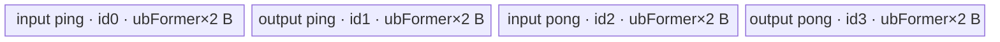

# NanToNum 950 ACLNN 算子知识

## 算子速览

| 项目 | 内容 |
|---|---|
| 实际入口 | 公开两段式 API `aclnnNanToNumGetWorkspaceSize` + `aclnnNanToNum`；本卡不包含原地变体 `aclnnInplaceNanToNum`。 |
| 计算语义 | 逐元素把 NaN、`+Inf`、`-Inf` 分别替换成 `nan`、`posinf`、`neginf`，其它值原样输出；整数与 BOOL 不可能出现这些浮点特殊值，ACLNN 直接复制。 |
| 输入输出 | `self/out` 同 shape、同 dtype，公开契约为 ND、至多 8 维、可非连续；dtype 为 FLOAT16、FLOAT32、BFLOAT16、INT8、INT16、INT32、INT64、UINT8、BOOL。 |
| 执行类型 | R-001 为框架 `Contiguous/ViewCopy` 恒等搬运，无算子自有 Kernel；R-002/R-003 的核心 `NanToNum` 均为单节点 `AIV_VECTOR`。无 Cube/AIC/MIX_CV。 |
| Kernel 路线 | R-001 整数/BOOL 恒等搬运；R-002 FP32 AIV；R-003 FP16/BF16 升到 FP32 判别后降精度。 |
| 核心资源 | 浮点路线：GM + 一个 `TBuf<VECCALC>`，按 DAG LEVEL_2 策略切成输入/输出各 ping/pong 的 4 个等长子区；寄存器完成比较与选择；Tiling 申报 16 MiB workspace，但 entry 不读该参数。 |
| 来源闭包 | `source_closed`：公开 ACLNN、executor 组图、L0 分流、950 OpDef/Tiling/POD、AIV entry/body、通用 ElementwiseSch 直接依赖、模板 key 与构建接线均闭合；`Contiguous/ViewCopy` 和 executor 内部调度作为明确框架边界。 |
| 验证状态 | 已完成源码闭包检查；本次知识提取未执行编译、真机、数值或性能测试。 |

## 接口与语义

### 计算语义

设 `N = product(self.shape)`。对每个 `0 <= i < N`：

```text
out[i] = nan     , if self[i] is NaN
       = posinf  , if self[i] is +Inf
       = neginf  , if self[i] is -Inf
       = self[i] , otherwise
```

FP32 路线直接在 float 寄存器中用 `x != x` 检测 NaN，并与按位构造的 `0x7f800000/0xff800000` 比较以检测正负无穷。FP16/BF16 路线先把输入 unpack 并 cast 到 FP32，完成同样的比较与三次 `Select`，再以 `CAST_RINT + NO_SAT` cast 回目标 dtype。INT8/INT16/INT32/INT64/UINT8/BOOL 在 ACLNN 层不创建 `NanToNum` 节点，三个替换属性不会被读取，输出就是输入值。

### 输入、输出与属性

| 参数 | shape/layout | dtype | 约束、默认值与语义 |
|---|---|---|---|
| `self` | 公开契约 ND；至多 8 维；与 `out` 同 shape；可非连续 | FLOAT16、FLOAT32、BFLOAT16、INT8、INT16、INT32、INT64、UINT8、BOOL | 必须非空；空 Tensor 在第一段直接成功返回。源码仅对 `FRACTAL_NZ` 打 warning，并不以此 warning 替代公开 ND 契约。 |
| `nan` | Host 标量 | `float` | 浮点路线中替换 NaN；FP16/BF16 路线最后按 `CAST_RINT` 转回输出 dtype；整数/BOOL 路线不读取。 |
| `posinf` | Host 标量 | `float` | 浮点路线中替换 `+Inf`；无额外范围校验。 |
| `neginf` | Host 标量 | `float` | 浮点路线中替换 `-Inf`；无额外范围校验。 |
| `out` | 与 `self` 同 shape、同公开 layout 契约；可非连续 | 必须与 `self` 相同 | 必须非空；最终通过 `ViewCopy` 写入用户视图。 |
| `workspaceSize` | Host 标量输出 | `uint64_t` | 由 executor 汇总；浮点核心节点 Tiling 固定申报 16 MiB，外围框架节点可能增加总量。 |
| `executor` | Host 对象 | `aclOpExecutor **` | 第一段创建并转移所有权，保存实际任务序列。 |
| `workspace` | Device 地址 | `void *` | 第二段输入，容量必须使用第一段返回值；AIV `nan_to_num` entry 保留参数但不读取。 |
| `stream` | runtime stream | `aclrtStream` | `CommonOpExecutorRun` 在该 stream 上执行 executor。 |

### 入口与版本

固定仓公开入口是无版本后缀的 `aclnnNanToNumGetWorkspaceSize/aclnnNanToNum`，没有同语义的更高版本。`aclnnInplaceNanToNum` 虽复用内部 `ExecNanToNumGetWorkspaceSize`，但其输出别名输入，属于独立原地语义，不纳入本卡。

公开产品表声明 Ascend 950、A3、A2 支持。950 由四层事实闭合：ACLNN 的设备 guard 接受 `IsRegBase()`，而 `IsRegBase` 对应 `DAV_3510`；`NanToNum` OpDef 只向 `ascend950` 注册 `nan_to_num_apt`；950 binary config 列出 FP16/BF16/FP32；算子 CMake 仅把 `ascend950` 接到 `arch35` Tiling。A2/A3 虽有公开支持声明和 ACLNN 设备 guard，但固定仓没有相应 OpDef、Tiling、Kernel、binary config 与活动 CMake 接线，因此不能达到 `source_closed`，不生成无后缀卡。

## Host/Launcher 执行流程

### 参数校验与前处理

`ExecNanToNumGetWorkspaceSize` 按以下顺序执行：

1. `CREATE_EXECUTOR()`；失败返回 `ACLNN_ERR_INNER_CREATE_EXECUTOR`。
2. `CheckParamsNanToNum` 依次检查 `self/out` 非空、当前设备允许、两者 dtype 相同且位于公开白名单、shape 相同、`self` 维数不超过 8；失败分别返回空指针或非法参数错误。
3. `CheckFormat(self)` 遇到 `FORMAT_FRACTAL_NZ` 仅记录 warning，不在此处返回错误；公开 API 契约仍只承诺 ND。
4. `self->IsEmpty()` 时写 `workspaceSize=0`、转移 executor 并成功返回，不创建任何搬运或计算节点。
5. `l0op::Contiguous(self)` 产生连续输入；失败返回 `ACLNN_ERR_INNER_NULLPTR`。
6. 若 `IsIntegralType(self.dtype, true)`，直接 `l0op::ViewCopy(selfContiguous, out)` 并返回；在当前白名单中即 INT8/INT16/INT32/INT64/UINT8/BOOL。
7. 否则调用 `l0op::NanToNum`：先按 view shape 与 dtype 分配连续临时输出；FP16/FP32/BF16 命中 `IsAiCoreSupport` 并由 `ADD_TO_LAUNCHER_LIST_AICORE(NanToNum, self, out, nan, posinf, neginf)` 添加核心任务。固定仓没有 AiCPU fallback，不支持类型会返回空指针。
8. `l0op::ViewCopy(outResult, out)` 把连续临时结果写入可能非连续的用户输出；随后 `GetWorkspaceSize()` 汇总 workspace，executor 所有权转移给调用者。第二段 `aclnnNanToNum` 只调用 `CommonOpExecutorRun`。

### 参数、Workspace 与生命周期

浮点路线的 `l0op::NanToNum` 通过 `executor->AllocTensor(self->GetViewShape(), self->GetDataType())` 创建连续临时结果；该 Tensor 至少存活到后续 `ViewCopy` 消费完成。950 Tiling 的 `SetTilingData` 把核心节点 workspace slice 固定为 `16 * 1024 * 1024` B；`nan_to_num(x, y, workspace, tiling)` 的函数体没有读取 `workspace`，因此该 slice 是运行时/框架预留，不是算法中间结果。

ACLNN 返回的总 workspace 不能机械等同于 16 MiB：`Contiguous/ViewCopy` 的临时区、executor 对齐和 slice offset 由框架实现决定，固定算子源码不可见；整数/BOOL 路线也只包含这些框架节点。调用者负责按第一段总量分配 workspace，并在第二段结束前保持输入、输出、workspace、executor 与 stream 有效。

### 启动图与失败传播

```text
aclnnNanToNumGetWorkspaceSize
  -> [empty] workspaceSize=0, no task
  -> [non-empty] Contiguous(self)
       -> [integral/bool] ViewCopy(selfContiguous, out)                    # R-001
       -> [floating] NanToNum(selfContiguous, attrs) -> ViewCopy(tmp, out) # R-002/R-003

aclnnNanToNum(workspace, workspaceSize, executor, stream)
  -> CommonOpExecutorRun(..., stream)
```

| 节点/边 | entry 与参数 | 交接介质 | ordering 与 owner/lifetime | 失败传播 |
|---|---|---|---|---|
| `Contiguous` | 框架 L0 节点，输入 `self` | executor 管理的连续 Tensor；物理 offset/extent 固定仓不可见 | executor 保存任务依赖并在第二段使用同一 stream；连续 Tensor 活到消费者结束 | 返回空指针则不组后续任务 |
| R-001 `ViewCopy` | 框架 L0 节点，`selfContiguous -> out` | 连续 GM 输入到用户输出视图 | executor/stream 顺序；无算子自有 POD 或 Kernel | 失败由第一段组图或第二段执行返回 |
| R-002/R-003 `NanToNum` | `nan_to_num(x,y,workspace,tiling)`；`blockDim=baseTiling.blockNum`；POD=`NanToNumTilingData` | 连续 GM 输入到连续临时 GM 输出；核心节点申报 16 MiB workspace 但 body 不读 | 单 AIV kernel；临时输出由 executor 持有到 `ViewCopy` | Tiling、launch 或执行失败阻断消费者 |
| `NanToNum -> ViewCopy` | producer 为 AIV `nan_to_num`，consumer 为框架 `ViewCopy` | `outResult`，shape/dtype 与 `self` 相同；workspace offset 固定仓不可见 | 同一 executor 的任务依赖与 stream 顺序保证可见性 | producer 失败时不会产生可消费结果 |
| 最终 `ViewCopy` | 框架 L0 节点，`outResult -> out` | 连续临时结果到用户视图 | executor 持有临时结果直到写回完成 | 错误由 `CommonOpExecutorRun` 返回 |

## Route 与参数设计

### 分核与资源计算

R-002/R-003 共用 Elementwise Tiling。令 `N=product(output.storage_shape)`、`s=sizeof(T)` B、`P=平台 AIV 核数`、`U=平台 UB 字节数`。本 DAG 为一个 CopyIn、一个直连 CopyOut 的计算节点，`MemOptCfg<LEVEL_2>` 得到 `BufferNum=4`：

```text
C = min(ceil(N * s * 8 / 32768), P)            # 目标核数；32768 bit = 4 KiB/核
blockFormer = ceil(ceil(N / C) / 512) * 512    # 元素；源码常量名含 BYTE，但公式直接对元素数对齐
blockNum = ceil(N / blockFormer)                # 实际 blockDim
blockTail = N - (blockNum - 1) * blockFormer    # 元素

alignFactor = 256 / s                           # 元素，对应 256 B
maxElemNums = floor(U / (4 * s))                # 元素
ubFormer = floor(maxElemNums / alignFactor) * alignFactor

ubLoopFormer = ceil(blockFormer / ubFormer)
ubLoopTail = ceil(blockTail / ubFormer)
ubTailFormer = blockFormer - (ubLoopFormer - 1) * ubFormer
ubTailTail = blockTail - (ubLoopTail - 1) * ubFormer
```

`N` 任一维为 0、`P==0`、`ubFormer==0`、shape 不匹配或平台信息不可得都会使 Tiling 失败。正常公开空 Tensor 已在 ACLNN 层提前返回，不到达 Tiling。`blockNum` 写入 `SetBlockDim`；每核 GM 基址为 `blockFormer * blockIdx * s`，最后一核用 tail loop/tail tile 字段。

### Route 选择

| 顺序 | Route | Key/模板 | 精确选择条件与优先级 | 不适用去向 |
|---:|---|---|---|---|
| 1 | R-001 整数/BOOL 恒等搬运 | 无 TilingKey；框架 `ViewCopy` | 非空，且 `IsIntegralType(DataType(self.dtype), true)`；当前白名单对应 INT8/INT16/INT32/INT64/UINT8/BOOL | 非整数进入 L0 `NanToNum` |
| 2 | R-002 FP32 AIV | key `7`；`ElementwiseSch<1, NanToNumDAG<float>::OpDag>` | 非空，dtype=FLOAT32；Host 先令 `scheMode=1,dType=3` | 其它浮点进入下一项 |
| 3 | R-003 FP16/BF16 AIV | FP16 key `3`、BF16 key `5`；`ElementwiseSch<1, NanToNumDAG<T>::OpDag>` | 非空，dtype=FLOAT16 或 BFLOAT16；Host `dType=1/2` | 其余 dtype 在 L0 无 AiCPU fallback，组图失败 |

```text
if self/out invalid or device unsupported: ACLNN_ERR_*
else if self.empty: success, workspaceSize=0
else:
  x = Contiguous(self)
  if IsIntegralType(self.dtype, includeBool=true):
    ViewCopy(x, out)                                  # R-001
  else:
    if dtype == FP32: key = encode(scheMode=1,dType=3) = 7   # R-002
    elif dtype == FP16: key = encode(1,1) = 3                 # R-003
    elif dtype == BF16: key = encode(1,2) = 5                 # R-003
    else: fail (no AiCPU fallback)
    launch nan_to_num; ViewCopy(tmp, out)
```

模板 key 的 `schMode` 占低 1 bit，UINT list `{0,1}` 编码的是列表索引；`dType` 为 8-bit 原值并左移 1 bit，所以 Host 固定的 `scheMode=1` 产生 `1 | (dType << 1)`。模板声明虽实例化 `schMode=0/1`，但 `ElewiseBaseTiling::GetScheMode()` 固定返回 1，因此 mode 0 对本公开入口不可达。

### 模板/实现执行矩阵

| Route | key/selector | dtype/shape/platform 完整命中条件 | 执行拓扑与 Kernel 节点 | 实际模板/body | 内存与同步特征 | tail/fallback |
|---|---|---|---|---|---|---|
| R-001 整数/BOOL 恒等搬运 | `IsIntegralType(..., true)` | 950；非空；INT8/INT16/INT32/INT64/UINT8/BOOL；同 shape/dtype | `Contiguous -> ViewCopy`，无自有 Kernel | 框架边界 | executor 管理 GM/临时区；算子无 UB/POD/workspace 公式 | 空 Tensor更早返回；框架失败返回错误 |
| R-002 FP32 AIV | key 7 | 950；非空；FLOAT32；同 shape/dtype | 单 AIV `nan_to_num`，外围前后各框架节点 | `ElementwiseSch<1,NanToNumDAG<float>::OpDag>` -> `NanToNumCustom<float>` | 4 个 `ubFormer*4` B 子区；MTE2/V/MTE3 Mutex；float 寄存器 | `UpdateMask<float>(count)` 保护寄存器尾；Tiling 不可用则失败 |
| R-003 FP16/BF16 AIV | key 3/5 | 950；非空；FLOAT16/BFLOAT16；同 shape/dtype | 单 AIV `nan_to_num`，外围前后各框架节点 | `ElementwiseSch<1,NanToNumDAG<half/bfloat16_t>::OpDag>` -> `NanToNumCustom<T>` | 4 个 `ubFormer*2` B 子区；unpack/cast/pack；相同 Mutex 图 | GM tail 由 DataCopyPad；寄存器 tail 由 FP32 mask；不可用则失败 |

### 隐藏性能 Guard

| Guard | Host/Tiling 条件 | Device/资源原因 | 影响 Route | 不满足时去向 | 源码符号 |
|---|---|---|---|---|---|
| 950 公开/构建平台 | `IsRegBase()` 且 OpDef/CMake/binary 均为 `ascend950` | 当前 Device body 使用 DAV3510 MicroAPI 与 AIV-only entry | R-001/R-002/R-003 | ACLNN 设备错误，或平台实现无法闭合 | `CheckDtypeValid`、`IsRegBase`、`NanToNum::NanToNum`、算子 CMake |
| dtype 分流 | API 白名单后，整数先 `IsIntegralType(..., true)`；AICore 只认 FP32/FP16/BF16 | 整数没有 NaN/Inf，可避免无意义比较；Kernel 无整数实例 | 全部 | L0 不支持类型返回 `nullptr`，无 AiCPU fallback | `ExecNanToNumGetWorkspaceSize`、`IsAiCoreSupport` |
| shape 非空 | ACLNN 空 Tensor提前返回；Tiling 要求每维非 0 | Tiling 的核数、block/tail 除法要求正元素域 | R-002/R-003 | 空域成功零任务；绕过 ACLNN 直接到 Tiling 则失败 | `ExecNanToNumGetWorkspaceSize`、`ElewiseTiling` |
| UB 上界 | `ubFormer=floor((U/(4s))/(256/s))*(256/s) > 0` | 一个 TBuf 需要输入/输出各 ping/pong，且 tile 对齐 256 B | R-002/R-003 | Tiling `GRAPH_FAILED` | `GetMaxElemNum`、`ElementwiseSch::Init` |
| 4 KiB/核启发式 | `C=min(ceil(N*s*8/32768),P)` | 避免给每核过小的数据域；不是 dtype route 切换 | R-002/R-003 | 自动减小核数，不另设 fallback | `ElewiseTiling` |
| 512 元素 block 对齐 | `blockFormer=ceil(ceil(N/C)/512)*512` | 固定分核边界，最后核单独处理剩余元素 | R-002/R-003 | 最后核使用 `blockTail` 派生字段 | `ElewiseTiling` |
| 寄存器 tail | `loopNum=ceil(count/(VECTOR_REG_WIDTH/4))`，每轮 `UpdateMask<float>(count)` | FP16/BF16 也以 FP32 lane 数计算，避免无效 lane 参与 compare/store | R-002/R-003 | 最后一轮 mask 截断 | `NanToNumCustom<T>::NanToNumCustom` |

### POD/ABI

`EleBaseTilingData` 按自然 8-byte 对齐为 80 B；`NanToNumTilingData` 在其后追加三个 float，尾部补齐后为 96 B、对齐 8 B。Host 与 Device 都直接包含同一结构定义。

| 结构 | 字段 | 类型/位宽 | ABI 布局 | 单位 | Host/launcher producer | Device consumer | 边界 |
|---|---|---|---|---|---|---|---|
| `NanToNumTilingData.baseTiling` | `dim0` | `int64_t`/64 | offset 0，size 8 | 元素 | `AdaptEleBaseTilingData <- ElewiseTilingData.dim0=N` | 当前 `ElementwiseSch` 不直接读取 | shape 乘积在 `int64_t` 中计算；固定源码未额外检查乘法溢出 |
| `baseTiling` | `coreNum` | `int32_t`/32 | offset 8，size 4 | AIV core | `static_cast<int32_t>(elewiseTilingData.coreNum)` | 当前 scheduler 不直接读取 | 平台 coreNum 已限制目标核数；发生窄化前无独立范围检查 |
| `baseTiling` | `ubFormer` | `int32_t`/32 | offset 12，size 4 | 元素/tile | `GetMaxElemNum(U,params)` 后窄化写入 | `Init` 分配与 `Process` 整 tile 长度 | 必须大于 0；写入前无独立 int32 上界检查 |
| `baseTiling` | `blockFormer` | `int64_t`/64 | offset 16，size 8 | 元素/core | 512 元素向上对齐公式 | `CalcBlockOffset` 与核 GM 基址 | 最后一核的实际量由 tail 字段表达 |
| `baseTiling` | `blockNum` | `int64_t`/64 | offset 24，size 8 | block | `ceil(N/blockFormer)` | `Process` 判断最后核；Host 同值设 `blockDim` | 必须正数且不超过平台可启动范围 |
| `baseTiling` | `ubLoopOfFormerBlock` | `int64_t`/64 | offset 32，size 8 | tile loop | `ceil(blockFormer/ubFormer)` | 非末核 `Process.loopNum` | 至少 1 |
| `baseTiling` | `ubLoopOfTailBlock` | `int64_t`/64 | offset 40，size 8 | tile loop | `ceil(blockTail/ubFormer)` | 末核 `Process.loopNum` | 至少 1 |
| `baseTiling` | `ubTailOfFormerBlock` | `int64_t`/64 | offset 48，size 8 | 元素 | former block 余量公式 | 非末核最后一次 `Run` 的 `tileLength` | `(0,ubFormer]` |
| `baseTiling` | `ubTailOfTailBlock` | `int64_t`/64 | offset 56，size 8 | 元素 | tail block 余量公式 | 末核最后一次 `Run` 的 `tileLength` | `(0,ubFormer]` |
| `baseTiling` | `elemNum` | `int64_t`/64 | offset 64，size 8 | 元素 | 写 `maxElemNum` | 当前 Device scheduler 不读取 | 名称不是总元素数，而是当前最大 tile 元素数 |
| `baseTiling` | `scheMode` | `uint64_t`/64 | offset 72，size 8 | 模板枚举 | `GetScheMode()` 固定 1 | entry 本体不读；Host 用于生成模板 key | mode 0 虽编译选择存在但 Host 不可达 |
| `NanToNumTilingData` | `nan` | `float`/32 | offset 80，size 4 | 数值 | `SetAttr`: `*GetAttrPointer<float>(0)` | entry `SetVar<float,0>` -> `NanToNumCustom` | 属性指针为空则 Tiling 失败；R-001 无 POD、不读取 |
| `NanToNumTilingData` | `posinf` | `float`/32 | offset 84，size 4 | 数值 | `SetAttr`: `*GetAttrPointer<float>(1)` | entry `SetVar<float,1>` -> `NanToNumCustom` | 同上 |
| `NanToNumTilingData` | `neginf` | `float`/32 | offset 88，size 4 | 数值 | `SetAttr`: `*GetAttrPointer<float>(2)` | entry `SetVar<float,2>` -> `NanToNumCustom` | 同上；结构尾部 padding 为 4 B |

### Route 源码闭包

| Route | Key/selector | Host/Tiling producer | POD/参数 | Kernel entry/router 节点 | Kernel body/直接依赖 | 构建接线 |
|---|---|---|---|---|---|---|
| R-001 整数/BOOL 恒等搬运 | `IsIntegralType(...,true)` | `op_api/aclnn_nan_to_num.cpp::ExecNanToNumGetWorkspaceSize` | 无自有 POD；executor 参数 | 无自有 entry；框架 `ViewCopy` | 框架边界 | ACLNN 源由 `add_all_modules_sources` 收集 |
| R-002 FP32 AIV | key 7 | `NanToNumTiling::RunTiling/SetTilingData` + `ElewiseBaseTiling::DoTiling<float DAG>` | `NanToNumTilingData` | `op_kernel/nan_to_num_apt.cpp::nan_to_num<1,3>` | `ElementwiseSch` -> `NanToNumCustom<float>` -> `Vec::CopyIn/CopyOut` | OpDef `ascend950` + binary FP32 项 + CMake `arch35` |
| R-003 FP16/BF16 AIV | key 3/5 | 同上，DAG 实例为 `half/bfloat16_t` | 同一 POD | `nan_to_num<1,1>` / `nan_to_num<1,2>` | `ElementwiseSch` -> `NanToNumCustom<T>` 的 unpack/cast/pack 分支 | OpDef `ascend950` + binary FP16/BF16 项 + CMake `arch35` |

## Kernel 实现

### 公共执行流程

R-002/R-003 都是一个 AIV-only 核心节点。entry 解析 `NanToNumTilingData`，构造 `TPipe` 与对应 dtype 的 `ElementwiseSch<schMode,OpDag>`，把三个 float 属性写进 DAG Var 0/1/2，随后 `Init(x,y)` 与 `Process()`。DAG 的函数序固定为 `Vec::CopyIn<T> -> NanToNumCustom<T> -> Vec::CopyOut<T>`。

`ElementwiseSch::Init` 以当前核的 `blockFormer*blockIdx*s` 绑定 GM 基址，并一次性 `InitBuffer(ubFormer * s * 4)`。`Process` 选择 former/tail core 的 loop 与 tail 字段；整 tile 与尾 tile 都调用同一 DAG，tile 序号的 `i&1` 在 ping/pong 子区间交替。每个子阶段通过同一 buffer id 上的 `PIPE_MTE2/PIPE_V/PIPE_MTE3` Mutex lock/unlock 建立 producer-consumer 与复用顺序。

### Route R-001：整数/BOOL 恒等搬运

#### 适用条件

##### 选择证据

| 层级 | 文件 | 符号 | 源码谓词/参数 | 结果/下一跳 |
|---|---|---|---|---|
| ACLNN | `math/nan_to_num/op_api/aclnn_nan_to_num.cpp` | `ExecNanToNumGetWorkspaceSize` | `self->IsEmpty()` 更早返回；随后 `IsIntegralType(DataType(self->GetDataType()), true)` | 直接 `ViewCopy(selfContiguous,out)`，不调用 L0 `NanToNum` |
| API guard | 同文件 | `DTYPE_SUPPORT_LIST` | INT8/INT16/INT32/INT64/UINT8/BOOL 位于白名单 | 允许进入恒等路线 |
| Launcher | 同文件 | `ExecNanToNumGetWorkspaceSize` | `viewCopyResult != nullptr` | 汇总 workspace 并返回；失败为内部空指针错误 |

#### Device 数据流

##### 函数级调用链

```text
aclnnNanToNumGetWorkspaceSize
  -> l0op::Contiguous(self)                 # 框架边界
  -> IsIntegralType(dtype, true)
  -> l0op::ViewCopy(selfContiguous, out)    # 框架边界
aclnnNanToNum
  -> CommonOpExecutorRun(..., stream)
```

##### 源码等价伪码

```text
# 伪码；实际搬运 kernel、分块与地址公式属于 Contiguous/ViewCopy 框架边界
assert dtype in {INT8,INT16,INT32,INT64,UINT8,BOOL}
x = contiguous(self)
out[...] = view_copy(x)
# nan/posinf/neginf are intentionally unused
```

#### 内存与数据搬运

##### 资源与搬运表

| 层级/缓冲区 | offset/地址公式 | extent/容量公式 | dtype/layout | producer | consumer | owner/lifetime | 对齐/复用 |
|---|---|---|---|---|---|---|---|
| 用户 GM `self` | 由 aclTensor view/stride 描述 | `N*s` 逻辑字节 | 公开 ND，可非连续 | 调用者 | `Contiguous` | 调用者持有到第二段完成 | 框架决定是否复用原存储 |
| 连续临时 Tensor | 固定仓不可见 | 逻辑 `N*s`；物理容量固定仓不可见 | 连续、同 dtype | `Contiguous` | `ViewCopy` | executor 持有到消费完成 | 对齐/别名规则固定仓不可见 |
| 用户 GM `out` | 由输出 view/stride 描述 | `N*s` 逻辑字节 | 同 dtype/shape | `ViewCopy` | 调用者 | 调用者持有 | 非连续写回细节为框架边界 |

##### 分层内存布局

N/A：本 Route 没有算子自有 AIV Kernel、UB、TQue、TBuf 或寄存器布局；实际替代路径是框架 `Contiguous/ViewCopy`。

##### 字节账与复用顺序

```text
UB_total = N/A (no operator-owned kernel)
dynamic_ub = N/A
workspace_total = executor.GetWorkspaceSize()
                  # Contiguous/ViewCopy slice 公式与 offset 固定算子源码不可见
```

| 复用子区 | 写入者 | 读取者/消费点 | 下一次覆盖 | 同步或释放依据 | 安全条件 |
|---|---|---|---|---|---|
| 连续临时 Tensor | `Contiguous` | `ViewCopy` | consumer 完成后由 executor 回收 | executor 的任务依赖与 stream 顺序 | 第二段结束前输入、输出和 executor 均有效 |

#### 同步、精度与尾块

##### 同步与数值边界表

| 阶段 | primitive/机制 | producer | consumer/等待点 | 保护对象 | 精度/尾块 |
|---|---|---|---|---|---|
| 连续化到写回 | executor/stream 依赖，细节固定仓不可见 | `Contiguous` | `ViewCopy` | 连续临时 Tensor | 位级恒等；搬运 tail 由框架实现，三个 float 属性不参与 |

#### 关键实现

##### 符号证据表

| 阶段 | 文件 | 符号/模板实例 | 实现事实 |
|---|---|---|---|
| Host/Tiling producer | `math/nan_to_num/op_api/aclnn_nan_to_num.cpp` | `ExecNanToNumGetWorkspaceSize` | 整数/BOOL 在 ACLNN 层直接 `ViewCopy` |
| Kernel entry/router | N/A | N/A | 本 Route 不创建 `NanToNum` Kernel |
| Device body/helper | 框架边界 | `l0op::Contiguous`、`l0op::ViewCopy` | 算子仓只公开组图，不公开框架 Device body |

### Route R-002：FP32 AIV

#### 适用条件

##### 选择证据

| 层级 | 文件 | 符号 | 源码谓词/参数 | 结果/下一跳 |
|---|---|---|---|---|
| ACLNN/L0 | `math/nan_to_num/op_api/nan_to_num.cpp` | `IsAiCoreSupport`、`NanToNum` | FLOAT 在 AICore 白名单 | 添加 `NanToNum` AICore launcher |
| Tiling | `math/nan_to_num/op_host/arch35/nan_to_num_tiling_arch35.cpp` | `RunTiling` | `outputDtype == ge::DT_FLOAT` | `dType=TPL_FP32(3)`，实例化 float DAG |
| Key | 同文件 + `nan_to_num_struct.h` | `SetTilingData`、模板声明 | `scheMode=1,dType=3` | key 7，`blockDim=blockNum` |
| Entry | `math/nan_to_num/op_kernel/nan_to_num_apt.cpp` | `nan_to_num<1,3>` | `dType == TPL_FP32` | 构造 `NanToNumDAG<float>` scheduler |

#### Device 数据流

##### 函数级调用链

```text
ADD_TO_LAUNCHER_LIST_AICORE(NanToNum)
  -> nan_to_num<1,TPL_FP32>(x,y,workspace,tiling)
    -> ElementwiseSch<1,NanToNumDAG<float>::OpDag>::Init/Process
      -> Vec::CopyIn<float> (DataCopyPad GM->UB)
      -> NanToNumCustom<float>::NanToNumCustom
      -> Vec::CopyOut<float> (DataCopyPad UB->GM)
  -> executor edge: temporary y -> ViewCopy -> user out
```

##### 源码等价伪码

```text
# 伪码；所有 offset/tail 均来自 POD
coreBase = blockFormer * blockIdx
loopNum = lastCore ? ubLoopOfTailBlock : ubLoopOfFormerBlock
tailLen = lastCore ? ubTailOfTailBlock : ubTailOfFormerBlock
offset = 0
for tile in 0 .. loopNum-1:
    count = (tile == loopNum-1) ? tailLen : ubFormer
    pp = tile & 1
    MTE2.lock(inputBuf[pp])
    DataCopyPad(inputUB[pp], x[coreBase+offset], count*4 B)
    MTE2.unlock(inputBuf[pp])

    V.lock(outputBuf[pp]); V.lock(inputBuf[pp])
    remaining = count
    for regLoop in 0 .. ceil(count/(VECTOR_REG_WIDTH/4))-1:
        mask = UpdateMask<float>(remaining)
        vin = load_DIST_NORM(inputUB + regLoop*VL)
        mNan = (vin != vin); mPos = (vin == +Inf); mNeg = (vin == -Inf)
        vout = select(mNan, nan, vin)
        vout = select(mPos, posinf, vout)
        vout = select(mNeg, neginf, vout)
        store_DIST_NORM_B32(outputUB + regLoop*VL, vout, mask)
    V.unlock(inputBuf[pp]); V.unlock(outputBuf[pp])

    MTE3.lock(outputBuf[pp])
    DataCopyPad(y[coreBase+offset], outputUB[pp], count*4 B)
    MTE3.unlock(outputBuf[pp])
    offset += count
```

#### 内存与数据搬运

##### 资源与搬运表

| 层级/缓冲区 | offset/地址公式 | extent/容量公式 | dtype/layout | producer | consumer | owner/lifetime | 对齐/复用 |
|---|---|---|---|---|---|---|---|
| GM `x` | `(blockFormer*blockIdx + tileOffset)*4` B | 当前 tile `count*4` B | FP32 contiguous | `Contiguous`/调用者 | `Vec::CopyIn<float>` | 跨 Kernel 有效 | `DataCopyPadExtParams{1,count*4,0,0,0}` |
| input UB ping/pong | id 0/id 2，各 `id*blockLen` | 各 `ubFormer*4` B | FP32 | MTE2 `DataCopyPad` | Vector load | 单 tile；两相交替 | 256 B tile 对齐；MTE2/V Mutex |
| output UB ping/pong | id 1/id 3，各 `id*blockLen` | 各 `ubFormer*4` B | FP32 | `NanToNumCustom<float>` | MTE3 `DataCopyPad` | 单 tile；两相交替 | 直连 CopyOut，无额外 temp；V/MTE3 Mutex |
| 寄存器 | 不可寻址 | `vregInput/vregOutput`、3 个 replacement reg、4 个 mask；具体物理字节固定仓不可见 | FP32 register | MicroAPI load/duplicate | compare/select/store | 每个 reg loop | mask zeroing；输出 reg 连续原地覆盖三次选择结果 |
| GM `y` | 与输入相同元素 offset | 当前 tile `count*4` B | FP32 contiguous | `Vec::CopyOut<float>` | 后续 `ViewCopy` | executor 临时 Tensor | 只提交有效字节数 |
| workspace slice | runtime 分配 offset 固定仓不可见 | 16,777,216 B | opaque | executor | entry 未读取 | 核心节点期间保留 | 预留，不参与算法 |

##### 分层内存布局


##### 字节账与复用顺序

```text
blockLen = ubFormer * 4 B
UB_total = 4 * blockLen = 4 * ubFormer * 4 B
UB_total <= U
dynamic_ub = N/A
workspace_core = 16 * 1024 * 1024 B (entry does not read it)
workspace_total = executor.GetWorkspaceSize() >= framework/core aligned slices
```

| 复用子区 | 写入者 | 读取者/消费点 | 下一次覆盖 | 同步或释放依据 | 安全条件 |
|---|---|---|---|---|---|
| input ping/pong | MTE2 CopyIn | Vector `DataCopy` load | 两个 tile 后同相 MTE2 覆盖 | `Get/ReleaseTensor<VECIN>` 与 `<VECCALC>` 映射到同 buffer id 的 Mutex | Vector 已完成当前 tile 读取 |
| output ping/pong | Vector store | MTE3 CopyOut | 两个 tile 后同相 Vector 覆盖 | `<VECCALC>` 与 `<VECOUT>` Mutex | MTE3 已完成当前 tile 写 GM |
| `vregOutput` | 第一次 NaN `Select` | 后续 `Select`/最终 store | 下一 reg loop | `__VEC_SCOPE__` 顺序 | 三个 compare mask 均取自原输入，覆盖次序不改变互斥分类 |

#### 同步、精度与尾块

##### 同步与数值边界表

| 阶段 | primitive/机制 | producer | consumer/等待点 | 保护对象 | 精度/尾块 |
|---|---|---|---|---|---|
| GM→UB | `Mutex::Lock/Unlock<PIPE_MTE2>` | MTE2 `DataCopyPad` | Vector 对同 id 的 `PIPE_V` lock | input ping/pong | copy 长度为 `count*4` B；无 padding 写入有效输出 |
| compare/select | `PIPE_V` Mutex + `__VEC_SCOPE__` | input UB/duplicate reg | output reg/store | input/output UB 子区 | 全程 FP32；`x!=x` 检测 NaN；mask 每轮消费剩余 count |
| UB→GM | `Mutex::Lock/Unlock<PIPE_MTE3>` | output UB | GM y / 后续节点 | output ping/pong | `DataCopyPad` 仅写 `count*4` B |
| core/tile tail | POD former/tail 字段 + `UpdateMask` | Host Tiling | scheduler/MicroAPI | 最后一核、最后 tile、最后 reg loop | 空域被 ACLNN 提前过滤；无效 lane 不写 UB/GM |

#### 关键实现

##### 符号证据表

| 阶段 | 文件 | 符号/模板实例 | 实现事实 |
|---|---|---|---|
| Host/Tiling producer | `math/nan_to_num/op_host/arch35/nan_to_num_tiling_arch35.cpp` | `RunTiling`、`SetTilingData` | FP32 dtype 分支、key、blockDim、POD attrs 与 16 MiB workspace |
| Kernel entry/router | `math/nan_to_num/op_kernel/nan_to_num_apt.cpp` | `nan_to_num<1,TPL_FP32>` | AIV-only；POD 解析、SetVar、scheduler Init/Process |
| Device body/helper | `math/nan_to_num/op_kernel/arch35/nan_to_num_dag.h` | `NanToNumCustom<float>` | FP32 load、3 compare、3 select、masked store |
| Device scheduler | `opbase/.../elewise_sch.h`、`vec.h`、`sync.h` | `ElementwiseSch`、`Vec::CopyIn/CopyOut`、`GetTensor/ReleaseTensor` | 分核/分 tile 地址、4-buffer pool、DataCopyPad 与管线 Mutex |

### Route R-003：FP16/BF16 AIV

#### 适用条件

##### 选择证据

| 层级 | 文件 | 符号 | 源码谓词/参数 | 结果/下一跳 |
|---|---|---|---|---|
| ACLNN/L0 | `math/nan_to_num/op_api/nan_to_num.cpp` | `IsAiCoreSupport`、`NanToNum` | FLOAT16/BFLOAT16 在 AICore 白名单 | 添加 `NanToNum` AICore launcher |
| Tiling | `math/nan_to_num/op_host/arch35/nan_to_num_tiling_arch35.cpp` | `RunTiling` | output dtype 为 FLOAT16/BF16 | `dType=1/2`，实例化对应 DAG |
| Key | 同文件 + `nan_to_num_struct.h` | `SetTilingData`、模板声明 | `(scheMode,dType)=(1,1)/(1,2)` | key 3/5，`blockDim=blockNum` |
| Entry | `math/nan_to_num/op_kernel/nan_to_num_apt.cpp` | `nan_to_num<1,1/2>` | 编译期 dtype 分支 | `NanToNumDAG<half/bfloat16_t>` |

#### Device 数据流

##### 函数级调用链

```text
ADD_TO_LAUNCHER_LIST_AICORE(NanToNum)
  -> nan_to_num<1,TPL_FP16/TPL_BF16>
    -> ElementwiseSch<1,NanToNumDAG<T>::OpDag>::Init/Process
      -> Vec::CopyIn<T> (DataCopyPad GM->UB)
      -> NanToNumCustom<T>
           -> DIST_UNPACK_B16 -> Cast<T->float>
           -> Compare/Select in float
           -> Cast<float->T, CAST_RINT, NO_SAT> -> DIST_PACK_B32
      -> Vec::CopyOut<T> (DataCopyPad UB->GM)
  -> executor edge: temporary y -> ViewCopy -> user out
```

##### 源码等价伪码

```text
# 伪码；core/tile/MTE2/MTE3 结构与 R-002 相同，s=2 B
for each assigned tile(count, pingPong):
    DataCopyPad(inputUB<T>, x, count*2 B)
    remaining = count
    for regLoop in 0 .. ceil(count/(VECTOR_REG_WIDTH/4))-1:
        mask = UpdateMask<float>(remaining)
        vin16 = load_DIST_UNPACK_B16(inputUB + regLoop*VL)
        vin32 = Cast<float,T,{ZERO,UNKNOWN,ZEROING,UNKNOWN}>(vin16, mask)
        mNan = (vin32 != vin32); mPos = (vin32 == +Inf); mNeg = (vin32 == -Inf)
        vout32 = select(mNan, nan, vin32)
        vout32 = select(mPos, posinf, vout32)
        vout32 = select(mNeg, neginf, vout32)
        vout16 = Cast<T,float,{ZERO,NO_SAT,ZEROING,CAST_RINT}>(vout32, mask)
        store_DIST_PACK_B32(outputUB + regLoop*VL, vout16, mask)
    DataCopyPad(y, outputUB<T>, count*2 B)
```

#### 内存与数据搬运

##### 资源与搬运表

| 层级/缓冲区 | offset/地址公式 | extent/容量公式 | dtype/layout | producer | consumer | owner/lifetime | 对齐/复用 |
|---|---|---|---|---|---|---|---|
| GM `x` | `(blockFormer*blockIdx + tileOffset)*2` B | `count*2` B | FP16/BF16 contiguous | `Contiguous`/调用者 | `Vec::CopyIn<T>` | 跨 Kernel 有效 | DataCopyPad 单 block |
| input UB ping/pong | id 0/id 2 | 各 `ubFormer*2` B | T | MTE2 | unpack load | 单 tile、两相交替 | 256 B tile 对齐；MTE2/V Mutex |
| output UB ping/pong | id 1/id 3 | 各 `ubFormer*2` B | T | pack store | MTE3 | 单 tile、两相交替 | 直连 CopyOut；V/MTE3 Mutex |
| FP16/BF16 寄存器 | 不可寻址 | `vregInput16/vregOutput16`；物理字节固定仓不可见 | T register | unpack/load、downcast | upcast、pack/store | 每 reg loop | 只处理 mask 有效 lane |
| FP32 寄存器 | 不可寻址 | input/output、3 replacement reg 与 masks | FP32 register | upcast/duplicate | compare/select/downcast | 每 reg loop | 中间判别与属性均为 float |
| GM `y` | 同输入元素 offset | `count*2` B | FP16/BF16 contiguous | MTE3 | `ViewCopy` | executor 临时 Tensor | 有效字节写回 |
| workspace slice | runtime offset 固定仓不可见 | 16,777,216 B | opaque | executor | entry 未读取 | 核心节点期间 | 算法不使用 |

##### 分层内存布局



##### 字节账与复用顺序

```text
blockLen = ubFormer * 2 B
UB_total = 4 * blockLen = 4 * ubFormer * 2 B
UB_total <= U
dynamic_ub = N/A
workspace_core = 16 * 1024 * 1024 B (unused by entry)
workspace_total = executor.GetWorkspaceSize()
```

| 复用子区 | 写入者 | 读取者/消费点 | 下一次覆盖 | 同步或释放依据 | 安全条件 |
|---|---|---|---|---|---|
| input ping/pong | MTE2 CopyIn | unpack load/Vector | 两个 tile 后同相 MTE2 | MTE2/V Mutex | 当前 Vector 消费完成 |
| output ping/pong | pack store/Vector | MTE3 CopyOut | 两个 tile 后同相 Vector | V/MTE3 Mutex | 当前 MTE3 写回完成 |
| `vregOutput` FP32 | 连续三次 `Select` | downcast | 下一 reg loop | V 指令顺序 | compare masks 均来自原输入，互斥分类保持不变 |

#### 同步、精度与尾块

##### 同步与数值边界表

| 阶段 | primitive/机制 | producer | consumer/等待点 | 保护对象 | 精度/尾块 |
|---|---|---|---|---|---|
| GM→UB | MTE2 Mutex + `DataCopyPad` | GM x | Vector unpack | input子区 | `count*2` B；框架 pad API处理非整搬运尾 |
| unpack/upcast | `DIST_UNPACK_B16` + `Cast<float,T,castTrait0>` | input UB | FP32 compare | input regs | ZEROING mask；FP16/BF16 有限值与 Inf/NaN 在 FP32 中判别 |
| compare/select | FP32 MicroAPI | upcast输入与 float attrs | downcast | FP32 regs | `x!=x`、`==±Inf`；每轮 mask 消费剩余 count |
| downcast/pack | `Cast<T,float,castTrait1>` + `DIST_PACK_B32` | FP32结果 | output UB | output regs/UB | `NO_SAT + CAST_RINT + ZEROING`；替换值按目标 dtype 舍入 |
| UB→GM | MTE3 Mutex + `DataCopyPad` | output UB | GM y | output子区 | 仅写有效 `count*2` B |
| core/tile tail | POD former/tail + reg mask | Host Tiling | scheduler/MicroAPI | 最后一核/tile/lane | 无效 lane 不参与有效输出 |

#### 关键实现

##### 符号证据表

| 阶段 | 文件 | 符号/模板实例 | 实现事实 |
|---|---|---|---|
| Host/Tiling producer | `math/nan_to_num/op_host/arch35/nan_to_num_tiling_arch35.cpp` | `RunTiling`、`SetTilingData` | FP16/BF16 dtype 分支、key、POD 与 blockDim |
| Kernel entry/router | `math/nan_to_num/op_kernel/nan_to_num_apt.cpp` | `nan_to_num<1,TPL_FP16/TPL_BF16>` | dtype 到 scheduler 实例映射 |
| Device body/helper | `math/nan_to_num/op_kernel/arch35/nan_to_num_dag.h` | `NanToNumCustom<half/bfloat16_t>` | unpack、FP32 compare/select、RINT downcast、pack 与 mask |
| Device scheduler | `opbase/.../elewise_sch.h`、`vec.h`、`sync.h` | `ElementwiseSch`、`Vec::CopyIn/CopyOut`、Mutex helper | 4-buffer pool、tile loop、地址、DataCopyPad 与同步 |

## 算子特定优化

### Trick T-001：整数/BOOL 在 ACLNN 层消除无意义 Kernel

#### 触发与源码依据

- 适用 Route：R-001
- 触发条件：非空且 `IsIntegralType(DataType(self->GetDataType()), true)`。
- Golden 来源：[`math/nan_to_num/op_api/aclnn_nan_to_num.cpp:94-101`](../../../../../../../cann-ops-raw/ascendc/ops-math/165d41f02a43a62324b434cb6bda7c533b14da3e/math/nan_to_num/op_api/aclnn_nan_to_num.cpp#L94-L101)

**官方源码（固定 Commit 连续逐字摘录）**：

```cpp
  // 如果self的dtype为整形，则返回self的值。
  if (IsIntegralType(DataType(self->GetDataType()), true)) {
    auto viewCopyResult = l0op::ViewCopy(selfContiguous, out, uniqueExecutor.get());
    CHECK_RET(viewCopyResult != nullptr, ACLNN_ERR_INNER_NULLPTR);
    *workspaceSize = uniqueExecutor->GetWorkspaceSize();
    uniqueExecutor.ReleaseTo(executor);
    return ACLNN_SUCCESS;
  }
```

#### 机制与设计原因

整数与 BOOL 不含 IEEE NaN/Inf，结果必然等于输入。该分支在组 executor 时直接复用既有连续化结果并写回用户输出，避免创建 `NanToNum` 临时输出、Tiling、AIV launch、UB 搬运和三组比较。`includeBool=true` 与当前 API 白名单共同确定 BOOL 也走该路线；三个 float 属性在此路线无 consumer。

#### 迁移边界

- 适用：输入域在类型系统上不可能出现 NaN/Inf，且算子语义只替换这些特殊值的场景。
- 前提：输出与输入同 dtype/shape，恒等复制仍需正确处理非连续 view。
- 失效：FLOAT16/BFLOAT16/FLOAT32 必须进入 R-002/R-003；不能仅因当前数据样本没有 NaN/Inf 而在 Host 侧扫描或跳过。
- 未验证：本次知识提取未执行编译、真机、数值或性能测试。

#### 错误做法

对整数 dtype 仍调用 L0 `NanToNum` 会命中其仅含 FP16/BF16/FP32 的 AICore 白名单并返回空指针；固定仓未提供其它可验证反例。

### Trick T-002：一次寄存器装载完成三类特殊值融合替换

#### 触发与源码依据

- 适用 Route：R-002、R-003
- 触发条件：每个有效寄存器块；R-003 已先将 B16 输入转为 FP32。
- Golden 来源：[`math/nan_to_num/op_kernel/arch35/nan_to_num_dag.h:73-86`](../../../../../../../cann-ops-raw/ascendc/ops-math/165d41f02a43a62324b434cb6bda7c533b14da3e/math/nan_to_num/op_kernel/arch35/nan_to_num_dag.h#L73-L86)

**官方源码（固定 Commit 连续逐字摘录）**：

```cpp
                for (uint16_t loopIdx = 0; loopIdx < loopNum; loopIdx++) {
                    mask = MicroAPI::UpdateMask<float, MicroAPI::RegTraitNumOne>(count);
                    // OpCopyIn
                    MicroAPI::DataCopy<T, MicroAPI::LoadDist::DIST_NORM>(
                        vregInput, (__ubuf__ T*)(srcAddr + loopIdx * vlSize));
                    MicroAPI::Compare<T, CMPMODE::NE>(cmpMaskNan, vregInput, vregInput, mask);
                    MicroAPI::CompareScalar<T, CMPMODE::EQ>(cmpMaskPosinf, vregInput, maxValue, mask);
                    MicroAPI::CompareScalar<T, CMPMODE::EQ>(cmpMaskNeginf, vregInput, minValue, mask);
                    MicroAPI::Select<T>(vregOutput, nanTensor, vregInput, cmpMaskNan);
                    MicroAPI::Select<T>(vregOutput, posinfTensor, vregOutput, cmpMaskPosinf);
                    MicroAPI::Select<T>(vregOutput, neginfTensor, vregOutput, cmpMaskNeginf);
                    // OpCopyOut
                    MicroAPI::DataCopy<T, MicroAPI::StoreDist::DIST_NORM_B32>(
                        (__ubuf__ T*)(dstAddr + loopIdx * vlSize), vregOutput, mask);
```

#### 机制与设计原因

每个有效块只从 UB 装载一次原输入，三个 compare mask 都基于该寄存器；三次 `Select` 连续覆盖同一个输出寄存器，最后只 store 一次。`x!=x` 无需额外 NaN 常量，`±Inf` 常量由固定 bit pattern 构造。R-003 复用完全相同的 FP32 判别网络，只在网络前后增加 unpack/upcast 与 downcast/pack，因此不需要为三种特殊值物化三个 UB mask 或启动多个 Kernel。

#### 迁移边界

- 适用：分类条件互斥、替换值为标量、输出 shape 与输入一致的逐元素特殊值清洗。
- 前提：compare 必须始终读取原输入；tail mask 必须同时约束 load、compare、cast 与 store。
- 失效：若类别可能重叠且有业务优先级，必须明确选择顺序；若 replacement 是逐元素 Tensor，需重新做搬运与 UB 账。
- 未验证：本次知识提取未执行编译、真机、数值或性能测试。

#### 错误做法

若第二、第三个 compare 改为读取已被 replacement 覆盖的 `vregOutput`，replacement 本身为 Inf/NaN 时会改变分类并产生级联替换；固定实现始终对 `vregInput` 比较，避免该问题。

### Trick T-003：DAG LEVEL_2 将中间结果直连 CopyOut 并做双缓冲

#### 触发与源码依据

- 适用 Route：R-002、R-003
- 触发条件：固定 DAG `CopyIn -> NanToNumCustom -> CopyOut` 且 `MemCfg=MemOptCfg<LEVEL_2>`。
- Golden 来源：[`math/nan_to_num/op_kernel/arch35/nan_to_num_dag.h:120-129`](../../../../../../../cann-ops-raw/ascendc/ops-math/165d41f02a43a62324b434cb6bda7c533b14da3e/math/nan_to_num/op_kernel/arch35/nan_to_num_dag.h#L120-L129)

**官方源码（固定 Commit 连续逐字摘录）**：

```cpp
template <typename U>
struct NanToNumDAG {
    using OpCopyIn0 = Bind<Vec::CopyIn<U>, Placeholder::In0<U>>;
    using OpResult = Bind<
        NanToNumCustom<U>, OpCopyIn0, Placeholder::Var<float, PLACEHOLDER_INDEX_0>,
        Placeholder::Var<float, PLACEHOLDER_INDEX_1>, Placeholder::Var<float, PLACEHOLDER_INDEX_2>>;
    using OpCopyOut = Bind<Vec::CopyOut<U>, Placeholder::Out0<U>, OpResult>;
    using Outputs = Elems<OpCopyOut>;
    using MemCfg = MemOptCfg<MemLevel::LEVEL_2>;
    using OpDag = DAGSch<Outputs, void, MemCfg>;
```

#### 机制与设计原因

计算节点的输出直接成为 CopyOut 输入，没有额外 UB 临时物化。LEVEL_2 的 buffer 公式为一个输入 MTE2 与一个输出 MTE3 各分配 ping/pong，共 4 个 `ubFormer*s` 子区；`ElementwiseSch` 用 `i&1` 交替并以 MTE2/V/MTE3 Mutex 约束同一 id 的生命周期。Host 用同一个 `BufferNum=4` 回算 `ubFormer`，使选择上界与 Device 的真实一次性 `InitBuffer` 一致。

#### 迁移边界

- 适用：短链逐元素 DAG，最终计算结果可直接写输出且不需跨 tile 保留。
- 前提：Host 与 Device 必须实例化同一 DAG/MemCfg；UB 上界要乘入 4 个物理子区，而不是按两个逻辑 Tensor 计费。
- 失效：增加中间分支、多 consumer、广播 cache 或跨 tile 状态后必须重新由 DAG 计算 BufferNum 与 buffer id，不能沿用本卡 4-buffer 结论。
- 未验证：本次知识提取未执行编译、真机、数值或性能测试。

#### 错误做法

只按 `2*ubFormer*s` 计算输入和输出两个逻辑 buffer 会漏掉 ping/pong 的另两份物理容量，导致 Host tile 上界超过 Device `InitBuffer` 可承受值。

## 模板与实现对比

| 对比维度 | R-001 整数/BOOL | R-002 FP32 | R-003 FP16/BF16 | 设计选择依据 |
|---|---|---|---|---|
| 命中条件/优先级 | 非空且 integral（含 BOOL），ACLNN 先判 | FLOAT32 | FLOAT16/BFLOAT16 | 类型是否存在 NaN/Inf；浮点再按存储位宽选模板 |
| 模板与 dtype | 无自有模板 | `NanToNumDAG<float>`，key 7 | `NanToNumDAG<half/bfloat16_t>`，key 3/5 | FP32 可直算；B16 需 FP32 判别网络 |
| 循环与分核 | 框架不可见 | 相同 Elementwise 分核/tile/reg loop | 相同分核，寄存器 VL 仍按 float lane | 保持 Host/Device tile ABI 一致 |
| Queue/TBuf/寄存器/dynamic UB/通信 window | 无自有 UB | 4×`ubFormer*4` B TBuf + FP32 regs | 4×`ubFormer*2` B TBuf + B16/FP32 regs | DAG LEVEL_2 直连输出；无 TQue/dynamic UB/通信 |
| 内存总占用与复用 | executor 框架临时区 | `16*ubFormer` B UB，输入/输出 ping/pong | `8*ubFormer` B UB，同一四区结构 | Tiling 用 `BufferNum*maxDtypeBytes` 回算 tile |
| 搬运/Vector/SIMT/NDDMA/通信 API | `Contiguous/ViewCopy` 框架边界 | DataCopyPad + DIST_NORM + compare/select + B32 store | DataCopyPad + unpack/cast + compare/select + cast/pack | 全部无 SIMT/NDDMA/通信；只含 AIV Vector |
| 同步、精度与 tail | 框架顺序；位级恒等 | MTE2/V/MTE3 Mutex；FP32；mask tail | 同步相同；FP32 中间、RINT降精度；mask tail | 保护同一 TBuf 子区并避免无效 lane 写回 |
| fallback/失败边界 | ViewCopy 失败即返回 | Tiling/launch 失败，无 AiCPU fallback | 同左 | 未支持 dtype 不会隐式转 CPU |

## 平台差异

| 项目 | A2 | A3 | 950 |
|---|---|---|---|
| 支持状态 | 公开文档写支持；固定仓缺少 Host/Tiling/Kernel/binary/CMake 全链路，未生成卡 | 公开文档写支持；固定仓缺少 Host/Tiling/Kernel/binary/CMake 全链路，未生成卡 | 支持；公开 API、RegBase guard、OpDef、Tiling、AIV Kernel、binary 与 CMake 闭合 |
| Host/Launcher | ACLNN guard 接受 ASCEND910B，但下游实现固定仓不可见 | ACLNN guard 接受 ASCEND910_93，但下游实现固定仓不可见 | `IsRegBase(DAV_3510)`；整数恒等分流，浮点 AICore launcher |
| Kernel/资源 | 固定仓不可见 | 固定仓不可见 | `arch35` AIV-only；Elementwise LEVEL_2 四缓冲；MicroAPI register compute |

## 限制与失败边界

- 公开契约只承诺 ND、同 shape/dtype、至多 8 维；`CheckFormat` 对 FRACTAL_NZ 仅 warning，不应把“未立即报错”误写成公开支持。
- 950 自有 OpDef/Kernel 只接 FP16/BF16/FP32；INT/BOOL 是 ACLNN 组图层的恒等复制，不得据 API dtype 表为 Kernel 添加不存在的整数模板。
- L0 `NanToNum` 没有 AiCPU fallback；若绕过 ACLNN shortcut 传入非 AICore 白名单 dtype，会返回空指针。
- `dim0` shape 乘积、`coreNum/ubFormer` 向 int32 写入均没有算子自有的显式溢出检查；公开 8 维约束不等于元素总数必然安全。
- FP16/BF16 replacement 先以 float 保存在 POD/寄存器中，最终按 `NO_SAT + CAST_RINT` 降到目标 dtype；固定仓没有属性范围限制或溢出饱和处理。
- 16 MiB 是浮点核心节点申报的 workspace，不是 ACLNN 总量公式；kernel body 不读取该参数。框架 `Contiguous/ViewCopy` 的物理 slice、对齐、别名与具体 Device body固定仓不可见。
- A2/A3 公开支持与 API guard 可见，但固定仓没有相应下游实现闭包，因此无后缀卡不创建；不得用 950 `arch35` body 推测补齐。
- 本次知识提取未执行编译、单元测试、真机、数值或性能测试，也未调用校验脚本。

## 源码索引

### 链路索引

| 链路阶段 | 文件 | 关键符号 | 支撑内容 |
|---|---|---|---|
| 入口声明/约束 | `math/nan_to_num/README.md` | 产品表、公式、参数表 | A2/A3/950 公开状态及图算子语义 |
| 入口声明/约束 | `math/nan_to_num/docs/aclnnNanToNum&aclnnInplaceNanToNum.md` | `aclnnNanToNumGetWorkspaceSize/aclnnNanToNum` | 两段式接口、dtype/shape/layout、错误和确定性 |
| 入口声明/约束 | `math/nan_to_num/op_api/aclnn_nan_to_num.h` | ACLNN 原型 | 实际公开符号与参数 ABI |
| 入口实现 | `math/nan_to_num/op_api/aclnn_nan_to_num.cpp` | `CheckDtypeValid`、`ExecNanToNumGetWorkspaceSize` | 设备 guard、校验、空域、Contiguous、整数 shortcut、ViewCopy、executor |
| 入口实现 | `math/nan_to_num/op_api/nan_to_num.cpp` | `IsAiCoreSupport`、`NanToNumAiCore`、`NanToNum` | L0 临时输出、浮点 AICore selector、无 AiCPU fallback |
| 入口直接依赖 | `common/inc/op_api/level2_base.h` | `CheckNotNull2Tensor`、`CheckSameShape1In1Out` | 空指针、同 shape 与 8 维检查 |
| 入口直接依赖 | `common/inc/op_api/aclnn_check.h` | `IsRegBase` | DAV3510 平台判定 |
| Host 注册 | `math/nan_to_num/op_host/nan_to_num_def.cpp` | `ops::NanToNum` | 950 dtype/layout 与 `ascend950 -> nan_to_num_apt` |
| Host/Tiling | `math/nan_to_num/op_host/arch35/nan_to_num_tiling_arch35.cpp` | `NanToNumTiling::*`、`Tiling4NanToNum` | 校验、attrs、dtype DAG、workspace、key、blockDim |
| POD | `math/nan_to_num/op_kernel/arch35/nan_to_num_tiling_struct.h` | `NanToNumTilingData` | base POD 与三个 float 属性顺序 |
| 模板路由 | `math/nan_to_num/op_kernel/arch35/nan_to_num_struct.h` | `ASCENDC_TPL_ARGS_DECL/SEL` | schMode/dType 位宽、合法实例 |
| Kernel body | `math/nan_to_num/op_kernel/arch35/nan_to_num_dag.h` | `NanToNumCustom<T>`、`NanToNumDAG<T>` | compare/select、cast、tail mask 与 LEVEL_2 DAG |
| Kernel entry | `math/nan_to_num/op_kernel/nan_to_num_apt.cpp` | `nan_to_num<schMode,dType>` | AIV-only entry、POD、SetVar 与 dtype router |
| binary config | `math/nan_to_num/op_host/config/ascend950/nan_to_num_binary.json` | `op_list` | 950 FP16/BF16/FP32 binary 接线 |
| 构建接线 | `math/nan_to_num/CMakeLists.txt` | `SUPPORT_COMPUTE_UNIT/TILING_DIR` | 仅 `ascend950 -> arch35` |
| 构建接线 | `cmake/func.cmake` | `add_all_modules_sources` | ACLNN/OpDef/Tiling 源收集与 compute-unit 映射 |
| Tiling 直接依赖 | `opbase/pkg_inc/op_common/atvoss/elewise/elewise_base_struct.h` | `EleBaseTilingData` | POD 字段类型与顺序 |
| Tiling 直接依赖 | `opbase/pkg_inc/op_common/atvoss/elewise/elewise_tiling.h` | `ElewiseBaseTiling::DoTiling` | DAG buffer 参数、shape/platform 输入与 POD 适配入口 |
| Tiling 直接依赖 | `opbase/src/op_common/atvoss/elewise/elewise_tiling.cpp` | `ElewiseTiling`、`GetPlatformInfo`、`AdaptEleBaseTilingData` | 分核/tile/UB 公式、scheMode=1、字段 producer |
| Device scheduler | `opbase/pkg_inc/op_common/atvoss/elewise/elewise_sch.h` | `ElementwiseSch` | GM 基址、TBuf、tile loop、DAG 执行与 buffer lifecycle |
| Device DAG | `opbase/pkg_inc/op_common/atvoss/util/dag.h` | `DAGSch`、`GetBufferNumImpl/GetBufferIds` | LEVEL_2 BufferNum 与 ping/pong id 生成 |
| Device DAG | `opbase/pkg_inc/op_common/atvoss/util/node.h` | `DagNodeInfo::GetBufferNumLevel2` | 输入/输出/temp 物理 buffer 计数公式 |
| Device DAG | `opbase/pkg_inc/op_common/atvoss/util/buffer.h` | `MemLevel`、`CalcPongBufferId` | LEVEL_2 枚举、Pong offset 与物理 id |
| Device 搬运 | `opbase/pkg_inc/op_common/atvoss/util/vec.h` | `Vec::CopyIn/CopyOut` | `DataCopyPad` 的 blockCount/blockLen/stride/pad 参数 |
| Device 同步 | `opbase/pkg_inc/op_common/atvoss/util/sync.h` | `GetTensor/ReleaseTensor` | MTE2/V/MTE3 Mutex 映射 |
| 模板 key | `asc-devkit/include/utils/tiling/template_argument.h` | `FastEncodeTilingKeyDirect` | UINT list 索引编码、字段位宽与拼接顺序 |
| 寄存器 tail | `asc-devkit/include/basic_api/reg_compute/kernel_reg_compute_maskreg_intf.h` | `UpdateMask(uint32_t&)` | remaining count 以引用更新，生成每轮 mask |

每行只写一个文件，并确保该文件存在于 Frontmatter `sources`。

### 实现复用检查

| 检查项 | 可复用事实 | 不得改变的约束 | 源码符号 |
|---|---|---|---|
| ABI/POD | 可复用 `EleBaseTilingData + 3*float` 结构与 Var 0/1/2 绑定 | 字段顺序、位宽、96 B 布局、attrs 索引与 Host/Device 同源结构不能改变 | `NanToNumTilingData`、`SetAttr`、entry `SetVar` |
| 调用顺序 | 可复用 `Contiguous -> dtype shortcut/core -> ViewCopy` 两段式组图 | 整数 shortcut 必须先于 L0 core；空域必须在任何任务前返回 | `ExecNanToNumGetWorkspaceSize` |
| workspace/内存 | 可复用 LEVEL_2 四缓冲与 `ubFormer` 公式 | BufferNum=4、每区 `ubFormer*s`、16 MiB 仅为核心预留且 entry 不读；总 workspace 由 executor 汇总 | `DoTiling`、`ElementwiseSch::Init`、`SetTilingData` |
| 同步 | 可复用同一 buffer id 的 MTE2→V→MTE3 Mutex 协议与 tile `i&1` | 不得在 consumer release 前让同相 producer 覆盖；不能把 TBuf 当无同步裸别名 | `GetTensor/ReleaseTensor`、`Process` |
| 精度与尾块 | 可复用 FP32 compare/select 与 B16 upcast/downcast 管线 | NaN/Inf compare 必须读原输入；B16 下 cast 为 `NO_SAT+CAST_RINT`；mask 覆盖所有 load/store；core/tile tail字段配套 | `NanToNumCustom<T>`、`UpdateMask`、`Process` |
| 失败边界 | 可复用设备/dtype/shape/空域 guard 与无 AiCPU fallback 结论 | 不得把 950 body外推至 A2/A3；不支持 dtype 不得静默进 CPU；公开 ND 契约不能由 warning 放宽 | `CheckDtypeValid`、`NanToNum`、CMake/OpDef |