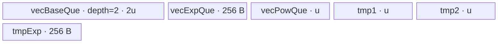
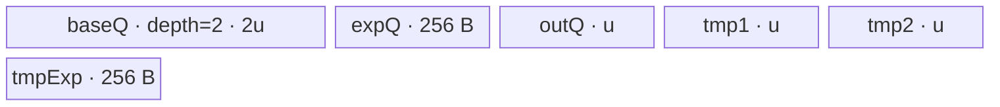

# PowTensorTensor 950 ACLNN 算子知识

## 算子速览

| 项目 | 内容 |
|---|---|
| 实际入口 | `aclnnPowTensorTensorGetWorkspaceSize` + `aclnnPowTensorTensor`，公开 ACLNN 两段式接口；本卡不合入 `aclnnPowScalarTensor`、`aclnnPowTensorScalar` 或任何原地入口。 |
| 计算语义 | 广播后逐元素计算 `out[i] = self[i] ^ exponent[i]`；两输入先提升到共同 dtype，核心 `Pow` 的结果再转换为 `out` dtype。 |
| 输入输出 | `self`/`exponent` 为 ND、0～8 维、可非连续；支持文档列出的浮点、整数、布尔与复数输入，禁止两输入同时为 BOOL；`out.shape` 必须等于广播 shape。 |
| 执行类型 | 空张量无 Device 节点；共同 dtype 属 950 AiCore 列表时为单 AIV Kernel，其中 singleton-exponent 路线是 `AIV_VECTOR`，一般广播路线为 `NDDMA + AIV_VECTOR`；其余共同 dtype 为单 AICPU Kernel。无 Cube/AIC/MIX_CV。 |
| Kernel 路线 | R-001 singleton float，R-002 singleton integer，R-003 NDDMA ≤5 轴，R-004 NDDMA >5 轴，R-005/R-006 AICPU 简单索引串/并行，R-007/R-008 AICPU 一般广播串/并行。 |
| 核心资源 | AiCore：GM、AIV UB、`TQue/TBuf`、寄存器、NDDMA，且 Pow 节点申请 16 MiB workspace；AICPU：输入/输出 GM 与 CPU worker，无 AIV UB，注册配置声明 100 B workspace。Executor 还持有 Contiguous/Cast/Pow/ViewCopy 中间张量。 |
| 来源闭包 | `source_closed`：公开 API、L0 selector、950 Host/Tiling/POD、AiCore entry/body、AICPU fallback、NDDMA helper 与 950 构建接线均闭合；AscendC primitive 和 executor 内部属于框架边界。 |
| 验证状态 | 已完成源码闭包检查；本次知识提取未执行编译、真机、数值或性能测试。 |

## 接口与语义

### 计算语义

设 `S = broadcast(self.shape, exponent.shape)`，右对齐两个 shape，缺失轴补 1，轴长为 1 的输入沿该轴广播。对 `S` 中每个逻辑坐标 `i`，先按公开互推导表得到 `P = PromoteType(dtype(self), dtype(exponent))`，再执行：

```text
selfP     = Cast(Contiguous(self), P)
exponentP = Cast(Contiguous(exponent), P)
powP[i]   = selfP[broadcast_index(i)] ^ exponentP[broadcast_index(i)]
out[i]    = Cast(powP[i], dtype(out))
```

`ViewCopy` 将连续临时结果写到可能非连续的 `out` view。`P` 在 `{FLOAT16, BFLOAT16, FLOAT, UINT8, INT8, INT16, INT32}` 时走 950 AiCore；其它可被 API 接受并成功提升的 dtype 走 AICPU。整数 AICPU 对负指数显式定义：底数为 `1/-1` 时保留相应值，其他整数底数返回 0；非负整数指数使用平方乘法。

### 输入、输出与属性

| 参数 | shape/layout | dtype | 约束、默认值与语义 |
|---|---|---|---|
| `self` | ND，0～8 维，可非连续 | FLOAT、FLOAT16、BFLOAT16、DOUBLE、INT8、UINT8、INT16、INT32、INT64、BOOL、COMPLEX64、COMPLEX128 | 底数；与 `exponent` 可广播、可互推导；两输入不可同时 BOOL。 |
| `exponent` | ND，0～8 维，可非连续 | 同 `self` | 指数；总元素数为 1 时仍属于 TensorTensor API，但 950 Host 选择 singleton 专用实现。 |
| `out` | ND，可非连续，shape=`broadcast(self, exponent)` | 文档允许 FLOAT/FLOAT16/BFLOAT16/DOUBLE/BOOL/INT8/UINT8/INT16/INT32/INT64/COMPLEX64/COMPLEX128/UINT16/UINT32/UINT64 | `P` 必须能转换为该 dtype；核心 Pow 先产出 `P`，再 Cast。 |
| `workspaceSize`/`executor` | Host 输出 | `uint64_t*`/`aclOpExecutor**` | 第一段返回完整计算图所需 workspace 与 owner；空输入返回 0 和空计算 executor。 |
| `workspace`/`stream` | Device 地址/ACL stream | `void*`/`aclrtStream` | 第二段必须使用第一段返回的大小和 executor，由 `CommonOpExecutorRun` 在该 stream 提交。 |

### 入口与版本

固定版本仅存在无版本后缀的公开 `aclnnPowTensorTensor`，因此它是本架构实际支持的最新公开入口。公开文档第 5～14 行明确列出 Ascend 950PR/950DT；`Pow` OpDef 又只为 `ascend950` 添加 `pow_apt` AICore 配置，`CMakeLists.txt` 将活动 compute unit 接为 `ascend950`/`mc62`。本卡不把同文件中的原地接口或另外两个 Scalar API 视为该逻辑算子的版本；singleton exponent 只是本入口内部可达的 Host specialization。

## Host/Launcher 执行流程

### 参数校验与前处理

`aclnnPowTensorTensorGetWorkspaceSize` 的顺序不可交换：

1. `CREATE_EXECUTOR`；失败返回 `ACLNN_ERR_INNER_CREATE_EXECUTOR`。
2. `CheckParams` 依次执行 `CheckNotNull`、`CheckDtypeValid`、`CheckPromoteType`、`CheckShape`。950 不受 `CheckSocVersionIsSupportBf16` 的 910B～910E 条件约束；两 BOOL、unsupported dtype、不可提升、输出 dtype 不可转换、rank>8、不可广播或输出 shape 不等均失败。
3. `CheckFormat` 对 FRACTAL_NZ 只记录 warning；公开有效格式仍是 ND。
4. 任一输入为空时令 `workspaceSize=0`、交出 executor 并返回，不建立 Pow Kernel。
5. 非空时先求 `promoteType`，再按 `self Contiguous→Cast`、`exponent Contiguous→Cast`、`l0op::Pow`、结果 `Cast`、`ViewCopy(out)` 建图。每个节点返回 null 都转成 `ACLNN_ERR_INNER_NULLPTR`。
6. 最后以 `uniqueExecutor->GetWorkspaceSize()` 返回整个图的 workspace，`ReleaseTo(executor)` 转移 owner。第二段只调用 `CommonOpExecutorRun`。

`Contiguous`、通用 `Cast`、`ViewCopy` 和 executor 内部是明确框架边界；Pow 自有 selector、Tiling、POD、entry 与 body 均继续闭合。

### 参数、Workspace 与生命周期

`l0op::Pow` 先按广播 shape 和共同 dtype `P` 由 executor 分配 `powOut`。`IsAiCoreSupport(selfCasted)` 在 RegBase/950 上只检查 `P` 是否属于七种 950 AiCore dtype；命中即添加 `ADD_TO_LAUNCHER_LIST_AICORE(Pow)`，否则添加 `ADD_TO_LAUNCHER_LIST_AICPU(Pow)`。AICPU task 的 shape dependency 为 `ge::DEPEND_IN_SHAPE`。

AiCore Tiling 的 `GetWorkspaceSize` 固定写 `workspaces[0]=16*1024*1024`；entry 必须先验证 system workspace 和 `GetUserWorkspace(workspace)` 非空，随后设置 `KERNEL_TYPE_AIV_ONLY`。各 body 虽接收 workspace 参数但不再读写 user slice。AICPU `pow.json` 声明 `workspaceSize="100"`。ACLNN 对完整多节点 executor 的最终 workspace 拼装、临时 tensor 偏移和复用策略在固定仓框架实现中不可见，因此不得把 16 MiB 误当成整个 ACLNN 图的返回值。

### 启动图与失败传播

```text
aclnnPowTensorTensorGetWorkspaceSize
  -> Contiguous(self) -> Cast(P) -------\
                                         -> Pow node -> Cast(out.dtype) -> ViewCopy(out)
  -> Contiguous(exponent) -> Cast(P) ---/

Pow node:
  P in A5 AiCore list -> one AIV-only `pow` entry (R-001..R-004)
  otherwise           -> one `RunCpuKernel`/`PowCpuKernel` node (R-005..R-008)
```

所有 executor 节点属于同一调用返回的 executor，并由第二段在同一 `stream` 交给 `CommonOpExecutorRun`；前一节点失败使第一段停止建图或使运行返回错误，后续节点不得消费失败结果。中间 tensor 由 executor 分配并至少存活到最后一个 consumer；其内部 offset/复用点固定仓不可见。Pow 本身是单 Kernel 节点，没有算子自有跨 Kernel workspace edge。

## Route 与参数设计

### 分核与资源计算

公共 `TilingBaseClass::DoTiling` 先取 shape/dtype，再取 AIV core 数、UB 字节、UB block size 和 vector register size，之后按 priority 递增尝试模板。priority 0 的 `PowTensorScalarTiling` 仅在 `prod(exponent.storage_shape)==1` 时命中；否则返回 `GRAPH_PARAM_INVALID`，priority 1 的 `PowTensorTensorTiling` 无条件接管。

singleton 路线令 `N=prod(self.storage_shape)`：

```text
reserve = 8 KiB + 256 B + 256 B + powsApiTmpBuffer
nodes   = 5 + powsApiNode
u0      = floor((platformUB - reserve) / nodes)
u       = align_down(u0, 512 B) if u0>=512,
          else align_down(u0, blockSize) if u0>=blockSize
oriElem = u / computeDtypeSize
blockFactor0 = ceil(N/coreNum)
ubFactor = min(oriElem, max(blockFactor0, 4096/baseDtypeSize))，达到 512/computeDtypeSize 时再向下对齐
ubOuter = ceil(N/ubFactor); ubTail = N % ubFactor（0 改成 ubFactor）
blockFactor = ceil(ubOuter/coreNum)
blockNum = ceil(ubOuter/blockFactor); blockTail = ubOuter % blockFactor（0 改成 blockFactor）
```

一般 tensor-tensor 路线先从 platform UB 扣除 `powApiTmpBuffer`，并把 `powApiNode*baseDtypeSize*8` 加到 compute buffer divisor。公共 BroadcastTiling 对右对齐 shape 合轴并生成元素 stride；`maxElemNum=floor(((UB-powTmp)*8)/bufferDivisor, 256*8/minDtypeBits 对齐)`。从尾轴累乘到 UB 上限求 `ubSplitAxis/ubFormer/ubOuter/ubTail`，再求 `fusedProduct`、`blockFormer=ceil(fusedProduct/coreNum)` 和 `blockNum`。`preferMultiCore=true` 且核数不足时，每次减 128 元素重算，最低止于 512，再向上恢复 128 对齐。合轴后 UB 内轴数 `shapeLen-ubSplitAxis<=5` 产生 schedule key 100，否则 1100。

### Route 选择

| 顺序 | Route | Key/模板 | 精确选择条件与优先级 | 不适用去向 |
|---:|---|---|---|---|
| 1 | R-001 singleton float | 1001/2001/3001；`PowTensorScalarFloat<half\|bfloat16_t\|float, same>` | AiCore 且 `prod(exponent.shape)==1`，P 为 FLOAT16/BFLOAT16/FLOAT；priority 0 | singleton integer 或 priority 1 |
| 2 | R-002 singleton integer | 4001/5001/6001/7001；`PowTensorScalarInteger<uint8_t\|int8_t\|int16_t\|int32_t, same>` | AiCore 且 exponent 单元素，P 为 UINT8/INT8/INT16/INT32；priority 0 | priority 1 |
| 3 | R-003 NDDMA 无外循环 | `opKey*10^14+1000100` | AiCore，exponent 元素数不为 1，P 属七种，且 `shapeLen-ubSplitAxis<=5` | R-004 或 Tiling 失败 |
| 4 | R-004 NDDMA 有外循环 | `opKey*10^14+1001100` | 同 R-003，但 `shapeLen-ubSplitAxis>5`（最大 8） | Tiling 失败 |
| 5 | R-005 AICPU 简单索引串行 | AICPU `NoBcastCompute` | `P` 不在 950 AiCore 列表；两 shape 相同或任一输入仅 1 元素；`out.numel<30720` | R-006 |
| 6 | R-006 AICPU 简单索引并行 | AICPU `NoBcastCompute` + `ParallelFor` | R-005 的 shape 条件且 `out.numel>=30720` | 无 |
| 7 | R-007 AICPU 一般广播串行 | AICPU `BcastCompute` | `P` 不在 AiCore 列表；非同 shape 且两输入均多元素；`out.numel<25600` | R-008 |
| 8 | R-008 AICPU 一般广播并行 | AICPU `BcastCompute` + `ParallelFor` | R-007 的 shape 条件且 `out.numel>=25600` | 无 |

```text
empty input? -> Host success, no Kernel
P in {f16,bf16,f32,u8,s8,s16,s32}?
  no  -> simple-index shape?
           yes -> numel>=30720 ? R-006 : R-005
           no  -> numel>=25600 ? R-008 : R-007
  yes -> exponent_numel==1?
           yes -> float P ? R-001 : R-002
           no  -> collapsed_axes_inside_UB<=5 ? R-003 : R-004
```

### 模板/实现执行矩阵

| Route | key/selector | dtype/shape/platform 完整命中条件 | 执行拓扑与 Kernel 节点 | 实际模板/body | 内存与同步特征 | tail/fallback |
|---|---|---|---|---|---|---|
| R-001 singleton float | 1001/2001/3001 | 950 AiCore + exponent numel=1 + P=f16/bf16/f32 | 单 AIV `pow` | `PowTensorScalarFloat<T,T>::Init/Process` | 3 queues、3 TBuf、Power/MicroAPI；BF16 scalar先 cast 到 f32 | 尾 tile 用 `ubTail`；指数值内部分支 |
| R-002 singleton integer | 4001/5001/6001/7001 | 950 AiCore + exponent numel=1 + P=u8/s8/s16/s32 | 单 AIV `pow` | `PowTensorScalarInteger<T,T>` | 与 R-001 同 UB 形状；整数平方/立方短路，普通值走 `Power INTRINSIC` | 尾 tile mask；控制寄存器饱和位恢复 |
| R-003 NDDMA 无外循环 | 14 个 key 中尾码 1000100 | exponent numel!=1，P 为七种，UB 内合轴 rank≤5 | 单 AIV `pow`，CopyIn 为一条最多 5D NDDMA | `Pow* NddmaWithoutLoops` | 3 个 depth=2 queue；连续轴退化为 `DataCopyPad` | 最后一核 `blockTail`，最后 UB 块 `ubTail` |
| R-004 NDDMA 有外循环 | 14 个 key 中尾码 1001100 | 同 R-003，但 UB 内合轴 rank>5 | 单 AIV `pow`，外层枚举被 5D NDDMA 丢出的轴 | `Pow*NddmaWithLoops` | 每次最多 5D MultiCopy，外层逐 slice 更新 GM/UB offset | 同 R-003；rank>8 Tiling 失败 |
| R-005/R-006 | `NoBcastCompute` | 非 AiCore P，same-shape/X-scalar/Y-scalar | 单 AICPU node | `SpecialCompute`→`PowImpl` | 无 AIV UB；R-006 `ParallelFor`，每 worker 连续区间 | 空数据提前 OK；dispatch 缺 key 报 invalid |
| R-007/R-008 | `BcastCompute` | 非 AiCore P，一般广播 | 单 AICPU node | `Bcast::GetBroadcastX/YIndex`→`PowImpl` | R-008 用 `max(1, CPU_num-2)` workers | 每输出元素独立；Bcast 构造/shape 失败传播 |

### 隐藏性能 Guard

| Guard | Host/Tiling 条件 | Device/资源原因 | 影响 Route | 不满足时去向 | 源码符号 |
|---|---|---|---|---|---|
| AiCore dtype | `IsRegBase() && CheckType(P,AICORE_DTYPE_950_SUPPORT_LIST)` | 950 binary/entry 仅实例化七种 dtype | R-001..R-004 | AICPU R-005..R-008 | `op_api/pow.cpp::IsAiCoreSupport` |
| singleton | `prod(expShape)==1` | 指数只读一次，可避免第二路逐 tile broadcast | R-001/R-002 | priority 1 R-003/R-004 | `PowTensorScalarTiling::IsCapable` |
| NDDMA rank | `shapeLen-ubSplitAxis<=5` | `MultiCopyParams<T,5>` 单次最多表达 5 维 | R-003/R-004 | 超过 5 改用显式外循环 | `BroadcastGetScheduleKey` |
| UB reserve | `UB>powApiTmpBuffer` 且 `maxElemNum>0` | 三路双缓冲与 Power 内部临时区必须同时容纳 | R-003/R-004 | `GRAPH_FAILED` | `PowTensorTensorTiling::DoOpTiling`; `DoBrodcastTiling` |
| singleton UB 对齐 | `u>=512` 按 512 B；否则按 `blockSize` | 控制 buffer/DMA 对齐并限制 tile | R-001/R-002 | 更小对齐或由后续零因子导致失败边界 | `PowTensorScalarTiling::DoOpTiling` |
| 广播缓存复用 | 当前输入在 split 轴 stride=0，且不是最初两次/新 `ubOuter` 周期 | 广播 UB 内容可跨相邻 loop 保留，省重复 NDDMA | R-003/R-004 | 重新执行 NDDMA | `Pow*Nddma*::CopyIn0/CopyIn1` |
| AICPU 并行阈值 | 简单索引 30720；一般广播 25600 | 小数据避免 worker 切分，广播并行预留 2 CPU | R-005..R-008 | 串行或并行对应 Route | `NoBcastCompute`; `BcastCompute` |
| workspace 非空 | entry 中 `workspace!=nullptr && GetUserWorkspace(workspace)!=nullptr` | entry 在设置系统 workspace 后才执行 body | R-001..R-004 | 直接 return，无输出 | `op_kernel/pow_apt.cpp::pow` |

### POD/ABI

`TILING_DATA_FIELD_DEF` 的宏展开实现不在 `ops-math@165d...` 内；固定仓能证明字段声明顺序、类型、producer 和 consumer，但不能逐字证明最终生成 C struct 的 `sizeof/alignof/offsetof`。下表因此不臆造 offset。

| 结构 | 字段 | 类型/位宽 | ABI 布局 | 单位 | Host/launcher producer | Device consumer | 边界 |
|---|---|---|---|---|---|---|---|
| `PowTensorScalarTilingData` | `blockNum` | int64/64 | 声明序 0；精确 offset 固定仓不可见 | block | `ceil(ubOuter/blockFactor)` | `PostTiling` 设置 blockDim | >0 是有效路线前提 |
| 同上 | `blockFactor` | int64/64 | 声明序 1 | tile/core | `ceil(ubOuter/coreNum)` | `Process` 求 begin/end tile | 最后一核由 `min(end,ubOuter)` 截断 |
| 同上 | `blockTail` | int64/64 | 声明序 2 | tile | `ubOuter%blockFactor`，0→blockFactor | body 未直接读取 | inactive consumer |
| 同上 | `ubOuter` | int64/64 | 声明序 3 | tile | `ceil(totalSize/ubFactor)` | `Process` 截断 end 与定位末 tile | >0 |
| 同上 | `ubFactor` | int64/64 | 声明序 4 | element | `GetUbFactor` | GM offset、正常 tile 长度 | 由 UB 上限决定 |
| 同上 | `ubTail` | int64/64 | 声明序 5 | element | `totalSize%ubFactor`，0→ubFactor | 最后一 tile `curDataLength` | 1..ubFactor |
| 同上 | `totalSize` | int64/64 | 声明序 6 | element | `prod(baseShape)` | body 未直接读取 | inactive consumer |
| 同上 | `ubSize` | int64/64 | 声明序 7 | byte/queue buffer | 对齐后的单 buffer 字节数 | 六次 `InitBuffer` 的容量来源之一 | 显式 UB 为 `5*ubSize+512` |
| `PowTensorTensorTilingData` | `blockFormer` | int64/64 | 声明序 0；精确 offset 固定仓不可见 | UB-loop/core | BroadcastTiling | `Process` loop 数和初始坐标 | 非末核使用 |
| 同上 | `ubFormer` | int64/64 | 声明序 1 | split-axis element | `GetBlockSplitFactor` | split 长度、offset、NDDMA | 正常 tile |
| 同上 | `ubOuter` | int64/64 | 声明序 2 | split-axis tile | `ceil(dim/ubFormer)` | 坐标更新、缓存周期 | >0 |
| 同上 | `ubTail` | int64/64 | 声明序 3 | split-axis element | `dim-(ubOuter-1)*ubFormer` | 尾 tile 长度 | 1..ubFormer |
| 同上 | `blockTail` | int64/64 | 声明序 4 | UB-loop/core | `fusedProduct-(blockNum-1)*blockFormer` | 末核 loop 数 | 1..blockFormer |
| 同上 | `shapeLen` | int64/64 | 声明序 5 | collapsed axis | `dims.back().size()` | NDDMA 参数与 loop boundary | ≤8 |
| 同上 | `ubSplitAxis` | int64/64 | 声明序 6 | axis index | 尾向前 UB 切分 | 所有地址/坐标 helper | `[0,shapeLen)` |
| 同上 | `dimProductBeforeUbInner` | int64/64 | 声明序 7 | tile product | `fusedProduct` | `BroadcastGetAxesIndices` 除法展开 | >0 |
| 同上 | `elemNum` | int64/64 | 声明序 8 | element/buffer | 对齐后的 `maxElemNum` | 三个 queue 的每 buffer 容量 | >0 |
| 同上 | `input0Dims[8]` | int64×8 | 声明序 9 | element/axis | collapsed `dims[0]`，未用尾项为 0 | 当前 body 未读取 | inactive consumer |
| 同上 | `input1Dims[8]` | int64×8 | 声明序 10 | element/axis | collapsed `dims[1]` | 当前 body 未读取 | inactive consumer |
| 同上 | `outputDims[8]` | int64×8 | 声明序 11 | element/axis | collapsed output dims | 坐标与 NDDMA loop size | 有效前 `shapeLen` 项 |
| 同上 | `input0Strides[8]` | int64×8 | 声明序 12 | element stride | collapsed input0 stride，广播轴为 0 | input0 GM offset/NDDMA | 有效前 `shapeLen` 项 |
| 同上 | `input1Strides[8]` | int64×8 | 声明序 13 | element stride | collapsed input1 stride | input1 GM offset/NDDMA | 同上 |
| 同上 | `outputStrides[8]` | int64×8 | 声明序 14 | element stride | collapsed output stride | UB/GM offset、计算长度 | 同上 |
| AICPU context | tensor desc/data | 框架 ABI | 无算子自有 POD | shape/dtype/address | `AicpuTaskSpace`/launcher | `PowCpuKernel::Compute` | runner ABI 固定仓不可见 |

### Route 源码闭包

| Route | Key/selector | Host/Tiling producer | POD/参数 | Kernel entry/router 节点 | Kernel body/直接依赖 | 构建接线 |
|---|---|---|---|---|---|---|
| R-001 | 1001/2001/3001 | `pow_tensor_scalar_tiling_arch35.cpp` | `PowTensorScalarTilingData` | `pow_apt.cpp::pow` | `PowTensorScalarFloat` | `pow_def.cpp` + `pow_binary.json` + CMake |
| R-002 | 4001/5001/6001/7001 | 同上 | 同上 | 同上 | `PowTensorScalarInteger` | 同上 |
| R-003 | `opKey*10^14+1000100` | `pow_tensor_tensor_tiling_arch35.cpp` + opbase BroadcastTiling | `PowTensorTensorTilingData` | `pow_apt.cpp::pow` | 7 个 `Pow*NddmaWithoutLoops` + `BroadcastNddmaWithoutLoop` | 同上 |
| R-004 | `opKey*10^14+1001100` | 同上 | 同上 | 同上 | 7 个 `Pow*NddmaWithLoops` + `BroadcastNddmaWithLoop` | 同上 |
| R-005..R-008 | `IsAiCoreSupport=false` + AICPU 内部分支 | `op_api/pow.cpp::Pow` | tensor context | `RunCpuKernel`→`PowCpuKernel::Compute` | `NoBcastCompute/BcastCompute/PowImpl` | `op_kernel_aicpu/pow.json` |

## Kernel 实现

### 公共执行流程

AiCore 路线的单 entry 参数为 `(base, exponent, y, workspace, tiling)`。entry 对 workspace 做两级非空检查，调用 `SetSysWorkspace`，声明 AIV-only，解析对应 POD，再构造 route class 执行 `Init→Process`；未知 key 没有 else/fallback，直接无输出结束。R-001/R-002 将 singleton exponent 标量化并按 base tile 流水；R-003/R-004 对两路输入做 NDDMA/连续搬运，在 UB 逐元素 `Power` 后写回。

AICPU 路线由 dtype 三层 map 分发到 `PowCompute<TIn1,TIn2,TOut>`；API 已将两输入 Cast 到共同 P，并让 Pow 临时输出使用 P。`PowCompute` 再按 shape 选择直接索引或 `Bcast` 索引，最后按阈值选择串行/`ParallelFor`。算子没有多 Kernel 节点或跨节点私有 workspace 边。

### Route R-001：singleton float AIV specialization

#### 适用条件

##### 选择证据

| 层级 | 文件 | 符号 | 源码谓词/参数 | 结果/下一跳 |
|---|---|---|---|---|
| API selector | `math/pow/op_api/pow.cpp` | `IsAiCoreSupport` | RegBase 且 P 在 950 list | AiCore Pow |
| Tiling | `pow_tensor_scalar_tiling_arch35.cpp` | `IsCapable` | `prod(expShape)==1`，priority 0 | key 1001/2001/3001 |
| Router | `op_kernel/pow_apt.cpp` | `pow` | `TILING_KEY_IS(key)` | `PowTensorScalarFloat<T,T>` |
| Device | `pow_tensor_scalar_float.h` | `Process` | `expValue` 等于 0、1、±0.5、2、3、-1、-2 或其它 | 对应专用 helper/通用 Power |

#### Device 数据流

##### 函数级调用链

```text
Pow AiCore launch -> pow(base, exponent, y, workspace, tiling)
  -> PowTensorScalarFloat<T,T>::Init
    -> bind GM; InitBuffer; read exponent[0]
  -> Process
    -> per assigned tile: CopyBase (需要输入的分支)
    -> ComputeZeros/Copy/Sqrt/Rsqrt/Square/Cube/Rec/SquareRec 或 Power
    -> CopyPow
```

##### 源码等价伪码

```text
begin = blockIdx*blockFactor; end=min((blockIdx+1)*blockFactor, ubOuter)
exp = BF16 ? Cast(exponent[0], f32) : float(exponent[0])
if exp==0:  UB=1 once; copy same UB to each tile (tail uses ubTail)
else for tile in [begin,end):
  len = tile==ubOuter-1 ? ubTail : ubFactor
  x = GM[ tile*ubFactor : +len ]
  if exp in {1, 0.5, -0.5, 2, 3, -1, -2}: run matching MicroAPI pipeline
  else if T=f32: Power<T, DOUBLE_FLOAT_TECH>(x, exp, len)
  else: Cast(x->f32); Power<f32, DOUBLE_FLOAT_TECH>; Cast(f32->T, BF16 uses RINT)
  copy valid len to output GM
```

#### 内存与数据搬运

##### 资源与搬运表

| 层级/缓冲区 | offset/地址公式 | extent/容量公式 | dtype/layout | producer | consumer | owner/lifetime | 对齐/复用 |
|---|---|---|---|---|---|---|---|
| base GM | `tile*ubFactor` | `len` elements | T/ND contiguous | ACLNN Cast | CopyBase | executor→Kernel | `DataCopyPad`, blockCount=1, blockLen=`len*sizeof(T)` |
| exponent GM | 0 | 1 element | T | ACLNN Cast | Init scalar read | executor→Kernel | BF16 经 256 B queue 与 tmp cast |
| output GM | `tile*ubFactor` | `len` | T/ND contiguous | Compute | CopyPow | Pow temp | 仅提交有效 tail |
| `vecBaseQue` | UB | `2*ubSize` | T | CopyBase | helper/Power | TPipe | depth=2 |
| `vecExpQue` | UB | 256 B | T | BF16 scalar DMA | BF16 cast | TPipe/Init | depth=1；非 BF16 已分配但不搬运 |
| `vecPowQue` | UB | `ubSize` | T | compute | CopyPow | TPipe/tile | depth=1 |
| `tmp1Tensor` | UB | `ubSize` | f32 view | input cast | Power | TPipe/tile | 仅 16-bit generic route 使用 |
| `tmp2Tensor` | UB | `ubSize` | f32 view | Power | output cast | TPipe/tile | 同上 |
| `tmpExpTensor` | UB | 256 B | f32 | BF16 cast | scalar read | TPipe/Init | 初始化后不覆盖 |

##### 分层内存布局



##### 字节账与复用顺序

```text
u = tilingData.ubSize
explicit_UB = 2u + 256 + u + u + u + 256 = 5u + 512 B
reserved_bound = (5+powsApiNode)*u + 8 KiB + 512 B + powsApiTmpBuffer <= platformUB
dynamic_ub = N/A
Pow workspace = 16 MiB；ACLNN executor workspace_total 固定仓不可见
```

| 复用子区 | 写入者 | 读取者/消费点 | 下一次覆盖 | 同步或释放依据 | 安全条件 |
|---|---|---|---|---|---|
| `vecBaseQue` slot | CopyBase | helper/Power | 下一 tile allocation | EnQue→DeQue→FreeTensor | 读取完成后才 Free |
| `vecPowQue` slot | helper/Power | CopyPow | 下一 tile | EnQue→DeQue→FreeTensor | GM copy 完成后释放 |
| tmp1/tmp2 | Cast/Power | Power/Cast | 下一 generic tile | 同一顺序函数体 | 只在 generic 16-bit 分支使用 |
| exp queue/tmp | scalar DMA/Cast | `expValue` read | 不再覆盖 | `V_S` event 后 scalar read | BF16 only |

#### 同步、精度与尾块

##### 同步与数值边界表

| 阶段 | primitive/机制 | producer | consumer/等待点 | 保护对象 | 精度/尾块 |
|---|---|---|---|---|---|
| BF16 exponent | Queue + `V_S` event | DMA/Cast vector | scalar `expCastTensor(0)` | exponent scalar | BF16→f32 |
| scalar→vector | `S_V` event | scalar exp read | Process vector | `expValue` | 所有 dtype |
| tile pipeline | TQue | CopyBase/compute | compute/CopyPow | queue slot | tail `len=ubTail` |
| float special values | masked MicroAPI | local input | local output | valid lanes | 16-bit 路径升 f32；`UpdateMask` 保护 tail |
| generic BF16/F16 | Cast→Power→Cast | input T | output T | tmp1/tmp2 | BF16 downcast `CAST_RINT`；F16 `CAST_NONE` |

#### 关键实现

##### 符号证据表

| 阶段 | 文件 | 符号/模板实例 | 实现事实 |
|---|---|---|---|
| Host/Tiling producer | `pow_tensor_scalar_tiling_arch35.cpp` | `PowTensorScalarTiling::*` | singleton predicate、UB/core/tail 与 key |
| Kernel entry/router | `op_kernel/pow_apt.cpp` | keys 1001/2001/3001 | POD→float class 映射 |
| Device body/helper | `pow_tensor_scalar_float.h` | `Init/Process/Compute*` | 标量读取、八类特化、精度与 mask |

### Route R-002：singleton integer AIV specialization

#### 适用条件

##### 选择证据

| 层级 | 文件 | 符号 | 源码谓词/参数 | 结果/下一跳 |
|---|---|---|---|---|
| API/Host | `op_api/pow.cpp` | `IsAiCoreSupport` | P=u8/s8/s16/s32 | AiCore |
| Tiling | `pow_tensor_scalar_tiling_arch35.cpp` | `IsCapable/GetTilingKey` | exponent numel=1 | 4001/5001/6001/7001 |
| Router | `pow_apt.cpp` | integer key branches | key | `PowTensorScalarInteger<T,T>` |

#### Device 数据流

##### 函数级调用链

```text
pow -> PowTensorScalarInteger<T,T>::Init (read exponent[0] to int64)
    -> Process -> CopyBase -> ComputeZeros/Copy/Square/Cube/Power -> CopyPow
```

##### 源码等价伪码

```text
exp = int64(exponentGM[0])
if exp==0: duplicate 1 once and copy to all assigned tiles
else for tile:
  DMA valid len
  exp==1 -> bitwise identity copy
  exp==2/3 -> masked multiply pipeline; temporarily set SAT control bit 60 to 0, then restore 1
  otherwise -> Power<T, INTRINSIC>(x, T(exp), len)
  DMA valid len to GM
```

#### 内存与数据搬运

##### 资源与搬运表

| 层级/缓冲区 | offset/地址公式 | extent/容量公式 | dtype/layout | producer | consumer | owner/lifetime | 对齐/复用 |
|---|---|---|---|---|---|---|---|
| GM base/output | `tile*ubFactor` | `len` | integer T/ND | DMA/compute | compute/DMA | executor/Pow | blockCount=1，字节数=`len*sizeof(T)` |
| three queues | UB | `2u + 256 + u` | T | DMA/compute | compute/DMA | TPipe | 与 R-001 同 depth |
| three TBuf | UB | `u+u+256` | temp | Power/internal | compute | TPipe | generic Power reserve |
| registers | current vector chunk | `ceil(len/VR_width)` loops | T 或 widened 16-bit | MicroAPI load | multiply/store | helper call | `UpdateMask` tail |

##### 分层内存布局



##### 字节账与复用顺序

```text
explicit_UB = 5u + 512 B
reserved_bound = (5+powsApiNode)*u + 8 KiB + 512 B + powsApiTmpBuffer <= platformUB
workspace_total(Pow node) = 16 MiB
```

| 复用子区 | 写入者 | 读取者/消费点 | 下一次覆盖 | 同步或释放依据 | 安全条件 |
|---|---|---|---|---|---|
| base queue slot | CopyBase | Square/Cube/Power | 下一 tile | queue FreeTensor | 消费后释放 |
| output queue slot | compute | CopyPow | 下一 tile | queue FreeTensor | GM copy 后释放 |
| control register SAT bit | Square/Cube | integer multiply | helper 结束恢复 | `SetCtrlSpr(...,1)` | 所有出口都执行恢复 |

#### 同步、精度与尾块

##### 同步与数值边界表

| 阶段 | primitive/机制 | producer | consumer/等待点 | 保护对象 | 精度/尾块 |
|---|---|---|---|---|---|
| exponent read | S→V event | scalar GM read | vector Process | expValue | int64 保存后再 cast 回 T 给 generic Power |
| square/cube | `UpdateMask` + ZEROING | valid lanes | packed store | tail lanes | u8/s8 先 widen 16 bit；按源码做 `&255` 后 pack |
| saturation | control bit 60 | helper entry | helper exit | integer arithmetic mode | 非饱和期间不得早退 |
| copy | TQue | DMA/compute | compute/DMA | UB slot | last tile uses `ubTail` |

#### 关键实现

##### 符号证据表

| 阶段 | 文件 | 符号/模板实例 | 实现事实 |
|---|---|---|---|
| Host/Tiling producer | `pow_tensor_scalar_tiling_arch35.cpp` | `DoOpTiling/GetTilingKey` | 4 integer keys 与资源公式 |
| Kernel entry/router | `pow_apt.cpp` | 4001..7001 branches | 完整 template 实参 |
| Device body/helper | `pow_tensor_scalar_integer.h` | `Process/ComputeSquare/ComputeCube` | 快速指数分支、mask、SAT 协议 |

### Route R-003：tensor-tensor NDDMA without loops

#### 适用条件

##### 选择证据

| 层级 | 文件 | 符号 | 源码谓词/参数 | 结果/下一跳 |
|---|---|---|---|---|
| Tiling registry | `math_tiling_templates_registry.h` | priority loop | singleton template返回 PARAM_INVALID | priority 1 |
| dtype selector | `pow_tensor_tensor_tiling_arch35.cpp` | `SetOpKey/GetOpKey` | P/P/P 为七种同 dtype tuple | opKey 1..7 |
| schedule | opbase `broadcast_tiling_base.cpp` | `BroadcastGetScheduleKey` | `axisInsideUB<=5` | inner key 1000100 |
| Router | `pow_apt.cpp` | 7 个 WITHOUT key | full key | dtype-specific WithoutLoops class |

#### Device 数据流

##### 函数级调用链

```text
pow -> Pow{F16|Bf16|F32|U8|S8|S16|S32}NddmaWithoutLoops::Init
    -> Process
      -> BroadcastGetAxesIndices / BroadcastUpdateAxesIndices
      -> CopyIn0 -> BroadcastNddmaWithoutLoop -> DataCopy<...,5> 或 DataCopyPad
      -> CopyIn1 -> same
      -> Compute2 -> Power<T,false,DOUBLE_FLOAT_TECH|INTRINSIC>
      -> CopyOut3 -> DataCopyPad
```

##### 源码等价伪码

```text
loops = lastCore ? blockTail : blockFormer
coord = unflatten(blockFormer*blockIdx, outputDims[0:split], dimProductBeforeUbInner)
for j in 0..loops:
  if j>0: increment coord with carry
  split = coord[splitAxis]==ubOuter-1 ? ubTail : ubFormer
  for each input k:
    allocate depth-2 queue slot
    if stride[k][splitAxis]!=0 or j<=1 or globalTile%ubOuter<=1:
      gm = sum(coord[a]*inputStride[a]) + coord[split]*stride[split]*ubFormer
      if outputStride[split]!=inputStride[split]: one 5D MultiCopy broadcast
      else: one contiguous DataCopyPad
    enqueue
  dequeue x,e; y=Power<T>(x,e, split*outputStride[split]); free x,e; enqueue y
  dequeue y; copy `split*outputStride[split]*sizeof(T)` bytes to output GM; free y
```

#### 内存与数据搬运

##### 资源与搬运表

| 层级/缓冲区 | offset/地址公式 | extent/容量公式 | dtype/layout | producer | consumer | owner/lifetime | 对齐/复用 |
|---|---|---|---|---|---|---|---|
| input0/1 GM | `BroadcastGetGmOffset(coord,inputStride,split,ubFormer)` | NDDMA loop-defined | T/collapsed ND | ACLNN Cast | CopyIn | executor | stride 0 表示 broadcast |
| `queIn0/queIn1` | UB | each `2*E*sizeof(T)` | T/linear output tile | NDDMA/DMA | Power | TPipe/loop | depth=2；broadcast cache 可跨 loop |
| `queOut0` | UB | `2*E*sizeof(T)` | T/linear | Power | CopyOut | TPipe/loop | depth=2 |
| output GM | `BroadcastGetGmOffset(coord,outputStride,...)` | `split*outputStride[split]` elements | T/ND | Power UB | DataCopyPad | Pow temp | one block |
| NDDMA config | no persistent buffer | 5 loop axes | element strides | `BroadcastSetNddmaConfigWithoutLoop` | `DataCopy<T,5>` | call-local registers | config `{false,0,0,false}` |

##### 分层内存布局


##### 字节账与复用顺序

```text
E=elemNum; s=sizeof(T)
explicit_UB = 6*E*s
Power-aware bound = (6+powApiNode)*E*s + powApiTmpBuffer <= platformUB
dynamic_ub = N/A
Pow workspace = 16 MiB（body 不读写 user slice）
```

| 复用子区 | 写入者 | 读取者/消费点 | 下一次覆盖 | 同步或释放依据 | 安全条件 |
|---|---|---|---|---|---|
| input queue slot | NDDMA/DMA | Power | later loop | EnQue→DeQue→FreeTensor | 非广播或周期边界必须刷新 |
| cached broadcast slot | earlier CopyIn | later loop Power | `j<=1`/new ubOuter period refresh | queue ordering + skip condition | split stride必须为0 |
| output slot | Power | CopyOut | later loop | EnQue→DeQue→FreeTensor | copy完成后释放 |

#### 同步、精度与尾块

##### 同步与数值边界表

| 阶段 | primitive/机制 | producer | consumer/等待点 | 保护对象 | 精度/尾块 |
|---|---|---|---|---|---|
| CopyIn→Power | TQue | NDDMA | DeQue | input slot | `split` 取 ubFormer/ubTail |
| Power→CopyOut | TQue | Power | DeQue | output slot | element count=`split*outputStride[split]` |
| broadcast | 5D MultiCopy | GM | UB | expanded tile | stride 0 axes复制；连续时退化 DMA |
| compute | `PowerConfig` | two input queues | output queue | valid elements | float/bf16/f16 `DOUBLE_FLOAT_TECH`；integers `INTRINSIC` |

#### 关键实现

##### 符号证据表

| 阶段 | 文件 | 符号/模板实例 | 实现事实 |
|---|---|---|---|
| Host/Tiling producer | `pow_tensor_tensor_tiling_arch35.cpp` + opbase broadcast tiling | `DoOpTiling/DoBrodcastTiling` | dtype key、合轴、tile/core、key |
| Kernel entry/router | `pow_apt.cpp` | 7 WITHOUT branches | key→class |
| Device body/helper | `pow_f16_nddma_without_loops.h` 等 7 文件 + `broadcast_utils.h` | `Process/BroadcastNddmaWithoutLoop` | loop、5D copy、cache、Power、tail |

### Route R-004：tensor-tensor NDDMA with loops

#### 适用条件

##### 选择证据

| 层级 | 文件 | 符号 | 源码谓词/参数 | 结果/下一跳 |
|---|---|---|---|---|
| Host | opbase `BroadcastGetScheduleKey` | `axisInsideUB>5` | collapsed inner rank 6～8 | inner key 1001100 |
| Router | `pow_apt.cpp` | 7 WITH key branches | full key | dtype-specific WithLoops class |
| Device | `broadcast_utils.h` | `BroadcastNddmaWithLoop` | output/input stride differ | outer loop + 5D MultiCopy |

#### Device 数据流

##### 函数级调用链

```text
pow -> Pow*NddmaWithLoops::Process
  -> CopyIn0/1 -> BroadcastNddmaWithLoop
    -> BroadcastSetNddmaConfigWithLoop(last 5 axes)
    -> for each thrown-axis coordinate: DataCopy<T,5>
  -> Power -> DataCopyPad output
```

##### 源码等价伪码

```text
same core/tile loop as R-003
for each input requiring broadcast:
  config = last five collapsed axes
  outerCount = product(outputDims[split+1 : shapeLen-5]) * split
  for n in 0..outerCount:
    update thrown-axis indices
    ubOff = dot(indices, outputStrides)
    gmOff = baseGmOff + dot(indices, inputStrides)
    MultiCopy5D(UB[ubOff], GM[gmOff], config)
Power and CopyOut are identical to R-003
```

#### 内存与数据搬运

##### 资源与搬运表

| 层级/缓冲区 | offset/地址公式 | extent/容量公式 | dtype/layout | producer | consumer | owner/lifetime | 对齐/复用 |
|---|---|---|---|---|---|---|---|
| three queues | same as R-003 | total `6Es` | T/linear | NDDMA/Power | Power/DMA | TPipe | depth=2 |
| thrown-axis indices | register/local scalar | up to 3 axes | int64 | update helper | offset helpers | CopyIn call | rank≤8 |
| each 5D slice | `ubOff`/`gmOff` dot products | last five axes | T | MultiCopy | Power | queue slot | multiple ordered NDDMA calls |
| output | same as R-003 | valid tile elements | T | Power | DataCopyPad | Pow temp | tail-aware |

##### 分层内存布局


##### 字节账与复用顺序

```text
explicit_UB = 6*E*s
Power-aware bound = (6+powApiNode)*E*s + powApiTmpBuffer <= platformUB
NDDMA has no GM intermediate; outer loop writes disjoint UB slices
workspace_total(Pow node) = 16 MiB
```

| 复用子区 | 写入者 | 读取者/消费点 | 下一次覆盖 | 同步或释放依据 | 安全条件 |
|---|---|---|---|---|---|
| per-slice UB range | each MultiCopy5D | Power after all slices | next tile | CopyIn completes before EnQue | offsets must cover disjoint logical output tile |
| queue slot | NDDMA | Power | next loop | queue lifecycle | same cache condition as R-003 |
| output slot | Power | CopyOut | next loop | queue lifecycle | copy before Free |

#### 同步、精度与尾块

##### 同步与数值边界表

| 阶段 | primitive/机制 | producer | consumer/等待点 | 保护对象 | 精度/尾块 |
|---|---|---|---|---|---|
| outer NDDMA slices | program order | successive DataCopy calls | EnQue after loop | complete input tile | last-five-axis config constant per tile |
| input/output queues | TQue | copy/compute | DeQue | slots | same as R-003 |
| rank/tail | coord loops | offset helpers | copy/Power | valid domain | at most 3 thrown axes; split uses ubTail |

#### 关键实现

##### 符号证据表

| 阶段 | 文件 | 符号/模板实例 | 实现事实 |
|---|---|---|---|
| Host/Tiling producer | opbase `broadcast_tiling_base.cpp` | `BroadcastGetScheduleKey` | >5 axes selects loop key |
| Kernel entry/router | `pow_apt.cpp` | 7 WITH branches | full key→body |
| Device body/helper | `pow_f16_nddma_with_loops.h` 等 7 文件 + opbase `broadcast_utils.h` | `BroadcastNddmaWithLoop` | 外层枚举、5D 参数、offset、tail |

### Route R-005：AICPU simple-index serial

#### 适用条件

##### 选择证据

| 层级 | 文件 | 符号 | 源码谓词/参数 | 结果/下一跳 |
|---|---|---|---|---|
| L0 selector | `op_api/pow.cpp` | `Pow` | `IsAiCoreSupport=false` | `PowAiCpu` |
| AICPU router | `pow_aicpu.cpp` | `Compute` | dtype triple 在 `kcalls` | `PowCompute<T...>` |
| body | 同上 | `PowCompute/NoBcastCompute` | same shape或任一 numel=1；data_num<30720 | serial `SpecialCompute` |

#### Device 数据流

##### 函数级调用链

```text
RunCpuKernel -> PowCpuKernel::Compute -> kcalls[dtype0][dtype1][dtypeOut]
  -> PowCompute -> NoBcastCompute -> SpecialCompute -> PowImpl/PowiImpl
```

##### 源码等价伪码

```text
type = SAME_SHAPE / X_ONE_ELEMENT / Y_ONE_ELEMENT
for i in [0,out.numel):
  xidx = type==X_ONE ? 0 : i
  eidx = type==Y_ONE ? 0 : i
  out[i] = PowImpl(x[xidx], e[eidx])
```

#### 内存与数据搬运

##### 资源与搬运表

| 层级/缓冲区 | offset/地址公式 | extent/容量公式 | dtype/layout | producer | consumer | owner/lifetime | 对齐/复用 |
|---|---|---|---|---|---|---|---|
| input/output GM | i 或 0 | tensor numel | promoted dtype | executor | CPU loads/stores | executor/task | direct pointer arithmetic |
| AIV UB | N/A | N/A | N/A | N/A | N/A | AICPU uses CPU path | no fabricated UB |
| AICPU workspace | config-defined | 100 B | opaque | runtime | runner | task | body未显式读取 |

##### 分层内存布局

N/A：此 Route 使用 AICPU 直接访问 tensor data；固定 body 未声明 AIV UB、dynamic UB 或中间 GM buffer。

##### 字节账与复用顺序

```text
UB_total = N/A
dynamic_ub = N/A
AICPU configured workspace = 100 B
executor workspace_total = framework-owned, fixed source does not expose offsets
```

| 复用子区 | 写入者 | 读取者/消费点 | 下一次覆盖 | 同步或释放依据 | 安全条件 |
|---|---|---|---|---|---|
| output[i] | PowImpl | final consumer | none in Kernel | each i written once | ranges disjoint |

#### 同步、精度与尾块

##### 同步与数值边界表

| 阶段 | primitive/机制 | producer | consumer/等待点 | 保护对象 | 精度/尾块 |
|---|---|---|---|---|---|
| serial loop | program order | element load | store | one output | end bound protects tail |
| integral pow | exponentiation by squaring | `PowiImpl` | output | integer arithmetic | negative exponent special cases |
| floating/complex | `std::pow` + static_cast | inputs | output | C++ result | half operand first converts to float |

#### 关键实现

##### 符号证据表

| 阶段 | 文件 | 符号/模板实例 | 实现事实 |
|---|---|---|---|
| Host/Tiling producer | `op_api/pow.cpp` | `PowAiCpu` | launcher selection |
| Kernel entry/router | `op_kernel_aicpu/pow_aicpu.cpp` | `Compute/kcalls` | dtype dispatch |
| Device body/helper | 同上 | `NoBcastCompute/SpecialCompute/PowImpl` | direct indices 与数学边界 |

### Route R-006：AICPU simple-index parallel

#### 适用条件

##### 选择证据

| 层级 | 文件 | 符号 | 源码谓词/参数 | 结果/下一跳 |
|---|---|---|---|---|
| AICPU | `pow_aicpu.cpp` | `NoBcastCompute` | R-005 shape 且 `data_num>=30*1024` | `ParallelFor` |

#### Device 数据流

##### 函数级调用链

```text
NoBcastCompute -> CPU_num -> per_unit_size=CeilMultiple(data_num,max_core_num)
  -> ParallelFor -> SpecialCompute(start,end)
```

##### 源码等价伪码

```text
workers=max(1,GetCPUNum(ctx)); chunk=CeilMultiple(numel,workers)
parallel each [start,end): same element mapping as R-005
```

#### 内存与数据搬运

##### 资源与搬运表

| 层级/缓冲区 | offset/地址公式 | extent/容量公式 | dtype/layout | producer | consumer | owner/lifetime | 对齐/复用 |
|---|---|---|---|---|---|---|---|
| worker range | `[start,end)` | framework chunk | promoted dtype | ParallelFor | SpecialCompute | task | disjoint output ranges |

##### 分层内存布局

N/A：AICPU CPU worker 路线，无 AIV UB。

##### 字节账与复用顺序

```text
UB_total=N/A; dynamic_ub=N/A; configured workspace=100 B
```

| 复用子区 | 写入者 | 读取者/消费点 | 下一次覆盖 | 同步或释放依据 | 安全条件 |
|---|---|---|---|---|---|
| output chunk | each worker | final output | none | ParallelFor join/return | chunks disjoint |

#### 同步、精度与尾块

##### 同步与数值边界表

| 阶段 | primitive/机制 | producer | consumer/等待点 | 保护对象 | 精度/尾块 |
|---|---|---|---|---|---|
| workers | `ParallelFor` | worker chunks | API return | output | end bound handles final chunk |

#### 关键实现

##### 符号证据表

| 阶段 | 文件 | 符号/模板实例 | 实现事实 |
|---|---|---|---|
| Host/Tiling producer | `pow_aicpu.cpp` | threshold constants | 30720 guard |
| Kernel entry/router | 同上 | `NoBcastCompute` | worker count/chunk |
| Device body/helper | 同上 | `SpecialCompute` | disjoint loop |

### Route R-007：AICPU general broadcast serial

#### 适用条件

##### 选择证据

| 层级 | 文件 | 符号 | 源码谓词/参数 | 结果/下一跳 |
|---|---|---|---|---|
| AICPU | `pow_aicpu.cpp` | `PowCompute` | 非 same shape 且两输入 numel>1 | `BcastCompute` |
| AICPU | 同上 | `BcastCompute` | `data_num<25*1024` | serial loop |

#### Device 数据流

##### 函数级调用链

```text
PowCompute -> Bcast(input0_shape,input1_shape) -> BcastCompute
  -> GetBroadcastXIndex/GetBroadcastYIndex -> PowImpl -> out[i]
```

##### 源码等价伪码

```text
for i in [0,out.numel):
  xi=bcast.GetBroadcastXIndex(i); yi=bcast.GetBroadcastYIndex(i)
  out[i]=PowImpl(in0[xi],in1[yi])
```

#### 内存与数据搬运

##### 资源与搬运表

| 层级/缓冲区 | offset/地址公式 | extent/容量公式 | dtype/layout | producer | consumer | owner/lifetime | 对齐/复用 |
|---|---|---|---|---|---|---|---|
| input GM | `Bcast` index | input numel | promoted dtype | executor | PowImpl | task | broadcast indices may repeat |
| output GM | i | out numel | promoted dtype | PowImpl | downstream Cast | task | written once |
| index metadata | Bcast object | shapes | CPU metadata | constructor | index methods | PowCompute call | framework helper |

##### 分层内存布局

N/A：AICPU CPU path，无 AIV UB。

##### 字节账与复用顺序

```text
UB_total=N/A; dynamic_ub=N/A; configured workspace=100 B
```

| 复用子区 | 写入者 | 读取者/消费点 | 下一次覆盖 | 同步或释放依据 | 安全条件 |
|---|---|---|---|---|---|
| repeated input element | executor | multiple loop iterations | immutable | read-only | input not overwritten by Pow |

#### 同步、精度与尾块

##### 同步与数值边界表

| 阶段 | primitive/机制 | producer | consumer/等待点 | 保护对象 | 精度/尾块 |
|---|---|---|---|---|---|
| index loop | program order | Bcast index | PowImpl | valid index | i<out.numel |

#### 关键实现

##### 符号证据表

| 阶段 | 文件 | 符号/模板实例 | 实现事实 |
|---|---|---|---|
| Host/Tiling producer | `op_api/pow.cpp` | `PowAiCpu` | fallback launch |
| Kernel entry/router | `pow_aicpu.cpp` | `PowCompute` | general broadcast selector |
| Device body/helper | 同上 | `BcastCompute` | index mapping and serial math |

### Route R-008：AICPU general broadcast parallel

#### 适用条件

##### 选择证据

| 层级 | 文件 | 符号 | 源码谓词/参数 | 结果/下一跳 |
|---|---|---|---|---|
| AICPU | `pow_aicpu.cpp` | `BcastCompute` | R-007 shape 且 `data_num>=25*1024` | `ParallelFor` |

#### Device 数据流

##### 函数级调用链

```text
BcastCompute -> workers=max(1,GetCPUNum(ctx)-2) -> ParallelFor
  -> per-worker Bcast indices -> PowImpl
```

##### 源码等价伪码

```text
workers=max(1,CPU_num-2); chunk=CeilMultiple(numel,workers)
parallel for each [start,end): map two broadcast indices and write out[i]
```

#### 内存与数据搬运

##### 资源与搬运表

| 层级/缓冲区 | offset/地址公式 | extent/容量公式 | dtype/layout | producer | consumer | owner/lifetime | 对齐/复用 |
|---|---|---|---|---|---|---|---|
| worker output | `[start,end)` | chunk | promoted dtype | worker | final output | task | disjoint |
| shared inputs/Bcast | mapped index | read-only | promoted dtype/metadata | executor/constructor | all workers | task | concurrent reads |

##### 分层内存布局

N/A：AICPU CPU worker 路线，无 AIV UB。

##### 字节账与复用顺序

```text
UB_total=N/A; dynamic_ub=N/A; configured workspace=100 B
```

| 复用子区 | 写入者 | 读取者/消费点 | 下一次覆盖 | 同步或释放依据 | 安全条件 |
|---|---|---|---|---|---|
| output chunk | worker | downstream node | none | ParallelFor completion | chunk disjoint |

#### 同步、精度与尾块

##### 同步与数值边界表

| 阶段 | primitive/机制 | producer | consumer/等待点 | 保护对象 | 精度/尾块 |
|---|---|---|---|---|---|
| broadcast workers | `ParallelFor` | CPU workers | task completion | output visibility | end bound guards final chunk |

#### 关键实现

##### 符号证据表

| 阶段 | 文件 | 符号/模板实例 | 实现事实 |
|---|---|---|---|
| Host/Tiling producer | `pow_aicpu.cpp` | threshold/CPU_num | 25600 与预留 2 CPU |
| Kernel entry/router | 同上 | `BcastCompute` | ParallelFor launch |
| Device body/helper | 同上 | worker lambda/PowImpl | broadcast mapping and writes |

## 算子特定优化

### Trick T-001：singleton exponent 提升为标量专用路线

#### 触发与源码依据

- 适用 Route：R-001、R-002
- 触发条件：`prod(params_.expShape)==1`；priority 0 先于一般 tensor-tensor priority 1。
- Golden 来源：[`math/pow/op_host/arch35/pow_tensor_scalar_tiling_arch35.cpp:32-40`](../../../../../../../cann-ops-raw/ascendc/ops-math/165d41f02a43a62324b434cb6bda7c533b14da3e/math/pow/op_host/arch35/pow_tensor_scalar_tiling_arch35.cpp#L32-L40)

**官方源码（固定 Commit 连续逐字摘录）**：

```cpp
bool PowTensorScalarTiling::IsCapable()
{
    int64_t expShapeDims = params_.expShape.GetDimNum();
    int64_t expSize = 1;
    for (int64_t i = 0; i < expShapeDims; i++) {
        expSize = expSize * params_.expShape.GetDim(i);
    }
    return expSize == 1;
}
```

#### 机制与设计原因

一般 tensor-tensor body 每 tile都要为 exponent 建第二路 NDDMA/queue；singleton route 在 `Init` 只读 `exponent[0]`，然后按标量值选择 `Duplicate`、identity、sqrt、乘法或 scalar `Power`。这同时减少 exponent GM 搬运、广播物化和通用 Power 调用。它不改变公开语义：exponent 仍是 `aclTensor*`，只是 Host 根据元素数选择 body。

#### 迁移边界

- 适用：公开 TensorTensor API 中 exponent 恰有一个元素的 950 AiCore dtype。
- 前提：共同 dtype 属 950 七种，指数在 Kernel 期间只读且可安全标量化。
- 失效：exponent 元素数不为 1 时必须转 R-003/R-004；非 AiCore dtype 转 AICPU。
- 未验证：本次知识提取未执行编译、真机、数值或性能测试。

#### 错误做法

不要因 route 名含 TensorScalar 就把 `aclnnPowTensorScalar` 的 `aclScalar*` 入口并入本卡；本 route 的 exponent 来源仍是 TensorTensor API 的 tensor。固定仓未提供其它可验证反例。

### Trick T-002：split-axis 广播 tile 的 UB 缓存复用

#### 触发与源码依据

- 适用 Route：R-003、R-004
- 触发条件：该输入在 `ubSplitAxis` 的 stride 为 0；只有最初两次或进入新的 `ubOuter` 周期时刷新。
- Golden 来源：[`math/pow/op_kernel/arch35/pow_f16_nddma_without_loops.h:77-85`](../../../../../../../cann-ops-raw/ascendc/ops-math/165d41f02a43a62324b434cb6bda7c533b14da3e/math/pow/op_kernel/arch35/pow_f16_nddma_without_loops.h#L77-L85)

**官方源码（固定 Commit 连续逐字摘录）**：

```cpp
bufferIn0_ = queIn0_.AllocTensor<half>();
if ((tilingDataPtr_->input0Strides[tilingDataPtr_->ubSplitAxis] != 0) ||
    (ubLoopIdx <= 1 ||
     (AscendC::GetBlockIdx() * tilingDataPtr_->blockFormer + ubLoopIdx) % tilingDataPtr_->ubOuter <= 1)) {
    BroadcastNddmaWithoutLoop(inputGmInputX_, bufferIn0_, tilingDataPtr_->outputDims,
                              tilingDataPtr_->outputStrides, tilingDataPtr_->input0Strides, axesIndices,
                              tilingDataPtr_->ubSplitAxis, tilingDataPtr_->shapeLen, ubSplitSize,
                              tilingDataPtr_->ubFormer);
}
```

#### 机制与设计原因

stride=0 表示同一 exponent/base slice 沿 split 轴广播；在周期内部，双缓冲 queue 的下一 slot仍保存可复用广播内容，body 跳过 NDDMA，却照常 EnQue/DeQue 给 Power。条件用全局 tile 序号和 `ubOuter` 保证跨周期时重新装载，因此减少重复 GM→UB 扩展搬运。

#### 迁移边界

- 适用：split 轴广播、queue depth 与轮转顺序完全相同的 tile pipeline。
- 前提：输入只读；缓存 slot 在 Power 消费和下一轮分配之间不被其它用途覆盖。
- 失效：split stride 非 0 或进入周期边界时必须执行 NDDMA。
- 未验证：本次知识提取未执行编译、真机、数值或性能测试。

#### 错误做法

若忽略周期边界无条件跳过 CopyIn，会复用上一广播组的数据；源码以 `globalTile % ubOuter <= 1` 强制刷新。

### Trick T-003：五维 NDDMA 上限外的轴由显式外循环承接

#### 触发与源码依据

- 适用 Route：R-004
- 触发条件：`shapeLen-ubSplitAxis>5`。
- Golden 来源：[`pkg_inc/op_common/atvoss/util/broadcast_utils.h:199-216`](https://gitcode.com/cann/opbase/blob/d574f5571391390f8b619c6a134b65c819842318/pkg_inc/op_common/atvoss/util/broadcast_utils.h#L199-L216)

**官方源码（固定 Commit 连续逐字摘录）**：

```cpp
AscendC::MultiCopyParams<T1, NDDMA_MAX_DIMS> paramsMain =
    BroadcastSetNddmaConfigWithLoop<T1>(outputDims, outputStrides, inputStrides, shapeLen, ubSplitAxis);
int64_t nddmaIndices[NDDMA_THROW_DIMS] = {0};
int64_t nddmaProduct = BroadcastFuseAxes(outputDims, ubSplitAxis + 1, shapeLen - NDDMA_MAX_DIMS) * ubSplitSize;
for (int64_t i = 0; i < nddmaProduct; i++) {
```

#### 机制与设计原因

硬件 MultiCopy 参数固定为 5 维。Host 用 key 1100 选择 loop body，Device 把最多 3 个更外轴折成 `nddmaProduct`，每次用点积偏移启动同一 5D copy。这样无需额外 GM 转置/中间 Kernel，仍能覆盖合轴后 6～8 维广播。

#### 迁移边界

- 适用：rank≤8、UB 内轴数>5 的广播 CopyIn。
- 前提：外循环 offset 与最后五轴 stride 分工不重叠；每个 slice 写 UB 的正确子区。
- 失效：≤5 轴用 R-003；>8 轴由 API/Tiling 拒绝。
- 未验证：本次知识提取未执行编译、真机、数值或性能测试。

#### 错误做法

把 >5 维参数直接塞入 `MultiCopyParams<T,5>` 会丢轴；源码通过显式外循环承接被丢出的轴。

## 模板与实现对比

| 对比维度 | R-001/R-002 singleton | R-003 NDDMA≤5 | R-004 NDDMA>5 | R-005..R-008 AICPU | 设计选择依据 |
|---|---|---|---|---|---|
| 命中条件/优先级 | exponent numel=1，priority 0 | 非 singleton，inner rank≤5 | 非 singleton，inner rank>5 | P 非 950 AiCore list | 先 dtype backend，再 shape specialization |
| 模板与 dtype | float/integer 两类，7 keys | 7 dtype classes | 7 dtype classes | dtype function map | 950 binary支持与数学精度 |
| 循环与分核 | base tile/core | core×UB tile | core×UB tile×NDDMA outer | serial/CPU workers | 资源与 rank |
| Queue/TBuf/寄存器/dynamic UB/通信 window | 3 queues+3 TBuf+MicroAPI regs | 3 depth-2 queues | 同 R-003 + thrown-axis indices | 无 AIV UB | 每 route真实资源 |
| 内存总占用与复用 | explicit `5u+512` | `6Es` | `6Es` | direct tensor data | Power reserve纳入 Host 上界 |
| 搬运/Vector/SIMT/NDDMA/通信 API | DataCopyPad + MicroAPI/Power | 5D NDDMA 或 contiguous DMA + Power | 外循环×5D NDDMA + Power | CPU load/std::pow/Powi | broadcast形态 |
| 同步、精度与 tail | queue/events/mask，16-bit升 f32 | queues，Power config，ubTail | 同左并保证 slice顺序 | ParallelFor join，range end | 各 backend协议 |
| fallback/失败边界 | 非 singleton落 NDDMA | rank>5落 R-004 | rank>8失败 | dispatch缺 dtype triple失败 | 无未知 key fallback |

## 平台差异

| 项目 | A2 | A3 | 950 |
|---|---|---|---|
| 支持状态 | 公开文档称支持，但固定仓未闭合 | 公开文档称支持，但固定仓未闭合 | 公开文档、OpDef、binary config 与 CMake 一致支持 |
| Host/Launcher | `IsAiCoreSupport` 声称部分 dtype 可走 AiCore，但固定仓无对应 OpDef/Tiling/body 接线 | 同 A2 | RegBase 七 dtype AiCore，其余 AICPU |
| Kernel/资源 | AiCore body 固定仓不可见，不能发布 A2 卡 | AiCore body 固定仓不可见，不能发布 A3 卡 | arch35 AIV singleton、NDDMA broadcast 与 AICPU body闭合 |

## 限制与失败边界

- API rank 上限为 8；两输入需广播兼容且 `out.shape` 精确等于广播 shape。两输入同时 BOOL、dtype 不支持、不能互推导或结果不能转为 out dtype均失败。
- 文档指出共同/推导 dtype 为 COMPLEX64、COMPLEX128、DOUBLE、INT16、UINT16、UINT64 的广播，合并连续广播/非广播轴后维数必须小于 6；否则广播失败。
- INT32 的公开文档给出 shape 与指数范围的超时边界；这是运行限制，不改变数学语义。
- entry 遇到 null system/user workspace 直接返回且不写输出；未知 TilingKey 没有 fallback。Host BroadcastTiling 的 UB/core/maxElemNum 非正、opKey 无效或合轴失败均返回 `GRAPH_FAILED`。
- `PowTensorScalarTiling::DoOpTiling` 在固定源码中没有显式检查 `ubFactor==0` 后再做取模/除法；平台 UB 与 Power reserve必须保证其为正。
- `TILING_DATA_FIELD_DEF` 最终宏展开的 `sizeof/alignof/offsetof`、executor 全图 workspace offsets、AscendC `Power` primitive 内部算法与 `CommonOpExecutorRun` 调度细节属于固定仓不可见边界。
- A2/A3 虽在公开 API 文档中列为支持，但本固定仓 CMake/OpDef 仅公开 950 接线，且 L0 selector 可达的非 950 AiCore Tiling/body 缺失，所以不生成无后缀卡。
- 本次知识提取未执行编译、单元测试、真机、数值或性能测试。

## 源码索引

### 链路索引

| 链路阶段 | 文件 | 关键符号 | 支撑内容 |
|---|---|---|---|
| 入口声明/约束 | `math/pow/docs/aclnnPowTensorTensor&aclnnInplacePowTensorTensor.md` | 产品表/参数表 | 950公开支持、dtype/shape/错误语义 |
| 公共语义 | `docs/zh/context/互推导关系.md` | Tensor互推导表 | 两输入共同 dtype |
| 公共语义 | `docs/zh/context/broadcast关系.md` | 广播规则/限制 | 右对齐广播及特殊 dtype 限制 |
| 入口声明 | `math/pow/op_api/aclnn_pow_tensor_tensor.h` | `aclnnPowTensorTensor*` | C ABI |
| 入口实现 | `math/pow/op_api/aclnn_pow_tensor_tensor.cpp` | `CheckParams/GetWorkspaceSize/aclnnPowTensorTensor` | 校验与 executor graph |
| L0 selector | `math/pow/op_api/pow.cpp` | `IsAiCoreSupport/Pow` | AiCore/AICPU分流 |
| Host/Tiling | `math/pow/op_host/arch35/pow_tiling_arch35.h` | POD/classes | ABI字段和模板 |
| Host/Tiling | `math/pow/op_host/arch35/pow_tiling.cpp` | `TilingPrepareForPow/TilingForPow` | 平台资源与 registry入口 |
| Host/Tiling | `math/pow/op_host/arch35/pow_tiling_arch35.cpp` | `PowTilingBase` | dtype size、workspace |
| Host/Tiling | `math/pow/op_host/arch35/pow_tensor_scalar_tiling_arch35.cpp` | `PowTensorScalarTiling` | singleton route |
| Host/Tiling | `math/pow/op_host/arch35/pow_tensor_tensor_tiling_arch35.cpp` | `PowTensorTensorTiling` | dtype/schedule keys与POD producer |
| Host/Tiling | `common/inc/op_host/math_tiling_templates_registry.h` | `MathTilingTemplatesRegistry` | priority 顺序与模板接管规则 |
| Kernel entry/body | `math/pow/op_kernel/pow_apt.cpp` | `pow` | entry/router/AIV-only |
| Kernel body | `math/pow/op_kernel/arch35/pow_tensor_scalar_float.h` | `PowTensorScalarFloat` | float singleton pipeline |
| Kernel body | `math/pow/op_kernel/arch35/pow_tensor_scalar_integer.h` | `PowTensorScalarInteger` | integer singleton pipeline |
| Kernel body | `math/pow/op_kernel/arch35/pow_f16_nddma_without_loops.h` | `PowF16NddmaWithoutLoops` | F16 WITHOUT 路线 |
| Kernel body | `math/pow/op_kernel/arch35/pow_f16_nddma_with_loops.h` | `PowF16NddmaWithLoops` | F16 WITH 路线 |
| Kernel body | `math/pow/op_kernel/arch35/pow_bf16_nddma_without_loops.h` | `PowBf16NddmaWithoutLoops` | BF16 WITHOUT 路线 |
| Kernel body | `math/pow/op_kernel/arch35/pow_bf16_nddma_with_loops.h` | `PowBf16NddmaWithLoops` | BF16 WITH 路线 |
| Kernel body | `math/pow/op_kernel/arch35/pow_f32_nddma_without_loops.h` | `PowF32NddmaWithoutLoops` | F32 WITHOUT 路线 |
| Kernel body | `math/pow/op_kernel/arch35/pow_f32_nddma_with_loops.h` | `PowF32NddmaWithLoops` | F32 WITH 路线 |
| Kernel body | `math/pow/op_kernel/arch35/pow_u8_nddma_without_loops.h` | `PowU8NddmaWithoutLoops` | U8 WITHOUT 路线 |
| Kernel body | `math/pow/op_kernel/arch35/pow_u8_nddma_with_loops.h` | `PowU8NddmaWithLoops` | U8 WITH 路线 |
| Kernel body | `math/pow/op_kernel/arch35/pow_s8_nddma_without_loops.h` | `PowS8NddmaWithoutLoops` | S8 WITHOUT 路线 |
| Kernel body | `math/pow/op_kernel/arch35/pow_s8_nddma_with_loops.h` | `PowS8NddmaWithLoops` | S8 WITH 路线 |
| Kernel body | `math/pow/op_kernel/arch35/pow_s16_nddma_without_loops.h` | `PowS16NddmaWithoutLoops` | S16 WITHOUT 路线 |
| Kernel body | `math/pow/op_kernel/arch35/pow_s16_nddma_with_loops.h` | `PowS16NddmaWithLoops` | S16 WITH 路线 |
| Kernel body | `math/pow/op_kernel/arch35/pow_s32_nddma_without_loops.h` | `PowS32NddmaWithoutLoops` | S32 WITHOUT 路线 |
| Kernel body | `math/pow/op_kernel/arch35/pow_s32_nddma_with_loops.h` | `PowS32NddmaWithLoops` | S32 WITH 路线 |
| Kernel body | `math/pow/op_kernel_aicpu/pow_aicpu.cpp` | `PowCpuKernel::*` | AICPU dispatch、广播、并行与数学 |
| 构建接线 | `math/pow/op_kernel_aicpu/pow.json` | `Pow.opInfo` | AICPU runner/workspace/dtype |
| 构建接线 | `math/pow/op_host/pow_def.cpp` | `OpDef Pow` | 950 dtype与 `pow_apt` |
| 构建接线 | `math/pow/op_host/config/ascend950/pow_binary.json` | `binaryList` | 950七种同 dtype binary |
| 构建接线 | `math/pow/CMakeLists.txt` | `SUPPORT_COMPUTE_UNIT` | ascend950/mc62活动接线 |
| 直接依赖 | opbase `pkg_inc/op_common/atvoss/util/broadcast_utils.h` | `BroadcastNddma*` | NDDMA参数、offset、外循环 |
| 直接依赖 | opbase `pkg_inc/op_common/atvoss/broadcast/broadcast_tiling_base.h` | `BroadcastTilingData` | 广播 POD、常量与 Host helper 接口 |
| 直接依赖 | opbase `include/op_common/op_host/tiling_base_class.h` | `TilingBaseClass::DoTiling` | platform资源获取与模板生命周期 |
| 直接依赖 | opbase `src/op_common/atvoss/broadcast/broadcast_tiling.cpp` | `BroadcastTiling/DoBrodcastTiling` | 合轴、UB/core切分 |
| 直接依赖 | opbase `src/op_common/atvoss/broadcast/broadcast_tiling_base.cpp` | `BroadcastGet*` | maxElem与schedule key |

### 实现复用检查

| 检查项 | 可复用事实 | 不得改变的约束 | 源码符号 |
|---|---|---|---|
| ABI/POD | 两套 POD producer/consumer逐字段对应 | 字段顺序、int64位宽、元素/字节单位、数组 8 项 | `pow_tiling_arch35.h` |
| 调用顺序 | Contiguous→Cast→Pow→Cast→ViewCopy；Kernel Init→Process | 不可在 dtype提升或连续化前启动 Pow | `aclnn_pow_tensor_tensor.cpp` |
| workspace/内存 | Pow AiCore 16 MiB；singleton `5u+512`；NDDMA `6Es` | executor总 workspace不可用 Pow单节点值替代；depth=2必须计入 | `GetWorkspaceSize`; `InitBuffer` |
| 同步 | scalar events、TQue生命周期、NDDMA slice程序顺序、ParallelFor completion | 不得提前覆盖 queue slot或跨周期误复用 broadcast tile | route bodies |
| 精度与尾块 | float special值、16-bit升 f32、integer SAT协议、ubTail/mask | BF16 round、PowerConfig、valid len不可改 | `PowTensorScalar*`; `Pow*Nddma*` |
| 失败边界 | empty fast return、Host GRAPH_FAILED、unknown key无输出、AICPU缺 dtype key invalid | 不得猜测 fallback | API/Tiling/router/AICPU `Compute` |
