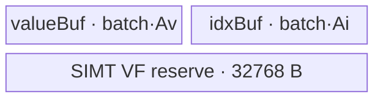
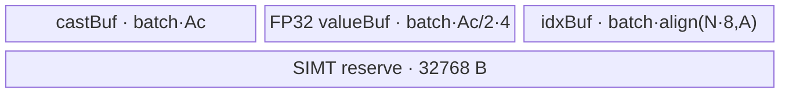
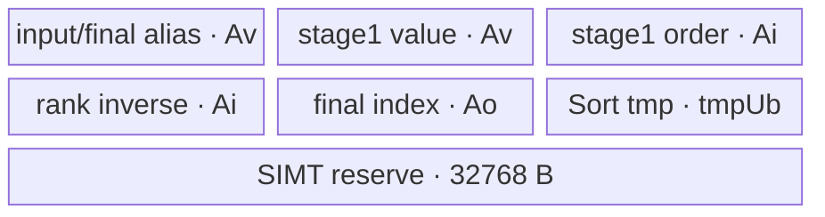
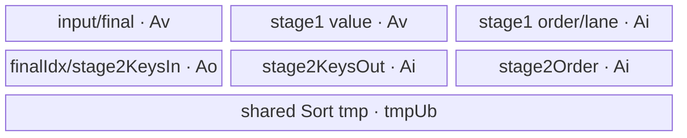
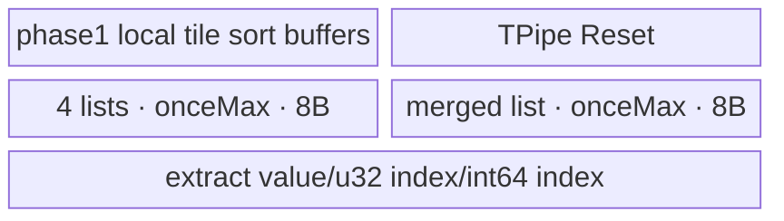
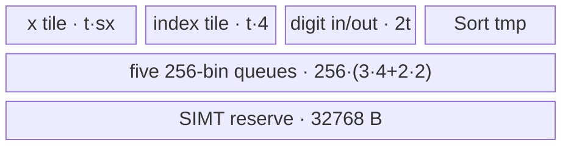

# Sort 950 ACLNN 算子知识

## 算子速览

| 项目 | 内容 |
|---|---|
| 实际入口 | `aclnnSortGetWorkspaceSize` / `aclnnSort`，公开 ACLNN 两段式接口；内部算子 `l0op::Sort`，Device entry `sort<schId,isInt32,isDescend>` |
| 计算语义 | 沿 `dim` 排序，`valuesOut` 返回值，`indicesOut` 返回各值在原轴上的下标；`stable=true` 要求相等值保持原次序 |
| 输入输出 | 公开文档：`self`/输出为 ND、1–8 维；950 `self` 支持 BF16/FP16/FP32、8/16/32/64 位有符号与无符号整数、BOOL，`indicesOut` 为 INT64；`valuesOut` 不支持 DOUBLE |
| 执行类型 | 核心 `Sort` 是单个 `KERNEL_TYPE_MIX_AIV_1_0` entry：AIV Vector；R-001/R-002/R-003/R-004/R-010/R-011 内嵌 SIMT VF，均无 Cube/AIC/MIX_CV |
| Kernel 路线 | R-001/002 小轴插入；R-003/004 两阶段小轴；R-005 `Sort32`；R-006 UB merge；R-007 跨核 merge；R-008 单核 radix；R-009 核内分块 merge；R-010/011 多核 radix |
| 核心资源 | GM 输入/输出、AIV UB/TBuf/TQue、SIMT VF 预留 32 KiB；R-007/R-009/R-010/R-011 使用 user workspace；其余核心 kernel 不读 user workspace |
| 来源闭包 | `source_closed`：公开声明→ACLNN executor→`l0op::Sort`→950 OpDef/Tiling/POD→entry/router→全部 Host 可达 body/helper→950 binary/CMake 已闭合 |
| 验证状态 | 已完成源码闭包检查；本次知识提取未执行编译、真机、数值或性能测试。 |

## 接口与语义

### 计算语义

令归一化轴为 `d`，固定其它坐标得到长度 `N=self.shape[d]` 的序列。输出满足 `valuesOut[...,j,...]=self[...,indicesOut[...,j,...],...]`；`descending=false/true` 分别按升/降序排列。`stable=true` 的公开语义是相等键保持输入先后。950 Tiling/entry 不读取 `stable`：同一 `(shape,dtype,descending)` 的 `stable=false/true` 进入同一 body；源码只证明该属性不参与实现选择，不据此推断相等键的硬件内部行为。

ACLNN 将目标轴换到末维，核心 kernel 将形状折叠为 `[B,N]`，其中 `B=∏shape[0:-1]`。`indicesOut` 是每行 `[0,N)` 内的轴内索引，不是扁平全局索引。

### 输入、输出与属性

| 参数 | shape/layout | dtype | 约束、默认值与语义 |
|---|---|---|---|
| `self` | ND，公开 1–8 维；可非连续 | 950：BF16/FP16/FP32、INT8/16/32/64、UINT8/16/32/64、BOOL | 非空指针；BOOL 在核心排序前 Cast 为 UINT8；950 BF16 直接进入 kernel |
| `stable` | 标量 | BOOL | 是否要求稳定；Host 转交内部 `Sort`，950 Tiling/entry 未消费 |
| `dim` | 标量 | INT64 | `[-rank,rank-1]`，负值加 `rank`；非末轴先 transpose 到末轴 |
| `descending` | 标量 | BOOL | 编译期模板 `isDescend`，改变比较/bit-twiddle 方向 |
| `valuesOut` | 与 `self` shape 相同，ND，可非连续 | 950 与 `ARCH3510_DTYPE_SUPPORT_LIST` 相同 | 核心值按内部输入 dtype 产生，随后 Cast 到输出 dtype；公开 950 说明不支持 DOUBLE |
| `indicesOut` | 与 `self` shape 相同，ND，可非连续 | INT64 | 950 内核直接实例化 INT64 index，无 ACLNN 后置 index Cast |

空 Tensor 在第一段接口直接返回 `workspaceSize=0`。排序轴长度为 1 时不启动 `Sort`：value 走 `Contiguous→ViewCopy`，index 走 `Fill(0)→ViewCopy`。这些是 F-EMPTY/F-AXIS1 框架短路，不属于下文核心 Kernel Route。

### 入口与版本

固定版本只有 `aclnnSort`，无版本号后缀。`aclnnSortGetWorkspaceSize` 构造 executor 并返回其总 workspace，`aclnnSort` 用 `CommonOpExecutorRun` 在传入 stream 上执行。公开文档明确支持 Ascend 950PR/950DT；`sort_def.cpp` 只给 `ascend950` 添加 AICore config，CMake 只设置 `SUPPORT_COMPUTE_UNIT "ascend950"`，binary config 覆盖 11 种核心输入 dtype × INT32/INT64 index。A2/A3 虽被公开文档列为支持，但固定仓没有其 Tiling/Kernel/config/CMake 接线，不能在本 Commit 达到 `source_closed`，因此不生成 A2/A3 卡。

## Host/Launcher 执行流程

### 参数校验与前处理

顺序固定如下：

1. 创建 executor；校验 `self/valuesOut/indicesOut` 非空、950 dtype 列表、`dim` 范围及三个 tensor shape 相同。
2. 空 Tensor：workspace 置 0，返回空 executor。
3. 若 `shape[dim]==1`：`Contiguous(self)` 后复制 value；用 `Fill` 产生零 index 并复制；不进入 `l0op::Sort`。
4. 主路径先 `Contiguous(self)`；BOOL Cast 为 UINT8。950 不执行非 RegBase 的 BF16→FP32，也不执行仅 Ascend 910 的 FP32→FP16。
5. 源码保留 `rank>8` 的折叠路径（末轴时 `[left,N]`，否则 `[left,N,right]`），但公开输入域为 1–8 维；非末轴通过交换 `dim` 与末轴的 `Transpose` 将 N 移到末维。
6. `l0op::Sort(...,-1,descending,stable,indicesOut.dtype)` 在 950 经 `SortAiCoreForDavid` 添加单个 `Sort` AICore launcher。950 `IsRegBase()` 分支不走 `SortAiCpu`。
7. 若做过 transpose，对 value/index 用同一个交换 perm 转回；必要时 reshape 回原 shape；value Cast 到 `valuesOut.dtype`，950 index 不再 Cast；最后两次 `ViewCopy` 写用户输出。任一中间 tensor 为空即返回对应 ACLNN 错误。

`Contiguous/Reshape/Transpose/Cast/ViewCopy/Fill` 的 executor lowering 属于框架或被调用算子边界；本卡闭合 Sort 自有 selector、POD、entry 与 body，不将这些前后处理伪装为 Sort 内核。

### 参数、Workspace 与生命周期

`GetWorkspaceSize` 返回整个 executor 的聚合 workspace，聚合算法在框架边界内；Sort 节点 Tiling 的明确请求如下。`WORK_SPACE_SIZE=16 MiB` 是运行时保留量，entry 通过 `GetUserWorkspace(workspace)` 得到其后的 user 区。

| Route | Sort 节点 workspace 请求 | kernel 实际使用 |
|---|---:|---|
| R-001～R-006、R-008 | `16 MiB` | 核心 body 忽略 user workspace |
| R-007 | `16 MiB + 5*B*N*4` bytes | 每行两个 ping-pong sort-struct 区，跨核 merge |
| R-009 | `16 MiB + actualCoreNum*align(alignNum*8*2,A)` | 每核一行 ping-pong cache，核内各 batch 顺序复用 |
| R-010/011 | `16 MiB + W0+...+W5` | exclusive bins、global histogram、index/value ping-pong、tile hist/cumsum、radix byte |

executor 持有所有中间 tensor、属性数组和 launch 描述直到第二段执行结束；用户持有 `workspace`，其有效期覆盖 `aclnnSort`。所有节点加入同一 executor/stream；前一节点失败时 `CHECK_RET` 不再追加后续节点，执行失败由 `CommonOpExecutorRun` 返回。

### 启动图与失败传播

```text
F-EMPTY: validate -> workspace=0 -> no device work
F-AXIS1: Contiguous -> ViewCopy(value) -> Fill(0) -> ViewCopy(index)
main:
  Contiguous -> [Cast BOOL->UINT8] -> [Reshape] -> [Transpose dim<->last]
  -> SortAiCoreForDavid/ADD_TO_LAUNCHER_LIST_AICORE
     -> one `sort<schId,isInt32,isDescend>` node, blockDim=coreNumNeed
  -> [inverse Transpose values+indices] -> [Reshape] -> Cast(value dtype)
  -> ViewCopy(valuesOut) + ViewCopy(indicesOut)
```

核心 Sort 是单 Kernel 节点，不因 R-007/R-009/R-010/R-011 内部使用 `SyncAll`、GM workspace 或 SIMT VF 而变成多 Kernel。node 输入为末维连续 `[B,N]`，输出同 shape；POD 为 `SortRegBaseTilingData`；unknown template key 没有运行时 fallback body。Host Tiling、任一框架节点或 kernel launch 失败都会阻断输出提交。

## Route 与参数设计

### 分核与资源计算

记 `U` 为平台 UB bytes、`A=GetUbBlockSize()`、`C=GetCoreNumAiv()`、`N=lastAxisNum`、`B=unsortedDimNum`、`sx=sizeof(x)`、`si=sizeof(y2)`（ACLNN 950 为 8）。Tiling 先要求 `U>32768`。`isInt32=(N<=0x3fffffff)` 是 radix 计数/位置宽度选择，不代表输出 index dtype。

小轴以 `fullCoreSegs=ceil(B/C)` 查 dtype 表。Insertion 的 `batchSize=min(fullCoreSegs,floor((U-32768)/bytesPerSeg),4095)`；Two-stage 从 `min(B,fullCoreSegs,UB 上限)` 向下找最大可行 batch，若末波使用核数小于 60%，优先找 `batchNum%blockDim==0` 的较小 batch。常规 merge 按行分核；大轴路线按 N 切 tile 或 block。所有 32 位 POD 派生值在 Host 上先做显式范围/对齐检查，失败则尝试后续 Route 或 Tiling 失败。

### Route 选择

| 顺序 | Route | Key/模板 | 精确选择条件与优先级 | 不适用去向 |
|---:|---|---|---|---|
| 1 | R-003/004 两阶段小轴 | `schId=6` | `N<=512`，命中 dtype 的 two-stage `maxN/minSegs`，且 batch 的 key/UB/uint32 约束成立；R-003 `N<=64`，R-004 `N>64` | 尝试 insertion；注意并发 tier 已满足但 UB 失败时 insertion 仍被抑制 |
| 2 | R-001/002 插入小轴 | `schId=5` | `N<=insertionMaxN`，two-stage 并发 tier 不满足，insertion tier 满足，且 batching UB 成立；BF16 为 R-002，其余 R-001 | TryMerge |
| 3 | R-005 `Sort32` merge | `schId=8` | 前述失败；FP32 `N<=4096` 或 FP16/BF16 `N<=1024`，`N<=32`，merge plan 成功 | R-006/后续 |
| 4 | R-006 通用 UB merge | `schId=0` | 同上 merge 条件但 `N>32` | 多核 merge |
| 5 | R-007 跨核 merge | `schId=3` | FP32，`4096<N<=32768`，`B*ceil(N/2048)<=C` | radix-one |
| 6 | R-008 单核 radix | `schId=1,isInt32=1` | 前述失败；`N<=0x3fffffff`，对齐后的 value/value/index queues 加 Sort tmp 能放入 U | 核内 merge |
| 7 | R-009 核内分块 merge | `schId=4` | 前述失败；FP32，`B>=C/2`，`N>4096`，`N<=blockSortSize*256`，extract chunk>0，B 的 uint32 分核范围成立 | 多核 radix |
| 8 | R-010/011 多核 radix | `schId=2` | 最终 fallback；R-010 `N<=0x3fffffff`，R-011 `N>0x3fffffff` | Tiling 计算/窄化失败则 GRAPH_FAILED |

```text
if N <= 512 and small-axis plan succeeds:
    TWO_STAGE first (sch6), else INSERTION (sch5)
else if float-family small merge succeeds:
    sch8 when N<=32, else sch0
else if fp32 multi-core merge succeeds: sch3
else if uint32-counter one-core radix fits UB: sch1
else if fp32 intra-core merge succeeds: sch4
else: sch2 multi-core radix (uint32 or int64 counters)
```

`schId=7` 的 `SortAxisOneCopy` 在内部 Sort selector 中存在，但 `aclnnSort` 在 `N==1` 时已短路，因此不是本入口 Host 可达 Route。

### 模板/实现执行矩阵

| Route | key/selector | dtype/shape/platform 完整命中条件 | 执行拓扑与 Kernel 节点 | 实际模板/body | 内存与同步特征 | tail/fallback |
|---|---|---|---|---|---|---|
| R-001 | `(5,isInt32,isDescend)` | 小轴 insertion；非 BF16 | 单 AIV entry+256-thread SIMT VF | `SortSmallAxisInsertion<T,T,int64_t,...>` | TBuf value/index，32 KiB SIMT reserve；batch 间 MTE3→S | 尾 batch 用 `validSegs` |
| R-002 | 同 R-001 | BF16 insertion | 同上 | `SortSmallAxisInsertion<bf16,float,int64_t,...>` | 多 castBuf；BF16→FP32→BF16(RINT) | 同上 |
| R-003 | `(6,isInt32,isDescend)` | two-stage 且 `N<=64` | 单 AIV entry+1024-thread rank-inverse VF | `SortSmallAxisTwoStage<...,int64_t,...>` | input 与 final value alias；两 index 工作区 | 尾 batch缩小 `totalElems` |
| R-004 | 同 R-003 | two-stage 且 `N>64` | 单 AIV entry+1024-thread key VF+第二次 Vector Sort | 同类，`useRankInverse=false` | 三个 uint32 工作区，finalIdx 区先作 stage2 key | 同上 |
| R-005 | `(8,1,isDescend)` | float-family merge，前序失败，`N<=32` | 单 AIV | `MergeSort<...,isSort32SmallAxis=1>` | `Sort32→Extract`，行批处理 | padding sentinel，不写 padded lane |
| R-006 | `(0,1,isDescend)` | float-family merge，前序失败，`N>32` | 单 AIV | `MergeSort<...,isSort32SmallAxis=0>` | `Concat→Sort→Extract` | 同上 |
| R-007 | `(3,1,isDescend)` | FP32，跨核 merge 条件 | 单 AIV，内部多次 `SyncAll` | `MergeSortBigSize<float,float,...,int64_t>` | 每行 workspace ping-pong；4-way merge | 最后 core/tail list |
| R-008 | `(1,1,isDescend)` | 单行 radix UB 可容纳 | 单 AIV | `SortRadixOneCore<T,int64_t,...>` | queues 可单/双 buffer；Sort tmp | 尾 B 行 guard |
| R-009 | `(4,isInt32,isDescend)` | FP32 核内分块条件；body 不消费 counter-width 模板位 | 单 AIV，三阶段 `TPipe::Reset` | `SortMergeIntraCore<float,int64_t,...>` | 每核 workspace ping-pong，无跨核同步 | 尾 block/chunk |
| R-010 | `(2,1,isDescend)` | fallback 且 uint32 counter | 单 AIV+SIMT scatter，32-bit atomic | `SortRadixMoreCore<T,int64_t,UT,uint32_t,...>` | 六个 workspace slice、全核 barrier、lookback flag | 最后 tile `currTileSize` |
| R-011 | `(2,0,isDescend)` | fallback 且 N 超 30-bit counter | 单 AIV+SIMT offset/scatter，64-bit atomic | `SortRadixMoreCore<T,int64_t,UT,int64_t,...>` | 同 R-010，index/counter slice 加宽 | 同上 |

### 隐藏性能 Guard

| Guard | Host/Tiling 条件 | Device/资源原因 | 影响 Route | 不满足时去向 | 源码符号 |
|---|---|---|---|---|---|
| SIMT reserve | `U>32768`；小轴/radix-more 使用 `U-32768` | VF 预留 dynamic UB | R-001～004/010/011 | Tiling 失败或后续 Route | `CheckInputAndOutput`, `FillSmallAxisBatched`, `GetRadixSortMoreCore` |
| 小轴并发表 | dtype-specific `{maxN,minSegs}`，`fullCoreSegs=ceil(B/C)` | 摊薄插入串行代价或两阶段 Sort/VF 开销 | R-001～004 | TryMerge | `kSmallAxisRules`, `LookupMinSegs` |
| DataCopy blockCount | insertion `batchSize<=4095` | `DataCopyExtParams.blockCount` 硬件上限 | R-001/002 | 缩 batch/失败 | `EstimateInsertionBatching` |
| Two-stage packed key | `batchSize*(batchSize*N)<=UINT32_MAX` | `segId*totalElems+rank` 用 uint32 | R-004 | 缩 batch/后续 Route | `TryTwoStageBatchCandidate` |
| Merge small阈值 | FP16/BF16 `N<=1024`；FP32 `N<=4096` | radix pass 数与 merge 切换点 | R-005/006 | R-007/008 | `IsMergeSort` |
| Merge Sort32 | `N<=32` | compile-time 单 repeat `Sort32/Extract` | R-005 | R-006 | `TryMerge`, `VbsMergeSort*` |
| Radix counter | `N<=0x3fffffff` | uint32 高 2 bit 被软件 lookback 状态占用 | R-008/010 vs R-011 | int64 counter | `IsRadixUint32CounterRange` |
| Intra blocks | `blocksPerRow<=256` | 最多四轮 4-way merge，限制 merge 路数增长 | R-009 | R-010 | `IsSortMergeIntraCoreAxisInRange` |
| uint32 POD | tile/core/batch/loop/alignment 派生量显式检查 | POD 对应字段均为 uint32 | 全 Route | 下个 Route或 GRAPH_FAILED | `TryCastInt64ToUint32` 等 |

### POD/ABI

Host 与 Device 共同 include `SortRegBaseTilingData`。按固定结构的自然 C++ ABI：`alignof=8`、`sizeof=64`；前 12 个 `uint32_t` 连续，两个 `int64_t` 已自然 8-byte 对齐。

| 结构 | 字段 | 类型/位宽 | ABI 布局 | 单位 | Host/launcher producer | Device consumer | 边界 |
|---|---|---|---|---|---|---|---|
| `SortRegBaseTilingData` | `numTileDataSize` | uint32/32 | offset 0 | elements | 各 `Get*` | tile/batch/block 长度 | 必须非零 |
| 同上 | `unsortedDimParallel` | uint32/32 | offset 4 | rows/并行组 | 各 `Get*` | B 轴分核 | ≤C |
| 同上 | `lastDimTileNum` | uint32/32 | offset 8 | tiles/blocks | 各 `Get*` | H 循环/merge block 数 | Route-specific |
| 同上 | `sortLoopTimes` | uint32/32 | offset 12 | loops | 各 `Get*` | B 轴外循环 | 显式窄化检查 |
| 同上 | `lastDimNeedCore` | uint32/32 | offset 16 | cores | 各 `Get*` | H 分核/实际核数 | ≤C |
| 同上 | `keyParams0` | uint32/32 | offset 20 | Route-specific | selector | batch size / queue bytes / rows/core / clear cores | inactive Route 不读 |
| 同上 | `keyParams1` | uint32/32 | offset 24 | Route-specific | selector | batch count / queue bytes / clear cores | inactive Route 不读 |
| 同上 | `keyParams2` | uint32/32 | offset 28 | Route-specific | selector | rank-inverse flag / index half / clear elems | inactive Route 不读 |
| 同上 | `keyParams3` | uint32/32 | offset 32 | Route-specific | selector | buffer depth / aligned N / clear loops | inactive Route 不读 |
| 同上 | `keyParams4` | uint32/32 | offset 36 | Route-specific | selector | merge queue depth/extract chunk/clear chunk | inactive Route 不读 |
| 同上 | `keyParams5` | uint32/32 | offset 40 | Route-specific | selector | merge loop cap / clear chunk | inactive Route 不读 |
| 同上 | `tmpUbSize` | uint32/32 | offset 44 | bytes | `GetSortMaxMinTmpSize`/`GetConcatTmpSize` | Sort/Concat temporary TBuf | 由 Host resource check 限制 |
| 同上 | `lastAxisNum` | int64/64 | offset 48 | elements | `N` | 每行长度/GM offset | 输入 shape |
| 同上 | `unsortedDimNum` | int64/64 | offset 56 | rows | `B` | batch guard/GM offset | 输入 shape product |

### Route 源码闭包

| Route | Key/selector | Host/Tiling producer | POD/参数 | Kernel entry/router 节点 | Kernel body/直接依赖 | 构建接线 |
|---|---|---|---|---|---|---|
| R-001/002 | sch5 | `SelectSmallAxisRoute`/`FillSmallAxisBatched` | batchSize/batchNum/N/B | `sort_apt.cpp::sort` | `SortSmallAxisInsertion::*`, `SimtInsertionSortSegments` | CMake+950 binary |
| R-003/004 | sch6 | 同上+`EstimateTwoStageBatching` | batch、rank flag、tmp | 同上 | `SortSmallAxisTwoStage::*`, 两个 SIMT helper | 同上 |
| R-005/006 | sch8/sch0 | `TryMerge`/`GetMergeSort` | row/core/align/queue/tmp | 同上 | `MergeSort::*` | 同上 |
| R-007 | sch3 | `IsSortMergeMultiCore`/`GetSortMergeMultiCore` | H cores/tile/maxDealing | 同上 | `MergeSortBigSize::*` | 同上 |
| R-008 | sch1 | `IsRadixSortOneCore`/`GetRadixSortOneCore` | queue bytes/index half/depth/tmp | 同上 | `SortRadixOneCore::*` | 同上 |
| R-009 | sch4 | `IsSortMergeIntraCore`/`GetSortMergeIntraCore` | batch/block/extract/aligned N | 同上 | `SortMergeIntraCore::*` | 同上 |
| R-010/011 | sch2 | `GetRadixSortMoreCore` | tile/core/clear/tmp/B/N | 同上 | `SortRadixMoreCore::*`, SIMT helpers | 同上 |

## Kernel 实现

### 公共执行流程

`sort_apt.cpp::sort` 解析同一 POD，取 `usrWorkspace=GetUserWorkspace(workspace)`，设置 `KERNEL_TYPE_MIX_AIV_1_0`，用 `schId` 编译期分支实例化唯一 body。`isDescend` 编译成比较/bit transform；`isInt32` 仅在 sch1/sch2 的计数与 index 中间类型有意义。每个 Route 的全局输入/输出布局均为连续 `[B,N]`，主 kernel 只处理有效行/元素；ACLNN 的 transpose/cast/view-copy 位于此节点外。

### Route R-001：原生 dtype 小轴插入

#### 适用条件

##### 选择证据

| 层级 | 文件 | 符号 | 源码谓词/参数 | 结果/下一跳 |
|---|---|---|---|---|
| Tiling | `sort_tiling_arch35.cpp` | `InsertionFeasible` | dtype rule、two-stage tier 不满足、insertion tier 满足、UB 可放，N>1 | sch5；失败 TryMerge |
| Router | `sort_apt.cpp` | `schId==5` | 非 BF16 | `SortSmallAxisInsertion<T,T,int64_t,isDescend>` |

#### Device 数据流

##### 函数级调用链

```text
sort -> Init -> Process
  -> LoadBatch(DataCopyPad GM->values)
  -> SimtInsertionSortSegments<256 threads>
  -> StoreBatch(DataCopyPad values/indices -> GM)
```

##### 源码等价伪码

```text
core takes contiguous batchId range
for batchId: valid=min(batchSize, B-batchId*batchSize)
  copy valid rows of N values with aligned UB row stride
  thread seg=threadIdx.x; seg<valid; seg+=256:
    idx[seg,:]=0..N-1
    stable insertion: move only prev>key (asc) or prev<key (desc)
  copy only valid rows and N valid lanes to value/index GM
```

#### 内存与数据搬运

##### 资源与搬运表

| 层级/缓冲区 | offset/地址公式 | extent/容量公式 | dtype/layout | producer | consumer | owner/lifetime | 对齐/复用 |
|---|---|---|---|---|---|---|---|
| GM x/y/y2 | `segStart*N` | `valid*N` | T/T/int64 row-major | ACLNN/kernel | kernel/ACLNN | caller | 有效 N，不写 UB padding |
| `valueBuf_` | 0 | `batch*Av`, `Av=align(N*sx,A)` | T | MTE2 | SIMT/MTE3 | kernel batch | 单 buffer |
| `idxBuf_` | 独立 TBuf | `batch*Ai`, `Ai=align(N*8,A)` | int64 | SIMT | MTE3 | kernel batch | 单 buffer |

##### 分层内存布局



##### 字节账与复用顺序

```text
UB_visible = batch*(Av+Ai) <= U-32768
dynamic_ub_reserve = 32768
workspace_user = 0 (Sort node still requests runtime 16 MiB reserve)
```

| 复用子区 | 写入者 | 读取者/消费点 | 下一次覆盖 | 同步或释放依据 | 安全条件 |
|---|---|---|---|---|---|
| value/index TBuf | MTE2/SIMT | SIMT/MTE3 | 下一 batch | MTE2_V、V_MTE3、MTE3_S | 当前 batch GM 写回完成 |

#### 同步、精度与尾块

##### 同步与数值边界表

| 阶段 | primitive/机制 | producer | consumer/等待点 | 保护对象 | 精度/尾块 |
|---|---|---|---|---|---|
| load→VF | `MTE2_V` | DataCopyPad | SIMT | valueBuf | `validSegs`、N lanes |
| VF→store | `V_MTE3` | insertion VF | MTE3 | value/index | 严格比较使相等值不移动 |
| batch reuse | `MTE3_S` | store | scalar loop | 两 TBuf | 尾 batch按 valid |

#### 关键实现

##### 符号证据表

| 阶段 | 文件 | 符号/模板实例 | 实现事实 |
|---|---|---|---|
| Host | `sort_tiling_arch35.cpp` | `EstimateInsertionBatching` | UB、4095 blockCount、batch/core |
| Router | `sort_apt.cpp` | sch5 | dtype模板路由 |
| Body | `sort_small_axis_insertion.h` | `LoadBatch/SimtInsertionSortSegments/StoreBatch` | 256线程稳定插入、DMA与同步 |

### Route R-002：BF16 升精度小轴插入

#### 适用条件

##### 选择证据

与 R-001 相同但 `dataType==BF16`；router 实例化 `CONVERT_TYPE=float`。

#### Device 数据流

##### 函数级调用链

```text
Load BF16 -> Cast FP32 -> SIMT insertion FP32 -> Cast BF16(RINT) -> store BF16/index
```

##### 源码等价伪码

同 R-001，唯一区别是每行 BF16 搬运 pitch 与 FP32 value buffer 使用同一元素 stride，排序前后显式 Cast。

#### 内存与数据搬运

##### 资源与搬运表

| 层级/缓冲区 | offset/地址公式 | extent/容量公式 | dtype/layout | producer | consumer | owner/lifetime | 对齐/复用 |
|---|---|---|---|---|---|---|---|
| `castBuf_` | 0 | `batch*Ac`, `Ac=align(N*2,A)` | BF16 | MTE2/FP32 Cast | Cast/MTE3 | batch | 前后 Cast 共用 |
| `valueBuf_` | 0 | `batch*(Ac/2)*4` | FP32 | Cast | SIMT/Cast | batch | pitch 与 castBuf 元素数一致 |
| `idxBuf_` | 0 | `batch*align(N*8,A)` | int64 | SIMT | MTE3 | batch | 独立 |

##### 分层内存布局



##### 字节账与复用顺序

```text
UB_visible = batch*(Ac + 2*Ac + align(N*8,A)) <= U-32768
workspace_user = 0
```

| 复用子区 | 写入者 | 读取者/消费点 | 下一次覆盖 | 同步或释放依据 | 安全条件 |
|---|---|---|---|---|---|
| castBuf | MTE2，后由降精度 Cast | 升精度 Cast，后由 MTE3 | 下一 batch | MTE2_V、V_MTE3、MTE3_S | 两次用途生命周期不重叠 |

#### 同步、精度与尾块

##### 同步与数值边界表

| 阶段 | primitive/机制 | producer | consumer/等待点 | 保护对象 | 精度/尾块 |
|---|---|---|---|---|---|
| BF16→FP32 | `Cast(...CAST_NONE)` | load | SIMT | FP32 values | valid rows × aligned pitch |
| FP32→BF16 | `Cast(...CAST_RINT)` | SIMT | MTE3 | castBuf | RINT；仅有效 N 输出 |

#### 关键实现

##### 符号证据表

| 阶段 | 文件 | 符号/模板实例 | 实现事实 |
|---|---|---|---|
| Host | `sort_tiling_arch35.cpp` | `ComputeInsertionBytesPerSeg` | BF16 三缓冲字节预算 |
| Router | `sort_apt.cpp` | sch5 BF16 | `T=bf16,CONVERT=float` |
| Body | `sort_small_axis_insertion.h` | `LoadBatch/StoreBatch` | CAST_NONE/RINT 与 castBuf 复用 |

### Route R-003：两阶段 rank-inverse 小轴

#### 适用条件

##### 选择证据

Two-stage dtype tier、UB/key 成立，且 `N<=64`；`keyParams2=1`。

#### Device 数据流

##### 函数级调用链

```text
Load flattened batch -> Stage1Sort(values,flatIndex)
  -> RankInverseScatter<1024 threads> -> StoreBatch
```

##### 源码等价伪码

```text
sort all E=validSegs*N values globally; get stage1Order[rank]=flatIdx
parallel build rankInverse[flatIdx]=rank; barrier
for each flatIdx: count same-segment elements with smaller global rank
  finalValue[seg,pos]=stage1Value[rank]
  finalIdx[seg,pos]=flatIdx%N
```

#### 内存与数据搬运

##### 资源与搬运表

| 层级/缓冲区 | offset/地址公式 | extent/容量公式 | dtype/layout | producer | consumer | owner/lifetime | 对齐/复用 |
|---|---|---|---|---|---|---|---|
| input/final value | 0 | `Av=align(E*sx,A)` | T flat | MTE2 / SIMT | Sort / MTE3 | batch | final aliases input after Stage1 |
| stage1 value | 0 | `Av` | T | Sort | SIMT | batch | 独立 |
| stage1 order | 0 | `Ai=align(E*4,A)` | uint32 | Sort | SIMT | batch | flat index |
| rank inverse | 0 | `Ai` | uint32 | SIMT | SIMT | batch | barrier protected |
| final index | 0 | `Ao=align(E*8,A)` | int64 | SIMT | MTE3 | batch | 独立 |
| tmp | 0 | `tmpUbSize` | bytes | Sort API | Sort API | batch | Host queried |

##### 分层内存布局



##### 字节账与复用顺序

```text
UB_visible = 2*Av + 2*Ai + Ao + tmpUb <= U-32768
workspace_user = 0
```

| 复用子区 | 写入者 | 读取者/消费点 | 下一次覆盖 | 同步或释放依据 | 安全条件 |
|---|---|---|---|---|---|
| input/final | MTE2；后 SIMT | Stage1Sort；后 MTE3 | 下一 batch load | V_MTE3 + MTE3_MTE2 | Stage1 后不再读 input |

#### 同步、精度与尾块

##### 同步与数值边界表

| 阶段 | primitive/机制 | producer | consumer/等待点 | 保护对象 | 精度/尾块 |
|---|---|---|---|---|---|
| rank build | `asc_syncthreads` | rank writers | position scan | rankInverse | E=valid*N |
| store/reuse | V_MTE3、MTE3_MTE2、MTE3_S | SIMT/MTE3 | next load/loop | aliased input/final | 只写 E |

#### 关键实现

##### 符号证据表

| 阶段 | 文件 | 符号/模板实例 | 实现事实 |
|---|---|---|---|
| Host | `sort_tiling_arch35.cpp` | `UseTwoStageRankInverse/EstimateTwoStageUbBytes` | N≤64 与 buffer count |
| Router | `sort_apt.cpp` | sch6 | two-stage实例 |
| Body | `sort_small_axis_two_stage.h` | `Stage1Sort/RankInverseScatter/StoreBatch` | 排名逆映射与 alias 同步 |

### Route R-004：两次 radix 的小轴重组

#### 适用条件

##### 选择证据

Two-stage 成立且 `64<N<=dtype rule.twoStageMaxN`；`keyParams2=0`，同时校验 `batchSize²*N<=UINT32_MAX`。

#### Device 数据流

##### 函数级调用链

```text
Stage1 Sort<T> -> SIMT BuildStage2Keys(key=segId*E+rank)
  -> Stage2 Sort<uint32> -> Gather values/indices -> Store
```

##### 源码等价伪码

Stage1 按值产生全局 rank；SIMT 把 key 编成 segment 主序并将 order 改写为 laneId；第二次升序 radix 产生最终 permutation；两次 Gather 回收对应 value/laneId，INT32 laneId Cast 为 INT64。

#### 内存与数据搬运

##### 资源与搬运表

与 R-003 相同，另有 `stage2Order=Ai`；`finalIdxBuf(Ao)` 在 BuildOutputs 前先以 uint32 view 充当 `stage2KeysIn`，`rankInverseBuf(Ai)` 充当 `stage2KeysOut`。

##### 分层内存布局



##### 字节账与复用顺序

```text
UB_visible = 2*Av + 3*Ai + Ao + max(tmpSortT,tmpSortU32) <= U-32768
```

| 复用子区 | 写入者 | 读取者/消费点 | 下一次覆盖 | 同步或释放依据 | 安全条件 |
|---|---|---|---|---|---|
| finalIdx/stage2KeysIn | SIMT key builder | Stage2Sort | BuildOutputs 写 INT64 | 顺序 VF→Sort→Vector | final index 尚未建立 |
| stage2KeysOut | Stage2Sort | 先作 gather byte offsets | 下一 batch | Vector 顺序 | offsets 使用完再覆盖 |

#### 同步、精度与尾块

##### 同步与数值边界表

| 阶段 | primitive/机制 | producer | consumer/等待点 | 保护对象 | 精度/尾块 |
|---|---|---|---|---|---|
| gather | `Muls/Gather/Cast` | Stage2 order | final buffers | byte offsets | INT32 lane→INT64 CAST_NONE；E tail |
| store | 同 R-003 | Vector | MTE3 | aliases | 只写 E |

#### 关键实现

##### 符号证据表

| 阶段 | 文件 | 符号/模板实例 | 实现事实 |
|---|---|---|---|
| Host | `sort_tiling_arch35.cpp` | `TryTwoStageBatchCandidate` | packed-key 溢出与两次 Sort tmp 上界 |
| Router | `sort_apt.cpp` | sch6 | same entry |
| Body | `sort_small_axis_two_stage.h` | `BuildStage2Keys/Stage2Sort/BuildOutputs` | key、alias、Gather |

### Route R-005：小轴 Sort32 merge

#### 适用条件

##### 选择证据

前置 small-axis 路线失败；float-family merge 条件成立且 `N<=32`，`schId=8`。

#### Device 数据流

##### 函数级调用链

```text
Process -> ProcessSingleBlockSort -> CopyDataIn(pad)
  -> VbsMergeSort[Bf16] -> Sort32 -> Extract -> [index Cast int64] -> CopyValue2Gm
```

##### 源码等价伪码

每核每轮处理 `oneCoreRowNum` 行；行内补 sentinel 到 `alignSize`，生成 0..align-1 index；升序前翻转浮点符号 bit；`Sort32(...,repeat=1)` 后 `Extract(...,1)`；翻回符号 bit，仅复制 N 个有效值与 index。

#### 内存与数据搬运

##### 资源与搬运表

设 `Qv=alignSize*rows*sx`、`Qi=alignSize*rows*8`、`D=(N>2048?1:2)`、`M=tmpUb`、`S=alignSize*8*sizeof(CONVERT_TYPE)`。

| 层级/缓冲区 | offset/地址公式 | extent/容量公式 | dtype/layout | producer | consumer | owner/lifetime | 对齐/复用 |
|---|---|---|---|---|---|---|---|
| in/value/index queues | row block | `D*Qv + D*Qv + D*Qi` | T/T/int64 | MTE2/Vector | Vector/MTE3 | iteration | queue depth D |
| tmp+concat | 独立 | `M+M` | bytes | APIs | APIs | kernel | TBuf |
| sort structs | 独立 | `2*S` | CONVERT view | Sort32 | Extract | kernel | two TBuf |
| index/cast | 独立 | `alignSize*4 + 2*alignSize*rows*sizeof(CONVERT_TYPE)` | u32/convert | init/sort | sort/cast | kernel | BF16 uses FP32 |

##### 分层内存布局


##### 字节账与复用顺序

```text
UB_total = 2*D*Qv + D*Qi + 2*M + 2*S + alignSize*4
         + 2*alignSize*rows*sizeof(CONVERT_TYPE)
workspace_user = 0
```

| 复用子区 | 写入者 | 读取者/消费点 | 下一次覆盖 | 同步或释放依据 | 安全条件 |
|---|---|---|---|---|---|
| queues | Copy/Sort | Sort/CopyOut | next row group | EnQue/DeQue/FreeTensor | depth由 N 阈值设置 |

#### 同步、精度与尾块

##### 同步与数值边界表

| 阶段 | primitive/机制 | producer | consumer/等待点 | 保护对象 | 精度/尾块 |
|---|---|---|---|---|---|
| pad/load | V_MTE2 event | Duplicate | DataCopyPad | padding | asc `NaN`、desc `-INF` sentinel |
| BF16 | Cast NONE/RINT | input/sorted FP32 | Sort/output | values | N valid output |
| index | Cast NONE | Extract u32 | int64 queue | y2 | aligned rows，copy N |

#### 关键实现

##### 符号证据表

| 阶段 | 文件 | 符号/模板实例 | 实现事实 |
|---|---|---|---|
| Host | `sort_tiling_arch35.cpp` | `GetMergeSort/TryMerge` | align/core/queue depth/sch8 |
| Router | `sort_apt.cpp` | sch8 | `MergeSort<...,1>` |
| Body | `sort_merge_sort.h` | `VbsMergeSort*` | Sort32、符号翻转、Extract |

### Route R-006：通用 UB merge

#### 适用条件

##### 选择证据

同 R-005 但 `N>32`，`schId=0`；FP16/BF16 上界 1024，FP32 上界 4096。

#### Device 数据流

##### 函数级调用链

与 R-005 相同，但核心为 `Concat→Sort<CONVERT_TYPE,true>→Extract`。

##### 源码等价伪码

每行 `concatRepeat=alignSize/16`、`sortRepeat=extractRepeat=alignSize/32`；其余分核、padding、index cast 与有效输出同 R-005。

#### 内存与数据搬运

##### 资源与搬运表

与 R-005 完全同布局和公式；区别是 concat/sort temp 实际被通用 API 消费。

##### 分层内存布局

同 R-005。

##### 字节账与复用顺序

同 R-005；`D=2`（本 Route N≤1024/4096，只有 FP32 N>2048 时 D=1）。

#### 同步、精度与尾块

##### 同步与数值边界表

同 R-005；通用 Sort/Extract 的 repeat 来自 `alignSize/32`，尾行仅复制 N。

#### 关键实现

##### 符号证据表

| 阶段 | 文件 | 符号/模板实例 | 实现事实 |
|---|---|---|---|
| Host | `sort_tiling_arch35.cpp` | `IsMergeSort/GetMergeSort` | dtype阈值与 sch0 |
| Router | `sort_apt.cpp` | sch0 | `MergeSort<...,0>` |
| Body | `sort_merge_sort.h` | `Concat/Sort/Extract` | repeat、pad、cast、tail |

### Route R-007：FP32 跨核四路 merge

#### 适用条件

##### 选择证据

FP32、`4096<N<=32768`、`hCore=ceil(N/2048)` 且 `B*hCore<=C`；前置路线失败。

#### Device 数据流

##### 函数级调用链

```text
each row uses hCore cores:
  local tile CopyIn -> sign flip -> Concat/Sort -> workspace ping
  SyncAll
  repeated 4-way MrgSort ping<->pong, SyncAll per level
  rowCore0 final MrgSort -> Extract -> sign restore -> value/index GM
  SyncAll
```

##### 源码等价伪码

`rowIdx=blockIdx/hCore`，`rowCoreIdx=blockIdx%hCore`；每核先排序 `numTileData`（尾核处理 remainder），携带全行 offset index。之后每 4 个有序 list 合并，工作 list 数每轮变为 `ceil(listNum/4)`，两个 workspace 区交替；最后由 rowCore0 抽取有效 `(value,index)`。

#### 内存与数据搬运

##### 资源与搬运表

| 层级/缓冲区 | offset/地址公式 | extent/容量公式 | dtype/layout | producer | consumer | owner/lifetime | 对齐/复用 |
|---|---|---|---|---|---|---|---|
| row workspace ping/pong | `row*2*align(N*8,A)` | each `align(N*8,A)` bytes | 8-byte sort struct | local Sort/MrgSort | next merge/final | executor | level ping-pong |
| phase1 UB | per core | `tailAlign*sx + tailAlign*(8+4+8+8+4+8)` | float/struct | load/sort | workspace | kernel phase | Reset后释放 |
| merge UB | per core | `4*onceMax*(8+8+4+4+8)` plus INT64 index `4*onceMax*8` | struct/value/index | workspace/Mrg | workspace/GM | kernel phase | depth 1 |

##### 分层内存布局



##### 字节账与复用顺序

```text
onceMax=floor((U/byteNum)/32)*32
workspace_user=5*B*N*4 bytes; kernel uses two aligned sort-struct regions per row
UB_peak=max(phase1_sum, merge_phase_sum)
```

| 复用子区 | 写入者 | 读取者/消费点 | 下一次覆盖 | 同步或释放依据 | 安全条件 |
|---|---|---|---|---|---|
| ping/pong row workspace | local Sort / merge level | next level/final | following level | `SyncAll` | 所有行内 producer 完成 |

#### 同步、精度与尾块

##### 同步与数值边界表

| 阶段 | primitive/机制 | producer | consumer/等待点 | 保护对象 | 精度/尾块 |
|---|---|---|---|---|---|
| local→merge | `SyncAll` | hCore local sorts | merge cores | workspace ping | tail core remainder |
| merge levels | `SyncAll` | current level | next level | ping/pong | tail 1–3 lists |
| final | Extract+sign flip | rowCore0 | MTE3 | output | int32 index Cast to int64 |

#### 关键实现

##### 符号证据表

| 阶段 | 文件 | 符号/模板实例 | 实现事实 |
|---|---|---|---|
| Host | `sort_tiling_arch35.cpp` | `IsSortMergeMultiCore/GetSortMergeMultiCore` | hCore、workspace、schedule mode |
| Router | `sort_apt.cpp` | sch3 FP32 | `MergeSortBigSize<float,float,...>` |
| Body | `merge_sort_big_size.h` | `Process/SortInMultiCore/FinalSortAndCopy` | 跨核同步、4-way merge、ping-pong |

### Route R-008：单核整行 radix

#### 适用条件

##### 选择证据

前序失败，`N<=0x3fffffff`；`xUb=align(N*sx,A)`、`y2Ub=2*align(N*4,A)`，`2*xUb+y2Ub+tmp<=U`。若再容纳一份 queues，`bufferNum=2`，否则 1。

#### Device 数据流

##### 函数级调用链

```text
for core-owned rows: DataCopyPad x -> AscendC::Sort RADIX
  -> u32 index written into second half of idx queue
  -> Cast u32->int64 into first half -> value/index DataCopyPad
```

##### 源码等价伪码

`row=blockIdx+loop*Cused`，越过 B 即返回；整行一次进 UB，Sort 直接给 value 与 uint32 index；950 INT64 输出使用同一 index queue 的两半完成 Cast。

#### 内存与数据搬运

##### 资源与搬运表

| 层级/缓冲区 | offset/地址公式 | extent/容量公式 | dtype/layout | producer | consumer | owner/lifetime | 对齐/复用 |
|---|---|---|---|---|---|---|---|
| in/value queues | `row*N` | each `D*xUb` | T | MTE2/Sort | Sort/MTE3 | loop | D=1/2 |
| index queue | `row*N` | `D*y2Ub` | first int64 half + second u32 half | Sort/Cast | Cast/MTE3 | loop | physical split |
| tmp | 0 | `tmpUbSize` | bytes | Sort API | Sort API | kernel | fixed |

##### 分层内存布局


##### 字节账与复用顺序

```text
UB_total=D*(2*xUb+y2Ub)+tmpUb <= U
workspace_user=0
```

| 复用子区 | 写入者 | 读取者/消费点 | 下一次覆盖 | 同步或释放依据 | 安全条件 |
|---|---|---|---|---|---|
| index queue halves | Sort writes u32 half | Cast writes int64 half | MTE3/next row | queue EnQue/DeQue/Free | `halfIndex=xUb32Elements` |

#### 同步、精度与尾块

##### 同步与数值边界表

| 阶段 | primitive/机制 | producer | consumer/等待点 | 保护对象 | 精度/尾块 |
|---|---|---|---|---|---|
| pipeline | TQue | MTE2/Sort | Sort/MTE3 | row buffers | whole N，尾 B guard |
| index | `Cast(...CAST_NONE,N)` | Sort u32 | int64 output | y2 | N≤30-bit |

#### 关键实现

##### 符号证据表

| 阶段 | 文件 | 符号/模板实例 | 实现事实 |
|---|---|---|---|
| Host | `sort_tiling_arch35.cpp` | `IsRadixSortOneCore/GetRadixSortOneCore` | UB/depth/core plan |
| Router | `sort_apt.cpp` | sch1 | `SortRadixOneCore<T,int64_t,...>` |
| Body | `sort_radix_sort_one_core.h` | `ProcessRadixSortOneCore` | whole-row Sort/index half alias |

### Route R-009：FP32 核内分块四路 merge

#### 适用条件

##### 选择证据

前序失败；FP32、`B>=C/2`、`N>4096`；`blockSortSize=floor((U/64)/32)*32`，`ceil(N/blockSortSize)<=256`；`extractChunk=floor((U/48)/32)*32>0`。

#### Device 数据流

##### 函数级调用链

```text
per core, per row:
  Phase1 block CopyIn -> Concat/Sort to struct -> workspace cache
  Reset
  Phase2 iterative 4-way MrgSort cache ping<->pong
  Reset
  Phase3 cache chunk -> Extract -> sign restore -> index Cast -> GM
```

##### 源码等价伪码

每核拥有连续 `batchPerCore=ceil(B/C)` 行。每行最多 256 块；Phase1 给 index 写全行 `baseOffset`。Phase2 每轮把至多四个 list 分块装 UB，`MrgSort` 消费量由 `listSortedNums` 回写，孤立 list 直接拷贝，迭代上限 `INT32_MAX/blockSortSize`。Phase3 按 extract chunk 提取有效 N。

#### 内存与数据搬运

##### 资源与搬运表

| 层级/缓冲区 | offset/地址公式 | extent/容量公式 | dtype/layout | producer | consumer | owner/lifetime | 对齐/复用 |
|---|---|---|---|---|---|---|---|
| per-core cache | `core*2*batchSortLen` float elems | `align(alignNum*8*2,A)` bytes | 8-byte sort struct ping/pong | Phase1/2 | Phase2/3 | executor | same region reused per row |
| Phase1 UB | — | `2*b*4 + 2*S + 2*S + b*4` | queues/TBuf | load/sort | cache | phase | `b=blockSortSize,S=GetSortLen(b)*4` |
| Phase2 UB | — | `8*S` | 4-list in+out | cache | cache | phase | one buffer each |
| Phase3 UB | — | `2*Se + 2*e*4 + 2*e*4 + 2*e*8` | extract/value/u32/i64 | cache/Extract/Cast | GM | phase | `Se=GetSortLen(e)*4` |

##### 分层内存布局


##### 字节账与复用顺序

```text
UB_peak=max(P1,P2,P3); Host conservatively derives b from 64 B/elem and e from 48 B/elem
workspace_user=actualCoreNum*align(alignNum*8*2,A)
```

| 复用子区 | 写入者 | 读取者/消费点 | 下一次覆盖 | 同步或释放依据 | 安全条件 |
|---|---|---|---|---|---|
| per-core cache | Phase1/merge | next merge/Extract | next batch same core | MTE3_MTE2 + `TPipe::Reset` | no other core accesses region |

#### 同步、精度与尾块

##### 同步与数值边界表

| 阶段 | primitive/机制 | producer | consumer/等待点 | 保护对象 | 精度/尾块 |
|---|---|---|---|---|---|
| phase boundaries | MTE3_MTE2+Reset | cache writer | next cache reader | per-core GM cache | no cross-core sync |
| tail | pad sentinel/valid count | load/sort | Extract | last block/chunk | only elemCount copied |
| index | u32→int64 CAST_NONE | Extract | GM | y2 | aligned cast, valid copy |

#### 关键实现

##### 符号证据表

| 阶段 | 文件 | 符号/模板实例 | 实现事实 |
|---|---|---|---|
| Host | `sort_tiling_arch35.cpp` | `IsSortMergeIntraCore/GetSortMergeIntraCore` | block/extract/workspace plan |
| Router | `sort_apt.cpp` | sch4 FP32 | `SortMergeIntraCore<float,int64_t,...>` |
| Body | `sort_merge_intra_core.h` | `Process/MergeSingleBatch/ExtractAndCopyOut` | phase reset、4-way merge、cache reuse |

### Route R-010：uint32 计数多核 radix

#### 适用条件

##### 选择证据

所有前序 Route 失败，`N<=0x3fffffff`；`schId=2,isInt32=1`，T3 为 uint32。

#### Device 数据流

##### 函数级调用链

```text
ClearWorkSpace -> SyncAll
for byte round=0..sizeof(T)-1:
  GetGlobalExcusiveSum:
    GM value -> twiddle -> byte digit + tile hist/cumsum -> GM
    atomic add 256-bin global exclusive
  SyncAll
  ComputeOnePass:
    load digit/hist/value -> publish AGGREGATE flag -> decoupled lookback
    -> local uint8 Sort -> SIMT scatter to alternate value/index GM
  SyncAll; swap ping/pong selectors
```

##### 源码等价伪码

每个 core 映射 `(unSortId=blockIdx/lastDimRealCore,tileId≡blockIdx mod lastDimRealCore)`；每字节执行稳定 LSD pass。浮点/有符号整数先做可排序 bit twiddle，降序再取反；FP ±0 统一为 +0 key。lookback 用每 bin 高 2 bit 表示 NOT_INIT/AGG_READY/PREFIX_READY，反向累加到最近 PREFIX_READY。SIMT 1024 threads 由 `globalBinOffset + precedingTileCount + localRank` 得最终位置，并携带原 index。

#### 内存与数据搬运

##### 资源与搬运表

令 `t=numTileDataSize`、`L=lastDimTileNum`、`P=unsortedDimParallel`、`c=4`。

| 层级/缓冲区 | offset/地址公式 | extent/容量公式 | dtype/layout | producer | consumer | owner/lifetime | 对齐/复用 |
|---|---|---|---|---|---|---|---|
| W0 exclusive bins | 0 | `align(key1*key4*c,A)` | u32 | clear/atomic | scatter | executor loop | per P rows/round |
| W1 global hist | after W0 | `align(key3*key2*key0*c,A)` | u32 state+count | tile publish | lookback | loop | high 2 bits state |
| W2 index alternate | after W1 | `align(N*P*c,A)` | u32 intermediate | scatter | next pass/final | loop | ping-pong with output |
| W3 hist+cumsum | after W2 | `2*L*256*P*2` | u16 | histogram | scatter | round | two arrays |
| W4 radix byte | after W3 | `align(L*t*P,A)` | u8 | digit extract | local Sort | round | padded tile capacity |
| W5 value alternate | after W4 | `align(N*P*sx,A)` | T | scatter | next pass/final | loop | ping-pong with output |
| UB queues/TBuf | — | `t*(sx+c+1+1+4)+256*(c+2+2+c+c)+tmp` | mixed | per pass | per pass | kernel | depth1 |

##### 分层内存布局



##### 字节账与复用顺序

```text
UB_visible=t*(sx+4+1+1+4)+256*(4+2+2+4+4)+tmpUb <= U-32768
workspace_user=W0+W1+W2+W3+W4+W5
```

| 复用子区 | 写入者 | 读取者/消费点 | 下一次覆盖 | 同步或释放依据 | 安全条件 |
|---|---|---|---|---|---|
| value/index ping-pong | SIMT scatter | next byte pass/final output | next scatter | `SyncAll` then selector xor | all cores complete pass |
| global hist state | tile publisher/lookback | later tiles | next round clear/overwrite | state polling + barriers | count≤30 bits |

#### 同步、精度与尾块

##### 同步与数值边界表

| 阶段 | primitive/机制 | producer | consumer/等待点 | 保护对象 | 精度/尾块 |
|---|---|---|---|---|---|
| clear | `SyncAll` | clear cores | histogram | W0/W1 | exact zero |
| global bin | atomic DataCopy | all tile cores | scatter | W0 | int32 atomic add |
| lookback | state bits+poll+V_S/S_V | preceding tile | current tile | W1 | tail tile current size |
| scatter | SIMT 1024+`asc_syncthreads` | local Sort/hist | GM ping-pong | W2/W5 | only `currTileSize` threads write |
| float key | MicroAPI bit transform | value | radix digit | ordering | -0/+0 key canonicalized |

#### 关键实现

##### 符号证据表

| 阶段 | 文件 | 符号/模板实例 | 实现事实 |
|---|---|---|---|
| Host | `sort_tiling_arch35.cpp` | `ComputeTileData/ComputeRadixMoreCoreWorkspace` | UB tile与六 slice |
| Router | `sort_apt.cpp` | sch2,isInt32=1 | T3 uint32模板 |
| Body | `sort_radix_sort_more_core.h` | `GetGlobalExcusiveSum/LookbackGlobal/ComputeOnePass/CopyOutGm` | histogram、软同步、SIMT scatter |

### Route R-011：int64 计数多核 radix

#### 适用条件

##### 选择证据

最终 fallback 且 `N>0x3fffffff`；`schId=2,isInt32=0`，T3/intemediate index 为 int64。

#### Device 数据流

##### 函数级调用链

同 R-010；global exclusive 改由 256-thread `SimtGlobalOffset<int64_t>` 做 `asc_atomic_add`，scatter/状态 count 全部使用 int64。

##### 源码等价伪码

同 R-010，状态位移到 bit 62–63，value mask 为 `0x3fffffffffffffff`；中间 index 从首轮起即为 int64，不做最终宽化。

#### 内存与数据搬运

##### 资源与搬运表

同 R-010，但 `c=8`，W0/W1/W2 与 UB index/flag queues 加宽；W3/W4/W5 不因 counter 宽度改变。

##### 分层内存布局


##### 字节账与复用顺序

```text
UB_visible=t*(sx+8+1+1+4)+256*(8+2+2+8+8)+tmpUb <= U-32768
workspace_user=R-010 formula with c=8 for W0/W1/W2
```

| 复用子区 | 写入者 | 读取者/消费点 | 下一次覆盖 | 同步或释放依据 | 安全条件 |
|---|---|---|---|---|---|
| ping-pong/state | 同 R-010 | 同 R-010 | 同 R-010 | 同 R-010 + int64 atomic VF | N 超 30-bit |

#### 同步、精度与尾块

##### 同步与数值边界表

| 阶段 | primitive/机制 | producer | consumer/等待点 | 保护对象 | 精度/尾块 |
|---|---|---|---|---|---|
| global bin | `SimtGlobalOffset<256>` int64 atomic | tile core | scatter | W0 | 64-bit count |
| lookback/scatter | 64-bit state+SIMT 1024 | prior/current tile | GM | W1/W2/W5 | 62-bit count payload |

#### 关键实现

##### 符号证据表

| 阶段 | 文件 | 符号/模板实例 | 实现事实 |
|---|---|---|---|
| Host | `sort_tiling_arch35.cpp` | `IsRadixUint32CounterRange/GetRadixSortMoreCore` | 64-bit counter选择与资源 |
| Router | `sort_apt.cpp` | sch2,isInt32=0 | T3=int64模板 |
| Body | `sort_radix_sort_more_core.h` | `SimtGlobalOffset/LookbackGlobal/ScatterOutInt64` | 64-bit atomic/state/index |

## 算子特定优化

### Trick T-001：小轴两阶段的输入/最终值原地别名

#### 触发与源码依据

- 适用 Route：R-003、R-004
- 触发条件：two-stage selector 成功；Stage1 已完成后输入 UB 不再使用。
- Golden 来源：[`sort_small_axis_two_stage.h:219-230`](../../../../../../../cann-ops-raw/ascendc/ops-math/165d41f02a43a62324b434cb6bda7c533b14da3e/math/sort/op_kernel/arch35/sort_small_axis_two_stage.h#L219-L230)

**官方源码（固定 Commit 连续逐字摘录）**：

```cpp
finalValues_ = inputValues_;
finalIdx_ = finalIdxBuf_.Get<OutIdxT>();
if (useRankInverse_) {
    rankInverse_ = rankInverseBuf_.Get<uint32_t>();
} else {
    stage2KeysIn_ = finalIdxBuf_.Get<uint32_t>();
```

#### 机制与设计原因

最终 value 直接覆盖已经结束消费的 input TBuf，省去一个 `E*sizeof(T)` buffer；R-004 又在最终 index 生成前把其物理区当 uint32 stage2 key 输入。Host 以 `max(sizeof(uint32),sizeof(OutIdxT))` 为 alias 区计费，保证 INT64 输出容量足够。

#### 迁移边界

- 适用：先完成全局 Stage1、后重建输出的分段排序。
- 前提：Stage1 后不再读取原 input；最终写回前 key 已消费；MTE3→MTE2 保护 batch 间覆盖。
- 失效：若 Stage1/Stage2 仍需原 input 或 key 与 final index 生命周期重叠，必须分配独立 TBuf。
- 未验证：本次知识提取未执行编译、真机、数值或性能测试。

#### 错误做法

固定仓未提供可验证反例；从当前同步图可确定，删除 `MTE3_MTE2` 后立即装载下一 batch 会提前覆盖尚未写回的 final value。

### Trick T-002：多核 radix 的 decoupled lookback 状态编码

#### 触发与源码依据

- 适用 Route：R-010、R-011
- 触发条件：sch2；tileId>0 需要前缀，计数分别落在 30-bit/62-bit payload。
- Golden 来源：[`sort_radix_sort_more_core.h:1199-1203`](../../../../../../../cann-ops-raw/ascendc/ops-math/165d41f02a43a62324b434cb6bda7c533b14da3e/math/sort/op_kernel/arch35/sort_radix_sort_more_core.h#L1199-L1203)

**官方源码（固定 Commit 连续逐字摘录）**：

```cpp
// 0 not inited, should retry
// 1 aggragate ready accumlate and look i-1 block
// 2 prefix ready accumlaye and stop
// 3 undefined
```

#### 机制与设计原因

每 tile 将 256-bin histogram 与 2-bit 就绪状态装入同一个 32/64-bit word；后继 tile 轮询，累加 AGG_READY，遇 PREFIX_READY 提前终止，不要求单独全局 scan kernel。Host 的 `0x3fffffff` 阈值正是为 uint32 高两位留状态空间；超过后整条 Route 改用 int64。

#### 迁移边界

- 适用：多 tile 稳定 radix 的跨核 histogram prefix。
- 前提：状态写入对后继核可见；payload 不溢出 30/62 bit；每轮前 workspace 正确清零。
- 失效：计数超过 30 bit 时必须用 R-011；若平台不支持当前全局可见性/atomic 协议，需独立 prefix 阶段。
- 未验证：本次知识提取未执行编译、真机、数值或性能测试。

#### 错误做法

不能把状态位当计数参与加法；源码在累加前用 `VALUE_MASK/VALUE_MASK_B64` 清除高两位。

### Trick T-003：BF16 小轴插入的 FP32 升精度与同 pitch 搬运

#### 触发与源码依据

- 适用 Route：R-002
- 触发条件：BF16 且 insertion selector 成功。
- Golden 来源：[`sort_small_axis_insertion.h:175-187`](../../../../../../../cann-ops-raw/ascendc/ops-math/165d41f02a43a62324b434cb6bda7c533b14da3e/math/sort/op_kernel/arch35/sort_small_axis_insertion.h#L175-L187)

**官方源码（固定 Commit 连续逐字摘录）**：

```cpp
uint32_t ubStrideBlocks = ((valueRowStride_ - segmentLen_) * sizeof(T)) / UB_BLOCK_SIZE;
DataCopyExtParams copyParam{
    static_cast<uint16_t>(validSegs), static_cast<uint32_t>(segmentLen_ * sizeof(T)), 0, ubStrideBlocks, 0 };
```

#### 机制与设计原因

BF16 的 GM-transfer buffer 与 FP32 sort buffer 使用相同“元素 pitch”，Host 分别按 BF16 aligned row 与对应 FP32 容量计费；一次二维 DMA 装入多 segment，随后批量 Cast，避免逐行搬运控制。

#### 迁移边界

- 适用：短行、多 segment、低精度输入但比较希望在 FP32 完成。
- 前提：`blockCount<=4095`，两种 buffer pitch 对应，UB 能容纳三缓冲和 32 KiB reserve。
- 失效：UB 或 blockCount 不满足则本 selector 放弃 insertion，转后续 Route。
- 未验证：本次知识提取未执行编译、真机、数值或性能测试。

#### 错误做法

不能用 FP32 字节宽度计算 BF16 DMA 的 `dstStride`；源码以 `sizeof(T)` 计算传输 stride，以相同元素 pitch 对齐两个视图。

## 模板与实现对比

| 对比维度 | R-001/002/003/004 | R-005/006/007/009 | R-008/010/011 | 设计选择依据 |
|---|---|---|---|---|
| 命中条件/优先级 | dtype小轴经验阈值+并发+UB | float-family merge shape/并行条件 | 前序失败后的 radix | 先小轴批处理，再 merge，最后 radix |
| 模板与 dtype | insertion/two-stage；BF16 insertion FP32 | FP16/BF16/FP32；大/intra仅 FP32 | 全核心 dtype；计数32/64 | dtype pass 数与 API 能力 |
| 循环与分核 | 多 segment/batch per core | 行、H core、block/merge level | 整行单核或 B×H tile | B/N 并行度 |
| Queue/TBuf/SIMT | TBuf+VF，预留32 KiB | TQue/TBuf；workspace merge | sch1 queues；sch2 queues+VF | 资源模型不同 |
| 内存总占用与复用 | input/final、key/index alias | phase reset、workspace ping-pong | queue half、GM ping-pong | 缩 UB 与跨阶段保存 |
| 搬运/Vector/SIMT API | 2D DMA、Sort、Gather、SIMT | Sort32/Concat/Sort/MrgSort/Extract | Sort或Histograms+SIMT scatter | N 与 dtype |
| 同步、精度与 tail | events、SIMT barrier；BF16 FP32 | queues/Reset/SyncAll；sentinel | queue或全核 barrier/lookback | 数据依赖范围 |
| fallback/失败边界 | TryMerge | radix-one/intra/radix-more | sch2 Tiling failure | 按 selector 顺序 |

## 平台差异

| 项目 | A2 | A3 | 950 |
|---|---|---|---|
| 支持状态 | 公开文档支持；固定仓实现闭包缺失 | 公开文档支持；固定仓实现闭包缺失 | 公开支持且 source_closed |
| Host/Launcher | 本 Commit 无对应 Tiling/config/build | 同左 | `IsRegBase`→`SortAiCoreForDavid`，arch35 Tiling |
| Kernel/资源 | 本 Commit 无对应 body | 同左 | `sort_apt`，AIV+SIMT，11 dtype×INT32/64 binary |

## 限制与失败边界

- 公开 ACLNN 输入 rank 是 1–8；源码虽含 rank>8 reshape 分支，不应据此扩大公开契约。空 Tensor 不启动算子；轴长 1 走框架短路。
- 950 API code 的 dtype 校验允许 `valuesOut` 与 `self` dtype 不同并做 Cast；公开文档明确 950 `valuesOut` 不支持 DOUBLE。BOOL 核心以 UINT8 排序。
- `stable` 被 API 转交，但 950 Tiling/POD/entry 无相应字段；固定源码只证明稳定与非稳定请求共用同一实现，未展开 AscendC Sort primitive 的相等键内部规则。
- R-010 的 uint32 count 高两位为状态，故 N 上限是 `0x3fffffff`；更大 N 只能使用 R-011。所有 tile/core/batch 字段须能写入 uint32 POD。
- `WORK_SPACE_SIZE=16 MiB` 是 Sort Tiling 请求中的运行时保留；ACLNN 返回值是 executor 聚合 workspace，框架聚合细节固定仓不可见。
- A2/A3 缺对应 Host/Tiling/Kernel/config/build source closure，未生成 `sort.md`。本次知识提取未执行编译、真机、数值或性能测试。

## 源码索引

### 链路索引

| 链路阶段 | 文件 | 关键符号 | 支撑内容 |
|---|---|---|---|
| 入口声明/约束 | `math/sort/docs/aclnnSort.md` | `aclnnSort*` 文档 | 公开平台、dtype、shape、语义 |
| 入口声明 | `math/sort/op_api/aclnn_sort.h` | `aclnnSortGetWorkspaceSize/aclnnSort` | ABI 原型 |
| 入口实现 | `math/sort/op_api/aclnn_sort.cpp` | `CheckParams/SortProcess/aclnnSortGetWorkspaceSize` | 前后处理、短路、executor |
| L0 launcher | `math/sort/op_api/sort.cpp` | `IsAiCoreSupport/SortAiCoreForDavid/Sort` | 950 AICore launch 与 AICPU 分界 |
| OpDef | `math/sort/op_host/sort_def.cpp` | `ops::Sort` | ascend950 config、dtype |
| Tiling注册 | `math/sort/op_host/arch35/sort_tiling.cpp` | `Tiling4Sort` | AIV core producer、注册 |
| Tiling实现 | `math/sort/op_host/arch35/sort_tiling_arch35.cpp` | `SelectSortSchedule` 及各 `Get*` | selector、POD、UB/workspace |
| binary config | `math/sort/op_host/config/ascend950/sort_binary.json` | `op_list` | 950 dtype/index实例 |
| POD | `math/sort/op_kernel/arch35/sort_tiling_data.h` | `SortRegBaseTilingData` | Host/Device ABI |
| key | `math/sort/op_kernel/arch35/sort_tiling_key.h` | `SORT_TPL_*` | 合法 schId/isInt32/isDescend |
| entry/router | `math/sort/op_kernel/sort_apt.cpp` | `sort` | key→body 映射、AIV task type |
| Device body | `math/sort/op_kernel/arch35/sort_small_axis_insertion.h` | `SortSmallAxisInsertion` | R-001/002 |
| Device body | `math/sort/op_kernel/arch35/sort_small_axis_two_stage.h` | `SortSmallAxisTwoStage` | R-003/004 |
| Device body | `math/sort/op_kernel/arch35/sort_merge_sort.h` | `MergeSort` | R-005/006 |
| Device body | `math/sort/op_kernel/arch35/merge_sort_big_size.h` | `MergeSortBigSize` | R-007 |
| Device body | `math/sort/op_kernel/arch35/sort_radix_sort_one_core.h` | `SortRadixOneCore` | R-008 |
| Device body | `math/sort/op_kernel/arch35/sort_merge_intra_core.h` | `SortMergeIntraCore` | R-009 |
| Device body | `math/sort/op_kernel/arch35/sort_radix_sort_more_core.h` | `SortRadixMoreCore` | R-010/011 |
| 构建接线 | `math/sort/CMakeLists.txt` | `SUPPORT_COMPUTE_UNIT` | 仅 ascend950/arch35 |

### 实现复用检查

| 检查项 | 可复用事实 | 不得改变的约束 | 源码符号 |
|---|---|---|---|
| ABI/POD | 统一 64-byte POD 驱动全部 Route | 字段顺序、uint32/int64 位宽、Route-specific inactive 语义 | `SortRegBaseTilingData`, `FillTilingDataSort` |
| 调用顺序 | ACLNN 先末轴化，再单节点 Sort，后恢复 | transpose perm 必须同时用于 value/index；失败阻断后续 | `SortProcess`, `reshapeCastRes` |
| workspace/内存 | 小路由 UB；大 merge/radix 用 GM ping-pong | 16 MiB reserve、slice offset、owner/lifetime、barrier不得删除 | `GetUserWorkspace`, `Compute*Workspace` |
| 同步 | Queue/event、`TPipe::Reset`、`SyncAll`、state/atomic 分层使用 | 不得用局部 event 替代跨核 barrier/state协议 | 各 Route `Process` |
| 精度与尾块 | BF16 insertion/merge 升 FP32；radix bit transform；有效长度 copy | Cast mode、sentinel、符号翻转、±0 canonicalization、tail guard | `VbsMergeSortBf16`, `TwiddleInFp*` |
| 失败边界 | selector按 small→merge→one-core→intra→radix-more | 不得跳过优先级、uint32溢出、UB和 DataCopy guard | `SelectSortSchedule` |
