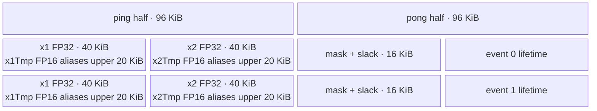

# FatreluMul A2/A3 ACLNN 算子知识

## 算子速览

| 项目 | 内容 |
|---|---|
| 实际入口 | `aclnnFatreluMulGetWorkspaceSize` + `aclnnFatreluMul`，公开两段式 ACLNN；固定仓未检入生成式 ACLNN bridge 源文件，`ACLNNTYPE aclnn` 与 `FatreluMul` OpDef 是该框架边界后的实际 Host 节点。 |
| 计算语义 | 将尾轴长度 `2d` 的输入拆为 `x1/x2`，Device 实际计算 `out = (x1 > threshold ? x1 : 0) * x2`。公开文档写成 `x1 >= threshold`，等于阈值处存在源码/文档差异。 |
| 输入输出 | `input:[...,2d]`，`threshold` 单元素，`out:[...,d]`；ND；A2/A3 支持 FP16/FP32/BF16；公开约束 rank 2～8、`2d<=1024`、外层行数 `B<=200000`。 |
| 执行类型 | 单 Kernel `fatrelu_mul`，`AIV_VECTOR`；无可达 Cube/AIC/MIX_CV。 |
| Kernel 路线 | R-001 FP16 升 FP32；R-002 FP32 原生；R-003 BF16 升 FP32。公开 shape 上界使 `BigTailProcess` 在 A2/A3 不可达，三条 Route 均进入 `SmallTailProcess`。 |
| 核心资源 | GM 输入/阈值/输出；单个 192 KiB `TBuf<VECCALC>` 手工切成两个 96 KiB ping-pong 半区；hard-event 0/1；Tiling 报告 16 MiB workspace，但 Kernel body 不使用。 |
| 来源闭包 | `source_closed`：公开 ACLNN 契约→生成式 bridge 框架边界→OpDef/InferShape→Tiling/POD→dtype key router→完整 AIV body→A2/A3 binary/活动构建接线闭合。 |
| 验证状态 | 已完成源码闭包检查；本次知识提取未执行编译、真机、数值或性能测试。 |

## 接口与语义

### 计算语义

设 `input` 的尾轴为 `L=2d`，外层展平行数为 `B=prod(input.shape[0:-1])`。对每行 `b` 和列 `j in [0,d)`：

```text
x1 = input[b, j]
x2 = input[b, d + j]
out[b, j] = (x1 > threshold[0] ? x1 : 0) * x2
```

公开 README/API 文档把 Threshold 定义为 `x1 < threshold` 时置零、否则保留，即等价于 `x1 >= threshold`。固定 Device body 使用 `CompareScalar(..., CMPMODE::GT, ...)`，所以 `x1 == threshold` 时选择零。本文按实现记录严格大于语义，并把该等值点差异保留为失败边界，不推测哪一侧会在未来修正。FP16/BF16 路线在 FP32 中比较与乘法，再降回输入 dtype；FP32 路线原生计算。

### 输入、输出与属性

| 参数 | shape/layout | dtype | 约束、默认值与语义 |
|---|---|---|---|
| `input` | ND，rank 2～8，`[...,2d]` | FP16/FP32/BF16 | 不可为 null；尾轴为正偶数且 `<=1024`；其余维乘积 `B<=200000`；公开接口声明支持非连续 Tensor，OpDef 标记 `AutoContiguous()`。 |
| `threshold` | ND，rank 0～8，单元素 | 与 `input` 相同 | 不可为 null；不支持 NaN/Inf；Device 只读取 `threshold[0]`。 |
| `out` | ND，`input.shape[:-1]+[d]` | 与 `input` 相同 | 不可为 null；公开接口声明支持非连续 Tensor，OpDef 输出标记 `AutoContiguous()`。 |
| `workspaceSize` | Host 标量 | `uint64_t*` | 第一段返回 executor 所需 Device workspace；核心 Tiling 的唯一项固定为 16 MiB。 |
| `executor` | Host handle | `aclOpExecutor**` | 第一段返回生成式执行器，第二段在指定 stream 上执行。 |

### 入口与版本

固定仓公开唯一版本 `aclnnFatreluMulGetWorkspaceSize/aclnnFatreluMul`，未发现同语义 V2/V3 候选。公开 API 文档明确支持 Atlas A2/A3，README 同样支持 A2/A3；`FatreluMul` OpDef 注册 `ascend910b` 与 `ascend910_93`，两份 binary config 以及全仓活动 `ascendc_config.json` 均接入相同三种 dtype，实现与公开平台无冲突。

该算子没有检入 `op_api/aclnn_*.cpp/.h`；`op_host/CMakeLists.txt` 以 `OPTYPE fatrelu_mul ACLNNTYPE aclnn` 将 OpDef 交给 ACLNN 生成链。因此 API 参数检查、executor 聚合和最终 launch stub 作为生成式框架边界记录，算子自有的 OpDef、InferShape、Tiling、POD、entry/body 和构建接线均已继续追到底。

## Host/Launcher 执行流程

### 参数校验与前处理

公开第一段接口契约要求 `input/threshold/out/workspaceSize/executor` 有效，并声明 dtype、rank、shape、单元素 threshold、NaN/Inf 与非连续 Tensor 约束；具体生成式检查函数未检入固定仓。框架进入 `FatreluMul` 后：

1. OpDef 对三路 Tensor 规定 ND 与匹配的 FP16/FP32/BF16，并为输入、threshold、输出启用 `AutoContiguous()`。
2. `InferShape4FatreluMul` 复制输入 shape，将最后一维除以 2；`InferDataType4FatreluMul` 复制输入 dtype。
3. `RunBigKernelTiling` 依次取 input Tensor/desc，按 dtype 产生 key，读取 origin shape，拒绝 rank `<2`、尾轴为 0、threshold 非单元素、尾轴 `>1024`、尾轴奇数和 `B>200000`。
4. 检查成功后写 POD、固定 workspace 和 `blockDim`；失败返回 `GRAPH_FAILED`，不会形成有效 Kernel launch。

空 Tensor 仅在某个非尾维为 0 且尾维仍为正偶数时可达：此时 `B=0`，Tiling 仍令 `blockDim=1`，Device 的 `loopNum=0`，不写输出。尾维本身为 0 的空 Tensor 会被 Tiling 拒绝，这与文档笼统的“支持空 Tensor”存在边界差异。

### 参数、Workspace 与生命周期

设 `C=PlatformAscendC::GetCoreNumAiv()`。Tiling 写出 `lastDimSize=L`、`batchSize=B`、`needCoreNum`，并将唯一 workspace slice 设为 `16*1024*1024` 字节。ACLNN executor/框架拥有自动连续化临时对象与 workspace，调用者必须保持第一段返回的 executor/workspace 到第二段所在 stream 完成；其聚合切片细节固定仓不可见。

Kernel entry 接收 `workspace`，却把局部 `userWs` 固定为 `nullptr` 并传入 `Init`；`Init` 本身不读取该参数。因此 16 MiB slice 在当前算子 body 中没有 producer/consumer，不能复用为自定义中间结果。

### 启动图与失败传播

```text
aclnnFatreluMulGetWorkspaceSize（生成式 ACLNN bridge）
  -> framework AutoContiguous / executor preparation
  -> FatreluMul Host node
       InferShape4FatreluMul / InferDataType4FatreluMul
       TilingFatreluMulTiling -> RunBigKernelTiling
       blockDim=needCoreNum, POD=FatreluMulTilingData, workspace slice=16 MiB
  -> fatrelu_mul(input, threshold, output, workspace, tiling) [单 AIV Kernel]
aclnnFatreluMul(workspace, workspaceSize, executor, stream)
  -> framework executor 按指定 stream 执行
```

单 Kernel 没有算子自有的跨 Kernel workspace 边。输入、threshold、输出由 executor/调用者保持到 stream 完成；Tiling 的任一 `GRAPH_FAILED` 阻断 launch。entry 只在编译 guard 为 AICore 220（或 Kirin 的 3003/3113，非本卡平台）且 key 为 1/2/3 时执行；未知 key 无 body、无输出。A2/A3 活动构建仅生成这些受支持 dtype 的二进制。

## Route 与参数设计

### 分核与资源计算

对 A2/A3，`P=PP_ELEMENT_NUM=10240` 元素，`U=MAX_UB_SIZE=192 KiB`。设 `s=sizeof(T)`、`A=32/s` 元素、`d=L/2`：

```text
dAlign = ceil(d / A) * A                    # 元素，32 B 对齐
n = floor(P / dAlign)                       # 每个 UB iteration 打包的最大行数
rawCore = ceil(B / n)                       # 公开 L<=1024 时 d<=512<P，只走此式
needCoreNum = min(max(rawCore,1), C)
blockDim = needCoreNum

baseRows = floor(B / needCoreNum)
remainCores = B % needCoreNum
rows(blockIdx) = baseRows + (blockIdx < remainCores ? 1 : 0)
loopNum = ceil(rows(blockIdx) / n)
tmpCalNum(i) = (最后一轮且 rows % n != 0) ? rows % n : n
dataCount(i) = tmpCalNum(i) * dAlign         # UB 中含逐行 padding 的元素数
```

前 `remainCores` 个核各多处理一行。其连续行起点分别为：多一行核 `blockIdx*(baseRows+1)*L`，其余核 `(blockIdx*baseRows+remainCores)*L`。每轮输入起点再加 `i*n*L`，输出起点是输入起点 `/2`。Host 的 `CeilA2B` 接收 `int32_t`，而 `batchSize` 是 `int64_t`；公开 `B<=200000` 保证正常输入不会发生窄化，但该约束在核心数计算之后才检查，越界输入不得依赖中间结果。

### Route 选择

| 顺序 | Route | Key/模板 | 精确选择条件与优先级 | 不适用去向 |
|---:|---|---|---|---|
| 1 | R-001 FP16 升 FP32 | key `1` → `FatreluMulND<half>` | `input.dtype==DT_FLOAT16`；公开 shape 检查通过后 `d<=512<10240`，Device 进入 `SmallTailProcess` | dtype 为 FP32/BF16 时进入对应 key；其它 dtype 生成式 API/OpDef 拒绝 |
| 2 | R-002 FP32 原生 | key `2` → `FatreluMulND<float>` | `input.dtype==DT_FLOAT`；同一 shape 条件 | 同上 |
| 3 | R-003 BF16 升 FP32 | key `3` → `FatreluMulND<bfloat16_t>` | `input.dtype==DT_BF16` 且 A2/A3；同一 shape 条件 | 其它 dtype 失败；Kirin 编译 guard 不含 key 3，但不属于本卡 |

```text
if input dtype == FLOAT16: key=1
else if input dtype == FLOAT: key=2
else if input dtype == BF16: key=3
else: key remains 0 -> unsupported contract / no Device body

if rank<2 or L==0 or threshold.numel!=1 or L>1024 or L odd or B>200000:
    GRAPH_FAILED
else:
    blockDim=needCoreNum
    launch fatrelu_mul<key>
    d=L/2 <= 512, therefore SmallTailProcess
```

### 模板/实现执行矩阵

| Route | key/selector | dtype/shape/platform 完整命中条件 | 执行拓扑与 Kernel 节点 | 实际模板/body | 内存与同步特征 | tail/fallback |
|---|---|---|---|---|---|---|
| R-001 FP16 升 FP32 | key 1 | A2/A3、FP16、rank 2～8、正偶数 `L<=1024`、`B<=200000`、threshold 单元素 | 单 `fatrelu_mul` AIV 节点 | `FatreluMulND<half>::SmallTailProcess/Compute/CopyOut` | 192 KiB TBuf 双半区；FP16 CopyIn 到别名区，FP32 Compare/Select/Mul，`CAST_NONE` 降精度；event 0/1 | `DataCopyPad` 按行补到 `dAlign`，CopyOut 只提交 `d`；无 Device fallback |
| R-002 FP32 原生 | key 2 | 同 shape/platform，FP32 | 单 AIV 节点 | `FatreluMulND<float>` 通用 body | FP32 直接 CopyIn/计算/CopyOut；相同 ping-pong/event | 同上 |
| R-003 BF16 升 FP32 | key 3 | 同 shape/platform，BF16 | 单 AIV 节点 | `FatreluMulND<bfloat16_t>::Compute` 特化 + 通用搬运 | BF16 CopyIn 到别名区，FP32 计算，`CAST_RINT` 降精度；相同事件图 | 同上 |

### 隐藏性能 Guard

| Guard | Host/Tiling 条件 | Device/资源原因 | 影响 Route | 不满足时去向 | 源码符号 |
|---|---|---|---|---|---|
| 平台接线 | OpDef/config 同时含 `ascend910b`、`ascend910_93` | 只有活动 binary config 中的 dtype 会生成可调用 AIV body | 全部 | 950 无接线且公开明确不支持 | `fatrelu_mul_def.cpp::FatreluMul`；`ascendc_config.json` |
| dtype key | `DT_FLOAT16→1`，`DT_FLOAT→2`，`DT_BF16→3` | entry 以 key 实例化不同精度模板 | R-001/2/3 | key 0/未知 key 无输出 | `FatreluMulTiling::GetTilingKey`；`fatrelu_mul` |
| 小尾路径可达性 | `L<=1024 => d<=512 <= P` | `Process` 的 `d>P` 才进入 BigTail；公开路径不满足 | 全部 | `BigTailProcess` 是当前公开 A2/A3 dead route，不写为正式 Route | `RunBigKernelTiling`；`FatreluMulND::Process` |
| 32 B 行对齐 | `dAlign=ceil(d/(32/s))*(32/s)` | `DataCopyPad` 将每行 UB 步长补齐，Vector 处理连续 padded 域 | 全部 | 同 Route padding path，无另一 key | `GetNeedCoreNum`；`SmallTailProcess` |
| UB 行打包上界 | `n=floor(10240/dAlign)`，每轮 `tmpCalNum<=n` | 每半区的两路 FP32 工作域各至多 `10240*4 B` | 全部 | 自动增加 loop；无失败 | `SmallTailProcess` |
| Compare mask round-up | `tmpDataCount=ceil(dataCount/64)*64` | FP32 Compare repeat 覆盖完整 64 元素组；Select/Mul 仍只消费 `dataCount` | 全部 | padding lane 不写 GM | `FatreluMulND::Compute` |
| 空域 | `L==0` 失败；`B==0,L>0` 可通过 | 避免除以零；非尾维空域以单核零循环结束 | 全部 | `GRAPH_FAILED` 或成功无写 | `RunBigKernelTiling`；`SmallTailProcess` |
| Host 窄化 | `CeilA2B(int32_t,int32_t)` 被传入 `int64_t batchSize` | 核数计算存在显式参数宽度收窄 | 全部 | 公开 `B<=200000` 内安全；越界随后失败，不能复用中间值 | `FatreluMulTiling::CeilA2B/GetNeedCoreNum` |

### POD/ABI

`FatreluMulTilingData` 由 tiling 宏生成并以 `SaveToBuffer` 序列化；固定仓未展开宏定义，不能从本仓证明 `sizeof/alignof/offsetof`，复用时不得自行重排。

| 结构 | 字段 | 类型/位宽 | ABI 布局 | 单位 | Host/launcher producer | Device consumer | 边界 |
|---|---|---|---|---|---|---|---|
| `FatreluMulTilingData` | `lastDimSize` | `int64_t`/64 | 声明顺序第 1；精确 `sizeof/alignof/offsetof` 固定仓不可见 | 元素 | `RunBigKernelTiling: inputShape.GetDim(rank-1)` | `Init` 生成 `d=L/2`；两路 GM stride 与输出 offset | 正偶数，`1..1024`；实际最小为 2 |
| `FatreluMulTilingData` | `batchSize` | `int64_t`/64 | 声明顺序第 2；精确 offset 不可见 | 行 | `inputShape.GetShapeSize()/lastDimSize` | `BigTailProcess/SmallTailProcess` 的分核与循环 | `0..200000`；0 仅对应非尾维空域 |
| `FatreluMulTilingData` | `needCoreNum` | `uint32_t`/32 | 声明顺序第 3；精确 offset/整体 padding 不可见 | AIV core 数 | `GetNeedCoreNum(GetCoreNumAiv())` | `Process` 越界保护、每核行数与 GM offset | 正常为 `1..C`；同时写入 `blockDim` |

### Route 源码闭包

| Route | Key/selector | Host/Tiling producer | POD/参数 | Kernel entry/router 节点 | Kernel body/直接依赖 | 构建接线 |
|---|---|---|---|---|---|---|
| R-001 FP16 | key 1 | `op_host/fatrelu_mul_tiling.cpp::GetTilingKey/GetNeedCoreNum/RunBigKernelTiling` | `FatreluMulTilingData` 三字段 | `op_kernel/fatrelu_mul.cpp::fatrelu_mul` → `FatreluMulND<half>` | `op_kernel/fatrelu_mul.h::Init/Process/SmallTailProcess/CopyIn/Compute/CopyOut` | OpDef `ascend910b/ascend910_93` + 两份 binary JSON + `ascendc_config.json` |
| R-002 FP32 | key 2 | 同上 | 同上 | `fatrelu_mul` → `FatreluMulND<float>` | 同一通用 body，FP32 分支 | 同上 |
| R-003 BF16 | key 3 | 同上 | 同上 | `fatrelu_mul` → `FatreluMulND<bfloat16_t>` | 通用 body + `Compute<bfloat16_t>` 特化 | 同上 |

## Kernel 实现

### 公共执行流程

三条 Route 共用单 Kernel 图。entry 解析 POD，忽略传入 workspace，并按 key 构造 dtype 模板。`Init` 绑定三路 GM、同步读取标量阈值、保存 POD、取 `blockIdx`，再一次性分配 192 KiB `TBuf<VECCALC>`。`Process` 先保护 `blockIdx<needCoreNum`，公开条件下只调用 `SmallTailProcess`。

每核获得连续行段；每轮最多把 `n` 行的左右半区分别用 2D `DataCopyPad` 搬入当前 96 KiB 半区。对于 16-bit dtype，原始输入先落在 FP32 工作区的上半段别名区，再 Cast 到同一工作区起点；随后执行 FP32 `CompareScalar(GT) -> Select(tensor-or-zero) -> Mul`。CopyOut 只提交每行 `d` 个有效元素。event 0/1 随 ping-pong 半区交替，`MTE3_MTE2` 保护前一轮输出完成后才能覆盖该半区，`MTE2_V` 与 `V_MTE3` 保护搬入、Vector、搬出阶段。

### Route R-001：FP16 升 FP32

#### 适用条件

##### 选择证据

| 层级 | 文件 | 符号 | 源码谓词/参数 | 结果/下一跳 |
|---|---|---|---|---|
| ACLNN | `activation/fatrelu_mul/docs/aclnnFatreluMul.md` | `aclnnFatreluMulGetWorkspaceSize` 契约 | input/threshold/out 同 dtype 且为 FLOAT16 | 进入生成式 FatreluMul Host 节点 |
| Host/Tiling | `activation/fatrelu_mul/op_host/fatrelu_mul_tiling.cpp` | `FatreluMulTiling::GetTilingKey` | `dataType==ge::DT_FLOAT16` | `tilingKey=1`，`oneBlockNum=16` |
| Host/Tiling | 同文件 | `RunBigKernelTiling` | rank/threshold/`L<=1024`/偶数/`B<=200000` 检查 | 写 POD、`blockDim=needCoreNum`；否则失败 |
| Router | `activation/fatrelu_mul/op_kernel/fatrelu_mul.cpp` | `fatrelu_mul` | AICore 220 且 `TILING_KEY_IS(1)` | `FatreluMulND<half>::Process` |
| Device | `activation/fatrelu_mul/op_kernel/fatrelu_mul.h` | `FatreluMulND::Process` | `d<=512<10240` | `SmallTailProcess` |

#### Device 数据流

##### 函数级调用链

```text
generated FatreluMul launcher(blockDim=needCoreNum, POD)
  -> fatrelu_mul [key 1]
    -> FatreluMulND<half>::Init
       -> threshold=inScalarGM.GetValue(0)
       -> InitBuffer(ubTBuf,192 KiB)
    -> FatreluMulND<half>::Process
       -> SmallTailProcess
          -> CopyIn (2D DataCopyPad x1Tmp/x2Tmp)
          -> Compute (Cast half->float, CompareScalar GT, Select, Mul)
          -> CopyOut (Cast float->half CAST_NONE, 2D DataCopyPad)
```

##### 源码等价伪码

```text
# 源码等价伪码
if blockIdx >= needCoreNum: return
dAlign = align_up(d,16)                       # FP16 元素，32 B
n = 10240 / dAlign
rows = floor(B/needCoreNum) + (blockIdx < B%needCoreNum)
gmRow0 = blockIdx < B%needCoreNum
           ? blockIdx*rows
           : blockIdx*rows + B%needCoreNum
set MTE3_MTE2 flags 0 and 1
for i in [0,ceil(rows/n)):
    k = last_partial ? rows%n : n
    halfBase = ping ? 96 KiB : 0
    event = ping ? 1 : 0
    wait MTE3_MTE2(event)
    x1Tmp = DataCopyPad2D(input[(gmRow0+i*n)*2d], blockCount=k,
                          blockLen=d*2 B, srcStride=d*2 B, localRow=dAlign)
    x2Tmp = DataCopyPad2D(input[(gmRow0+i*n)*2d+d], same params)
    set/wait MTE2_V(event)
    x1Fp32 = Cast(x1Tmp, CAST_NONE, k*dAlign)
    x2Fp32 = Cast(x2Tmp, CAST_NONE, k*dAlign)
    mask = CompareScalar(x1Fp32, float(threshold), GT, align_up(k*dAlign,64))
    x1Fp32 = Select(mask, x1Fp32, 0, k*dAlign)
    x1Fp32 = Mul(x1Fp32,x2Fp32,k*dAlign)
    x1Half = Cast(x1Fp32, CAST_NONE, k*dAlign)
    set/wait V_MTE3(event)
    DataCopyPad2D(output[(gmRow0+i*n)*d], x1Half,
                  blockCount=k, blockLen=d*2 B, srcStride=0)
    set MTE3_MTE2(event); ping ^= 1
wait MTE3_MTE2(0); wait MTE3_MTE2(1)
```

#### 内存与数据搬运

##### 资源与搬运表

| 层级/缓冲区 | offset/地址公式 | extent/容量公式 | dtype/layout | producer | consumer | owner/lifetime | 对齐/复用 |
|---|---|---|---|---|---|---|---|
| GM `inputGm` x1 | `(gmRow0+i*n)*2d` | `k` 行 × `d` FP16 | row-major ND | caller/framework | `CopyIn` | caller/executor 至 stream 完成 | `srcStride=d*2 B` 跳过每行 x2 |
| GM `inputGm` x2 | x1 base `+d` | 同上 | row-major ND | caller/framework | `CopyIn` | 同上 | stride 跳过下一行 x1 |
| ping/pong half | `p*(96 KiB)`，`p∈{0,1}` | 每半区 96 KiB | raw UB | `InitBuffer` | 当前 iteration | `ubTBuf`，Kernel 全程 | event id 与半区一一对应 |
| `x1TensorFp32` | half `+0` | `10240*4=40960 B` | FP32 padded rows | `Cast(x1Tmp)` | Compare/Select/Mul/CopyOut Cast | 当前半区至 MTE3 完成 | 与 `x1Tensor<half>` 同起点；原地降精度 |
| `x1Tmp` | half `+10240*2=20480 B` | `10240*2=20480 B` | FP16 padded rows | x1 DataCopyPad | half→float Cast | Cast 完成前 | 别名于 x1 FP32 区 `[20,40) KiB` |
| `x2TensorFp32` | half `+10240*4=40960 B` | 40960 B | FP32 padded rows | `Cast(x2Tmp)` | Mul | 当前 Compute | 独立于 x1 FP32 区 |
| `x2Tmp` | half `+61440 B` | 20480 B | FP16 padded rows | x2 DataCopyPad | half→float Cast | Cast 完成前 | 别名于 x2 FP32 区上半段 |
| `selMask` | half `+81920 B` | 到半区末最多 16384 B；实际 mask 编码由 AscendC API 定义 | `uint8_t` mask | CompareScalar | Select | 当前 Compute | count 向上到 64；不跨半区 |
| GM `outputGm` | `(gmRow0+i*n)*d` | `k` 行 × `d` FP16 | row-major ND | CopyOut | caller | caller/executor | 仅有效 `d*2 B`/行，不写 UB padding |
| workspace | launcher slice | 16 MiB | opaque | Tiling/runtime | 无 body consumer | executor 至 stream 完成 | entry 丢弃地址，不可视为可用缓存 |

##### 分层内存布局



##### 字节账与复用顺序

```text
UB_total = InitBuffer(ubTBuf, MAX_UB_SIZE) = 192*1024 = 196608 B
half_bytes = 196608/2 = 98304 B
per half: x1 FP32 region 40960 B + x2 FP32 region 40960 B + mask/slack region 16384 B = 98304 B
x1Tmp/x2Tmp are physical aliases inside the FP32 regions, so they add 0 B
UB_total <= Host UB: Host 不读取 UB 大小；A2/A3 body 固定假设可分配 192 KiB，资源不足无 Host fallback
dynamic_ub = N/A（AIV 固定 TBuf）
workspace_total = 16*1024*1024 B（body 不读写）
```

| 复用子区 | 写入者 | 读取者/消费点 | 下一次覆盖 | 同步或释放依据 | 安全条件 |
|---|---|---|---|---|---|
| x1/x2 FP32 区中的 FP16 alias | `CopyIn` 写 `x1Tmp/x2Tmp` | 两次 Cast | Cast 写完整 FP32 工作域并随后 Vector 使用 | `MTE2_V` 后开始 Cast；PIPE_V barrier 分隔 Cast | 必须保持源码别名 offset 与 Cast 顺序；AscendC 重叠 Cast 合法性依赖固定库契约 |
| x1 FP32 起点 | Cast 产生 FP32 x1 | Compare/Select/Mul；末尾降精度 Cast | 同轮降精度后供 MTE3；该半区下次轮转复用 | 每个 Vector primitive 后 `PIPE_V`；`V_MTE3`；最终 `MTE3_MTE2` | 不能在 CopyOut 完成前再次 CopyIn 到同半区 |
| ping/pong 半区 | iteration `i` 的 CopyIn/Compute/CopyOut | 当前 iteration | 同 parity 的 `i+2` | 对应 event 的 `WaitFlag<MTE3_MTE2>` | event id 必须与 `pingPongFlag` 同步切换 |

#### 同步、精度与尾块

##### 同步与数值边界表

| 阶段 | primitive/机制 | producer | consumer/等待点 | 保护对象 | 精度/尾块 |
|---|---|---|---|---|---|
| 半区复用 | `MTE3_MTE2` event 0/1 | 上次同半区 CopyOut | 下次 CopyIn 前 WaitFlag | 96 KiB ping/pong 半区 | 保证输出 DMA 完成后覆盖 |
| 搬入→Vector | `SetFlag/WaitFlag<MTE2_V>` | 两路 DataCopyPad | Cast/Compute | 当前 x1Tmp/x2Tmp | 每行不足 32 B 的尾部由 pad path 形成 `dAlign` |
| 升精度 | `Cast(...,CAST_NONE)` + `PIPE_V` | FP16 tmp | FP32 Compare/Mul | x1/x2 FP32 区 | threshold 由 half 转 float；未定义额外舍入策略 |
| 阈值 | `CompareScalar(...,GT,align_up(dataCount,64))` | FP32 x1 | Select | mask | 严格 `>`；扩展 mask lane 不被后续 `dataCount` 消费 |
| 计算 | `Select`、`Mul` + `PIPE_V` | mask/x1/x2 | 降精度 Cast | x1 FP32 区 | 有效与 padding 元素均算，CopyOut 只提交有效列 |
| 降精度 | `Cast(float->half,CAST_NONE)` | FP32 product | MTE3 | x1 起点别名 | 精确舍入含义由 AscendC primitive 定义 |
| Vector→搬出 | `V_MTE3` | 降精度结果 | DataCopyPad GM write | x1 local 输出 | 每行只写 `d*2 B`，不写 padding |

#### 关键实现

##### 符号证据表

| 阶段 | 文件 | 符号/模板实例 | 实现事实 |
|---|---|---|---|
| Host/Tiling producer | `activation/fatrelu_mul/op_host/fatrelu_mul_tiling.cpp` | `GetTilingKey/GetNeedCoreNum/RunBigKernelTiling` | key 1、32 B 对齐、核心数、POD、16 MiB workspace |
| Kernel entry/router | `activation/fatrelu_mul/op_kernel/fatrelu_mul.cpp` | `fatrelu_mul` key 1 | 映射 `FatreluMulND<half>`，workspace 改传 null |
| Device body/helper | `activation/fatrelu_mul/op_kernel/fatrelu_mul.h` | `FatreluMulND<half>::{Init,SmallTailProcess,CopyIn,Compute,CopyOut}` | 2D 搬运、FP32 工作域、hard events、有效尾输出 |

### Route R-002：FP32 原生

#### 适用条件

##### 选择证据

| 层级 | 文件 | 符号 | 源码谓词/参数 | 结果/下一跳 |
|---|---|---|---|---|
| ACLNN | `activation/fatrelu_mul/docs/aclnnFatreluMul.md` | 公开契约 | 三 Tensor dtype 为 FLOAT | 进入 Host 节点 |
| Host/Tiling | `activation/fatrelu_mul/op_host/fatrelu_mul_tiling.cpp` | `GetTilingKey` | `dataType==ge::DT_FLOAT` | key 2，`oneBlockNum=8` |
| Router | `activation/fatrelu_mul/op_kernel/fatrelu_mul.cpp` | `fatrelu_mul` | `TILING_KEY_IS(2)` | `FatreluMulND<float>` |
| Device | `activation/fatrelu_mul/op_kernel/fatrelu_mul.h` | `Process` | `d<=512<10240` | `SmallTailProcess` |

#### Device 数据流

##### 函数级调用链

```text
FatreluMul launcher -> fatrelu_mul [key 2]
  -> FatreluMulND<float>::Init
  -> Process -> SmallTailProcess
     -> CopyIn (2D DataCopyPad directly to x1Tensor/x2Tensor)
     -> Compute (CompareScalar GT -> Select -> Mul, all FP32)
     -> CopyOut (2D DataCopyPad, no Cast)
```

##### 源码等价伪码

```text
# 源码等价伪码；分核/事件/offset 与 R-001 相同
dAlign=align_up(d,8); n=10240/dAlign; dataCount=k*dAlign
DataCopyPad2D(x1Fp32,input[row0*2d],k,d*4 B,d*4 B)
DataCopyPad2D(x2Fp32,input[row0*2d+d],k,d*4 B,d*4 B)
mask=CompareScalar(x1Fp32,threshold,GT,align_up(dataCount,64))
x1Fp32=Select(mask,x1Fp32,0,dataCount)
x1Fp32=Mul(x1Fp32,x2Fp32,dataCount)
DataCopyPad2D(output[row0*d],x1Fp32,k,d*4 B,srcStride=0)
```

#### 内存与数据搬运

##### 资源与搬运表

| 层级/缓冲区 | offset/地址公式 | extent/容量公式 | dtype/layout | producer | consumer | owner/lifetime | 对齐/复用 |
|---|---|---|---|---|---|---|---|
| GM input x1/x2 | 与 R-001 相同，字节宽改为 4 | 每路 `k*d*4 B` 有效 | FP32 ND | caller | CopyIn | stream 完成 | 每行 UB 步长 `dAlign*4 B` |
| x1 FP32 | half `+0` | 40960 B | FP32 padded rows | DataCopyPad | Compare/Select/Mul/CopyOut | 当前半区 | 计算结果原地覆盖输入 x1 |
| x2 FP32 | half `+40960 B` | 40960 B | FP32 padded rows | DataCopyPad | Mul | 当前 Compute | 下一次同半区复用 |
| mask/slack | half `+81920 B` | 16384 B | uint8 mask/unused | CompareScalar | Select | 当前 Compute | count 64 对齐 |
| GM output | `(gmRow0+i*n)*d` | `k*d*4 B` | FP32 ND | CopyOut | caller | stream 完成 | 每行只写 d 元素 |
| workspace | launcher slice | 16 MiB | opaque | runtime | 无 body consumer | executor | 未使用 |

##### 分层内存布局


##### 字节账与复用顺序

```text
UB_total = 2*(40960 + 40960 + 16384) = 196608 B
dynamic_ub = N/A
workspace_total = 16 MiB, body unused
```

| 复用子区 | 写入者 | 读取者/消费点 | 下一次覆盖 | 同步或释放依据 | 安全条件 |
|---|---|---|---|---|---|
| x1 FP32 | CopyIn | Compare；Select/Mul 原地写；CopyOut | 同 parity 下一 iteration | PIPE_V、V_MTE3、MTE3_MTE2 | CopyOut 完成前不能覆盖 |
| x2 FP32 | CopyIn | Mul | 同 parity 下一 iteration | MTE2_V + Vector barriers + 半区 event | Mul 完成后才可复用 |
| ping/pong half | 当前 iteration | 当前 MTE2/V/MTE3 | `i+2` | event 0/1 | 与 R-001 相同 |

#### 同步、精度与尾块

##### 同步与数值边界表

| 阶段 | primitive/机制 | producer | consumer/等待点 | 保护对象 | 精度/尾块 |
|---|---|---|---|---|---|
| MTE2/V/MTE3 | 与 R-001 相同的三类 hard event | CopyIn/Vector/CopyOut | 对应 WaitFlag | 当前半区 | 无 Cast，全程 FP32 |
| Compare/Select | GT mask + PIPE_V | x1 | Select/Mul | x1/mask | 严格大于；mask 64 元素向上对齐 |
| 尾块 | 2D DataCopyPad | GM rows | Vector/GM output | 每行 padding | 有效输出只含 d 列 |

#### 关键实现

##### 符号证据表

| 阶段 | 文件 | 符号/模板实例 | 实现事实 |
|---|---|---|---|
| Host/Tiling producer | `activation/fatrelu_mul/op_host/fatrelu_mul_tiling.cpp` | `GetTilingKey/RunBigKernelTiling` | key 2、POD/blockDim/workspace |
| Kernel entry/router | `activation/fatrelu_mul/op_kernel/fatrelu_mul.cpp` | `fatrelu_mul` key 2 | `FatreluMulND<float>` |
| Device body/helper | `activation/fatrelu_mul/op_kernel/fatrelu_mul.h` | 通用 `CopyIn/Compute/CopyOut` | FP32 直接搬入、严格 GT、原地结果、2D 尾搬运 |

### Route R-003：BF16 升 FP32

#### 适用条件

##### 选择证据

| 层级 | 文件 | 符号 | 源码谓词/参数 | 结果/下一跳 |
|---|---|---|---|---|
| ACLNN | `activation/fatrelu_mul/docs/aclnnFatreluMul.md` | 公开契约 | 三 Tensor dtype 为 BFLOAT16；A2/A3 支持 | 进入 Host 节点 |
| Host/Tiling | `activation/fatrelu_mul/op_host/fatrelu_mul_tiling.cpp` | `GetTilingKey` | `dataType==ge::DT_BF16` | key 3，`oneBlockNum=16` |
| Router | `activation/fatrelu_mul/op_kernel/fatrelu_mul.cpp` | `fatrelu_mul` | AICore 220、`TILING_KEY_IS(3)`，且非 Kirin arch guard | `FatreluMulND<bfloat16_t>` |
| Device | `activation/fatrelu_mul/op_kernel/fatrelu_mul.h` | `Compute<bfloat16_t>` | 模板特化 | `ToFloat(threshold)`、FP32 Compute、RINT CopyOut |

#### Device 数据流

##### 函数级调用链

```text
FatreluMul launcher -> fatrelu_mul [key 3]
  -> FatreluMulND<bfloat16_t>::Init
  -> Process -> SmallTailProcess
     -> CopyIn (BF16 x1Tmp/x2Tmp)
     -> Compute<bfloat16_t> (Cast->FP32, ToFloat threshold, GT/Select/Mul)
     -> CopyOut (Cast FP32->BF16 CAST_RINT, DataCopyPad)
```

##### 源码等价伪码

```text
# 源码等价伪码；分核、地址、别名与 R-001 相同
dAlign=align_up(d,16); n=10240/dAlign; dataCount=k*dAlign
x1Fp32=Cast(x1TmpBF16,CAST_NONE,dataCount)
x2Fp32=Cast(x2TmpBF16,CAST_NONE,dataCount)
thresholdFp32=ToFloat(thresholdBF16)
mask=CompareScalar(x1Fp32,thresholdFp32,GT,align_up(dataCount,64))
x1Fp32=Select(mask,x1Fp32,0,dataCount)
x1Fp32=Mul(x1Fp32,x2Fp32,dataCount)
x1BF16=Cast(x1Fp32,CAST_RINT,dataCount)
CopyOut only d valid columns per row
```

#### 内存与数据搬运

##### 资源与搬运表

| 层级/缓冲区 | offset/地址公式 | extent/容量公式 | dtype/layout | producer | consumer | owner/lifetime | 对齐/复用 |
|---|---|---|---|---|---|---|---|
| GM input/output | 同 R-001 | 每路/输出 `k*d*2 B` | BF16 ND | caller/CopyOut | CopyIn/caller | stream 完成 | 2D byte stride，UB 行 32 B 对齐 |
| x1/x2 FP32 regions | 同 R-001 | 各 40960 B/half | FP32 padded rows | BF16→FP32 Cast | Compare/Mul | 当前 half | BF16 tmp alias 上半区 |
| x1Tmp/x2Tmp | 同 R-001 | 各 20480 B/half | BF16 padded rows | CopyIn | Cast | Cast 完成前 | 物理 alias，不增加 UB |
| mask/slack | half `+81920` | 16384 B | uint8/unused | Compare | Select | 当前 Compute | 64 元素 mask count |
| workspace | launcher slice | 16 MiB | opaque | runtime | 无 body consumer | executor | 未使用 |

##### 分层内存布局


##### 字节账与复用顺序

```text
UB_total = 192 KiB fixed TBuf
BF16 tmp alias bytes = 0 additional
dynamic_ub = N/A
workspace_total = 16 MiB, body unused
```

| 复用子区 | 写入者 | 读取者/消费点 | 下一次覆盖 | 同步或释放依据 | 安全条件 |
|---|---|---|---|---|---|
| BF16 tmp/FP32 physical regions | CopyIn → Cast | FP32 Vector；末尾 RINT Cast | MTE3 后同 parity iteration | 与 R-001 相同的 hard events/PIPE_V | 保持别名 offset、Cast 顺序与有效 count |
| ping/pong half | 当前 iteration | MTE2/V/MTE3 | `i+2` | event 0/1 | CopyOut 完成后覆盖 |

#### 同步、精度与尾块

##### 同步与数值边界表

| 阶段 | primitive/机制 | producer | consumer/等待点 | 保护对象 | 精度/尾块 |
|---|---|---|---|---|---|
| 升精度 | BF16→FP32 `CAST_NONE` + PIPE_V | x1Tmp/x2Tmp | Compare/Mul | FP32 工作域 | threshold 用 `ToFloat` |
| 比较/乘法 | GT/Select/Mul | FP32 inputs | RINT Cast | x1 result | 严格大于，FP32 中乘法 |
| 降精度 | `Cast(...,CAST_RINT)` | FP32 result | MTE3 | BF16 output local | 显式 RINT，与 FP16 Route 不同 |
| 搬运/复用 | MTE2_V、V_MTE3、MTE3_MTE2 | 各 pipeline 阶段 | 后继 WaitFlag | 当前 half | 每行只输出 d 个有效 BF16 |

#### 关键实现

##### 符号证据表

| 阶段 | 文件 | 符号/模板实例 | 实现事实 |
|---|---|---|---|
| Host/Tiling producer | `activation/fatrelu_mul/op_host/fatrelu_mul_tiling.cpp` | `GetTilingKey` | BF16 key 3 |
| Kernel entry/router | `activation/fatrelu_mul/op_kernel/fatrelu_mul.cpp` | `fatrelu_mul` key 3 | A2/A3 guard 下实例化 BF16 body |
| Device body/helper | `activation/fatrelu_mul/op_kernel/fatrelu_mul.h` | `Compute<bfloat16_t>`、通用 `CopyOut` | ToFloat threshold、FP32 pipeline、CAST_RINT |

## 算子特定优化

### Trick T-001：按 UB 容量批量打包多行并以双半区事件流水复用

#### 触发与源码依据

- 适用 Route：R-001、R-002、R-003。
- 触发条件：公开路径 `d<=512<=PP_ELEMENT_NUM`，进入 `SmallTailProcess`；`n=PP_ELEMENT_NUM/dAlign` 决定单轮可打包行数，连续 iteration 交替 `pingPongFlag`。
- Golden 来源：[`activation/fatrelu_mul/op_kernel/fatrelu_mul.h:284-302`](../../../../../../../cann-ops-raw/ascendc/ops-nn/955f8b33985b6d72989ebff341bb9c2c564a51bc/activation/fatrelu_mul/op_kernel/fatrelu_mul.h#L284-L302)

**官方源码（固定 Commit 连续逐字摘录）**：

```cpp
pingPongFlag = 0;
SetFlag<HardEvent::MTE3_MTE2>(EVENT_ID0);
SetFlag<HardEvent::MTE3_MTE2>(EVENT_ID1);
for (int32_t i = 0; i < loopNum; i++) {
    uint16_t tmpCalNum = n;
    if (loopRemain > 0 && i == loopNum - 1) {
        tmpCalNum = loopRemain;
    }

    int32_t localOffset = i * n * lastDimSize;
    eventId = pingPongFlag ? EVENT_ID1 : EVENT_ID0;
    DataCopyExtParams dataCopyParamsIn{
        tmpCalNum, static_cast<uint32_t>(d * sizeof(T)), static_cast<uint32_t>(d * sizeof(T)), 0, 0};

    CopyIn(totalOffset + localOffset, dataCopyParamsIn);
    Compute(tmpCalNum * dAlign);
    DataCopyExtParams dataCopyParamsOut{tmpCalNum, static_cast<uint32_t>(d * sizeof(T)), 0, 0, 0};
    CopyOut((totalOffset + localOffset) / 2, tmpCalNum * dAlign, dataCopyParamsOut);
    pingPongFlag = 1 - pingPongFlag;
}
```

#### 机制与设计原因

Host 先用 `dAlign` 和 `P=10240` 计算 `n`，使一次 iteration 的每路 padded 域不超过 `P` 元素。`DataCopyExtParams.blockCount=tmpCalNum` 把多行合为一次 2D 搬运描述，`blockLen=d*sizeof(T)` 只搬有效半行，输入 `srcStride=d*sizeof(T)` 恰好跨过同一输入行的另一半；输出 `srcStride=0` 按本地 32 B 对齐步长读出、只写有效字节。这样无需逐行发起独立 CopyIn/Compute/CopyOut。

同一个 192 KiB TBuf 分为两个 96 KiB 物理半区。`pingPongFlag` 同时选择 half base 与 event id；下一轮切换到另一半区，只有再次回到原半区时才由 `MTE3_MTE2` 等待其上次 CopyOut 完成。源码由此证明减少逐行搬运描述并允许相邻轮次使用独立 UB 半区；未执行真机性能测量，不能给出收益比例。

#### 迁移边界

- 适用：输入按尾轴左右两半配对、每行有效长度已知且能以 2D DMA stride 跳过另一半的 AIV elementwise 融合。
- 前提：`dAlign` 的每路容量不超过半区预留的 `PP_ELEMENT_NUM`；输入/输出行序连续；event 与物理半区一一对应；Vector 只把 `dataCount=k*dAlign` 作为本地域，GM CopyOut 只提交 `k*d`。
- 失效：若单个 `d>PP_ELEMENT_NUM` 必须切换逐行分片的 `BigTailProcess`；本公开 A2/A3 API 因 `d<=512` 不会命中该路线。
- 未验证：本次知识提取未执行编译、真机、数值或性能测试。

#### 错误做法

固定仓未提供可验证反例。复用时不能把输入 `srcStride` 设为 0，否则 x1 搬运会把相邻的 x2 当成下一行；也不能在未等待对应 `MTE3_MTE2` event 时覆盖同一半区。后两项是当前地址式与同步协议的直接约束，不是性能实测结论。

## 模板与实现对比

| 对比维度 | R-001 FP16 | R-002 FP32 | R-003 BF16 | 设计选择依据 |
|---|---|---|---|---|
| 命中条件/优先级 | dtype FP16，key 1 | dtype FP32，key 2 | dtype BF16，key 3 | Host `GetTilingKey` 一次 dtype 决策，无 fallback |
| 模板与 dtype | `FatreluMulND<half>` | `FatreluMulND<float>` | `FatreluMulND<bfloat16_t>` + Compute 特化 | entry 逐 key 实例化 |
| 循环与分核 | `dAlign=align16(d)` | `dAlign=align8(d)` | `dAlign=align16(d)` | 统一 32 B 行对齐；均批量打包 `n=10240/dAlign` 行 |
| Queue/TBuf/寄存器/dynamic UB/通信 window | 无 Queue；192 KiB TBuf；FP16 tmp alias + FP32 域；无 dynamic UB | 无 tmp Cast 域，直接 FP32；同一 TBuf | BF16 tmp alias + FP32 域；同一 TBuf | 固定手工双半区；无通信/寄存器显式分配 |
| 内存总占用与复用 | 192 KiB，tmp 不额外占用 | 192 KiB | 192 KiB，tmp 不额外占用 | dtype 不改变物理 TBuf 总量 |
| 搬运/Vector/SIMT/NDDMA/通信 API | DataCopyPad；Cast/Compare/Select/Mul | DataCopyPad；Compare/Select/Mul | DataCopyPad；Cast/Compare/Select/Mul | 全为 AIV_VECTOR，无 SIMT/NDDMA/通信 |
| 同步、精度与 tail | FP32 计算，`CAST_NONE` 回半精度 | 全 FP32 | FP32 计算，`CAST_RINT` 回 BF16 | hard event 图相同；精度顺序不可互换 |
| fallback/失败边界 | 未知 key/Host 约束失败 | 同左 | A2/A3 可用；Kirin guard 不可用 | 950 不支持；公开路径不进入 BigTail |

## 平台差异

| 项目 | A2 | A3 | 950 |
|---|---|---|---|
| 支持状态 | 支持；公开表 + `ascend910b` OpDef/binary config | 支持；公开表 + `ascend910_93` OpDef/binary config | 公开 README/API 明确“×”；无 `ascend950` OpDef、binary config 或活动 kernel config，因此未生成 `_950` 卡 |
| Host/Launcher | 与 A3 共用 Tiling/POD，AIV 核数 `C` 由平台取得 | 与 A2 共用实现，平台核数可不同 | N/A |
| Kernel/资源 | AICore 220 guard；192 KiB TBuf、`PP=10240` | 同一 guard/body/常量 | N/A；不能凭目录或其它算子推测 |

## 限制与失败边界

- Device 的严格 `x1>threshold` 与公开文档的 `x1>=threshold` 在等值点不一致；调用方若依赖等值语义必须以目标发布包实测确认，本次未执行数值测试。
- 文档称支持空 Tensor，但 Tiling 明确拒绝 `lastDimSize==0`；仅非尾维为 0、尾维仍为正偶数的空域能以 `B=0`、单核零循环通过。
- 公开约束为 rank 2～8、尾轴正偶数且 `<=1024`、`B<=200000`、threshold 单元素；Tiling 不显式校验 output shape/dtype、threshold dtype、NaN/Inf，这些属于生成式 ACLNN/OpDef 框架边界，固定仓没有对应检查函数正文。
- `GetNeedCoreNum` 在检查 `L<=1024/B<=200000` 之前计算，且把 `int64_t batchSize` 传给 `int32_t CeilA2B`；只可在公开合法域复用公式。
- A2/A3 Kernel 固定申请 192 KiB UB，Host 未依据实际平台 UB 做 `IsCapable` 或 fallback；固定仓未提供分配失败处理。
- `CompareScalar` mask 长度向上对齐到 64 个 FP32 元素，而 Select/Mul 只消费 `dataCount`；padding lane 不写 GM。16-bit 输入暂存与 FP32 工作区存在源码明确的物理别名，移植时必须核验 AscendC Cast 的重叠约束。
- Tiling 返回固定 16 MiB workspace，但 entry/body 不使用；不能删减调用者按第一段返回值申请的 workspace，也不能把它当成算子自有可复用缓存。
- 公开 A2/A3 域使 `BigTailProcess` 不可达；本文未把 dead route 当成正式实现族。未知 key 或不匹配编译 guard 时 entry 静默无输出。
- 本次知识提取未执行编译、真机、数值或性能测试。

## 源码索引

### 链路索引

| 链路阶段 | 文件 | 关键符号 | 支撑内容 |
|---|---|---|---|
| 入口声明/约束 | `activation/fatrelu_mul/docs/aclnnFatreluMul.md` | `aclnnFatreluMulGetWorkspaceSize/aclnnFatreluMul` | 两段式原型、A2/A3 支持、dtype/shape/空域/确定性契约 |
| 入口声明/平台 | `activation/fatrelu_mul/README.md` | 产品支持、功能说明 | A2/A3 支持、950 明确不支持、公开公式与参数 |
| Host OpDef | `activation/fatrelu_mul/op_host/fatrelu_mul_def.cpp` | `ops::FatreluMul` | dtype/ND/AutoContiguous、ascend910b/ascend910_93 注册 |
| Shape/dtype 推导 | `activation/fatrelu_mul/op_host/fatrelu_mul_infershape.cpp` | `InferShape4FatreluMul/InferDataType4FatreluMul` | 输出尾轴减半、dtype 复制 |
| POD | `activation/fatrelu_mul/op_host/fatrelu_mul_tiling.h` | `FatreluMulTilingData` | 三字段声明与注册 |
| Tiling | `activation/fatrelu_mul/op_host/fatrelu_mul_tiling.cpp` | `GetTilingKey/GetNeedCoreNum/RunBigKernelTiling` | key、分核、校验、workspace、blockDim、POD producer |
| Kernel entry | `activation/fatrelu_mul/op_kernel/fatrelu_mul.cpp` | `fatrelu_mul` | A2/A3 guard、key→dtype 模板、workspace 丢弃 |
| Kernel body | `activation/fatrelu_mul/op_kernel/fatrelu_mul.h` | `FatreluMulND` 全方法 | UB、地址、2D 搬运、Vector、同步、精度、tail |
| ACLNN 构建接线 | `activation/fatrelu_mul/op_host/CMakeLists.txt` | `add_modules_sources(... ACLNNTYPE aclnn)` | 生成式 ACLNN 分类与 Host 源接入 |
| A2 binary | `activation/fatrelu_mul/op_host/config/ascend910b/fatrelu_mul_binary.json` | `FatreluMul` 三 entries | FP16/FP32/BF16 活动二进制签名 |
| A3 binary | `activation/fatrelu_mul/op_host/config/ascend910_93/fatrelu_mul_binary.json` | `FatreluMul` 三 entries | FP16/FP32/BF16 活动二进制签名 |
| Kernel 活动配置 | `scripts/kernel/binary_config/ascendc_config.json` | `FatreluMul` | compute units 仅 910b/910_93/Kirin，无 ascend950 |

### 实现复用检查

| 检查项 | 可复用事实 | 不得改变的约束 | 源码符号 |
|---|---|---|---|
| ABI/POD | `L/B/needCoreNum` 三字段驱动所有 Route | 字段顺序、位宽、元素/行/core 单位和 `blockDim==needCoreNum` | `FatreluMulTilingData`；`RunBigKernelTiling` |
| 调用顺序 | Init→SmallTail→CopyIn→Compute→CopyOut | threshold 必须在 Init 读取；公开合法域不应切到 BigTail | `FatreluMulND::{Init,Process,SmallTailProcess}` |
| workspace/内存 | 固定 16 MiB workspace；192 KiB TBuf 双半区 | body 不消费 workspace；half base、FP32 区、tmp alias、mask offset 不得漂移 | `fatrelu_mul`；`Init/CopyIn/Compute` |
| 同步 | event 0/1 与 ping/pong 半区绑定 | `MTE3_MTE2`、`MTE2_V`、`V_MTE3` 及 PIPE_V 顺序不可删除或换序 | `SmallTailProcess/CopyIn/Compute/CopyOut` |
| 精度与尾块 | FP16/BF16 升 FP32；FP16 CAST_NONE、BF16 CAST_RINT；2D DMA 只写 d 列 | 严格 GT、mask 64 对齐、`dataCount=k*dAlign`、输出 blockLen `d*s` | `Compute`、`Compute<bfloat16_t>`、`CopyOut` |
| 失败边界 | Tiling 约束失败阻断 launch；未知 key无输出；950不支持 | 不得把 dead BigTail、Kirin 或 950 实现信号误作本卡公开 Route | `RunBigKernelTiling`；`fatrelu_mul`；公开产品表 |
