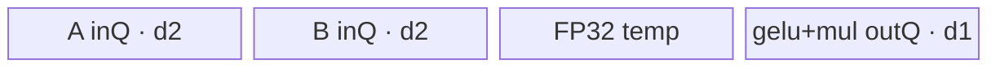

# GeGlu A2/A3 ACLNN 算子知识

## 算子速览

| 项目 | 内容 |
|---|---|
| 实际入口 | `aclnnGeGluV3GetWorkspaceSize` + `aclnnGeGluV3`；同族旧入口 `aclnnGeGlu` 固定 `activateLeft=false` 后复用同一实现 |
| 计算语义 | 沿 `dim` 将 `self` 等分为左半 `A`、右半 `B`；`activateLeft=true` 时 `out=GELU(A)*B, outGelu=GELU(A)`，否则 `out=A*GELU(B), outGelu=GELU(B)` |
| 输入输出 | ND，rank 1–8 的非空核心 Kernel 路径；FLOAT16/BFLOAT16/FLOAT32，输出 shape 仅 `dim` 长度减半 |
| 执行类型 | 核心节点单 Kernel、AIV_VECTOR；entry 的 `KERNEL_TYPE_MIX_VECTOR_CORE` 仅选择 Vector Core 任务类型，全部可达 body 是 GM↔UB 与 Vector API，无 Cube/AIC/MIX_CV |
| Kernel 路线 | R-001 tanh-vreduce；R-002 tanh-align；R-003 tanh-big；R-004 erf-vreduce；R-005 erf-align；R-006 erf-big；每组含 FP16/BF16/FP32 独立 key/body |
| 核心资源 | GM 输入/双输出、TQue/TBuf、16 MiB 框架保留 workspace 加 `coreNum*128 B` 用户区；body 不读写 `userWS` |
| 来源闭包 | source_closed：公开 V3 ACLNN→L0 `GeGluV2`→Tiling/POD→18 key router→全部 Vector body/helper→OpDef/binary config 已闭合 |
| 验证状态 | 已完成源码闭包检查；本次知识提取未执行编译、真机、数值或性能测试。 |

## 接口与语义

### 计算语义

令规范化轴 `d = dim < 0 ? rank + dim : dim`，`self[..., d, ...]` 的偶数长度被二分为 `A` 与 `B`。V3 用 `activateLeft` 选择激活半边，另一半作为 gate；`outGelu` 保存被激活半边的 GELU，`out` 保存其与另一半的逐元素乘积。`approximate=1` 走 tanh 近似，`approximate=0` 走源码命名为 erf/none 的实现。

### 输入、输出与属性

| 参数 | shape/layout | dtype | 约束、默认值与语义 |
|---|---|---|---|
| `self` | ND，rank≤8 | FLOAT16/BFLOAT16/FLOAT32 | 非空核心路径要求 rank≥1、元素数非零；允许 ACLNN 非连续输入，先 `Contiguous` |
| `dim` | 标量 | int64 | `[-rank, rank-1]`，对应维长度为偶数；L0/OpDef 默认 `-1` |
| `approximate` | 标量 | int64 | 仅 0/1；0=none/erf，1=tanh；OpDef 默认 1 |
| `activateLeft` | 标量 | bool | V3 显式传入；true 激活左半，false 激活右半 |
| `out` | 除 `dim` 减半外同 `self` | 同 `self` | 可非连续，核心连续结果经 `ViewCopy` 回写 |
| `outGelu` | 同 `out` | 同 `self` | 保存激活结果，可非连续 |

### 入口与版本

公开文档同时列出旧 `aclnnGeGlu` 和更新的 `aclnnGeGluV3`；V3 增加 `activateLeft`，两者都进入 `ExecGeGluGetWorkspaceSize`，旧入口在 `aclnn_geglu.cpp:231-245` 固定传 `false`。因此 A2/A3 取同语义族最新公开入口 V3。`aclnn_geglu.h:47` 的注释把 0/1 文案写反；公开 V3 文档、OpDef、Tiling 常量和 key 选择一致证明实际实现为 0=erf/none、1=tanh，复用时必须以实现链为准。

## Host/Launcher 执行流程

### 参数校验与前处理

`CheckParams` 顺序检查非空指针、平台 dtype 列表、rank/dim/shape、`approximate∈{0,1}`。空 tensor 或 rank 0 在 ACLNN 层直接返回空 executor，不启动核心 Kernel。非空时：`Contiguous(self)`→`l0op::GeGluV2` 分配两个连续输出并添加 AICORE launcher→两次 `ViewCopy` 回写用户输出；任一步空指针立即返回对应 ACLNN 错误。

### 参数、Workspace 与生命周期

L0 由输入 shape 将 `dim` 长度减半并分配两个连续临时输出。Tiling 折叠 shape：`x=∏shape[i<d]`、`n=shape[d]/2`、`y=∏shape[i>d]`、`ny=n*y`。Kernel workspace 为 `16*1024*1024 + totalCoreNum*32*4` 字节；entry 只要求 workspace 与 `GetUserWorkspace(workspace)` 非空，后续 body 未使用该地址。ACLNN 返回的是 executor 所有节点合计 workspace，具体叠加由框架边界管理。

### 启动图与失败传播

```text
aclnnGeGluV3GetWorkspaceSize
  -> Contiguous(self)                         # 框架节点/必要时
  -> l0op::GeGluV2 -> launcher GeGluV2       # 单个核心 AIV_VECTOR Kernel
       ge_glu_v2(x, yTmp, geluTmp, workspace, tiling)
  -> ViewCopy(yTmp, out)                      # 框架节点
  -> ViewCopy(geluTmp, outGelu)               # 框架节点
aclnnGeGluV3 -> CommonOpExecutorRun(..., stream)
```

核心节点输入输出均为 executor 所有的连续 GM tensor；同一 executor/stream 保证前后节点顺序。任何创建/节点返回空指针阻止后续节点加入；第二段由 `CommonOpExecutorRun` 传播执行状态。框架 Contiguous/ViewCopy 的内部 Kernel、workspace slice 与 event 是固定仓外边界。

## Route 与参数设计

### 分核与资源计算

公共 tile 上限 `B=6144`，FP32+erf+`ny==1` 特例 `B=4912`；dtype block 元素数分别 FP16/BF16=16、FP32=8。`ny==1` 用 VReduce；`1<ny<=6144` 用按行分组；`ny>6144` 用按行切片。small 路线令 `group=B/ny`（未对齐时用 `B/align_up(ny,blockSize)`），`numPerCore=ceil(x/coreNum)`、`realCoreNum=ceil(x/numPerCore)`，再生成普通核/尾核 loop 与残组。big 路线令 `group=floor(ny/B)`、`tail=ny-group*B`、`realCoreNum=coreNum`、总任务数 `x*(group+(tail!=0))`。

### Route 选择

| 顺序 | Route | Key/模板 | 精确选择条件与优先级 | 不适用去向 |
|---:|---|---|---|---|
| 1 | R-001 tanh-vreduce | 102/202/302 | `approximate==1 && ny==1`；key 百位按 FP16/BF16/FP32 | R-002 |
| 2 | R-002 tanh-align | 101/201/301 | `approximate==1 && 1<ny<=6144` | R-003 |
| 3 | R-003 tanh-big | 103/203/303 | `approximate==1 && ny>6144` | 无 |
| 4 | R-004 erf-vreduce | 112/212/312 | `approximate==0 && ny==1`；FP32 的 B=4912 | R-005 |
| 5 | R-005 erf-align | 111/211/311 | `approximate==0 && 1<ny<=6144` | R-006 |
| 6 | R-006 erf-big | 113/213/313 | `approximate==0 && ny>6144` | 无 |

```text
dtype -> FP16/BF16/FP32
approximate == 1 ? [ny==1 -> x02; ny<=6144 -> x01; else -> x03]
                 : [ny==1 -> x12; ny<=6144 -> x11; else -> x13]
```

### 模板/实现执行矩阵

| Route | key/selector | dtype/shape/platform 完整命中条件 | 执行拓扑与 Kernel 节点 | 实际模板/body | 内存与同步特征 | tail/fallback |
|---|---|---|---|---|---|---|
| R-001 | 102/202/302 | tanh；ny=1；FP16/BF16/FP32 | 单 AIV_VECTOR | `Fp16VReduce`/`Bf16VReduce`/`Fp32VReduce` | 连续装入 A/B 交错行，`GatherMask` 拆分 | 普通/尾核残组 |
| R-002 | 101/201/301 | tanh；1<ny≤6144 | 单 AIV_VECTOR | 三 dtype `*Align` | 双输入 Queue；未 32B 对齐用 `DataCopyPad` | padding lane 不写回 |
| R-003 | 103/203/303 | tanh；ny>6144 | 单 AIV_VECTOR | 三 dtype `*AlignLastAxisBig` | `(row,slice)` 任务跨核轮转 | 最后一片按 `tailLoopNum` |
| R-004 | 112/212/312 | erf；ny=1 | 单 AIV_VECTOR | 三 dtype `*VReduceErf` | VReduce + erf 临时 TBuf | 普通/尾核残组 |
| R-005 | 111/211/311 | erf；1<ny≤6144 | 单 AIV_VECTOR | 三 dtype `*AlignErf` | 双输入 Queue + erf 临时 TBuf | padding lane 不写回 |
| R-006 | 113/213/313 | erf；ny>6144 | 单 AIV_VECTOR | 三 dtype `*AlignLastAxisBigErf` | `(row,slice)` 任务跨核轮转 | 最后一片精确长度 |

### 隐藏性能 Guard

| Guard | Host/Tiling 条件 | Device/资源原因 | 影响 Route | 不满足时去向 | 源码符号 |
|---|---|---|---|---|---|
| 非空域 | `x!=0 && ny!=0` | Kernel loop/除法要求正域 | 全部 | Tiling 失败；ACLNN 空域提前返回 | `GetTillingParam` |
| VReduce | `ny==1` | A/B 元素交错，可一次 DMA 后按奇偶 lane `GatherMask` | R-001/R-004 | Align | `Get*TilingData`, `Compute*VReduce` |
| UB tile | `ny<=6144` | 固定 B 控制 Queue/TBuf 容量 | Align | Big | `COMMON_BUFFER_SIZE_LIMIT` |
| 32B 对齐 | `ny%blockSize==0` | 可用普通 `DataCopy`；否则需逐行 pad | R-002/R-005 | 同 Route 的 padded 分支 | `CopyInXAlign` |
| key 完整性 | 仅 18 个生成 key | router 无最终 else 报错/回退 | 全部 | 未知 key 无输出 | `ge_glu_v2` |

### POD/ABI

`GeGluV2TilingData` 由 13 个顺序 `int64_t` 字段组成；宏实现不在固定仓，`sizeof/alignof/offsetof` 不可见，不能臆定 padding。

| 结构 | 字段 | 类型/位宽 | ABI 布局 | 单位 | Host/launcher producer | Device consumer | 边界 |
|---|---|---|---|---|---|---|---|
| GeGluV2TilingData | group | int64/64 | 第1字段 | 行/片数 | small=`B/aligned(ny)`；big=`ny/B` | 各 Process 循环 | 正数 |
| 同上 | loopNum | int64/64 | 第2字段 | loop/task | small=`numPerCore/group`；big=`x*(group+tailFlag)` | 普通核或 big 跨核循环 | ≥0 |
| 同上 | tailLoopNum | int64/64 | 第3字段 | loop/元素 | small 尾核 loop；big 尾片元素数 | tail/big 长度 | 路线相关 |
| 同上 | nLastTailGroup | int64/64 | 第4字段 | 行数 | `numPerCore%group` | 普通核残组 | big inactive |
| 同上 | lastTailGroup | int64/64 | 第5字段 | 行数 | 尾核剩余 `%group` | 尾核残组 | big inactive |
| 同上 | splitSize | int64/64 | 第6字段 | 元素 | small=`ny`；big=`B` | DMA、地址、UB长度 | >0 |
| 同上 | realCoreNum | int64/64 | 第7字段 | core | small 实算；big=`coreNum` | block guard/任务轮转 | >0 |
| 同上 | numPerCore | int64/64 | 第8字段 | 行/core | small `ceil(x/coreNum)` | GM基址 | big 地址不依赖其有效分核语义 |
| 同上 | blockSize | int64/64 | 第9字段 | 元素/32B | FP16/BF16=16，FP32=8 | alignment/padding | 固定 dtype |
| 同上 | tilingKey | int64/64 | 第10字段 | key | dtype/algorithm/size 决策 | router；body仅保存 | 18值 |
| 同上 | activateLeft | int64/64 | 第11字段 | bool整数 | attr true→1 | `BaseInit` 半边偏移/奇偶模式 | 0/1 |
| 同上 | ny | int64/64 | 第12字段 | 元素/半行 | `n*y` | big 行跨度 | >0 |
| 同上 | approximate | int64/64 | 第13字段 | 枚举 | ACLNN attr | body保存；router已由key固化 | 0/1 |

### Route 源码闭包

| Route | Key/selector | Host/Tiling producer | POD/参数 | Kernel entry/router 节点 | Kernel body/直接依赖 | 构建接线 |
|---|---|---|---|---|---|---|
| R-001–R-006 | 101–313 十八 key | `ge_glu_v2_tiling.cpp::Tiling4GeGluV2/Get*TilingData` | `GeGluV2TilingData` | `ge_glu_v2.cpp::ge_glu_v2` | `tanh/*.h`,`erf/*.h`,`ge_glu_v2_base.h` | `ge_glu_v2_def.cpp` + ascend910b/ascend910_93 binary json |

## Kernel 实现

### 公共执行流程

entry 校验 workspace 与 user workspace 指针、反序列化 POD，并按 key 实例化唯一 body。`BaseInit` 绑定三个 GM tensor，计算 `gmXOffset=blockIdx*numPerCore*splitSize*2`、`gmDYOffset=blockIdx*numPerCore*splitSize`；`activateLeft` 通过 `x1_stride/x2_stride` 或 VReduce 奇偶 pattern 交换激活半边。所有路线执行 `CopyIn→GELU→outGelu提交→乘 gate→out提交`，Queue 的 `EnQue/DeQue/FreeTensor` 和必要 `PipeBarrier<PIPE_V>` 构成核内同步。

### Route R-001：tanh-vreduce（102/202/302）

#### 适用条件

##### 选择证据

| 层级 | 文件 | 符号 | 源码谓词/参数 | 结果/下一跳 |
|---|---|---|---|---|
| Tiling | `op_host/ge_glu_v2_tiling.cpp` | `GetFp16/Bf16/Fp32TilingData` | `approximate==1 && ny==1` | 102/202/302 |
| Router | `op_kernel/ge_glu_v2.cpp` | `ge_glu_v2` | `TILING_KEY_IS(x02)` | 三 dtype VReduce body |

#### Device 数据流

##### 函数级调用链

```text
ge_glu_v2 -> *VReduce::Init/BaseInit -> Process -> CopyInXVreduce
  -> GatherMask(even/odd) -> FP32 GELU(tanh) -> cast/mul -> two CopyOutVreduce
```

##### 源码等价伪码

```text
for ordinary/tail loop: DMA [group,2] contiguous elements; GatherMask picks gate/active lanes
active_fp32 = cast(active); gelu = active/(1+exp(-alpha*(active+beta*active^3)))
outGelu = cast_rint(gelu); out = gate*outGelu (BF16乘法在FP32完成); copy exact ub_num
```

#### 内存与数据搬运

##### 资源与搬运表

| 层级/缓冲区 | offset/地址公式 | extent/容量公式 | dtype/layout | producer | consumer | owner/lifetime | 对齐/复用 |
|---|---|---|---|---|---|---|---|
| GM x | `gmXOffset+i*one_process_in_stride` | `2*group` 元素 | T/interleaved pair | caller | CopyIn | caller | single padded DMA |
| inQueueX | 0 | depth2，`2B` 元素/slot | T | DMA | GatherMask | TPipe | Free after split |
| outputs | GM `gmDYOffset+i*stride` | `ub_num` each | T/ND | compute | DMA | executor | exact bytes |

##### 分层内存布局


##### 字节账与复用顺序

```text
B=6144；UB_total: FP16=24B=147456 B，BF16=28B=172032 B，FP32=32B=196608 B
dynamic_ub=N/A；workspace_total=16 MiB+coreNum*128 B（body未消费用户区）
```

| 复用子区 | 写入者 | 读取者/消费点 | 下一次覆盖 | 同步或释放依据 | 安全条件 |
|---|---|---|---|---|---|
| FP32 temp | cast/GatherMask | GELU与Mul | 下一 loop | 同步 Vector 顺序 + Queue Free | 当前输出已入队 |

#### 同步、精度与尾块

##### 同步与数值边界表

| 阶段 | primitive/机制 | producer | consumer/等待点 | 保护对象 | 精度/尾块 |
|---|---|---|---|---|---|
| DMA→compute | Queue | CopyIn | DeQue | input slot | FP16/BF16升至FP32；FP32原精度 |
| split | `GatherMask` | contiguous A/B | GELU/Mul | 奇偶 lane | repeat=`ceil(2*ub_num/128)` 或 `/64` |
| tail | loop guards | Tiling | CopyOut | GM有效域 | 仅写 `ub_num` |

#### 关键实现

##### 符号证据表

| 阶段 | 文件 | 符号/模板实例 | 实现事实 |
|---|---|---|---|
| Host/Tiling producer | `op_host/ge_glu_v2_tiling.cpp` | `GetTilingDataSmall(...,true)` | ny=1、分核、key |
| Kernel entry/router | `op_kernel/ge_glu_v2.cpp` | `ge_glu_v2` x02 | dtype→VReduce body |
| Device body/helper | `op_kernel/tanh/*_vreduce.h`, `ge_glu_v2_base.h` | `Compute*VReduce`, `ComputeGeluBase` | 奇偶拆分与FP32 tanh近似 |

### Route R-002：tanh-align（101/201/301）

#### 适用条件

##### 选择证据

| 层级 | 文件 | 符号 | 源码谓词/参数 | 结果/下一跳 |
|---|---|---|---|---|
| Tiling | `op_host/ge_glu_v2_tiling.cpp` | `Get*TilingData` | `approximate==1 && 1<ny<=6144` | x01 |
| Router | `op_kernel/ge_glu_v2.cpp` | `ge_glu_v2` | x01 | `*Align` |

#### Device 数据流

##### 函数级调用链

```text
*Align::Process -> CopyInXAlign(A,B) -> ComputeGeluBase -> CopyOutGelu
  -> gate*gelu -> CopyOutMul
```

##### 源码等价伪码

```text
each core processes group rows; aligned rows use strided DataCopy, otherwise DataCopyPad to 32B
compute active in FP32 for half/bfloat16; write only splitSize elements of every row
```

#### 内存与数据搬运

##### 资源与搬运表

| 层级/缓冲区 | offset/地址公式 | extent/容量公式 | dtype/layout | producer | consumer | owner/lifetime | 对齐/复用 |
|---|---|---|---|---|---|---|---|
| inQueueX1/X2 | two half offsets | each depth2×B | T/row-major | two DMA | Vector | TPipe | padded to block |
| outQueueGelu/Mul | 0 | each depth1×B | T | Vector | DMA | TPipe | gelu dequeued, copied, re-enqueued for Mul |
| temp | 0 | FP16/BF16 2×B FP32；FP32 1×B | FP32 | cast/GELU | cast/mul | TPipe | in-place reuse |

##### 分层内存布局



##### 字节账与复用顺序

```text
B=6144；UB_total FP16/BF16=20B=122880 B；FP32=28B=172032 B
workspace_total=16 MiB+coreNum*128 B
```

| 复用子区 | 写入者 | 读取者/消费点 | 下一次覆盖 | 同步或释放依据 | 安全条件 |
|---|---|---|---|---|---|
| gelu outQueue slot | Cast/GELU | GM gelu DMA then Mul | Free after Mul | DeQue→EnQue→DeQue | copy completes before re-enqueue consumer |

#### 同步、精度与尾块

##### 同步与数值边界表

| 阶段 | primitive/机制 | producer | consumer/等待点 | 保护对象 | 精度/尾块 |
|---|---|---|---|---|---|
| compute | Queue + PipeBarrier | GELU | Mul | gelu slot | half/BF16 cast-rint；padding不写回 |

#### 关键实现

##### 符号证据表

| 阶段 | 文件 | 符号/模板实例 | 实现事实 |
|---|---|---|---|
| Host/Tiling producer | `op_host/ge_glu_v2_tiling.cpp` | `GetTilingDataSmall` | group/alignment/尾核 |
| Kernel entry/router | `op_kernel/ge_glu_v2.cpp` | x01 | 三 dtype Align |
| Device body/helper | `op_kernel/tanh/*_align.h`, `ge_glu_v2_base.h` | `CopyInXAlign` | strided DMA/pad/计算 |

### Route R-003：tanh-big（103/203/303）

#### 适用条件

##### 选择证据

| 层级 | 文件 | 符号 | 源码谓词/参数 | 结果/下一跳 |
|---|---|---|---|---|
| Tiling | `op_host/ge_glu_v2_tiling.cpp` | `GetTilingDataBig` | `approximate==1 && ny>6144` | x03 |

#### Device 数据流

##### 函数级调用链

```text
*AlignLastAxisBig::Process -> global task e=core+round*realCoreNum
  -> (row,slice,length) -> CopyIn/GELU/CopyOutGelu/Mul/CopyOutMul
```

##### 源码等价伪码

```text
tasks = x*(floor(ny/B)+(ny%B!=0)); each core takes round-robin tasks
offset input=row*2*ny+activeHalfOffset+slice*B; output=row*ny+slice*B; tail length=ny%B
```

#### 内存与数据搬运

##### 资源与搬运表

| 层级/缓冲区 | offset/地址公式 | extent/容量公式 | dtype/layout | producer | consumer | owner/lifetime | 对齐/复用 |
|---|---|---|---|---|---|---|---|
| GM slice | `row*2ny+half+slice*B` | B或tail | T | caller | DMA | caller | `DataCopyPad(isPad=false)` exact bytes |
| UB | 同R-002 | B | dtype-specific | TPipe | Vector/DMA | one task | tail only valid length |

##### 分层内存布局


##### 字节账与复用顺序

```text
同R-002固定容量；tail不缩小分配。workspace_total=16 MiB+coreNum*128 B
```

| 复用子区 | 写入者 | 读取者/消费点 | 下一次覆盖 | 同步或释放依据 | 安全条件 |
|---|---|---|---|---|---|
| task-local queues | current slice | output DMA | next round | FreeTensor | tail仅处理length |

#### 同步、精度与尾块

##### 同步与数值边界表

| 阶段 | primitive/机制 | producer | consumer/等待点 | 保护对象 | 精度/尾块 |
|---|---|---|---|---|---|
| task tail | block guard | Tiling | DMA/Vector | last slice | `length=tailLoopNum` |

#### 关键实现

##### 符号证据表

| 阶段 | 文件 | 符号/模板实例 | 实现事实 |
|---|---|---|---|
| Host/Tiling producer | `op_host/ge_glu_v2_tiling.cpp` | `GetTilingDataBig` | slice/task图 |
| Kernel entry/router | `op_kernel/ge_glu_v2.cpp` | x03 | Big body |
| Device body/helper | `op_kernel/tanh/*_last_axis_big.h` | `ProcessPerCore` | task映射与tail |

### Route R-004：erf-vreduce（112/212/312）

#### 适用条件

##### 选择证据

| 层级 | 文件 | 符号 | 源码谓词/参数 | 结果/下一跳 |
|---|---|---|---|---|
| Tiling | `op_host/ge_glu_v2_tiling.cpp` | `Get*TilingData` | `approximate==0 && ny==1` | x12；FP32 B=4912 |

#### Device 数据流

##### 函数级调用链

```text
*VReduceErf -> GatherMask -> ComputeGeluErf polynomial/exp rational approximation -> cast/mul -> outputs
```

##### 源码等价伪码

```text
split active/gate; clamp active to <=5.75; evaluate polynomial in x^2;
gelu=active/(1+exp(poly(x^2)*x)); emit gelu and gate*gelu
```

#### 内存与数据搬运

##### 资源与搬运表

| 层级/缓冲区 | offset/地址公式 | extent/容量公式 | dtype/layout | producer | consumer | owner/lifetime | 对齐/复用 |
|---|---|---|---|---|---|---|---|
| VReduce buffers | 同R-001 | B | dtype-specific | DMA/Gather | erf | TPipe | extra polynomial temps |

##### 分层内存布局


##### 字节账与复用顺序

```text
FP16 B6144:32B=196608 B；BF16 B6144:32B=196608 B；FP32 B4912:40B=196480 B
```

| 复用子区 | 写入者 | 读取者/消费点 | 下一次覆盖 | 同步或释放依据 | 安全条件 |
|---|---|---|---|---|---|
| polynomial temp | Horner steps | next Horner/Exp/Div | next loop | sequential Vector issue | keep active/gate until Mul |

#### 同步、精度与尾块

##### 同步与数值边界表

| 阶段 | primitive/机制 | producer | consumer/等待点 | 保护对象 | 精度/尾块 |
|---|---|---|---|---|---|
| erf | Vector order | clamp/poly | Exp/Div | FP32 temps | half/BF16 entire erf in FP32 |

#### 关键实现

##### 符号证据表

| 阶段 | 文件 | 符号/模板实例 | 实现事实 |
|---|---|---|---|
| Host/Tiling producer | `op_host/ge_glu_v2_tiling.cpp` | `FP32_BUFFER_SIZE_VREDUCE_ERF` | FP32专用B |
| Kernel entry/router | `op_kernel/ge_glu_v2.cpp` | x12 | Erf VReduce |
| Device body/helper | `op_kernel/erf/*_vreduce_erf.h`, `ge_glu_v2_base.h` | `ComputeGeluErf` | polynomial路径 |

### Route R-005：erf-align（111/211/311）

#### 适用条件

##### 选择证据

| 层级 | 文件 | 符号 | 源码谓词/参数 | 结果/下一跳 |
|---|---|---|---|---|
| Tiling | `op_host/ge_glu_v2_tiling.cpp` | `Get*TilingData` | `approximate==0 && 1<ny<=6144` | x11 |

#### Device 数据流

##### 函数级调用链

```text
*AlignErf -> CopyInXAlign -> ComputeGeluErf -> gelu CopyOut/requeue -> Mul -> out CopyOut
```

##### 源码等价伪码

```text
same row grouping/pad as R-002; replace tanh helper with FP32 erf polynomial helper
```

#### 内存与数据搬运

##### 资源与搬运表

| 层级/缓冲区 | offset/地址公式 | extent/容量公式 | dtype/layout | producer | consumer | owner/lifetime | 对齐/复用 |
|---|---|---|---|---|---|---|---|
| queues | 同R-002 | B | T | DMA/Vector | Vector/DMA | TPipe | exact row writes |
| erf temps | 0 | half/BF16 4×B FP32；FP32 2×B | FP32 | polynomial | GELU | TPipe | Horner in-place |

##### 分层内存布局


##### 字节账与复用顺序

```text
B6144；UB_total FP16/BF16=28B=172032 B；FP32=32B=196608 B
```

| 复用子区 | 写入者 | 读取者/消费点 | 下一次覆盖 | 同步或释放依据 | 安全条件 |
|---|---|---|---|---|---|
| erf computeOut | Horner/Div | Cast/GELU output | next loop | Vector order | clamp temp独立 |

#### 同步、精度与尾块

##### 同步与数值边界表

| 阶段 | primitive/机制 | producer | consumer/等待点 | 保护对象 | 精度/尾块 |
|---|---|---|---|---|---|
| pad | DataCopyPad | GM | Vector | UB tail | only logical splitSize copied out |

#### 关键实现

##### 符号证据表

| 阶段 | 文件 | 符号/模板实例 | 实现事实 |
|---|---|---|---|
| Host/Tiling producer | `op_host/ge_glu_v2_tiling.cpp` | x11 selection | erf align |
| Kernel entry/router | `op_kernel/ge_glu_v2.cpp` | x11 | three bodies |
| Device body/helper | `op_kernel/erf/*_align_erf.h` | ComputeGelu/AndMul | FP32 polynomial |

### Route R-006：erf-big（113/213/313）

#### 适用条件

##### 选择证据

| 层级 | 文件 | 符号 | 源码谓词/参数 | 结果/下一跳 |
|---|---|---|---|---|
| Tiling | `op_host/ge_glu_v2_tiling.cpp` | `GetTilingDataBig` | `approximate==0 && ny>6144` | x13 |

#### Device 数据流

##### 函数级调用链

```text
*AlignLastAxisBigErf -> round-robin (row,slice) -> exact DMA -> erf -> two exact outputs
```

##### 源码等价伪码

```text
same task map as R-003; each B/tail slice runs erf helper then gate multiply
```

#### 内存与数据搬运

##### 资源与搬运表

| 层级/缓冲区 | offset/地址公式 | extent/容量公式 | dtype/layout | producer | consumer | owner/lifetime | 对齐/复用 |
|---|---|---|---|---|---|---|---|
| GM/UB slices | 同R-003 | B/tail | T | DMA | erf/Mul | per task | no padding writeback |

##### 分层内存布局


##### 字节账与复用顺序

```text
同R-005固定分配；tail不缩容。
```

| 复用子区 | 写入者 | 读取者/消费点 | 下一次覆盖 | 同步或释放依据 | 安全条件 |
|---|---|---|---|---|---|
| slice buffers | current task | exact output DMA | next task | FreeTensor | block tail guard |

#### 同步、精度与尾块

##### 同步与数值边界表

| 阶段 | primitive/机制 | producer | consumer/等待点 | 保护对象 | 精度/尾块 |
|---|---|---|---|---|---|
| big tail | task guard | Host POD | DMA/Vector | final slice | length=B或ny%B |

#### 关键实现

##### 符号证据表

| 阶段 | 文件 | 符号/模板实例 | 实现事实 |
|---|---|---|---|
| Host/Tiling producer | `op_host/ge_glu_v2_tiling.cpp` | `GetTilingDataBig` | tasks/tail |
| Kernel entry/router | `op_kernel/ge_glu_v2.cpp` | x13 | BigErf body |
| Device body/helper | `op_kernel/erf/*_last_axis_big_erf.h` | `ProcessPerCore` | exact slice erf |

## 算子特定优化

### Trick T-001：ny=1 连续装载后用 GatherMask 拆分两半

#### 触发与源码依据

- 适用 Route：R-001、R-004
- 触发条件：`ny==1`
- Golden 来源：[`ge_glu_v2_base.h:314-334`](../../../../../../../cann-ops-raw/ascendc/ops-nn/955f8b33985b6d72989ebff341bb9c2c564a51bc/activation/ge_glu_v2/op_kernel/ge_glu_v2_base.h#L314-L334)

**官方源码（固定 Commit 连续逐字摘录）**：

```cpp
uint64_t total_vreduce_num = ub_num * 2;
uint16_t repeat = (total_vreduce_num + 127) / 128;
GatherMask(ubX1, ubX, vreduce_srcPattern_x1, false, 0, {1, repeat, 8, 0}, rsvdCnt);
GatherMask(ubX2, ubX, vreduce_srcPattern_x2, false, 0, {1, repeat, 8, 0}, rsvdCnt);
```

#### 机制与设计原因

当每半行只有一个元素，A/B 在 GM 中交错。一次连续 DMA 装入 `2*group` 元素，再以奇偶 pattern 拆成 gate/active，避免两路极短、跨距 DMA；`activateLeft` 只交换两个 pattern。FP32 repeat 的 lane 分母改为64，FP16为128。

#### 迁移边界

- 适用：两段等长且元素交错的极短内轴。
- 前提：`ny==1`、pattern与激活方向一致、repeat不溢出 `uint16_t`。
- 失效：`ny>1` 改用 R-002/R-005 分组搬运。
- 未验证：本次知识提取未执行编译、真机、数值或性能测试。

#### 错误做法

固定仓未提供可验证反例。

### Trick T-002：先提交 outGelu，再复用同一 Queue slot 完成门乘

#### 触发与源码依据

- 适用 Route：A2/A3 的 R-002/R-003/R-005/R-006 FP16/FP32 body
- 触发条件：GELU 与乘积需要同一激活值
- Golden 来源：[`ge_glu_v2_fp16_align.h:147-163`](../../../../../../../cann-ops-raw/ascendc/ops-nn/955f8b33985b6d72989ebff341bb9c2c564a51bc/activation/ge_glu_v2/op_kernel/tanh/ge_glu_v2_fp16_align.h#L147-L163)

**官方源码（固定 Commit 连续逐字摘录）**：

```cpp
LocalTensor<T> gelu_out = outQueueGelu.AllocTensor<T>();
Cast(gelu_out, tmpBuf, RoundMode::CAST_RINT, ub_num);
outQueueGelu.EnQue(gelu_out);
```

#### 机制与设计原因

`CopyOutGelu` 对 gelu slot `DeQue` 后执行 GM copy，再 `EnQue`；随后 `ComputeMul` 再次 `DeQue` 同一 slot 与 gate 相乘，避免另建一份 GELU 中间 TBuf。最终才 `FreeTensor`，Queue 顺序保护其不被提前覆盖。

#### 迁移边界

- 适用：一个中间结果既要独立输出又被后续逐元素计算消费。
- 前提：GM copy 与再入队的 Queue/pipe 顺序保持不变。
- 失效：若输出 DMA 异步可越过再消费，需显式 event/不同缓冲协议。
- 未验证：本次知识提取未执行编译、真机、数值或性能测试。

#### 错误做法

固定仓未提供可验证反例。

## 模板与实现对比

| 对比维度 | VReduce R-001/R-004 | Align R-002/R-005 | Big R-003/R-006 | 设计选择依据 |
|---|---|---|---|---|
| 命中条件/优先级 | ny=1 | 1<ny≤B | ny>B | 内轴规模 |
| 模板与 dtype | 每 dtype 独立 VReduce | 每 dtype 独立 Align | 每 dtype 独立 Big | 精度/UB不同 |
| 循环与分核 | 行组分核 | 行组分核+尾核 | `(row,slice)`跨核轮转 | GM连续性 |
| Queue/TBuf | 单输入交错 Queue | 双输入 Queue | 双输入切片 Queue | 搬运形态 |
| 内存总占用与复用 | Gather临时较多 | GELU slot复用 | 固定B、tail不缩容 | 简化调度 |
| 搬运/Vector API | DataCopyPad+GatherMask | DataCopy/DataCopyPad | exact-byte DataCopyPad | 对齐与stride |
| 同步、精度与 tail | Queue；残组 | Queue/PipeBarrier；padding | Queue；尾片 | 仅写有效域 |
| fallback/失败边界 | ny>1转Align | ny>B转Big | 无后续 | unknown key无输出 |

## 平台差异

| 项目 | A2 | A3 | 950 |
|---|---|---|---|
| 支持状态 | 公开支持 | 公开支持 | 公开支持，见 `_950` 卡 |
| Host/Launcher | 共用 V3、同Tiling | 共用 V3、同Tiling | 同Host，`isRegbase=true` |
| Kernel/资源 | `ge_glu_v2.cpp`、B=6144 | 同A2 | arch35 `ge_glu_v2_apt.cpp`、B=4880、输出Queue depth2、原生Erf |

## 限制与失败边界

- ACLNN 空 tensor/rank0 提前成功，不进入 Tiling；核心 Tiling 明确拒绝 `x==0 || ny==0`。
- shape 乘积使用 `int64_t`，固定源码未见乘法溢出保护；极大 shape 不得假定安全。
- router 对未知 key 没有显式错误分支，表现为不写输出；调用方必须只使用 Host 生成 key。
- `aclnn_geglu.h` 的 approximate 注释与公开文档/实现相反；实际 body 证据为 1=tanh、0=erf/none。
- Contiguous/ViewCopy 内部实现、executor 合计 workspace 切片和框架 stream/event 细节不在固定算子源码中；按框架边界处理。

## 源码索引

### 链路索引

| 链路阶段 | 文件 | 关键符号 | 支撑内容 |
|---|---|---|---|
| 入口声明/约束 | `docs/aclnnGeGluV3.md` | `aclnnGeGluV3*` | 公开平台、语义、参数 |
| 入口实现 | `op_host/op_api/aclnn_geglu.cpp` | `ExecGeGluGetWorkspaceSize` | 校验、前后处理、V3/旧版复用 |
| Host/Tiling/Launcher | `op_host/ge_glu_v2_tiling.cpp` | `Tiling4GeGluV2` | shape折叠、key、POD、workspace |
| Kernel entry/body | `op_kernel/ge_glu_v2.cpp` | `ge_glu_v2` | 18 key router |
| 构建接线 | `op_host/ge_glu_v2_def.cpp` | `GeGluV2::GeGluV2` | ascend910b/ascend910_93注册 |

### 实现复用检查

| 检查项 | 可复用事实 | 不得改变的约束 | 源码符号 |
|---|---|---|---|
| ABI/POD | 13个int64顺序字段 | 字段顺序、单位、key语义 | `GeGluV2TilingData` |
| 调用顺序 | Contiguous→GeGluV2→两次ViewCopy | 失败必须阻断后续 | `ExecGeGluGetWorkspaceSize` |
| workspace/内存 | 固定16MiB+每核128B | entry要求非空；body未使用userWS | `Tiling4GeGluV2`, `ge_glu_v2` |
| 同步 | Queue生命周期与PipeBarrier | gelu copy/requeue/mul顺序 | 各 `Process/ComputeMul` |
| 精度与尾块 | half/BF16升FP32；cast-rint；exact tail | pattern、padding、有效长度 | Base及18 body |
| 失败边界 | 参数/Tiling失败、unknown key无输出 | 不补造fallback | `CheckParams`, router |