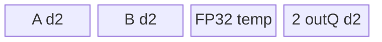

# GeGlu 950 ACLNN 算子知识

## 算子速览

| 项目 | 内容 |
|---|---|
| 实际入口 | 最新同语义入口 `aclnnGeGluV3GetWorkspaceSize` + `aclnnGeGluV3`；旧入口固定 `activateLeft=false` 并复用 |
| 计算语义 | 沿 `dim` 二分 A/B；按 `activateLeft` 输出 `GELU(A)*B` 或 `A*GELU(B)`，并输出被激活半边 |
| 输入输出 | ND，FLOAT16/BFLOAT16/FLOAT32；输出在 split 轴减半 |
| 执行类型 | 单核心 Kernel、AIV_VECTOR；`ge_glu_v2_apt.cpp` 明确 `KERNEL_TYPE_AIV_ONLY`，无 Cube/AIC/MIX_CV |
| Kernel 路线 | R-001/R-004 VReduce；R-002/R-005 Align；R-003/R-006 Big；tanh/erf各三类，每类含三 dtype key |
| 核心资源 | GM、depth2 TQue、TBuf；tile B=4880，FP32 erf-vreduce B=4224；workspace `16 MiB+coreNum*128 B` |
| 来源闭包 | source_closed：V3 ACLNN→L0→Tiling/POD→950 18-key router→arch35 body/helper→ascend950 注册/config 已闭合 |
| 验证状态 | 已完成源码闭包检查；本次知识提取未执行编译、真机、数值或性能测试。 |

## 接口与语义

### 计算语义

规范轴 `d=dim<0?rank+dim:dim`；轴长度必须为偶数。`activateLeft=true` 时 `outGelu=GELU(A), out=outGelu*B`，否则 `outGelu=GELU(B), out=A*outGelu`。`approximate=1` 为 tanh 路线，0 为 none/erf 路线。

### 输入、输出与属性

| 参数 | shape/layout | dtype | 约束、默认值与语义 |
|---|---|---|---|
| self | ND，rank≤8 | FP16/BF16/FP32 | 非连续输入先 Contiguous；核心路径非空 |
| dim | 标量 | int64 | `[-rank,rank-1]`，默认-1，轴长偶数 |
| approximate | 标量 | int64 | 0/1，默认1 |
| activateLeft | 标量 | bool | V3新增方向选择 |
| out/outGelu | dim轴减半 | 同self | 非连续输出由ViewCopy回写 |

### 入口与版本

V3 是公开文档中扩充 `activateLeft` 的最新版本。`aclnnGeGlu` 与 V3 共用 `ExecGeGluGetWorkspaceSize` 和 `GeGluV2` body，旧入口仅把方向固定为 false。公开 V3 文档、OpDef 和 Tiling 一致表明 0=none/erf、1=tanh；公开头文件注释中的反向文案是固定源码冲突，不能用于实现映射。

## Host/Launcher 执行流程

### 参数校验与前处理

`CheckParams` 依次验证指针、950 dtype、rank/dim/shape、approximate。空/rank0 tensor 返回空 executor。非空链为 `Contiguous(self)→l0op::GeGluV2→ViewCopy(out)→ViewCopy(outGelu)`。

### 参数、Workspace 与生命周期

Tiling 折叠 `x=∏d之前`、`n=shape[d]/2`、`y=∏d之后`、`ny=n*y`。L0 分配两个连续临时输出；executor 持有所有临时对象。核心 workspace 为 `16*1024*1024+totalCoreNum*128` 字节，entry 检查 `GetUserWorkspace` 非空，但 arch35 body 不访问它。

### 启动图与失败传播

```text
V3 phase-1 -> Contiguous -> GeGluV2 launcher
  -> ge_glu_v2_apt::ge_glu_v2 [AIV_ONLY, one kernel]
  -> ViewCopy y -> ViewCopy gelu
V3 phase-2 -> CommonOpExecutorRun(same stream)
```

框架节点内部实现是固定仓边界；核心节点 POD、blockDim、entry/body 全部可见。任一 phase-1 空返回立即终止组图，phase-2 状态由公共 executor 传播。

## Route 与参数设计

### 分核与资源计算

950 由 `IsRegbaseSocVersion` 置 `isRegbase=true`。公共 `B=4880`，FP32 erf-vreduce `B=4224`；blockSize为16/16/8元素。small：`group=B/ny`，未对齐时除数为 `align_up(ny,blockSize)`；`numPerCore=ceil(x/coreNum)`，计算普通/尾核 loop。big：`group=ny/B`、`tail=ny%B`，共 `x*(group+tailFlag)` 个 `(row,slice)` 任务跨核轮转。

### Route 选择

| 顺序 | Route | Key/模板 | 精确选择条件与优先级 | 不适用去向 |
|---:|---|---|---|---|
| 1 | R-001 tanh-vreduce | 102/202/302 | approximate=1, ny=1 | R-002 |
| 2 | R-002 tanh-align | 101/201/301 | approximate=1, 1<ny≤4880 | R-003 |
| 3 | R-003 tanh-big | 103/203/303 | approximate=1, ny>4880 | 无 |
| 4 | R-004 erf-vreduce | 112/212/312 | approximate=0, ny=1；FP32 B=4224 | R-005 |
| 5 | R-005 erf-align | 111/211/311 | approximate=0, 1<ny≤4880 | R-006 |
| 6 | R-006 erf-big | 113/213/313 | approximate=0, ny>4880 | 无 |

```text
dtype百位=1/2/3(FP16/BF16/FP32); 个位=2(ny=1),1(small),3(big); 十位=0(tanh),1(erf)
```

### 模板/实现执行矩阵

| Route | key/selector | dtype/shape/platform 完整命中条件 | 执行拓扑与 Kernel 节点 | 实际模板/body | 内存与同步特征 | tail/fallback |
|---|---|---|---|---|---|---|
| R-001 | x02 | tanh, ny=1, 950 | 单AIV | arch35 `*VReduce` | 连续DMA+GatherMask | 残组 |
| R-002 | x01 | tanh, 1<ny≤4880 | 单AIV | arch35 `*Align` | 双输入/双输出depth2 | 行pad |
| R-003 | x03 | tanh, ny>4880 | 单AIV | arch35 `*LastAxisBig` | 切片任务 | exact tail |
| R-004 | x12 | erf, ny=1 | 单AIV | arch35 `*VReduceErf` | 原生Erf+临时TBuf | 残组 |
| R-005 | x11 | erf, 1<ny≤4880 | 单AIV | arch35 `*AlignErf` | 原生Erf、双缓冲输出 | 行pad |
| R-006 | x13 | erf, ny>4880 | 单AIV | arch35 `*LastAxisBigErf` | 切片+原生Erf | exact tail |

### 隐藏性能 Guard

| Guard | Host/Tiling 条件 | Device/资源原因 | 影响 Route | 不满足时去向 | 源码符号 |
|---|---|---|---|---|---|
| 非空 | x!=0&&ny!=0 | 分核/除法 | all | Tiling失败 | `GetTillingParam` |
| regbase tile | isRegbase | arch35 UB布局 | all | 非950常量 | `TilingPrepare4GeGluV2` |
| 32B对齐 | ny%blockSize | 普通DMA或pad | Align | 同Route分支 | `CopyInXAlign` |
| task tail | ny%4880 | big最后片 | Big | exact tail | `GetTilingDataBig` |
| key | 18值 | router无unknown fallback | all | 无输出 | `ge_glu_v2_apt.cpp` |

### POD/ABI

宏定义按序含13个int64；宏实现不在固定仓，sizeof/alignof/offsetof不可见。

| 结构 | 字段 | 类型/位宽 | ABI布局 | 单位 | Host producer | Device consumer | 边界 |
|---|---|---|---|---|---|---|---|
| GeGluV2TilingData | group | int64/64 | #1 | 行/片 | B/对齐ny或ny/B | loops | >0 |
| 同上 | loopNum | int64/64 | #2 | loop/task | small或big公式 | Process | ≥0 |
| 同上 | tailLoopNum | int64/64 | #3 | loop/元素 | 尾核或尾片 | tail | 路线相关 |
| 同上 | nLastTailGroup | int64/64 | #4 | 行 | numPerCore%group | 普通核 | small |
| 同上 | lastTailGroup | int64/64 | #5 | 行 | 尾核余数 | 尾核 | small |
| 同上 | splitSize | int64/64 | #6 | 元素 | ny或B | DMA/地址 | >0 |
| 同上 | realCoreNum | int64/64 | #7 | core | 实算/coreNum | block guard | >0 |
| 同上 | numPerCore | int64/64 | #8 | 行/core | ceil(x/coreNum) | GM基址 | small语义 |
| 同上 | blockSize | int64/64 | #9 | 元素/32B | 16/16/8 | alignment | dtype固定 |
| 同上 | tilingKey | int64/64 | #10 | key | selector | router/body保存 | 18值 |
| 同上 | activateLeft | int64/64 | #11 | 0/1 | attr | half offset/pattern | 0/1 |
| 同上 | ny | int64/64 | #12 | 元素 | n*y | big stride | >0 |
| 同上 | approximate | int64/64 | #13 | 0/1 | attr | key已固化 | 0/1 |

### Route 源码闭包

| Route | Key/selector | Host/Tiling producer | POD/参数 | Kernel entry/router 节点 | Kernel body/直接依赖 | 构建接线 |
|---|---|---|---|---|---|---|
| R-001–R-006 | 18 keys | `Tiling4GeGluV2/Get*TilingData` | GeGluV2TilingData | `ge_glu_v2_apt.cpp::ge_glu_v2` | arch35 tanh/erf headers+base | OpDef ascend950→`ge_glu_v2_apt`; ascend950 binary json |

## Kernel 实现

### 公共执行流程

`BaseInit` 绑定GM，按blockIdx建立普通路线基址；`activateLeft` 交换半边offset或VReduce奇偶pattern。950 body普遍先在同一 `ComputeGeluAndMul` 内产出 GELU 与乘积，再把两个depth2输出Queue分别CopyOut；FP16/BF16升FP32，结果 `CAST_RINT` 降精度。Erf路线用 `Erf<float,false,{SUBSECTION_POLYNOMIAL_APPROXIMATION}>` 计算 `erf(x/sqrt(2))`，再乘0.5与x。

### Route R-001：tanh-vreduce

#### 适用条件
##### 选择证据
| 层级 | 文件 | 符号 | 谓词 | 结果 |
|---|---|---|---|---|
| Tiling/Router | tiling.cpp / ge_glu_v2_apt.cpp | Get*TilingData / entry | approx=1,ny=1,x02 | arch35 VReduce |
#### Device 数据流
##### 函数级调用链
`entry→VReduce::Init→Process→CopyInXVreduce→GatherMask→ComputeGeluBase→Mul→CopyOut*`
##### 源码等价伪码
`DMA interleaved 2*rows; gather even/odd; FP32 tanh GELU; emit gelu and gate*gelu; exact tail.`
#### 内存与数据搬运
##### 资源与搬运表
| 缓冲 | 容量 | owner/lifetime | 复用 |
|---|---|---|---|
| input/out/temp | B=4880，按dtype | TPipe/loop | Queue Free后覆盖 |
##### 分层内存布局

##### 字节账与复用顺序
`UB_total FP16=28B=136640B；BF16=32B=156160B；FP32=40B=195200B。`
| 子区 | 写入 | 读取 | 覆盖 | 依据 | 条件 |
|---|---|---|---|---|---|
| temp | gather/cast | GELU/Mul | next loop | Vector order | outputs已EnQue |
#### 同步、精度与尾块
##### 同步与数值边界表
| 阶段 | 机制 | producer | consumer | 保护 | 精度/tail |
|---|---|---|---|---|---|
| loop | Queue | DMA | compute/copy | slot | repeat ceil；exact ub_num |
#### 关键实现
##### 符号证据表
| 阶段 | 文件 | 符号 | 事实 |
|---|---|---|---|
| body | arch35/tanh/*_vreduce.h | ComputeGeluAndMul | gather+GELU+Mul |

### Route R-002：tanh-align

#### 适用条件
##### 选择证据
| 层级 | 文件 | 符号 | 谓词 | 结果 |
|---|---|---|---|---|
| Tiling | tiling.cpp | Get*TilingDataSmall | approx=1,1<ny≤4880 | x01 |
#### Device 数据流
##### 函数级调用链
`Align::Process→CopyInXAlign→ComputeGeluAndMul→CopyOutGelu→CopyOutMul`
##### 源码等价伪码
`group rows; DMA A/B with 32B aligned or padded branch; compute both outputs; write logical row length.`
#### 内存与数据搬运
##### 资源与搬运表
| 缓冲 | 容量 | owner/lifetime | 复用 |
|---|---|---|---|
| A/B inQ, two outQ | each depth2×B×sizeof(T) | TPipe | loop slots |
| temp | FP16/BF16 2B float；FP32 1B float | TPipe | in-place |
##### 分层内存布局

##### 字节账与复用顺序
`UB_total FP16/BF16=24B=117120B；FP32=36B=175680B。`
| 子区 | 写入 | 读取 | 覆盖 | 依据 | 条件 |
|---|---|---|---|---|---|
| output slots | Compute | DMA | next loop | Queue | depth2 |
#### 同步、精度与尾块
##### 同步与数值边界表
| 阶段 | 机制 | producer | consumer | 保护 | 精度/tail |
|---|---|---|---|---|---|
| pad | DataCopyPad | GM | Vector | UB lanes | invalid lanes never written |
#### 关键实现
##### 符号证据表
| 阶段 | 文件 | 符号 | 事实 |
|---|---|---|---|
| body | arch35/tanh/*_align.h | ComputeGeluAndMul | fused two-output compute |

### Route R-003：tanh-big

#### 适用条件
##### 选择证据
| 层级 | 文件 | 符号 | 谓词 | 结果 |
|---|---|---|---|---|
| Tiling | tiling.cpp | GetTilingDataBig | approx=1,ny>4880 | x03 |
#### Device 数据流
##### 函数级调用链
`Big::Process→task=round*cores+block→(row,slice,length)→CopyIn/Compute/CopyOut`
##### 源码等价伪码
`round-robin x*(floor(ny/B)+tailFlag) tasks; exact B/tail slice offsets.`
#### 内存与数据搬运
##### 资源与搬运表
| 缓冲 | 容量 | owner/lifetime | 复用 |
|---|---|---|---|
| slice queues/temps | same R-002 fixed B | per task | FreeTensor |
##### 分层内存布局
`与R-002相同，逻辑extent为B或tail。`
##### 字节账与复用顺序
`同R-002；tail不缩小物理分配。`
| 子区 | 写入 | 读取 | 覆盖 | 依据 | 条件 |
|---|---|---|---|---|---|
| slice | current task | DMA out | next task | Queue | block/task guard |
#### 同步、精度与尾块
##### 同步与数值边界表
| 阶段 | 机制 | producer | consumer | 保护 | 精度/tail |
|---|---|---|---|---|---|
| tail | length | POD | DMA/Vector | last slice | ny%4880 |
#### 关键实现
##### 符号证据表
| 阶段 | 文件 | 符号 | 事实 |
|---|---|---|---|
| body | arch35/tanh/*_last_axis_big.h | ProcessPerCore | task mapping |

### Route R-004：erf-vreduce

#### 适用条件
##### 选择证据
| 层级 | 文件 | 符号 | 谓词 | 结果 |
|---|---|---|---|---|
| Tiling | tiling.cpp | Get*TilingData | approx=0,ny=1 | x12 |
#### Device 数据流
##### 函数级调用链
`VReduceErf→GatherMask→Muls(x,1/sqrt2)→Erf→(1+erf)*0.5*x→Mul gate`
##### 源码等价伪码
`split pair; gelu=x*0.5*(1+erf(x/sqrt2)); emit two outputs.`
#### 内存与数据搬运
##### 资源与搬运表
| 缓冲 | 容量 | owner/lifetime | 复用 |
|---|---|---|---|
| input/output/temp | dtype B；FP32 B=4224 | TPipe | helper temps |
##### 分层内存布局
`interleaved inQ + split/temp + two outQ。`
##### 字节账与复用顺序
`FP16/BF16 B4880:36B=175680B；FP32 B4224:48B=202752B。`
| 子区 | 写入 | 读取 | 覆盖 | 依据 | 条件 |
|---|---|---|---|---|---|
| Erf temps | Muls/Erf | Adds/Mul | next loop | Vector order | length valid |
#### 同步、精度与尾块
##### 同步与数值边界表
| 阶段 | 机制 | producer | consumer | 保护 | 精度/tail |
|---|---|---|---|---|---|
| Erf | native vector Erf | scaled x | GELU Mul | FP32 temp | subsection polynomial config |
#### 关键实现
##### 符号证据表
| 阶段 | 文件 | 符号 | 事实 |
|---|---|---|---|
| helper | arch35/ge_glu_v2_base.h | ComputeGeluErf | native Erf pipeline |

### Route R-005：erf-align

#### 适用条件
##### 选择证据
| 层级 | 文件 | 符号 | 谓词 | 结果 |
|---|---|---|---|---|
| Tiling | tiling.cpp | Get*TilingDataSmall | approx=0,1<ny≤4880 | x11 |
#### Device 数据流
##### 函数级调用链
`AlignErf→CopyInXAlign→ComputeGeluErf→gate Mul→two CopyOut`
##### 源码等价伪码
`grouped A/B DMA; FP32 native Erf GELU; cast-rint for half/BF16.`
#### 内存与数据搬运
##### 资源与搬运表
| 缓冲 | 容量 | owner/lifetime | 复用 |
|---|---|---|---|
| queues/temps | B4880 | TPipe | outputs depth2 |
##### 分层内存布局
`A/B inQ + 2/4 FP32 temp + two outQ。`
##### 字节账与复用顺序
`UB_total FP16/BF16=32B=156160B；FP32=40B=195200B。`
| 子区 | 写入 | 读取 | 覆盖 | 依据 | 条件 |
|---|---|---|---|---|---|
| temp | Erf helper | Cast/Mul | next loop | Vector order | queues valid |
#### 同步、精度与尾块
##### 同步与数值边界表
| 阶段 | 机制 | producer | consumer | 保护 | 精度/tail |
|---|---|---|---|---|---|
| output | Queue | compute | DMA | slots | logical row only |
#### 关键实现
##### 符号证据表
| 阶段 | 文件 | 符号 | 事实 |
|---|---|---|---|
| body | arch35/erf/*_align_erf.h | ComputeGeluAndMul | nativeErf+gate |

### Route R-006：erf-big

#### 适用条件
##### 选择证据
| 层级 | 文件 | 符号 | 谓词 | 结果 |
|---|---|---|---|---|
| Tiling | tiling.cpp | GetTilingDataBig | approx=0,ny>4880 | x13 |
#### Device 数据流
##### 函数级调用链
`BigErf→round-robin slice→exact DMA→nativeErf GELU→Mul→exact outputs`
##### 源码等价伪码
`same R-003 task map, replace tanh helper by native Erf pipeline.`
#### 内存与数据搬运
##### 资源与搬运表
| 缓冲 | 容量 | owner/lifetime | 复用 |
|---|---|---|---|
| slice queues/temps | same R-005 | per task | Queue |
##### 分层内存布局
`与R-005相同，tail为逻辑extent。`
##### 字节账与复用顺序
`同R-005；workspace总式不变。`
| 子区 | 写入 | 读取 | 覆盖 | 依据 | 条件 |
|---|---|---|---|---|---|
| slice temp | task | outputs | next task | FreeTensor | tail guard |
#### 同步、精度与尾块
##### 同步与数值边界表
| 阶段 | 机制 | producer | consumer | 保护 | 精度/tail |
|---|---|---|---|---|---|
| tail | exact length | POD | all vector/DMA | GM bounds | B或ny%B |
#### 关键实现
##### 符号证据表
| 阶段 | 文件 | 符号 | 事实 |
|---|---|---|---|
| body | arch35/erf/*_last_axis_big_erf.h | ProcessPerCore | slice+Erf |

## 算子特定优化

### Trick T-001：950 用原生 Erf 子段多项式配置替换手写高阶链

#### 触发与源码依据

- 适用 Route：R-004/R-005/R-006
- 触发条件：`approximate==0` 且 950 arch35 body
- Golden 来源：[`arch35/ge_glu_v2_base.h:274-284`](../../../../../../../cann-ops-raw/ascendc/ops-nn/955f8b33985b6d72989ebff341bb9c2c564a51bc/activation/ge_glu_v2/op_kernel/arch35/ge_glu_v2_base.h#L274-L284)

**官方源码（固定 Commit 连续逐字摘录）**：

```cpp
AscendC::Muls(tmpBuf1, ubx2_fp32, ERF_SQRT_TWO_REC, length);
static constexpr ErfConfig config = { ErfAlgo::SUBSECTION_POLYNOMIAL_APPROXIMATION };
AscendC::Erf<float,false,config>(tmpBuf2, tmpBuf1, length);
AscendC::Adds(tmpBuf1, tmpBuf2, ERF_ONE, length);
AscendC::Muls(tmpBuf2, tmpBuf1, ERF_DOT_FIVE, length);
AscendC::Mul(gelu_out, ubx2_fp32, tmpBuf2, length);
```

#### 机制与设计原因

950 将 `x/sqrt(2)` 交给带明确算法配置的 Vector Erf，再直接组合 GELU；对比非950手写 clamp/Horner/Exp/Div 链，源码可证明减少算子自管的中间步骤，并保持FP32计算。

#### 迁移边界

- 适用：950且可用相同Erf配置的FP32向量路径。
- 前提：缩放、0.5和乘x的顺序不变；half/BF16仍在末尾cast-rint。
- 失效：非950必须保留其固定仓手写近似。
- 未验证：本次知识提取未执行编译、真机、数值或性能测试。

#### 错误做法

固定仓未提供可验证反例。

### Trick T-002：950 将两个输出 Queue 都设为 depth=2

#### 触发与源码依据

- 适用 Route：全部 950 Route
- 触发条件：arch35 body `bufferNum=2`
- Golden 来源：[`arch35/tanh/ge_glu_v2_fp16_align.h:59-65`](../../../../../../../cann-ops-raw/ascendc/ops-nn/955f8b33985b6d72989ebff341bb9c2c564a51bc/activation/ge_glu_v2/op_kernel/arch35/tanh/ge_glu_v2_fp16_align.h#L59-L65)

**官方源码（固定 Commit 连续逐字摘录）**：

```cpp
pipe.InitBuffer(inQueueX1, bufferNum, bufferSize * sizeof(T));
pipe.InitBuffer(inQueueX2, bufferNum, bufferSize * sizeof(T));
pipe.InitBuffer(outQueueGelu, bufferNum, bufferSize * sizeof(T));
pipe.InitBuffer(outQueueMul, bufferNum, bufferSize * sizeof(T));
```

#### 机制与设计原因

四条Queue统一双缓冲，使相邻loop的搬入、计算和双输出提交拥有独立slot；代价已计入950 UB总账，因此tile从6144收紧到4880。

#### 迁移边界

- 适用：双输出逐元素流水。
- 前提：UB足以容纳全部depth；Host与body使用同一B。
- 失效：资源不足必须缩tile或降低depth，不能只改Host常量。
- 未验证：本次知识提取未执行编译、真机、数值或性能测试。

#### 错误做法

固定仓未提供可验证反例。

## 模板与实现对比

| 对比维度 | VReduce | Align | Big | 设计选择依据 |
|---|---|---|---|---|
| 命中条件/优先级 | ny=1 | 1<ny≤4880 | ny>4880 | 搬运连续性/UB |
| 模板与 dtype | 三dtype独立 | 三dtype独立 | 三dtype独立 | cast与temp布局 |
| 循环与分核 | 行组 | 行组+尾核 | row/slice任务 | shape |
| Queue/TBuf | interleaved input | dual input | slice dual input | 地址形态 |
| 内存总占用与复用 | up to202752B | up to195200B | 同Align | 固定tile |
| 搬运/Vector API | GatherMask | DataCopy/Pad | exact DataCopyPad | ny规模 |
| 同步、精度与tail | Queue/FP32 | depth2/FP32 | task guard | 有效域 |
| fallback/失败边界 | Align | Big | none | selector顺序 |

## 平台差异

| 项目 | A2 | A3 | 950 |
|---|---|---|---|
| 支持状态 | 公开支持，见无后缀卡 | 同左 | 公开支持 |
| Host/Launcher | B=6144 | B=6144 | isRegbase，B=4880/4224 |
| Kernel/资源 | MIX_VECTOR_CORE entry，输出depth1 | 同A2 | AIV_ONLY arch35，输出depth2，原生Erf |

## 限制与失败边界

- ACLNN空/rank0提前返回；核心Tiling拒绝x或ny为0。
- shape折叠乘法无可见溢出保护；未知key无显式错误分支且不写输出。
- header注释对approximate的0/1描述与文档/实现冲突；实现链确定0=erf、1=tanh。
- 框架Contiguous/ViewCopy的内部Kernel、workspace slice、event不可见；不得推测。

## 源码索引

### 链路索引

| 链路阶段 | 文件 | 关键符号 | 支撑内容 |
|---|---|---|---|
| 入口声明/约束 | docs/aclnnGeGluV3.md | aclnnGeGluV3* | 公开950与语义 |
| 入口实现 | op_host/op_api/aclnn_geglu.cpp | ExecGeGluGetWorkspaceSize | 检查/launch graph |
| Host/Tiling/Launcher | op_host/ge_glu_v2_tiling.cpp | Tiling4GeGluV2 | regbase route/POD/workspace |
| Kernel entry/body | op_kernel/ge_glu_v2_apt.cpp | ge_glu_v2 | AIV_ONLY与18 key |
| 构建接线 | op_host/ge_glu_v2_def.cpp | ascend950 config | apt映射 |

### 实现复用检查

| 检查项 | 可复用事实 | 不得改变的约束 | 源码符号 |
|---|---|---|---|
| ABI/POD | 13 int64顺序 | 字段/单位/key | GeGluV2TilingData |
| 调用顺序 | Contiguous→core→2 ViewCopy | 失败传播 | ExecGeGluGetWorkspaceSize |
| workspace/内存 | 16MiB+core*128B；B常量 | depth2与B成套 | Tiling/InitBuffer |
| 同步 | Queue双缓冲 | EnQue/DeQue/FreeTensor | arch35 body |
| 精度与尾块 | FP32 GELU、cast-rint、exact tail | Erf config/pattern | arch35 base/body |
| 失败边界 | 参数/Tiling/unknown key | 不补fallback | CheckParams/router |