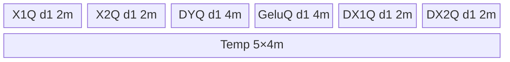

# GeGluBackward A2/A3 ACLNN 算子知识

## 算子速览

| 项目 | 内容 |
|---|---|
| 实际入口 | `aclnnGeGluV3BackwardGetWorkspaceSize` / `aclnnGeGluV3Backward`；旧 `aclnnGeGluBackward` 固定传 `activateLeft=false` 复用同一 body |
| 计算语义 | 将 `x` 沿 `dim` 分为 `x1/x2`；`dx1=gelu*dy`，`dx2=dy*x1*GELU'(x2)`，`activateLeft` 决定两半的物理位置 |
| 输入输出 | `dy/gelu:[...,M,...]`，`x/dx` 的 `dim` 维为其两倍；ND；FP16/BF16/FP32，四者同 dtype |
| 执行类型 | 单 Kernel：`ge_glu_grad_v2`，`AIV_VECTOR`；无 Cube/AIC/MIX_CV 可达节点 |
| Kernel 路线 | 18 条：`approximate(2) × dtype(3) × 调度模式(3)`，keys 101–303、701–903 |
| 核心资源 | GM + 6 个 TQue + 1 个 TBuf；32 B DMA 对齐；固定算子 workspace `16 MiB + 32*总 AIV 核数` |
| 来源闭包 | `source_closed`：公开 V3 ACLNN→共同 executor→`GeGluGradV2` launcher→Tiling/POD→key router→Tanh/Erf AIV body→平台注册/二进制配置均闭合 |
| 验证状态 | 已完成源码闭包检查；本次知识提取未执行编译、真机、数值或性能测试。 |

## 接口与语义

### 计算语义

将 `dy` 在 `dim` 之前的维度乘积记为 `N`，从 `dim` 起的维度乘积记为 `M`；则 `dy/gelu` 可展平为 `[N,M]`，`x/dx` 为 `[N,2M]`。Device 令 `x1=activateLeft ? x[:,M:2M] : x[:,0:M]`、`x2` 为另一半，并把 `dx1/dx2` 写回对应半区：

```text
dx1 = gelu * dy
dx2 = (x1 * dy) * GELU'(x2)
approximate=1: GELU' 使用 Tanh 路线的 logistic 形式多项式
approximate=0: GELU' = Phi(x2) + x2*phi(x2)，Phi 用有理式、phi 用 Exp 实现
```

### 输入、输出与属性

| 参数 | shape/layout | dtype | 约束、默认值与语义 |
|---|---|---|---|
| `gradOutput/dy` | rank 1–8，ND | FP16/BF16/FP32 | 与 `gelu` 同 shape；除 `dim` 外与 `self` 相同，`dim` 长度为一半 |
| `self/x` | rank 1–8，ND | 同 `dy` | 非空；`dim` 长度为 `dy` 的 2 倍 |
| `gelu` | 同 `dy`，ND | 同 `dy` | forward 保存的 GELU 输出，用于 `dx1` |
| `dim` | scalar | int64 | ACLNN 校验 `[-rank,rank-1]`，负值归一化 |
| `approximate` | scalar | int64 | 0=`none/Erf`，1=`tanh` |
| `activateLeft` | scalar | bool | V3 新增；false 时激活半为右半，旧入口固定 false |
| `gradInput/dx` | 同 `self`，ND | 同 `dy` | 可非连续，最终由 `ViewCopy` 提交 |

### 入口与版本

固定仓公开 `aclnnGeGluBackward` 和 `aclnnGeGluV3Backward`。V3 增加 `activateLeft`，两者进入 `ExecGeGluBackwardGetWorkspaceSize`；旧版本传 false，V3 透传属性。因此 A2/A3 取实际支持的最新公开 V3，旧符号只记录复用关系。README、V3 文档、`GeGluGradV2` OpDef 的 `ascend910b/ascend910_93` 注册和对应 binary config 共同证明 A2/A3 公开支持，未见文档与接线冲突。

## Host/Launcher 执行流程

### 参数校验与前处理

`CheckParams` 依次检查非空、平台 dtype 集、四 tensor dtype 相同、`gelu==dy`、`dx==x`、rank 和 `dim`、`dy[dim]*2==x[dim]`、`approximate∈{0,1}`。`dy` 为空时第一段直接返回 workspace 0。非空时依次为三输入建立 `Contiguous`，调用 `l0op::GeGluGradV2`，再以 `ViewCopy` 写用户输出；每一步空指针均立即失败。A2/A3 的架构条件支持 BF16；具体平台识别由 `GetCurrentPlatformInfo` 完成。

### 参数、Workspace 与生命周期

`l0op::GeGluGradV2` 按 `self` shape/dtype 分配连续临时输出，并将三个连续输入、该输出和三属性加入 AICore launcher。Tiling 报告的算子 workspace slice 为 `16*1024*1024 + totalCoreNum*32` 字节；entry 仅通过 `GetUserWorkspace` 检查其非空，当前 body 不读写 user workspace。ACLNN 返回的总 workspace 还由 executor 汇总 `Contiguous`/临时输出/`ViewCopy` 边界，owner 为 executor，第二段 `CommonOpExecutorRun` 在传入 stream 上消费。

### 启动图与失败传播

```text
ACLNN executor (同一 stream)
  -> Contiguous(dy), Contiguous(x), Contiguous(gelu)
  -> GeGluGradV2 launcher
       Tiling4GeGluGradV2 -> blockDim=needCoreNum, POD=GeGluGradV2TilingData
       ge_glu_grad_v2(dy,x,gelu,tmpDx,workspace,tiling)  [单 AIV Kernel]
  -> ViewCopy(tmpDx, user dx)
```

单 Kernel 无 Device 节点间 workspace 边。框架按 executor/同 stream 顺序保证临时输出在 `ViewCopy` 前可见；任一前处理或 launcher 创建失败即不添加/执行后继。entry 的 `workspace==nullptr` 或 `GetUserWorkspace(workspace)==nullptr` 会无输出返回；未知 key 同样不实例化 body。

## Route 与参数设计

### 分核与资源计算

`valueN=∏dy.shape[0:dim]`，`valueM=∏dy.shape[dim:rank]`。设 `S=sizeof(dtype)`、`A=32/S` 个元素、`R=512/S` 个元素。A2/A3 Tanh 与 Erf 的 buffer count 均为 BF16 18、FP16 16、FP32 11，因此 `maxProcCount=floor_to_multiple(UB/count,32)/S`，`maxPerfCount=maxProcCount/R`。

选择 Perf 时 `groupNum=floor_to_multiple(maxProcCount/valueM,R)`；普通整行模式 `groupNum=maxProcCount/ceil_to_multiple(valueM,A)`；切 M 模式 `groupNum=ceil(valueM/maxProcCount)`。随后 `ubLoopNum=ceil(valueN/groupNum)`（前两者）或 `valueN*groupNum`（切 M），`needCoreNum=min(ubLoopNum,totalCoreNum)`，`loopNumPerCore/tailCoreIndex/tailUbLoopNum` 按轮转 `(idx*needCoreNum+blockIdx)` 分配。

### Route 选择

| 顺序 | Route | Key/模板 | 精确选择条件与优先级 | 不适用去向 |
|---:|---|---|---|---|
| 1 | R-001/R-004/R-007/R-010/R-013/R-016 Perf | 103/203/303/703/803/903 | `(curArch==DAV_2201 \|\| isRegbase) && valueM<=maxProcCount/(512/S)`，再按 approximate/dtype 选 key | 普通整行 |
| 2 | R-002/R-005/R-008/R-011/R-014/R-017 整行分组 | 101/201/301/701/801/901 | 前项假且 `valueM<=maxProcCount` | 切 M |
| 3 | R-003/R-006/R-009/R-012/R-015/R-018 切 M | 102/202/302/702/802/902 | `valueM>maxProcCount` | 无；参数/资源前置失败则 Tiling 失败 |

```text
base = approximate==1 ? 101 : 701
base += dtype==FP16 ? 100 : dtype==FP32 ? 200 : 0
if ((DAV_2201 || regbase) && M <= maxProc/(512/S)): key=base+2
else if (M <= maxProc): key=base
else: key=base+1
```

### 模板/实现执行矩阵

| Route | key/selector | dtype/shape/platform 完整命中条件 | 执行拓扑与 Kernel 节点 | 实际模板/body | 内存与同步特征 | tail/fallback |
|---|---|---|---|---|---|---|
| R-001/2/3 Tanh BF16 | 103/101/102 | approximate=1，BF16，分别 Perf/整行/切 M 谓词 | 单 AIV | `GeGluGradV2TanhBFP16::{Process,Compute*}` + TanhBase | BF16 输入升 FP32，5×FP32 TBuf | Pad 至 32 B；无 key fallback |
| R-004/5/6 Tanh FP16 | 203/201/202 | approximate=1，FP16 | 单 AIV | `GeGluGradV2TanhFP16` + TanhBase | `x1*dy` 先 FP16，再升 FP32求导 | 同上 |
| R-007/8/9 Tanh FP32 | 303/301/302 | approximate=1，FP32 | 单 AIV | `GeGluGradV2TanhFP32` + TanhBase | 全 FP32，Gelu queue depth=2 | 同上 |
| R-010/11/12 Erf BF16 | 703/701/702 | approximate=0，BF16 | 单 AIV | `GeGluGradV2ErfBFP16` + ErfBase | BF16 输入升 FP32，有理 CDF+Exp PDF | 同上 |
| R-013/14/15 Erf FP16 | 803/801/802 | approximate=0，FP16 | 单 AIV | `GeGluGradV2ErfFP16` + ErfBase | 半精度乘后升 FP32求导 | 同上 |
| R-016/17/18 Erf FP32 | 903/901/902 | approximate=0，FP32 | 单 AIV | `GeGluGradV2ErfFP32` + ErfBase | 全 FP32 | 同上 |

### 隐藏性能 Guard

| Guard | Host/Tiling 条件 | Device/资源原因 | 影响 Route | 不满足时去向 | 源码符号 |
|---|---|---|---|---|---|
| Perf 转置上界 | `M<=maxProc/(512/S)` 且 DAV_2201/regbase | 以 512 B repeat 组织 `TransDataTo5HDImpl`，整块拼接两半 | suffix 3 | suffix 1/2 | `ProcessTilingCore` |
| UB 上界 | `maxProc=floor32(UB/bufCnt)/S` | 所有 queue/TBuf 容量均以 maxProc 分配 | 全部 | Tiling 资源计算失败/不可达 | `CaclMaxProcessCount` |
| DMA 尾块 | `dataCount%A` | 对齐时 blockLen 是 32 B block；否则 byte-mode `DataCopyPad` + rightPadding | 全部 | 同 Route 尾路径 | `CopyIn*`,`CopyOut*` |
| 空域 | ACLNN 空 `dy` 直接成功；Tiling 拒绝空 `x` | 避免 blockDim=0 与无效除法 | 全部 | 无 Kernel launch/GRAPH_FAILED | `ExecGeGluBackwardGetWorkspaceSize`,`CheckParams` |
| dtype/platform | A2/A3 BF16 由平台识别；四 tensor dtype 必须相同 | key/router 的专用类与 binary config 一一对应 | 全部 | ACLNN/tiling 失败 | `GetDtypeSupportList`,`CaclMaxProcessCount` |

### POD/ABI

| 结构 | 字段 | 类型/位宽 | ABI 布局 | 单位 | Host/launcher producer | Device consumer | 边界 |
|---|---|---|---|---|---|---|---|
| `GeGluGradV2TilingData` | `approximate` | int32/32 | 声明顺序第 1；宏展开后的 offsetof 固定目录不可见 | 枚举值 | `(int32_t)approximateAttr` | base ctor 选择 Tanh/Erf 已由 key完成，值保留 | 0/1 |
| 同上 | `activateLeft` | int32/32 | 第 2；精确 offsetof 不可见 | bool-as-int | `(int32_t)activateLeftAttr` | base ctor 转 bool，决定半区 offset | 0/1 |
| 同上 | `maxProcCount` | int64/64 | 第 3 | 元素 | UB/count 公式 | 分配容量、切 M、temp offset | >0 |
| 同上 | `valueN` | int64/64 | 第 4 | 行/外层组 | shape 前缀乘积 | Perf/整行的总任务域间接使用 | >0 |
| 同上 | `valueM` | int64/64 | 第 5 | 元素/半行 | shape 后缀乘积 | 地址、两半 stride、循环选择 | >0 |
| 同上 | `needCoreNum` | int64/64 | 第 6 | AIV core | `min(ubLoopNum,totalCoreNum)` | 轮转 task id | 1..totalCoreNum |
| 同上 | `loopNumPerCore` | int64/64 | 第 7 | loop/core | `ProcessTilingCore` | 每核主循环 | 可为 0 |
| 同上 | `tailCoreIndex` | int64/64 | 第 8 | core index | `ProcessTilingCore` | 多执行一次/尾任务判定 | 可等于 needCoreNum |
| 同上 | `tailUbLoopNum` | int64/64 | 第 9 | 行组数 | `valueN%groupNum` | 最后一次有效 group | 0 表示无尾组 |
| 同上 | `groupNum` | int64/64 | 第 10 | 行组数或 M 分片数 | 三分支公式 | GM offset、blockCount、mIndex | >0 |

### Route 源码闭包

| Route | Key/selector | Host/Tiling producer | POD/参数 | Kernel entry/router 节点 | Kernel body/直接依赖 | 构建接线 |
|---|---|---|---|---|---|---|
| R-001..R-018 | keys 101–303、701–903 | `ge_glu_grad_v2_tiling.cpp::{CaclMaxProcessCount,ProcessTilingCore}` | `GeGluGradV2TilingData` 十字段 | `op_kernel/ge_glu_grad_v2.cpp::ge_glu_grad_v2` | `ge_glu_grad_v2_{tanh,erf}_{base,bfp16,fp16,fp32}.h` | `ge_glu_grad_v2_def.cpp` + `config/ascend910{b,_93}/*.json` |

## Kernel 实现

### 公共执行流程

entry 检查 framework/user workspace，解析 POD 后按 key 构造专用类，`Init` 分配 UB，`Process` 进入 Perf/整行/切 M。每个 task 均 CopyIn `dy/gelu/x1/x2`，先算并提交 `dx1`，再在 FP32 temp 上求 `dx2`，最后按 `activateLeft` 选择的半区 CopyOut。Queue 的 `EnQue/DeQue/FreeTensor` 建立 MTE2→V→MTE3 生命周期；Perf 路径额外用 hard event 和 `PIPE_V` barrier 保护同一 TBuf 的搬运/转置/拼接复用。

### Route R-001：Tanh BF16 Perf（103）

#### 适用条件

##### 选择证据

| 层级 | 文件 | 符号 | 源码谓词/参数 | 结果/下一跳 |
|---|---|---|---|---|
| Tiling | `op_host/ge_glu_grad_v2_tiling.cpp` | `CaclMaxProcessCount`,`ProcessTilingCore` | approximate=1，BF16，Perf guard | key 103 |
| Router | `op_kernel/ge_glu_grad_v2.cpp` | `ge_glu_grad_v2` | `TILING_KEY_IS(103)` | `GeGluGradV2TanhBFP16::Process(true)` |

#### Device 数据流

##### 函数级调用链

```text
ge_glu_grad_v2 -> TanhBFP16::Init -> ProcessPerf
  -> CopyInDyAndGelu + CopyInXPerf -> Split/Transpose X
  -> ComputeLeftHalf -> ComputeRightHalf/ComputeGeluGrad
  -> CopyOutDXPerf -> Concat/Transpose DX -> GM
```

##### 源码等价伪码

```text
task=(idx*cores+block); off=task*group*M; valid=(tail?tailGroup:group)*M
copy dy,gelu; copy contiguous x[2*off:2*off+2*valid] to temp
transpose/split x1,x2 respecting activateLeft
dx1=cast_fp32(gelu)*cast_fp32(dy); p=cast_fp32(x1)*cast_fp32(dy)
dx2=p*tanh_gelu_grad(cast_fp32(x2)); cast_rint both; concat halves; copy valid 2*valid
```

#### 内存与数据搬运

##### 资源与搬运表

| 层级/缓冲区 | offset/地址公式 | extent/容量公式 | dtype/layout | producer | consumer | owner/lifetime | 对齐/复用 |
|---|---|---|---|---|---|---|---|
| GM dy/gelu | `off` | valid ≤ maxProc | BF16 `[N,M]` | caller | CopyIn | caller/Kernel | 32 B pad tail |
| GM x/dx | `2*off` | `2*valid` | BF16 `[N,2M]` | caller/Kernel | split/ViewCopy | caller/executor | Perf 单次连续 DMA |
| 4 in queues | 0 | X各`2m`; DY/Gelu各`4m` bytes | BF16/FP32 backing | MTE2 | Vector | Kernel iteration | depth X/DY/Gelu=1（A2/A3实现） |
| 2 out queues | 0 | 各`2m` bytes | BF16 | Vector | MTE3 | Kernel iteration | depth 1 |
| resultTempBuf | `index*m` | `5*4m` bytes | FP32 | copy/compute | split/derivative/concat | Kernel | 多阶段复用 |

##### 分层内存布局



##### 字节账与复用顺序

```text
UB_total = (2+2+4+4+2+2+20)*m = 36m bytes = 18*S*m
UB_total <= UB_platform by maxProc formula; dynamic_ub=N/A
workspace_total = 16 MiB + 32*totalCoreNum（body 未消费 userWS）
```

| 复用子区 | 写入者 | 读取者/消费点 | 下一次覆盖 | 同步或释放依据 | 安全条件 |
|---|---|---|---|---|---|
| Temp index0 | CopyInXPerf/ComputeLeft | split、GELU grad、ConcatDX | 当前 task CopyOut 后 | MTE3_MTE2、MTE2_V、V_MTE3 events | 不跨 task 提前覆盖 |
| queues | CopyIn/Compute | Compute/CopyOut | `FreeTensor` 后下一 task | EnQue/DeQue/FreeTensor | valid≤maxProc |

#### 同步、精度与尾块

##### 同步与数值边界表

| 阶段 | primitive/机制 | producer | consumer/等待点 | 保护对象 | 精度/尾块 |
|---|---|---|---|---|---|
| Perf split | MTE3_MTE2、MTE2_V + `PIPE_V` | 上次输出/本次 DMA | 转置/拆分 | shared temp | 非对齐用 DataCopyPad |
| compute | Queue | MTE2 | Vector | 输入 queues | BF16→FP32，输出 CAST_RINT |
| concat/out | `PIPE_V` + V_MTE3 | Vector/transpose | MTE3 | temp/out queues | 仅写 `2*valid` |

#### 关键实现

##### 符号证据表

| 阶段 | 文件 | 符号/模板实例 | 实现事实 |
|---|---|---|---|
| Host/Tiling producer | `op_host/ge_glu_grad_v2_tiling.cpp` | `ProcessTilingCore` | Perf key、group/tail/core |
| Kernel entry/router | `op_kernel/ge_glu_grad_v2.cpp` | key 103 branch | BF16 Tanh Perf |
| Device body/helper | `op_kernel/ge_glu_grad_v2_tanh_base.h` + `_bfp16.h` | `ProcessPerf`,`ComputeGeluGrad` | 转置拆分、FP32求导、拼接 |

### Route R-002：Tanh BF16 整行分组（101）

#### 适用条件

##### 选择证据

key 101：approximate=1、BF16、Perf guard 失败且 `M<=maxProc`；router 调 `TanhBFP16::Process(false)`→`ProcessLessEqual`。

#### Device 数据流

##### 函数级调用链

`entry→TanhBFP16::Process→ProcessLessEqual→CopyInDyAndGelu/CopyInX→ComputeLeftHalf→CopyOutLeft→ComputeRightHalf→CopyOutRight`。

##### 源码等价伪码

`off=task*group*M`；以 `blockCount=group`、每 block `M` 元素和跨半区 stride 搬运，末组用 `tailUbLoopNum`；计算同 R-001，不做转置拼接。

#### 内存与数据搬运

##### 资源与搬运表

同 R-001 UB 字节账；X/输出使用 `blockCount=group`、`src/dstStride=blockLen` 将 `[x1|x2]` 的多行分别聚集/散写。

##### 分层内存布局

同 R-001（36m bytes）。

##### 字节账与复用顺序

Queue 在左半输出 `FreeTensor` 后复用；Temp 保存 `x1*dy` 直到右半求导完成，下一 task 才覆盖。

#### 同步、精度与尾块

##### 同步与数值边界表

Queue 顺序同步；每行非 32 B 对齐时 `DataCopyPad`，右 padding 不写回；BF16 升 FP32、CAST_RINT 回 BF16。

#### 关键实现

##### 符号证据表

`ProcessLessEqual`、`CopyInX`、`CopyOutLeft/Right` 与 `TanhBFP16::Compute*` 闭合该路线。

### Route R-003：Tanh BF16 切 M（102）

#### 适用条件

##### 选择证据

key 102：approximate=1、BF16、`M>maxProc`；router 调 `Process(false)`→`ProcessGreater`。

#### Device 数据流

##### 函数级调用链

同 R-002，但 `ProcessGreater` 令 `mIndex=task/group`、`mSub=task%group`。

##### 源码等价伪码

每 task 处理一行的 `[mSub*maxProc, min(...,M))`；末片 `modCount=M%maxProc`（整除时取 maxProc），地址对两半分别加 `2*mIndex*M` 与 `M`。

#### 内存与数据搬运

##### 资源与搬运表

同 R-001；每次 `blockCount=1`，full tile 为 maxProc，末 tile 向上补到 32 B。

##### 分层内存布局

同 R-001。

##### 字节账与复用顺序

同 R-002；尾片只提交 `modCount` 有效元素。

#### 同步、精度与尾块

##### 同步与数值边界表

同 R-002；`CeilAlign(modCount,A)` 仅扩大 Vector 有效 buffer，GM CopyOut 保持 modCount。

#### 关键实现

##### 符号证据表

`ProcessTilingCore` suffix+1、router key 102、`ProcessGreater` 三层闭合。

### Route R-004：Tanh FP16 Perf（203）

#### 适用条件

##### 选择证据

approximate=1、FP16、Perf guard；key 203→`TanhFP16::Process(true)`。

#### Device 数据流

##### 函数级调用链

同 R-001，专用 body 为 `TanhFP16::ComputeLeftHalf/RightHalf`。

##### 源码等价伪码

`dx1=gelu*dy`、`p=x1*dy` 先以 FP16 Mul；p cast FP32 后与 FP32 GELU' 相乘，结果 CAST_RINT FP16。

#### 内存与数据搬运

##### 资源与搬运表

4 input + 2 output queues 各 `2m` bytes、Temp `20m`，总 `32m=16*S*m`；Perf 转置复用同 R-001。

##### 分层内存布局

六个 d1 queue + `Temp 5×4m`。

##### 字节账与复用顺序

同 R-001，`UB_total=32m`。

#### 同步、精度与尾块

##### 同步与数值边界表

同 R-001；注意乘法在 FP16，导数部分 FP32，最终 RINT。

#### 关键实现

##### 符号证据表

key 203→`TanhFP16`→TanhBase Perf。

### Route R-005：Tanh FP16 整行分组（201）

#### 适用条件

##### 选择证据

approximate=1、FP16、Perf guard 失败且 `M<=maxProc`；key 201。

#### Device 数据流

##### 函数级调用链

`TanhFP16::ProcessLessEqual`，地址/循环同 R-002。

##### 源码等价伪码

同 R-002，精度顺序同 R-004。

#### 内存与数据搬运

##### 资源与搬运表

`UB_total=32m`，strided multi-block DMA。

##### 分层内存布局

同 R-004。

##### 字节账与复用顺序

同 R-002。

#### 同步、精度与尾块

##### 同步与数值边界表

Queue + DataCopyPad；FP16 Mul→FP32 derivative→FP16 RINT。

#### 关键实现

##### 符号证据表

key 201→`TanhFP16`→`ProcessLessEqual`。

### Route R-006：Tanh FP16 切 M（202）

#### 适用条件

##### 选择证据

approximate=1、FP16、`M>maxProc`；key 202。

#### Device 数据流

##### 函数级调用链

`TanhFP16::ProcessGreater`，分片公式同 R-003。

##### 源码等价伪码

同 R-003，精度顺序同 R-004。

#### 内存与数据搬运

##### 资源与搬运表

`UB_total=32m`，单行 M 分片。

##### 分层内存布局

同 R-004。

##### 字节账与复用顺序

同 R-003。

#### 同步、精度与尾块

##### 同步与数值边界表

末片 `modCount` + 32 B pad；精度同 R-004。

#### 关键实现

##### 符号证据表

key 202→`TanhFP16`→`ProcessGreater`。

### Route R-007：Tanh FP32 Perf（303）

#### 适用条件

##### 选择证据

approximate=1、FP32、Perf guard；key 303。

#### Device 数据流

##### 函数级调用链

`TanhFP32::ProcessPerf`，转置/拼接同 R-001。

##### 源码等价伪码

全 FP32：`dx1=gelu*dy`；temp=`x1*dy`；`dx2=temp*tanh_gelu_grad(x2)`。

#### 内存与数据搬运

##### 资源与搬运表

DY/X1/X2 各 `4m`，Gelu depth2 `8m`，两输出各 `4m`，Temp `16m`；总 `44m=11*S*m`。

##### 分层内存布局

六 queues（Gelu d2）+ `Temp 4×4m`。

##### 字节账与复用顺序

`UB_total=44m`；同步/复用同 R-001。

#### 同步、精度与尾块

##### 同步与数值边界表

全 FP32，无 cast；Perf events、barriers 和有效尾提交同 R-001。

#### 关键实现

##### 符号证据表

key 303→`TanhFP32`→TanhBase Perf。

### Route R-008：Tanh FP32 整行分组（301）

#### 适用条件

##### 选择证据

approximate=1、FP32、普通整行；key 301。

#### Device 数据流

##### 函数级调用链

`TanhFP32::ProcessLessEqual`。

##### 源码等价伪码

地址/分组同 R-002，全 FP32计算同 R-007。

#### 内存与数据搬运

##### 资源与搬运表

`UB_total=44m`，多 block stride DMA。

##### 分层内存布局

同 R-007。

##### 字节账与复用顺序

同 R-002。

#### 同步、精度与尾块

##### 同步与数值边界表

Queue + Pad；全 FP32。

#### 关键实现

##### 符号证据表

key 301→`TanhFP32`→`ProcessLessEqual`。

### Route R-009：Tanh FP32 切 M（302）

#### 适用条件

##### 选择证据

approximate=1、FP32、`M>maxProc`；key 302。

#### Device 数据流

##### 函数级调用链

`TanhFP32::ProcessGreater`。

##### 源码等价伪码

分片同 R-003，全 FP32计算同 R-007。

#### 内存与数据搬运

##### 资源与搬运表

`UB_total=44m`，单行 M 分片。

##### 分层内存布局

同 R-007。

##### 字节账与复用顺序

同 R-003。

#### 同步、精度与尾块

##### 同步与数值边界表

末片 pad；全 FP32。

#### 关键实现

##### 符号证据表

key 302→`TanhFP32`→`ProcessGreater`。

### Route R-010：Erf BF16 Perf（703）

#### 适用条件

##### 选择证据

approximate=0、BF16、Perf guard；key 703→`ErfBFP16::Process(true)`。

#### Device 数据流

##### 函数级调用链

同 R-001 拓扑，计算 helper 改为 `ErfBase::{ComputeCDF,ComputePDF,ComputeGeluGrad}`。

##### 源码等价伪码

`cdf=0.5+0.5*sign(x)*R((x/sqrt2)^2)`（阈值钳制后有理多项式）；`pdf=exp(-x²/2)/sqrt(2π)`；`dx2=(x1*dy)*(cdf+x2*pdf)`。

#### 内存与数据搬运

##### 资源与搬运表

与 R-001 相同：`UB_total=36m`，Temp 5×FP32。

##### 分层内存布局

同 R-001。

##### 字节账与复用顺序

CDF/PDF 的 t1/t2 与 x1*dy 分区按调用顺序复用，右半完成后覆盖。

#### 同步、精度与尾块

##### 同步与数值边界表

Perf events/Pad 同 R-001；BF16→FP32 CDF/PDF，CAST_RINT 回 BF16。

#### 关键实现

##### 符号证据表

key 703→`ErfBFP16`→ErfBase Perf/CDF/PDF。

### Route R-011：Erf BF16 整行分组（701）

#### 适用条件

##### 选择证据

approximate=0、BF16、普通整行；key 701。

#### Device 数据流

##### 函数级调用链

`ErfBFP16::ProcessLessEqual`。

##### 源码等价伪码

地址同 R-002，计算同 R-010。

#### 内存与数据搬运

##### 资源与搬运表

`UB_total=36m`，strided multi-block DMA。

##### 分层内存布局

同 R-010。

##### 字节账与复用顺序

同 R-002/R-010。

#### 同步、精度与尾块

##### 同步与数值边界表

Queue+Pad；BF16/FP32精度链。

#### 关键实现

##### 符号证据表

key 701→`ErfBFP16`→`ProcessLessEqual`。

### Route R-012：Erf BF16 切 M（702）

#### 适用条件

##### 选择证据

approximate=0、BF16、`M>maxProc`；key 702。

#### Device 数据流

##### 函数级调用链

`ErfBFP16::ProcessGreater`。

##### 源码等价伪码

分片同 R-003，计算同 R-010。

#### 内存与数据搬运

##### 资源与搬运表

`UB_total=36m`。

##### 分层内存布局

同 R-010。

##### 字节账与复用顺序

同 R-003/R-010。

#### 同步、精度与尾块

##### 同步与数值边界表

末片 Pad；BF16→FP32→BF16 RINT。

#### 关键实现

##### 符号证据表

key 702→`ErfBFP16`→`ProcessGreater`。

### Route R-013：Erf FP16 Perf（803）

#### 适用条件

##### 选择证据

approximate=0、FP16、Perf guard；key 803。

#### Device 数据流

##### 函数级调用链

`ErfFP16::ProcessPerf` + ErfBase CDF/PDF。

##### 源码等价伪码

FP16 `dx1`/`x1*dy`，后者升 FP32 乘 `cdf+x2*pdf`，RINT 回 FP16。

#### 内存与数据搬运

##### 资源与搬运表

与 R-004 相同，`UB_total=32m`。

##### 分层内存布局

同 R-004。

##### 字节账与复用顺序

Perf temp/event 复用同 R-001。

#### 同步、精度与尾块

##### 同步与数值边界表

FP16 Mul→FP32 CDF/PDF→FP16 RINT；Pad 仅影响无效 lane。

#### 关键实现

##### 符号证据表

key 803→`ErfFP16`→ErfBase Perf。

### Route R-014：Erf FP16 整行分组（801）

#### 适用条件

##### 选择证据

approximate=0、FP16、普通整行；key 801。

#### Device 数据流

##### 函数级调用链

`ErfFP16::ProcessLessEqual`。

##### 源码等价伪码

地址同 R-002，计算同 R-013。

#### 内存与数据搬运

##### 资源与搬运表

`UB_total=32m`。

##### 分层内存布局

同 R-013。

##### 字节账与复用顺序

同 R-002。

#### 同步、精度与尾块

##### 同步与数值边界表

Queue+Pad；FP16/FP32精度链。

#### 关键实现

##### 符号证据表

key 801→`ErfFP16`→`ProcessLessEqual`。

### Route R-015：Erf FP16 切 M（802）

#### 适用条件

##### 选择证据

approximate=0、FP16、`M>maxProc`；key 802。

#### Device 数据流

##### 函数级调用链

`ErfFP16::ProcessGreater`。

##### 源码等价伪码

分片同 R-003，计算同 R-013。

#### 内存与数据搬运

##### 资源与搬运表

`UB_total=32m`。

##### 分层内存布局

同 R-013。

##### 字节账与复用顺序

同 R-003。

#### 同步、精度与尾块

##### 同步与数值边界表

末片 Pad；FP16→FP32→FP16 RINT。

#### 关键实现

##### 符号证据表

key 802→`ErfFP16`→`ProcessGreater`。

### Route R-016：Erf FP32 Perf（903）

#### 适用条件

##### 选择证据

approximate=0、FP32、Perf guard；key 903。

#### Device 数据流

##### 函数级调用链

`ErfFP32::ProcessPerf` + CDF/PDF。

##### 源码等价伪码

全 FP32 `dx1` 与 `(x1*dy)*(cdf+x2*pdf)`。

#### 内存与数据搬运

##### 资源与搬运表

与 R-007 相同，`UB_total=44m`。

##### 分层内存布局

同 R-007。

##### 字节账与复用顺序

Perf temp/event 复用同 R-001。

#### 同步、精度与尾块

##### 同步与数值边界表

全 FP32；Pad/有效输出同 R-001。

#### 关键实现

##### 符号证据表

key 903→`ErfFP32`→ErfBase Perf。

### Route R-017：Erf FP32 整行分组（901）

#### 适用条件

##### 选择证据

approximate=0、FP32、普通整行；key 901。

#### Device 数据流

##### 函数级调用链

`ErfFP32::ProcessLessEqual`。

##### 源码等价伪码

地址同 R-002，计算同 R-016。

#### 内存与数据搬运

##### 资源与搬运表

`UB_total=44m`。

##### 分层内存布局

同 R-016。

##### 字节账与复用顺序

同 R-002。

#### 同步、精度与尾块

##### 同步与数值边界表

Queue+Pad；全 FP32。

#### 关键实现

##### 符号证据表

key 901→`ErfFP32`→`ProcessLessEqual`。

### Route R-018：Erf FP32 切 M（902）

#### 适用条件

##### 选择证据

approximate=0、FP32、`M>maxProc`；key 902。

#### Device 数据流

##### 函数级调用链

`ErfFP32::ProcessGreater`。

##### 源码等价伪码

分片同 R-003，计算同 R-016。

#### 内存与数据搬运

##### 资源与搬运表

`UB_total=44m`。

##### 分层内存布局

同 R-016。

##### 字节账与复用顺序

同 R-003。

#### 同步、精度与尾块

##### 同步与数值边界表

末片 Pad；全 FP32。

#### 关键实现

##### 符号证据表

key 902→`ErfFP32`→`ProcessGreater`。

## 算子特定优化

### Trick T-001：整行小 M 的 512 B 转置拆分/拼接

#### 触发与源码依据

- 适用 Route：R-001、R-004、R-007、R-010、R-013、R-016
- 触发条件：`(curSocVersion==DAV_2201 || isRegbase) && valueM<=maxProcCount/(512/dtypeSize)`
- Golden 来源：[`op_host/ge_glu_grad_v2_tiling.cpp:339-360`](../../../../../../../cann-ops-raw/ascendc/ops-nn/955f8b33985b6d72989ebff341bb9c2c564a51bc/activation/ge_glu_grad_v2/op_host/ge_glu_grad_v2_tiling.cpp#L339-L360)

**官方源码（固定 Commit 连续逐字摘录）**：

```cpp
if ((ptrCompileInfo->curSocVersion == NpuArch::DAV_2201 || ptrCompileInfo->isRegbase) &&
    valueM <= maxPerfCount) {
    tilingKey = static_cast<GeGluGradV2TilingKey>(static_cast<int32_t>(tilingKey) + NUM_TWO);
    groupNum = AlignA2B(maxProcCount / valueM, repeatDataCount);
    ubLoopNum = Ops::Base::CeilDiv(valueN, groupNum);
    tailUbLoopNum = groupNum == 0 ? valueN : valueN % groupNum;
}
```

#### 机制与设计原因

普通路线按每行分别搬两半，Perf 路线把 `groupNum` 行的 `[x1|x2]` 作为一段连续 GM 数据一次搬入，再以 `TransDataTo5HDImpl` 和 UB 内 DataCopy 拆分，输出反向拼接后一次写回。`repeatDataCount=512/S` 使 group 对齐到转置 repeat 宽度，减少多行短 DMA 与 GM stride 操作；hard events 保证同一 temp 在 MTE2、Vector、MTE3 间安全复用。该结论是源码机制，不代表已实测收益。

#### 迁移边界

- 适用：沿一维二等分、每行较短且多行可合并的双分支逐元素反向。
- 前提：DAV_2201/regbase、`M<=maxPerfCount`、两半连续 ND 布局、UB 容纳 group。
- 失效：条件不成立转 suffix 1 整行分组或 suffix 2 切 M。
- 未验证：本次知识提取未执行编译、真机、数值或性能测试。

#### 错误做法

不能在未满足 512 B repeat/group 上界时强制 key+2，否则转置参数和 UB 容量不再由 Host 公式保证；固定仓未提供除此 guard 外的可验证反例。

### Trick T-002：半区位置只改地址，不复制重排语义

#### 触发与源码依据

- 适用 Route：全部
- 触发条件：V3 的任意 `activateLeft`
- Golden 来源：[`op_kernel/ge_glu_grad_v2_tanh_base.h:342-365`](../../../../../../../cann-ops-raw/ascendc/ops-nn/955f8b33985b6d72989ebff341bb9c2c564a51bc/activation/ge_glu_grad_v2/op_kernel/ge_glu_grad_v2_tanh_base.h#L342-L365)

**官方源码（固定 Commit 连续逐字摘录）**：

```cpp
int64_t x1GmOffset = activateLeft ? gmOffset + valueM : gmOffset;
int64_t x2GmOffset = activateLeft ? gmOffset : gmOffset + valueM;
if (dataCount % perBlockCount == 0) {
    copyInParams.blockLen = dataCount / perBlockCount;
    copyInParams.srcStride = copyInParams.blockLen;
    DataCopy(ubX1, xGm[x1GmOffset], copyInParams);
    DataCopy(ubX2, xGm[x2GmOffset], copyInParams);
}
```

#### 机制与设计原因

V1/V3 共用一套计算 body，`activateLeft` 只交换 x1/x2 与 dx1/dx2 的 GM 半区 offset。这样既保留输出原布局，也避免额外 GM 重排或第二 Kernel；Perf 路线则在 UB split/concat 的 offset 上做同样交换。

#### 迁移边界

- 适用：两个等长连续半区、计算角色可通过地址交换表达的门控算子。
- 前提：`x` 的 `dim` 长度严格为 dy 的两倍，flatten 后每行 `[half0|half1]` 连续。
- 失效：非等分或非连续物理布局必须改变 Tiling/搬运；ACLNN 先用 Contiguous 解决用户非连续输入。
- 未验证：本次知识提取未执行编译、真机、数值或性能测试。

#### 错误做法

只交换输入 offset 而不在 `CopyOutLeft/Right` 同步交换输出 offset 会破坏 `dx` 与 `self` 的布局对应关系。

## 模板与实现对比

| 对比维度 | Perf（suffix 3） | 整行（suffix 1） | 切 M（suffix 2） | 设计选择依据 |
|---|---|---|---|---|
| 命中条件/优先级 | 平台 guard 且 M≤maxPerf | Perf失败且 M≤maxProc | M>maxProc | 先合并小行，再整行，最后切片 |
| 模板与 dtype | Tanh/Erf × BF16/FP16/FP32 | 同 | 同 | approximate/dtype 决定 body |
| 循环与分核 | task 覆盖 group 行 | task 覆盖 group 行 | task 覆盖一行的一片 M | UB/行长 |
| Queue/TBuf | 与 dtype 对应，额外在 TBuf 转置 | 同分配，无转置 | 同分配，无转置 | 同 key族共用 Init |
| 内存总占用与复用 | BF16 36m；FP16 32m；FP32 44m | 同 | 同 | Host count 精确覆盖 |
| 搬运/Vector API | 连续 DMA+TransDataTo5HD+Concat | strided multi-block DMA | 单 block DMA | GM 连续性/长度 |
| 同步、精度与 tail | events+barrier；尾 group | Queue；尾 group | Queue；尾 M片 | shared temp 与有效域 |
| fallback/失败边界 | →整行/切 M | →切 M | unknown key无输出 | 决策树无 Device fallback |

## 平台差异

| 项目 | A2 | A3 | 950 |
|---|---|---|---|
| 支持状态 | 公开支持 | 公开支持 | 公开支持，见独立 `_950` 卡 |
| Host/Launcher | `ascend910b`，共用 Tiling/entry | `ascend910_93`，共用 Tiling/entry | 共用 Tiling，`isRegbase=true` 与 apt entry |
| Kernel/资源 | 非 arch35 AIV body | 非 arch35 AIV body | arch35 queues 全 depth2、独立 TBuf，buffer count 不同 |

## 限制与失败边界

- ACLNN 接受 rank 1–8；四 tensor dtype 必须相同，shape 必须满足严格二等分；非空路径不支持零元素 `x`。
- `valueN/valueM` 为 int64 连乘；固定源码未显式给出乘法溢出保护。`needCoreNum` 成员先以 int32 计算再写 int64 POD。
- workspace 固定预留 16 MiB 加每 AIV 核 32 B，但当前 Kernel body 仅检查 user workspace 非空，未使用其数据。
- unknown tiling key、null workspace/userWS 的 entry 仅返回，无显式 Device 错误码；依赖 Host 保证。
- TilingData 宏展开及精确 `sizeof/alignof/offsetof` 位于指定目录外，固定读取范围内不可见；卡不推测 ABI 偏移。
- 本次未执行编译、单元测试、真机、数值或性能测试。

## 源码索引

### 链路索引

| 链路阶段 | 文件 | 关键符号 | 支撑内容 |
|---|---|---|---|
| 入口声明/约束 | `docs/aclnnGeGluV3Backward.md` | V3 两段式原型/产品表 | 公开入口、参数和 A2/A3 支持 |
| 入口实现 | `op_host/op_api/aclnn_geglu_backward.cpp` | `ExecGeGluBackwardGetWorkspaceSize` | V1/V3复用、校验、Contiguous/ViewCopy |
| Host/Tiling/Launcher | `op_host/ge_glu_grad_v2_tiling.cpp` | `RunTiling4GeGluGradV2` | key、core、UB、workspace、POD producer |
| Kernel entry/body | `op_kernel/ge_glu_grad_v2.cpp` | `ge_glu_grad_v2` | 18 keys 到专用类 |
| Kernel entry/body | `op_kernel/ge_glu_grad_v2_tanh_base.h` | `Process*`,`ComputeGeluGrad` | Tanh 三调度路线、搬运、同步、求导 |
| Kernel entry/body | `op_kernel/ge_glu_grad_v2_erf_base.h` | `Process*`,`ComputeCDF/PDF` | Erf 三调度路线、搬运、同步、求导 |
| 构建接线 | `op_host/ge_glu_grad_v2_def.cpp` | `GeGluGradV2::GeGluGradV2` | 910b/910_93/950 注册和 AICore config |

### 实现复用检查

| 检查项 | 可复用事实 | 不得改变的约束 | 源码符号 |
|---|---|---|---|
| ABI/POD | 十字段生产/消费链 | 字段顺序、int32/int64 位宽、元素单位 | `GeGluGradV2TilingData`,`FillTilingData` |
| 调用顺序 | left output 与 `x1*dy` 先算，再求 right | x1 temp 必须活到 `ComputeRightHalf` | `ComputeLeftHalf/RightHalf` |
| workspace/内存 | dtype 对应 buffer count/maxProc 公式 | Queue depth、Temp 容量、32 B pad | `CaclMaxProcessCount`,`Init` |
| 同步 | Queue；Perf hard event+PIPE_V | temp 被 MTE2/V/MTE3 复用时不可删 event | `CopyInXPerf`,`CopyOutDXPerf` |
| 精度与尾块 | BF16/FP16升精度链和 RINT | FP16 的前两次 Mul 仍在 FP16；GM 只写 valid | dtype `Compute*`,`DataCopyPad` |
| 失败边界 | Host 校验、空 tensor早退、unknown key无 body | 不可绕过 shape/dtype/workspace guard | `CheckParams`, entry router |