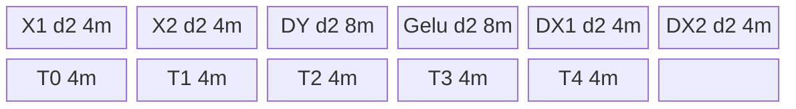
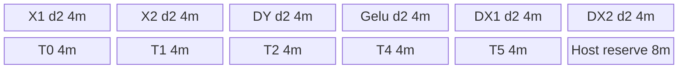

# GeGluBackward 950 ACLNN 算子知识

## 算子速览

| 项目 | 内容 |
|---|---|
| 实际入口 | 最新公开 `aclnnGeGluV3BackwardGetWorkspaceSize` / `aclnnGeGluV3Backward`；V1 固定 `activateLeft=false` 复用共同实现 |
| 计算语义 | `dx1=gelu*dy`，`dx2=(x1*dy)*GELU'(x2)`；`activateLeft` 交换 x1/x2 及输出半区 |
| 输入输出 | ND；FP16/BF16/FP32；`dy/gelu` 同 shape，`x/dx` 的 split 维为 2 倍 |
| 执行类型 | 单 Kernel `ge_glu_grad_v2`，entry 显式 `KERNEL_TYPE_AIV_ONLY`，执行族 `AIV_VECTOR` |
| Kernel 路线 | 18 条：Tanh/Erf × BF16/FP16/FP32 × Perf/整行/切 M |
| 核心资源 | GM、6 个 depth=2 TQue、5 个独立 FP32 TBuf、32 B DMA；固定 workspace `16 MiB+32*总AIV核数` |
| 来源闭包 | `source_closed`：公开 ACLNN、executor、950 注册/binary config、共用 Tiling、apt AIV router、arch35 全部 body/helper 已闭合 |
| 验证状态 | 已完成源码闭包检查；本次知识提取未执行编译、真机、数值或性能测试。 |

## 接口与语义

### 计算语义

令 `N=∏dy.shape[0:dim]`，`M=∏dy.shape[dim:rank]`，则 `dy/gelu=[N,M]`、`x/dx=[N,2M]`。Device 定义：

```text
x1 = activateLeft ? x[:,M:2M] : x[:,0:M]
x2 = activateLeft ? x[:,0:M] : x[:,M:2M]
dx[x1-half] = gelu*dy
dx[x2-half] = (x1*dy)*GELU'(x2)
```

`approximate=1` 使用 Tanh/logistic 近似导数；`approximate=0` 使用 `Phi(x)+x*phi(x)`，其中 CDF 是阈值钳制后的有理多项式、PDF 是 `Exp(-x²/2)/sqrt(2π)`。

### 输入、输出与属性

| 参数 | shape/layout | dtype | 约束、默认值与语义 |
|---|---|---|---|
| `gradOutput/dy` | rank 1–8，ND | FP16/BF16/FP32 | 与 gelu 同 shape；split 维为 self 的一半 |
| `self/x` | rank 1–8，ND | 同 dy | 非空 Kernel 路径；split 维为 dy 的 2 倍 |
| `gelu` | 同 dy | 同 dy | forward GELU 结果 |
| `dim` | scalar | int64 | `[-rank,rank-1]`，负值归一化 |
| `approximate` | scalar | int64 | 0=Erf，1=Tanh |
| `activateLeft` | scalar | bool | V3 属性；false 表示激活右半 |
| `gradInput/dx` | 同 self，ND | 同 dy | 支持非连续用户输出，由 ViewCopy 写回 |

### 入口与版本

固定仓 V1 与 V3 均公开且产品表明确支持 Ascend 950PR/950DT。V3 比 V1 多 `activateLeft`；二者调用同一 `ExecGeGluBackwardGetWorkspaceSize`，V1 传 false。950 采用同语义版本族中最新 V3。公开文档、OpDef 的 `ascend950` + `opFile=ge_glu_grad_v2_apt`、950 binary config 三层一致，无发布冲突。

## Host/Launcher 执行流程

### 参数校验与前处理

`CheckParams` 按非空→平台 dtype→四 tensor 同 dtype→shape/rank/dim→approximate 顺序返回错误。空 `dy` 直接返回 workspace 0；非空时三个输入各经 `Contiguous`，创建 `GeGluGradV2` 连续临时输出，最后 `ViewCopy` 到用户 `gradInput`。950 被 `IsRegbase()` 纳入含 BF16 的 dtype 集。

### 参数、Workspace 与生命周期

`l0op::GeGluGradV2` 用 self 的 shape/dtype 分配 executor-owned 临时 dx，并把三个连续输入、临时 dx 和三属性添加到 launcher。算子 Tiling workspace 为 `16*1024*1024+totalCoreNum*32`；apt entry 只检查 `GetUserWorkspace` 非空，arch35 body 不消费该区。ACLNN 第一段返回 executor 汇总后的总 workspace，第二段在传入 stream 上运行，临时 tensor 活到 ViewCopy 完成。

### 启动图与失败传播

```text
Contiguous(dy/x/gelu)
  -> Tiling4GeGluGradV2(blockDim=needCoreNum,key,POD,workspace)
  -> ge_glu_grad_v2_apt(dy,x,gelu,tmpDx,workspace,tiling) [AIV_ONLY]
  -> ViewCopy(tmpDx,userDx)
```

这是单 Device Kernel，无跨 Kernel workspace 边。executor 的同 stream 次序提供节点可见性。Host 任一步失败阻断后继；entry 遇 null framework/user workspace 或未知 key 时不执行 body、也无显式 Device 状态返回。

## Route 与参数设计

### 分核与资源计算

设 `S=sizeof(dtype)`、`A=32/S`、`R=512/S`。`valueN/valueM` 由 shape 乘积生成。950 `isRegbase=true`，Tanh 的 `bufCnt` 为 BF16 26、FP16 22、FP32 17；Erf 为 BF16 26、FP16 26、FP32 19。`maxProc=floor_to_32B(UB/bufCnt)/S`，`maxPerf=maxProc/R`。

- Perf：`M<=maxPerf`，`group=floor_to_R(maxProc/M)`，`ubLoops=ceil(N/group)`，key suffix 3。
- 整行：前项失败且 `M<=maxProc`，`group=maxProc/ceil_to_A(M)`，`ubLoops=ceil(N/group)`，suffix 1。
- 切 M：`M>maxProc`，`group=ceil(M/maxProc)`，`ubLoops=N*group`，suffix 2。

`needCore=min(ubLoops,totalAivCores)`；每核 task 使用 `(idx*needCore+blockIdx)` 轮转，`tailCoreIndex/tailUbLoopNum` 描述多一次循环及尾 group。

### Route 选择

| 顺序 | Route | Key/模板 | 精确选择条件与优先级 | 不适用去向 |
|---:|---|---|---|---|
| 1 | R-001/4/7/10/13/16 Perf | 103/203/303/703/803/903 | `isRegbase && M<=maxProc/(512/S)`，再按 approximate/dtype | 整行 |
| 2 | R-002/5/8/11/14/17 整行 | 101/201/301/701/801/901 | Perf假且 `M<=maxProc` | 切 M |
| 3 | R-003/6/9/12/15/18 切 M | 102/202/302/702/802/902 | `M>maxProc` | 无 Device fallback |

```text
base=(approximate==1?101:701)+(FP16?100:FP32?200:0)
if isRegbase && M<=maxProc/(512/S): key=base+2
else if M<=maxProc: key=base
else: key=base+1
```

### 模板/实现执行矩阵

| Route | key/selector | dtype/shape/platform 完整命中条件 | 执行拓扑与 Kernel 节点 | 实际模板/body | 内存与同步特征 | tail/fallback |
|---|---|---|---|---|---|---|
| R-001/2/3 | 103/101/102 | Tanh BF16 + 三 shape 谓词 + 950 | 单 AIV | arch35 `TanhBFP16` + TanhBase | queues d2；DY/Gelu FP32 backing；5 TBuf | group/M tail + Pad |
| R-004/5/6 | 203/201/202 | Tanh FP16 | 单 AIV | arch35 `TanhFP16` + TanhBase | queues d2；FP16 Mul→FP32 derivative | 同上 |
| R-007/8/9 | 303/301/302 | Tanh FP32 | 单 AIV | arch35 `TanhFP32` + TanhBase | queues d2；全 FP32 | 同上 |
| R-010/11/12 | 703/701/702 | Erf BF16 | 单 AIV | arch35 `ErfBFP16` + ErfBase | queues d2；x2 在 left 阶段提前 cast | 同上 |
| R-013/14/15 | 803/801/802 | Erf FP16 | 单 AIV | arch35 `ErfFP16` + ErfBase | queues d2；x2 提前 cast | 同上 |
| R-016/17/18 | 903/901/902 | Erf FP32 | 单 AIV | arch35 `ErfFP32` + ErfBase | queues d2；全 FP32 | 同上 |

### 隐藏性能 Guard

| Guard | Host/Tiling 条件 | Device/资源原因 | 影响 Route | 不满足时去向 | 源码符号 |
|---|---|---|---|---|---|
| 950 Perf | `isRegbase && M<=maxProc/(512/S)` | 512 B repeat 的转置拆分/拼接 | suffix3 | suffix1/2 | `ProcessTilingCore` |
| 保守 UB count | Tanh 26/22/17；Erf 26/26/19 | 覆盖 d2 queues、FP32 temp，Erf 还保留额外预算 | 全部 | maxProc 缩小 | `DTYPE_BUF_CNT_MAP_*_950` |
| DMA tail | `dataCount%(32/S)` | aligned API 用 32 B block，非对齐用 byte-mode Pad | 全部 | 同 Route 尾支 | `CopyIn*`,`CopyOut*` |
| 空域 | ACLNN 空 dy 早退；Tiling 空 x 失败 | 避免零核/零除 | 全部 | no launch/GRAPH_FAILED | API `Exec*`, Tiling `CheckParams` |
| entry 执行族 | 无 shape 条件 | `KERNEL_TASK_TYPE_DEFAULT(KERNEL_TYPE_AIV_ONLY)` | 全部 | N/A | `ge_glu_grad_v2_apt.cpp::ge_glu_grad_v2` |

### POD/ABI

| 结构 | 字段 | 类型/位宽 | ABI 布局 | 单位 | Host/launcher producer | Device consumer | 边界 |
|---|---|---|---|---|---|---|---|
| `GeGluGradV2TilingData` | `approximate` | int32/32 | 声明第1；宏展开精确偏移在固定目录不可见 | 枚举 | `(int32_t)approximateAttr` | key/body 语义 | 0/1 |
| 同上 | `activateLeft` | int32/32 | 第2；offset不可见 | bool-as-int | `(int32_t)activateLeftAttr` | base ctor→半区地址 | 0/1 |
| 同上 | `maxProcCount` | int64/64 | 第3 | 元素 | UB/bufCnt | Init、循环、temp | >0 |
| 同上 | `valueN` | int64/64 | 第4 | 行 | shape前缀积 | Host任务域 | >0 |
| 同上 | `valueM` | int64/64 | 第5 | 元素/半行 | shape后缀积 | stride、offset、branch | >0 |
| 同上 | `needCoreNum` | int64/64 | 第6 | AIV core | min公式 | task id | 1..总核数 |
| 同上 | `loopNumPerCore` | int64/64 | 第7 | loop/core | 核分配 | 主循环 | 可为0 |
| 同上 | `tailCoreIndex` | int64/64 | 第8 | core index | 核分配 | 多一次/尾支 | 可等于needCore |
| 同上 | `tailUbLoopNum` | int64/64 | 第9 | 行组 | `N%group` | 尾组 valid | 0=无尾组 |
| 同上 | `groupNum` | int64/64 | 第10 | 行组/M片 | 三路线公式 | GM/task 映射 | >0 |

### Route 源码闭包

| Route | Key/selector | Host/Tiling producer | POD/参数 | Kernel entry/router 节点 | Kernel body/直接依赖 | 构建接线 |
|---|---|---|---|---|---|---|
| R-001..R-018 | 101–303、701–903 | `ge_glu_grad_v2_tiling.cpp::{CaclMaxProcessCount,ProcessTilingCore}` | 十字段 `GeGluGradV2TilingData` | `ge_glu_grad_v2_apt.cpp::ge_glu_grad_v2` | `arch35/ge_glu_grad_v2_{tanh,erf}_{base,bfp16,fp16,fp32}.h` | OpDef `ascend950/opFile` + 950 binary config |

## Kernel 实现

### 公共执行流程

apt entry 创建共享 `TPipe`，声明 AIV_ONLY，检查 workspace，解析 POD，并把同一 pipe 传入 key 对应类。`Init` 为全部输入/输出 queues 以 depth=2 分配，另分配 5 个独立 FP32 TBuf。每 task 的非 Perf 路线按 `dy/gelu/x1/x2→dx1/x1*dy→GELU'→dx2→两半 GM` 执行；Perf 路线先连续搬 `[x1|x2]`，用 TransDataTo5HD 拆分，计算后拼接再连续写回。`activateLeft` 仅交换半区地址。

### Route R-001：Tanh BF16 Perf（103）

#### 适用条件

##### 选择证据

Tiling `approximate=1 && BF16 && isRegbase && M<=maxPerf`→103；apt router→`TanhBFP16::Process(true)`。

#### Device 数据流

##### 函数级调用链

`apt entry→Init→ProcessPerf→CopyInDyAndGelu/CopyInXPerf→Split/Transpose→ComputeLeftHalf→ComputeRightHalf/ComputeGeluGrad→Concat/Transpose→CopyOutDXPerf`。

##### 源码等价伪码

`off=task*group*M`；连续搬 2*valid x，转置拆两半；BF16 dy/gelu/x1/x2 升 FP32，算两输出，RINT 回 BF16，按属性拼接并只写 2*valid。

#### 内存与数据搬运

##### 资源与搬运表

| 层级/缓冲区 | offset/地址公式 | extent/容量公式 | dtype/layout | producer | consumer | owner/lifetime | 对齐/复用 |
|---|---|---|---|---|---|---|---|
| GM dy/gelu | `off` | valid≤m | BF16 `[N,M]` | caller | MTE2 | caller | 32 B Pad |
| GM x/dx | `2*off` | 2*valid | BF16 `[N,2M]` | caller/Kernel | split/ViewCopy | caller/executor | Perf连续 DMA |
| X queues | 0 | 各 `d2*2m=4m` | BF16 | MTE2 | V | Kernel/task | d2 |
| DY/Gelu queues | 0 | 各 `d2*4m=8m` | FP32 backing/BF16 payload | MTE2 | cast/V | Kernel/task | d2 |
| output queues | 0 | 各 `d2*2m=4m` | BF16 | V | MTE3 | Kernel/task | d2 |
| Temp0..4 | 独立区 | 各 `4m` | FP32 | copy/compute | transpose/derivative | Kernel | 生命周期复用 |

##### 分层内存布局



##### 字节账与复用顺序

```text
UB_total = 4+4+8+8+4+4+5*4 = 52m bytes = 26*S*m
UB_total <= UB by A5 Tanh BF16 bufCnt=26
dynamic_ub=N/A; workspace=16 MiB+32*totalCoreNum
```

Temp0 在 Perf input/计算/output 间复用，MTE3_MTE2、MTE2_V、V_MTE3 event 与 PIPE_V barrier 防止提前覆盖；queues 以 EnQue/DeQue/FreeTensor 保护双缓冲槽。

#### 同步、精度与尾块

##### 同步与数值边界表

| 阶段 | primitive/机制 | producer | consumer/等待点 | 保护对象 | 精度/尾块 |
|---|---|---|---|---|---|
| DMA→transpose | MTE2_V event | MTE2 | Vector | Temp0 | Pad至32B，valid控制写回 |
| compute | Queue | MTE2 | Vector | six queues | BF16→FP32，CAST_RINT |
| concat→DMA | PIPE_V+V_MTE3 | Vector | MTE3 | Temp0/outQ | 尾group只写有效元素 |

#### 关键实现

##### 符号证据表

Tiling `ProcessTilingCore`、apt key103 branch、arch35 `TanhBFP16::{Init,Compute*}` 与 TanhBase Perf 完整闭合。

### Route R-002：Tanh BF16 整行分组（101）

#### 适用条件

##### 选择证据

Tanh BF16，Perf guard 失败且 `M<=maxProc`；key101→`ProcessLessEqual`。

#### Device 数据流

##### 函数级调用链

`CopyInDyAndGelu/CopyInX(blockCount=group)→ComputeLeft→CopyOutLeft→ComputeRight→CopyOutRight`。

##### 源码等价伪码

task 处理 group 行；每行两半以 `src/dstStride=blockLen` 聚集/散写；尾 task 用 tail group。

#### 内存与数据搬运

##### 资源与搬运表

同 R-001 的 52m UB；无转置，使用多 block strided DMA。

##### 分层内存布局

同 R-001。

##### 字节账与复用顺序

Temp0 保存 `x1*dy` 到右半求导结束；Queue Free 后下一 task 覆盖。

#### 同步、精度与尾块

##### 同步与数值边界表

Queue 同步；非对齐每行 `DataCopyPad`；BF16→FP32→BF16 RINT。

#### 关键实现

##### 符号证据表

key101→arch35 `TanhBFP16::ProcessLessEqual` 与 base CopyIn/Out。

### Route R-003：Tanh BF16 切 M（102）

#### 适用条件

##### 选择证据

Tanh BF16 且 `M>maxProc`；key102→`ProcessGreater`。

#### Device 数据流

##### 函数级调用链

同 R-002，task 映射为 `row=task/group, mSub=task%group`。

##### 源码等价伪码

每 task 处理 maxProc 的 M 片，末片 `mod=M%maxProc`（0改maxProc），GM 只提交 mod。

#### 内存与数据搬运

##### 资源与搬运表

52m UB；单 block DMA，尾片 Pad。

##### 分层内存布局

同 R-001。

##### 字节账与复用顺序

同 R-002。

#### 同步、精度与尾块

##### 同步与数值边界表

Vector 长度 `ceilAlign(mod,32/S)`，CopyOut 长度为 mod。

#### 关键实现

##### 符号证据表

key102→`TanhBFP16::ProcessGreater`。

### Route R-004：Tanh FP16 Perf（203）

#### 适用条件

##### 选择证据

Tanh FP16 + Perf guard；key203。

#### Device 数据流

##### 函数级调用链

同 R-001，body 为 arch35 `TanhFP16`。

##### 源码等价伪码

FP16 `dx1=gelu*dy` 与 `p=x1*dy`，p/x2 升 FP32 求导，RINT 回 FP16。

#### 内存与数据搬运

##### 资源与搬运表

六 queues 各 `d2*2m=4m`，五 TBuf 各4m；`UB_total=44m=22*S*m`。

##### 分层内存布局

六个 d2 FP16 queues + Temp0..4。

##### 字节账与复用顺序

`UB_total=44m`；Perf events/Temp复用同 R-001。

#### 同步、精度与尾块

##### 同步与数值边界表

FP16 Mul→FP32 derivative→FP16 RINT；尾group有效写回。

#### 关键实现

##### 符号证据表

key203→arch35 `TanhFP16`→TanhBase Perf。

### Route R-005：Tanh FP16 整行分组（201）

#### 适用条件

##### 选择证据

Tanh FP16，普通整行；key201。

#### Device 数据流

##### 函数级调用链

`TanhFP16::ProcessLessEqual`。

##### 源码等价伪码

地址/循环同 R-002，精度同 R-004。

#### 内存与数据搬运

##### 资源与搬运表

44m UB，strided multi-block DMA。

##### 分层内存布局

同 R-004。

##### 字节账与复用顺序

同 R-002。

#### 同步、精度与尾块

##### 同步与数值边界表

Queue+Pad；FP16/FP32精度链。

#### 关键实现

##### 符号证据表

key201→`TanhFP16::ProcessLessEqual`。

### Route R-006：Tanh FP16 切 M（202）

#### 适用条件

##### 选择证据

Tanh FP16，M>maxProc；key202。

#### Device 数据流

##### 函数级调用链

`TanhFP16::ProcessGreater`。

##### 源码等价伪码

分片同 R-003，精度同 R-004。

#### 内存与数据搬运

##### 资源与搬运表

44m UB，单 M 片 DMA。

##### 分层内存布局

同 R-004。

##### 字节账与复用顺序

同 R-003。

#### 同步、精度与尾块

##### 同步与数值边界表

末片 Pad；只写 mod。

#### 关键实现

##### 符号证据表

key202→`TanhFP16::ProcessGreater`。

### Route R-007：Tanh FP32 Perf（303）

#### 适用条件

##### 选择证据

Tanh FP32 + Perf guard；key303。

#### Device 数据流

##### 函数级调用链

arch35 `TanhFP32::ProcessPerf`。

##### 源码等价伪码

全 FP32，两输出公式直接 Vector 实现。

#### 内存与数据搬运

##### 资源与搬运表

六 queues 各 `d2*4m=8m`，五 TBuf各4m；`UB_total=68m=17*S*m`。

##### 分层内存布局

六个 d2 FP32 queues + Temp0..4。

##### 字节账与复用顺序

68m；Perf复用同 R-001。

#### 同步、精度与尾块

##### 同步与数值边界表

全 FP32；events/barriers/Pad同 R-001。

#### 关键实现

##### 符号证据表

key303→`TanhFP32`→TanhBase Perf。

### Route R-008：Tanh FP32 整行分组（301）

#### 适用条件

##### 选择证据

Tanh FP32 普通整行；key301。

#### Device 数据流

##### 函数级调用链

`TanhFP32::ProcessLessEqual`。

##### 源码等价伪码

同 R-002 地址，全 FP32。

#### 内存与数据搬运

##### 资源与搬运表

68m，strided DMA。

##### 分层内存布局

同 R-007。

##### 字节账与复用顺序

同 R-002。

#### 同步、精度与尾块

##### 同步与数值边界表

Queue+Pad，全 FP32。

#### 关键实现

##### 符号证据表

key301→`TanhFP32::ProcessLessEqual`。

### Route R-009：Tanh FP32 切 M（302）

#### 适用条件

##### 选择证据

Tanh FP32，M>maxProc；key302。

#### Device 数据流

##### 函数级调用链

`TanhFP32::ProcessGreater`。

##### 源码等价伪码

同 R-003 分片，全 FP32。

#### 内存与数据搬运

##### 资源与搬运表

68m，单片 DMA。

##### 分层内存布局

同 R-007。

##### 字节账与复用顺序

同 R-003。

#### 同步、精度与尾块

##### 同步与数值边界表

末片 Pad，全 FP32。

#### 关键实现

##### 符号证据表

key302→`TanhFP32::ProcessGreater`。

### Route R-010：Erf BF16 Perf（703）

#### 适用条件

##### 选择证据

Erf BF16 + Perf guard；key703。

#### Device 数据流

##### 函数级调用链

apt→arch35 `ErfBFP16::ProcessPerf`→ErfBase `ComputeCDF/PDF`。

##### 源码等价伪码

left 阶段将 dy/gelu/x1/x2 全部升 FP32并释放输入 queues；right 用 Temp4 中 x2 算 `cdf+x*pdf`，乘 Temp0 的 x1*dy，RINT输出。

#### 内存与数据搬运

##### 资源与搬运表

六 BF16 d2 queues 各4m + 五 FP32 TBuf各4m，源码显式分配 `UB_visible=44m`；Host `bufCnt=26` 约束 `52m`，多出的 8m 是保守/接口预算，固定 body 未显式命名对应 buffer。

##### 分层内存布局



##### 字节账与复用顺序

`UB_visible=44m`，Host selector budget=`52m=26*S*m`；Temp4 在 left 写 x2 FP32、right 读；Temp1/2/5 在 CDF/PDF 多项式中复用。

#### 同步、精度与尾块

##### 同步与数值边界表

Perf events/barriers；BF16→FP32 CDF/PDF→BF16 RINT；只提交 valid。

#### 关键实现

##### 符号证据表

key703→arch35 `ErfBFP16::{Init,Compute*}` + ErfBase Perf/CDF/PDF。

### Route R-011：Erf BF16 整行分组（701）

#### 适用条件

##### 选择证据

Erf BF16，普通整行；key701。

#### Device 数据流

##### 函数级调用链

`ErfBFP16::ProcessLessEqual`。

##### 源码等价伪码

地址同 R-002；x2 在 left 阶段提前 cast 到 Temp4，right 只消费 temp。

#### 内存与数据搬运

##### 资源与搬运表

visible44m/selector52m；strided DMA。

##### 分层内存布局

同 R-010。

##### 字节账与复用顺序

同 R-010；Queue 可更早释放 x2。

#### 同步、精度与尾块

##### 同步与数值边界表

Queue+Pad；BF16/FP32精度链。

#### 关键实现

##### 符号证据表

key701→`ErfBFP16::ProcessLessEqual`。

### Route R-012：Erf BF16 切 M（702）

#### 适用条件

##### 选择证据

Erf BF16，M>maxProc；key702。

#### Device 数据流

##### 函数级调用链

`ErfBFP16::ProcessGreater`。

##### 源码等价伪码

分片同 R-003，计算/提前 cast 同 R-010。

#### 内存与数据搬运

##### 资源与搬运表

visible44m/selector52m，单片 DMA。

##### 分层内存布局

同 R-010。

##### 字节账与复用顺序

同 R-010。

#### 同步、精度与尾块

##### 同步与数值边界表

末片 Pad；BF16→FP32→BF16。

#### 关键实现

##### 符号证据表

key702→`ErfBFP16::ProcessGreater`。

### Route R-013：Erf FP16 Perf（803）

#### 适用条件

##### 选择证据

Erf FP16 + Perf guard；key803。

#### Device 数据流

##### 函数级调用链

arch35 `ErfFP16::ProcessPerf` + ErfBase CDF/PDF。

##### 源码等价伪码

FP16 dx1/x1*dy；x1结果与 x2 升 FP32，CDF/PDF后 RINT FP16。

#### 内存与数据搬运

##### 资源与搬运表

显式同为44m；950 Erf FP16 selector budget=`26*S*m=52m`，额外8m未在固定 body 命名。

##### 分层内存布局

六 d2 FP16 queues + 五 FP32 TBuf + 8m selector reserve。

##### 字节账与复用顺序

visible44m/selector52m；Perf复用同 R-001。

#### 同步、精度与尾块

##### 同步与数值边界表

FP16 Mul→FP32 CDF/PDF→FP16 RINT；Perf events。

#### 关键实现

##### 符号证据表

key803→`ErfFP16`→ErfBase Perf。

### Route R-014：Erf FP16 整行分组（801）

#### 适用条件

##### 选择证据

Erf FP16 普通整行；key801。

#### Device 数据流

##### 函数级调用链

`ErfFP16::ProcessLessEqual`。

##### 源码等价伪码

同 R-011 地址，精度同 R-013。

#### 内存与数据搬运

##### 资源与搬运表

visible44m/selector52m，strided DMA。

##### 分层内存布局

同 R-013。

##### 字节账与复用顺序

同 R-011。

#### 同步、精度与尾块

##### 同步与数值边界表

Queue+Pad，FP16/FP32链。

#### 关键实现

##### 符号证据表

key801→`ErfFP16::ProcessLessEqual`。

### Route R-015：Erf FP16 切 M（802）

#### 适用条件

##### 选择证据

Erf FP16，M>maxProc；key802。

#### Device 数据流

##### 函数级调用链

`ErfFP16::ProcessGreater`。

##### 源码等价伪码

分片同 R-003，精度同 R-013。

#### 内存与数据搬运

##### 资源与搬运表

visible44m/selector52m，单片 DMA。

##### 分层内存布局

同 R-013。

##### 字节账与复用顺序

同 R-012。

#### 同步、精度与尾块

##### 同步与数值边界表

末片 Pad，只写有效 mod。

#### 关键实现

##### 符号证据表

key802→`ErfFP16::ProcessGreater`。

### Route R-016：Erf FP32 Perf（903）

#### 适用条件

##### 选择证据

Erf FP32 + Perf guard；key903。

#### Device 数据流

##### 函数级调用链

arch35 `ErfFP32::ProcessPerf` + CDF/PDF。

##### 源码等价伪码

全 FP32：dx1 与 `(x1*dy)*(cdf+x2*pdf)`。

#### 内存与数据搬运

##### 资源与搬运表

六 d2 FP32 queues=48m、五 TBuf=20m，visible68m；selector=`19*S*m=76m`，额外8m未命名。

##### 分层内存布局

六 d2 FP32 queues + 五 FP32 TBuf + 8m selector reserve。

##### 字节账与复用顺序

visible68m/selector76m；Perf events保护 Temp0。

#### 同步、精度与尾块

##### 同步与数值边界表

全 FP32，Perf events/barriers，Pad尾。

#### 关键实现

##### 符号证据表

key903→`ErfFP32`→ErfBase Perf。

### Route R-017：Erf FP32 整行分组（901）

#### 适用条件

##### 选择证据

Erf FP32 普通整行；key901。

#### Device 数据流

##### 函数级调用链

`ErfFP32::ProcessLessEqual`。

##### 源码等价伪码

同 R-011 地址，全 FP32。

#### 内存与数据搬运

##### 资源与搬运表

visible68m/selector76m，strided DMA。

##### 分层内存布局

同 R-016。

##### 字节账与复用顺序

同 R-011。

#### 同步、精度与尾块

##### 同步与数值边界表

Queue+Pad，全 FP32。

#### 关键实现

##### 符号证据表

key901→`ErfFP32::ProcessLessEqual`。

### Route R-018：Erf FP32 切 M（902）

#### 适用条件

##### 选择证据

Erf FP32，M>maxProc；key902。

#### Device 数据流

##### 函数级调用链

`ErfFP32::ProcessGreater`。

##### 源码等价伪码

分片同 R-003，全 FP32。

#### 内存与数据搬运

##### 资源与搬运表

visible68m/selector76m，单片 DMA。

##### 分层内存布局

同 R-016。

##### 字节账与复用顺序

同 R-012。

#### 同步、精度与尾块

##### 同步与数值边界表

末片 Pad，全 FP32。

#### 关键实现

##### 符号证据表

key902→`ErfFP32::ProcessGreater`。

## 算子特定优化

### Trick T-001：950 全 Queue 双缓冲并按算法配置保守 maxProc

#### 触发与源码依据

- 适用 Route：全部 950 Route
- 触发条件：950 arch35 body；Tanh/Erf 与 dtype 决定 buffer count
- Golden 来源：[`op_kernel/arch35/ge_glu_grad_v2_tanh_fp16.h:56-70`](../../../../../../../cann-ops-raw/ascendc/ops-nn/955f8b33985b6d72989ebff341bb9c2c564a51bc/activation/ge_glu_grad_v2/op_kernel/arch35/ge_glu_grad_v2_tanh_fp16.h#L56-L70)

**官方源码（固定 Commit 连续逐字摘录）**：

```cpp
pipe->InitBuffer(inQueueDY, DB_BUFFER, maxProcCount * sizeof(half));
pipe->InitBuffer(inQueueGelu, DB_BUFFER, maxProcCount * sizeof(half));
pipe->InitBuffer(inQueueX1, DB_BUFFER, maxProcCount * sizeof(half));
pipe->InitBuffer(inQueueX2, DB_BUFFER, maxProcCount * sizeof(half));

pipe->InitBuffer(outQueueDX1, DB_BUFFER, maxProcCount * sizeof(half));
pipe->InitBuffer(outQueueDX2, DB_BUFFER, maxProcCount * sizeof(half));
```

#### 机制与设计原因

950 将六个 Queue 的实际 depth 都设为 2，使相邻 task 的 MTE2/Vector/MTE3 可通过 Queue 生命周期流水；Host 不沿用 A2/A3 count，而为 Tanh BF16/FP16/FP32 使用 26/22/17，为 Erf 使用 26/26/19，先缩小 maxProc 以满足 950 UB 预算。五个 FP32临时区分开分配，避免依赖单大 TBuf 的手工索引。这里只能证明流水与资源机制，未真机量化收益。

#### 迁移边界

- 适用：GM搬入、Vector计算、GM搬出可跨 tile 流水，且 UB 能容纳双份 Queue。
- 前提：maxProc 重新按 depth×容量和算法 temp 预算计算；不得照搬 A2/A3 count。
- 失效：UB不足时必须降低 maxProc/depth 或重排 temp 生命周期。
- 未验证：本次知识提取未执行编译、真机、数值或性能测试。

#### 错误做法

只把 `InitBuffer` 改成 depth2 而不把 depth 乘入 Host UB count，会使 selector 放行超过 UB 上限的 tile。

### Trick T-002：Erf 半精度路线提前转换 x2 并释放输入 Queue

#### 触发与源码依据

- 适用 Route：R-010–R-015
- 触发条件：950 arch35 Erf BF16/FP16
- Golden 来源：[`op_kernel/arch35/ge_glu_grad_v2_erf_fp16.h:70-100`](../../../../../../../cann-ops-raw/ascendc/ops-nn/955f8b33985b6d72989ebff341bb9c2c564a51bc/activation/ge_glu_grad_v2/op_kernel/arch35/ge_glu_grad_v2_erf_fp16.h#L70-L100)

**官方源码（固定 Commit 连续逐字摘录）**：

```cpp
LocalTensor<half> ubX2 = inQueueX2.DeQue<half>();
LocalTensor<float> xBufRight = resultTempBuf4.Get<float>();

Mul(outLocalLeft, ubGelu, ubDY, realProcCount); // dx1 = gelu * dy
Mul(ubX1, ubX1, ubDY, realProcCount);           // x1 = x1 * dy
Cast(xBufLeft, ubX1, RoundMode::CAST_NONE, realProcCount);
Cast(xBufRight, ubX2, RoundMode::CAST_NONE, realProcCount);
```

#### 机制与设计原因

与 A2/A3 在 `ComputeRightHalf` 才 dequeue/cast x2 不同，950 Erf 半精度 body 在 left 阶段一次取齐四输入，把 x2 升到独立 Temp4 后立即释放 X2 Queue；right 阶段直接运行 CDF/PDF。这样缩短输入 Queue 槽的占用期，并与 d2 流水配合，同时保持导数计算为 FP32。

#### 迁移边界

- 适用：后半计算只需要升精度后的输入，且有独立 temp 持有它。
- 前提：Temp4 在 right 消费前不得覆盖，Queue Free 与 Temp 写完成顺序受当前 Vector 调用序保证。
- 失效：temp 被其它阶段别名或 x2 仍需原 dtype 时不能提前 Free。
- 未验证：本次知识提取未执行编译、真机、数值或性能测试。

#### 错误做法

在 `Cast(xBufRight,ubX2)` 之前释放 `ubX2`，或在 right 前覆盖 Temp4，都会破坏 x2 的生命周期。

## 模板与实现对比

| 对比维度 | Perf suffix3 | 整行 suffix1 | 切 M suffix2 | 设计选择依据 |
|---|---|---|---|---|
| 命中条件/优先级 | regbase且M≤maxPerf | Perf假且M≤maxProc | M>maxProc | 先合并短行 |
| 模板与 dtype | 2算法×3dtype | 同 | 同 | key百位/基值映射 |
| 循环与分核 | group行/task | group行/task | 一行一片/task | UB与行长 |
| Queue/TBuf | d2 queues + 5 TBuf | 同 | 同 | 950共同 Init |
| 内存总占用与复用 | 按dtype/算法 count；Temp参与转置 | 同容量，无转置 | 同容量，无转置 | selector保守预算 |
| 搬运/Vector API | 连续DMA+TransDataTo5HD | strided multi-block DMA | 单块DMA | 连续性 |
| 同步、精度与 tail | hard event+barrier；tail group | Queue；tail group | Queue；tail M | shared temp/有效域 |
| fallback/失败边界 | →整行/切M | →切M | unknown key无输出 | Host 决策树 |

## 平台差异

| 项目 | A2 | A3 | 950 |
|---|---|---|---|
| 支持状态 | 公开支持，见无后缀卡 | 公开支持，见无后缀卡 | 公开支持 |
| Host/Launcher | 共用 Tiling，非 regbase entry | 共用 Tiling，非 regbase entry | `isRegbase=true`，OpDef 指向 apt entry |
| Kernel/资源 | 单大 TBuf，Queue 多为 d1 | 同 A2 | AIV_ONLY；全 queues d2；五独立 TBuf；不同 buffer count |

## 限制与失败边界

- rank 1–8、ND、四 tensor 同 dtype、严格二等分；空 dy 在 ACLNN 层早退，Tiling 非空路径拒绝空 x。
- `valueN/valueM` 的 int64 shape 连乘无显式溢出保护；`needCoreNum` 内部先存 int32。
- 950 Erf 的 Host buffer count 比 arch35 body 显式 Queue+TBuf 字节账多 `8*maxProc` 字节；固定目录内没有给这部分单独命名，卡保留为 selector 预算，不推测 owner。
- Tiling 定义了 `REGBASE_CCEC_RESERVE_SIZE=8 KiB` 但当前公式未引用；不得把它擅自从 UB 扣除。
- workspace 预留存在，但 body 仅判空、不读写 userWS；unknown key/null workspace 直接无输出返回。
- TilingData 生成宏的精确 `sizeof/alignof/offsetof` 在指定读取范围外不可见。
- 本次未执行编译、单元测试、真机、数值或性能测试。

## 源码索引

### 链路索引

| 链路阶段 | 文件 | 关键符号 | 支撑内容 |
|---|---|---|---|
| 入口声明/约束 | `docs/aclnnGeGluV3Backward.md` | V3原型/产品表 | 最新公开入口、950支持 |
| 入口实现 | `op_host/op_api/aclnn_geglu_backward.cpp` | `ExecGeGluBackwardGetWorkspaceSize` | 校验、V1/V3复用、executor图 |
| Host/Tiling/Launcher | `op_host/ge_glu_grad_v2_tiling.cpp` | `CaclMaxProcessCount`,`ProcessTilingCore` | 950 count、18 keys、core/workspace/POD |
| Kernel entry/body | `op_kernel/ge_glu_grad_v2_apt.cpp` | `ge_glu_grad_v2` | AIV_ONLY、18 keys、共享TPipe |
| Kernel entry/body | `op_kernel/arch35/ge_glu_grad_v2_tanh_base.h` | `Process*`,`ComputeGeluGrad` | Tanh loop/搬运/同步/导数 |
| Kernel entry/body | `op_kernel/arch35/ge_glu_grad_v2_erf_base.h` | `Process*`,`ComputeCDF/PDF` | Erf loop/搬运/同步/导数 |
| 构建接线 | `op_host/config/ascend950/ge_glu_grad_v2_binary.json` | `GeGluGradV2` 三 dtype entries | 950 active binary config |

### 实现复用检查

| 检查项 | 可复用事实 | 不得改变的约束 | 源码符号 |
|---|---|---|---|
| ABI/POD | 十字段 producer/consumer | 顺序、位宽、元素单位 | `GeGluGradV2TilingData`,`FillTilingData` |
| 调用顺序 | left→right，Erf半精度提前cast x2 | Temp0/4必须活到right结束 | arch35 dtype `Compute*` |
| workspace/内存 | 950 count与d2 Queue模式 | depth必须计入；Erf保守8m不能擅删 | `_950` maps、各`Init` |
| 同步 | Queue + Perf events/barriers | Temp0跨MTE2/V/MTE3复用协议 | `CopyInXPerf`,`CopyOutDXPerf` |
| 精度与尾块 | 半精度乘/升FP32/CAST_RINT | FP16前置Mul与BF16升精度顺序；仅写valid | dtype `Compute*`, Pad branches |
| 失败边界 | Host校验、空tensor、entry null/key | 不绕过 platform/shape/workspace guards | API `CheckParams`, apt entry |