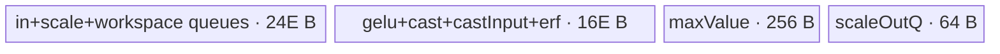

# GeluQuant 950 ACLNN 算子知识

## 算子速览

| 项目 | 内容 |
|---|---|
| 实际入口 | `aclnnGeluQuantGetWorkspaceSize` + `aclnnGeluQuant`，公开 ACLNN 两段式接口；固定仓只允许 RegBase 架构 |
| 计算语义 | 先以 `none` 或 `tanh` 公式计算 GELU，再做 static 或按末轴逐行 dynamic quant；量化语义独立于普通 GELU |
| 输入输出 | `self`: FP16/BF16/FP32 ND；可选 scale/offset: FP16/BF16/FP32 ND；`y`: INT8/FP8_E5M2/FP8_E4M3FN/HIFLOAT8；dynamic 另输出 FP32 `outScale` |
| 执行类型 | 所有 Route 均为单 Kernel `AIV_VECTOR`；entry 显式 `KERNEL_TYPE_AIV_ONLY`，无可达 Cube/AIC/MIX_CV 节点 |
| Kernel 路线 | R-001 static per-tensor；R-002 static function；R-003 static block；R-004 dynamic normal；R-005 dynamic workspace |
| 核心资源 | GM、AIV UB、双缓冲 TQue、TBuf、MicroAPI RegTensor；R-005 额外使用 user workspace；无跨 Kernel 边 |
| 来源闭包 | `source_closed`：公开 ACLNN→L0 launcher→RegBase Tiling/POD→`gelu_quant_apt` router→五个 AIV body→Ascend 950 binary config 闭合 |
| 验证状态 | 已完成源码闭包检查；本次知识提取未执行编译、真机、数值或性能测试。 |

## 接口与语义

### 计算语义

令 `g = GELU(self)`。`approximate="none"` 时 `g = 0.5*x*(1+erf(x/sqrt(2)))`；`approximate="tanh"` 时等价于 `0.5*x*(1+tanh(sqrt(2/pi)*(x+0.044715*x^3)))`。RegBase tanh body 采用等价指数式 `x/(exp(-sqrt(8/pi)*0.044715*(x^3+x/0.044715))+1)`。

- static：`y = cast_dst(g * inputScale + inputOffset, roundMode)`；scale 必选，offset 可选；shape 为 `[1]` 时按标量广播，否则按末轴逐元素应用。
- dynamic：先令 `z = g * inputScale`，scale 缺省时等于 1；每个末轴 row 计算 `amax=max(abs(z))` 与 `outScale=amax/maxValue(dst)`，再输出 `y=cast_dst(z/outScale, roundMode)`。`maxValue` 分别为 INT8 127、FP8_E4M3FN 448、FP8_E5M2 57344、HIFLOAT8 32768。

### 输入、输出与属性

| 参数 | shape/layout | dtype | 约束、默认值与语义 |
|---|---|---|---|
| `self` | static 1–8D、dynamic 2–8D，ND；`y` 同 shape | FP16/BF16/FP32 | 不支持空 Tensor；ACLNN 先转连续 |
| `inputScaleOptional` | 1D，长度 1 或 `self[-1]`，ND | FP16/BF16/FP32 | static 必选、dynamic 可缺省；精度须与 `self` 相容；缺省 dynamic scale 为 1 |
| `inputOffsetOptional` | 1D，长度/类型与 scale 相同，ND | FP16/BF16/FP32 | static 可选；dynamic 组合校验不允许 offset 单独存在，Tiling/Kernel 也不消费 dynamic offset |
| `approximate` | Host string | — | `none` 或 `tanh` |
| `quantMode` | Host string | — | `static` 或 `dynamic` |
| `roundMode` | Host string | — | INT8/FP8 仅 `rint`；HIFLOAT8 为 `round` 或 `hybrid` |
| `dstType` | Host int64 | — | 2/34/35/36，对应 INT8/HIFLOAT8/FP8_E5M2/FP8_E4M3FN；须与 `y.dtype` 相同 |
| `y` | 与 `self` 同 shape，ND | INT8/FP8_E5M2/FP8_E4M3FN/HIFLOAT8 | ACLNN 接受非连续目标并经 ViewCopy 回写；每种输出物理元素均为 1 byte |
| `outScaleOptional` | dynamic 为 `self` 去末轴后的 shape，ND | FP32 | dynamic 必选；static 必须为空指针，不回写该输出 |

### 入口与版本

固定版本为 `ops-nn@955f8b33985b6d72989ebff341bb9c2c564a51bc`、CANN 9.1。`docs/aclnnGeluQuant.md` 的产品表仅给 Ascend 950PR/950DT 打勾；`CheckPlatform` 又要求 `IsRegbase(npuArch)`，注释写“当前仅支持arch3510”。L0 只添加一个 `GeluQuant` AICore launcher，Ascend 950 OpDef 将 `opFile.value` 指向 `gelu_quant_apt`。因此本卡是该公开 ACLNN 在 950 的唯一实际版本；A2/A3 的图算子实现不构成公开 ACLNN 支持。

## Host/Launcher 执行流程

### 参数校验与前处理

`aclnnGeluQuantGetWorkspaceSize` 顺序为：创建 executor；检查 RegBase 平台；解析 quant mode；按 static/dynamic 检查必需指针和 optional 组合；校验 dtype/精度相容性、`dstType==y.dtype`、GELU 模式；校验 shape；校验 round mode；拒绝任一现存空 Tensor。随后对 `self/scale/offset` 分别执行框架 `Contiguous`，调用 L0 `GeluQuant`，最后对 `y` 执行 `ViewCopy`，dynamic 时再对 `outScale` 执行 `ViewCopy`。任一步返回空指针或失败都立即终止，不把错误 executor 交给第二段。

### 参数、Workspace 与生命周期

L0 按 `self` storage/view shape 和 `dstType` 分配连续 `yOut`；dynamic 的 FP32 scale 输出 shape 为 `self` 去末轴，static 则只分配 `[1]` dummy。`ADD_TO_LAUNCHER_LIST_AICORE` 传入 `(self, scale, offset)`、输出 `(yOut, output)` 和属性 `(approximate, quantMode, dstType, roundMode)`。

Tiling 总是请求 20 MiB `WORKSPACE_BUFFER`；R-005 再追加 `endAxisLen * sizeof(float) * usedCoreNum`。entry 先 `SetSysWorkspace(workspace)`，再以 `GetUserWorkspace(workspace)` 得到算子可用区：R-005 将其切成每核 `endAxisLen` 个 FP32 的 slice，行间复用；其他 Route 不读 user slice。第一段返回 executor 所需总 workspace；第二段 `CommonOpExecutorRun` 在调用者提供的 stream 上执行，executor 在第一段移交给调用者。

### 启动图与失败传播

```text
aclnnGeluQuantGetWorkspaceSize
  -> Contiguous(self/optional scale/optional offset)
  -> L0 GeluQuant / ADD_TO_LAUNCHER_LIST_AICORE
  -> [单节点] gelu_quant(x, scale, offset, yOut, outScaleOut, workspace, tiling_data)
       blockDim = usedCoreNum; task type = AIV_ONLY
  -> ViewCopy(yOut -> y)
  -> dynamic only: ViewCopy(outScaleOut -> outScaleOptional)
aclnnGeluQuant
  -> CommonOpExecutorRun(workspace, workspaceSize, executor, stream)
```

只有一个 Device 节点，无跨 Kernel workspace 边。Contiguous、launcher 调度、ViewCopy 和 executor stream ordering 属于框架边界；算子自有 entry 的失败返回不可见，未知 key 在 router 中没有 fallback body，故必须由 Host key 与 binary config 保证可达实例一致。

## Route 与参数设计

### 分核与资源计算

记 `C=vectorCoreNum`，`U=UB_size-8 KiB`，`K=endAxisLen`，`K8=ceil_align(K,8)`，`F=prod(shape[:-1])`，`N=F*K`。所有 `coexistentNodeElementNum=E` 均向下 8 元素对齐。

- R-001：`E=floor_align(U/(4*11),8)`；`N<=128` 时单核，否则 `normal=max(ceil(N/C),128)`、`used=ceil(N/normal)`、`tail=N-normal*(used-1)`，按扁平元素切分。
- R-002/R-003：`E=floor_align(U/(4*11),8)`，先按 row 得到 `normal=ceil(F/C)`、`used=ceil(F/normal)`、`tail=F-normal*(used-1)`。R-002 每核逐 row、逐末轴 tile；R-003 把 `(rowOuter,colOuter)` 矩形块空间映射到核。
- R-003 满核小尾轴：从 `m=E/K8` 递减，直到 `ceil(F/m)>=C`；`rowInner=m,rowOuter=ceil(F/m),rowTail=F%m或m,colInner=K,colOuter=1`。非满核：`colSplit=ceil(C/F)`，`colInner=min(E,max(128,floor_align(ceil(K/colSplit),128)))`，`colOuter=ceil(K/colInner)`。
- R-004/R-005：按 row 切核，`normal=ceil(F/C)`、`used=ceil(F/normal)`、`tail=F-normal*(used-1)`；`E=floor_align(U/(4*13),8)`。以 `E/K8` 是否为 0 选择 normal/workspace。

### Route 选择

| 顺序 | Route | Key/模板 | 精确选择条件与优先级 | 不适用去向 |
|---:|---|---|---|---|
| 1 | R-001 static per-tensor | 1001–1005 | `quantMode==static && inputScaleType==SCALAR_TENSOR` | R-002/R-003 |
| 2 | R-002 static function | 1011–1015 | static、scale 非标量、`F>=C`，且初始 `E/K8<2`；或 R-003 满核调整 `m` 后 `m==1` | R-003 |
| 3 | R-003 static block | 1021–1025 | static、scale 非标量，且未命中 R-002；包含 `F>=C && adjusted_m>=2` 与 `F<C` | static 失败 |
| 4 | R-004 dynamic normal | 1031–1035 | `quantMode==dynamic && E/K8 != 0` | R-005 |
| 5 | R-005 dynamic workspace | 1041–1045 | `quantMode==dynamic && E/K8 == 0` | dynamic 失败 |

```text
if static:
  if scale shape-size == 1: R-001
  else if F >= C and E/K8 < 2: R-002
  else if F >= C:
    decrement m=E/K8 while m>=2 and ceil(F/m)<C
    if m==1: R-002
    else: R-003 (multi-row block)
  else: R-003 (split last axis)
else:
  if E/K8 == 0: R-005
  else: R-004
```

### 模板/实现执行矩阵

| Route | key/selector | dtype/shape/platform 完整命中条件 | 执行拓扑与 Kernel 节点 | 实际模板/body | 内存与同步特征 | tail/fallback |
|---|---|---|---|---|---|---|
| R-001 | 1001 HH；1002 HF；1003 FF；1004 BB；1005 BF | static、scale `[1]`；950 | 单 `gelu_quant` AIV | `StaticQuantPerTensor<T1,T2>` | elementwise DB；标量 scale/offset 每核直接 GM 取值 | 最后核 `tail`，最后 UB loop `N%E` |
| R-002 | 1011–1015，同 dtype 后缀 | static、normal scale、满核且每 UB 不能保留至少两 row | 单 AIV | `GeluQuant<T1,T2>` | scale/offset tile 搬一次，在该核多 row 复用 | 末轴 `K%E`；最后核 row tail |
| R-003 | 1021–1025 | static、normal scale，满核小 K 或非满核切 K | 单 AIV | `StaticQuantBlock<T1,T2>` | 2D block DMA，MicroAPI 跨 row 广播 scale/offset | `rowTail/colTail` 与 8/16/32 元素对齐 |
| R-004 | 1031–1035 | dynamic，`E/K8>0` | 单 AIV | `GeluDynamicQuant<T1,T2>` | 多 row 同 UB；每 row寄存器 reduce、scale与y直接输出 | `curRows % mulRows`，末轴 mask |
| R-005 | 1041–1045 | dynamic，`E/K8==0` | 单 AIV | `GeluDynamicQuantWorkspace<T1,T2>` | 同一 kernel 两遍扫描；GM workspace 保存 `z`；MTE3→MTE2 event | 末轴 `K%E`；每 row复用本核 workspace slice |

其中 HH=`<half,half>`，HF=`<half,float>`，FF=`<float,float>`，BB=`<bfloat16_t,bfloat16_t>`，BF=`<bfloat16_t,float>`。key 公式为 `1000 + 10*templateMode + inputDataType`，`inputDataType` 为 1..5。Ascend 950 binary config 具有 5 种输入 dtype 对 × 4 种 1-byte 输出类型，共 20 个 active binary。

### 隐藏性能 Guard

| Guard | Host/Tiling 条件 | Device/资源原因 | 影响 Route | 不满足时去向 | 源码符号 |
|---|---|---|---|---|---|
| 平台 | `IsRegbase(npuArch)` | ACLNN router/body 为 arch3510 RegBase | 全部 | runtime error | `aclnn_gelu_quant.cpp::CheckPlatform` |
| UB 保留 | `U=ubSize-8192 > 0`（源码只在减前检查 `ubSize>0`） | 为系统/框架预留 8 KiB | 全部 | 固定仓未见减后显式 guard | `GetPlatformInfo` |
| E 对齐 | `E=floor(U/(4*nodes),8)` | FP32 block 为 8 元素 | 全部 | E 可为 0，固定仓未见统一错误终点 | `Do*QuantTiling` |
| static 模板阈值 | `F>=C && E/K8<2` | 一 UB 放不下两 row 时逐 row/末轴 tile 更合适 | R-002/R-003 | 继续 block 选择 | `DoStaticQuantTiling` |
| dynamic 大末轴 | `E/K8==0` | normal body 需至少容纳一条对齐 row | R-004/R-005 | R-005 | `DoDynamicQuantTiling` |
| dynamic 实际对齐 | Device 以 FP32 `align8`、FP16/BF16 `align16` 计算 `mulRows=E/actualAlign` | Host selector 统一使用 `K8`；固定仓未额外检查 half/bf16 的 `E>=align16(K)` | R-004 | 若该隐含条件不成立，Device 会出现 `mulRows==0` 风险 | `GeluDynamicQuant::Init/Process` |
| MicroAPI mask | `loop=ceil(count/VL)`，逐轮 `UpdateMask` | 只让有效 lane 参与与写回 | 全部 | 最后轮 masked | `ComputeGeluTanh`、各 quant body |
| output cast | FP8/HIFLOAT8 设置 arch3510 saturation control；INT8 先 F32→F16(CAST_ODD) 再 F16→I8 | 匹配硬件 8-bit cast 路径 | 全部 | 不支持 dtype 在 Host 已拒绝 | `SetFloatOverflowModeForRegbase`、`CastOutLocal` |

### POD/ABI

`GeluQuantTilingData` 由 `BEGIN_TILING_DATA_DEF` 宏生成。固定目录能确认字段顺序、源码类型和 Host/Device 使用，但宏展开、结构 `sizeof/alignof/offsetof` 不在固定源码范围内，故 ABI 布局列明确标为不可见。

| 结构 | 字段 | 类型/位宽 | ABI 布局 | 单位 | Host/launcher producer | Device consumer | 边界 |
|---|---|---|---|---|---|---|---|
| `GeluQuantTilingData` | `normalCoreProcessNum` | int64/64 | 宏展开不可见 | R-001 为元素，其余为 row/block 数 | `SaveToTilingData` | `ParseTilingData`、各 `Init` | 普通核负载 |
| 同上 | `tailCoreProcessNum` | int64/64 | 同上 | 同上 | 同上 | 同上 | 最后核负载 |
| 同上 | `endAxisLen` | int64/64 | 同上 | 元素 | `ProcessRequiredInfo` | 所有 body 地址/循环 | `shape[-1]` |
| 同上 | `endAxisLenAligned` | int64/64 | 同上 | FP32 元素，8 对齐 | `ProcessRequiredInfo` | 950 body 不读取 | selector 计算用值的快照 |
| 同上 | `rowOuter` | int64/64 | 同上 | block 行组数 | block tiling | `StaticQuantBlock::Init` | 仅 R-003 active |
| 同上 | `colOuter` | int64/64 | 同上 | block 列组数 | block tiling | `StaticQuantBlock::ScalarCompute` | 仅 R-003 active |
| 同上 | `rowInner` | uint32/32 | 同上 | row | block tiling，int64 窄化 | `StaticQuantBlock` | 仅 R-003 active；固定仓未见溢出 guard |
| 同上 | `rowTail` | uint32/32 | 同上 | row | block tiling，int64 窄化 | `StaticQuantBlock` | 仅 R-003 active |
| 同上 | `colInner` | uint32/32 | 同上 | 元素 | block tiling，int64 窄化 | `StaticQuantBlock` | 仅 R-003 active |
| 同上 | `colTail` | uint32/32 | 同上 | 元素 | block tiling，int64 窄化 | `StaticQuantBlock` | 仅 R-003 active |
| 同上 | `usedCoreNum` | uint32/32 | 同上 | AIV core | all tiling | entry `blockDim`、body core guard | int64→uint32 窄化 |
| 同上 | `coexistentNodeNum` | uint32/32 | 同上 | FP32-equivalent node 数 | 11 或 13 | `ParseTilingData`；body 不直接分配此数 | 资源解释字段 |
| 同上 | `coexistentNodeElementNum` | uint32/32 | 同上 | 元素/UB tile | `floor_align(U/(4*nodes),8)` | 全部 `InitBuffer`/loop | 必须非零 |
| 同上 | `quantMode` | uint32/32 | 同上 | enum：0 static/1 dynamic | attrs | 950 body 不读取 | 路由已编码进 key |
| 同上 | `approximate` | uint32/32 | 同上 | enum：0 none/1 tanh | attrs | `ComputeGelu` | 全部 active |
| 同上 | `inputScaleType` | uint32/32 | 同上 | 0 empty/1 scalar/2 normal | optional shape | 各 quant body | static 不允许 empty |
| 同上 | `inputOffsetType` | uint32/32 | 同上 | 0 empty/1 scalar/2 normal | optional shape | static body | dynamic inactive |
| 同上 | `tilingKey` | uint32/32 | 同上 | key | `GetTilingKey` 后写入 | 950 body 不读取；router 用框架 key | 值 1001–1045 |
| 同上 | `dstType` | uint32/32 | 同上 | GE dtype enum | attrs | cast 分支、maxValue | 2/34/35/36 |
| 同上 | `roundMode` | uint32/32 | 同上 | `AscendC::RoundMode` enum | `GetRoundMode` | cast 分支 | rint/round/hybrid |

### Route 源码闭包

| Route | Key/selector | Host/Tiling producer | POD/参数 | Kernel entry/router 节点 | Kernel body/直接依赖 | 构建接线 |
|---|---|---|---|---|---|---|
| R-001 | 1001–1005 | `gelu_quant_tiling_arch35.cpp::DoStaticQuantPerTensorTiling` | `GeluQuantTilingData` | `gelu_quant_apt.cpp::gelu_quant` | `StaticQuantPerTensor` + `GeluQuantBase` | `ascend950/gelu_quant_binary.json` |
| R-002 | 1011–1015 | `DoStaticQuantTiling/DoStaticQuantFullKernelSmallEndAxis` | 同上 | 同上 | `GeluQuant<T1,T2>` + base | 同上 |
| R-003 | 1021–1025 | `DoStaticQuantFullKernelSmallEndAxis/DoStaticQuantNotFullKernelSplitEndAxis` | 同上 | 同上 | `StaticQuantBlock<T1,T2>` + base | 同上 |
| R-004 | 1031–1035 | `DoDynamicQuantTiling` normal 分支 | 同上 | 同上 | `GeluDynamicQuant<T1,T2>` + base | 同上 |
| R-005 | 1041–1045 | `DoDynamicQuantTiling` workspace 分支 | 同上 | 同上 | `GeluDynamicQuantWorkspace<T1,T2>` + base | 同上 |

## Kernel 实现

### 公共执行流程

`gelu_quant` 声明 `KERNEL_TYPE_AIV_ONLY`，解析 POD 后按编译期 `ORIG_DTYPE_X` 和运行时 tiling key 实例化五种 body。所有 body 先以 `blockIdx` 选择普通/尾核负载，再由 `DataCopyPad` 把 GM tile 搬到 VECIN Queue；GELU 在 FP32 中计算；static 做 scale/offset 后 cast，dynamic 做逐 row abs-max 与 scale 后 cast；最后由 VECOUT Queue 回写 GM。FP8/HIFLOAT8 在 arch3510 临时打开饱和控制，entry 退出前恢复原 overflow control。

### Route R-001：static per-tensor

#### 适用条件

##### 选择证据

| 层级 | 文件 | 符号 | 源码谓词/参数 | 结果/下一跳 |
|---|---|---|---|---|
| Tiling | `op_host/gelu_quant_tiling_arch35.cpp` | `DoStaticQuantTiling` | `inputScaleType == SCALAR_TENSOR` | templateMode 0 |
| Tiling | 同上 | `GetTilingKey` | `1000 + inputDataType` | 1001–1005 |
| Router | `op_kernel/gelu_quant_apt.cpp` | `invokeTemplateStaticQuantPerTensor` | key + `ORIG_DTYPE_X` | `StaticQuantPerTensor<T1,T2>` |

#### Device 数据流

##### 函数级调用链

```text
gelu_quant -> invokeTemplateStaticQuantPerTensor -> Init -> Process
  -> ProcessScalarInput
  -> ProcessPerLoop -> CopyIn -> ComputeGelu -> ComputePerTensorQuant -> CopyOut
```

##### 源码等价伪码

```text
coreBase = blockIdx * normalElements
cur = lastCore ? tailElements : normalElements
scale = GM scale[0]; offset = optional GM offset[0]
for tile in [0, cur) step E:
  DataCopyPad x[coreBase+tile : +valid] -> inQueue
  g = GELU_fp32(xLocal, approximate)
  if scale scalar: g *= scale
  if offset scalar: g += offset
  yLocal = cast_dst(g, roundMode, valid-mask)
  DataCopyPad yLocal[0:valid] -> y[coreBase+tile]
```

#### 内存与数据搬运

##### 资源与搬运表

| 层级/缓冲区 | offset/地址公式 | extent/容量公式 | dtype/layout | producer | consumer | owner/lifetime | 对齐/复用 |
|---|---|---|---|---|---|---|---|
| GM x/y | `blockIdx*normal + tile` | `valid<=E` | T1 / 1-byte dst, flat ND | caller / CopyOut | CopyIn / caller | invocation | tail 按有效字节搬运 |
| `inQueue_` | UB queue slot | depth 2 × `4E` bytes | T1 view | CopyIn | ComputeGelu | TPipe | buffer 按 FP32 容量分配 |
| `temp/cast/erf` | 独立 TBuf | 各 `4E` | FP32 | GELU stages | 后续 stage | kernel | temp 原地 scale/offset |
| `outQueue_` | UB queue slot | depth 2 × `E` | 1-byte dst | cast | CopyOut | TPipe | packed 1-byte |

##### 分层内存布局


##### 字节账与复用顺序

```text
UB_total = 2*4E + 3*4E + 2*1E = 22E bytes
Host: E = floor_align(U/(11*4), 8), so 44E <= U
dynamic_ub = N/A
workspace_total = 20 MiB framework/system reservation; user slice unused
```

| 复用子区 | 写入者 | 读取者/消费点 | 下一次覆盖 | 同步或释放依据 | 安全条件 |
|---|---|---|---|---|---|
| `tempQueue_` | GELU | scale/offset/cast | 下一 tile GELU | 顺序指令 + 当前 tile CopyOut 前不覆盖 | 单 tile 生命周期 |
| queue slot | CopyIn/cast | Compute/CopyOut | `FreeTensor` 后 | EnQue→DeQue→FreeTensor | depth 2 协议 |

#### 同步、精度与尾块

##### 同步与数值边界表

| 阶段 | primitive/机制 | producer | consumer/等待点 | 保护对象 | 精度/尾块 |
|---|---|---|---|---|---|
| GM→UB→GM | TQue + DataCopyPad | MTE2 / Vector | DeQue / MTE3 | queue slot | 最后一 tile 仅 `valid` 字节 |
| GELU | Vector + MicroAPI mask | xLocal | quant | FP32 TBuf | FP16/BF16 先升 FP32 |
| cast | `CastOutLocal` | quant FP32 | outQueue | 1-byte result | INT8 经 F16 中间；FP8/H8 饱和；mask=valid |

#### 关键实现

##### 符号证据表

| 阶段 | 文件 | 符号/模板实例 | 实现事实 |
|---|---|---|---|
| Host/Tiling producer | `op_host/gelu_quant_tiling_arch35.cpp` | `DoStaticQuantPerTensorTiling` | 128 元素阈值、elementwise 分核 |
| Kernel entry/router | `op_kernel/gelu_quant_apt.cpp` | `invokeTemplateStaticQuantPerTensor` | keys 1001–1005 到 dtype 实例 |
| Device body/helper | `op_kernel/arch35/gelu_static_quant_per_tensor_regbase.h` | `StaticQuantPerTensor::Process*` | 标量复用、扁平 tile 与 cast |

### Route R-002：static function

#### 适用条件

##### 选择证据

| 层级 | 文件 | 符号 | 源码谓词/参数 | 结果/下一跳 |
|---|---|---|---|---|
| Tiling | `gelu_quant_tiling_arch35.cpp` | `DoStaticQuantTiling` | `F>=C && E/K8<2` | mode 1 |
| Tiling | 同上 | `DoStaticQuantFullKernelSmallEndAxis` | 调整后 `mulRowsInUb==1` | mode 1 |
| Router | `gelu_quant_apt.cpp` | `invokeTemplateGeluQuant` | keys 1011–1015 | `GeluQuant<T1,T2>` |

#### Device 数据流

##### 函数级调用链

```text
gelu_quant -> invokeTemplateGeluQuant -> Init -> Process
  -> ProcessPerLoop(endAxis tile)
     -> ProcessOptionalInput(scale/offset once)
     -> for each core-owned row: CopyIn -> ComputeGelu -> ComputeQuant -> CopyOut
```

##### 源码等价伪码

```text
core rows start = blockIdx*normalRows
for kTile in [0,K) step E:
  load/cast scale[kTile] and optional offset[kTile] once
  for localRow in [0,curRows):
    load x[(coreStart+localRow)*K+kTile]
    g = GELU_fp32(x)
    g *= scaleTile; if offset: g += offsetTile
    cast and store y at same row/tile
```

#### 内存与数据搬运

##### 资源与搬运表

| 层级/缓冲区 | offset/地址公式 | extent/容量公式 | dtype/layout | producer | consumer | owner/lifetime | 对齐/复用 |
|---|---|---|---|---|---|---|---|
| GM x/y | core row base + `row*K+kTile` | `calCount<=E` | ND row-major | caller/body | body/caller | invocation | valid tail bytes |
| scale/offset GM | `kTile` | `calCount` | T2 1D | caller | ProcessOptionalInput | invocation | 每 kTile 只搬一次 |
| four queues | UB | each depth2 × `4E` | input/scale/offset/output | Copy/Vector | Vector/Copy | TPipe | output 也按 FP32 容量分配 |
| three TBuf | UB | each `4E` | FP32 | GELU | quant | kernel | temp 原地更新 |

##### 分层内存布局


##### 字节账与复用顺序

```text
UB_total = 4 queues * (2*4E) + 3 TBuf * 4E = 44E bytes
Host: E=floor_align(U/44,8), hence UB_total<=U
dynamic_ub=N/A; workspace_total=20 MiB, user slice unused
```

| 复用子区 | 写入者 | 读取者/消费点 | 下一次覆盖 | 同步或释放依据 | 安全条件 |
|---|---|---|---|---|---|
| scale/offset LocalTensor | optional load | all rows of same kTile | next kTile after row loop | explicit outer/inner loop order | current kTile rows complete |
| temp GELU | GELU | Mul/Add/Cast | next row | same-thread program order | CopyOut consumes cast result first |

#### 同步、精度与尾块

##### 同步与数值边界表

| 阶段 | primitive/机制 | producer | consumer/等待点 | 保护对象 | 精度/尾块 |
|---|---|---|---|---|---|
| optional input | Queue | MTE2 | Vector DeQue | scale/offset tile | T2→FP32 |
| row loop | program order | per-row compute | CopyOut | shared scale/offset buffers | `K%E` tail uses exact byte length |
| cast | MicroAPI | FP32 result | MTE3 | output queue | per valid `calCount` mask |

#### 关键实现

##### 符号证据表

| 阶段 | 文件 | 符号/模板实例 | 实现事实 |
|---|---|---|---|
| Host/Tiling producer | `op_host/gelu_quant_tiling_arch35.cpp` | `DoStaticQuantTiling` | function threshold与 fallback |
| Kernel entry/router | `op_kernel/gelu_quant_apt.cpp` | `invokeTemplateGeluQuant` | 101x key 路由 |
| Device body/helper | `op_kernel/arch35/gelu_static_quant_regbase.h` | `GeluQuant::ProcessPerLoop` | scale/offset 跨 row 复用 |

### Route R-003：static block

#### 适用条件

##### 选择证据

| 层级 | 文件 | 符号 | 源码谓词/参数 | 结果/下一跳 |
|---|---|---|---|---|
| Tiling | `gelu_quant_tiling_arch35.cpp` | `DoStaticQuantFullKernelSmallEndAxis` | `F>=C && adjusted m>=2` | 多 row block |
| Tiling | 同上 | `DoStaticQuantNotFullKernelSplitEndAxis` | `F<C` | 切末轴 block |
| Router | `gelu_quant_apt.cpp` | `invokeTemplateStaticQuantBlock` | keys 1021–1025 | `StaticQuantBlock<T1,T2>` |

#### Device 数据流

##### 函数级调用链

```text
gelu_quant -> StaticQuantBlock::Init -> Process
  -> ScalarCompute(block index -> rowIndex,colIndex,rowActual,colActual)
  -> ProcessOptionalInput(scale/offset col slice)
  -> CopyIn(2D rows×cols) -> ComputeGelu
  -> ComputeScale -> ComputeOffset -> ComputeCast -> CopyOut(2D)
```

##### 源码等价伪码

```text
flatBlock = blockIdx*normalBlocks + localBlock
rowGroup = flatBlock/colOuter; colGroup = flatBlock%colOuter
gmBase = K*rowGroup*rowInner + colGroup*colInner
rows = lastRowGroup?rowTail:rowInner; cols = lastColGroup?colTail:colInner
2D DMA x[rows,cols] with srcStride=(K-cols)*sizeof(T1)
for row: cast valid cols to FP32 aligned row
GELU on rows*align8(cols)
for row/vector: multiply scale[col], add offset[col], cast valid mask
2D DMA y with dstStride=(K-cols) bytes
```

#### 内存与数据搬运

##### 资源与搬运表

| 层级/缓冲区 | offset/地址公式 | extent/容量公式 | dtype/layout | producer | consumer | owner/lifetime | 对齐/复用 |
|---|---|---|---|---|---|---|---|
| GM x/y block | `K*rowIndex*rowInner+colIndex*colInner` | `rows*cols` valid | strided ND | caller/body | body/caller | invocation | DMA stride skips `K-cols` |
| scale/offset | `colIndex*colInner` | `cols` | T2 1D | caller | MicroAPI broadcast per row | block | loaded once per block |
| queues/TBuf | same allocation as R-002 | `44E` total | FP32-backed UB | pipeline | pipeline | kernel | per-row input uses align16/8; FP32 align8; output align32 elements |

##### 分层内存布局


##### 字节账与复用顺序

```text
UB_total=44E bytes <= U
workspace_total=20 MiB; user slice unused
block logical payload rows*cols; physical row strides use align8/align16/align32 element counts
```

| 复用子区 | 写入者 | 读取者/消费点 | 下一次覆盖 | 同步或释放依据 | 安全条件 |
|---|---|---|---|---|---|
| scale/offset buffers | optional DMA+cast | all row MicroAPI loops | next block | block program order | current block cast complete |
| `tempQueue_` | GELU | scale/offset/cast | next block | sequential body | only valid masks written to output |

#### 同步、精度与尾块

##### 同步与数值边界表

| 阶段 | primitive/机制 | producer | consumer/等待点 | 保护对象 | 精度/尾块 |
|---|---|---|---|---|---|
| 2D DMA | DataCopyPad | GM | queue | strided block | exact rows/cols, padding excluded from GM output |
| GELU | FP32 Vector | cast x | quant | aligned rows | GELU computes aligned FP32 span；量化按 `colActual` mask |
| output pack | `DIST_PACK4_B32` | FP32 cast | y local | 1-byte rows | y row base uses align32 elements，GM copy only cols |

#### 关键实现

##### 符号证据表

| 阶段 | 文件 | 符号/模板实例 | 实现事实 |
|---|---|---|---|
| Host/Tiling producer | `op_host/gelu_quant_tiling_arch35.cpp` | `DoStaticQuant*EndAxis` | row/col block 构造 |
| Kernel entry/router | `op_kernel/gelu_quant_apt.cpp` | `invokeTemplateStaticQuantBlock` | 102x key 路由 |
| Device body/helper | `op_kernel/arch35/gelu_static_quant_block_regbase.h` | `ScalarCompute/ComputeScale/ComputeOffset/ComputeCast` | 2D DMA、广播与 tail mask |

### Route R-004：dynamic normal

#### 适用条件

##### 选择证据

| 层级 | 文件 | 符号 | 源码谓词/参数 | 结果/下一跳 |
|---|---|---|---|---|
| Tiling | `gelu_quant_tiling_arch35.cpp` | `DoDynamicQuantTiling` | `E/K8 != 0` | mode 3 |
| Router | `gelu_quant_apt.cpp` | `invokeTemplateGeluDynamicQuant` | keys 1031–1035 | `GeluDynamicQuant<T1,T2>` |
| Body | `gelu_dynamic_quant_regbase.h` | `Process` | `mulRows=E/endAxisActualAlignLen` | multi-row UB loop |

#### Device 数据流

##### 函数级调用链

```text
gelu_quant -> GeluDynamicQuant::Init -> Process
  -> ProcessOptionalScale(once per core)
  -> ProcessMulRows -> CopyIn -> ComputeGelu
     -> ComputeDynamicQuantRegbase(reduce/cast)
  -> CopyOut(outScale and y)
```

##### 源码等价伪码

```text
load/cast/broadcast entire optional scale vector once per core
mulRows=E/actualAlignedK
for rowTile of curRows:
  padded DMA rowTile x -> UB
  g=GELU_fp32(x)
  for each row:
    first pass over K: z=g*scale; amax=max(abs(z))
    outScale=amax*(1/maxValue)
    LocalMemBar(VEC_STORE,VEC_LOAD)
    second pass: y=cast(z/outScale), valid-K mask
  copy one FP32 scale per row and K output bytes per row to GM
```

#### 内存与数据搬运

##### 资源与搬运表

| 层级/缓冲区 | offset/地址公式 | extent/容量公式 | dtype/layout | producer | consumer | owner/lifetime | 对齐/复用 |
|---|---|---|---|---|---|---|---|
| x/y GM | `coreRowBase*K + rowTile*K` | `rows*K` | T1 / 1-byte | caller/body | body/caller | invocation | input pad true；output exact K bytes |
| outScale GM | `coreRowBase+rowTile` | rows FP32 | row-major without last axis | reduce | caller | invocation | UB stores each scale at stride 8 FP32, DMA picks 1/row |
| in/out/scaleOut queues | UB | each depth2 × `4E` | FP32-backed | DMA/Vector | Vector/DMA | kernel | double buffered |
| four TBuf | UB | each `4E` | FP32 | scale/GELU/cast/erf | quant | kernel | scale vector reused across rows |

##### 分层内存布局


##### 字节账与复用顺序

```text
UB_total = 3*(2*4E)+4*(4E)=40E bytes
Host bound: E=floor_align(U/(13*4),8), so 52E<=U and actual 40E<=U
workspace_total=20 MiB; user slice unused
```

| 复用子区 | 写入者 | 读取者/消费点 | 下一次覆盖 | 同步或释放依据 | 安全条件 |
|---|---|---|---|---|---|
| scale TBuf | optional scale load/duplicate | every row tile | kernel end | initialized before row loop | K-aligned scale remains valid |
| GELU TBuf | ComputeGelu | reduce first pass + quant second pass | next row tile | `LocalMemBar` between stored scale and reload phase | current outputs enqueued first |

#### 同步、精度与尾块

##### 同步与数值边界表

| 阶段 | primitive/机制 | producer | consumer/等待点 | 保护对象 | 精度/尾块 |
|---|---|---|---|---|---|
| reduction→quant | `LocalMemBar<VEC_STORE,VEC_LOAD>` | scale reduction | second z/scale pass | UB scale register/store visibility | FP32 amax/scale |
| row output | queue | Vector | MTE3 | y + scaleOut | K mask and row tail |
| cast | per-dst trait | normalized FP32 | packed output | overflow mode | FP8/H8 saturation，INT8 F16 intermediate |

#### 关键实现

##### 符号证据表

| 阶段 | 文件 | 符号/模板实例 | 实现事实 |
|---|---|---|---|
| Host/Tiling producer | `op_host/gelu_quant_tiling_arch35.cpp` | `DoDynamicQuantTiling` | normal/workspace guard、13-node E |
| Kernel entry/router | `op_kernel/gelu_quant_apt.cpp` | `invokeTemplateGeluDynamicQuant` | 103x key |
| Device body/helper | `op_kernel/arch35/gelu_dynamic_quant_regbase.h` | `ComputeDynamicQuantRegbase` | 逐 row 两遍寄存器循环与双输出 |

### Route R-005：dynamic workspace

#### 适用条件

##### 选择证据

| 层级 | 文件 | 符号 | 源码谓词/参数 | 结果/下一跳 |
|---|---|---|---|---|
| Tiling | `gelu_quant_tiling_arch35.cpp` | `DoDynamicQuantTiling` | `E/K8 == 0` | mode 4 |
| Tiling | 同上 | `PostTiling` | mode 4 | workspace `20MiB + K*4*usedCoreNum` |
| Router | `gelu_quant_apt.cpp` | `invokeTemplateGeluDynamicQuantWorkspace` | keys 1041–1045 | workspace body |

#### Device 数据流

##### 函数级调用链

```text
gelu_quant -> GeluDynamicQuantWorkspace::Init -> Process
  -> for each core-owned row: ProcessPerEndAxis
     -> first tile pass: CopyIn -> ComputeGelu -> ProcessOptionalScale
        -> ComputeDynamicQuantRegbase -> CopyOutWorkspace
     -> compute row scale
     -> MTE3_MTE2 event
     -> second tile pass: WorkspaceToScaleRes -> ComputeDynamicQuant -> CopyOut
     -> CopyOutScaleOut
```

##### 源码等价伪码

```text
coreWS = userWS + blockIdx*K floats
for row in core-owned rows:
  maxVec=0
  for kTile in [0,K) step E:
    g=GELU_fp32(x[row,kTile]); scaleTile=optional scale or 1
    z=g*scaleTile; coreWS[kTile]=z; maxVec=max(maxVec,abs(z))
  scale=max(maxVec)/maxValue
  event MTE3->MTE2
  for kTile in [0,K) step E:
    reload z from coreWS; yTile=cast(z/scale); store y
  event before tail reload when full loops exist
  store outScale[row]=scale
```

#### 内存与数据搬运

##### 资源与搬运表

| 层级/缓冲区 | offset/地址公式 | extent/容量公式 | dtype/layout | producer | consumer | owner/lifetime | 对齐/复用 |
|---|---|---|---|---|---|---|---|
| per-core GM workspace | userWS + `blockIdx*K` FP32 | `K*4` bytes/core | FP32 row `z` | first pass MTE3 | second pass MTE2 | executor workspace；row end可覆盖 | 不同核不别名；核内逐 row 复用 |
| input/scale/workspace queues | UB | each depth2 × `4E` | FP32-backed | DMA/Vector | Vector/DMA | kernel | workspaceQueue 第二遍亦作 1-byte outQueue |
| gelu/cast/castInput/erf TBuf | UB | each `4E` | FP32 | GELU/scale | reduction | kernel | `castBuf` 承载 scale FP32 |
| maxValueBuf | UB | `64*4=256` bytes | FP32 | reduction | scale compute | row | 累计所有 kTile |
| scaleOutQueue | UB | depth2 × `8*4=64` bytes | FP32 | Divs | CopyOutScaleOut | row | 只提交首元素 |

##### 分层内存布局



##### 字节账与复用顺序

```text
UB_total = 3*(2*4E) + 4*(4E) + 64*4 + 2*8*4
         = 40E + 320 bytes
Host chooses E=floor_align(U/(13*4),8); fixed source does not explicitly subtract the extra 320 B
workspace_total = 20 MiB + usedCoreNum*K*4 bytes
user workspace payload = usedCoreNum*K*4 bytes
```

| 复用子区 | 写入者 | 读取者/消费点 | 下一次覆盖 | 同步或释放依据 | 安全条件 |
|---|---|---|---|---|---|
| per-core workspace slice | first-pass `CopyOutWorkspace` | second-pass `WorkspaceToScaleRes` | next row first pass | `MTE3_MTE2` SetFlag/WaitFlag | 同核完成第二遍后覆盖；核间 slice 隔离 |
| `workspaceQueue_` | first pass FP32 z / second pass int8-like dst | MTE3 / CopyOut | `FreeTensor` | queue lifecycle | 两阶段不并发生命期 |
| `maxValueBuf_` | tile reduction | final Divs | next row Duplicate(0) | row program order | 覆盖前 scale 已入队 |

#### 同步、精度与尾块

##### 同步与数值边界表

| 阶段 | primitive/机制 | producer | consumer/等待点 | 保护对象 | 精度/尾块 |
|---|---|---|---|---|---|
| first→second pass | `HardEvent::MTE3_MTE2` | workspace GM store | workspace GM reload | per-core slice | 确保 z 可见 |
| tile reduction | RegTensor Max/ReduceMax | z tile | maxValueBuf | row amax | last tile `UpdateMask(calCount)` |
| scale/output | FP32 Divs + cast | amax/z | output | numerical order | scale 为 `amax/maxValue`；y mask=tail |

#### 关键实现

##### 符号证据表

| 阶段 | 文件 | 符号/模板实例 | 实现事实 |
|---|---|---|---|
| Host/Tiling producer | `op_host/gelu_quant_tiling_arch35.cpp` | `DoDynamicQuantTiling/PostTiling` | workspace route与字节数 |
| Kernel entry/router | `op_kernel/gelu_quant_apt.cpp` | `invokeTemplateGeluDynamicQuantWorkspace` | 104x key |
| Device body/helper | `op_kernel/arch35/gelu_dynamic_quant_workspace_regbase.h` | `ProcessPerEndAxis/ComputeDynamicQuantRegbase` | 双遍 GM 中间态、event、row slice |

## 算子特定优化

### Trick T-001：static block 把 scale/offset 跨 row 复用

#### 触发与源码依据

- 适用 Route：R-003
- 触发条件：static normal scale 且 Host 选择二维 block 模板
- Golden 来源：[`gelu_static_quant_block_regbase.h:150-166`](../../../../../../../cann-ops-raw/ascendc/ops-nn/955f8b33985b6d72989ebff341bb9c2c564a51bc/activation/gelu_quant/op_kernel/arch35/gelu_static_quant_block_regbase.h#L150-L166)

**官方源码（固定 Commit 连续逐字摘录）**：

```cpp
for (int64_t loopNum = 0; loopNum < curCoreProcessNum_; loopNum++) {
    ScalarCompute(loopNum);
    LocalTensor<float> scaleLocalFp32 = scaleQueue_.AllocTensor<float>();
    LocalTensor<float> offsetLocalFp32 = offsetQueue_.AllocTensor<float>();
    if (inputScaleType_ == NORMAL_TENSOR) {
        ProcessOptionalInput(scaleLocalFp32, inputScaleGm_, endAxisOffset_, colActual_);
    }
    if (inputOffsetType_ == NORMAL_TENSOR) {
        ProcessOptionalInput(offsetLocalFp32, inputOffsetGm_, endAxisOffset_, colActual_);
    }
    CopyIn(inputOffset_, rowActual_, colActual_);
    Compute(scaleLocalFp32, offsetLocalFp32);
    CopyOut(inputOffset_, rowActual_, colActual_);
```

#### 机制与设计原因

一个 block 的 `rowActual_` 行共享同一末轴 scale/offset slice。Host 令 block payload 不超过 E，Device 只搬一次 `colActual_` 个 scale/offset，再由 MicroAPI 的外层 row 循环读取相同寄存器块，对多行 GELU 结果原地 Mul/Add。它减少了按行重复的 optional-input GM 搬运，同时 2D DMA 保留原 ND row stride。

#### 迁移边界

- 适用：多行共享末轴参数的 elementwise+per-channel static quant。
- 前提：参数只随末轴变化；row/col block 与 UB 容量闭合；tail 使用独立有效列 mask。
- 失效：scale 为标量时应使用 R-001；UB 只能容一行时使用 R-002。
- 未验证：本次知识提取未执行编译、真机、数值或性能测试。

#### 错误做法

固定仓未提供可验证反例；迁移时若 scale/offset 随 row 变化，则不能沿用该复用。

### Trick T-002：大末轴 dynamic quant 以单 Kernel 双遍 workspace 闭合全 row 归约

#### 触发与源码依据

- 适用 Route：R-005
- 触发条件：`E / align8(K) == 0`
- Golden 来源：[`gelu_dynamic_quant_workspace_regbase.h:150-184`](../../../../../../../cann-ops-raw/ascendc/ops-nn/955f8b33985b6d72989ebff341bb9c2c564a51bc/activation/gelu_quant/op_kernel/arch35/gelu_dynamic_quant_workspace_regbase.h#L150-L184)

**官方源码（固定 Commit 连续逐字摘录）**：

```cpp
for (int64_t endAxisLoopIndex = 0; endAxisLoopIndex < endAxisLoopNum; endAxisLoopIndex++) {
    ProcessPerBlock(endAxisLoopIndex * coexistentNodeElementNum_, coexistentNodeElementNum_, maxValueRes);
}
if (endAxisLoopTail != 0) {
    ProcessPerBlock(endAxisLoopNum * coexistentNodeElementNum_, endAxisLoopTail, maxValueRes);
}
LocalTensor<float> scaleOutLocal = scaleOutQueue_.AllocTensor<float>();
Divs(scaleOutLocal, maxValueRes, maxValue_, FP32_BLOCK_NUM);
scaleOutQueue_.EnQue<float>(scaleOutLocal);
LocalTensor<float> scaleOut = scaleOutQueue_.DeQue<float>();
int32_t eventIDMTE3ToMTE2 = static_cast<int32_t>(GetTPipePtr()->FetchEventID(HardEvent::MTE3_MTE2));
SetFlag<HardEvent::MTE3_MTE2>(eventIDMTE3ToMTE2);
WaitFlag<HardEvent::MTE3_MTE2>(eventIDMTE3ToMTE2);
```

#### 机制与设计原因

末轴无法整体进入 UB 时，第一遍分 tile 计算 `z=GELU(x)*scale`，把 z 写到每核独占 GM workspace，并把各 tile 的 abs-max 累积在 64-lane FP32 buffer。得到整行 scale 后，通过 MTE3→MTE2 event 保证 GM 可见，再逐 tile 回读并量化。这样避免跨 Kernel launch 与跨核归约，workspace slice 只需每核一行并可跨 row 复用。

#### 迁移边界

- 适用：归一化尺度依赖整行、但整行中间量无法驻留 UB 的单核逐行算法。
- 前提：每核有独占 `K*sizeof(float)` slice；store→load event 正确；同一 row 的第二遍完成后才覆盖。
- 失效：一条或多条完整 row 能驻留 UB 时使用 R-004，省去 GM 中间态。
- 未验证：本次知识提取未执行编译、真机、数值或性能测试。

#### 错误做法

固定仓的真实失败边界是省略 MTE3→MTE2 依赖会让第二遍可能读到尚未可见的 workspace；源码以 `SetFlag/WaitFlag` 明确阻止该顺序错误。

## 模板与实现对比

| 对比维度 | R-001 per-tensor | R-002 function | R-003 block | R-004 dyn normal | R-005 dyn workspace | 设计选择依据 |
|---|---|---|---|---|---|---|
| 命中条件/优先级 | static scalar scale | static normal scale、单 row UB | static normal scale、2D block | dynamic 可驻留 row | dynamic 不可驻留 row | scale 粒度、核饱和、row 是否入 UB |
| 模板与 dtype | 五种 T1/T2 | 同 | 同 | 同 | 同 | key 个位编码 dtype 对 |
| 循环与分核 | flat elements | core rows→K tiles | flat blocks→rows/cols | core rows→row groups | core rows→K tiles两遍 | Host 选择不同域分解 |
| Queue/TBuf | 22E B | 44E B | 44E B | 40E B | 40E+320 B | 实际 InitBuffer 字节账 |
| 内存总占用与复用 | scalar GM value复用 | scale tile跨 row | scale block跨 rows | scale vector跨 rows | workspace slice跨 rows | 避免重复参数搬运或补足 UB |
| 搬运/Vector API | 1D DMA | 1D DMA | 2D strided DMA | padded rows + Reg reduce | GM z 双遍 + event | shape/资源决定 |
| 同步、精度与 tail | Queue；FP32 GELU | 同；K tail | Queue；row/col tail | LocalMemBar；row/K mask | MTE3_MTE2；K tail | 所有 cast 服从 dst round mode |
| fallback/失败边界 | static only | block fallback | 无更低 static fallback | workspace fallback | 无更低 dynamic fallback | unknown key 无 Device fallback |

## 平台差异

| 项目 | A2 | A3 | 950 |
|---|---|---|---|
| 支持状态 | 公开 `aclnnGeluQuant` 文档明确不支持 | 公开文档明确不支持 | Ascend 950PR/950DT 公开支持 |
| Host/Launcher | ACLNN `CheckPlatform` 拒绝非 RegBase | 同左 | L0 单 AICore launcher，RegBase Tiling |
| Kernel/资源 | 图算子目录存在非 RegBase实现，但不构成 ACLNN 发布证据 | 同左 | `gelu_quant_apt`、AIV_ONLY、RegBase MicroAPI、五模板 |

## 限制与失败边界

- ACLNN 仅支持 RegBase/950；不能用 `README.md` 的图算子产品表把 A2/A3 推导为 ACLNN 支持。
- 不支持空 Tensor。dynamic 要求 2–8D；static 最多 8D。shape 连乘、row/col int64→uint32 POD 窄化没有额外溢出检查。
- `inputScale` normal 长度必须等于末轴，标量长度为 1；static 缺 scale 失败。dynamic offset 不参与计算。
- Tiling 在 `ubSize` 减 8 KiB 后未再次验证正数；E 为 0 时 static 路径缺少统一 guard。R-004 的 Host `K8` 与 half/bf16 Device `align16(K)` 存在隐含容量前提。
- R-005 的 Host E 公式没有显式扣除固定 320 B UB；此卡保留源码字节账，不推测平台运行时修正。
- dynamic `amax==0` 时 `outScale==0` 且随后执行 `z/outScale`；固定源码未展示零尺度特判，其数值结果边界不得推测。
- Tiling ABI 宏展开、框架 Contiguous/ViewCopy/launcher 内部 workspace 布局、executor stream 实现属于固定目录外边界。
- unknown tiling key 在 entry 中没有 else/error body；Host producer、binary variant和 router 必须保持一致。
- 本次知识提取未执行编译、真机、数值或性能测试。

## 源码索引

### 链路索引

| 链路阶段 | 文件 | 关键符号 | 支撑内容 |
|---|---|---|---|
| 入口声明/约束 | `activation/gelu_quant/docs/aclnnGeluQuant.md` | 产品表、函数原型 | 950 公开支持、接口约束 |
| 入口声明/约束 | `activation/gelu_quant/op_host/op_api/aclnn_gelu_quant.h` | `aclnnGeluQuant*` | C ABI |
| 入口实现 | `activation/gelu_quant/op_host/op_api/aclnn_gelu_quant.cpp` | `CheckParams`、两段入口 | 平台/参数/Contiguous/ViewCopy/executor |
| 入口实现 | `activation/gelu_quant/op_host/op_api/gelu_quant.cpp` | `l0op::GeluQuant` | 输出分配与 launcher |
| 平台接线 | `activation/gelu_quant/op_host/gelu_quant_def.cpp` | `regbaseCfg` | Ascend 950 dtype 与 `gelu_quant_apt` |
| Host/Tiling | `activation/gelu_quant/op_host/gelu_quant_tiling_def.h` | `GeluQuantTilingData` | POD 字段顺序和类型 |
| Host/Tiling | `activation/gelu_quant/op_host/gelu_quant_tiling.cpp` | `TilingForGeluQuant` | RegBase selector、platform producer |
| Host/Tiling | `activation/gelu_quant/op_host/gelu_quant_tiling_arch35.cpp` | `GeluQuantRegbaseTiling::*` | 五 Route、key、workspace、blockDim |
| Kernel entry/body | `activation/gelu_quant/op_kernel/gelu_quant_apt.cpp` | `gelu_quant` | AIV_ONLY router、25 keys |
| Kernel entry/body | `activation/gelu_quant/op_kernel/arch35/gelu_quant_base_regbase.h` | `GeluQuantBase` | GELU、cast、POD consumer |
| Kernel entry/body | `activation/gelu_quant/op_kernel/arch35/gelu_static_quant_per_tensor_regbase.h` | `StaticQuantPerTensor` | R-001 |
| Kernel entry/body | `activation/gelu_quant/op_kernel/arch35/gelu_static_quant_regbase.h` | `GeluQuant` | R-002 |
| Kernel entry/body | `activation/gelu_quant/op_kernel/arch35/gelu_static_quant_block_regbase.h` | `StaticQuantBlock` | R-003 |
| Kernel entry/body | `activation/gelu_quant/op_kernel/arch35/gelu_dynamic_quant_regbase.h` | `GeluDynamicQuant` | R-004 |
| Kernel entry/body | `activation/gelu_quant/op_kernel/arch35/gelu_dynamic_quant_workspace_regbase.h` | `GeluDynamicQuantWorkspace` | R-005 |
| 构建接线 | `activation/gelu_quant/op_host/config/ascend950/gelu_quant_binary.json` | 20 `op_list` entries | 950 binary dtype/output coverage |

### 实现复用检查

| 检查项 | 可复用事实 | 不得改变的约束 | 源码符号 |
|---|---|---|---|
| ABI/POD | 五 Route 共享一份 POD | 字段顺序/位宽、inactive 字段、key 公式不可变 | `GeluQuantTilingData`、`ParseTilingData` |
| 调用顺序 | ACLNN→Contiguous→single launcher→ViewCopy | dynamic 才回写 outScale；失败立即终止 | `aclnnGeluQuantGetWorkspaceSize` |
| workspace/内存 | R-005 每核一行 FP32 slice | `blockIdx*K` offset、`K*4` extent、行间复用时机 | `PostTiling`、workspace body `Init` |
| 同步 | Queue 生命周期；R-005 MTE3→MTE2 | GM z store 必须先于 reload | `ProcessPerEndAxis` |
| 精度与尾块 | GELU FP32；dst-specific cast；mask tail | INT8 两段 cast、H8 mode、FP8 saturation、row/col有效域 | `GeluQuantBase`、各 body |
| 失败边界 | RegBase only、nonempty、known key | 不可把图算子 A2/A3 接线当 ACLNN；不可静默接受 unknown key | `CheckPlatform`、router |
