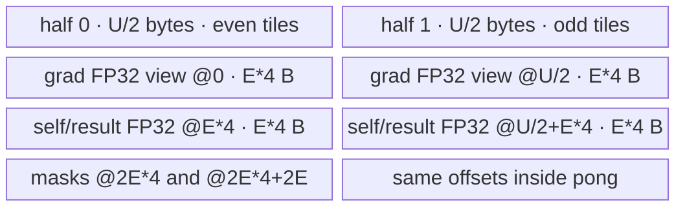

# HardswishBackwardV2 A2/A3 ACLNN 算子知识

## 算子速览

| 项目 | 内容 |
|---|---|
| 实际入口 | `aclnnHardswishBackwardV2GetWorkspaceSize` + `aclnnHardswishBackwardV2`，公开 ACLNN V2 两段式接口 |
| 计算语义 | `out[i] = gradOutput[i] * (self[i] <= -3 ? 0 : self[i] >= 3 ? 1 : self[i] / 3 + 0.5)` |
| 输入输出 | `gradOutput`、`self`、`out` 同 shape、同 dtype、ND；A2/A3 支持 FP16/FP32/BF16，公开文档约束 rank 1–8 |
| 执行类型 | 算子自有节点为单 Kernel `AIV_VECTOR`；ACLNN 前后可插入框架 `Contiguous`/`ViewCopy` 数据搬运节点 |
| Kernel 路线 | R-001：AICore 220 `HardSwishGradV2220<T>`，key 0，三种 dtype 共用 |
| 核心资源 | GM 输入/输出；每个 AIV core 一个大小为 `U=ubSize` 的 `VECCALC TBuf`，按两个 `U/2` ping-pong 半区复用；Tiling workspace 仅为系统库 workspace，算子 body 不读用户 workspace |
| 来源闭包 | `source_closed`：公开 ACLNN → L0 launcher → OpDef/Tiling/POD → A2/A3 entry/router → `HardSwishGradV2220` body → binary config 均闭合；框架 `Contiguous/ViewCopy/CommonOpExecutorRun` 按框架边界标注 |
| 验证状态 | 已完成源码闭包检查；本次知识提取未执行编译、真机、数值或性能测试。 |

## 接口与语义

### 计算语义

令 `x=self[i]`、`g=gradOutput[i]`，先以 FP32 计算
`d(x)=0 (x<=-3)`、`d(x)=x*0.33333334+0.5 (-3<x<3)`、`d(x)=1 (x>=3)`，再得到 `out[i]=g*d(x)`。Device 使用 `GT(x,-3)` 和 `LT(x,3)` 两个掩码，因此恰好在 `-3` 选择 0，在 `3` 选择 1。FP16/BF16 输入先升为 FP32；输出再降回原 dtype。

### 输入、输出与属性

| 参数 | shape/layout | dtype | 约束、默认值与语义 |
|---|---|---|---|
| `gradOutput` | 与 `self/out` 相同；ND；公开文档 rank 1–8 | FP16、FP32、BF16 | 上游梯度；允许非连续 Tensor；空 Tensor 走 ACLNN 空域短路 |
| `self` | 与 `gradOutput/out` 相同；ND；公开文档 rank 1–8 | 与 `gradOutput/out` 相同 | 正向输入；允许非连续 Tensor；空 Tensor 走 ACLNN 空域短路 |
| `out` | 与 `self` 相同；ND | 与输入相同 | 可为非连续 Tensor，由 `ViewCopy` 写回 |
| `workspaceSize` | 标量输出 | `uint64_t*` | executor 图所需 Device workspace 字节数 |
| `executor` | opaque | `aclOpExecutor**` | 持有 `Contiguous → HardSwishGradV2 → ViewCopy` 执行图 |
| `workspace/stream` | Device 地址/流 | opaque | 第二段运行第一段生成的 executor |

### 入口与版本

固定 Commit 公开的最新独立语义入口是 `aclnnHardswishBackwardV2`。README 与 API 文档明确说明 V2 相比旧 `aclnnHardswishBackward` 调整了梯度公式；本卡不合并旧版反向、正向、原地或其它语义。公开产品表明确支持 Atlas A2 与 A3，OpDef 的 `ascend910b`/`ascend910_93` 注册和两份 binary config 进一步闭合平台实现。

## Host/Launcher 执行流程

### 参数校验与前处理

第一段先检查 `workspaceSize/executor` 公共输出参数，再创建 executor；`CheckParams` 按顺序检查三个 Tensor 非空、dtype 在平台支持表内、三者 dtype 一致、输入 rank 不超过框架常量 `MAX_SUPPORT_DIMS_NUMS`、三者 shape 相等。任一输入为空时直接返回 `workspaceSize=0`，executor 中不加入算子节点。非空时依次为 `gradOutput`、`self` 调用 `l0op::Contiguous`，再调用 `l0op::HardSwishGradV2`，最后 `l0op::ViewCopy` 到用户 `out`；每一步空返回均终止。

### 参数、Workspace 与生命周期

L0 以 `self->GetViewShape()` 和 `self->GetDataType()` 在 executor 内分配临时输出，再用 `ADD_TO_LAUNCHER_LIST_AICORE` 加入 `HardSwishGradV2`。Tiling 写 `workspace[0]=PlatformAscendC::GetLibApiWorkSpaceSize()`；Kernel entry 将 `userWs` 固定为 `nullptr`，`HardSwishGradV2Base::Init` 也不消费 workspace。因此算子自有 body 无跨 Kernel 中间切片；ACLNN 返回的总 workspace 还可能包括两次 `Contiguous`、临时输出和 `ViewCopy` 的框架需求，其精确合并公式位于允许标注的 executor 框架边界。executor 在第一段移交给调用者，第二段由 `CommonOpExecutorRun` 在给定 stream 上执行。

### 启动图与失败传播

```text
gradOutput --Contiguous?--\
                           HardSwishGradV2(entry hard_swish_grad_v2, blockDim=C, POD)
self       --Contiguous?--/                         |
                                            temporary contiguous output
                                                     |
                                              ViewCopy? -> out
```

算子自有启动图只有一个 Device 节点：Host `l0op::HardSwishGradV2` 添加 launcher；Tiling 产生 `blockDim=C` 与 POD；entry 读取 POD 后实例化 `HardSwishGradV2220<DTYPE_SELF>`。所有 executor 节点处于传入 stream 的框架顺序中；任一 `Contiguous`、launcher 添加或 `ViewCopy` 构图失败，第一段返回错误且不会交付可运行的完整图；第二段直接传播 `CommonOpExecutorRun` 状态。框架节点的内部 POD、workspace slice 与 Device body不在本算子固定目录内，按 Skill 允许的框架边界处理。

## Route 与参数设计

### 分核与资源计算

记 `N=gradOutput` 原始 shape 元素数、`U=平台返回的 UB 字节数`、`P=平台 AIV core 数`：

```text
E = floor(U / 10 / sizeof(float) / 256) * 256    # 每 tile 元素数，256 元素对齐
C = min(max(ceil(N / E), 1), P)                  # needCoreNum / blockDim
T = ceil(N / E)                                  # 全局 tile 数
q = floor(T / C), r = T mod C
loops(b) = q + (b < r ? 1 : 0)
```

`E*4 <= U/10`，而 Device 把完整 TBuf 分成两个 `U/2` 半区。对 `r>0`，尾元素 `remain=N%E` 由 `lastCoreNum=r-1` 的最后循环处理；`b>=r` 的起点再加 `N%(E*C)`，恰好越过该尾片。Tiling 在 `U==0` 或 `E==0` 时失败；`CeilA2B` 返回 `uint32_t`，超出其表示范围的 tile 数在固定源码中没有额外防窄化检查。

### Route 选择

| 顺序 | Route | Key/模板 | 精确选择条件与优先级 | 不适用去向 |
|---:|---|---|---|---|
| 1 | R-001 AICore 220 Vector | key `0`；`HardSwishGradV2220<DTYPE_SELF>` | A2/A3 公平台注册可达，dtype 为 FP16/FP32/BF16，非空 ACLNN 图；Tiling 无 shape 分支，始终设置 key 0 | dtype/shape/API 校验失败；UB/E 为 0 时 Tiling 失败；空输入在 ACLNN 层成功短路 |

```text
API 参数校验
  -> 输入为空: workspaceSize=0，成功，不启动 Kernel
  -> 非空: Contiguous -> HardSwishGradV2
       -> Tiling U>0 && E>0: key=0, blockDim=C
            -> __CCE_AICORE__ == 220: HardSwishGradV2220<T>
       -> 否则: GRAPH_FAILED
  -> ViewCopy -> executor
```

### 模板/实现执行矩阵

| Route | key/selector | dtype/shape/platform 完整命中条件 | 执行拓扑与 Kernel 节点 | 实际模板/body | 内存与同步特征 | tail/fallback |
|---|---|---|---|---|---|---|
| R-001 AICore 220 Vector | key 0；编译宏 `__CCE_AICORE__==220` | A2/A3；FP16/FP32/BF16；shape 相等；非空；`U>0,E>0` | 单个算子自有 AIV Kernel；框架可前后插入连续化/写回节点 | `HardSwishGradV2220<T>::Process/CopyInAndCast/Compute/CastAndCopyOut` | 单 `U` 字节 TBuf，两个半区 ping-pong；MTE2→V→MTE3 event 与 Vector pipe barrier | `DataCopyPad` 以字节长度处理任意尾 tile；无第二 Route；失败返回 Host/框架 |

### 隐藏性能 Guard

| Guard | Host/Tiling 条件 | Device/资源原因 | 影响 Route | 不满足时去向 | 源码符号 |
|---|---|---|---|---|---|
| UB 可用性 | `ubSize>0 && elementNumEachCore>0` | 必须能初始化单个 `U` 字节 TBuf，并令 tile 至少为 256 元素 | R-001 | `GRAPH_FAILED` | `HardSwishGradV2Tiling::RunBigKernelTiling` |
| tile 对齐 | `E=floor(U/10/4/256)*256` | 保留 FP32 双输入、mask 与双半区空间，且 tile 为 256 元素倍数 | R-001 | `E==0` 时失败 | 同上 |
| core 上限 | `C=min(ceil(N/E), GetCoreNumAiv())`，0 强制为 1 | block 只映射 AIV core，越界 block 提前返回 | R-001 | 无 fallback | `GetNeedCoreNum`; `HardSwishGradV2220::Process` |
| mask 长度 | `tmpDataCount=ceil(dataCount/64)*64` | `CompareScalar` 的谓词域按 64 个 FP32 元素向上取整；后续算术/Select 仍只提交 `dataCount` | R-001 | 无 fallback | `HardSwishGradV2220::Compute` |
| dtype 平台表 | 910B/910_93 binary config 三 dtype | 选择已编译的 `DTYPE_SELF` 实例 | R-001 | ACLNN dtype 错误 | `CheckDtypeValid`; platform binary json |

### POD/ABI

| 结构 | 字段 | 类型/位宽 | ABI 布局 | 单位 | Host/launcher producer | Device consumer | 边界 |
|---|---|---|---|---|---|---|---|
| `HardSwishGradV2TilingData` | `elementNum` | `int64_t`/64 | 声明顺序第 1；宏生成的 `sizeof/alignof/offsetof` 在固定算子目录不可见 | 元素 | `set_elementNum(inputShape.GetShapeSize())` | Base `Init`；`Process` 的 tile/尾块分配 | shape size 乘积与溢出规则由框架 shape 类型决定 |
| `HardSwishGradV2TilingData` | `needCoreNum` | `uint32_t`/32 | 声明顺序第 2；精确 offset 固定算子目录不可见 | AIV core | `set_needCoreNum(GetNeedCoreNum(GetCoreNumAiv()))` | Base `Init`；block guard、循环分配 | 至少 1，不超过平台 AIV core 数 |
| `HardSwishGradV2TilingData` | `ubSize` | `uint64_t`/64 | 声明顺序第 3；精确 offset 固定算子目录不可见 | 字节 | `set_ubSize(GetCoreMemSize(UB))` | Base `Init`；`InitBuffer` 与半区偏移 | 必须大于 0 |
| `HardSwishGradV2TilingData` | `elementNumEachCore` | `int64_t`/64 | 声明顺序第 4；精确 offset 固定算子目录不可见 | 元素/tile | `set_elementNumEachCore(E)` | Base `Init`；地址、循环、UB 子区偏移 | 256 元素倍数且大于 0 |

### Route 源码闭包

| Route | Key/selector | Host/Tiling producer | POD/参数 | Kernel entry/router 节点 | Kernel body/直接依赖 | 构建接线 |
|---|---|---|---|---|---|---|
| R-001 AICore 220 Vector | key 0 / `__CCE_AICORE__==220` | `hard_swish_grad_v2_tiling.cpp::RunBigKernelTiling` | `HardSwishGradV2TilingData` 四字段 | `hard_swish_grad_v2.cpp::hard_swish_grad_v2` | `hard_swish_grad_v2_base.h::Init`; `hard_swish_grad_v2_220.h::HardSwishGradV2220` | `hard_swish_grad_v2_def.cpp` 的 910B/910_93 config；两平台 binary json |

## Kernel 实现

### 公共执行流程

entry 按 `(gradOutput,self,out,workspace,tiling)` 接收 GM 地址，解析 POD；workspace 被置空后传入 Base `Init`。Base 绑定三个 GM Tensor，缓存四个 Tiling 字段与 `GetBlockIdx()`，并一次性分配 `U` 字节 `VECCALC TBuf`。220 body 对每个 core 的每个 tile 执行 `DataCopyPad → 可选 Cast 到 FP32 → CompareScalar/Muls/Adds/Select/Mul → 可选 Cast 回 T → DataCopyPad`。没有跨 core reduce、atomic、通信、NDDMA 或第二个算子自有 Kernel。

### Route R-001：AICore 220 Vector

#### 适用条件

##### 选择证据

| 层级 | 文件 | 符号 | 源码谓词/参数 | 结果/下一跳 |
|---|---|---|---|---|
| API | `op_api/aclnn_hardswish_backward_v2.cpp` | `CheckParams` / GetWorkspaceSize | 非空指针、支持 dtype、同 dtype/shape；输入空域单独短路 | 构建 executor 或返回 ACLNN 错误/空成功 |
| Tiling | `op_host/hard_swish_grad_v2_tiling.cpp` | `RunBigKernelTiling` | 无 Route 分支；`U>0 && E>0` | key 0、blockDim `C`，否则失败 |
| Router | `op_kernel/hard_swish_grad_v2.cpp` | `hard_swish_grad_v2` | `__CCE_AICORE__ == 220` | `HardSwishGradV2220<DTYPE_SELF>` |
| Platform | `op_host/hard_swish_grad_v2_def.cpp` | `HardSwishGradV2` constructor | `AddConfig("ascend910b")`、`AddConfig("ascend910_93")` | A2/A3 注册可达 |

#### Device 数据流

##### 函数级调用链

```text
l0op::HardSwishGradV2 -> ADD_TO_LAUNCHER_LIST_AICORE(HardSwishGradV2)
  -> hard_swish_grad_v2(gradOutput, self, out, workspace, tiling)
    -> HardSwishGradV2Base<T>::Init
    -> HardSwishGradV2220<T>::Process
      -> ProcessAlign
        -> CopyInAndCast
        -> Compute
        -> CastAndCopyOut
```

##### 源码等价伪码

```text
# 伪码；b=blockIdx, E=elementNumEachCore, C=needCoreNum
if b >= C: return
T=ceil(N/E); q=T/C; r=T%C
loops=q+(b<r); start=loops*b*E
if r>0 && b>=r: start += N%(E*C)
lastCore=(r==0 ? C-1 : r-1)
initialize MTE3->MTE2 flags for half 0/1
for i in [0, loops):
  half=i%2; wait previous MTE3->MTE2(half)
  n=(remain>0 && i==loops-1 && b==lastCore) ? remain : E
  off=start+i*E
  DataCopyPad gradOutput[off:off+n], self[off:off+n] into half
  wait MTE2->V
  if T is FP16/BF16: cast both inputs to FP32 in the same half
  mNeg = selfFp32 > -3; mPos = selfFp32 < 3  # compare length ceil(n/64)*64
  d = selfFp32*0.33333334 + 0.5
  d = select(mNeg, d, 0); d = select(mPos, d, 1)
  selfFp32 = gradFp32*d
  if FP16: cast back with CAST_NONE
  if BF16: cast back with CAST_RINT
  wait V->MTE3; DataCopyPad n elements to out[off:]
  signal MTE3->MTE2(half)
wait both half flags before exit
```

#### 内存与数据搬运

##### 资源与搬运表

| 层级/缓冲区 | offset/地址公式 | extent/容量公式 | dtype/layout | producer | consumer | owner/lifetime | 对齐/复用 |
|---|---|---|---|---|---|---|---|
| GM `gradOutput/self/out` | `off=start+i*E` | `n<=E` elements | T/flat ND | framework/user / Kernel | Kernel / framework/user | 用户 Tensor；整个 launch 有效 | 220 使用字节长度 `DataCopyPad`，支持尾长 |
| `ubTBuf/tmpTensor` | UB base | `U` bytes | raw byte TBuf | Base `InitBuffer` | 全部阶段 | 每 core、整个 Kernel | 唯一物理分配；不重复计算逻辑 view |
| ping/pong 半区 | `half*(U/2)` | `U/2` bytes | raw byte | 当前 tile CopyIn/Compute | 当前 tile CopyOut | 交替迭代 | `MTE3_MTE2` event 防止提前覆盖 |
| `gradTensorFp32` | 半区 `+0` | `E*4` bytes | FP32 | CopyIn（FP32）或 Cast（16-bit） | `Mul` | 当前 tile | 16-bit raw source 位于同 view 的 `+E` 个 T 元素，cast 后覆盖/复用 |
| `selfTensorFp32` | 半区 `+E*4` | `E*4` bytes | FP32 | CopyIn/Cast | Compare、Muls、Adds、Select、Mul、CopyOut | 当前 tile | 原地承载导数和最终结果 |
| 16-bit raw `grad/self` | 分别为半区 `+E*sizeof(T)`、`+E*4+E*sizeof(T)` | 各 `E*sizeof(T)` | FP16/BF16 | `DataCopyPad` | Cast | Cast 前 | 与 FP32 目标位于同半区，Cast 后可覆盖 |
| `maskGreater` | 半区 `+2*E*4` | mask primitive 有效域为 `ceil(n/64)*64` 个谓词；物理上限受下一 base 限制 | uint8 predicate view | `CompareScalar(GT)` | 第一个 Select | 当前 Compute | 下一 mask base 为 `+2*E` bytes |
| `maskLessThan` | 半区 `+2*E*4+(E*4)/2` | 同上；精确 predicate 编码字节数由 Vector primitive 定义，算子源码未另行分配 | uint8 predicate view | `CompareScalar(LT)` | 第二个 Select | 当前 Compute | 位于同一物理半区 |
| Tiling system workspace | 框架分配 | `GetLibApiWorkSpaceSize()` | bytes | Tiling | 系统库；算子 body 不读 | executor launch | Kernel 将 `userWs=nullptr` |

##### 分层内存布局



##### 字节账与复用顺序

```text
UB_total = U                         # 唯一 InitBuffer 分配
per_half = U/2
E = floor(U/10/4/256)*256
2 * per_half = U <= platform reported UB U
dynamic_ub = N/A
operator_body_workspace = 0 consumed bytes
tiling_workspace_total = GetLibApiWorkSpaceSize()
ACLNN_executor_workspace = framework GetWorkspaceSize()  # 包含 Contiguous/ViewCopy，目录内无展开公式
```

| 复用子区 | 写入者 | 读取者/消费点 | 下一次覆盖 | 同步或释放依据 | 安全条件 |
|---|---|---|---|---|---|
| ping/pong 整半区 | `CopyInAndCast` | `Compute`、`CastAndCopyOut` | 同 parity 的下下个 tile | `MTE3_MTE2` event | CopyOut 完成后才允许 MTE2 重写 |
| `selfTensorFp32` | Cast/CopyIn | Compare、算术、Select | Muls/Adds/Select/Mul 原地逐级写回 | 每步 `PipeBarrier<PIPE_V>` | 下一 Vector primitive 等待前一步可见 |
| 16-bit raw input 区 | `DataCopyPad` | Cast | Cast 产生 FP32 后 | `MTE2_V` event + Cast 后 `PIPE_V` barrier | 只在 FP16/BF16 实例启用 |
| mask views | `CompareScalar` | 对应 Select | 下一 tile | `PIPE_V` barrier | Select 的有效长度仅 `n` |

#### 同步、精度与尾块

##### 同步与数值边界表

| 阶段 | primitive/机制 | producer | consumer/等待点 | 保护对象 | 精度/尾块 |
|---|---|---|---|---|---|
| 半区复用 | `MTE3_MTE2` EVENT_ID0/1 | 前一同半区 CopyOut | 下一同半区 CopyIn 前 | ping/pong 半区 | 两个 event 初始化、循环内 wait/set、退出前双 wait |
| CopyIn→Vector | `MTE2_V` | 两次 `DataCopyPad` | Cast/Compute | 当前输入 | `blockCount=1, blockLen=n*sizeof(T), stride=0` |
| Vector 链 | `PipeBarrier<PIPE_V>` | Cast/Compare/Muls/Adds/Select/Mul | 下一 Vector primitive | FP32 views/masks | FP16/BF16 升 FP32；比较域向上对齐 64，提交域仍为 n |
| Vector→CopyOut | `V_MTE3` | 最终 Mul/降精度 Cast | `DataCopyPad` | 当前结果 | FP16 `CAST_NONE`；BF16 `CAST_RINT`；FP32 不 Cast |
| 尾 tile | `DataCopyPad` 字节长度 | GM/UB | Vector/GM | 最后 `n=remain` 元素 | 无标量 tail 路线；只写有效 n 元素 |

#### 关键实现

##### 符号证据表

| 阶段 | 文件 | 符号/模板实例 | 实现事实 |
|---|---|---|---|
| Host/Tiling producer | `op_host/hard_swish_grad_v2_tiling.cpp` | `RunBigKernelTiling`、`GetNeedCoreNum` | key 0、E/C/U/workspace/POD/blockDim |
| Kernel entry/router | `op_kernel/hard_swish_grad_v2.cpp` | `hard_swish_grad_v2`; `__CCE_AICORE__==220` | A2/A3 路由到 `HardSwishGradV2220<DTYPE_SELF>` |
| Device init | `op_kernel/hard_swish_grad_v2_base.h` | `HardSwishGradV2Base<T>::Init` | GM 绑定、POD 读取、单 TBuf 分配 |
| Device body/helper | `op_kernel/hard_swish_grad_v2_220.h` | `Process`、`CopyInAndCast`、`Compute`、`CastAndCopyOut` | 分核循环、ping-pong、FP32 计算、mask、尾搬运和同步 |

## 算子特定优化

### Trick T-001：单 TBuf 双半区 ping-pong 与显式跨流水事件

#### 触发与源码依据

- 适用 Route：R-001
- 触发条件：所有非空 tile；`pingPongFlag` 每轮翻转并选择 EVENT_ID0/1。
- Golden 来源：[`op_kernel/hard_swish_grad_v2_220.h:140-155`](https://gitcode.com/cann/ops-nn/blob/955f8b33985b6d72989ebff341bb9c2c564a51bc/activation/hard_swish_grad_v2/op_kernel/hard_swish_grad_v2_220.h#L140-155)

**官方源码（固定 Commit 连续逐字摘录）**：

```cpp
SetFlag<HardEvent::MTE3_MTE2>(EVENT_ID0);
SetFlag<HardEvent::MTE3_MTE2>(EVENT_ID1);
for (int64_t i = 0; i < loopNumber; i++) {
    this->eventId = this->pingPongFlag ? EVENT_ID1 : EVENT_ID0;
    WaitFlag<HardEvent::MTE3_MTE2>(this->eventId);
```

#### 机制与设计原因

整个 UB 只做一次 `InitBuffer(U)`，地址通过 `pingPongFlag ? U/2 : 0` 在两个物理半区切换。每个半区自己的 event 将前一轮 MTE3 完成与下一次 MTE2 覆盖连接起来，允许相邻 tile 使用不同半区，并避免为每个逻辑 Tensor 建独立 Queue/Buffer。

#### 迁移边界

- 适用：逐 tile 输入、计算、输出生命周期闭合且能按 parity 复用的 AIV elementwise Kernel。
- 前提：两个半区各自容纳该 Route 的全部 FP32 view、raw 16-bit view 与 masks；保持 MTE2→V→MTE3 事件顺序。
- 失效：单半区超过 `U/2`、存在跨 tile 状态或 CopyOut 未完成即覆盖时，必须重做 UB 切片/同步，不能直接复用。
- 未验证：本次知识提取未执行编译、真机、数值或性能测试。

#### 错误做法

固定仓的真实防错路径是每轮先 `WaitFlag<MTE3_MTE2>` 再 CopyIn；删除该依赖会使同半区可能在前次 CopyOut 完成前被覆盖。固定仓未提供独立性能反例。

### Trick T-002：16-bit 输入在同半区升 FP32，结果原地复用 self view

#### 触发与源码依据

- 适用 Route：R-001 的 FP16/BF16 实例。
- 触发条件：`std::is_same_v<T,bfloat16_t> || std::is_same_v<T,half>`。
- Golden 来源：[`op_kernel/hard_swish_grad_v2_220.h:40-56`](https://gitcode.com/cann/ops-nn/blob/955f8b33985b6d72989ebff341bb9c2c564a51bc/activation/hard_swish_grad_v2/op_kernel/hard_swish_grad_v2_220.h#L40-56)

**官方源码（固定 Commit 连续逐字摘录）**：

```cpp
if (std::is_same_v<T, bfloat16_t> || std::is_same_v<T, half>) {
    Cast(this->gradTensorFp32, this->gradTensor[this->elementNumEachCore], RoundMode::CAST_NONE, dataCount);
    Cast(this->selfTensorFp32, this->selfTensor[this->elementNumEachCore], RoundMode::CAST_NONE, dataCount);
}
```

#### 机制与设计原因

raw 16-bit 输入放在每个逻辑 view 的后部，FP32 目标从 view 起点开始；升精度后 `selfTensorFp32` 依次原地承载线性导数、两个 Select 结果和最终乘积，减少中间结果物化。所有阈值、比例与乘法均在 FP32 完成；BF16 回写显式 `CAST_RINT`，FP16 使用 `CAST_NONE`。

#### 迁移边界

- 适用：输入可升精度后原地消费、输出再降精度的逐元素激活/梯度。
- 前提：保持 raw source 与 FP32 destination 的源码偏移、Cast overlap 语义、barrier 和最终 round mode。
- 失效：中间结果需被后续多次读取、Cast 不支持该重叠布局或精度规范不同，必须拆分 buffer。
- 未验证：本次知识提取未执行编译、真机、数值或性能测试。

#### 错误做法

固定仓未提供可验证反例；但源码明确把 BF16 输出 round 固定为 `CAST_RINT`，迁移时不得改成 FP16 分支的 mode。

### Trick T-003：220 Route 用字节长度 DataCopyPad 统一整块与尾块

#### 触发与源码依据

- 适用 Route：R-001。
- 触发条件：每个 tile 的 `dataCount`，包括 `remain` 尾 tile。
- Golden 来源：[`op_kernel/hard_swish_grad_v2_220.h:38-46`](https://gitcode.com/cann/ops-nn/blob/955f8b33985b6d72989ebff341bb9c2c564a51bc/activation/hard_swish_grad_v2/op_kernel/hard_swish_grad_v2_220.h#L38-46)

**官方源码（固定 Commit 连续逐字摘录）**：

```cpp
DataCopyExtParams dataCopyParams{1, static_cast<uint32_t>(dataCount * sizeof(T)), 0, 0, 0};
DataCopyPadExtParams<T> padParams{false, 0, 0, 0};
```

#### 机制与设计原因

Host 只需一个 key；Device 对每个 tile 按 `dataCount*sizeof(T)` 生成单 block、零 stride 的扩展搬运参数，最后一个未对齐 tile 与整 tile 共用 `ProcessAlign`。这移除了 AICore 100 body 中的回退重叠搬运/标量 GM 访问路径，同时只让 Vector 阶段处理有效 `dataCount`。

#### 迁移边界

- 适用：220 Vector 路线中连续的一维扁平片段。
- 前提：平台支持相同 `DataCopyPad` 语义；长度乘积能安全窄化到 `uint32_t`。
- 失效：跨距布局、单次字节数超 `uint32_t`、或旧架构只支持对齐 `DataCopy` 时需拆分搬运或提供 tail Route。
- 未验证：本次知识提取未执行编译、真机、数值或性能测试。

#### 错误做法

固定仓未提供 220 fallback；若把字节数误当元素数传入会改变搬运 extent。源码中的显式 `dataCount*sizeof(T)` 是该单位约束。

## 模板与实现对比

| 对比维度 | R-001 AICore 220 Vector | 设计选择依据 |
|---|---|---|
| 命中条件/优先级 | 唯一 key 0；A2/A3 非空合法输入 | Tiling 不做 shape/dtype Route 分支 |
| 模板与 dtype | `HardSwishGradV2220<FP16/FP32/BF16>` | binary config 与 ACLNN dtype 表 |
| 循环与分核 | `E` tile、`C` AIV core，q/r 分配 | UB 与平台 AIV core 数 |
| Queue/TBuf/寄存器/dynamic UB/通信 window | 单 `VECCALC TBuf(U)`；无 TQue/dynamic UB/通信 | 手工 LocalTensor view + event |
| 内存总占用与复用 | `U`，两个 `U/2` 半区；self/result 原地 | `InitBuffer` 与偏移公式 |
| 搬运/Vector/SIMT/NDDMA/通信 API | `DataCopyPad`、Cast、CompareScalar、Muls/Adds、Select、Mul；无 SIMT/NDDMA/通信 | 220 elementwise body |
| 同步、精度与 tail | 双 event + pipe barrier；FP32 中间；DataCopyPad 尾块 | 精度与任意长度连续搬运 |
| fallback/失败边界 | 无 Device fallback；API/Tiling 失败或空域短路 | 单 Route 设计 |

## 平台差异

| 项目 | A2 | A3 | 950 |
|---|---|---|---|
| 支持状态 | 公开支持 | 公开支持 | 公开支持，见独立 `_950` 卡 |
| Host/Launcher | `ascend910b` config，共用 key 0 Tiling | `ascend910_93` config，共用 key 0 Tiling | `ascend950/mc62` config，Tiling 公式共用 |
| Kernel/资源 | `hard_swish_grad_v2.cpp` 的 220 分支 | 同左 | `_apt` entry 直接实例化相同 `HardSwishGradV2220` body |

## 限制与失败边界

- 公开文档约束 rank 1–8、三 Tensor shape/dtype 相等；ACLNN source 显式检查最大 rank，但最小 rank 由公开契约约束。
- 空输入在 ACLNN 第一段成功短路且 `workspaceSize=0`，不会启动 Kernel；图模式若直接到 Tiling，源码仍令 `C>=1`，两条入口的空域行为不要混用。
- `E`、core 数和 `DataCopyPad.blockLen` 存在 `int64/uint64 → uint32` 窄化点；固定源码没有额外超界 guard。
- POD 宏生成的精确 `sizeof/alignof/offsetof`、executor 汇总 workspace 公式和框架 `Contiguous/ViewCopy` 内部节点位于固定算子目录之外，按明确框架边界标记，未推测补齐。
- A2/A3 body 未发现 Cube/AIC/MIX_CV、SIMT、NDDMA、通信或多算子自有 Kernel；因此归 VV/AIV_VECTOR。
- 本次知识提取未执行编译、真机、数值或性能测试。

## 源码索引

### 链路索引

| 链路阶段 | 文件 | 关键符号 | 支撑内容 |
|---|---|---|---|
| 入口声明/约束 | `docs/aclnnHardswishBackwardV2.md` | 两段式原型、产品表、公式、参数表 | 公开性、V2 语义、A2/A3 支持 |
| 入口声明 | `op_host/op_api/aclnn_hardswish_backward_v2.h` | 两个 ACLNN 符号 | C ABI 与执行图 |
| 入口实现 | `op_host/op_api/aclnn_hardswish_backward_v2.cpp` | `CheckParams`; 两段式函数 | 校验、空域、Contiguous/L0/ViewCopy、executor |
| L0 launcher | `op_host/op_api/hard_swish_grad_v2.cpp` | `l0op::HardSwishGradV2` | 临时输出与 AICore launcher |
| 平台注册 | `op_host/hard_swish_grad_v2_def.cpp` | `ops::HardSwishGradV2` | dtype、ND、910B/910_93/950 configs |
| Host/Tiling | `op_host/hard_swish_grad_v2_tiling.cpp` | `RunBigKernelTiling` | key、UB、tile、core、workspace、blockDim |
| POD | `op_host/hard_swish_grad_v2_tiling_def.h` | `HardSwishGradV2TilingData` | 四字段 ABI 声明 |
| Kernel entry/router | `op_kernel/hard_swish_grad_v2.cpp` | `hard_swish_grad_v2` | 220 模板路由 |
| Kernel init | `op_kernel/hard_swish_grad_v2_base.h` | `HardSwishGradV2Base::Init` | GM/POD/TBuf 初始化 |
| Kernel body | `op_kernel/hard_swish_grad_v2_220.h` | `HardSwishGradV2220` | 220 完整 AIV Vector 算法 |
| 构建接线 | `op_host/config/ascend910b/hard_swish_grad_v2_binary.json` | `HardSwishGradV2` entries | A2 三 dtype binary |
| 构建接线 | `op_host/config/ascend910_93/hard_swish_grad_v2_binary.json` | `HardSwishGradV2` entries | A3 三 dtype binary |

### 实现复用检查

| 检查项 | 可复用事实 | 不得改变的约束 | 源码符号 |
|---|---|---|---|
| ABI/POD | 四字段 producer/consumer 一一对应 | 字段顺序、位宽、元素/字节单位 | `HardSwishGradV2TilingData`; Base `Init` |
| 调用顺序 | Contiguous→Kernel→ViewCopy；Kernel 内 CopyIn→Compute→CopyOut | 空域短路和任一步失败传播 | ACLNN GetWorkspaceSize；`ProcessAlign` |
| workspace/内存 | 单 TBuf 与双半区可复用 | `U/2` 基址、E 偏移、系统 workspace 不被 body 使用 | Base `Init`; 220 `CopyInAndCast/Compute` |
| 同步 | parity event 协议可复用 | MTE3→MTE2、MTE2→V、V→MTE3 与 PIPE_V 顺序 | 220 `Process`/helpers |
| 精度与尾块 | FP32 中间与 DataCopyPad tail | 比较严格性、常量 0.33333334、BF16 RINT、有效 n | 220 `Compute/CastAndCopyOut` |
| 失败边界 | API/Tiling 明确终点 | 不得把空域、非法 dtype/shape 或 U/E=0 降级成未知 Device Route | `CheckParams`; `RunBigKernelTiling` |