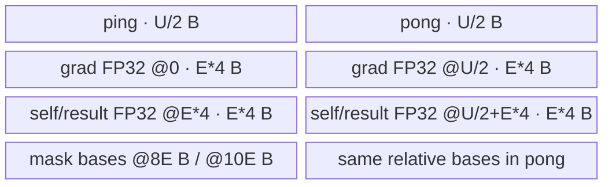

# HardswishBackwardV2 950 ACLNN 算子知识

## 算子速览

| 项目 | 内容 |
|---|---|
| 实际入口 | `aclnnHardswishBackwardV2GetWorkspaceSize` + `aclnnHardswishBackwardV2`，公开 ACLNN V2 两段式接口 |
| 计算语义 | `out[i] = gradOutput[i] * (self[i] <= -3 ? 0 : self[i] >= 3 ? 1 : self[i] / 3 + 0.5)` |
| 输入输出 | `gradOutput`、`self`、`out` 同 shape、同 dtype、ND；950 支持 FP16/FP32/BF16，公开文档约束 rank 1–8 |
| 执行类型 | 算子自有节点为单 Kernel `AIV_VECTOR`；ACLNN 前后可插入框架 `Contiguous`/`ViewCopy` 数据搬运节点 |
| Kernel 路线 | R-001：950 `_apt` entry 直接实例化 `HardSwishGradV2220<T>`，key 0 |
| 核心资源 | GM 输入/输出；每 core 一个 `U=ubSize` 字节 `VECCALC TBuf`，按两个 `U/2` 半区 ping-pong；无算子自用 workspace |
| 来源闭包 | `source_closed`：公开 ACLNN → L0 → 950 OpDef/Tiling/POD → `_apt` entry → `HardSwishGradV2220` → ascend950 binary config 均闭合；框架节点按边界标注 |
| 验证状态 | 已完成源码闭包检查；本次知识提取未执行编译、真机、数值或性能测试。 |

## 接口与语义

### 计算语义

令 `x=self[i]`、`g=gradOutput[i]`。Device 先计算 `mNeg=(x>-3)`、`mPos=(x<3)`，再令 `d=x*0.33333334+0.5`，依次通过两个 Select 得到 `x<=-3` 时 0、`x>=3` 时 1，最后 `out=g*d`。FP16/BF16 输入升到 FP32 后完成比较与算术；输出回到原 dtype。

### 输入、输出与属性

| 参数 | shape/layout | dtype | 约束、默认值与语义 |
|---|---|---|---|
| `gradOutput` | 与 `self/out` 相同；ND；rank 1–8 | FP16、FP32、BF16 | 上游梯度；非连续输入先 Contiguous；支持空 Tensor |
| `self` | 与 `gradOutput/out` 相同；ND；rank 1–8 | 与其它 Tensor 相同 | 正向输入；非连续输入先 Contiguous；支持空 Tensor |
| `out` | 同 shape，ND | 与输入相同 | 可非连续，框架 ViewCopy 写回 |
| `workspaceSize` | 标量输出 | `uint64_t*` | executor 图的 Device workspace 字节数 |
| `executor` | opaque | `aclOpExecutor**` | 第一段构造、第二段消费 |
| `workspace/stream` | Device 地址/流 | opaque | 第二段运行 executor |

### 入口与版本

公开 API 文档产品表明确支持 Ascend 950PR/950DT。V2 是与旧 `aclnnHardswishBackward` 数学语义不同的独立入口，本卡不含旧版或正向。950 实现由 OpDef 的 `ascend950`/`mc62` config 选择 `opFile.value=hard_swish_grad_v2_apt`，ascend950 binary config 对 FP16/FP32/BF16 三种实例均有接线。

## Host/Launcher 执行流程

### 参数校验与前处理

第一段依次检查公共输出参数、创建 executor、检查三个 Tensor 非空、dtype 支持且一致、输入 rank 不超过 `MAX_SUPPORT_DIMS_NUMS`、shape 相等。`gradOutput` 或 `self` 为空时返回 `workspaceSize=0` 并释放 executor 给调用者，不加入计算节点。非空时按 `Contiguous(gradOutput) → Contiguous(self) → l0op::HardSwishGradV2 → ViewCopy(out)` 构图，任一返回空指针立即失败。

### 参数、Workspace 与生命周期

L0 以 `self` 的 view shape/dtype 分配连续临时输出，并通过 `ADD_TO_LAUNCHER_LIST_AICORE` 添加节点。Tiling 的 `workspace[0]` 是 `GetLibApiWorkSpaceSize()`；950 entry 把传给 Base 的 `userWs` 固定为 `nullptr`，Device body 不消费该 workspace。ACLNN 总 workspace 还包括框架可能产生的连续化、临时输出与写回需求，精确汇总由 `uniqueExecutor->GetWorkspaceSize()` 在框架边界完成。executor 在第一段移交，第二段在用户 stream 上由 `CommonOpExecutorRun` 执行。

### 启动图与失败传播

```text
gradOutput --Contiguous?--\
                           HardSwishGradV2
self       --Contiguous?--/  entry=hard_swish_grad_v2(_apt), blockDim=C, POD
                                      |
                              contiguous temporary out
                                      |
                                ViewCopy? -> out
```

算子自有拓扑是单 AIV Kernel。框架按同一 executor/stream 保证前处理、计算和写回顺序；第一段任何构图节点失败都不交付完整执行图，第二段直接传播运行状态。`Contiguous/ViewCopy/CommonOpExecutorRun` 的内部 Device body 与 workspace slice 是 Skill 允许的框架边界。

## Route 与参数设计

### 分核与资源计算

记 `N` 为元素数、`U` 为 950 平台 UB 字节数、`P` 为 AIV core 数：

```text
E = floor(U / 10 / 4 / 256) * 256
C = min(max(ceil(N/E), 1), P)
T = ceil(N/E); q=floor(T/C); r=T%C
loops(b)=q+(b<r ? 1 : 0)
```

Device 对 `r>0` 把 `remain=N%E` 放给 `lastCoreNum=r-1` 的最后循环；`b>=r` 的起点加 `N%(E*C)`，使其从该尾片之后继续。`E*4<=U/10`，完整 TBuf 使用两个 `U/2` 半区。Tiling 在 `U==0` 或 `E==0` 返回失败，并令 `blockDim=C`。

### Route 选择

| 顺序 | Route | Key/模板 | 精确选择条件与优先级 | 不适用去向 |
|---:|---|---|---|---|
| 1 | R-001 950 APT Vector | key 0；`HardSwishGradV2220<DTYPE_SELF>` | 950 `ascend950/mc62` 注册；FP16/FP32/BF16；输入非空且 API 校验、Tiling `U>0,E>0` | 空域成功短路；非法参数或 Tiling 失败，无 Device fallback |

```text
API check
  -> empty: workspaceSize=0, success, no kernel
  -> non-empty: framework preprocessing -> HardSwishGradV2
       -> key=0, blockDim=C
       -> hard_swish_grad_v2_apt -> HardSwishGradV2220<T>
  -> framework ViewCopy
```

### 模板/实现执行矩阵

| Route | key/selector | dtype/shape/platform 完整命中条件 | 执行拓扑与 Kernel 节点 | 实际模板/body | 内存与同步特征 | tail/fallback |
|---|---|---|---|---|---|---|
| R-001 950 APT Vector | key 0；OpDef `opFile.value=hard_swish_grad_v2_apt` | 950；三 dtype；同 shape/dtype；非空；U/E 有效 | 单个算子自有 AIV Kernel | `HardSwishGradV2220<T>` 完整 body | `TBuf(U)` 双半区；MTE2/V/MTE3 events + Vector barriers | `DataCopyPad` 任意尾长；无其它 Route |

### 隐藏性能 Guard

| Guard | Host/Tiling 条件 | Device/资源原因 | 影响 Route | 不满足时去向 | 源码符号 |
|---|---|---|---|---|---|
| 950 注册 | `ascend950` 或 `mc62` config，`opFile.value=hard_swish_grad_v2_apt` | 选择 `_apt` entry 而非宏 router | R-001 | 平台不可达 | `HardSwishGradV2` OpDef constructor |
| UB/tile | `U>0 && E=floor(U/10/4/256)*256>0` | 单 TBuf 和 256 元素 tile | R-001 | `GRAPH_FAILED` | `RunBigKernelTiling` |
| core | `C<=GetCoreNumAiv()` | AIV block 映射 | R-001 | 无 fallback | `GetNeedCoreNum`; `Process` |
| Compare 长度 | `tmpDataCount=ceil(dataCount/64)*64` | FP32 compare 谓词按 64 元素粒度 | R-001 | 无 fallback；Select/输出仅 n | `HardSwishGradV2220::Compute` |
| dtype binary | ascend950 config 含 FP16/FP32/BF16 | `DTYPE_SELF` 编译实例 | R-001 | ACLNN dtype 错误 | `CheckDtypeValid`; ascend950 binary json |

### POD/ABI

| 结构 | 字段 | 类型/位宽 | ABI 布局 | 单位 | Host/launcher producer | Device consumer | 边界 |
|---|---|---|---|---|---|---|---|
| `HardSwishGradV2TilingData` | `elementNum` | `int64_t`/64 | 声明顺序第 1；宏生成精确 offset/size 在固定目录不可见 | 元素 | `set_elementNum(inputShape.GetShapeSize())` | Base `Init`、Process 分片 | shape size 溢出规则为框架边界 |
| `HardSwishGradV2TilingData` | `needCoreNum` | `uint32_t`/32 | 声明顺序第 2；精确 offset 不可见 | core | `set_needCoreNum(C)` | block guard/循环 | `[1,P]` |
| `HardSwishGradV2TilingData` | `ubSize` | `uint64_t`/64 | 声明顺序第 3；精确 offset 不可见 | 字节 | `set_ubSize(U)` | `InitBuffer`、半区基址 | `U>0` |
| `HardSwishGradV2TilingData` | `elementNumEachCore` | `int64_t`/64 | 声明顺序第 4；精确 offset 不可见 | 元素/tile | `set_elementNumEachCore(E)` | 地址/循环/UB views | 256 倍数、`E>0` |

### Route 源码闭包

| Route | Key/selector | Host/Tiling producer | POD/参数 | Kernel entry/router 节点 | Kernel body/直接依赖 | 构建接线 |
|---|---|---|---|---|---|---|
| R-001 950 APT Vector | key 0 / 950 opFile selector | `hard_swish_grad_v2_tiling.cpp::RunBigKernelTiling` | `HardSwishGradV2TilingData` | `hard_swish_grad_v2_apt.cpp::hard_swish_grad_v2` | Base `Init` + `HardSwishGradV2220` | OpDef `ascend950/mc62` + ascend950 binary json |

## Kernel 实现

### 公共执行流程

950 `_apt` entry 解析 POD，忽略 workspace，直接构造 `HardSwishGradV2220<DTYPE_SELF>`。Base `Init` 绑定 GM、读取四字段、取得 block id 并分配 `TBuf(U)`。每 tile 依次执行扩展搬入、16-bit 可选升 FP32、两次阈值比较、线性段、两次 Select、乘上梯度、可选降精度和扩展搬出。没有 Cube/AIC/MIX_CV、SIMT、NDDMA、通信、atomic、reduce 或第二个算子自有 Kernel。

### Route R-001：950 APT Vector

#### 适用条件

##### 选择证据

| 层级 | 文件 | 符号 | 源码谓词/参数 | 结果/下一跳 |
|---|---|---|---|---|
| API | `op_api/aclnn_hardswish_backward_v2.cpp` | `CheckParams`/GetWorkspaceSize | 三 Tensor 合法；输入空域另行短路 | executor 或错误/空成功 |
| Host platform | `op_host/hard_swish_grad_v2_def.cpp` | config950 | `ascend950/mc62`; `opFile.value=hard_swish_grad_v2_apt` | 950 `_apt` entry |
| Tiling | `op_host/hard_swish_grad_v2_tiling.cpp` | `RunBigKernelTiling` | key 0；`U>0,E>0` | POD + blockDim C，否则失败 |
| Entry | `op_kernel/hard_swish_grad_v2_apt.cpp` | `hard_swish_grad_v2` | 无内部 key/架构分支 | 直接 `HardSwishGradV2220<T>` |

#### Device 数据流

##### 函数级调用链

```text
l0op::HardSwishGradV2 -> ADD_TO_LAUNCHER_LIST_AICORE
  -> hard_swish_grad_v2_apt::hard_swish_grad_v2
    -> HardSwishGradV2Base<T>::Init
    -> HardSwishGradV2220<T>::Process
      -> ProcessAlign
        -> CopyInAndCast -> Compute -> CastAndCopyOut
```

##### 源码等价伪码

```text
# 伪码
if blockIdx>=C: return
derive loops/start from T=ceil(N/E), q=T/C, r=T%C
initialize EVENT_ID0/1 as reusable
for each local tile i:
  half=i%2; wait MTE3->MTE2(half)
  n = E, except lastCore's last loop uses N%E
  copy grad/self [off,off+n) to half with one-block byte-length DataCopyPad
  wait MTE2->V
  FP16/BF16 -> FP32 Cast; FP32 uses direct views
  gt = self>-3; lt=self<3                 # compare domain ceil(n/64)*64
  self = self*0.33333334+0.5
  self = select(gt,self,0)
  self = select(lt,self,1)
  self = grad*self
  FP32 -> FP16(CAST_NONE) or BF16(CAST_RINT), if needed
  wait V->MTE3; DataCopyPad n outputs; signal half reusable
wait both half events
```

#### 内存与数据搬运

##### 资源与搬运表

| 层级/缓冲区 | offset/地址公式 | extent/容量公式 | dtype/layout | producer | consumer | owner/lifetime | 对齐/复用 |
|---|---|---|---|---|---|---|---|
| GM tensors | `off=start+i*E` | `n<=E` elements | T/flat ND | user/framework | Kernel/user | launch lifetime | `DataCopyPad` byte length |
| `ubTBuf` | UB base | `U` bytes | raw | Base `InitBuffer` | all stages | per core/kernel | sole physical allocation |
| ping/pong half | `half*U/2` | `U/2` bytes | raw | CopyIn/Compute | CopyOut | alternating tile | parity event |
| grad FP32 view | half `+0` | `E*4` bytes | FP32 | direct copy or Cast | final Mul | tile | 16-bit raw source at `+E*sizeof(T)` |
| self/result FP32 view | half `+E*4` | `E*4` bytes | FP32 | direct copy or Cast | compare through output | tile | derivative/result in-place |
| raw FP16/BF16 grad/self | half `+E*sizeof(T)` / `+E*4+E*sizeof(T)` | each `E*sizeof(T)` | 16-bit | DataCopyPad | Cast | pre-Cast | same half, then reclaimable |
| `maskGreater` | half `+2*E*4` | primitive predicate extent; next base bounds physical region | uint8 view | CompareScalar GT | Select 1 | Compute | valid domain rounded to 64 |
| `maskLessThan` | half `+2*E*4+(E*4)/2` | primitive predicate extent; exact encoding external to primitive | uint8 view | CompareScalar LT | Select 2 | Compute | same half |
| system workspace | framework offset | `GetLibApiWorkSpaceSize()` | bytes | Tiling | system library | launch | body receives nullptr |

##### 分层内存布局



##### 字节账与复用顺序

```text
UB_total = U
per_half = U/2
E = floor(U/10/4/256)*256
2*per_half = U <= A5 platform reported U
dynamic_ub = N/A
operator_body_workspace = 0 consumed bytes
tiling_workspace_total = GetLibApiWorkSpaceSize()
ACLNN total = uniqueExecutor->GetWorkspaceSize()  # framework-owned exact aggregation
```

| 复用子区 | 写入者 | 读取者/消费点 | 下一次覆盖 | 同步或释放依据 | 安全条件 |
|---|---|---|---|---|---|
| entire half | CopyIn/Compute | CopyOut | next same-parity tile | MTE3_MTE2 event | output DMA completes first |
| self/result FP32 | Cast/CopyIn | Compare/Muls/Adds/Select/Mul | same tile in-place steps | PIPE_V barriers | strict source order |
| raw 16-bit views | DataCopyPad | Cast | after Cast | MTE2_V + PIPE_V | only 16-bit templates |
| masks | CompareScalar | corresponding Select | next tile | PIPE_V | Select count is n |

#### 同步、精度与尾块

##### 同步与数值边界表

| 阶段 | primitive/机制 | producer | consumer/等待点 | 保护对象 | 精度/尾块 |
|---|---|---|---|---|---|
| half reuse | EVENT_ID0/1 `MTE3_MTE2` | CopyOut | next CopyIn | ping/pong | init, per-loop wait/set, final waits |
| input visibility | `MTE2_V` | DataCopyPad | Cast/Compute | input views | one block, `n*sizeof(T)` bytes |
| Vector order | `PIPE_V` | each vector op | next op | fp32/masks | FP32 arithmetic; compare rounded to 64 |
| output visibility | `V_MTE3` | Mul/Cast | DataCopyPad | result | BF16 RINT, FP16 NONE |
| tail | DataCopyPad | GM/UB | Vector/GM | n valid elements | same path as full tile, no scalar fallback |

#### 关键实现

##### 符号证据表

| 阶段 | 文件 | 符号/模板实例 | 实现事实 |
|---|---|---|---|
| Host/Tiling producer | `op_host/hard_swish_grad_v2_tiling.cpp` | `RunBigKernelTiling` | key/E/C/U/workspace/POD/blockDim |
| 950 selector | `op_host/hard_swish_grad_v2_def.cpp` | config950 | ascend950/mc62 与 `_apt` opFile |
| Kernel entry | `op_kernel/hard_swish_grad_v2_apt.cpp` | `hard_swish_grad_v2` | 直接实例化 220 body |
| Device init | `op_kernel/hard_swish_grad_v2_base.h` | `Init` | GM、POD、TBuf |
| Device body | `op_kernel/hard_swish_grad_v2_220.h` | `HardSwishGradV2220` methods | 完整循环、搬运、计算、同步、tail |

## 算子特定优化

### Trick T-001：950 `_apt` entry 直接复用 220 Vector body

#### 触发与源码依据

- 适用 Route：R-001。
- 触发条件：OpDef `ascend950/mc62` 选择 `hard_swish_grad_v2_apt`。
- Golden 来源：[`op_kernel/hard_swish_grad_v2_apt.cpp:28-33`](https://gitcode.com/cann/ops-nn/blob/955f8b33985b6d72989ebff341bb9c2c564a51bc/activation/hard_swish_grad_v2/op_kernel/hard_swish_grad_v2_apt.cpp#L28-33)

**官方源码（固定 Commit 连续逐字摘录）**：

```cpp
GET_TILING_DATA(tilingData, tiling);
GM_ADDR userWs = nullptr;
HardSwishGradV2220<DTYPE_SELF> op;
op.Init(gradOutput, self, out, userWs, &tilingData);
op.Process();
```

#### 机制与设计原因

950 不经过 `__CCE_AICORE__` 条件 router，而由 Host 的 `opFile.value` 直接选择 `_apt` object；Device 仍复用已闭合的 220 AIV Vector body。这把平台选择固定在 Host/构建阶段，并保持与 A2/A3 相同的 POD、UB、精度和 tail 行为。

#### 迁移边界

- 适用：950 binary config 与 OpDef 能共同选择独立 APT entry 的单 Vector Kernel。
- 前提：POD 字段顺序、`DTYPE_SELF` 实例和 220 primitive 行为不变。
- 失效：950 需要不同 POD、资源模型或新 body 时，不能仅复制 `_apt` entry。
- 未验证：本次知识提取未执行编译、真机、数值或性能测试。

#### 错误做法

固定仓的 Host config 明确指定 `_apt` 文件；仅凭目录名认定 950 支持而忽略公开产品表、OpDef 和 binary config，无法形成发布证据。

### Trick T-002：双半区事件化复用与 FP32 原地计算

#### 触发与源码依据

- 适用 Route：R-001 全部 dtype；16-bit dtype 额外执行 Cast。
- 触发条件：每轮按 `pingPongFlag` 选择 `U/2` 半区。
- Golden 来源：[`op_kernel/hard_swish_grad_v2_220.h:34-56`](https://gitcode.com/cann/ops-nn/blob/955f8b33985b6d72989ebff341bb9c2c564a51bc/activation/hard_swish_grad_v2/op_kernel/hard_swish_grad_v2_220.h#L34-56)

**官方源码（固定 Commit 连续逐字摘录）**：

```cpp
this->gradTensor = this->pingPongFlag ?
    this->tmpTensor[this->ubSize / NUM_TWO].template ReinterpretCast<T>() :
    this->tmpTensor[0].template ReinterpretCast<T>();
```

#### 机制与设计原因

单 TBuf 通过半区基址切换形成 ping-pong；raw 16-bit 输入放在 FP32 view 后部并原地 Cast，`selfTensorFp32` 又原地承载导数和最终乘积。MTE3→MTE2 parity event 防止同半区提前覆盖，Vector barrier 固定原地步骤的可见性，从源码上减少了独立中间 buffer 的物化。

#### 迁移边界

- 适用：tile 内生命周期线性、最终结果可覆盖一个输入 view 的 elementwise 算子。
- 前提：每半区能容纳全部 views/masks，并保留 Cast overlap 与事件顺序。
- 失效：跨 tile 依赖、额外中间 Tensor 或不同 Cast overlap 能力要求重新划分 UB。
- 未验证：本次知识提取未执行编译、真机、数值或性能测试。

#### 错误做法

删除 `MTE3_MTE2` wait/set 会破坏同 parity 半区的覆盖时序；固定仓未提供性能反例。

### Trick T-003：DataCopyPad 统一 950 尾 tile

#### 触发与源码依据

- 适用 Route：R-001。
- 触发条件：所有 `dataCount`，含 `remain`。
- Golden 来源：[`op_kernel/hard_swish_grad_v2_220.h:94-105`](https://gitcode.com/cann/ops-nn/blob/955f8b33985b6d72989ebff341bb9c2c564a51bc/activation/hard_swish_grad_v2/op_kernel/hard_swish_grad_v2_220.h#L94-105)

**官方源码（固定 Commit 连续逐字摘录）**：

```cpp
DataCopyExtParams dataCopyParams{1, static_cast<uint32_t>(dataCount * sizeof(T)), 0, 0, 0};
DataCopyPad(this->outGm[outputOffset], this->selfTensor, dataCopyParams);
```

#### 机制与设计原因

单 block、零 stride、显式字节长度使完整 tile 与尾 tile 共享相同 helper，无需独立 tail key 或标量 GM 循环。比较可向上覆盖到 64 粒度，但 Select、算术和搬出均只提交有效 `dataCount`。

#### 迁移边界

- 适用：950 连续扁平分片。
- 前提：长度乘法可安全转 `uint32_t`，且 DataCopyPad primitive 语义一致。
- 失效：strided layout、超长单次搬运或 primitive 不可用时需要拆分。
- 未验证：本次知识提取未执行编译、真机、数值或性能测试。

#### 错误做法

不能把 `blockLen` 当元素数；固定源码显式传 `dataCount*sizeof(T)` 字节。

## 模板与实现对比

| 对比维度 | R-001 950 APT Vector | 设计选择依据 |
|---|---|---|
| 命中条件/优先级 | 唯一 key 0、950 合法非空输入 | Host `opFile` + 单 Tiling Route |
| 模板与 dtype | `HardSwishGradV2220<FP16/FP32/BF16>` | 950 binary config |
| 循环与分核 | E tile、C AIV core、q/r 分配 | 950 返回 U/P |
| Queue/TBuf/寄存器/dynamic UB/通信 window | 单 TBuf(U)，无 TQue/dynamic UB/通信 | Base InitBuffer |
| 内存总占用与复用 | U；双半区；self/result 原地 | view offsets + events |
| 搬运/Vector/SIMT/NDDMA/通信 API | DataCopyPad + Vector；无其它执行族 | 220 body |
| 同步、精度与 tail | events/barriers；FP32 中间；统一 tail | body primitives |
| fallback/失败边界 | 无 Device fallback | API/Tiling 终点 |

## 平台差异

| 项目 | A2 | A3 | 950 |
|---|---|---|---|
| 支持状态 | 公开支持，见无后缀卡 | 公开支持，见无后缀卡 | 公开支持 |
| Host/Launcher | 910B config | 910_93 config | `ascend950/mc62` config + `_apt` opFile |
| Kernel/资源 | 通用 entry 的 220 分支 | 同左 | `_apt` entry 直接复用同一 220 body；U/P 取 950 平台值 |

## 限制与失败边界

- 公开 API 约束 rank 1–8、同 shape/dtype；source 只显式检查最大 rank，最小 rank 以公开契约为准。
- ACLNN 空输入不进入 Tiling/Kernel；直接图入口的 Tiling 会把 0 元素 core 数设为 1，不应与 ACLNN 空域路径混同。
- `CeilA2B` 返回 `uint32_t`，`DataCopyPad.blockLen` 也窄化到 `uint32_t`；固定源码没有额外超范围 guard。
- POD 宏的精确 ABI offset/size、executor workspace 汇总和框架 Contiguous/ViewCopy body 位于固定算子目录之外，已按框架边界标注，未推测。
- 950 可达 body 是 AIV_VECTOR；没有发现 Cube/AIC/MIX_CV，因此不切换 CV Skill。
- 本次知识提取未执行编译、真机、数值或性能测试。

## 源码索引

### 链路索引

| 链路阶段 | 文件 | 关键符号 | 支撑内容 |
|---|---|---|---|
| 入口声明/约束 | `docs/aclnnHardswishBackwardV2.md` | 原型、产品表、公式、参数 | 公开 V2 与 950 支持 |
| 入口声明 | `op_host/op_api/aclnn_hardswish_backward_v2.h` | ACLNN 两段符号 | C ABI |
| 入口实现 | `op_host/op_api/aclnn_hardswish_backward_v2.cpp` | `CheckParams`; GetWorkspaceSize/Run | 校验、空域、executor 图 |
| L0 launcher | `op_host/op_api/hard_swish_grad_v2.cpp` | `l0op::HardSwishGradV2` | 临时输出与 launcher |
| 950 注册 | `op_host/hard_swish_grad_v2_def.cpp` | config950 | ascend950/mc62 与 APT 文件 |
| Host/Tiling | `op_host/hard_swish_grad_v2_tiling.cpp` | `RunBigKernelTiling` | key、E/C/U、workspace、blockDim |
| POD | `op_host/hard_swish_grad_v2_tiling_def.h` | `HardSwishGradV2TilingData` | 四字段 |
| Kernel entry | `op_kernel/hard_swish_grad_v2_apt.cpp` | `hard_swish_grad_v2` | 950 直达 220 body |
| Kernel init | `op_kernel/hard_swish_grad_v2_base.h` | Base `Init` | GM/POD/TBuf |
| Kernel body | `op_kernel/hard_swish_grad_v2_220.h` | `HardSwishGradV2220` | 完整 AIV Vector body |
| 构建接线 | `op_host/config/ascend950/hard_swish_grad_v2_binary.json` | 三 dtype entries | 950 binary 可达性 |

### 实现复用检查

| 检查项 | 可复用事实 | 不得改变的约束 | 源码符号 |
|---|---|---|---|
| ABI/POD | 950 与 220 body 共用四字段 | 顺序、位宽、单位 | Tiling data / Base Init |
| 调用顺序 | framework→APT entry→body→framework | 空域、失败传播和 stream 顺序 | ACLNN/L0/APT entry |
| workspace/内存 | 单 TBuf、双半区、body 不用 ws | U/2/E offsets、owner/lifetime | Base Init; 220 helpers |
| 同步 | parity event + pipe event/barrier | 三段流水依赖不可删 | 220 Process/helpers |
| 精度与尾块 | FP32 中间、BF16 RINT、DataCopyPad tail | 阈值严格性、常量、round、n | 220 Compute/CopyOut |
| 失败边界 | API/Tiling 终点明确 | 不得虚构 950 fallback | CheckParams; RunBigKernelTiling |

- [GET_TILING_DATA](../../../../apis/simd_api/basic_api/kernel_tiling/get_tiling_data.md)
