```mermaid
block-beta
  columns 6
  p0x1["p0 x1 FP32 32KiB · BF16源在后16KiB"]:1
  p0x2["p0 x2 FP32 32KiB · BF16源在后16KiB"]:1
  p1x1["p1 x1 FP32 32KiB · BF16源在后16KiB"]:1
  p1x2["p1 x2 FP32 32KiB · BF16源在后16KiB"]:1
  masks["4 masks · 32KiB"]:1
  spare["unaliased · 32KiB"]:1
```

# Heaviside A2/A3 ACLNN 算子知识

## 算子速览

| 项目 | 内容 |
|---|---|
| 实际入口 | 公开两段式 `aclnnHeavisideGetWorkspaceSize` / `aclnnHeaviside`，无版本后缀 |
| 计算语义 | 逐元素返回 `0`（`input<0`）、`values`（`input==0`）或 `1`（`input>0`）；一般 broadcast 由 ACLNN 前处理物化 |
| 输入输出 | `input`、`values`、`out`：ND，0D～8D，FLOAT/FLOAT16/BFLOAT16；公开接口允许非连续 Tensor 和空 Tensor |
| 执行类型 | 核心节点为单 Kernel `AIV_VECTOR`；ACLNN 外围按需加入框架 `Contiguous`、`BroadcastTo`、`ViewCopy` 节点 |
| Kernel 路线 | R-001 FLOAT32 原生计算；R-002 FLOAT16 原生计算；R-003 BFLOAT16→FLOAT32 计算→BFLOAT16 |
| 核心资源 | GM 输入/输出；一个 192 KiB `TBuf<VECCALC>`；双缓冲数据区与双缓冲 uint8 mask；Heaviside 节点申报 16 MiB workspace 但 Kernel 不消费 |
| 来源闭包 | `source_closed`：公开 ACLNN→L0 launcher→Heaviside Tiling/POD→key 1 router→`HeavisideND<T>`→A2/A3 binary config 闭合；外围通用变换按明确的框架边界记录 |
| 验证状态 | 已完成源码闭包检查；本次知识提取未执行编译、真机、数值或性能测试。 |

## 接口与语义

### 计算语义

对 broadcast 后的每个位置 `i`：

```text
out[i] = 0         , input[i] < 0
out[i] = values[i] , input[i] = 0
out[i] = 1         , input[i] > 0
```

ACLNN 在 `values` 不是单元素且两输入 view shape 不相等时，先把两者都 `BroadcastTo` 到推导 shape；核心 Heaviside Kernel 因而只接收“`values` 为单元素”或“`values` 与 `input` shape 完全相同”两种布局。Kernel 会先用 `input == input` 屏蔽 NaN，再把 NaN 改写为 `-1`，所以固定源码的 Device 行为是 NaN 进入负值分支并输出 `0`。

### 输入、输出与属性

| 参数 | shape/layout | dtype | 约束、默认值与语义 |
|---|---|---|---|
| `input` | ND，0D～8D，可非连续、可空 | FLOAT/FLOAT16/BFLOAT16 | 与 `values` 可 broadcast；Kernel 前转连续 |
| `values` | ND，0D～8D，可非连续、可空 | FLOAT/FLOAT16/BFLOAT16 | `input==0` 时采用；一般 broadcast 由 L0 `BroadcastTo` 物化 |
| `out` | ND，0D～8D，可非连续、可空 | FLOAT/FLOAT16/BFLOAT16 | 文档要求 dtype 与输入一致、shape 为 broadcast 结果；结果经 `ViewCopy` 写入 |
| `workspaceSize` | 标量 Host 输出 | `uint64_t*` | executor 全流程所需 Device workspace；空 Tensor 路径固定返回 0 |
| `executor` | Host 对象 | `aclOpExecutor**` | 第一段创建并移交，第二段在给定 stream 上运行 |

### 入口与版本

固定 Commit `955f8b33985b6d72989ebff341bb9c2c564a51bc` 公开 `aclnnHeavisideGetWorkspaceSize` 和 `aclnnHeaviside`，未发现带版本后缀的更新入口。README 与 ACLNN 文档都公开标记 Atlas A2、Atlas A3 支持；OpDef 分别接线 `ascend910b`、`ascend910_93`，两份 binary config 均提供 FLOAT、FLOAT16、BFLOAT16 三种同 dtype specialization。

## Host/Launcher 执行流程

### 参数校验与前处理

第一段接口依次执行：

1. `OP_CHECK_COMM_INPUT` 校验 `workspaceSize`、`executor`，随后创建 executor。
2. `CheckNotNull` 校验 `input`、`values`、`out`；`CheckDtypeValid` 分别限制为 FLOAT/FLOAT16/BFLOAT16；`CheckShape` 限制两输入最大 8 维、校验可 broadcast，并仅以元素总数比较 `out` 与 broadcast shape。
3. 任一输入或输出为空时，将 `workspaceSize=0`，移交空执行流程并成功返回，不加入核心 Kernel。
4. 非空时分别调用 `l0op::Contiguous(input)`、`l0op::Contiguous(values)`。
5. 若 `values` 元素数不是 1 且两输入 view shape 不同，调用 `BroadcastInferShape`，再对两输入分别加入 `BroadcastTo`；否则直接进入 Heaviside。
6. `l0op::Heaviside` 按 `input` 的 view shape 和 dtype 分配中间输出，通过 `ADD_TO_LAUNCHER_LIST_AICORE(Heaviside, ...)` 加入核心节点；最后 `ViewCopy(result, out)` 处理非连续输出。
7. executor 汇总 workspace 并移交。第二段 `aclnnHeaviside` 仅调用 `CommonOpExecutorRun(workspace, workspaceSize, executor, stream)`。

### 参数、Workspace 与生命周期

核心 Tiling 取 `input`、`values` 原始 shape，产生 `elementNum`、`valuesType`、`needCoreNum`，固定申报 `16 * 1024 * 1024 = 16 MiB` workspace。Kernel entry 把 `userWs` 置空并传给 `Init`，而 `Init` 不绑定 workspace，故该 16 MiB 不参与核心计算；不能把它从 ABI/调度请求中删除。ACLNN 对一般 broadcast、非连续输入输出的额外 workspace 由 executor 内的通用节点汇总，固定算子目录未公开其逐节点公式。

输入/输出 Tensor 由调用者持有；executor 持有中间连续 Tensor、broadcast Tensor、核心结果和节点顺序，直到第二段执行结束。用户提供的 workspace 至少覆盖第一段返回大小并在 stream 执行期间保持有效。

### 启动图与失败传播

```text
空 Tensor：校验 -> workspaceSize=0 -> 空 executor -> CommonOpExecutorRun

非空：
input --Contiguous--+-------------------------------+
                    |                               |
values--Contiguous--+--[必要时双 BroadcastTo]-------+--> Heaviside(AIV_VECTOR, key=1)
                                                         -> ViewCopy(result, out)
```

Heaviside 节点由 `HeavisideAiCore` 加入同一个 executor；其 `blockDim=needCoreNum`，POD 为 `HeavisideTilingData`，输入为连续且已满足 scalar/same-shape 条件的 `input/values`，输出为 executor 分配的连续中间 Tensor。外围通用节点的内部 Kernel、workspace slice 和同步实现属于固定源码未展开的框架边界；本目录可证明它们按加入 executor 的数据依赖先于/后于 Heaviside，并由 `CommonOpExecutorRun` 在传入 stream 上统一执行。任何中间返回空指针或 launcher 加入失败都会立即返回错误，不再加入后续节点。

## Route 与参数设计

### 分核与资源计算

令 `N=elementNum`、`P=8192`、`C=GetCoreNumAiv()`：

```text
needCoreNum = min(max(ceil(N / P), 1), C)
totalTimes  = ceil(N / P)
baseLoops   = floor(totalTimes / needCoreNum)
extraCores  = totalTimes % needCoreNum
loopNum(b)  = baseLoops + (b < extraCores ? 1 : 0)
```

起始 offset 初值为 `loopNum(b) * b * P`。当 `extraCores>0 && b>=extraCores` 时再加 `N % (P*needCoreNum)`；这个修正把前 `extraCores` 个核（最后一个可能持有短 tile）的实际覆盖长度计入后续核起点。`remain=N%P` 非零时，`lastCoreNum=(extraCores==0 ? needCoreNum-1 : extraCores-1)` 的最后一轮使用 `calNum=remain`，其余轮使用 8192。

A2/A3 编译分支固定 `MAX_UB_SIZE=192 KiB`、`PP_ELEMENT_NUM=8192`。每核只分配一个 192 KiB TBuf；逻辑数据和 mask 使用其中前 160 KiB，末尾 32 KiB 没有建立 LocalTensor 别名。

### Route 选择

| 顺序 | Route | Key/模板 | 精确选择条件与优先级 | 不适用去向 |
|---:|---|---|---|---|
| 1 | R-001 FLOAT32 原生 | binary FLOAT32，key 1，`HeavisideND<float>` | A2/A3 config 命中 FLOAT32；Tiling 无 shape 分支并固定 key 1 | dtype 不支持则 ACLNN 参数校验失败 |
| 2 | R-002 FLOAT16 原生 | binary FLOAT16，key 1，`HeavisideND<half>` | A2/A3 config 命中 FLOAT16；Tiling 固定 key 1 | dtype 不支持则 ACLNN 参数校验失败 |
| 3 | R-003 BFLOAT16 升精度 | binary BFLOAT16，key 1，`HeavisideND<bfloat16_t>` | A2/A3 config 命中 BFLOAT16；Tiling 固定 key 1 | dtype 不支持则 ACLNN 参数校验失败 |

```text
ACLNN dtype ∈ {FLOAT, FLOAT16, BFLOAT16}
  -> 平台 binary config 选同 dtype specialization
    -> TilingKey = 1
      -> __CCE_AICORE__ == 220 || 310
        -> HeavisideND<DTYPE_INPUT>
          -> BFLOAT16 ? R-003 : (FLOAT ? R-001 : R-002)
```

### 模板/实现执行矩阵

| Route | key/selector | dtype/shape/platform 完整命中条件 | 执行拓扑与 Kernel 节点 | 实际模板/body | 内存与同步特征 | tail/fallback |
|---|---|---|---|---|---|---|
| R-001 FLOAT32 原生 | key 1 / FLOAT32 binary | A2/A3、非空、FLOAT32；`values` 已是 scalar 或 same-shape | 单 `heaviside` AIV_VECTOR Kernel | `HeavisideND<float>::Process` | 192 KiB 单 TBuf；双 data/mask 区；event 0/1 交替 | 最后负责核以 `remain` 搬出；无 Device fallback |
| R-002 FLOAT16 原生 | key 1 / FLOAT16 binary | A2/A3、非空、FLOAT16；`values` 已是 scalar 或 same-shape | 单 `heaviside` AIV_VECTOR Kernel | `HeavisideND<half>::Process` | 同一 192 KiB TBuf；每个 32 KiB data slot 仅前 16 KiB 为有效 FP16 tile | 同 R-001 |
| R-003 BFLOAT16 升精度 | key 1 / BFLOAT16 binary | A2/A3、非空、BFLOAT16；`values` 已是 scalar 或 same-shape | 单 `heaviside` AIV_VECTOR Kernel | `HeavisideND<bfloat16_t>::Process` | BF16 源放在每个 32 KiB slot 后半，原地扩展成 FP32；结果 RINT 降回 BF16 | 同 R-001；cast 后只搬 `remain` |

### 隐藏性能 Guard

| Guard | Host/Tiling 条件 | Device/资源原因 | 影响 Route | 不满足时去向 | 源码符号 |
|---|---|---|---|---|---|
| scalar/same-shape | `valuesShapeSize==1 \|\| (valuesShapeSize>0 && valuesShape==inputShape)` | Kernel 只有标量 GM 读取或同 offset 向量读取两种寻址 | 全部 | ACLNN 先 `BroadcastTo`；直接进入 Tiling 而不满足则 `GRAPH_FAILED` | `HeavisideTiling::GetValuesType` |
| 每核最大基础 tile | `P=8192`，Host 用 `ceil(N/8192)` 求核数 | A2/A3 TBuf 地址布局按 8192 元素切片 | 全部 | 超过一个 tile 时每核循环 | `MAX_ELEMENT_NUM_EACH_CORE`、`PP_ELEMENT_NUM` |
| dtype 编译 guard | `__CCE_AICORE__==220 \|\| 310` | 只有该分支实例化 key 1 body | 全部 | 不进入 body，无 Kernel fallback | `heaviside` entry |
| Vector repeat 对齐 | `tmpDataCount=ceil(dataCount/(256/sizeof(compute_type)))*(256/sizeof(compute_type))` | Compare/Max 覆盖完整 256-byte repeat | 全部 | 无别的 Route；输出仅提交 `dataCount` | `HeavisideND::Compute` |
| 空域 | ACLNN 任一 Tensor `IsEmpty()` | 避免生成无数据节点 | 全部 | 成功返回 workspace 0 的空 executor | `aclnnHeavisideGetWorkspaceSize` |

### POD/ABI

| 结构 | 字段 | 类型/位宽 | ABI 布局 | 单位 | Host/launcher producer | Device consumer | 边界 |
|---|---|---|---|---|---|---|---|
| `HeavisideTilingData` | `elementNum` | `int64_t` / 64 | 字段声明顺序第 1；宏展开、`sizeof/alignof/offsetof` 在固定目录不可见 | 元素 | `set_elementNum(inputShape.GetShapeSize())` | `Init`→`elementNum`，控制 tile/offset/tail | 非负；空 ACLNN 不启动核心节点 |
| `HeavisideTilingData` | `valuesType` | `bool` / 实现 ABI 位宽由宏生成布局决定 | 字段声明顺序第 2；精确 offset 不可见 | 布尔 | scalar 时 `true`，same-shape 时 `false` | 决定 `GetValue(0)` 或按 tile 搬运 values | 其它 shape 在 Tiling 失败 |
| `HeavisideTilingData` | `needCoreNum` | `uint32_t` / 32 | 字段声明顺序第 3；精确 offset 不可见 | AIV core 数 | `GetNeedCoreNum(GetCoreNumAiv())` | `Process` 分核与越界保护 | 至少 1，不超过平台 AIV core 数 |

Host 用 `SaveToBuffer`，Device 用同一生成类型的 `GET_TILING_DATA` 解析，字段顺序和生成宏不得改变；固定目录没有 `BEGIN_TILING_DATA_DEF` 宏实现，因而不推测 padding 和总大小。

### Route 源码闭包

| Route | Key/selector | Host/Tiling producer | POD/参数 | Kernel entry/router 节点 | Kernel body/直接依赖 | 构建接线 |
|---|---|---|---|---|---|---|
| R-001 FLOAT32 原生 | key 1 / FLOAT32 config | `op_host/heaviside_tiling.cpp` · `RunBigKernelTiling` | `HeavisideTilingData` | `op_kernel/heaviside.cpp` · `heaviside`→`HeavisideND<float>` | `op_kernel/heaviside.h` · `Init/Process/CopyInAndCast/Compute/CastAndCopyOut` | `ascend910b`、`ascend910_93` binary config + `op_host/CMakeLists.txt` |
| R-002 FLOAT16 原生 | key 1 / FLOAT16 config | 同上 | 同上 | `heaviside`→`HeavisideND<half>` | 同一模板非 BF16 分支 | 同上 |
| R-003 BFLOAT16 升精度 | key 1 / BFLOAT16 config | 同上 | 同上 | `heaviside`→`HeavisideND<bfloat16_t>` | 同一模板 BF16 constexpr 分支 | 同上 |

## Kernel 实现

### 公共执行流程

`heaviside` entry 解析 POD；在 A2/A3 编译 guard 内仅接受 TilingKey 1，构造 `HeavisideND<DTYPE_INPUT>`，依次 `Init`、`Process`。`Init` 绑定三路 GM，读取 POD，记录 `GetBlockIdx()`，并分配整个 192 KiB TBuf。`Process` 计算每核连续 tile 区间，预置两个 `MTE3_MTE2` event，按 tile 执行 `CopyInAndCast`→`Compute`→`CastAndCopyOut`，在 event 0/1 间 ping-pong，循环末等待两路最终 MTE3 完成。

### Route R-001：FLOAT32 原生计算

#### 适用条件

##### 选择证据

| 层级 | 文件 | 符号 | 源码谓词/参数 | 结果/下一跳 |
|---|---|---|---|---|
| API | `op_host/op_api/aclnn_heaviside.cpp` | `CheckDtypeValid` | dtype 属于 FLOAT/FLOAT16/BFLOAT16 | FLOAT 继续 |
| Host | `op_host/config/ascend910b/heaviside_binary.json`、`ascend910_93/...` | FLOAT32 entry | 两输入/输出 FLOAT32、ND | 选择 FLOAT32 binary |
| Tiling | `op_host/heaviside_tiling.cpp` | `RunBigKernelTiling` | scalar/same-shape，固定 key 1 | `blockDim=needCoreNum` |
| Router | `op_kernel/heaviside.cpp` | `heaviside` | A2/A3 guard 且 `TILING_KEY_IS(1)` | `HeavisideND<float>` |

#### Device 数据流

##### 函数级调用链

```text
HeavisideAiCore -> ADD_TO_LAUNCHER_LIST_AICORE(Heaviside)
  -> heaviside(input, values, output, workspace, tiling)
    -> HeavisideND<float>::Init
    -> HeavisideND<float>::Process
      -> CopyInAndCast
      -> Compute
      -> CastAndCopyOut
```

##### 源码等价伪码

```text
# 源码等价伪码
for tile in 本核连续 tile 区间:
  calNum = (本 tile 是全局尾 tile && N%8192 != 0) ? N%8192 : 8192
  slot = ping ? 1 : 0; wait(MTE3_MTE2[event(slot)])
  copy input[offset:offset+calNum] -> x1[slot]
  valuesType ? scalar=valuesGm[0] : copy values[offset:...] -> x2[slot]
  signal/wait MTE2_V
  validMask = (x1 == x1)                         # NaN 为 false
  x1 = select(validMask, x1, -1)
  nonzeroMask = (x1 != 0); nonpositiveMask = (x1 <= 0)
  x1 = max(x1, 0)
  x1 = select(nonpositiveMask, x1, 1)
  x1 = select(nonzeroMask, x1, values/scalar)
  signal/wait V_MTE3
  copy x1[0:calNum] -> output[offset:offset+calNum]
  signal MTE3_MTE2[event(slot)]; ping ^= 1
wait 两个 slot 的 MTE3_MTE2
```

#### 内存与数据搬运

##### 资源与搬运表

| 层级/缓冲区 | offset/地址公式 | extent/容量公式 | dtype/layout | producer | consumer | owner/lifetime | 对齐/复用 |
|---|---|---|---|---|---|---|---|
| input GM | `eachCoreStartOffset+i*8192` | `calNum` | FLOAT32/ND | 调用者/前处理 | `DataCopyPad` | 外部持有 | 精确字节搬运 |
| values GM | 同 input offset 或 0 | `calNum` 或 1 | FLOAT32/ND | 调用者/前处理 | `DataCopyPad`/`GetValue(0)` | 外部持有 | scalar 不占 x2 有效数据 |
| data slot 0/1 | `slot*2*32768 + {0,32768}` bytes | 每个 x1/x2 slot 32768 bytes | FLOAT32 | MTE2 | Vector | 192 KiB TBuf 内 | 两 slot 由 event 0/1 保护 |
| mask slot 0/1 | `131072 + slot*16384 + {0,8192}` bytes | 每 mask 8192 bytes | uint8 mask | Compare | Select | TBuf 内 | `selMaskOne` 在两次 Compare 间复用 |
| output GM | 与 input offset 相同 | `calNum` | FLOAT32/ND | MTE3 | `ViewCopy`/调用者 | executor 中间结果 | 只写有效尾长 |

##### 分层内存布局


##### 字节账与复用顺序

```text
UB_total = InitBuffer(ubTBuf, 192*1024) = 196608 B
logical aliases = 4*32768 + 4*8192 = 163840 B <= 196608 B
dynamic_ub = N/A
workspace_total(Heaviside node) = 16*1024*1024 B requested; Kernel consumption = 0 B
=> tile <= 8192 elements
```

| 复用子区 | 写入者 | 读取者/消费点 | 下一次覆盖 | 同步或释放依据 | 安全条件 |
|---|---|---|---|---|---|
| ping data slot | `DataCopyPad` | Vector + `DataCopyPad` output | 同 parity 的下下个 tile | `MTE3_MTE2` event 0/1 | 覆盖前输出 MTE3 完成 |
| `selMaskOne` | NaN `Compare`，随后 `CompareScalar(NE)` | 两次 `Select` | 同 tile 第二次 Compare；后续同 slot tile | `PIPE_V` barrier；slot event | 第一 Select 已消费 NaN mask |

#### 同步、精度与尾块

##### 同步与数值边界表

| 阶段 | primitive/机制 | producer | consumer/等待点 | 保护对象 | 精度/尾块 |
|---|---|---|---|---|---|
| slot 复用 | `MTE3_MTE2` event 0/1 | 上次 CopyOut | 下次 CopyIn | data slot | 双缓冲不提前覆盖 |
| CopyIn→Vector | `MTE2_V` | `DataCopyPad` | Compare | 当前 slot | blockLen=`calNum*4` bytes |
| Vector 链 | `PipeBarrier<PIPE_V>` | 每个 Compare/Select/Maxs | 下一 Vector op | x1/masks | compare/max 用 64-element repeat 对齐，Select 只提交 `calNum` |
| Vector→CopyOut | `V_MTE3` | 最终 Select | `DataCopyPad` | x1 | 尾 tile 仅搬 `calNum*4` bytes |

#### 关键实现

##### 符号证据表

| 阶段 | 文件 | 符号/模板实例 | 实现事实 |
|---|---|---|---|
| Host/Tiling producer | `op_host/heaviside_tiling.cpp` | `RunBigKernelTiling` | key、POD、blockDim、workspace |
| Kernel entry/router | `op_kernel/heaviside.cpp` | `heaviside` / `HeavisideND<float>` | A2/A3 guard 与 key 1 映射 |
| Device body/helper | `op_kernel/heaviside.h` | `Process/CopyInAndCast/Compute/CastAndCopyOut` | 分核、双缓冲、原生 FLOAT Vector 链与 tail |

### Route R-002：FLOAT16 原生计算

#### 适用条件

##### 选择证据

| 层级 | 文件 | 符号 | 源码谓词/参数 | 结果/下一跳 |
|---|---|---|---|---|
| API | `op_host/op_api/aclnn_heaviside.cpp` | `CheckDtypeValid` | FLOAT16 在支持集合 | 继续 |
| Host | A2/A3 `heaviside_binary.json` | FLOAT16 entry | 两输入/输出 FLOAT16、ND | FLOAT16 binary |
| Tiling | `op_host/heaviside_tiling.cpp` | `RunBigKernelTiling` | scalar/same-shape，key 1 | `blockDim=needCoreNum` |
| Router | `op_kernel/heaviside.cpp` | `heaviside` | A2/A3 guard，key 1 | `HeavisideND<half>` |

#### Device 数据流

##### 函数级调用链

```text
HeavisideAiCore -> heaviside -> HeavisideND<half>::Init -> Process
  -> CopyInAndCast(non-BF16 branch) -> Compute(non-BF16 branch) -> CastAndCopyOut
```

##### 源码等价伪码

```text
# 与 R-001 的 tile/offset/event 顺序相同
copy calNum*2 bytes input/value -> 当前 slot
repeatAlign = ceil(calNum / 128) * 128
用 FP16 Compare/Select/Maxs 完成 NaN 清理、符号分支和零点 values 选择
copy calNum*2 bytes 到输出
```

#### 内存与数据搬运

##### 资源与搬运表

| 层级/缓冲区 | offset/地址公式 | extent/容量公式 | dtype/layout | producer | consumer | owner/lifetime | 对齐/复用 |
|---|---|---|---|---|---|---|---|
| input/values GM | 与 R-001 相同元素 offset | 每 tile `calNum` | FLOAT16/ND | 外部 | MTE2 | 外部 | blockLen=`calNum*2` |
| x1/x2 slot | 物理起点仍为 `{0,32768,65536,98304}` | 每个物理 slot 32768B；每 tile 有效 16384B | FLOAT16 | MTE2 | Vector | TBuf | slot 间保留 16384B 间隔 |
| mask slot | 与 R-001 相同 | 4*8192B | uint8 | Compare | Select | TBuf | `selMaskOne` 复用 |
| output GM | 同元素 offset | `calNum` | FLOAT16/ND | MTE3 | 外部 | executor 中间结果 | 尾长精确 |

##### 分层内存布局


##### 字节账与复用顺序

```text
UB_total = 196608 B
physical addressed data region = 131072 B; FLOAT16 tile payload = 4*16384 B
masks = 32768 B; final unaliased = 32768 B
dynamic_ub = N/A
workspace_total(Heaviside node) = 16777216 B requested; consumed = 0 B
```

| 复用子区 | 写入者 | 读取者/消费点 | 下一次覆盖 | 同步或释放依据 | 安全条件 |
|---|---|---|---|---|---|
| data slot | MTE2 | Vector/MTE3 | 同 parity 后续 tile | event 0/1 | MTE3 完成后覆盖 |
| masks | Compare | Select | 当前 tile 内第二次 Compare/后续 tile | `PIPE_V` + slot event | 与 R-001 相同 |

#### 同步、精度与尾块

##### 同步与数值边界表

| 阶段 | primitive/机制 | producer | consumer/等待点 | 保护对象 | 精度/尾块 |
|---|---|---|---|---|---|
| Copy/slot | `MTE3_MTE2`、`MTE2_V`、`V_MTE3` | MTE2/Vector/MTE3 | 对应等待点 | 当前 slot | 全流程保持 FP16 |
| Vector repeat | 256-byte repeat | Compare/Maxs | Select | 128 FP16 lanes/repeat | 无效 lanes 不搬出 |
| tail | `calNum` | Host POD + Process | CopyIn/Select/CopyOut | 尾 tile | 精确写 `calNum` 元素 |

#### 关键实现

##### 符号证据表

| 阶段 | 文件 | 符号/模板实例 | 实现事实 |
|---|---|---|---|
| Host/Tiling producer | `op_host/heaviside_tiling.cpp` | `RunBigKernelTiling` | 公共 key/POD/blockDim |
| Kernel entry/router | `op_kernel/heaviside.cpp` | `HeavisideND<half>` | key 1 到 FLOAT16 specialization |
| Device body/helper | `op_kernel/heaviside.h` | 非 BF16 constexpr 分支 | 128-lane repeat、FP16 原生链、2-byte tail copy |

### Route R-003：BFLOAT16 升精度计算

#### 适用条件

##### 选择证据

| 层级 | 文件 | 符号 | 源码谓词/参数 | 结果/下一跳 |
|---|---|---|---|---|
| API | `op_host/op_api/aclnn_heaviside.cpp` | `CheckDtypeValid` | BFLOAT16 在支持集合 | 继续 |
| Host | A2/A3 `heaviside_binary.json` | BFLOAT16 entry | 两输入/输出 BFLOAT16、ND | BFLOAT16 binary |
| Tiling | `op_host/heaviside_tiling.cpp` | `RunBigKernelTiling` | scalar/same-shape，key 1 | 公共 POD |
| Router | `op_kernel/heaviside.cpp` | `heaviside` | A2/A3 guard，key 1 | `HeavisideND<bfloat16_t>` |

#### Device 数据流

##### 函数级调用链

```text
HeavisideAiCore -> heaviside -> HeavisideND<bfloat16_t>::Init -> Process
  -> CopyInAndCast: BF16 GM -> slot 后半 xTmp -> Cast FP32 到 slot 起点
  -> Compute: FP32 Compare/Select/Maxs
  -> CastAndCopyOut: FP32 -> BF16(CAST_RINT) -> GM
```

##### 源码等价伪码

```text
for tile:
  wait 可复用 slot
  copy BF16 input/value 到每个 32KiB slot 的 +16KiB 子区
  wait MTE2_V
  cast BF16 source -> FP32 destination（同一 slot 起点，扩展后覆盖整个 32KiB）
  repeatAlign = ceil(calNum/64)*64
  以 FP32 执行 NaN 清理、符号分支、零点 values 选择
  cast FP32 result -> BF16 destination(slot 起点), CAST_RINT
  wait V_MTE3; copy calNum*2 bytes 到输出; signal slot 可复用
```

#### 内存与数据搬运

##### 资源与搬运表

| 层级/缓冲区 | offset/地址公式 | extent/容量公式 | dtype/layout | producer | consumer | owner/lifetime | 对齐/复用 |
|---|---|---|---|---|---|---|---|
| BF16 GM | 公共元素 offset | `calNum` | BFLOAT16/ND | 外部 | MTE2 | 外部 | `calNum*2` bytes |
| FP32 result slots | `{0,32768,65536,98304}` | 每 slot 32768B | FLOAT32 | Cast/Vector | Cast/MTE3 | TBuf | 双缓冲 |
| BF16 source aliases | 每 slot 起点 `+16384` | 16384B | BFLOAT16 | MTE2 | Cast | 与 FP32 slot 同物理区 | 后半放源，向前原地扩展 |
| masks | 从 131072B 起四段 8192B | 32768B | uint8 | FP32 Compare | Select | TBuf | 同 R-001 |
| BF16 output GM | 公共元素 offset | `calNum` | BFLOAT16 | MTE3 | 外部 | executor 中间结果 | cast 后精确尾长 |

##### 分层内存布局



##### 字节账与复用顺序

```text
UB_total = 196608 B
4 FP32 slots = 131072 B（每个 BF16 source 16384 B 与对应 slot 后半 alias，不重复计）
4 masks = 32768 B
unaliased tail = 32768 B
dynamic_ub = N/A
workspace_total(Heaviside node) = 16777216 B requested; consumed = 0 B
```

| 复用子区 | 写入者 | 读取者/消费点 | 下一次覆盖 | 同步或释放依据 | 安全条件 |
|---|---|---|---|---|---|
| slot 后半 BF16 source | MTE2 | BF16→FP32 Cast | Cast 扩展结果覆盖 | `MTE2_V` + `PIPE_V` | 源地址放在后半，保持源码规定 alias |
| slot 起点 FP32/BF16 result | Cast/Vector | 后续 Vector/MTE3 | 下次同 parity tile | V barrier + MTE3_MTE2 | 不改变 cast 顺序或地址 |
| masks | Compare | Select | 当前/后续 tile | `PIPE_V` | 同 R-001 |

#### 同步、精度与尾块

##### 同步与数值边界表

| 阶段 | primitive/机制 | producer | consumer/等待点 | 保护对象 | 精度/尾块 |
|---|---|---|---|---|---|
| BF16 Copy→Cast | `MTE2_V` | MTE2 | Cast | slot 后半源 | BF16 精确扩展 FP32 |
| FP32 链 | `PIPE_V` | Cast/Compare/Select/Maxs | 下一 Vector op | FP32 slot/mask | 64 FP32 lanes/repeat；Select 用 `calNum` |
| 降精度 | `Cast(...CAST_RINT)` + `PIPE_V` | FP32 结果 | MTE3 | slot 起点 | round-to-nearest-integral 模式按源码 `CAST_RINT` |
| tail/slot | `V_MTE3`、`MTE3_MTE2` | Vector/MTE3 | CopyOut/下次 CopyIn | 当前 slot | 仅搬 `calNum*2` bytes |

#### 关键实现

##### 符号证据表

| 阶段 | 文件 | 符号/模板实例 | 实现事实 |
|---|---|---|---|
| Host/Tiling producer | `op_host/heaviside_tiling.cpp` | `RunBigKernelTiling` | 公共 key/POD/blockDim |
| Kernel entry/router | `op_kernel/heaviside.cpp` | `HeavisideND<bfloat16_t>` | key 1 BF16 specialization |
| Device body/helper | `op_kernel/heaviside.h` | BF16 constexpr 分支 | 后半源 alias、FP32 计算、RINT 回写 |

## 算子特定优化

### Trick T-001：双 event 的单 TBuf ping-pong 覆盖流水

#### 触发与源码依据

- 适用 Route：R-001、R-002、R-003
- 触发条件：每核 `loopNum>0`；`pingPongFlag` 每轮翻转并选择 event 0/1
- Golden 来源：[`op_kernel/heaviside.h:123-142`](../../../../../../../cann-ops-raw/ascendc/ops-nn/955f8b33985b6d72989ebff341bb9c2c564a51bc/activation/heaviside/op_kernel/heaviside.h#L123-L142)

**官方源码（固定 Commit 连续逐字摘录）**：

```cpp
pingPongFlag = 0;
SetFlag<HardEvent::MTE3_MTE2>(EVENT_ID0);
SetFlag<HardEvent::MTE3_MTE2>(EVENT_ID1);
for (int64_t i = 0; i < loopNum; i++) {
    int64_t localOffset = i * PP_ELEMENT_NUM;

    // 最后一轮的最后一个核处理余数
    if (remain_0 > 0 && i == loopNum - 1 && blockIdx == lastCoreNum) {
        calNum = remain_0;
    }
    eventId = pingPongFlag ? EVENT_ID1 : EVENT_ID0;
    CopyInAndCast(eachCoreStartOffset + localOffset, calNum);

    Compute(calNum);

    CastAndCopyOut(eachCoreStartOffset + localOffset, calNum);
    pingPongFlag = 1 - pingPongFlag;
}
```

#### 机制与设计原因

两套地址 slot 与两个 `MTE3_MTE2` event 一一对应。当前 tile 的 MTE2/Vector/MTE3 使用一个 slot 时，下轮切到另一 slot；同 parity slot 再次用于 CopyIn 前，`WaitFlag` 确保上次 CopyOut 已读完。这允许一个 192 KiB TBuf 内的地址复用保持明确生命周期，同时把最后 tile 的 `calNum` 贯穿 CopyIn、Vector Select 和 CopyOut，避免尾部 GM 多搬。

#### 迁移边界

- 适用：逐 tile、输出与输入等长、MTE3 完成后即可覆盖本地结果的 Vector 算子。
- 前提：两个 slot 的 offset、event parity、每 tile 最大 8192 元素和尾块 `calNum` 必须同步修改。
- 失效：单 TBuf 容量不足或消费者跨两轮仍读取旧 slot 时，必须重新设计缓冲和同步；固定实现没有 fallback Route。
- 未验证：本次知识提取未执行编译、真机、数值或性能测试。

#### 错误做法

固定仓未提供可验证反例；从同步依赖可证明，删除同 parity 的 `MTE3_MTE2` 等待会允许 MTE2 在 MTE3 完成前覆盖输出源。

### Trick T-002：BF16 源放在 FP32 slot 后半并原地扩展

#### 触发与源码依据

- 适用 Route：R-003
- 触发条件：`std::is_same_v<T, bfloat16_t>`
- Golden 来源：[`op_kernel/heaviside.h:156-178`](../../../../../../../cann-ops-raw/ascendc/ops-nn/955f8b33985b6d72989ebff341bb9c2c564a51bc/activation/heaviside/op_kernel/heaviside.h#L156-L178)

**官方源码（固定 Commit 连续逐字摘录）**：

```cpp
if (std::is_same_v<T, bfloat16_t>) {
    int32_t bf16Byte = PP_ELEMENT_NUM * sizeof(T);
    x1Tmp = pingPongFlag ? tmpTensor[bf16Byte + elementByte * 2].ReinterpretCast<T>() :
                           tmpTensor[bf16Byte].ReinterpretCast<T>();
    x2Tmp = pingPongFlag ? tmpTensor[bf16Byte + elementByte * 3].ReinterpretCast<T>() :
                           tmpTensor[bf16Byte + elementByte].ReinterpretCast<T>();
    DataCopyPad(x1Tmp, inputGm[inputOffset], dataCopyParams, padParams);
    if (valuesType == false) {
        DataCopyPad(x2Tmp, valuesGm[inputOffset], dataCopyParams, padParams);
    } else {
        values = T(valuesGm.GetValue(0));
    }

    SetFlag<HardEvent::MTE2_V>(eventId);
    WaitFlag<HardEvent::MTE2_V>(eventId);

    x1TensorCast = x1Tensor.template ReinterpretCast<float>();
    x2TensorCast = x2Tensor.template ReinterpretCast<float>();
    Cast(x1TensorCast, x1Tmp, RoundMode::CAST_NONE, dataCount);
```

#### 机制与设计原因

每个 8192 元素 FP32 slot 需要 32768B，而对应 BF16 源只需 16384B。源码把 BF16 源放到同一 slot 的后半，再把 cast 结果写到 slot 起点；因此每路不另加一个 BF16 TBuf，物理峰值仍是四个 32KiB slot。`MTE2_V` 保证源搬完，随后 `PIPE_V` 保证 cast 结果可被比较链消费。

#### 迁移边界

- 适用：窄类型向两倍字节宽类型扩展、底层 Cast 支持该源码所用重叠地址方向的场景。
- 前提：源必须位于目标区后半，tile 容量与字节倍率必须一致；同步顺序不可改变。
- 失效：宽度倍率不同、Cast 不允许这种 alias、或后续仍需窄源时必须独立分配源区。
- 未验证：本次知识提取未执行编译、真机、数值或性能测试。

#### 错误做法

固定仓未提供可验证反例；把 BF16 源放到 slot 起点会使扩展写入与尚未读取的源正向重叠，不能视为与官方布局等价。

## 模板与实现对比

| 对比维度 | R-001 FLOAT32 | R-002 FLOAT16 | R-003 BFLOAT16 | 设计选择依据 |
|---|---|---|---|---|
| 命中条件/优先级 | FLOAT binary | FLOAT16 binary | BFLOAT16 binary | config 按 dtype specialization；均 key 1 |
| 模板与 dtype | `HeavisideND<float>` | `HeavisideND<half>` | `HeavisideND<bfloat16_t>` | `DTYPE_INPUT` |
| 循环与分核 | 8192/tile | 相同 | 相同 | Host/Device 常量一致 |
| Queue/TBuf/寄存器/dynamic UB/通信 window | 192 KiB TBuf | 同 | 同，含 BF16 source alias | 无 Queue/dynamic UB/通信 |
| 内存总占用与复用 | 160 KiB alias + 32 KiB 未别名 | 物理布局同，FP16 payload 更小 | 同物理布局，源/目标重叠 | 保持统一最大 tile |
| 搬运/Vector/SIMT/NDDMA/通信 API | 4-byte Copy + 原生 Vector | 2-byte Copy + 原生 Vector | 2-byte Copy + FP32 Vector + Cast | BF16 单独升精度 |
| 同步、精度与 tail | 双 event，FLOAT | 双 event，FLOAT16 | 双 event，FP32 中间，RINT 回 BF16 | `if constexpr` |
| fallback/失败边界 | 无 Device fallback | 无 Device fallback | 无 Device fallback | 未知 key/编译 guard 不命中不执行 body |

## 平台差异

| 项目 | A2 | A3 | 950 |
|---|---|---|---|
| 支持状态 | 公开支持；`ascend910b` 接线 | 公开支持；`ascend910_93` 接线 | 公开文档明确不支持，与 `ascend950` 实现接线冲突，不发布 950 卡 |
| Host/Launcher | 共用 ACLNN、Tiling、key 1 | 共用 | 实现信号存在但不能推翻公开“不支持” |
| Kernel/资源 | `__CCE_AICORE__==220/310` guard 之一；192 KiB、8192/tile | 同一 guard 集；192 KiB、8192/tile | 本卡不声明可用实现 |

## 限制与失败边界

- ACLNN 文档要求 `out` shape 等于 broadcast shape，但 `CheckShape` 源码只比较元素总数，不逐维比较；不能把实现校验加强为文档约束已被完整执行。
- `CheckDtypeValid` 分别验证三个 Tensor 属于支持集合，没有在本函数显式验证三者 dtype 相同；A2/A3 binary config 只列同 dtype 输入输出组合，混合 dtype 不属于已闭合 Route。
- 核心 Tiling 仅接受 `values` 单元素或与 `input` 原始 shape 完全相同；一般 broadcast 依赖 ACLNN 的外部 `BroadcastTo` 前处理。
- Tiling 固定申报 16 MiB workspace，Kernel 明确不使用；不可因 Device 未消费而省略 Host workspace 请求。
- POD 生成宏实现不在固定算子目录，精确 `sizeof/alignof/offsetof` 不可见；禁止凭普通 C++ struct 布局推测。
- 950 公开支持表与实现接线冲突，未生成 `heaviside_950.md`。
- 本次知识提取未执行编译、真机、数值或性能测试。

## 源码索引

### 链路索引

| 链路阶段 | 文件 | 关键符号 | 支撑内容 |
|---|---|---|---|
| 入口声明/约束 | `docs/aclnnHeaviside.md` | 两段式函数原型、支持表 | API、shape/dtype、A2/A3 支持与 950 不支持 |
| 入口声明/约束 | `README.md` | 产品支持、公式 | 平台交叉证据与语义 |
| 入口实现 | `op_host/op_api/aclnn_heaviside.cpp` | `CheckParams`、`aclnnHeavisideGetWorkspaceSize`、`aclnnHeaviside` | 校验、空域、前后处理、executor |
| 入口实现 | `op_host/op_api/heaviside.cpp` | `HeavisideAiCore`、`Heaviside` | 核心 launcher 节点 |
| Host/Tiling/Launcher | `op_host/heaviside_def.cpp` | `Heaviside::Heaviside` | dtype/layout 与平台 config |
| Host/Tiling/Launcher | `op_host/heaviside_tiling.h` | `HeavisideTilingData` | POD 字段 |
| Host/Tiling/Launcher | `op_host/heaviside_tiling.cpp` | `HeavisideTiling::RunBigKernelTiling` | shape guard、分核、workspace、key |
| Kernel entry/body | `op_kernel/heaviside.cpp` | `heaviside` | 编译 guard、key router、模板实例 |
| Kernel entry/body | `op_kernel/heaviside.h` | `HeavisideND<T>` | UB、循环、搬运、Vector、同步、tail |
| 构建接线 | `op_host/config/ascend910b/heaviside_binary.json` | `op_list` | A2 三 dtype binary |
| 构建接线 | `op_host/config/ascend910_93/heaviside_binary.json` | `op_list` | A3 三 dtype binary |
| 构建接线 | `op_host/CMakeLists.txt` | `add_modules_sources` | Host 模块纳入构建 |

### 实现复用检查

| 检查项 | 可复用事实 | 不得改变的约束 | 源码符号 |
|---|---|---|---|
| ABI/POD | 三字段 producer/consumer 一一对应 | 字段声明顺序、类型、单位；布局宏保持一致 | `HeavisideTilingData`、`GET_TILING_DATA` |
| 调用顺序 | `CopyInAndCast→Compute→CastAndCopyOut` | event parity 与 tile offset 顺序 | `HeavisideND::Process` |
| workspace/内存 | 192 KiB TBuf 和 16 MiB Host 请求 | BF16 alias offset、slot 起点、workspace ABI | `Init`、`CopyInAndCast`、`RunBigKernelTiling` |
| 同步 | 双 `MTE3_MTE2` + tile 内 `MTE2_V/V_MTE3/PIPE_V` | producer→consumer 等待不可删除 | `Process`、`CopyInAndCast`、`Compute`、`CastAndCopyOut` |
| 精度与尾块 | native FLOAT/FLOAT16；BF16 经 FP32 与 RINT | repeat 对齐、Select 的 `dataCount`、尾部 Copy 长度 | `Compute`、`CastAndCopyOut` |
| 失败边界 | 空域短路；shape/dtype/launcher 失败立即返回 | scalar/same-shape Kernel 前提；无 Device fallback | `aclnnHeavisideGetWorkspaceSize`、`GetValuesType`、`heaviside` |
