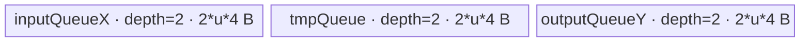
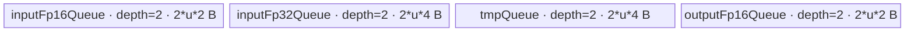
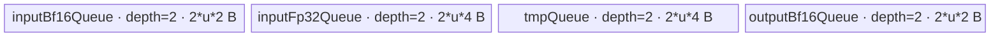

# InplaceHardswish 950 ACLNN 算子知识

## 算子速览

| 项目 | 内容 |
|---|---|
| 实际入口 | 公开两段式 `aclnnInplaceHardswishGetWorkspaceSize` / `aclnnInplaceHardswish`，无版本后缀；950 活动实现为 `activation/hard_swish` 的 `HardSwish` |
| 计算语义 | 对 `self` 原地写回 `x * clamp(x + 3, 0, 6) / 6`；核心 Kernel 先写 executor 中间输出，最终由 `ViewCopy` 覆盖 `self` |
| 输入输出 | `self`：ND、0D～8D、FLOAT/FLOAT16/BFLOAT16，可非连续、可空；输出 shape/dtype 与输入相同 |
| 执行类型 | 核心节点为单 Kernel `AIV_VECTOR`；外围按需经过框架 `Contiguous`、`Cast`、`ViewCopy` 节点；无 Cube/AIC/MIX_CV |
| Kernel 路线 | R-001 FLOAT32 原生；R-002 FLOAT16 升精度；R-003 BFLOAT16 升精度 |
| 核心资源 | GM 输入/中间输出；三或四个 depth=2 的 `TQue`；FP16/BF16 使用 FP32 中间队列；核心 workspace 为 0 |
| 来源闭包 | `source_closed`：公开 ACLNN→L0 launcher→950 OpDef/Tiling/POD→模板 key→`hard_swish` entry→三条 AIV body→binary/CMake 接线闭合；通用 `Contiguous/Cast/ViewCopy` 作为明确框架边界 |
| 验证状态 | 已完成源码闭包检查；本次知识提取未执行编译、真机、数值或性能测试。 |

## 接口与语义

### 计算语义

对逻辑域内每个元素 `x=self[i]`：

```text
t       = clamp(x + 3, 0, 6)
x_safe  = max(x, -3)
y       = x_safe * t * (1/6)
self[i] = cast_to_input_dtype(y)
```

`x_safe=max(x,-3)` 与分段公式在有限输入上等价；它额外使 `x=-inf` 时不执行 `-inf*0`，得到 `-3*0=0`。核心 `HardSwish` 不直接写调用者输入：L0 分配连续 `hardswish_out`，ACLNN 再通过 `ViewCopy(..., self)` 实现原地语义，因此非连续 view 也由框架按其 view 布局回写。

### 输入、输出与属性

| 参数 | shape/layout | dtype | 约束、默认值与语义 |
|---|---|---|---|
| `self` | ND，0D～8D；可非连续；可空 | FLOAT、FLOAT16、BFLOAT16 | 输入/输出同一 `aclTensor`；950 属于 API 的 `CheckSocVersionGe910B` 支持集合，三种 dtype 均通过校验 |
| `workspaceSize` | Host 标量输出 | `uint64_t*` | 第一段返回整个 executor 流程所需 Device workspace；空 Tensor 固定写 0 |
| `executor` | Host 对象 | `aclOpExecutor**` | 第一段创建并移交，持有框架节点、中间 Tensor、依赖和 workspace 需求 |
| `workspace` | Device 地址 | `void*` | 第二段由调用者提供，大小至少为第一段返回值；核心 HardSwish 节点自身声明 0 字节且不读该指针 |
| `stream` | runtime stream | `aclrtStream` | `CommonOpExecutorRun` 在该 stream 上执行 executor |

无独立属性。标量的 storage shape 在 Tiling 中由 `EnsureNotScalar` 归一为 `{1}`，因此核心按一个元素处理；空 Tensor 在 ACLNN 层提前成功返回，不进入 Tiling/Kernel。

### 入口与版本

固定 Commit `955f8b33985b6d72989ebff341bb9c2c564a51bc` 的公开文档声明无后缀 `aclnnInplaceHardswish`，产品表同时列 A2、A3 与 Ascend 950。当前稳定候选 `activation/hard_swish` 的活动实现只把 `SUPPORT_COMPUTE_UNIT` 设为 `ascend950`，Tiling 目录为 `arch35`；OpDef 只执行 `AddConfig("ascend950")`，binary config 也只有 `ascend950` 三种 dtype，因此本卡采用该 950 最新活动实现。

同仓 `experimental/activation/hard_swish_v2` 公开的是不同入口 `aclnnHardSwishV2`，没有 `aclnnInplaceHardswish`，不能作为本逻辑算子的原地版本候选。A2/A3 虽被公共 ACLNN 文档列为支持，但固定仓中没有与本入口闭合的 A2/A3 Host/Tiling/Kernel 活动接线，故不满足 `source_closed`，不生成无后缀卡。

## Host/Launcher 执行流程

### 参数校验与前处理

`aclnnInplaceHardswishGetWorkspaceSize` 先令 `out=const_cast<aclTensor*>(self)`，然后完全复用 `aclnnHardswishGetWorkspaceSize(self, out, ...)`：

1. `OP_CHECK_COMM_INPUT` 校验 `workspaceSize`、`executor` 输出指针，`CREATE_EXECUTOR` 创建 executor。
2. `CheckParams` 依次检查 `self/out` 非空、dtype 属于平台支持表、两者 dtype 可互转、shape 相同。原地入口的 `self/out` 为同一对象，因此互转和 shape 检查自然一致。
3. 若 `self->IsEmpty()`，写 `workspaceSize=0` 并移交空 executor，不加入任何 Device 节点。
4. `l0op::Contiguous(self)` 建立连续输入；是否物化及其 workspace 由通用框架决定。
5. 仅当平台不在 `ASCEND910B..ASCEND910E` 范围且输入为 BFLOAT16 时，前置 `Cast(..., FLOAT16)`。950 走 `CheckSocVersionGe910B` 路径，公开三种 dtype 不触发该降精度分支。
6. `l0op::HardSwish(selfCast)` 按 storage shape/dtype 分配连续中间输出，以 `ADD_TO_LAUNCHER_LIST_AICORE(HardSwish, ...)` 加入本算子的 AIV Kernel。
7. 无条件调用 `l0op::Cast(hardswishOpOut, self->GetDataType())`；同 dtype 是否复用由框架实现决定，固定算子目录不推测。
8. `l0op::ViewCopy(castOut, self)` 加入原地回写节点。随后 executor 汇总 workspace 并移交。
9. 第二段 `aclnnInplaceHardswish` 仅调用 `CommonOpExecutorRun(workspace, workspaceSize, executor, stream)`。

每个 `Contiguous/Cast/HardSwish/ViewCopy` 返回值均在继续前检查；失败立即返回，不再追加后续节点。L0 HardSwish 的中间输出分配或 launcher 加入失败返回 `nullptr`，ACLNN 转为 `ACLNN_ERR_INNER_NULLPTR`。

### 参数、Workspace 与生命周期

核心 Tiling 的 `GetWorkspaceSize` 取得一个 workspace slot，并固定写 `WS_SYS_SIZE=0`；`hard_swish(x,y,workspace,tiling)` 保留 ABI 形参 `workspace`，三个 body 的 `Init` 均不接收它。因此核心节点 `workspace_core=0`。

ACLNN 返回的 `workspaceSize=uniqueExecutor->GetWorkspaceSize()` 是整个流程汇总值，可能包含通用 `Contiguous/Cast/ViewCopy` 的框架需求以及 executor 管理的中间 Tensor；这些通用节点的逐 slice offset/extent 在本算子固定目录不可见。调用者拥有 `self` 与传入 workspace，并须保持到 stream 执行结束；executor 拥有连续输入（若物化）、HardSwish 输出、Cast 输出（若物化）和节点描述。每个中间对象至少存活到直接 consumer 完成：`selfContiguous/selfCast` 到 HardSwish 读完，`hardswishOpOut` 到 Cast 完成，`castOut` 到 ViewCopy 回写完成。

### 启动图与失败传播

```text
空 Tensor：参数校验 -> workspaceSize=0 -> 空 executor -> CommonOpExecutorRun

非空 A5：
self
  -> Contiguous（框架边界）
  -> HardSwish（单 AIV_VECTOR Kernel，blockDim=usedCoreNum，POD=HardSwishTilingData）
  -> Cast(to self dtype，框架边界；同 dtype 可由框架处理)
  -> ViewCopy(out=self，框架边界，完成原地覆盖)
```

核心自有 launch graph 只有一个 Device 节点：Host producer 为 `l0op::HardSwish` / 框架 AICore launcher，entry 为 `hard_swish<schMode>`，输入输出均为连续 ND GM，POD 为 24 字节名义布局的三个 `int64_t` 字段，核心 workspace slice 为 0 字节。所有节点由同一 executor 按数据依赖在传入 stream 上执行；固定目录没有算子自有 event、跨 Kernel workspace 边或 cleanup。任一 producer 失败都会阻断其 consumer，核心失败不会执行最终 `ViewCopy`。

## Route 与参数设计

### 分核与资源计算

令 `N` 为归一后的 storage shape 元素数，`C` 为 950 AIV core 数，`U` 为每核 UB 字节数，`B=GetUbBlockSize(context)`，`F=blockFactor`，`u=ubFactor`：

```text
F          = ceil(N / C)                         # 元素/核
usedCore   = ceil(N / F)                         # blockDim
coreStart  = blockIdx * F                        # 元素
coreLen    = min(F, N - coreStart)               # 元素

R-001 FP32:
u = floor_align(floor((U / 4) / 6), B)          # 元素/tile

R-002 FP16、R-003 BF16:
u = floor_align(floor((U / 4) / 8), B)          # 元素/tile；按 FP32 中间保守估算

loopCount  = ceil(coreLen / u)
tileLen(i) = (i == loopCount-1) ? coreLen-u*i : u
```

`N`、`F`、`u` 与循环/地址均为 `int64_t`。Host 在 `u<=0` 时失败；未显式检查 `N` 的 shape 乘积、`N+C-1` 类内部 `CeilDiv` 或 `F*blockIdx` 的溢出。`FloorAlign` 的第二参数直接使用 `GetUbBlockSize` 返回值；源码没有额外单位换算，复用时必须保持该 Host API 的原单位契约。

实际 UB 字节账显示 FP32 为 `24u`，16 位路线为 `24u`；16 位 Host 以 `32u<=U` 选择 tile，留下保守余量。`usedCore<=C` 且最后一核承接余数，不另设 former/tail POD 字段。

### Route 选择

| 顺序 | Route | Key/模板 | 精确选择条件与优先级 | 不适用去向 |
|---:|---|---|---|---|
| 1 | R-001 FLOAT32 原生 | `GET_TPL_TILING_KEY(0)` / `schMode=0`；`HardSwish<float>` | 950、非空、ACLNN dtype FLOAT；Tiling 的首个 `if (dataType==DT_FLOAT)` | dtype 非 FLOAT 转下一条件；非法 dtype 在 API/Tiling 失败 |
| 2 | R-002 FLOAT16 升精度 | `GET_TPL_TILING_KEY(1)` / `schMode=1`；`HardSwishFp16` | 950、非空、ACLNN dtype FLOAT16；Tiling 的 `else if (DT_FLOAT16)` | dtype 非 FLOAT16 转下一条件 |
| 3 | R-003 BFLOAT16 升精度 | `GET_TPL_TILING_KEY(2)` / `schMode=2`；`HardSwishBf16` | 950、非空、ACLNN dtype BFLOAT16；Tiling 的 `else if (DT_BF16)` | 其它 dtype 失败，无 Device fallback |

```text
ACLNN self 非空且 dtype 通过平台表
  -> HardSwishTilingFunc(dataType)
     -> FLOAT    : GET_TPL_TILING_KEY(0), u=floor_align((U/4)/6, B) -> schMode=0 -> HardSwish<float>
     -> FLOAT16  : GET_TPL_TILING_KEY(1), u=floor_align((U/4)/8, B) -> schMode=1 -> HardSwishFp16
     -> BFLOAT16 : GET_TPL_TILING_KEY(2), u=floor_align((U/4)/8, B) -> schMode=2 -> HardSwishBf16
     -> otherwise: GRAPH_FAILED
```

三个 `schMode` 值都由 `ASCENDC_TPL_ARGS_DECL/SEL` 列入活动模板集合；最终 TilingKey 由外部框架宏 `GET_TPL_TILING_KEY(schMode)` 编码，固定仓没有该宏定义，故不把其最终 64 位数值臆写为 `0/1/2`。entry 使用编译期 `if constexpr`，不存在运行时 unknown-key fallback body。

### 模板/实现执行矩阵

| Route | key/selector | dtype/shape/platform 完整命中条件 | 执行拓扑与 Kernel 节点 | 实际模板/body | 内存与同步特征 | tail/fallback |
|---|---|---|---|---|---|---|
| R-001 FLOAT32 原生 | `schMode=0` | 950、非空、FLOAT、ND storage shape | 单 `hard_swish<0>` AIV_VECTOR | `HardSwish<float>::Process/Compute` | 三个 depth=2 FP32 队列；输入和临时值各自原地改写；Queue producer/consumer 顺序 | 最后一核与最后 tile 用精确 `currentNum`；无 fallback |
| R-002 FLOAT16 升精度 | `schMode=1` | 950、非空、FLOAT16、ND storage shape | 单 `hard_swish<1>` AIV_VECTOR | `HardSwishFp16::Process/Compute` | 两个 depth=2 FP16 队列、两个 depth=2 FP32 队列；FP32 计算后 round cast | 同上；无 fallback |
| R-003 BFLOAT16 升精度 | `schMode=2` | 950、非空、BFLOAT16、ND storage shape | 单 `hard_swish<2>` AIV_VECTOR | `HardSwishBf16::Process/Compute` | 两个 depth=2 BF16 队列、两个 depth=2 FP32 队列；FP32 计算后 round cast | 同上；无 fallback |

### 隐藏性能 Guard

| Guard | Host/Tiling 条件 | Device/资源原因 | 影响 Route | 不满足时去向 | 源码符号 |
|---|---|---|---|---|---|
| 平台可用性 | OpDef `AddConfig("ascend950")` 且 CMake/config 仅 `ascend950` | 当前公开 body 是 arch35 AIV Vector 实现 | 全部 | 非 950 不属于该源码闭包 | `HardSwish::HardSwish`、`SUPPORT_COMPUTE_UNIT` |
| dtype key | `dataType` 精确等于 FLOAT/FLOAT16/BFLOAT16 | entry 的三种编译期 specialization 决定 GM/UB dtype 与 cast | 全部 | API 或 Tiling `GRAPH_FAILED` | `GetShapeAttrsInfo`、`HardSwishTilingFunc` |
| AIV core/UB 可用 | `coreNum!=0 && ubSize!=0` | 需要非零 blockDim 和 tile 资源 | 全部 | Tiling 失败 | `GetPlatformInfo` |
| UB tile 下界 | `ubFactor=floor_align(...) > 0` | Queue 每块容量必须正数，循环除数不能为 0 | 全部 | Tiling 失败 | `HardSwishTilingFunc` |
| 16 位保守 UB | `32u<=U`（由 `(U/4)/8` 得出） | 实际四队列总计 `24u`，Host 留出 `8u` 余量 | R-002/R-003 | 自动缩小 tile，无其它 Route | `BUFFER_NUM_FP16/BF16`、`InitBuffer` |
| 空域 | `self->IsEmpty()` | 避免 `F=ceil(0/C)=0` 后再次除 0及无效启动 | 全部 | 成功返回 workspace 0 | `aclnnHardswishGetWorkspaceSize` |
| tail DMA | `currentNum=min(u, coreLen-u*i)` | `DataCopyPad.blockLen` 使用精确有效字节数，可处理不对齐尾块 | 全部 | 无 fallback | 三个 `Process/CopyIn/CopyOut` |

### POD/ABI

| 结构 | 字段 | 类型/位宽 | ABI 布局 | 单位 | Host/launcher producer | Device consumer | 边界 |
|---|---|---|---|---|---|---|---|
| `HardSwishTilingData` | `totalNum` | `int64_t` / 64 | 声明顺序第 1 个；名义 `offsetof=0` | 元素 | `HardSwishTilingFunc`: `input storage shape.GetShapeSize()`；标量先变 `{1}` | 三个 `Init`: `totalNum-blockFactor*GetBlockIdx()` | 公开非空路线 `>0`；shape 乘积溢出未显式检查 |
| `HardSwishTilingData` | `blockFactor` | `int64_t` / 64 | 声明顺序第 2 个；名义 `offsetof=8` | 元素/核 | `CeilDiv(totalNum, coreNum)` | 三个 `Init`: GM base 与当前核 `blockLength_` | `>0`；最后核可短于该值 |
| `HardSwishTilingData` | `ubFactor` | `int64_t` / 64 | 声明顺序第 3 个；名义 `offsetof=16` | 元素/tile | 按 dtype 的 UB 公式，经 `FloorAlign` | 三个 `Init/Process/CopyIn/CopyOut`: Queue 容量、循环和 GM tile offset | `<=0` 时 Tiling 失败 |

结构仅含连续三个 `int64_t`，固定源码没有 `static_assert(sizeof/alignof/offsetof)`；按声明的名义 ABI 为 `sizeof=24`、`alignof=8`、offset `0/8/16`，但最终序列化 ABI 仍由 `REGISTER_TILING_DEFAULT/GET_TILING_DATA_WITH_STRUCT` 的框架约定控制。Host 先 `memset_s` 清零再逐字段写入，三个字段在所有活动 Route 都会被 Device 读取。

### Route 源码闭包

| Route | Key/selector | Host/Tiling producer | POD/参数 | Kernel entry/router 节点 | Kernel body/直接依赖 | 构建接线 |
|---|---|---|---|---|---|---|
| R-001 FLOAT32 原生 | `GET_TPL_TILING_KEY(0)` / `schMode=0` | `op_host/arch35/hard_swish_tiling.cpp` · `HardSwishTilingFunc` | `HardSwishTilingData` 三字段 | `op_kernel/hard_swish_apt.cpp` · `hard_swish<0>` | `op_kernel/arch35/hard_swish.h` · `HardSwish<float>` | OpDef `AddConfig("ascend950")`；ascend950 binary JSON；CMake arch35 |
| R-002 FLOAT16 升精度 | `GET_TPL_TILING_KEY(1)` / `schMode=1` | 同上 | 同上 | `hard_swish<1>` | `HardSwishFp16` | 同上 |
| R-003 BFLOAT16 升精度 | `GET_TPL_TILING_KEY(2)` / `schMode=2` | 同上 | 同上 | `hard_swish<2>` | `HardSwishBf16` | 同上 |

## Kernel 实现

### 公共执行流程

`hard_swish<schMode>(x,y,workspace,tiling)` 用框架宏解析同一 `HardSwishTilingData`，按编译期 key 构造唯一 body。三个 `Init` 都计算当前核的 `coreStart=blockFactor*blockIdx`、`blockLength=min(blockFactor,totalNum-coreStart)`，绑定连续 GM 输入/输出，并按 `ubFactor` 初始化 depth=2 Queue。`Process` 对每个 tile 严格调用 `CopyIn→Compute→CopyOut`：单 block `DataCopyPad` 传输 `currentNum*sizeof(storage_dtype)` 字节，Vector primitive 的元素数也都是 `currentNum`，故最后核和最后 tile 不会把 padding lane 写入 GM。

每条 Route 都是单 AIV Vector Kernel，无跨核共享、归约、Atomic、workspace、SIMT、NDDMA、通信或 Cube。Queue 的 `EnQue/DeQue/FreeTensor` 建立 VECIN→计算→VECOUT 的生产消费和槽位复用顺序；源码没有显式 event/barrier。

### Route R-001：FLOAT32 原生计算

#### 适用条件

##### 选择证据

| 层级 | 文件 | 符号 | 源码谓词/参数 | 结果/下一跳 |
|---|---|---|---|---|
| API | `op_host/op_api/aclnn_hardswish.cpp` | `CheckDtypeValid` | 950 支持表包含 FLOAT，非空后进入 L0 | 继续 HardSwish |
| Tiling | `op_host/arch35/hard_swish_tiling.cpp` | `HardSwishTilingFunc` | `dataType==ge::DT_FLOAT` | `ubFactor=floor_align((U/4)/6,B)`，`GET_TPL_TILING_KEY(0)` |
| Router | `op_kernel/hard_swish_apt.cpp` | `hard_swish<schMode>` | `schMode==TILING_KEY_FP32` | `HardSwish<float>` |
| Platform | `op_host/hard_swish_def.cpp` | `HardSwish::HardSwish` | `AddConfig("ascend950")` | 950 AIV binary |

#### Device 数据流

##### 函数级调用链

```text
l0op::HardSwish -> ADD_TO_LAUNCHER_LIST_AICORE(HardSwish)
  -> hard_swish<0>(x, y, workspace_unused, tiling)
    -> HardSwish<float>::Init
    -> HardSwish<float>::Process
      -> CopyIn
      -> Compute: Adds -> Mins -> Maxs -> Maxs -> Mul -> Muls
      -> CopyOut
  -> Cast(frame boundary) -> ViewCopy(out=self)
```

##### 源码等价伪码

```text
# 源码等价伪码
b = GetBlockIdx()
start = blockFactor * b
len = min(blockFactor, totalNum - start)
bind xGM=x[start:start+len], yGM=y[start:start+len]

for i in [0, ceil(len/ubFactor)):
    n = (i is last) ? len-ubFactor*i : ubFactor
    xLocal = DataCopyPad(xGM[i*ubFactor], blockCount=1, blockLen=n*4, strides=0)
    tmp = min(max(xLocal + 3.0f, 0.0f), 6.0f)
    xLocal = max(xLocal, -3.0f)
    yLocal = (xLocal * tmp) * (1.0f/6.0f)
    DataCopyPad(yGM[i*ubFactor], yLocal, blockCount=1, blockLen=n*4, strides=0)
```

#### 内存与数据搬运

##### 资源与搬运表

| 层级/缓冲区 | offset/地址公式 | extent/容量公式 | dtype/layout | producer | consumer | owner/lifetime | 对齐/复用 |
|---|---|---|---|---|---|---|---|
| GM `inputGMX` | `x + blockFactor*b + ubFactor*i` | 当前核 `blockLength_`，本轮 `currentNum` | FLOAT/ND 连续 | Contiguous/调用者 | `CopyIn` | executor/调用者；到核心读完 | 尾块精确字节搬运 |
| `inputQueueX` | Queue 槽位 | `2*u*4` bytes | FLOAT | `CopyIn` | `Compute` | Kernel/pipe；Alloc→EnQue→DeQue→Free | depth=2；`Maxs` 原地覆盖 x |
| `tmpQueue` | Queue 槽位 | `2*u*4` bytes | FLOAT | `Compute::Adds` | `Mins/Maxs/Mul` | Kernel/pipe；Compute 内 | depth=2；连续原地 clamp |
| `outputQueueY` | Queue 槽位 | `2*u*4` bytes | FLOAT | `Compute::Mul/Muls` | `CopyOut` | Kernel/pipe；Alloc→EnQue→DeQue→Free | depth=2；`Muls` 原地覆盖 |
| GM `outputGMY` | `y + blockFactor*b + ubFactor*i` | 当前核 `blockLength_`，本轮 `currentNum` | FLOAT/ND 连续 | `CopyOut` | ACLNN Cast/ViewCopy | executor；到原地回写完成 | 核间不重叠 |

##### 分层内存布局



##### 字节账与复用顺序

```text
UB_total = 2*u*4 + 2*u*4 + 2*u*4 = 24u bytes
Host: u <= floor(U / 24) 后按 B 向下对齐
=> UB_total <= U
dynamic_ub = N/A（AIV Queue 使用静态 TPipe 分配）
workspace_total(core node) = 0
```

| 复用子区 | 写入者 | 读取者/消费点 | 下一次覆盖 | 同步或释放依据 | 安全条件 |
|---|---|---|---|---|---|
| `inputQueueX` 当前槽 | `CopyIn` | `Compute` 的 `Maxs/Mul` | `FreeTensor` 后的后续 tile | `EnQue→DeQue→FreeTensor` | `Mul` 完成前不得释放 |
| `tmpQueue` 当前槽 | `Adds` | `Mins→Maxs→Mul` | `FreeTensor` 后的后续 tile | `FreeTensor(tmpLocal)` | clamp 与 Mul 完成前不得覆盖 |
| `outputQueueY` 当前槽 | `Mul→Muls` | `CopyOut` | `FreeTensor` 后的后续 tile | `EnQue→DeQue→FreeTensor` | GM 搬运提交前不得复用 |

#### 同步、精度与尾块

##### 同步与数值边界表

| 阶段 | primitive/机制 | producer | consumer/等待点 | 保护对象 | 精度/尾块 |
|---|---|---|---|---|---|
| GM→UB | `DataCopyPad` + Queue | GM 输入 | `DeQue` | input Queue 槽 | `blockLen=currentNum*4`，无效尾 lane 不参与 Vector 长度 |
| clamp | `Adds/Mins/Maxs` | xLocal | `Mul` | tmpLocal | 全 FP32；常量 3、6、0；长度 `currentNum` |
| `-inf` 防护 | 原地 `Maxs(x,-3)` | xLocal | `Mul` | input 槽 | 防止 `-inf*0=NaN`；有限 `x<=-3` 仍得 0 |
| 输出 | `Mul/Muls` + Queue | x/tmp | `CopyOut::DeQue` | output 槽 | FP32 常量 `1/6`；尾块只写 `currentNum*4` 字节 |

#### 关键实现

##### 符号证据表

| 阶段 | 文件 | 符号/模板实例 | 实现事实 |
|---|---|---|---|
| Host/Tiling producer | `activation/hard_swish/op_host/arch35/hard_swish_tiling.cpp` | `HardSwishTilingFunc` | FP32 模板 key、分核、UB 公式、blockDim、workspace 0 |
| Kernel entry/router | `activation/hard_swish/op_kernel/hard_swish_apt.cpp` | `hard_swish<0>` | `schMode=0` 构造 `HardSwish<float>` |
| Device body/helper | `activation/hard_swish/op_kernel/arch35/hard_swish.h` | `HardSwish<float>::Init/CopyIn/Compute/CopyOut/Process` | GM offset、三 Queue、Vector 顺序、原地复用与尾块 |

### Route R-002：FLOAT16 升精度计算

#### 适用条件

##### 选择证据

| 层级 | 文件 | 符号 | 源码谓词/参数 | 结果/下一跳 |
|---|---|---|---|---|
| API | `op_host/op_api/aclnn_hardswish.cpp` | `CheckDtypeValid` | 950 FLOAT16 通过平台 dtype 表 | 继续 HardSwish |
| Tiling | `op_host/arch35/hard_swish_tiling.cpp` | `HardSwishTilingFunc` | `dataType==ge::DT_FLOAT16` | `ubFactor=floor_align((U/4)/8,B)`，`GET_TPL_TILING_KEY(1)` |
| Router | `op_kernel/hard_swish_apt.cpp` | `hard_swish<1>` | `schMode==TILING_KEY_FP16` | `HardSwishFp16` |
| Config | `op_host/config/ascend950/hard_swish_binary.json` | FLOAT16 entry | input/output dtype float16 | 950 binary |

#### Device 数据流

##### 函数级调用链

```text
l0op::HardSwish
  -> hard_swish<1>
    -> HardSwishFp16::Init
    -> HardSwishFp16::Process
      -> CopyIn(FP16)
      -> Compute: Cast(FP16->FP32) -> FP32 Adds/Mins/Maxs/Maxs/Mul/Muls -> Cast(FP32->FP16)
      -> CopyOut(FP16)
  -> Cast(frame boundary) -> ViewCopy(out=self)
```

##### 源码等价伪码

```text
# 分核、循环与地址同 R-001，storage byte size=2
for each tile n:
    x16 = DataCopyPad(xGM[offset], blockLen=n*2)
    x32 = Cast(x16, FP32, CAST_NONE, n)
    tmp32 = min(max(x32 + 3.0f, 0.0f), 6.0f)
    x32 = max(x32, -3.0f)
    x32 = (x32 * tmp32) * (1.0f/6.0f)
    y16 = Cast(x32, FP16, CAST_ROUND, n)
    DataCopyPad(yGM[offset], y16, blockLen=n*2)
```

#### 内存与数据搬运

##### 资源与搬运表

| 层级/缓冲区 | offset/地址公式 | extent/容量公式 | dtype/layout | producer | consumer | owner/lifetime | 对齐/复用 |
|---|---|---|---|---|---|---|---|
| GM input/output | `base+blockFactor*b+u*i` | `currentNum` | FLOAT16/ND | 框架、`CopyOut` | `CopyIn`、ViewCopy | executor | 每元素 2B，尾块精确搬运 |
| `inputFp16Queue` | Queue 槽 | `2*u*2` bytes | FP16 | `CopyIn` | input Cast | pipe | depth=2 |
| `inputFp32Queue` | Queue 槽 | `2*u*4` bytes | FP32 | Cast / 后续原地计算 | clamp、Mul、output Cast | pipe | depth=2；x32 原地 `Maxs/Mul/Muls` |
| `tmpQueue` | Queue 槽 | `2*u*4` bytes | FP32 | `Adds` | `Mins/Maxs/Mul` | pipe | depth=2；原地 clamp |
| `outputFp16Queue` | Queue 槽 | `2*u*2` bytes | FP16 | output Cast | `CopyOut` | pipe | depth=2 |

##### 分层内存布局



##### 字节账与复用顺序

```text
UB_total = 4u + 8u + 8u + 4u = 24u bytes
Host selector enforces u <= floor(U/32) 后按 B 向下对齐
=> UB_total <= 3U/4（忽略向下对齐只会更小），保守余量至少约 U/4
dynamic_ub = N/A
workspace_total(core node) = 0
```

| 复用子区 | 写入者 | 读取者/消费点 | 下一次覆盖 | 同步或释放依据 | 安全条件 |
|---|---|---|---|---|---|
| `inputFp16Queue` 槽 | `CopyIn` | FP16→FP32 Cast | `FreeTensor` 后 | Queue 生命周期 | Cast 完成前不得释放 |
| `inputFp32Queue` 槽 | input Cast，随后 `Maxs/Mul/Muls` 原地写 | output Cast | `FreeTensor` 后 | Compute 末尾释放 | FP16 输出 Cast 完成前不得覆盖 |
| `tmpQueue` 槽 | `Adds/Mins/Maxs` | `Mul` | `FreeTensor` 后 | Compute 末尾释放 | Mul 完成前有效 |
| `outputFp16Queue` 槽 | output Cast | CopyOut | `FreeTensor` 后 | `EnQue→DeQue→FreeTensor` | GM 写回完成前有效 |

#### 同步、精度与尾块

##### 同步与数值边界表

| 阶段 | primitive/机制 | producer | consumer/等待点 | 保护对象 | 精度/尾块 |
|---|---|---|---|---|---|
| 输入 | `DataCopyPad` + Queue | FP16 GM | input Cast | input16 槽 | `blockLen=n*2` |
| 升精度 | `Cast(..., CAST_NONE, n)` | x16 | FP32 算术 | input32 槽 | 精确提升 FP16 到 FP32 |
| 计算 | FP32 Vector primitives | x32/tmp32 | output Cast | 两个 FP32 槽 | `max(x,-3)` 保证 `-inf` 边界；所有长度为 n |
| 降精度/输出 | `Cast(..., CAST_ROUND, n)` + Queue | FP32 结果 | CopyOut | output16 槽 | 明确 round 后写 `n*2` 字节 |

#### 关键实现

##### 符号证据表

| 阶段 | 文件 | 符号/模板实例 | 实现事实 |
|---|---|---|---|
| Host/Tiling producer | `activation/hard_swish/op_host/arch35/hard_swish_tiling.cpp` | `HardSwishTilingFunc` | `schMode=1`、按 8 个 FP32 等价 buffer 的保守 tile 公式 |
| Kernel entry/router | `activation/hard_swish/op_kernel/hard_swish_apt.cpp` | `hard_swish<1>` | 构造 `HardSwishFp16` |
| Device body/helper | `activation/hard_swish/op_kernel/arch35/hard_swish.h` | `HardSwishFp16::*` | 四 Queue、双 Cast、FP32 算术、round 与尾块 |

### Route R-003：BFLOAT16 升精度计算

#### 适用条件

##### 选择证据

| 层级 | 文件 | 符号 | 源码谓词/参数 | 结果/下一跳 |
|---|---|---|---|---|
| API | `op_host/op_api/aclnn_hardswish.cpp` | `CheckSocVersionGe910B/CheckDtypeValid` | 950 使用含 BFLOAT16 的平台 dtype 表 | 不执行前置 BF16→FP16 Cast，继续 HardSwish |
| Tiling | `op_host/arch35/hard_swish_tiling.cpp` | `HardSwishTilingFunc` | `dataType==ge::DT_BF16` | `ubFactor=floor_align((U/4)/8,B)`，`GET_TPL_TILING_KEY(2)` |
| Router | `op_kernel/hard_swish_apt.cpp` | `hard_swish<2>` | `schMode==TILING_KEY_BF16` | `HardSwishBf16` |
| Config | `op_host/config/ascend950/hard_swish_binary.json` | BFLOAT16 entry | input/output dtype bfloat16 | 950 binary |

#### Device 数据流

##### 函数级调用链

```text
l0op::HardSwish
  -> hard_swish<2>
    -> HardSwishBf16::Init
    -> HardSwishBf16::Process
      -> CopyIn(BF16)
      -> Compute: Cast(BF16->FP32) -> FP32 Adds/Mins/Maxs/Maxs/Mul/Muls -> Cast(FP32->BF16)
      -> CopyOut(BF16)
  -> Cast(frame boundary) -> ViewCopy(out=self)
```

##### 源码等价伪码

```text
# 分核、循环与地址同 R-001，storage byte size=2
for each tile n:
    xb16 = DataCopyPad(xGM[offset], blockLen=n*2)
    x32 = Cast(xb16, FP32, CAST_NONE, n)
    tmp32 = min(max(x32 + 3.0f, 0.0f), 6.0f)
    x32 = max(x32, -3.0f)
    x32 = (x32 * tmp32) * (1.0f/6.0f)
    yb16 = Cast(x32, BF16, CAST_ROUND, n)
    DataCopyPad(yGM[offset], yb16, blockLen=n*2)
```

#### 内存与数据搬运

##### 资源与搬运表

| 层级/缓冲区 | offset/地址公式 | extent/容量公式 | dtype/layout | producer | consumer | owner/lifetime | 对齐/复用 |
|---|---|---|---|---|---|---|---|
| GM input/output | `base+blockFactor*b+u*i` | `currentNum` | BFLOAT16/ND | 框架、`CopyOut` | `CopyIn`、ViewCopy | executor | 每元素 2B，尾块精确搬运 |
| `inputBf16Queue` | Queue 槽 | `2*u*2` bytes | BF16 | `CopyIn` | input Cast | pipe | depth=2 |
| `inputFp32Queue` | Queue 槽 | `2*u*4` bytes | FP32 | Cast / 原地计算 | clamp、Mul、output Cast | pipe | depth=2 |
| `tmpQueue` | Queue 槽 | `2*u*4` bytes | FP32 | `Adds` | `Mins/Maxs/Mul` | pipe | depth=2 |
| `outputBf16Queue` | Queue 槽 | `2*u*2` bytes | BF16 | output Cast | `CopyOut` | pipe | depth=2 |

##### 分层内存布局



##### 字节账与复用顺序

```text
UB_total = 4u + 8u + 8u + 4u = 24u bytes
Host selector: u <= floor(U/32) 后按 B 向下对齐
dynamic_ub = N/A
workspace_total(core node) = 0
```

| 复用子区 | 写入者 | 读取者/消费点 | 下一次覆盖 | 同步或释放依据 | 安全条件 |
|---|---|---|---|---|---|
| `inputBf16Queue` 槽 | CopyIn | BF16→FP32 Cast | Free 后下一 tile | Queue 生命周期 | Cast 完成前有效 |
| `inputFp32Queue` 槽 | input Cast、原地 `Maxs/Mul/Muls` | output Cast | Free 后下一 tile | Compute 末尾释放 | BF16 Cast 完成前有效 |
| `tmpQueue` 槽 | clamp 链 | Mul | Free 后下一 tile | Compute 末尾释放 | Mul 完成前有效 |
| `outputBf16Queue` 槽 | output Cast | CopyOut | Free 后下一 tile | Queue 生命周期 | GM 写回完成前有效 |

#### 同步、精度与尾块

##### 同步与数值边界表

| 阶段 | primitive/机制 | producer | consumer/等待点 | 保护对象 | 精度/尾块 |
|---|---|---|---|---|---|
| 输入 | `DataCopyPad` + Queue | BF16 GM | input Cast | input BF16 槽 | `blockLen=n*2` |
| 升精度 | `Cast(..., CAST_NONE, n)` | BF16 | FP32 算术 | input32 槽 | BF16 值提升到 FP32 |
| 计算 | FP32 Vector primitives | x32/tmp32 | output Cast | FP32 槽 | `max(x,-3)` 防 `-inf*0`；只处理 n 个元素 |
| 降精度/输出 | `Cast(..., CAST_ROUND, n)` + Queue | FP32 | CopyOut | output BF16 槽 | round 后精确写 `n*2` 字节 |

#### 关键实现

##### 符号证据表

| 阶段 | 文件 | 符号/模板实例 | 实现事实 |
|---|---|---|---|
| Host/Tiling producer | `activation/hard_swish/op_host/arch35/hard_swish_tiling.cpp` | `HardSwishTilingFunc` | `schMode=2`、分核和保守 UB 公式 |
| Kernel entry/router | `activation/hard_swish/op_kernel/hard_swish_apt.cpp` | `hard_swish<2>` | 构造 `HardSwishBf16` |
| Device body/helper | `activation/hard_swish/op_kernel/arch35/hard_swish.h` | `HardSwishBf16::*` | BF16/FP32 Queue、双 Cast、FP32 算术、round、tail |

## 算子特定优化

### Trick T-001：乘法前钳制输入以闭合负无穷边界

#### 触发与源码依据

- 适用 Route：R-001、R-002、R-003。
- 触发条件：每个有效 tile 的 HardSwish 计算；对 `x<=-3` 尤其是 `x=-inf` 生效。
- Golden 来源：[`activation/hard_swish/op_kernel/arch35/hard_swish.h:114-126`](../../../../../../../cann-ops-raw/ascendc/ops-nn/955f8b33985b6d72989ebff341bb9c2c564a51bc/activation/hard_swish/op_kernel/arch35/hard_swish.h#L114-L126)

**官方源码（固定 Commit 连续逐字摘录）**：

```cpp
// Step 1: tmpLocal = x + 3
Adds(tmpLocal, xLocal, static_cast<T>(3.0f), currentNum);
// Step 2: tmpLocal = min(tmpLocal, 6)
Mins(tmpLocal, tmpLocal, static_cast<T>(6.0f), currentNum);
// Step 3: tmpLocal = max(tmpLocal, 0) => clamp(x+3, 0, 6)
Maxs(tmpLocal, tmpLocal, static_cast<T>(0.0f), currentNum);
// Step 4 (ISSUE-001 fix): clamp x to >= -3, so -inf becomes -3.
//   When x <= -3, clamp result is 0, so max(x,-3)*0 = -3*0 = 0 (not NaN).
Maxs(xLocal, xLocal, static_cast<T>(-3.0f), currentNum);
// Step 5: yLocal = max(x,-3) * clamp(x+3, 0, 6)
Mul(yLocal, xLocal, tmpLocal, currentNum);
// Step 6: yLocal = yLocal * (1/6)
Muls(yLocal, yLocal, static_cast<T>(1.0f / 6.0f), currentNum);
```

#### 机制与设计原因

直接实现 `x*clamp(x+3,0,6)` 时，`x=-inf` 会形成 IEEE `-inf*0` 并得到 NaN。源码先在独立 `tmpLocal` 生成 clamp，再把输入 Queue 槽中的 `xLocal` 原地改成 `max(x,-3)`；对所有有限 `x<=-3`，乘数仍与数学分段结果等价，对 `-inf` 则变成有限的 `-3*0`。全部 primitive 的长度都来自当前循环 `currentNum`，不会读取尾部无效 lane。16 位 Route 在 FP32 中应用相同顺序。

#### 迁移边界

- 适用：形如 `x*g(x)` 且某分段 `g(x)=0`、输入允许无穷值的逐元素激活。
- 前提：钳制后的乘数在零分段保持数学等价；常量、比较边界与原公式一致。
- 失效：若零分段仍需保留输入符号/NaN payload，或 `g(x)` 并非精确零，不能机械套用；应重新证明数值语义。
- 未验证：本次知识提取未执行编译、真机、数值或性能测试。

#### 错误做法

源码注释给出的真实反例是直接计算 `-inf*0`，其结果为 NaN，而接口分段语义要求 `x<=-3` 输出 0。

### Trick T-002：16 位存储、FP32 计算并原地复用计算队列

#### 触发与源码依据

- 适用 Route：R-002、R-003。
- 触发条件：输入 dtype 为 FLOAT16 或 BFLOAT16。
- Golden 来源：[`activation/hard_swish/op_kernel/arch35/hard_swish.h:223-236`](../../../../../../../cann-ops-raw/ascendc/ops-nn/955f8b33985b6d72989ebff341bb9c2c564a51bc/activation/hard_swish/op_kernel/arch35/hard_swish.h#L223-L236)

**官方源码（固定 Commit 连续逐字摘录）**：

```cpp
// fp16 -> fp32
Cast(xFp32Local, xFp16Local, RoundMode::CAST_NONE, currentNum);

// HardSwish in fp32
Adds(tmpLocal, xFp32Local, 3.0f, currentNum);
Mins(tmpLocal, tmpLocal, 6.0f, currentNum);
Maxs(tmpLocal, tmpLocal, 0.0f, currentNum);
// ISSUE-001 fix: clamp x to >= -3 to avoid -inf * 0 = NaN
Maxs(xFp32Local, xFp32Local, -3.0f, currentNum);
Mul(xFp32Local, xFp32Local, tmpLocal, currentNum);
Muls(xFp32Local, xFp32Local, 1.0f / 6.0f, currentNum);

// fp32 -> fp16
Cast(yFp16Local, xFp32Local, RoundMode::CAST_ROUND, currentNum);
```

#### 机制与设计原因

GM 与输入/输出 Queue 保持 2 字节存储，减少相对全 FP32 GM 的搬运；进入 Compute 后只转换一次到 FP32，完整的加、clamp、乘和缩放都在 FP32 执行，最后以 `CAST_ROUND` 一次降精度。`xFp32Local` 同一物理 Queue 槽依次承载升精度输入、钳制值、乘积和缩放结果，避免为每一步物化新 FP32 buffer；`tmpLocal` 也被 `Mins/Maxs` 原地覆盖。

#### 迁移边界

- 适用：16 位输入输出、多个连续逐元素 primitive、允许以 FP32 中间改善计算精度的 AIV Kernel。
- 前提：UB 能容纳两个 16 位和两个 FP32 depth=2 Queue；Host tile 上界必须按实际 Queue 字节账约束。
- 失效：若接口要求每步按 16 位舍入，或 UB 不足使 `ubFactor<=0`，需改变精度/内存设计；本实现直接 Tiling 失败，没有备用 Route。
- 未验证：本次知识提取未执行编译、真机、数值或性能测试。

#### 错误做法

固定仓未提供可验证的另一条 16 位逐步舍入实现；不得据此推测精度或性能百分比。

## 模板与实现对比

| 对比维度 | R-001 FLOAT32 原生 | R-002 FLOAT16 升精度 | R-003 BFLOAT16 升精度 | 设计选择依据 |
|---|---|---|---|---|
| 命中条件/优先级 | dtype FLOAT，`schMode=0` | dtype FLOAT16，`schMode=1` | dtype BFLOAT16，`schMode=2` | Host dtype `if/else if` 与模板参数一一对应 |
| 模板与 dtype | `HardSwish<float>` | `HardSwishFp16` | `HardSwishBf16` | 16 位使用专用类，避免模板内运行时分支 |
| 循环与分核 | `F=ceil(N/C)`，tile `u` | 同左 | 同左 | 公共 POD 与地址公式 |
| Queue/TBuf/寄存器/dynamic UB/通信 window | 三个 FP32 depth=2 Queue；无显式 TBuf/dynamic UB/通信 | FP16 in/out + 两个 FP32 depth=2 Queue | BF16 in/out + 两个 FP32 depth=2 Queue | storage dtype 与计算 dtype 分离 |
| 内存总占用与复用 | `24u`；x/tmp/y 原地复用 | `24u`；Host 保守按 `32u`；x32/tmp 原地复用 | 同 R-002 | 16 位为 FP32 中间留资源余量 |
| 搬运/Vector/SIMT/NDDMA/通信 API | 4B `DataCopyPad`；FP32 Adds/Mins/Maxs/Mul/Muls | 2B `DataCopyPad` + 双 Cast + FP32 算术 | 同左但 BF16 Cast | 三者均仅 AIV Vector |
| 同步、精度与 tail | Queue；全 FP32；精确字节 tail | Queue；FP32 计算，round 到 FP16；精确 tail | Queue；FP32 计算，round 到 BF16；精确 tail | `currentNum` 贯穿 DMA/Vector/Cast |
| fallback/失败边界 | UB/key/platform 失败即终止 | 同左 | 同左 | 无 Device fallback |

## 平台差异

| 项目 | A2 | A3 | 950 |
|---|---|---|---|
| 支持状态 | 公开 ACLNN 文档标为支持；固定仓无本入口的 A2 source-closed 实现 | 公开 ACLNN 文档标为支持；固定仓无本入口的 A3 source-closed 实现 | 公开支持且 `activation/hard_swish` 源码闭合 |
| Host/Launcher | API 壳可见，但实际 A2 Host/Tiling/Kernel/build 接线缺失 | API 壳可见，但实际 A3 Host/Tiling/Kernel/build 接线缺失 | arch35 Tiling，三 dtype key，单 AIV 核心节点 |
| Kernel/资源 | 固定仓不可见，不推测 | 固定仓不可见，不推测 | 三/四个 depth=2 Queue，实际 UB `24u`，核心 workspace 0 |

因此 `inplace_hardswish.md` 不创建；文档支持不替代 `source_closed` 所需的 Host/Tiling/POD/Kernel/build 证据。

## 限制与失败边界

- 公开输入限 FLOAT/FLOAT16/BFLOAT16、ND、0D～8D；空 Tensor 成功返回 workspace 0。API 实现未显式检查维数，维数上限来自公开文档，固定实现只读取 storage shape 元素总数。
- 非连续 Tensor 的物化与回写由通用 `Contiguous/ViewCopy` 完成；它们及无条件 `Cast` 的内部 Kernel、workspace slice、同 dtype 复用策略不在本算子固定目录中，按框架边界保留，不推测。
- 核心输出不是直接别名写回 `self`；移植时不得删除最终 `ViewCopy`，否则会丢失原地语义和非连续 view 布局。
- `totalNum/blockFactor/ubFactor` 均为 `int64_t`，但 shape 乘积、CeilDiv 中间值和地址乘法没有算子自有溢出检查。
- Tiling 要求 AIV core 数、UB 字节数和对齐后的 `ubFactor` 均非零；失败直接返回 `GRAPH_FAILED`，没有小 tile、SIMT、AICPU 或其它 fallback。
- entry 的 `workspace` 参数未读取；不能把 executor 汇总 workspace 误写为核心 Kernel workspace 0，也不能反过来假设整个 ACLNN workspace 恒为 0。
- 三条可达 Kernel 都只调用 Vector/Cast/DataCopyPad primitive；未发现 Cube/AIC/MIX_CV、SIMT、NDDMA、通信、Atomic 或多 Kernel 核心图。
- 本次知识提取未执行编译、真机、数值或性能测试。

## 源码索引

### 链路索引

| 链路阶段 | 文件 | 关键符号 | 支撑内容 |
|---|---|---|---|
| 入口声明/约束 | `activation/hard_swish/docs/aclnnHardswish&aclnnInplaceHardswish.md` | 产品支持表、原地接口原型 | 公开性、平台、dtype/shape/非连续约束、语义 |
| 入口声明/约束 | `activation/hard_swish/op_host/op_api/aclnn_hardswish.h` | `aclnnInplaceHardswish*` | 两段式 C API 与框架流程 |
| 入口实现 | `activation/hard_swish/op_host/op_api/aclnn_hardswish.cpp` | `CheckParams`、`aclnnHardswishGetWorkspaceSize`、`aclnnInplaceHardswish*` | 原地复用、校验、空域、Contiguous/Cast/HardSwish/ViewCopy、executor |
| Host/Launcher | `activation/hard_swish/op_host/op_api/hardswish.cpp` | `l0op::HardSwish` | 中间输出分配与 AICore launcher 加入 |
| Host/Launcher | `activation/hard_swish/op_host/hard_swish_def.cpp` | `HardSwish::HardSwish` | dtype/ND、AutoContiguous、950 OpDef 接线 |
| Host/Tiling | `activation/hard_swish/op_host/arch35/hard_swish_tiling.cpp` | `GetPlatformInfo`、`GetShapeAttrsInfo`、`HardSwishTilingFunc` | core/UB、分核、tile、workspace、key、失败终点 |
| POD | `activation/hard_swish/op_kernel/arch35/hard_swish_tiling_data.h` | `HardSwishTilingData` | 三字段 ABI 声明 |
| 模板选择 | `activation/hard_swish/op_kernel/arch35/hard_swish_tiling_key.h` | `ASCENDC_TPL_ARGS_DECL/SEL` | `schMode=0/1/2` 活动模板集合 |
| Kernel entry | `activation/hard_swish/op_kernel/hard_swish_apt.cpp` | `hard_swish<schMode>` | key 到三类 body 的编译期 router |
| Kernel body | `activation/hard_swish/op_kernel/arch35/hard_swish.h` | `HardSwish<T>`、`HardSwishFp16`、`HardSwishBf16` | Queue、GM 地址、Vector/Cast、同步、精度与 tail |
| 构建接线 | `activation/hard_swish/op_host/config/ascend950/hard_swish_binary.json` | `HardSwish` 三 binary 条目 | 950 FLOAT/FLOAT16/BFLOAT16 binary 实例 |
| 构建接线 | `activation/hard_swish/CMakeLists.txt` | `SUPPORT_COMPUTE_UNIT`、`SUPPORT_TILING_DIR` | 仅 ascend950、arch35 活动构建 |
| 构建接线 | `activation/hard_swish/op_host/CMakeLists.txt` | `add_modules_sources` | Host/API/Tiling 以 ascend950、arch35 接入构建 |

### 实现复用检查

| 检查项 | 可复用事实 | 不得改变的约束 | 源码符号 |
|---|---|---|---|
| ABI/POD | 三个 64 位元素计数字段可复用为平铺逐元素分核 | 字段顺序 `totalNum/blockFactor/ubFactor`、单位和 key 映射不可改变 | `HardSwishTilingData`、`HardSwishTilingFunc` |
| 调用顺序 | `Contiguous→HardSwish→Cast→ViewCopy` 形成原地语义 | 核心写中间输出；最终回写不得省略；失败必须阻断 consumer | `aclnnHardswishGetWorkspaceSize`、`l0op::HardSwish` |
| workspace/内存 | 核心 workspace 0；Queue 字节账与 dtype specialization 可复用 | FP32 为三队列 `24u`；16 位四队列实际 `24u`、Host 保守按 `32u` | `GetWorkspaceSize`、三个 `Init` |
| 同步 | Queue `Alloc/EnQue/DeQue/Free` 管理 tile 生命周期 | consumer 完成及 `FreeTensor` 前不得覆盖槽位 | 三个 `CopyIn/Compute/CopyOut` |
| 精度与尾块 | 16 位先升 FP32、完整计算、一次 round；所有 primitive 用 `currentNum` | `max(x,-3)` 必须在 Mul 前；tail DMA 字节数与 Vector/Cast 长度一致 | 三个 `Compute/Process` |
| 失败边界 | core/UB/dtype/`ubFactor` guard 可直接复用 | 不得虚构 fallback；空域必须在 ACLNN 提前返回 | `GetPlatformInfo`、`GetShapeAttrsInfo`、`HardSwishTilingFunc` |
