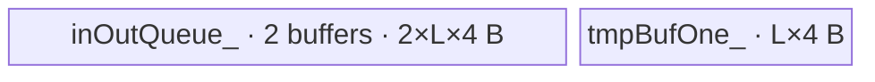

# InplaceSigmoid A2 ACLNN 算子知识

## 算子速览

| 项目 | 内容 |
|---|---|
| 实际入口 | 公开两段式 `aclnnInplaceSigmoidGetWorkspaceSize` / `aclnnInplaceSigmoid`；API 无版本后缀，采用 `experimental/activation/sigmoid_v2` 的 A2 实现 |
| 计算语义 | 对 `selfRef` 逐元素计算 `1 / (1 + exp(-x))`，最终通过 `ViewCopy` 覆盖调用者原张量内存 |
| 输入输出 | `selfRef`：ND，0D～8D，FLOAT/FLOAT16/BFLOAT16，可非连续、可空；shape 与 dtype 原地保持不变 |
| 执行类型 | 核心节点为单 Kernel `AIV_VECTOR`；外围按需包含框架 `Contiguous` 和必有的 `ViewCopy` |
| Kernel 路线 | R-001 FLOAT32 原生 FP32；R-002 FLOAT16/BFLOAT16 升精度到 FP32 |
| 核心资源 | GM 输入/中间输出；双 buffer 的绑定队列；R-001 一个 FP32 TBuf，R-002 两个 FP32 TBuf；Kernel 不读取 workspace 参数 |
| 来源闭包 | `source_closed`：公开 ACLNN→L0 AICore launcher→A2 OpDef→dtype 模板参数→Tiling/POD→`sigmoid` entry→两类 AIV body 闭合；通用 `Contiguous/ViewCopy` 按框架边界记录 |
| 验证状态 | 已完成源码闭包检查；本次知识提取未执行编译、真机、数值或性能测试。 |

## 接口与语义

### 计算语义

对原张量逻辑域内每个元素 `i`：

```text
tmp[i]     = 1 / (1 + exp(-selfRef[i]))
selfRef[i] = tmp[i]
```

核心 Sigmoid Kernel 写 executor 分配的连续中间张量，并不直接覆盖输入；随后 `ViewCopy(tmp, selfRef)` 才完成 ACLNN 的原地语义。FLOAT16/BFLOAT16 路线先转换到 FLOAT32，完整计算后以 `CAST_RINT` 转回输入 dtype。

### 输入、输出与属性

| 参数 | shape/layout | dtype | 约束、默认值与语义 |
|---|---|---|---|
| `selfRef` | ND，0D～8D，可非连续、可空 | FLOAT/FLOAT16/BFLOAT16 | 输入/输出同一 `aclTensor`；结果覆盖其内存，shape、dtype 不变 |
| `workspaceSize` | Host 标量输出 | `uint64_t*` | 返回 executor 全流程所需 Device workspace；空 Tensor 固定返回 0 |
| `executor` | Host 对象 | `aclOpExecutor**` | 第一段创建并移交，记录 `Contiguous`、Sigmoid、`ViewCopy` 数据依赖 |
| `workspace` | Device 地址 | `void*` | 第二段由调用者提供，至少为第一段返回大小，并保持到 stream 执行结束 |
| `stream` | runtime stream | `aclrtStream` | `CommonOpExecutorRun` 在该 stream 上执行整个流程 |

### 入口与版本

固定 Commit `955f8b33985b6d72989ebff341bb9c2c564a51bc` 中，`experimental/activation/sigmoid_v2` 公开同名无后缀 ACLNN 接口，并把 dtype 收敛为 FLOAT/FLOAT16/BFLOAT16。仓根 `ENABLE_EXPERIMENTAL` 与 `add_category_subdirectory` 可按目录名选择该候选；其 OpDef 只对 `ascend910b` 添加 AICore 配置，因此本卡只发布 A2。README/ACLNN 文档虽还列出 A3 和 Ascend 950，但该候选没有相应 OpDef/config/build 平台接线，不能仅凭文档扩大平台。

稳定 `activation/sigmoid` 是 950 的活动实现，但其原地 API公开允许 DOUBLE/COMPLEX64/COMPLEX128，`l0op::Sigmoid` 会将这些 dtype 分发到 `ADD_TO_LAUNCHER_LIST_AICPU`，固定仓没有对应 Sigmoid AICPU body；即使只看 AIV dtype，950 Host 还直接调用固定仓不存在的 `Ops::NN::Optiling::ElewiseTiling` 实体。因此 950 不满足整个公开入口的 `source_closed`，不生成 `_950` 卡。

## Host/Launcher 执行流程

### 参数校验与前处理

`aclnnInplaceSigmoidGetWorkspaceSize` 按以下顺序执行：

1. `OP_CHECK_COMM_INPUT(workspaceSize, executor)` 校验两个 Host 输出指针。
2. `CheckInplaceParams` 校验 `selfRef` 非空、dtype 属于 FLOAT/FLOAT16/BFLOAT16，且维度不超过 8。
3. 调用内部 `ExecSigmoidGetWorkspaceSize(selfRef, selfRef, ...)` 创建 executor；该函数再次通过通用 `CheckParams` 校验同一 Tensor 的非空、dtype/shape 一致性。
4. 若 `selfRef->IsEmpty()`，固定写 `workspaceSize=0`，移交空 executor，核心 Kernel 不启动。
5. 非空时 `l0op::Contiguous(selfRef)` 建立连续输入边界；连续输入可复用原存储，非连续输入由框架生成连续中间 Tensor。
6. `l0op::Sigmoid` 按输入 view shape/dtype 分配连续中间输出，并用 `ADD_TO_LAUNCHER_LIST_AICORE(Sigmoid, ...)` 加入核心节点。
7. `l0op::ViewCopy(sigmoidOpOut, selfRef)` 加入回写节点，恢复非连续 view 并实现原地覆盖。
8. executor 汇总 workspace 大小并移交。第二段 `aclnnInplaceSigmoid` 调用 `CommonOpExecutorRun`。

任一步返回空指针或 launcher 加入失败都会立即返回错误，后续节点不再加入。

### 参数、Workspace 与生命周期

核心 Tiling 通过 `GetLibApiWorkSpaceSize()` 取得平台系统 workspace，并写入该节点的唯一 workspace slot；`sigmoid` entry 虽保留 `workspace` 形参，但 `KernelSigmoid::Init` / `KernelSigmoidUpcast::Init` 都不接收或读取它。ACLNN 第一段返回的是 executor 对核心系统 workspace、必要的 `Contiguous` 中间存储和 `ViewCopy` 等通用节点需求的汇总；固定算子目录未公开通用节点的逐 slice offset 公式。

调用者拥有 `selfRef` 和第二段传入的 workspace；executor 拥有连续输入（若物化）、Sigmoid 中间输出、节点描述和顺序，直到第二段执行结束。Sigmoid 输出必须保持有效直到 `ViewCopy` 完成，之后才可释放或复用。

### 启动图与失败传播

```text
空 Tensor：CheckInplaceParams -> workspaceSize=0 -> 空 executor -> CommonOpExecutorRun

非空：
selfRef --Contiguous(框架边界)--> contiguousInput
  -> Sigmoid(AIV_VECTOR, blockDim=usedCoreNum, POD=SigmoidTilingData)
  -> sigmoidOpOut
  -> ViewCopy(框架边界, out=selfRef)
```

核心 Sigmoid 是唯一算子自有 Device 节点。`Contiguous`、Sigmoid、`ViewCopy` 由同一 executor 按数据依赖加入，并在传入 stream 上顺序可见；固定目录没有公开通用节点内部 Kernel 或显式 event，故不推测其 workspace slice。核心 launcher 加入失败时返回 `nullptr`，`ExecSigmoidGetWorkspaceSize` 转为 `ACLNN_ERR_INNER_NULLPTR`，不会加入 `ViewCopy`。

## Route 与参数设计

### 分核与资源计算

令 `N` 为输入 storage shape 元素数，`S=sizeof(dtype)`，`U` 为 AIV UB 字节数，`C` 为平台 AIV core 数：

```text
totalBytes          = N * S
targetCoreNum       = clamp(ceil(totalBytes / 16384), 1, C)
cacheLineElements   = max(1, 512 / S)
perCoreRaw          = ceil(N / targetCoreNum)
formerLength        = align_up(perCoreRaw, cacheLineElements)
usedCoreNum         = max(1, ceil(N / formerLength))
formerNum           = usedCoreNum - 1
tailLength          = N - formerNum * formerLength
alignElements       = max(1, 32 / S)
maxTileElements     = floor(U / 12)
tileLength          = floor(maxTileElements / alignElements) * alignElements
blockDim            = usedCoreNum
```

前 `formerNum` 个核各覆盖 `formerLength`，最后一核覆盖 `tailLength`；每核再按 `tileLength` 切分。12 字节/元素系数与 Device 实际分配对应：FLOAT32 为 `2*4 + 4`，FLOAT16/BFLOAT16 为 `2*2 + 4 + 4`。`N*S`、对齐和 POD 均使用 64 位有符号整数；固定源码未增加乘法溢出检查。空 ACLNN 已提前返回，Tiling 的 `FillDefaultTiling` 空域默认值不从公开非空路线到达。

### Route 选择

| 顺序 | Route | Key/模板 | 精确选择条件与优先级 | 不适用去向 |
|---:|---|---|---|---|
| 1 | R-001 FLOAT32 原生 | `D_T_X=C_DT_FLOAT` → `KernelSigmoid<float>` | A2、非空、ACLNN dtype FLOAT；entry 条件 `sizeof(D_T_X)==sizeof(float)` | 非 FLOAT 转下一 specialization；非支持 dtype 在 API 失败 |
| 2 | R-002 16 位升精度 | `D_T_X=C_DT_FLOAT16` 或 `C_DT_BF16` → `KernelSigmoidUpcast<D_T_X>` | A2、非空、ACLNN dtype FLOAT16 或 BFLOAT16；entry 的 `else` 分支 | 无 Device fallback；其它 dtype 在 API 失败 |

```text
ACLNN dtype ∈ {FLOAT, FLOAT16, BFLOAT16}
  -> ASCENDC_TPL_SEL_PARAM(context, static_cast<uint32_t>(dtype))
    -> D_T_X == FLOAT
       ? R-001 KernelSigmoid<float>
       : R-002 KernelSigmoidUpcast<half|bfloat16_t>
```

### 模板/实现执行矩阵

| Route | key/selector | dtype/shape/platform 完整命中条件 | 执行拓扑与 Kernel 节点 | 实际模板/body | 内存与同步特征 | tail/fallback |
|---|---|---|---|---|---|---|
| R-001 FLOAT32 原生 | dtype 模板参数 `C_DT_FLOAT`；数值 key 在固定源码不可见 | A2 OpDef、非空、FLOAT、0D～8D | 单 `sigmoid` AIV_VECTOR Kernel | `KernelSigmoid<float>::Process`→`ComputeBase` | 绑定队列两块 FP32 tile + 一个 FP32 ones TBuf；Queue producer/consumer 同步 | 最后一核/最后一 tile 取实际长度；无 fallback |
| R-002 16 位升精度 | `C_DT_FLOAT16` 或 `C_DT_BF16`；数值 key 不可见 | A2 OpDef、非空、FLOAT16/BFLOAT16、0D～8D | 单 `sigmoid` AIV_VECTOR Kernel | `KernelSigmoidUpcast<half\|bfloat16_t>::Process`→`ComputeBase` | 绑定队列两块 16 位 tile + 两个 FP32 TBuf；Queue 同步 | 实际 tail 长度传给全部 primitive；无 fallback |

### 隐藏性能 Guard

| Guard | Host/Tiling 条件 | Device/资源原因 | 影响 Route | 不满足时去向 | 源码符号 |
|---|---|---|---|---|---|
| 最小每核负载 | `targetCoreNum=ceil(totalBytes/16KiB)` 再截断到 `[1,C]` | 避免小张量无条件铺满全部 AIV core | 全部 | 自动减少 `blockDim` | `FillNormalTiling` |
| 512B 分核对齐 | `formerLength=align_up(ceil(N/targetCoreNum), 512/S)` | 前核 GM 区间从 512B 边界开始，最后一核承接余量 | 全部 | 无其它 Route | `FillNormalTiling` |
| 32B tile 对齐 | `tileLength=floor((U/12)/(32/S))*(32/S)` | 常规 tile 满足 DMA 32B 元素对齐；tail 用 `DataCopyPad` | 全部 | 若算得 0，退为 `32/S` | `FillNormalTiling` |
| dtype specialization | `ASCENDC_TPL_SEL_PARAM(context, dTypeX)` | entry 在编译期选择原生或升精度类 | 全部 | 非三种 dtype 在 `GetShapeAttrsInfo`/API 失败 | `FillNormalTiling`、`sigmoid` |
| 空域 | ACLNN `self->IsEmpty()` | 避免无有效输出的 Device 启动 | 全部 | 成功返回 workspace 0 的空 executor | `ExecSigmoidGetWorkspaceSize` |
| tail | `curTileLength=min(tileLength, blockLength-progress*tileLength)` | DMA blockLen 和 Vector length 只覆盖有效元素 | 全部 | 无 fallback | `ProcessBase` |

### POD/ABI

| 结构 | 字段 | 类型/位宽 | ABI 布局 | 单位 | Host/launcher producer | Device consumer | 边界 |
|---|---|---|---|---|---|---|---|
| `SigmoidTilingData` | `formerNum` | `int64_t` / 64 | `sizeof=32`、`alignof=8`、`offsetof=0` | core 数 | `FillNormalTiling`: `usedCoreNum-1`；空默认 0 | `InitBase`: 判断当前核是否为 former 核 | `blockDim=formerNum+1` |
| `SigmoidTilingData` | `formerLength` | `int64_t` / 64 | `offsetof=8` | 元素 | `FillNormalTiling`: 512B 等价元素对齐长度；空默认 0 | `InitBase`: former extent 与 GM offset | 正数；最后核不使用为自身 extent |
| `SigmoidTilingData` | `tailLength` | `int64_t` / 64 | `offsetof=16` | 元素 | `N-formerNum*formerLength`；空默认 0 | `InitBase`: 最后一核 extent | `1..formerLength`（公开非空路线） |
| `SigmoidTilingData` | `tileLength` | `int64_t` / 64 | `offsetof=24` | 元素 | `FillNormalTiling`: `U/12` 后按 32B 对齐；空默认 1 | `InitBase`、`ProcessBase`、GM tile offset | 公开非空路线为正 |

Host 通过 `context->GetTilingData<SigmoidTilingData>()` 直接填同一 POD，Device 用 `REGISTER_TILING_DEFAULT` 和 `GET_TILING_DATA_WITH_STRUCT` 解析；四个连续 `int64_t` 没有内部 padding。改变字段顺序、位宽或单位会同时破坏分核地址和 tile 循环。

### Route 源码闭包

| Route | Key/selector | Host/Tiling producer | POD/参数 | Kernel entry/router 节点 | Kernel body/直接依赖 | 构建接线 |
|---|---|---|---|---|---|---|
| R-001 FLOAT32 原生 | `D_T_X=C_DT_FLOAT` | `op_host/sigmoid_tiling.cpp` · `SigmoidTilingFunc/FillNormalTiling` | `SigmoidTilingData` 四字段 | `op_kernel/sigmoid.cpp` · `sigmoid<float>` | `op_kernel/sigmoid.h` · `KernelSigmoidBase`、`KernelSigmoid<float>` | `op_host/sigmoid_def.cpp` · `AddConfig("ascend910b")`；`op_host/CMakeLists.txt` |
| R-002 16 位升精度 | `D_T_X=C_DT_FLOAT16/C_DT_BF16` | 同上 | 同上 | `sigmoid<half\|bfloat16_t>` | `KernelSigmoidBase`、`KernelSigmoidUpcast<T>` | 同上 |

## Kernel 实现

### 公共执行流程

`sigmoid<D_T_X>` 解析 POD；FLOAT 实例构造 `KernelSigmoid<float>`，16 位实例构造 `KernelSigmoidUpcast<T>`。公共 `InitBase` 根据 `GetBlockIdx()` 绑定当前核连续 GM 区间，按 POD 的 `tileLength` 为 `TQueBind<VECIN,VECOUT,1>` 初始化两个 tile buffer。`ProcessBase` 对完整 tile 循环，然后独立处理尾 tile；每轮 `CopyInBase` 以单 block、精确字节数 `DataCopyPad` 入队，派生类原地计算同一 LocalTensor，再从 VECOUT 端出队并精确字节数写回中间 GM 输出。核心节点无跨核归约、Atomic、显式 event、SIMT、NDDMA、通信或 Cube 路径。

### Route R-001：FLOAT32 原生计算

#### 适用条件

##### 选择证据

| 层级 | 文件 | 符号 | 源码谓词/参数 | 结果/下一跳 |
|---|---|---|---|---|
| API | `op_host/op_api/aclnn_sigmoid.cpp` | `CheckInplaceParams` | `selfRef` dtype 属于 FLOAT/FLOAT16/BFLOAT16 | FLOAT 继续 |
| Host | `op_host/sigmoid_tiling.cpp` | `FillNormalTiling` | `dTypeX=static_cast<uint32_t>(DT_FLOAT)` | 选择 FLOAT 模板参数 |
| Router | `op_kernel/sigmoid.cpp` | `sigmoid<float>` | `sizeof(D_T_X)==sizeof(float)` | `KernelSigmoid<float>` |
| Platform | `op_host/sigmoid_def.cpp` | `Sigmoid::Sigmoid` | `AICore().AddConfig("ascend910b")` | A2 AICore 实例 |

#### Device 数据流

##### 函数级调用链

```text
l0op::Sigmoid -> ADD_TO_LAUNCHER_LIST_AICORE(Sigmoid)
  -> sigmoid<float>(x, y, workspace, tiling)
    -> KernelSigmoid<float>::Init
      -> KernelSigmoidBase::InitBase
      -> InitBuffer(tmpBufOne_)
    -> KernelSigmoidBase::Process
      -> ProcessBase
        -> CopyInBase
        -> KernelSigmoid<float>::ComputeBase
        -> CopyOutBase
```

##### 源码等价伪码

```text
# 源码等价伪码
b = GetBlockIdx()
if b < formerNum:
    blockLength = formerLength
    gmOffset = formerLength * b
else:
    blockLength = tailLength
    gmOffset = formerLength * formerNum

tileNum = ceil(blockLength / tileLength)
for tile in [0, tileNum):
    n = (tile == tileNum-1) ? blockLength-(tileNum-1)*tileLength : tileLength
    xLocal = DataCopyPad(x[gmOffset + tile*tileLength], blockLen=n*4)
    xLocal = xLocal * -1.0f
    xLocal = exp(xLocal)
    xLocal = xLocal + 1.0f
    oneLocal[0:n] = 1.0f
    xLocal = oneLocal / xLocal
    DataCopyPad(y[gmOffset + tile*tileLength], xLocal, blockLen=n*4)
```

#### 内存与数据搬运

##### 资源与搬运表

| 层级/缓冲区 | offset/地址公式 | extent/容量公式 | dtype/layout | producer | consumer | owner/lifetime | 对齐/复用 |
|---|---|---|---|---|---|---|---|
| GM `x` | `gmOffset + tile*L` | 当前核 `blockLength`，tile 有效 `n` | FLOAT32/ND 连续 | `Contiguous` | `CopyInBase` | executor；到核心读完 | former 起点 512B 对齐 |
| `inOutQueue_` | queue 分配 | 2 个 buffer × `L*4` bytes | FLOAT32 | `CopyInBase` | `ComputeBase`→`CopyOutBase` | `TPipe`，单 Kernel | `TQueBind` 让同一 LocalTensor 从 VECIN 转到 VECOUT |
| `tmpBufOne_` | 独立 VECCALC TBuf | `L*4` bytes | FLOAT32 | `Duplicate` | `Div` | Kernel 实例全生命周期 | 每 tile 覆盖，不跨 tile保留值 |
| GM `y` | `gmOffset + tile*L` | 当前核 `blockLength`，有效 `n` | FLOAT32/ND 连续 | `CopyOutBase` | 框架 `ViewCopy` | executor；到回写结束 | tail 仅写 `n*4` bytes |
| workspace | entry 参数 | 平台 `GetLibApiWorkSpaceSize()` | bytes | Tiling/runtime | Kernel 不读取 | 用户/executor | 核心 body 为 N/A |

##### 分层内存布局



##### 字节账与复用顺序

```text
queue_bytes   = 2 * L * sizeof(float) = 8L
tbuf_bytes    = L * sizeof(float)     = 4L
UB_total      = 12L <= U
dynamic_ub    = N/A（AIV TPipe 静态 UB）
workspace_core = GetLibApiWorkSpaceSize()，但 Device body 不读取 workspace
```

| 复用子区 | 写入者 | 读取者/消费点 | 下一次覆盖 | 同步或释放依据 | 安全条件 |
|---|---|---|---|---|---|
| `inOutQueue_` 当前 LocalTensor | `CopyInBase` | `ComputeBase` 原地改写，随后 `CopyOutBase` | `FreeTensor` 后下一 tile `AllocTensor` | GM→VECIN `EnQue/DeQue` 与 VECOUT→GM `EnQue/DeQue/FreeTensor` | 必须沿绑定队列完成所有权转换后再复用 |
| `tmpBufOne_` | 每 tile `Duplicate` | 同 tile `Div` | 下一 tile `Duplicate` | 同一 `ComputeBase` 顺序 | 当前 `Div` 完成前不得覆盖 |

#### 同步、精度与尾块

##### 同步与数值边界表

| 阶段 | primitive/机制 | producer | consumer/等待点 | 保护对象 | 精度/尾块 |
|---|---|---|---|---|---|
| GM→UB | `DataCopyPad` + VECIN `EnQue/DeQue` | `CopyInBase` | `ComputeBase` | 当前 queue buffer | `blockCount=1`、`blockLen=n*4`、stride=0；tail 精确字节数 |
| Vector | `Muls→Exp→Adds→Duplicate→Div` | `ComputeBase` | VECOUT enqueue | 同一 FP32 LocalTensor、ones TBuf | 全程 FP32；每个 API 的 length 都是 `n`，无效 lane 不提交 |
| UB→GM | VECOUT `EnQue/DeQue` + `DataCopyPad` | `ComputeBase` | `CopyOutBase` | 当前 queue buffer | 只写 `n*4` bytes |

#### 关键实现

##### 符号证据表

| 阶段 | 文件 | 符号/模板实例 | 实现事实 |
|---|---|---|---|
| Host/Tiling producer | `experimental/activation/sigmoid_v2/op_host/sigmoid_tiling.cpp` | `FillNormalTiling` | 生产分核、tile、blockDim 和 dtype 模板参数 |
| Kernel entry/router | `experimental/activation/sigmoid_v2/op_kernel/sigmoid.cpp` | `sigmoid<float>` | `sizeof(float)` 分支映射到原生类 |
| Device body/helper | `experimental/activation/sigmoid_v2/op_kernel/sigmoid.h` | `KernelSigmoidBase<float,...>`、`KernelSigmoid<float>::ComputeBase` | GM/UB 循环、绑定队列、FP32 sigmoid 与 tail |

### Route R-002：FLOAT16/BFLOAT16 升精度计算

#### 适用条件

##### 选择证据

| 层级 | 文件 | 符号 | 源码谓词/参数 | 结果/下一跳 |
|---|---|---|---|---|
| API | `op_host/op_api/aclnn_sigmoid.cpp` | `CheckInplaceParams` | dtype 为 FLOAT16 或 BFLOAT16 | 继续 |
| Host | `op_host/sigmoid_tiling.cpp` | `FillNormalTiling` | `dTypeX` 写入对应模板选择参数 | `C_DT_FLOAT16` 或 `C_DT_BF16` |
| Router | `op_kernel/sigmoid.cpp` | `sigmoid<D_T_X>` | `sizeof(D_T_X) != sizeof(float)` | `KernelSigmoidUpcast<D_T_X>` |
| Platform | `op_host/sigmoid_def.cpp` | `Sigmoid::Sigmoid` | `AddConfig("ascend910b")` 且 OpDef含 FLOAT16/BFLOAT16 | A2 AICore 实例 |

#### Device 数据流

##### 函数级调用链

```text
l0op::Sigmoid -> ADD_TO_LAUNCHER_LIST_AICORE(Sigmoid)
  -> sigmoid<half|bfloat16_t>(x, y, workspace, tiling)
    -> KernelSigmoidUpcast<T>::Init
      -> KernelSigmoidBase::InitBase
      -> InitBuffer(tmpBufXFp32_)
      -> InitBuffer(tmpBufFp32_)
    -> KernelSigmoidBase::Process
      -> ProcessBase
        -> CopyInBase
        -> KernelSigmoidUpcast<T>::ComputeBase
        -> CopyOutBase
```

##### 源码等价伪码

```text
# 分核、tileNum、n 与 R-001 相同，但 S=2
xLocal<T> = DataCopyPad(x + gmOffset + tile*L, blockLen=n*2)
xFp32     = Cast<T -> float, CAST_NONE>(xLocal, n)
xFp32     = xFp32 * -1.0f
xFp32     = exp(xFp32)
xFp32     = xFp32 + 1.0f
tmpFp32   = Duplicate(1.0f, n)
xFp32     = tmpFp32 / xFp32
xLocal<T> = Cast<float -> T, CAST_RINT>(xFp32, n)
DataCopyPad(y + gmOffset + tile*L, xLocal, blockLen=n*2)
```

#### 内存与数据搬运

##### 资源与搬运表

| 层级/缓冲区 | offset/地址公式 | extent/容量公式 | dtype/layout | producer | consumer | owner/lifetime | 对齐/复用 |
|---|---|---|---|---|---|---|---|
| GM `x` | `gmOffset + tile*L` | 当前核 `blockLength`，有效 `n` | FP16/BF16 ND 连续 | `Contiguous` | `CopyInBase` | executor | former 起点 512B 对齐 |
| `inOutQueue_` | queue 分配 | 2 个 buffer × `L*2` bytes | FP16/BF16 | `CopyInBase` | `ComputeBase`→`CopyOutBase` | `TPipe` | 同一 LocalTensor 最终承接降精度结果 |
| `tmpBufXFp32_` | 独立 TBuf | `L*4` bytes | FLOAT32 | 首次 Cast 与后续算术 | 最终 Cast | Kernel 实例 | 算术全程原地复用 |
| `tmpBufFp32_` | 独立 TBuf | `L*4` bytes | FLOAT32 | `Duplicate(1)` | `Div` | Kernel 实例 | 每 tile 覆盖 |
| GM `y` | `gmOffset + tile*L` | 当前核 `blockLength`，有效 `n` | FP16/BF16 ND 连续 | `CopyOutBase` | `ViewCopy` | executor | tail 仅写 `n*2` bytes |

##### 分层内存布局


##### 字节账与复用顺序

```text
queue_bytes   = 2 * L * sizeof(T16) = 4L
tbuf_x_bytes  = L * sizeof(float)   = 4L
tbuf_1_bytes  = L * sizeof(float)   = 4L
UB_total      = 12L <= U
dynamic_ub    = N/A（AIV TPipe 静态 UB）
workspace_core = GetLibApiWorkSpaceSize()，Device body 不读取
```

| 复用子区 | 写入者 | 读取者/消费点 | 下一次覆盖 | 同步或释放依据 | 安全条件 |
|---|---|---|---|---|---|
| `inOutQueue_` 当前 LocalTensor | `CopyInBase`，最终由降精度 Cast 改写 | `ComputeBase`、`CopyOutBase` | `FreeTensor` 后下一 tile | 绑定 Queue 的双向 `EnQue/DeQue` | 降精度结果必须先完成 GM copy |
| `tmpBufXFp32_` | 输入 Cast | `Muls/Exp/Adds/Div` 原地链与输出 Cast | 下一 tile 输入 Cast | 同一函数程序顺序 | 输出 Cast 完成前不得覆盖 |
| `tmpBufFp32_` | `Duplicate` | `Div` | 下一 tile `Duplicate` | 同一函数程序顺序 | 当前 `Div` 完成前不得覆盖 |

#### 同步、精度与尾块

##### 同步与数值边界表

| 阶段 | primitive/机制 | producer | consumer/等待点 | 保护对象 | 精度/尾块 |
|---|---|---|---|---|---|
| GM→UB | `DataCopyPad` + Queue | `CopyInBase` | `ComputeBase` | 16 位 queue buffer | 单 block、`blockLen=n*2`、stride=0 |
| 升精度 | `Cast(..., CAST_NONE, n)` | 16 位 LocalTensor | FP32 `Muls` | `tmpBufXFp32_` | FP16/BF16→FP32，不舍入到较窄类型 |
| FP32 算术 | `Muls→Exp→Adds→Duplicate→Div` | FP32 TBuf | 输出 Cast | 两个 FP32 TBuf | 所有 primitive length 为 `n` |
| 降精度 | `Cast(..., CAST_RINT, n)` | FP32 结果 | VECOUT enqueue | 原 16 位 LocalTensor | 按 RINT 降为 FP16/BF16；只覆盖有效 `n` |
| UB→GM | Queue + `DataCopyPad` | 降精度结果 | `CopyOutBase` | 16 位 queue buffer | 只写 `n*2` bytes |

#### 关键实现

##### 符号证据表

| 阶段 | 文件 | 符号/模板实例 | 实现事实 |
|---|---|---|---|
| Host/Tiling producer | `experimental/activation/sigmoid_v2/op_host/sigmoid_tiling.cpp` | `FillNormalTiling` | 12 字节/元素 tile 上界适配 16 位升精度内存 |
| Kernel entry/router | `experimental/activation/sigmoid_v2/op_kernel/sigmoid.cpp` | `sigmoid<half\|bfloat16_t>` | 非 4 字节实例映射到升精度类 |
| Device body/helper | `experimental/activation/sigmoid_v2/op_kernel/sigmoid.h` | `KernelSigmoidUpcast<T>::ComputeBase` | 两次 Cast、FP32 算术、RINT、绑定队列复用与 tail |

## 算子特定优化

### Trick T-001：绑定输入/输出队列原地复用同一 tile

#### 触发与源码依据

- 适用 Route：R-001、R-002
- 触发条件：所有非空 A2 核心 tile；`inOutQueue_` 为 `TQueBind<VECIN,VECOUT,1>`。
- Golden 来源：[`op_kernel/sigmoid.h:118-127`](../../../../../../../cann-ops-raw/ascendc/ops-nn/955f8b33985b6d72989ebff341bb9c2c564a51bc/experimental/activation/sigmoid_v2/op_kernel/sigmoid.h#L118-L127)

**官方源码（固定 Commit 连续逐字摘录）**：

```cpp
LocalTensor<T> xLocal = this->inOutQueue_.template DeQue<QuePosition::GM, QuePosition::VECIN, T>();
LocalTensor<float> oneLocal = tmpBufOne_.Get<float>();

Muls(xLocal, xLocal, -1.0f, curTileLength);
Exp(xLocal, xLocal, curTileLength);
Adds(xLocal, xLocal, 1.0f, curTileLength);
Duplicate(oneLocal, 1.0f, curTileLength);
Div(xLocal, oneLocal, xLocal, curTileLength);

this->inOutQueue_.template EnQue<QuePosition::VECOUT, QuePosition::GM, T>(xLocal);
```

#### 机制与设计原因

输入 tile 出队后直接作为 `Muls/Exp/Adds/Div` 的 dst，结果不另行物化到输出 Queue；同一 LocalTensor 再从绑定队列的 VECOUT 侧提交。这样 R-001 只需两块流式 buffer 加一个常量 TBuf，Host 的 12 字节/元素系数与实际 `8L+4L` 闭合。R-002 也复用 16 位 LocalTensor 承接最终降精度结果，避免额外的 16 位输出 buffer 区。

#### 迁移边界

- 适用：输入不再需要、输出与输入 tile shape/dtype 一致的逐元素算子。
- 前提：`TQueBind` 的 GM→VECIN→VECOUT→GM 所有权顺序保持不变；计算结束后 LocalTensor 容量足以存最终 dtype。
- 失效：若输出 shape/dtype 或同时存活的中间结果不同，必须拆分队列/TBuf 并重新计算 UB 系数。
- 未验证：本次知识提取未执行编译、真机、数值或性能测试。

#### 错误做法

固定仓未提供可验证反例。

### Trick T-002：16 位输入统一升到 FP32 后一次性降精度

#### 触发与源码依据

- 适用 Route：R-002
- 触发条件：`D_T_X` 为 FLOAT16 或 BFLOAT16，entry 进入 `KernelSigmoidUpcast<T>`。
- Golden 来源：[`op_kernel/sigmoid.h:145-157`](../../../../../../../cann-ops-raw/ascendc/ops-nn/955f8b33985b6d72989ebff341bb9c2c564a51bc/experimental/activation/sigmoid_v2/op_kernel/sigmoid.h#L145-L157)

**官方源码（固定 Commit 连续逐字摘录）**：

```cpp
__aicore__ inline void ComputeBase(int64_t curTileLength)
{
    LocalTensor<T> xLocal = this->inOutQueue_.template DeQue<QuePosition::GM, QuePosition::VECIN, T>();
    LocalTensor<float> xFp32 = tmpBufXFp32_.Get<float>();
    LocalTensor<float> tmpLocal = tmpBufFp32_.Get<float>();

    Cast(xFp32, xLocal, RoundMode::CAST_NONE, curTileLength);
    Muls(xFp32, xFp32, -1.0f, curTileLength);
    Exp(xFp32, xFp32, curTileLength);
    Adds(xFp32, xFp32, 1.0f, curTileLength);
    Duplicate(tmpLocal, 1.0f, curTileLength);
    Div(xFp32, tmpLocal, xFp32, curTileLength);
    Cast(xLocal, xFp32, RoundMode::CAST_RINT, curTileLength);
```

#### 机制与设计原因

只在入口和出口各做一次 Cast，中间 `-x→exp→+1→reciprocal` 全部留在同一 FP32 TBuf 中，避免每步按 16 位舍入。第二个 FP32 TBuf 只物化常量 1；所有 API 的长度都取当前实际 tile 长度，因此 tail 不参与无效 lane 的结果提交。

#### 迁移边界

- 适用：FP16/BF16 输入且 FP32 Vector primitive 可用的逐元素复合函数。
- 前提：UB 能容纳 `2*L*sizeof(T16)+2*L*sizeof(float)`，输出允许 `CAST_RINT`。
- 失效：若目标数值契约要求另一舍入模式或原生 16 位指令顺序，不能复用此路线。
- 未验证：本次知识提取未执行编译、真机、数值或性能测试。

#### 错误做法

固定仓未提供可验证反例。

## 模板与实现对比

| 对比维度 | R-001 FLOAT32 原生 | R-002 FLOAT16/BFLOAT16 升精度 | 设计选择依据 |
|---|---|---|---|
| 命中条件/优先级 | `D_T_X=C_DT_FLOAT` | `D_T_X=C_DT_FLOAT16/C_DT_BF16` | dtype 模板选择后按 `sizeof(D_T_X)` 编译期分支 |
| 模板与 dtype | `KernelSigmoid<float>` | `KernelSigmoidUpcast<half\|bfloat16_t>` | 4 字节原生；2 字节升精度 |
| 循环与分核 | 16KiB/核目标、512B former 对齐、32B tile 对齐 | 相同公式，`S=2` | 同一 POD 和公共基类 |
| Queue/TBuf/寄存器/dynamic UB/通信 window | 两个 FP32 queue buffer + 一个 FP32 TBuf | 两个 16 位 queue buffer + 两个 FP32 TBuf | 两者都严格为 12L bytes；无 dynamic UB/通信 |
| 内存总占用与复用 | 12L；xLocal 原地完成算术 | 12L；FP32 TBuf 原地算术，xLocal 承接降精度结果 | Host 用统一 `U/12` tile 上界 |
| 搬运/Vector/SIMT/NDDMA/通信 API | `DataCopyPad`；`Muls/Exp/Adds/Duplicate/Div` | 再增加输入/输出 Cast | 仅 AIV Vector，无 SIMT/NDDMA/通信 |
| 同步、精度与 tail | Queue 同步；全 FP32；精确 `n` | Queue 同步；FP32 中间、RINT；精确 `n` | 公共 `ProcessBase` 统一 tail |
| fallback/失败边界 | 无 Device fallback | 无 Device fallback | API/Tiling dtype 失败是唯一不支持终点 |

## 平台差异

| 项目 | A2 | A3 | 950 |
|---|---|---|---|
| 支持状态 | 本卡采用 `sigmoid_v2`：公开文档支持且 OpDef 注册 `ascend910b`，`source_closed` | `sigmoid_v2` 文档声称支持但无 A3 注册；稳定 README 标记不支持而稳定 ACLNN 文档标记支持，证据冲突；不发布 | 稳定实现公开支持，但 DOUBLE/COMPLEX 可达 AICPU body 缺失，AIV Tiling 依赖 `ElewiseTiling` 实体也缺失；不发布 |
| Host/Launcher | FP32/FP16/BF16 全部直接 AICore | 固定候选无可证明活动 Host 配置 | 稳定 API有 AICore/AICPU dtype 分发，AICPU路线不闭合 |
| Kernel/资源 | 两条 AIV_VECTOR Route，统一 12L UB 上界 | 固定候选不可证明 | 950 AIV MicroAPI body可见，但不足以覆盖完整公开入口 |

## 限制与失败边界

- `selfRef`、`workspaceSize`、`executor` 为空分别触发公共输入或参数错误；dtype 非 FLOAT/FLOAT16/BFLOAT16、rank>8 触发 `ACLNN_ERR_PARAM_INVALID`。
- 空 Tensor 不启动 Device Kernel，固定返回 workspace 0；Kernel Tiling 的空默认 POD是内部防御路线，不应误写成公开 ACLNN Kernel Route。
- `totalLength*dtypeSize`、多次向上取整和 `curTileLength*sizeof(T)` 没有独立溢出/32 位 blockLen 窄化检查；合法超大 Tensor 的真实上界固定仓未给出。
- A3 的稳定 README 明确标记不支持，而稳定 ACLNN 文档标记支持；再加上 `sigmoid_v2` 无 A3 注册，存在发布冲突，本卡仅覆盖 A2。
- 950 的公开 DOUBLE/COMPLEX AICPU body 与 AIV `ElewiseTiling` 实体均在固定仓缺失；可见的 arch35 Kernel 文件不能替代完整 ACLNN 闭包。
- 核心 workspace 由平台 `GetLibApiWorkSpaceSize()` 给出但 Kernel 不读取；通用 `Contiguous/ViewCopy` 的内部 workspace、Kernel 和 event 是固定源码明确允许的框架边界。
- 本次知识提取未执行编译、真机、数值或性能测试。

## 源码索引

### 链路索引

| 链路阶段 | 文件 | 关键符号 | 支撑内容 |
|---|---|---|---|
| 入口声明/约束 | `experimental/activation/sigmoid_v2/op_host/op_api/aclnn_sigmoid.h` | `aclnnInplaceSigmoid*` | 两段式公开符号 |
| 入口声明/约束 | `experimental/activation/sigmoid_v2/docs/aclnnSigmoid&aclnnInplaceSigmoid.md` | 产品支持、原地接口、约束 | A2公开性、dtype/rank/空域/非连续语义 |
| 入口声明/约束 | `experimental/activation/sigmoid_v2/README.md` | 产品支持、ACLNN接口 | 候选目录与接口公开说明 |
| 入口实现 | `experimental/activation/sigmoid_v2/op_host/op_api/aclnn_sigmoid.cpp` | `CheckInplaceParams`、`ExecSigmoidGetWorkspaceSize`、`aclnnInplaceSigmoid` | 校验、空域、Contiguous→Sigmoid→ViewCopy→executor |
| 入口实现 | `experimental/activation/sigmoid_v2/op_host/op_api/sigmoid.cpp` | `l0op::Sigmoid` | 分配中间输出并只加入 AICore launcher |
| Host/Tiling/Launcher | `experimental/activation/sigmoid_v2/op_host/sigmoid_def.cpp` | `ops::Sigmoid` | FLOAT/FP16/BF16 与 `ascend910b` OpDef |
| Host/Tiling/Launcher | `experimental/activation/sigmoid_v2/op_host/sigmoid_tiling.cpp` | `SigmoidTilingFunc`、`FillNormalTiling` | 平台资源、分核、tile、workspace、dtype 参数 |
| Host/Tiling/Launcher | `experimental/activation/sigmoid_v2/op_kernel/sigmoid_tiling_data.h` | `SigmoidTilingData` | 四字段 POD ABI |
| Host/Tiling/Launcher | `experimental/activation/sigmoid_v2/op_kernel/sigmoid_tiling_key.h` | `ASCENDC_TPL_ARGS_DECL/SEL` | 三种 dtype specialization |
| Kernel entry/body | `experimental/activation/sigmoid_v2/op_kernel/sigmoid.cpp` | `sigmoid<D_T_X>` | dtype 到原生/升精度 body 的 router |
| Kernel entry/body | `experimental/activation/sigmoid_v2/op_kernel/sigmoid.h` | `KernelSigmoidBase`、`KernelSigmoid`、`KernelSigmoidUpcast` | GM/UB、循环、Vector、精度、同步、tail |
| 构建接线 | `experimental/activation/sigmoid_v2/op_host/CMakeLists.txt` | `add_modules_sources(... OPTYPE sigmoid ...)` | Host/API模块活动构建接线 |
| 构建总开关 | `CMakeLists.txt` | `ENABLE_EXPERIMENTAL` | experimental 模块由显式构建开关启用 |
| 构建目录分流 | `cmake/func.cmake` | `add_category_subdirectory` | 开关为真时扫描 `experimental/<category>` 并按 `sigmoid_v2` 目录选择 |
| 平台审计 | `activation/sigmoid/README.md` | 产品支持表 | stable 标记 A3 不支持、950/A2 支持 |
| 平台审计 | `activation/sigmoid/docs/aclnnSigmoid&aclnnInplaceSigmoid.md` | 产品支持表、原地 dtype | stable ACLNN 文档标记 A3/950 支持并公开宽 dtype，形成冲突/额外路线 |
| 平台审计 | `activation/sigmoid/CMakeLists.txt` | `SUPPORT_COMPUTE_UNIT/TILING_DIR` | stable 活动源码接线为 `ascend950/mc62 -> arch35` |
| 950 API缺口 | `activation/sigmoid/op_api/aclnn_sigmoid.cpp` | `GetSelfRefDtypeList`、`ExecSigmoidGetWorkspaceSize` | 原地接口允许宽 dtype 并进入 L0 Sigmoid |
| 950 AICPU缺口 | `activation/sigmoid/op_api/sigmoid.cpp` | `IsAiCoreSupport`、`SigmoidAiCpu` | 非 FLOAT/FP16/BF16 进入固定仓无 body 的 AICPU launcher |
| 950 Tiling缺口 | `activation/sigmoid/op_host/arch35/sigmoid_tiling_arch35.cpp` | `SigmoidTiling::DoOpTiling` | AIV路线直接依赖固定仓不可见 `ElewiseTiling` |

### 实现复用检查

| 检查项 | 可复用事实 | 不得改变的约束 | 源码符号 |
|---|---|---|---|
| ABI/POD | 四个连续 `int64_t` 可复用公共分核/tile基类 | 字段顺序、单位和 `blockDim=formerNum+1` 不得改变 | `SigmoidTilingData`、`InitBase` |
| 调用顺序 | `Contiguous→Sigmoid中间输出→ViewCopy(selfRef)` | 不能让核心输出直接别名输入而绕过非连续处理 | `ExecSigmoidGetWorkspaceSize` |
| workspace/内存 | 两路线统一 `UB_total=12L`；核心不读取 workspace | buffer count、dtype 字节数、12系数与 executor workspace owner 不得混淆 | `FillNormalTiling`、各 `Init` |
| 同步 | 绑定 Queue 负责 GM/VECIN/VECOUT/GM 所有权转换 | `FreeTensor` 前不能覆盖 LocalTensor | `CopyInBase/ComputeBase/CopyOutBase` |
| 精度与尾块 | 16 位路线 FP32 算术后 `CAST_RINT`；全部 API使用实际 `n` | Cast顺序、round mode、tail blockLen 不得改变 | `KernelSigmoidUpcast::ComputeBase`、`ProcessBase` |
| 失败边界 | 空域成功短路；非法 dtype/rank 失败；launcher失败阻断 ViewCopy | 不得把 A3/950 文档声明当成候选实现平台注册 | `CheckInplaceParams`、`SigmoidTilingFunc`、`l0op::Sigmoid` |