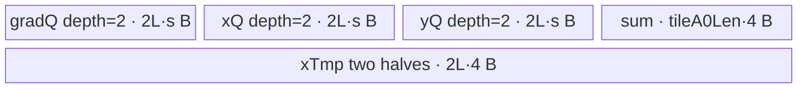
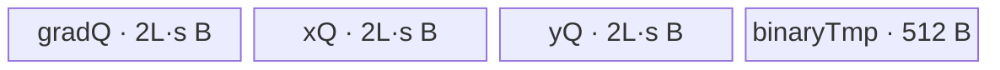

# LogSoftmaxBackward 950 ACLNN 算子知识

## 算子速览

| 项目 | 内容 |
|---|---|
| 实际入口 | `aclnnLogSoftmaxBackwardGetWorkspaceSize` + `aclnnLogSoftmaxBackward`，公开两段式 ACLNN，无更高版本入口。 |
| 计算语义 | 对归约轴 `dim`：`out = gradOutput - exp(output) * reduce_sum(gradOutput, dim, keepdim=true)`。 |
| 输入输出 | `gradOutput/output` 同 shape、同 dtype、ND；公开文档为 1–8 维并允许非连续。固定 950 ACLNN 实现实际接受 FP16/FP32；BF16 被入口 SoC guard 拒绝。核心 `LogSoftmaxGrad` 输出同输入 dtype，外层 `Cast/ViewCopy` 适配 `out`。 |
| 执行类型 | 核心节点为单 Kernel `AIV_VECTOR`；entry 在 `g_coreType == AIC` 时立即返回并声明 `KERNEL_TYPE_AIV_ONLY`，不存在可达 Cube/MIX_CV body。ACLNN 的 `Contiguous/Cast/ViewCopy` 是框架前后处理边界。 |
| Kernel 路线 | R-001 AR-small-R(500)、R-002 AR-full-load(1000)、R-003 AR-recompute(2000)、R-004 ARA-full-load(10000)、R-005 ARA-recompute(20000)。 |
| 核心资源 | GM 输入/输出；AIV UB 中双缓冲 `TQue`、FP32 reduction/cache `TBuf` 和寄存器；核心 tiling 固定声明 16 MiB workspace，但 Device entry 不读取 `workspace`。 |
| 来源闭包 | `source_closed`：公开 ACLNN → executor/L0 `LogSoftmaxGrad` → 950 OpDef/tiling selector/POD → AIV router → 五个 body/helper → ascend950 binary/CMake 接线闭合。 |
| 验证状态 | 已完成源码闭包检查；本次知识提取未执行编译、真机、数值或性能测试。 |

## 接口与语义

### 计算语义

把连续逻辑 shape 围绕归约轴折叠为 `[A1, R, A0]`：`A1=prod(shape[:dim])`、`R=shape[dim]`、`A0=prod(shape[dim+1:])`。对每个 `(a1,a0)`：

```text
s[a1,a0] = Σ(k=0..R-1) gradOutput[a1,k,a0]
out[a1,r,a0] = gradOutput[a1,r,a0] - exp(output[a1,r,a0]) * s[a1,a0]
```

负 `dim` 先加 rank 归一化。若 `R==1`，Host 将折叠域改写为 `A1=1, A0=旧A1*旧A0`，结果仍逐元素遵守同一公式。所有 Route 的 `sum/exp/mul/sub` 在 FP32 寄存器或 FP32 UB 中执行，FP16/BF16 body 最后用 `CAST_RINT` 降精度；但本卡的 950 ACLNN 入口会拒绝 BF16。

### 输入、输出与属性

| 参数 | shape/layout | dtype | 约束、默认值与语义 |
|---|---|---|---|
| `gradOutput` | ND，公开文档 1–8 维；可非连续 | 文档列 FP16/FP32/BF16；950 入口实际 FP16/FP32 | 上游梯度；非空时必须与 `output` 同 dtype、同 shape，并与 `out` 同 shape。 |
| `output` | 同 `gradOutput`；可非连续 | 与 `gradOutput` 相同 | forward `LogSoftmax` 输出，Device 计算 `exp(output)`。 |
| `dim` | 标量属性 | INT64 | 合法范围 `[-rank, rank-1]`；标量 view 按 rank 1 校验。L0 转为长度 1 的 `FVector<int64_t>`/IntArray。 |
| `out` | 同输入 shape；可非连续 | 文档列 FP16/FP32/BF16；实现未在 `CheckParams` 校验其 dtype | `LogSoftmaxGrad` 先产生输入 dtype 的临时结果，再由框架 `Cast` 到 `out` dtype并 `ViewCopy`。 |
| `workspaceSize` | N/A | `uint64_t*` | executor 汇总所有前后处理及核心节点 workspace；空 Tensor 返回 0。核心 tiling 单独写入 16 MiB。 |
| `executor/stream` | N/A | opaque handle | 第一段构建 executor；第二段由 `CommonOpExecutorRun` 在指定 stream 执行。 |

### 入口与版本

固定仓只公开 `aclnnLogSoftmaxBackward` 这一版本族。第一段依次完成 null/空域/dtype/shape/dim 检查，建立 executor，插入两个 `Contiguous`、一个 `LogSoftmaxGrad`、一个 `Cast` 和一个 `ViewCopy`；第二段交给 `CommonOpExecutorRun`。空 Tensor 在 null 检查后、dtype/shape/dim 检查前直接生成零 workspace executor。

公开文档产品表列出 Ascend 950、A3、A2；但固定 Commit 的模块 `SUPPORT_COMPUTE_UNIT`、OpDef config 和 binary config 都仅接线 `ascend950`，所以本卡只发布 950。另有 dtype 公开性冲突：文档与 ascend950 binary 列出 BF16，而 `CheckSocVersionIsSupportBf16()` 仅允许 `ASCEND910B..ASCEND910E`，因此 950 上 ACLNN 第一段会拒绝 BF16；本卡不把内部可编译 BF16 body 外推为 950 ACLNN 可用能力。

## Host/Launcher 执行流程

### 参数校验与前处理

1. `CheckNotNull` 依次检查 `output/gradOutput/out`；失败返回 `ACLNN_ERR_PARAM_NULLPTR`。
2. 任一输入 `IsEmpty()` 时直接成功；不再检查 dtype、shape、dim，第一段返回 `workspaceSize=0`。
3. `CheckDtypeValid` 先执行 BF16 SoC guard，再检查输入属于 `{FP32,FP16,BF16}` 且两输入同 dtype。
4. `CheckShape` 检查输入 rank 不超过 8、两输入与 `out` view shape 相等；`CheckDim` 检查 `dim` 范围。
5. `Contiguous(gradOutput)`、`Contiguous(output)` 将非连续 view 交给框架处理。
6. `l0op::LogSoftmaxGrad` 按输入 storage shape/dtype分配临时输出，把 `dim` 包装为长度 1 的 IntArray，并用 `ADD_TO_LAUNCHER_LIST_AICORE` 添加核心节点。
7. 框架 `Cast(op_out, out dtype)` 后 `ViewCopy(..., out)`；任一步返回 null 都中止第一段。

### 参数、Workspace 与生命周期

executor 持有连续化临时量、核心临时输出、cast 结果和 launcher 描述；`ReleaseTo(executor)` 后由调用者把第一段返回的 `workspaceSize` 对应 Device 内存传给第二段。各框架节点的 workspace slice/别名由 executor 实现管理，固定算子仓不可见。核心 Host `SoftmaxGradTilingBase::GetWorkspaceSize` 对每条 Route 都设置 `MINIMAL_WORKSPACE=16*1024*1024` 字节；`log_softmax_grad` entry 保留 `workspace` 参数但五条 body 均不读取它，所以该切片不参与核心节点间交接。

### 启动图与失败传播

```text
aclnnLogSoftmaxBackwardGetWorkspaceSize
  -> framework Contiguous(gradOutput)            # 条件性框架节点
  -> framework Contiguous(output)                # 条件性框架节点
  -> l0op::LogSoftmaxGrad / ADD_TO_LAUNCHER_LIST_AICORE
       -> TilingForSoftmaxGrad -> priority selector -> key/POD/blockDim
       -> log_softmax_grad(grad, output, tmpOut, workspace, tiling)
            -> exactly one AIV body R-001..R-005
  -> framework Cast(tmpOut, out.dtype)            # 可被框架消除/实现不可见
  -> framework ViewCopy(castOut, out)
aclnnLogSoftmaxBackward
  -> CommonOpExecutorRun(workspace, workspaceSize, executor, stream)
```

核心是单 Device Kernel，无跨核心节点 workspace 边。框架按同一 executor/stream 保持上述 producer→consumer 顺序；任一 `Contiguous/LogSoftmaxGrad/Cast/ViewCopy` 建图失败使第一段返回错误，第二段运行错误由 `CommonOpExecutorRun` 透传。固定仓未公开 executor 内部事件、各框架节点 blockDim 及 workspace offset，不能外推。

## Route 与参数设计

### 分核与资源计算

公共 Host 先从平台取得 AIV 核数 `N`、UB 字节 `U`、UB block 字节 `B`、向量寄存器字节 `V`，令 `vl32=V/4`、`vl16=V/2`。shape 折叠为 `[A1,R,A0]` 后，五条 Route 分核如下：

- R-001：`rAlign=align_up(R, 8)`(FP32) 或 `align_up(R,16)`(FP16/BF16)，`aTileBase=vl32`；按转置后的 A 方向切 tile，`tilesPerCore=ceil(totalTiles/N)`。
- R-002：`rAlign=align_up(R,B/s)`；按 A1 行分核，`aBlock=ceil(A1/N)`；`ubFactor=min(aBlock,(U-1024-512)/(2*rAlign*(2s+s)))`。
- R-003：按 A1 行分核；`F=U-32-2048`，`base=4s+8`，`lcm=lcm(B,lcm(B/s,B/4))`，`ubFactor=min(R,floor(F/base/lcm)*lcm)`，并计算 R tile 的二分折叠参数。
- R-004：`a0Base=vl32`(FP32) 或 `vl16`(16-bit)；先切 A0，再在剩余 UB 中切 A1，tile 数为 `a1Outer*a0Outer`。
- R-005：固定 `rFactor=128`；`a0Base=8`(FP32) 或 `16`(16-bit)，先以尽量占满 AIV 核为目标选 A0 tile，再按 `(A1,a0Outer)` 分核。

所有 `SetBlockDim` 都写 `usedCoreNums`，尾核/尾 tile 由 body 依据 `aBlockFactor`、`totalTiles`、`tileA0Tail/a1Tail` 缩短有效域。

### Route 选择

| 顺序 | Route | Key/模板 | 精确选择条件与优先级 | 不适用去向 |
|---:|---|---|---|---|
| 1 | R-001 AR-small-R | key 500；priority 50 | `A0==1 && R<=16 && !(R>8 && dtype==FP32)`，且 `a0TileNumMax>0` | predicate false 或 `DoOpTiling==GRAPH_PARAM_INVALID` → R-002 |
| 2 | R-002 AR-full-load | key 1000；priority 100 | `A0==1 && R<=16384`，且 `ubFactor>0` | → R-003 |
| 3 | R-003 AR-recompute | key 2000；priority 200 | `A0==1`，且 `baseFactor<=U-2080` | → R-004（其 `A0!=1` 必失败），最终无有效模板 |
| 4 | R-004 ARA-full-load | key 10000；priority 300 | `A0!=1`，且 full-load `factorMax>0` | → R-005 |
| 5 | R-005 ARA-recompute | key 20000；priority 400 | `A0!=1`，且 recompute `factorMax>0` | selector 返回 `GRAPH_FAILED` |

```text
按 priority 数值升序：
if A0==1 and small-R predicate and small-R UB 可行: key=500
else if A0==1 and R<=16384 and full-load UB 可行: key=1000
else if A0==1 and recompute UB 可行: key=2000
else if A0!=1 and ARA full-load UB 可行: key=10000
else if A0!=1 and ARA recompute UB 可行: key=20000
else: GRAPH_FAILED
```

### 模板/实现执行矩阵

| Route | key/selector | dtype/shape/platform 完整命中条件 | 执行拓扑与 Kernel 节点 | 实际模板/body | 内存与同步特征 | tail/fallback |
|---|---|---|---|---|---|---|
| R-001 AR-small-R | 500/priority 50 | 950；`A0=1`；FP32 `R<=8`，16-bit `R<=16`；UB 可容纳至少一个 A tile | 单 AIV Kernel | `LogSoftmaxGradARSmallR<DTYPE_GRAD>` | 双缓冲输入/输出；GM→UB 二维转置式 `MultiCopy`；RA reduce；结果转置回 GM | `tileA0Tail` + lane mask；失败去 1000 |
| R-002 AR-full-load | 1000/priority 100 | 950；`A0=1,R<=16384,ubFactor>0` | 单 AIV Kernel | `LogSoftmaxGradAR<T>` | 三路双缓冲 queue + 512B reduction temp；整行载入 UB | 尾核 `blockA`、尾 UB `ubA`、R mask；失败去 2000 |
| R-003 AR-recompute | 2000/priority 200 | 950；`A0=1`；`4s+8<=U-2080` | 单 AIV Kernel，两遍扫描 R tiles | `LogSoftmaxGradArRecompute<T>` | 32B sum + 2048B binary cache；第一遍求和，第二遍重读 grad/x 产出 | `ubFactorTail` mask；若无有效模板整体失败 |
| R-004 ARA-full-load | 10000/priority 300 | 950；`A0!=1,factorMax>0` | 单 AIV Kernel | `LogSoftmaxGradARA<T>` | LoopMode strided DMA；FP32 y queue兼作 reduction materialization；A1/A0 tile全载 R | `tileA0Tail/a1Tail`；失败去 20000 |
| R-005 ARA-recompute | 20000/priority 400 | 950；`A0!=1,factorMax>0` | 单 AIV Kernel，两遍扫描 128-row R blocks | `LogSoftmaxGradARARecompute<T>` | 双缓冲 queues +按二分深度分配 FP32 cache；R 重读换 UB | `binAddRTail/tileA0Tail`；失败则 `GRAPH_FAILED` |

### 隐藏性能 Guard

| Guard | Host/Tiling 条件 | Device/资源原因 | 影响 Route | 不满足时去向 | 源码符号 |
|---|---|---|---|---|---|
| 小 R 专用上限 | `R<=16 && !(R>8 && FP32)` | 转置粒度为 16 个 16-bit 元素或 8 个 FP32 元素，专用寄存器归约仅覆盖该域 | R-001 | R-002 | `SoftmaxGradTilingARSmallR::IsCapable` |
| AR full-load R 上限 | `R<=16384` | full-load body的向量折叠临时区/循环参数限定 | R-002 | R-003 | `SoftmaxGradTilingAR::IsCapable` |
| AR full-load UB | `(U-1024-512)/(2*rAlign*3s)>0` | 三个 dtype-T queue 各 depth 2；另有 512B temp，并保守留 1024B | R-002 | R-003 | `SoftmaxGradTilingAR::DoOpTiling` |
| AR recompute 对齐 | `ubFactor` 向 `lcm(B,B/s,B/4)` 向下对齐 | 同一 tile 要满足 GM dtype 与 FP32 reduction 的 32B 对齐 | R-003 | 固定源码仅先检查 `base<=U-2080`；无显式 `ubFactor>0` guard | `SoftmaxGradTilingARRecompute::DoOpTiling` |
| ARA full-load UB | `factorMax=U/a0Base/(2R(4+2s)+4)>0` | grad/x/y双缓冲及 A0 sum buffer必须同时驻留 | R-004 | R-005 | `SoftmaxGradARATiling::DoOpTiling` |
| ARA recompute UB | `factorMax=U/a0Base/(128*2*(4+2s)+4*cacheCount+4)>0` | 128 行 tile、双缓冲和二分 cache 同时驻留 | R-005 | `GRAPH_FAILED` | `SoftmaxGradARARecomputeTiling::DoOpTiling` |
| 16-bit 精度路径 | `T` 为 FP16/BF16 | load 时 unpack+cast FP32，输出 `CAST_RINT` pack | 全部 | 无其它 Device fallback | `castTraitFp16ToFp32/castTraitFp32ToFp16` |
| AIV-only | `g_coreType==AIC` 立即 return；`KERNEL_TASK_TYPE_DEFAULT(KERNEL_TYPE_AIV_ONLY)` | 防止 Cube 核执行 Vector body | 全部 | AIC 无输出；正常调度只发 AIV | `log_softmax_grad` |

### POD/ABI

所有 POD 字段都声明为 `int64_t`；下表的 payload offset/总字节数按仓内字段声明顺序与 8 字节字段宽度给出。`BEGIN_TILING_DATA_DEF` 生成的 Host C++ wrapper 自身 `sizeof/alignof/offsetof` 不在固定仓内公开，不能与序列化 payload 混同。没有 inactive 字段跨 Route 复用：router 按 key 解析对应 payload。

| 结构 | 字段 | 类型/位宽 | ABI 布局 | 单位 | Host/launcher producer | Device consumer | 边界 |
|---|---|---|---|---|---|---|---|
| `SoftmaxGradARSmallRTilingData`(72B) | `totalA0Len` | int64/64 | off 0 | element | `a0New=A1` | GM/tile总域 | >0 |
| 同上 | `totalRLen` | int64/64 | off 8 | element | `R` | transpose/reduce循环 | 1..16 |
| 同上 | `tileA0Outer` | int64/64 | off 16 | tile | `ceil(A1/tileA0Len)` | 元数据；body用 `totalTiles` | >0 |
| 同上 | `totalTiles` | int64/64 | off 24 | tile | `a0Outer` | core end/tail | >0 |
| 同上 | `tilesPerCore` | int64/64 | off 32 | tile/core | `ceil(totalTiles/N)` | begin/end | >0 |
| 同上 | `tileA0Len` | int64/64 | off 40 | element | `a0TileNum*vl32` | UB容量/地址步长 | `vl32` 倍数 |
| 同上 | `tileA0Tail` | int64/64 | off 48 | element | `A1-tileLen*(outer-1)` | 最后一 tile mask | 1..tileLen |
| 同上 | `rTileBase` | int64/64 | off 56 | element | FP32=8，否则16 | transpose参数 | dtype相关 |
| 同上 | `rAligned` | int64/64 | off 64 | element | `align_up(R,rTileBase)` | UB/transpose | >=R |
| `SoftmaxGradARTilingData`(48B) | `a` | int64/64 | off 0 | row | `A1` | 尾核行数 | >0 |
| 同上 | `r` | int64/64 | off 8 | element/row | `R` | DMA有效列/计算 mask | >0 |
| 同上 | `rAligned` | int64/64 | off 16 | element/row | `align_up(R,B/s)` | UB stride | >=R |
| 同上 | `ubFactor` | int64/64 | off 24 | row/tile | UB公式后 clamp 到 `aBlockFactor` | UB loop/容量 | >0 |
| 同上 | `aBlockFactor` | int64/64 | off 32 | row/core | `ceil(A1/N)` | GM core offset/尾核 | >0 |
| 同上 | `rLoopCount` | int64/64 | off 40 | vector loop | `ceil(rAligned/vl32)` | post-reduce遍历 R | >0 |
| `SoftmaxGradARRecomputeTilingData`(64B) | `a` | int64/64 | off 0 | row | `A1` | 尾核行数 | >0 |
| 同上 | `r` | int64/64 | off 8 | element/row | `R` | 行偏移 | >0 |
| 同上 | `ubFactor` | int64/64 | off 16 | element/tile | 对齐后的 UB factor | queue容量/主 tile | >0 是 body前提 |
| 同上 | `ubFactorTail` | int64/64 | off 24 | element | `R-ubFactor*floor(R/ubFactor)` | 尾 DMA/mask | 0..ubFactor-1 |
| 同上 | `aBlockFactor` | int64/64 | off 32 | row/core | `ceil(A1/N)` | core行域 | >0 |
| 同上 | `aLoopCountCeil` | int64/64 | off 40 | tile | `ceil(R/ubFactor)` | 第二遍 R loop | >0 |
| 同上 | `basicBlockLoop` | int64/64 | off 48 | tile | `FindNearestPower2(aLoopCountCeil)` | 第一遍二分主循环 | 0或2幂折叠点 |
| 同上 | `mainFoldCount` | int64/64 | off 56 | tile | `floor(R/ubFactor)-basicBlockLoop` | paired fold分支 | >=0 |
| `SoftmaxGradARATilingData`(80B) | `totalRLen` | int64/64 | off 0 | element | `R` | DMA/reduce | >0 |
| 同上 | `totalA0Len` | int64/64 | off 8 | element | `A0` | GM stride | >1 |
| 同上 | `totalTiles` | int64/64 | off 16 | tile | `a1Outer*a0Outer` | core end | >0 |
| 同上 | `tilesPerCore` | int64/64 | off 24 | tile/core | `ceil(totalTiles/N)` | begin/end | >0 |
| 同上 | `tileA0Outer` | int64/64 | off 32 | tile | `ceil(A0/tileA0Len)` | tile坐标 | >0 |
| 同上 | `tileA0Len` | int64/64 | off 40 | element | `a0Inner*a0Base` | UB/stride | aligned |
| 同上 | `tileA0Tail` | int64/64 | off 48 | element | A0余量 | tail mask/DMA | 1..tileLen |
| 同上 | `a1Outer` | int64/64 | off 56 | tile | `ceil(A1/a1Inner)` | A1 tail判定 | >0 |
| 同上 | `a1Inner` | int64/64 | off 64 | row/tile | UB剩余量可容纳行数 | LoopMode/UB | >0 |
| 同上 | `a1Tail` | int64/64 | off 72 | row | A1余量 | 最后一 A1 tile | 1..a1Inner |
| `SoftmaxGradARARecomputeTilingData`(128B) | `totalRLen` | int64/64 | off 0 | element | `R` | R loop/GM stride | >0 |
| 同上 | `totalA0Len` | int64/64 | off 8 | element | `A0` | GM stride | >1 |
| 同上 | `totalTiles` | int64/64 | off 16 | tile | `A1*a0Outer` | core end | >0 |
| 同上 | `tilesPerCore` | int64/64 | off 24 | tile/core | `ceil(totalTiles/N)` | begin/end | >0 |
| 同上 | `usedCoreNums` | int64/64 | off 32 | core | `ceil(totalTiles/tilesPerCore)` | body未读取；Host SetBlockDim | inactive on Device |
| 同上 | `tileA0Outer` | int64/64 | off 40 | tile | `ceil(A0/tileA0Len)` | tile坐标 | >0 |
| 同上 | `tileA0Len` | int64/64 | off 48 | element | `a0Inner*a0Base` | queue/cache stride | aligned |
| 同上 | `tileA0Tail` | int64/64 | off 56 | element | A0余量 | tail mask | 1..tileLen |
| 同上 | `binAddRFactor` | int64/64 | off 64 | row/tile | 常量128 | queue容量/R block | 128 |
| 同上 | `binAddRLoop` | int64/64 | off 72 | full tile | `floor(R/128)` | body未直接读取 | inactive on Device |
| 同上 | `binAddRTotalLoop` | int64/64 | off 80 | tile | `ceil(R/128)` | 两遍 R loop | >0 |
| 同上 | `binAddRTail` | int64/64 | off 88 | row | `R-(totalLoop-1)*128` | 尾 block | 1..128 |
| 同上 | `binAddBasicBlockLoop` | int64/64 | off 96 | tile | 最大不超过 totalLoop 的2幂折叠点（totalLoop=1时0） | 第一遍主循环 | 0或2幂 |
| 同上 | `binAddMainFoldCount` | int64/64 | off 104 | tile | `floor(R/128)-basicBlockLoop` | fold分支 | >=0 |
| 同上 | `binAddCacheBufferCount` | int64/64 | off 112 | cache slot | `1` 或 `log2(basicBlockLoop)+1` | `InitBuffer(cache)` | >0 |
| 同上 | `binAddResultCacheID` | int64/64 | off 120 | cache index | `GetCacheID(basicBlockLoop-1)` 或0 | 最终 sum slice | <cacheCount |

### Route 源码闭包

| Route | Key/selector | Host/Tiling producer | POD/参数 | Kernel entry/router 节点 | Kernel body/直接依赖 | 构建接线 |
|---|---|---|---|---|---|---|
| R-001 | 500/priority50 | `softmax_grad_tiling_ar_small_r.cpp::IsCapable/DoOpTiling`，由 `LogSoftmaxGradTilingARSmallR` 继承 | `SoftmaxGradARSmallRTilingData` | `log_softmax_grad_apt.cpp::log_softmax_grad` | `log_softmax_grad_ar_small_r.h::LogSoftmaxGradARSmallR` + base helpers | ascend950 CMake/binary |
| R-002 | 1000/priority100 | `softmax_grad_tiling_ar_full_load.cpp::SoftmaxGradTilingAR::*` | `SoftmaxGradARTilingData` | 同上 router | `log_softmax_grad_ar_full_load.h::LogSoftmaxGradAR` + base | 同上 |
| R-003 | 2000/priority200 | `softmax_grad_tiling_ar_recompute.cpp::SoftmaxGradTilingARRecompute::*` | `SoftmaxGradARRecomputeTilingData` | 同上 router | `log_softmax_grad_ar_recompute.h::LogSoftmaxGradArRecompute` + base | 同上 |
| R-004 | 10000/priority300 | `softmax_grad_tiling_ara_full_load.cpp::SoftmaxGradARATiling::*` | `SoftmaxGradARATilingData` | 同上 router | `log_softmax_grad_ara_full_load.h::LogSoftmaxGradARA` + base | 同上 |
| R-005 | 20000/priority400 | `softmax_grad_tiling_ara_recompute.cpp::SoftmaxGradARARecomputeTiling::*` | `SoftmaxGradARARecomputeTilingData` | 同上 router | `log_softmax_grad_ara_recompute.h::LogSoftmaxGradARARecompute` + base | 同上 |

## Kernel 实现

### 公共执行流程

`log_softmax_grad(grad,x,y,workspace,tiling)` 先拒绝 AIC core，随后按 key 解析唯一 POD、构造本 Route 类、`Init` 后 `Process`。所有 body 都把 `grad` 与 log-softmax `x` 搬入 UB，FP16/BF16 先 unpack/cast FP32，求 `Σgrad`，再对每个有效 lane 做 `Exp(x) → Mul(exp(x),sum) → Sub(grad,...)`，最后直接写 output queue并回 GM。unknown key 没有 else 错误分支，Device 不写输出；Host selector正常只产生五个已知 key。核心 `workspace` 无 consumer。

### Route R-001：AR-small-R 转置专用路线

#### 适用条件

##### 选择证据

| 层级 | 文件 | 符号 | 源码谓词/参数 | 结果/下一跳 |
|---|---|---|---|---|
| Host | `activation/softmax_grad/op_host/arch35/softmax_grad_tiling_ar_small_r.cpp` | `SoftmaxGradTilingARSmallR::IsCapable` | `(A0==1)&&(R<=16)&&!(R>8&&FP32)` | key 500；否则 priority100 |
| Tiling | 同文件 | `DoOpTiling` | `a0TileNumMax=U/(vl32*(rAligned*2*(4+3s)+4))>0` | 生成 A tile/core/POD |
| Router | `activation/log_softmax_grad/op_kernel/log_softmax_grad_apt.cpp` | `TILING_KEY_IS(500)` | `DTYPE_GRAD` | `LogSoftmaxGradARSmallR<T>` |

#### Device 数据流

##### 函数级调用链

```text
log_softmax_grad -> LogSoftmaxGradARSmallR<T>::Init/Process
  -> CopyInAndTransPose(grad,x) -> DeQue
  -> CalcReduceSum -> ReduceSum<RA,true>
  -> CalcOutput(exp/mul/sub)
  -> CalcTranspose -> yQueue -> CopyOutY
```

##### 源码等价伪码

```text
tile range = [block*tilesPerCore, min(totalTiles,...))
preload first tile as [R,curA] transposed UB layout
for tile (including tail):
  for A vector, for r: load/cast grad; duplicate into two FP32 tmp halves
  sum[A] = ReduceSum_RA(tmp[R,A])
  for A vector, for r: yT[r,A] = gradT - exp(xT)*sum[A]
  transpose yT back to [A,R], copy only curA*R valid elements to GM
  main loop preloads next tile between reduction and output compute
```

#### 内存与数据搬运

##### 资源与搬运表

| 层级/缓冲区 | offset/地址公式 | extent/容量公式 | dtype/layout | producer | consumer | owner/lifetime | 对齐/复用 |
|---|---|---|---|---|---|---|---|
| GM grad/x/y | `tile*tileA0Len*R` | `curA*R` | T `[A,R]` | API/core | CopyIn/CopyOut | caller | exact valid extent |
| gradQ/xQ | slot | each `L=tileA0Len*rAligned` | T `[R,A]` | MultiCopy | reduction/output | pipe, depth2 | next-tile prefetch |
| yQ | slot | `L` | T transposed→normal | transpose | CopyOut | pipe, depth2 | queue同步 |
| xTmpBuf | halves `[0,L)`,`[L,2L)` | `2L*4` B | FP32 `[R,A]` | CalcReduceSum | RA reduce/CalcOutput scratch | TBuf per kernel | first half later aliases output staging via reinterpret |
| xSumBuffer | 0 | `tileA0Len*4` B | FP32 `[A]` | ReduceSum | broadcast | TBuf | tile lifetime |

##### 分层内存布局



##### 字节账与复用顺序

```text
L = tileA0Len*rAligned; s=sizeof(T)
UB_total = 6L*s + 8L + 4*tileA0Len
UB_total <= U by a0TileNumMax formula
dynamic_ub = N/A
workspace_total(core) = 16 MiB declared, 0 B read by Device body
```

| 复用子区 | 写入者 | 读取者/消费点 | 下一次覆盖 | 同步或释放依据 | 安全条件 |
|---|---|---|---|---|---|
| queue slot0/1 | CopyIn | DeQue compute | next tile | EnQue→DeQue→FreeTensor | depth2且 Free 后覆盖 |
| xTmp first half | reduction staging | RA reduce | CalcOutput output staging | 顺序调用 | reduce完成后覆盖 |

#### 同步、精度与尾块

##### 同步与数值边界表

| 阶段 | primitive/机制 | producer | consumer/等待点 | 保护对象 | 精度/尾块 |
|---|---|---|---|---|---|
| DMA→compute | EnQue/DeQue | `CopyInAndTransPose` | `Process` | grad/x queue slot | `curA`控制尾 tile |
| reduce | MicroAPI + `ReduceSum<RA,true>` | FP32 tmp | sum broadcast | FP32 sum | `UpdateMask(curA)`排除 A tail |
| output | VEC scope | sum/inputs | transpose | registers/tmp | FP32 exp/mul/sub；16-bit RINT |
| UB→GM | EnQue/DeQue | transpose | CopyOut | y slot | `blockLen=R*s`,`blockCount=curA` |

#### 关键实现

##### 符号证据表

| 阶段 | 文件 | 符号/模板实例 | 实现事实 |
|---|---|---|---|
| Host/Tiling producer | `activation/softmax_grad/op_host/arch35/softmax_grad_tiling_ar_small_r.cpp` | `IsCapable/DoOpTiling/PostTiling` | predicate、UB与 A tile |
| Kernel entry/router | `activation/log_softmax_grad/op_kernel/log_softmax_grad_apt.cpp` | `LOG_SOFTMAX_AR_SMALL_R_IMPL` | key500→POD/body |
| Device body/helper | `activation/log_softmax_grad/op_kernel/arch35/log_softmax_grad_ar_small_r.h` | `Process/CalcReduceSum/CalcOutput/CalcTranspose` | prefetch、RA reduce、转置与 tail |

### Route R-002：AR 整行全载路线

#### 适用条件

##### 选择证据

| 层级 | 文件 | 符号 | 源码谓词/参数 | 结果/下一跳 |
|---|---|---|---|---|
| Host | `activation/softmax_grad/op_host/arch35/softmax_grad_tiling_ar_full_load.cpp` | `SoftmaxGradTilingAR::IsCapable` | `A0==1 && R<=16384` | 尝试 full-load |
| Tiling | 同文件 | `DoOpTiling` | `ubFactor=(U-1536)/(2*rAligned*3s)>0` | key1000；否则2000 |
| Router | `activation/log_softmax_grad/op_kernel/log_softmax_grad_apt.cpp` | `TILING_KEY_IS(1000)` | POD+dtype | `LogSoftmaxGradAR<T>` |

#### Device 数据流

##### 函数级调用链

```text
log_softmax_grad -> LogSoftmaxGradAR<T>::Init/Process
  -> ProcessUB -> CopyInX(grad,x)
  -> NormCompute
       -> small R: NormComputePostWithMul
       -> large R: register fold -> NormComputePost
  -> CopyOutY
```

##### 源码等价伪码

```text
core rows = aBlockFactor, last core uses A1-aBlockFactor*(blockNum-1)
for ub row tile:
  DMA grad/x as ubA rows, each UB row stride rAligned
  if R<=2*vl32: reduce row in registers and immediately exp/mul/sub
  else: fold VL chunks to 512B temp, final reduce, then scan aligned R vectors and exp/mul/sub
  DMA only ubA*R valid elements back, skipping UB padding
```

#### 内存与数据搬运

##### 资源与搬运表

| 层级/缓冲区 | offset/地址公式 | extent/容量公式 | dtype/layout | producer | consumer | owner/lifetime | 对齐/复用 |
|---|---|---|---|---|---|---|---|
| GM rows | core base + `aOffset` | `ubA*R` | T `[A,R]` | caller/body | DMA | caller | contiguous |
| gradQ/xQ/yQ | slot | each `L=ubFactor*rAligned` | T `[ubA,rAligned]` | DMA/compute | compute/DMA | pipe depth2 | padded row stride |
| binaryTmp | 0 | 512 B | FP32 partial sums | large-R fold | post reduce | TBuf | small-R inactive |

##### 分层内存布局



##### 字节账与复用顺序

```text
UB_total = 6*ubFactor*rAligned*s + 512
Host additionally reserves 1024 B, so UB_total <= U-1024
dynamic_ub=N/A; workspace_total(core)=16 MiB declared / 0 B consumed
```

| 复用子区 | 写入者 | 读取者/消费点 | 下一次覆盖 | 同步或释放依据 | 安全条件 |
|---|---|---|---|---|---|
| queue slots | DMA/compute | DeQue/CopyOut | next UB tile | queue FreeTensor | only after consumer |
| binaryTmp | fold | final row reduce | next row/tile | same-thread ordered VEC scopes | R>2*vl32 only |

#### 同步、精度与尾块

##### 同步与数值边界表

| 阶段 | primitive/机制 | producer | consumer/等待点 | 保护对象 | 精度/尾块 |
|---|---|---|---|---|---|
| DMA queues | EnQue/DeQue | CopyIn | NormCompute | slots | `ubA` tail rows |
| reduction | register fold + unaligned temp | grad regs | post compute | per-row sum | tail vector mask merged before full ReduceSum |
| output | MicroAPI | sum/x/grad | y queue | output | only `R` lanes; RINT for 16-bit |

#### 关键实现

##### 符号证据表

| 阶段 | 文件 | 符号/模板实例 | 实现事实 |
|---|---|---|---|
| Host/Tiling producer | `activation/softmax_grad/op_host/arch35/softmax_grad_tiling_ar_full_load.cpp` | `SoftmaxGradTilingAR::*` | R cap、UB、blockDim |
| Kernel entry/router | `activation/log_softmax_grad/op_kernel/log_softmax_grad_apt.cpp` | `LOG_SOFTMAX_AR_IMPL` | key1000 |
| Device body/helper | `activation/log_softmax_grad/op_kernel/arch35/log_softmax_grad_ar_full_load.h` | `LogSoftmaxGradAR::NormCompute*` | full-load、fold、mask |

### Route R-003：AR 重计算路线

#### 适用条件

##### 选择证据

| 层级 | 文件 | 符号 | 源码谓词/参数 | 结果/下一跳 |
|---|---|---|---|---|
| Host | `activation/softmax_grad/op_host/arch35/softmax_grad_tiling_ar_recompute.cpp` | `IsCapable` | `A0==1` | 尝试 recompute |
| Tiling | 同文件 | `DoOpTiling/BinarySummationTiling` | UB减2080B，R factor按多种 dtype block对齐 | key2000 |
| Router | `activation/log_softmax_grad/op_kernel/log_softmax_grad_apt.cpp` | key2000 | POD+dtype | `LogSoftmaxGradArRecompute<T>` |

#### Device 数据流

##### 函数级调用链

```text
Process per core row
  -> first pass: CastVF/FoldBlockVF -> ReduceSum<AR,true> -> UpdateCache
  -> choose totalSumLocal
  -> second pass each R tile: Copy grad+x -> CalculateOutVF -> CopyOut
```

##### 源码等价伪码

```text
for row assigned to core:
  for basic binary block: load main grad tile; optionally load/fold paired/tail tile
    tileSum=ReduceSum_FP32; cache[cacheId]=tileSum+cache[0..cacheId-1]
  total = cache[resultCacheId] (or direct sum when one tile)
  for every R tile again: load grad and x; y=grad-exp(x)*broadcast(total); store valid tail
```

#### 内存与数据搬运

##### 资源与搬运表

| 层级/缓冲区 | offset/地址公式 | extent/容量公式 | dtype/layout | producer | consumer | owner/lifetime | 对齐/复用 |
|---|---|---|---|---|---|---|---|
| queues | R tile offset | grad/x `2L*s` each；y `2L*4` | mixed T/FP32 capacity | DMA/compute | reduce/output | depth2 | y queue first作FP32 tmp后作T output |
| gradSumBuffer | 0 | 32B=8 FP32 | FP32 | ReduceSum | cache/output | TBuf | per row |
| cachebuffer | `cacheId*8` FP32 | 2048B | FP32 | UpdateCache | total sum | TBuf | binary carry cache |

##### 分层内存布局


##### 字节账与复用顺序

```text
L=ubFactor
UB_total=4L*s+8L+32+2048 = L*(4s+8)+2080 <= U
dynamic_ub=N/A; workspace_total(core)=16 MiB declared / 0 B consumed
```

| 复用子区 | 写入者 | 读取者/消费点 | 下一次覆盖 | 同步或释放依据 | 安全条件 |
|---|---|---|---|---|---|
| yQueue slot | CastVF/Fold→ReduceSum | reduction | second-pass output | FreeTensor after total captured | total points to sum/cache TBuf, not freed slot |
| cache slot | UpdateCache | later UpdateCache/final output | next row | scalar ordered loop | cacheId protocol |

#### 同步、精度与尾块

##### 同步与数值边界表

| 阶段 | primitive/机制 | producer | consumer/等待点 | 保护对象 | 精度/尾块 |
|---|---|---|---|---|---|
| first pass | queues + binary cache | DMA | total sum | per-row reduction | `ubFactorTail` controls paired tail mask |
| second pass | queue order | grad/x DMA | CalculateOutVF | tile | `UpdateMask(ubFactor)` |
| output | FP32 registers | total/inputs | packed y | numeric result | 16-bit `CAST_RINT` |

#### 关键实现

##### 符号证据表

| 阶段 | 文件 | 符号/模板实例 | 实现事实 |
|---|---|---|---|
| Host/Tiling producer | `activation/softmax_grad/op_host/arch35/softmax_grad_tiling_ar_recompute.cpp` | `DoOpTiling/BinarySummationTiling` | aligned R tile与二分参数 |
| Kernel entry/router | `activation/log_softmax_grad/op_kernel/log_softmax_grad_apt.cpp` | `LOG_SOFTMAX_AR_RECOMPUTE_IMPL` | key2000 |
| Device body/helper | `activation/log_softmax_grad/op_kernel/arch35/log_softmax_grad_ar_recompute.h` | `Process/CastVF/FoldBlockVF/UpdateCache/CalculateOutVF` | 两遍扫描与 cache |

### Route R-004：ARA 全载路线

#### 适用条件

##### 选择证据

| 层级 | 文件 | 符号 | 源码谓词/参数 | 结果/下一跳 |
|---|---|---|---|---|
| Host | `activation/softmax_grad/op_host/arch35/softmax_grad_tiling_ara_full_load.cpp` | `IsCapable` | `A0!=1` | full-load ARA |
| Tiling | 同文件 | `DoOpTiling` | factorMax>0，先切A0再切A1 | key10000 |
| Router | `activation/log_softmax_grad/op_kernel/log_softmax_grad_apt.cpp` | key10000 | POD+dtype | `LogSoftmaxGradARA<T>` |

#### Device 数据流

##### 函数级调用链

```text
Process tiles -> CopyInX(LoopMode [A1,R,A0])
  -> per A1 row CalcReduceSum<RA,true> using yMain FP32
  -> CalcOutput into same yMain physical queue
  -> CopyOutY(LoopMode UB_TO_OUT)
```

##### 源码等价伪码

```text
tile maps to (a1Tile,a0Tile); derive curA1 and curA0 tail
strided DMA grad/x: curA1 groups × R blocks × curA0 contiguous elements
for each local A1:
  materialize casted grad in FP32 y buffer; sum across R for every A0 lane
  overwrite y buffer with grad-exp(x)*sum
strided DMA valid curA0 lanes back to original [A1,R,A0]
```

#### 内存与数据搬运

##### 资源与搬运表

| 层级/缓冲区 | offset/地址公式 | extent/容量公式 | dtype/layout | producer | consumer | owner/lifetime | 对齐/复用 |
|---|---|---|---|---|---|---|---|
| GM | `a1Tile*R*A0*a1Inner+a0Tile*tileA0Len` | `curA1*R*curA0` | T `[A1,R,A0]` strided | caller | LoopMode DMA | caller | blockLen=curA0*s |
| gradQ/xQ | slot | each `2L*s` | T compact `[a1Inner,R,tileA0Len]` | DMA | compute | depth2 | tail padding |
| yQ | slot | `2L*4` | FP32 physical capacity | reduction/output | DMA | depth2 | reduction materialization overwritten by final T |
| xSum | 0 | `tileA0Len*4` | FP32 | RA reduce | broadcast | TBuf | per local A1 |

##### 分层内存布局


##### 字节账与复用顺序

```text
L=a1Inner*tileA0Len*R
UB_total=4L*s+8L+4*tileA0Len <= U
dynamic_ub=N/A; workspace_total(core)=16 MiB declared / 0 B consumed
```

| 复用子区 | 写入者 | 读取者/消费点 | 下一次覆盖 | 同步或释放依据 | 安全条件 |
|---|---|---|---|---|---|
| yMain per A1 slice | casted grad staging | ReduceSum | CalcOutput final y | ordered calls | reduction completes before overwrite |
| queue slots | DMA/compute | DeQue/CopyOut | next tile | FreeTensor | depth2 |

#### 同步、精度与尾块

##### 同步与数值边界表

| 阶段 | primitive/机制 | producer | consumer/等待点 | 保护对象 | 精度/尾块 |
|---|---|---|---|---|---|
| strided DMA | Set/ResetLoopMode + queue | GM | compute | compact UB tile | curA1/curA0 extent |
| reduction/output | ordered VEC scopes | yMain staging | yMain final | same physical bytes | A0 lane mask，FP32 math |
| copyout | queue | yMain | GM | output | src/dst stride restore A0 |

#### 关键实现

##### 符号证据表

| 阶段 | 文件 | 符号/模板实例 | 实现事实 |
|---|---|---|---|
| Host/Tiling producer | `activation/softmax_grad/op_host/arch35/softmax_grad_tiling_ara_full_load.cpp` | `SoftmaxGradARATiling::*` | A0/A1 tile与UB |
| Kernel entry/router | `activation/log_softmax_grad/op_kernel/log_softmax_grad_apt.cpp` | `LOG_SOFTMAX_ARA_IMPL` | key10000 |
| Device body/helper | `activation/log_softmax_grad/op_kernel/arch35/log_softmax_grad_ara_full_load.h` | `CopyInX/CalcReduceSum/CalcOutput/CopyOutY` | LoopMode、buffer复用、tail |

### Route R-005：ARA 重计算路线

#### 适用条件

##### 选择证据

| 层级 | 文件 | 符号 | 源码谓词/参数 | 结果/下一跳 |
|---|---|---|---|---|
| Host | `activation/softmax_grad/op_host/arch35/softmax_grad_tiling_ara_recompute.cpp` | `IsCapable` | `A0!=1` | recompute ARA |
| Tiling | 同文件 | `ComputeBinaryAddParams/DoOpTiling` | R factor=128、factorMax>0 | key20000，否则总失败 |
| Router | `activation/log_softmax_grad/op_kernel/log_softmax_grad_apt.cpp` | key20000 | POD+dtype | `LogSoftmaxGradARARecompute<T>` |

#### Device 数据流

##### 函数级调用链

```text
Process tile
  -> CalcReduceSum
       -> ProcessMainBlock / optional ProcessFoldBlock
       -> ProcessSummation -> UpdateCache
  -> for each R block: CopyInGradAndX -> CalcOutput -> CopyOutY
```

##### 源码等价伪码

```text
tile maps to one A1 coordinate and one A0 tile
first pass over 128-row R blocks:
  load grad main block; optionally fold paired block in FP32
  ReduceSum_RA over rows; merge carry levels by cacheId
sum[A0] = cache[resultCacheID]
second pass over all R blocks:
  reload grad and x, compute FP32 y, pack T, strided copy valid A0 lanes to GM
```

#### 内存与数据搬运

##### 资源与搬运表

| 层级/缓冲区 | offset/地址公式 | extent/容量公式 | dtype/layout | producer | consumer | owner/lifetime | 对齐/复用 |
|---|---|---|---|---|---|---|---|
| gradQ/xQ/yQ | R-block offset | grad/x each `2L*s`, y `2L*4`; `L=tileA0Len*128` | compact `[Rtile,A0tile]` | DMA/compute | reduce/output | depth2 | tail block uses smaller valid extent |
| cacheBuffer | `cacheId*tileA0Len` | `cacheCount*tileA0Len*4` | FP32 | UpdateCache | final sum | TBuf | carry levels |
| tempBuffer | 0 | `tileA0Len*4` | FP32 | ReduceSum | UpdateCache | TBuf | every block覆盖 |

##### 分层内存布局


##### 字节账与复用顺序

```text
L=tileA0Len*128; c=binAddCacheBufferCount
UB_total=4L*s+8L+4*tileA0Len*(c+1) <= U
dynamic_ub=N/A; workspace_total(core)=16 MiB declared / 0 B consumed
```

| 复用子区 | 写入者 | 读取者/消费点 | 下一次覆盖 | 同步或释放依据 | 安全条件 |
|---|---|---|---|---|---|
| yQueue | ProcessMain/Fold FP32 staging | ReduceSum | CalcOutput T result | FreeTensor after summation | first pass结束后才二次用途 |
| cache level | UpdateCache | higher carry/final sum | next tile | scalar loop order | `cacheID=popcount(idx^(idx+1))-1` |
| temp | ReduceSum | UpdateCache | next block | direct ordered call | consumed before overwrite |

#### 同步、精度与尾块

##### 同步与数值边界表

| 阶段 | primitive/机制 | producer | consumer/等待点 | 保护对象 | 精度/尾块 |
|---|---|---|---|---|---|
| first pass | queue + ordered cache | DMA | reduction/cache | sum | `binAddRTail` controls tail rows |
| second pass | queue | grad/x DMA | output | current block | A0 mask + R tail extent |
| output | FP32 register pipeline | cache sum | y queue | numeric result | 16-bit RINT pack |

#### 关键实现

##### 符号证据表

| 阶段 | 文件 | 符号/模板实例 | 实现事实 |
|---|---|---|---|
| Host/Tiling producer | `activation/softmax_grad/op_host/arch35/softmax_grad_tiling_ara_recompute.cpp` | `ComputeBinaryAddParams/DoOpTiling` | 128行、cache深度、分核 |
| Kernel entry/router | `activation/log_softmax_grad/op_kernel/log_softmax_grad_apt.cpp` | `LOG_SOFTMAX_ARA_RECOMPUTE_IMPL` | key20000 |
| Device body/helper | `activation/log_softmax_grad/op_kernel/arch35/log_softmax_grad_ara_recompute.h` | `CalcReduceSum/ProcessMainBlock/ProcessFoldBlock/ProcessSummation/CalcOutput` | 两遍扫描与 cache |

## 算子特定优化

### Trick T-001：small-R 下一 tile 预取与当前 tile 计算交叠

#### 触发与源码依据

- 适用 Route：R-001。
- 触发条件：一个 core 至少处理两个 tile；next tile 使用 queue 的另一个物理 slot。
- Golden 来源：[`activation/log_softmax_grad/op_kernel/arch35/log_softmax_grad_ar_small_r.h:89-108`](../../../../../../../cann-ops-raw/ascendc/ops-nn/955f8b33985b6d72989ebff341bb9c2c564a51bc/activation/log_softmax_grad/op_kernel/arch35/log_softmax_grad_ar_small_r.h#L89-L108)

**官方源码（固定 Commit 连续逐字摘录）**：

```cpp
for (curIdx = beginIdx; curIdx < endIdx - 1; curIdx++) {
    if (curIdx + 1 == (tilingData_->totalTiles - 1)) {
        nextTileA0Len = tilingData_->tileA0Tail;
    }
    int64_t xOffsetPreLoad = (curIdx + 1) * tilingData_->tileA0Len * tilingData_->totalRLen;
    xOffset = curIdx * tilingData_->tileA0Len * tilingData_->totalRLen;
    LocalTensor<T> x0Tensor = x0Queue_.DeQue<T>();
    LocalTensor<T> x1Tensor = x1Queue_.DeQue<T>();
    CalcReduceSum(gradLocal, curTileA0Len);
    CopyInAndTransPose(xOffsetPreLoad, nextTileA0Len, tilingData_->totalRLen);
    CalcOutput(gradLocal, xLocal, curTileA0Len);
```

#### 机制与设计原因

当前 tile 的 FP32 reduction 完成后、`CalcOutput` 前发起下一 tile 的二维 `MultiCopy`；`InitBuffer(...,BUFFER_NUM=2,...)` 提供两个 queue slot，使 GM→UB 搬运能与当前 tile 的 exp/mul/sub/transpose阶段交叠。下一 tile 的有效 A 长度提前按全局尾 tile修正，避免预取越界。

#### 迁移边界

- 适用：小归约轴、按 A 连续切 tile且有双缓冲 queue 的 Vector 算子。
- 前提：R-001 predicate、UB 已计入两 slot、queue生命周期按 EnQue/DeQue/FreeTensor。
- 失效：单 tile无交叠；UB 不足时转 R-002/R-003。
- 未验证：本次知识提取未执行编译、真机、数值或性能测试。

#### 错误做法

固定仓未提供可验证反例；从源码协议可确定不能在当前 tile `FreeTensor` 前复用其 slot，也不能用固定 `tileA0Len` 预取全局尾 tile。

### Trick T-002：以两遍 GM 扫描换取固定小型二分 reduction cache

#### 触发与源码依据

- 适用 Route：R-003、R-005。
- 触发条件：对应 full-load Route 因 R/UB 条件不可用，selector 落到 recompute。
- Golden 来源：[`activation/log_softmax_grad/op_kernel/arch35/log_softmax_grad_ar_recompute.h:142-206`](../../../../../../../cann-ops-raw/ascendc/ops-nn/955f8b33985b6d72989ebff341bb9c2c564a51bc/activation/log_softmax_grad/op_kernel/arch35/log_softmax_grad_ar_recompute.h#L142-L206)

**官方源码（固定 Commit 连续逐字摘录）**：

```cpp
// step 1. UB间二分累加：计算每行的Σgrad
for (uint64_t basicBlockIdx = 0; basicBlockIdx < tl_->basicBlockLoop; basicBlockIdx++) {
    // ... load/fold grad tiles ...
    AscendC::ReduceSum<float, AscendC::Pattern::Reduce::AR, true>(gradSumLocal, tmpLocal, srcShape, false);
    UpdateCache(cacheLocal, gradSumLocal, cacheId, A_IN_IN * AR_RECOMPUTE_SUM_LEN, A_IN_IN);
}
totalSumLocal_ = tl_->basicBlockLoop > 0 ? cacheLocal[resultCacheID_ * AR_RECOMPUTE_SUM_LEN] : gradSumLocal;
// step 3. 遍历UB块，计算除法
for (uint64_t ubIdx = 0; ubIdx < tl_->aLoopCountCeil; ubIdx++) {
```

#### 机制与设计原因

full-load 需要令整个 R 行与三个 queue 常驻；recompute 只保留一个对齐 tile、32B sum 和 2048B cache（ARA 版本的 cache 随二分深度增长）。第一遍只读取 grad 并用 `GetCacheID` 合并二分层级；第二遍重读 grad 与 x 完成输出。它增加 GM 读取，但把 UB 上界从 `O(R)` 降到 `O(tile)`，因此是超大 R 的真实 fallback。

#### 迁移边界

- 适用：最终逐元素计算依赖全轴标量/向量归约且允许输入重读。
- 前提：两遍间 sum cache保持有效；第二遍使用相同 tile/尾块划分；FP32 cache容量由 Host 精确计算。
- 失效：full-load 可用时优先选 1000/10000；cache/factor连一个基本 tile都放不下则 selector失败。
- 未验证：本次知识提取未执行编译、真机、数值或性能测试。

#### 错误做法

不能在第一遍只累加每 tile 的低精度结果：固定实现先将 16-bit grad 升为 FP32，再做 tile内和 tile间累加。

### Trick T-003：ARA yQueue 先承载 FP32 reduction staging，再原位物化最终输出

#### 触发与源码依据

- 适用 Route：R-004。
- 触发条件：`A0!=1` 且 ARA full-load UB 可行。
- Golden 来源：[`activation/log_softmax_grad/op_kernel/arch35/log_softmax_grad_ara_full_load.h:104-117`](../../../../../../../cann-ops-raw/ascendc/ops-nn/955f8b33985b6d72989ebff341bb9c2c564a51bc/activation/log_softmax_grad/op_kernel/arch35/log_softmax_grad_ara_full_load.h#L104-L117)

**官方源码（固定 Commit 连续逐字摘录）**：

```cpp
yMain_ = yQueue_.AllocTensor<float>();
for (int64_t j = 0; j < curTileA1Len; j++) {
    int64_t offset = j * tilingData_->tileA0Len * tilingData_->totalRLen;
    CalcReduceSum(gradLocal + offset, curTileA0Len, offset);
    CalcOutput(gradLocal + offset, xLocal + offset, curTileA0Len, offset);
}
yQueue_.EnQue(yMain_);
```

#### 机制与设计原因

y queue按 FP32 字节容量分配。每个 A1 slice 先把 cast 后 grad 写入对应 yMain 子区供 RA reduction，得到 sum 后立即由 `CalcOutput` 覆盖同一子区为最终 T 输出，不再分配独立的大型 FP32 reduction staging。Host 的 `factor0` 正是按一个 FP32 y 双缓冲加两个 T 输入双缓冲计算。

#### 迁移边界

- 适用：staging 的最后消费者结束后可立刻覆盖，且 output 字节容量不大于 staging。
- 前提：`CalcReduceSum` 与 `CalcOutput` 严格顺序；queue按 FP32而非逻辑输出 dtype计容。
- 失效：需要跨 slice/异步读取 staging 时不能覆盖；UB 不足转 R-005。
- 未验证：本次知识提取未执行编译、真机、数值或性能测试。

#### 错误做法

固定仓未提供可验证反例；按输出 T 的逻辑字节数缩小 yQueue 会破坏 FP32 staging 容量，是源码字节账明确排除的实现。

## 模板与实现对比

| 对比维度 | R-001 small-R | R-002 AR full | R-003 AR recompute | R-004 ARA full | R-005 ARA recompute | 设计选择依据 |
|---|---|---|---|---|---|---|
| 命中条件/优先级 | A0=1，小R；50 | A0=1,R<=16384；100 | A0=1；200 | A0!=1；300 | A0!=1；400 | 先专用/全载，后重计算 |
| 模板与 dtype | `ARSmallR<T>` | `AR<T>` | `ArRecompute<T>` | `ARA<T>` | `ARARecompute<T>` | router统一 `DTYPE_GRAD` |
| 循环与分核 | A tile/core | 行/core，行内UB tile | 行/core，两遍R tile | A1×A0 tile/core | A1×A0 tile/core，两遍R block | 归约轴是否尾轴决定AR/ARA |
| Queue/TBuf | 3×T queue、2L FP32 tmp、sum | 3×T queue、512B | T/T/FP32 queues、32B+2048B | T/T/FP32 queues、sum | T/T/FP32 queues、depth cache+temp | full-load驻留更多，recompute保留cache |
| 内存总占用与复用 | `6Ls+8L+4A` | `6Ls+512` | `4Ls+8L+2080` | `4Ls+8L+4A` | `4Ls+8L+4A(c+1)` | Host公式与 InitBuffer逐项一致 |
| 搬运/Vector API | MultiCopy+transpose+RA | padded row DMA+reg fold | 两遍线性DMA+AR reduce | LoopMode strided DMA+RA | strided DMA+RA/cache | A0!=1避免逐元素散搬 |
| 同步、精度与 tail | queue，A mask/转置尾 | queue，核/UB/R tail | queue，UB tail/cache | queue，A1/A0 tail | queue，R/A0 tail/cache | 全部 FP32 math，16-bit RINT |
| fallback/失败边界 | →1000 | →2000 | 无 A0=1 后继 | →20000 | 总失败 | registry只对 `GRAPH_PARAM_INVALID`继续 |

## 平台差异

| 项目 | A2 | A3 | 950 |
|---|---|---|---|
| 支持状态 | 公开文档列支持，但固定 Commit 无对应实现闭包，未生成卡 | 公开文档列支持，但固定 Commit 无对应实现闭包，未生成卡 | 公开文档、OpDef、CMake、binary均有支持；`source_closed` |
| Host/Launcher | 固定仓不可见 | 固定仓不可见 | `arch35` 五模板 priority selector，16 MiB core workspace |
| Kernel/资源 | 固定仓不可见 | 固定仓不可见 | `log_softmax_grad_apt` 单 AIV Kernel，五个 Vector body；950 ACLNN BF16受入口 guard 拒绝 |

## 限制与失败边界

- 950 ACLNN 实际不接受 BF16：这是入口实现与公开文档/binary config 的冲突，不能仅凭内部 body存在扩大公开能力。
- 空 Tensor 在 null 检查后提前成功，绕过 dtype/shape/dim检查；不得假定空域仍执行完整校验。
- Host shape乘积、tile字段均用 `int64_t`；固定源码未见显式 shape乘法溢出检查。Device 多处把 row/repeat/count窄化为 `uint16_t/uint32_t`，其安全性依赖 Host Route上界和平台资源，不能扩大输入域。
- R-003 先检查 `baseFactor<=U-2080`，随后把 factor向 LCM 向下对齐，但没有单独检查对齐后的 `ubFactor>0`；固定仓未给出该极端资源条件的 fallback。
- unknown tiling key、AIC core路径都直接不写输出；合法 Host selector不产生 unknown key，正常 950 launch声明 AIV-only。
- core tiling声明 16 MiB workspace但 kernel不消费；ACLNN executor总 workspace还包含条件性 Contiguous/Cast/ViewCopy，固定仓不可见其精确切片、事件与 owner释放细节。
- 本次知识提取未执行编译、真机、数值或性能测试。

## 源码索引

### 链路索引

| 链路阶段 | 文件 | 关键符号 | 支撑内容 |
|---|---|---|---|
| 入口声明/约束 | `activation/log_softmax_grad/docs/aclnnLogSoftmaxBackward.md` | 产品表、公式、参数表 | 950公开性、接口语义与文档dtype |
| 入口声明/约束 | `activation/log_softmax_grad/op_api/aclnn_logsoftmax_backward.h` | 两段式原型 | ABI入口 |
| 入口实现 | `activation/log_softmax_grad/op_api/aclnn_logsoftmax_backward.cpp` | `CheckParams/GetWorkspaceSize/aclnnLogSoftmaxBackward` | 校验、框架节点、executor |
| 入口实现 | `activation/log_softmax_grad/op_api/logsoftmax_grad.cpp` | `l0op::LogSoftmaxGrad` | 临时输出、axis IntArray、launcher |
| Host定义 | `activation/log_softmax_grad/op_host/log_softmax_grad_def.cpp` | `LogSoftmaxGrad` OpDef | dtype/format、ascend950 config |
| Host/Tiling | `activation/log_softmax_grad/op_host/arch35/log_softmax_grad_tiling_base.cpp` | `LogSoftmaxGradTilingBase::GetAndCheckDtypes` | Log版本dtype校验与公共tiling注册 |
| Host/Tiling | `activation/log_softmax_grad/op_host/arch35/log_softmax_grad_tiling.h` | `LogSoftmaxGradTilingBase` | 继承通用 SoftmaxGrad tiling |
| Host/Tiling | `activation/log_softmax_grad/op_host/arch35/log_softmax_grad_tiling_ar_small_r.cpp` | `LogSoftmaxGradTilingARSmallR` | R-001 对 LogSoftmaxGrad 注册 |
| Host/Tiling | `activation/log_softmax_grad/op_host/arch35/log_softmax_grad_tiling_ar_full_load.cpp` | `LogSoftmaxGradTilingAR` | R-002 对 LogSoftmaxGrad 注册 |
| Host/Tiling | `activation/log_softmax_grad/op_host/arch35/log_softmax_grad_tiling_ar_recompute.cpp` | `LogSoftmaxGradTilingARRecompute` | R-003 对 LogSoftmaxGrad 注册 |
| Host/Tiling | `activation/log_softmax_grad/op_host/arch35/log_softmax_grad_tiling_ara_full_load.cpp` | `LogSoftmaxGradARATiling` | R-004 对 LogSoftmaxGrad 注册 |
| Host/Tiling | `activation/log_softmax_grad/op_host/arch35/log_softmax_grad_tiling_ara_recompute.cpp` | `LogSoftmaxGradARARecomputeTiling` | R-005 对 LogSoftmaxGrad 注册 |
| Host/Tiling/POD | `activation/softmax_grad/op_host/arch35/softmax_grad_tiling.h` | POD/priority/key/class | 五结构ABI和模板身份 |
| Host/Tiling | `activation/softmax_grad/op_host/arch35/softmax_grad_tiling_base.cpp` | shape/platform/registry | `[A1,R,A0]`、资源、selector |
| Host/Tiling | `activation/softmax_grad/op_host/arch35/softmax_grad_tiling_ar_small_r.cpp` | `SoftmaxGradTilingARSmallR` | R-001 |
| Host/Tiling | `activation/softmax_grad/op_host/arch35/softmax_grad_tiling_ar_full_load.cpp` | `SoftmaxGradTilingAR` | R-002 |
| Host/Tiling | `activation/softmax_grad/op_host/arch35/softmax_grad_tiling_ar_recompute.cpp` | `SoftmaxGradTilingARRecompute` | R-003 |
| Host/Tiling | `activation/softmax_grad/op_host/arch35/softmax_grad_tiling_ara_full_load.cpp` | `SoftmaxGradARATiling` | R-004 |
| Host/Tiling | `activation/softmax_grad/op_host/arch35/softmax_grad_tiling_ara_recompute.cpp` | `SoftmaxGradARARecomputeTiling` | R-005 |
| Kernel entry/body | `activation/log_softmax_grad/op_kernel/log_softmax_grad_apt.cpp` | `log_softmax_grad` | AIV-only router |
| Kernel entry/body | `activation/log_softmax_grad/op_kernel/arch35/log_softmax_grad_ar_small_r.h` | `LogSoftmaxGradARSmallR` | R-001 body |
| Kernel entry/body | `activation/log_softmax_grad/op_kernel/arch35/log_softmax_grad_ar_full_load.h` | `LogSoftmaxGradAR` | R-002 body |
| Kernel entry/body | `activation/log_softmax_grad/op_kernel/arch35/log_softmax_grad_ar_recompute.h` | `LogSoftmaxGradArRecompute` | R-003 body |
| Kernel entry/body | `activation/log_softmax_grad/op_kernel/arch35/log_softmax_grad_ara_full_load.h` | `LogSoftmaxGradARA` | R-004 body |
| Kernel entry/body | `activation/log_softmax_grad/op_kernel/arch35/log_softmax_grad_ara_recompute.h` | `LogSoftmaxGradARARecompute` | R-005 body |
| Kernel helper | `activation/log_softmax_grad/op_kernel/arch35/log_softmax_grad_base.h` | cast/reduce/cache helpers | MicroAPI参数、精度、二分归约 |
| Host公共框架 | `common/inc/op_host/tiling_templates_registry.h` | `TilingRegistry::DoTilingImpl` | priority升序与 fallback语义 |
| Host公共框架 | `common/inc/op_host/tiling_base.h` | `TilingBaseClass::DoTiling` | IsCapable/DoOpTiling/PostTiling顺序 |
| Kernel平台 | `common/inc/op_kernel/platform.h` | `GetUbBlockSize/GetVRegSize` | 32B UB block与寄存器宽度来源 |
| 构建接线 | `activation/log_softmax_grad/CMakeLists.txt` | `SUPPORT_COMPUTE_UNIT` | 仅 ascend950/arch35 |
| 构建接线 | `activation/log_softmax_grad/op_host/config/ascend950/log_softmax_grad_binary.json` | 三 dtype binary | 950 binary实例 |

### 实现复用检查

| 检查项 | 可复用事实 | 不得改变的约束 | 源码符号 |
|---|---|---|---|
| ABI/POD | 五 Route 的顺序化 int64 POD | 字段顺序、key、offset、单位；inactive字段不能误读 | `softmax_grad_tiling.h` POD macros |
| 调用顺序 | API框架链与单核心 Kernel router | Contiguous→core→Cast→ViewCopy；Route内 reduce先于output | `aclnnLogSoftmaxBackwardGetWorkspaceSize`、各 `Process` |
| workspace/内存 | Route字节公式与双缓冲结构 | depth=2必须计入；16 MiB core workspace无 Device consumer | `GetWorkspaceSize`、各 `InitBuffer` |
| 同步 | TQue EnQue/DeQue/FreeTensor及顺序 VEC scope | slot只在消费/Free后覆盖；cache在最终读取前有效 | 各 body `Process` |
| 精度与尾块 | FP32 sum/exp/mul/sub、16-bit RINT、mask tail | 不能低精度累计；GM只写有效 R/A0/A1域 | cast traits、`UpdateMask`、CopyOut参数 |
| 失败边界 | priority递增 fallback、unknown key无输出 | 只有 `GRAPH_PARAM_INVALID`继续模板；其它错误中止 | `TilingRegistry::DoTilingImpl`、router |
