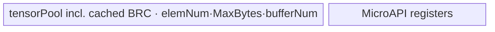
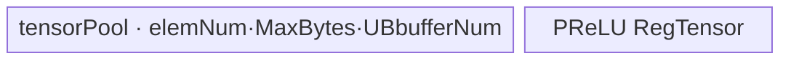
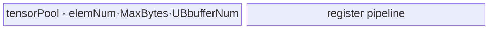

# Prelu 950 ACLNN 算子知识

## 算子速览

| 项目 | 内容 |
|---|---|
| 实际入口 | `aclnnPreluGetWorkspaceSize` + `aclnnPrelu`，公开两段式 ACLNN；L0 为 `l0op::PRelu`。 |
| 计算语义 | `y=max(x,0)+weight*min(x,0)`；API 将通道权重 reshape 为 `[1,C,1,...]` 后广播。 |
| 输入输出 | ND，rank 0–8；FLOAT/FLOAT16/BFLOAT16；输入可非连续并可做 dtype promotion，内部 PRelu 三张量 dtype 相同。 |
| 执行类型 | 单 AIV Kernel；R-002/R-003 的 broadcast 搬运为 NDDMA，其余为 AIV Vector/UB broadcast；无 Cube/AIC/MIX_CV。 |
| Kernel 路线 | R-001 mode 202；R-002/003 modes 1/2；R-004–008 modes 101/102/103/104/109。 |
| 核心资源 | executor workspace（PRelu backend 固定 16 MiB system workspace，另含框架 Contiguous/Cast/ViewCopy）；AIV TBuf tensor pool；MicroAPI RegTensor。 |
| 来源闭包 | `source_closed`：公开 ACLNN→executor/L0→950 OpDef/Tiling→opbase 锁定依赖的 Broadcast POD/selector/scheduler→PRelu MicroAPI DAG→ascend950 config/CMake。 |
| 验证状态 | 已完成源码闭包检查；本次知识提取未执行编译、真机、数值或性能测试。 |

## 接口与语义

### 计算语义

内部 Promote dtype 上对每个输出元素计算 `x>0 ? x : x*weight_broadcast`。比较严格使用 `GT`，因此 `x==0` 选择乘积分支，但结果仍为 0。API 若 `rank(self)>1`，把已 Cast 的 weight reshape 为与 self 同 rank：第 1 维为 `weightSize`，其余维为 1；rank≤1 时不 reshape。

### 输入、输出与属性

| 参数 | shape/layout | dtype | 约束、默认值与语义 |
|---|---|---|---|
| `self` | ND，rank 0–8，可非连续 | FLOAT/FLOAT16/BFLOAT16 | 可为空；与 out shape 相同。 |
| `weight` | ND，rank 0–8，可非连续 | 同支持集，可与 self promotion | 元素数 1 或 channel；rank≤1 时 channel=1。 |
| `out` | ND，rank 0–8，可非连续 | 支持集 | 接受 promoted 结果可转换的 dtype；ViewCopy 提交。 |

### 入口与版本

`aclnnPreluGetWorkspaceSize` 是固定仓唯一公开版本；950 由 `IsRegbase(curArch)` 启用三 dtype。稳定 CMake 仅设 `SUPPORT_COMPUTE_UNIT=ascend950`、`SUPPORT_TILING_DIR=arch35`，OpDef 与三条 binary config 同样只接 950，因此本卡只覆盖 950。

## Host/Launcher 执行流程

### 参数校验与前处理

依次检查 workspaceSize、self/weight/out 非空，dtype 属于平台列表，`PromoteType(self,weight)` 有效且可 cast 到 out，rank≤8、self/out shape 相等、weightSize 为 1 或 channel。空 self/weight 直接返回 workspace 0 与空 executor。非空时执行 `Contiguous(self)→Cast(promote)→Contiguous(weight)→Cast(promote)→可选 Reshape(weight)→PRelu→Cast(out dtype)→ViewCopy`；任一空结果立即返回错误。

### 参数、Workspace 与生命周期

PRelu L0 分配与 self 同 view shape/dtype/format 的临时输出，通过 `ADD_TO_LAUNCHER_LIST_AICORE(PRelu,...)` 加入 executor。Broadcast Tiling 从平台取 `GetCoreNumAiv` 和 UB，写 `DEFAULT_TILING_WORKSPACE_SIZE=16*1024*1024`；ACLNN 总 workspace 由 executor 汇总框架节点与 K0 slice，具体 offset 是框架边界。所有节点在传入 stream 上按 executor 依赖执行，最终 ViewCopy 完成前中间张量不可释放。

### 启动图与失败传播

```text
F0 Contiguous/Cast(self) ─┐
                           ├─ F2 optional Reshape(weight) ─ K0 PRelu<schMode> ─ F3 Cast ─ F4 ViewCopy
F1 Contiguous/Cast(weight)─┘
```

K0 entry 为 `prelu(x,weight,y,workspace,tiling)`，blockDim 来自 Broadcast Tiling，POD 随 mode 为 `BroadcastOneDimTilingDataAdvance` 或 `BroadcastBaseTilingData<PreluDAG<T>::OpDag>`。第一段任何检查/构图/Tiling 失败阻断执行；第二段由 `CommonOpExecutorRun` 返回 stream 执行错误。

## Route 与参数设计

### 分核与资源计算

Broadcast 先读取 storage/view shape、stride，补 scalar 维并合并相邻轴。ACLNN 已将两输入 Contiguous，故 `inputAllContiguous=true`，非连续 301–305 modes 对本入口不可达。若合轴后 rank=1，因 DAG `InputSize+OutputSize=3<=4` 且 `VarSize=0`，必选 mode 202；tile 按 `floor((ubSize/aliveNum)/512)*512/maxDtypeBytes`，blockNum 由 ubOuter/blockFormer 产生。多维时公共算法产生 `ubSplitAxis/ubFormer/ubTail/ubOuter/blockFormer/blockTail/elemNum`；UB broadcast 的 running rank 1–4 对应 101–104，大于 4 对应 109；NDDMA running rank≤5 对应 1，否则 2。

### Route 选择

| 顺序 | Route | Key/模板 | 精确选择条件与优先级 | 不适用去向 |
|---:|---|---|---|---|
| 1 | R-001 one-dim advance | 202 | 合轴 rank=1 且 contiguous；DAG 参数数/Var 编译期 guard 成立 | 多维 |
| 2 | R-002 NDDMA no-loop-cache | 1 | 多维 contiguous，`IsUbBroadcast=false`，`runningRank<=5` | R-003 |
| 3 | R-003 NDDMA loop-cache | 2 | 多维 contiguous，`IsUbBroadcast=false`，`runningRank>5` | 无 |
| 4 | R-004 UB rank1 | 101 | 多维全局 shape，但 UB 切分后的 `runningRank=1`，`IsUbBroadcast=true` | 按 rank |
| 5 | R-005 UB rank2 | 102 | 同上，`runningRank=2` | 按 rank |
| 6 | R-006 UB rank3 | 103 | 同上，`runningRank=3` | 按 rank |
| 7 | R-007 UB rank4 | 104 | 同上，`runningRank=4` | 按 rank |
| 8 | R-008 UB dynamic-rank | 109 | 同上，`runningRank>4` | 无 |

```text
collapse shapes/strides
if rank==1 && contiguous -> 202
else if contiguous:
  isUb = explicit kernelType, else broadcast presence/CopyBrc/big-Nlast/dtype-alignment rules
  if !isUb -> (runningRank>5 ? 2 : 1)
  else -> (runningRank 1..4 ? 100+rank : 109)
else -> noncontiguous modes（本 ACLNN 因 Contiguous 不可达）
```

### 模板/实现执行矩阵

| Route | key/selector | dtype/shape/platform 完整命中条件 | 执行拓扑与 Kernel 节点 | 实际模板/body | 内存与同步特征 | tail/fallback |
|---|---|---|---|---|---|---|
| R-001 | 202 | 一维合轴，三 dtype，950 | K0 | `BroadcastOneDimAdvanceSch<OpDag>` | 512B tile、ping/pong pool | `ubTailNum` mask/copy |
| R-002 | 1 | 多维、NDDMA、rank≤5 | K0 | `BroadcastNddmaSch<OpDag,false>` | NDDMA CopyInBrc + tensorPool | ubTail |
| R-003 | 2 | 多维、NDDMA、rank>5 | K0 | `BroadcastNddmaSch<OpDag,true>` | loop-cache BRC | cache only when stride allows |
| R-004 | 101 | UB BRC running rank1 | K0 | `BroadcastUbSch<OpDag,1>` | UB Broadcast static rank | ubTail |
| R-005 | 102 | rank2 | K0 | `BroadcastUbSch<OpDag,2>` | 同上 | ubTail |
| R-006 | 103 | rank3 | K0 | `BroadcastUbSch<OpDag,3>` | 同上 | ubTail |
| R-007 | 104 | rank4 | K0 | `BroadcastUbSch<OpDag,4>` | 同上 | ubTail |
| R-008 | 109 | rank>4 | K0 | `BroadcastUbSch<OpDag,-1>` | runtime rank Broadcast | ubTail |

### 隐藏性能 Guard

| Guard | Host/Tiling 条件 | Device/资源原因 | 影响 Route | 不满足时去向 | 源码符号 |
|---|---|---|---|---|---|
| API contiguous | 两输入先 `l0op::Contiguous` | 排除 stride transpose routes | 全部 | 框架失败 | `aclnnPreluGetWorkspaceSize` |
| one-dim advance | args≤4且 VarSize≤0 | 使用紧凑 16B POD/SIMD scheduler | R-001 | 一般 one-dim（本 DAG 编译期不走） | `BroadcastBaseTiling::DoTiling` |
| UB/NDDMA | `IsUbBroadcast()` 五级规则 | 决定广播在 Vector 或 NDDMA 搬运实现 | R-002–008 | 对应族 | `IsUbBroadcast` |
| NDDMA rank | `runningRank>5` | 高维需 loop cache | R-002/003 | mode 2/1 | `SetSchMode` |
| UB static rank | `runningRank<=4` | 编译期 `Broadcast<T,R>` | R-004–008 | mode109 runtime rank | `SetSchMode/VecBrc` |
| vector tail | `loopNum=ceil(count/VL)` + `UpdateMask(count)` | 只激活有效 lane | 全部 | 无 Device fallback | `PreluCustom` |

### POD/ABI

| 结构 | 字段 | 类型/位宽 | ABI 布局 | 单位 | Host/launcher producer | Device consumer | 边界 |
|---|---|---|---|---|---|---|---|
| `BroadcastOneDimTilingDataAdvance` | `dimLen` | int64/64 | sizeof16 align8 off0 | 元素 | `DoOneDimFormerTilingAdvance` | scheduler ubOuter | >0 |
| 同上 | `tileNum` | int32/32 | off8 | 元素 | UB/aliveNum/512B | blockEleLen | >0 |
| 同上 | `blockNum` | int16/16 | off12 | core | Host 分核 | tail core | 窄化依赖平台核数 |
| 同上 | `scalarFlag` | int16/16 | off14 | bitmask | input scalar 判定 | CopyIn scalar path | PRelu weight broadcast |
| `BroadcastBaseTilingData<OpDag>` | `scheMode` | int32/32 | 模板实例 ABI；完整 sizeof 由编译器展开，固定源码未物化数值 | mode | adapt | scheduler | key 同步 |
| 同上 | `shapeLen` | int32/32 | 同上 | axis | collapse | loop/offset | ≤8 |
| 同上 | `ubSplitAxis` | int32/32 | 同上 | axis | common tiling | scheduler | valid axis |
| 同上 | `ubFormer` | int32/32 | 同上 | axis elements | common tiling | main tile | 正数 |
| 同上 | `ubTail` | int32/32 | 同上 | axis elements | common tiling | last tile | 正数化 tail |
| 同上 | `ubOuter` | int64/64 | 同上 | tile | common tiling | loop/cache | ≥1 |
| 同上 | `blockFormer` | int64/64 | 同上 | tile/core | common tiling | core loop | non-tail |
| 同上 | `blockTail` | int64/64 | 同上 | tile | common tiling | last core | 正数化 tail |
| 同上 | `dimProductBeforeUbInner` | int64/64 | 同上 | 元素 | collapse | axes index | offset basis |
| 同上 | `elemNum` | int64/64 | 同上 | 元素/buffer | resource tiling | tensorPool | UB bound |
| 同上 | `blockNum` | int64/64 | 同上 | core | common tiling | launch/GetBlockNum | blockDim |
| 同上 | `outputDims[8]` | int64 array | 同上 | 元素/axis | adapt | axes update | unused tail slots |
| 同上 | `outputStrides[8]` | int64 array | 同上 | 元素 | adapt | GM offset | row-major output |
| 同上 | `inputDims[2][2]` | int64 array | 同上 | 元素 | `SetInputParams` | CopyIn main/tail | x/weight |
| 同上 | `inputBrcDims[2][8]` | int64 array | 同上 | 元素/axis | CopyInBrc params | NDDMA/UB BRC | x/weight 两个 `CopyInBrc` 节点 |
| 同上 | `inputVecBrcDims[0][8]` | empty template extent | 同上 | N/A | DAG has no Vec::Brc | not read | inactive |
| 同上 | `inputStrides[2][8]` | int64 array | 同上 | 元素 stride | collapse/adapt | normal CopyIn | x/weight |
| 同上 | `inputBrcStrides[2][8]` | int64 array | 同上 | 元素 stride | CopyInBrc params | NDDMA cache/offset | x/weight |
| 同上 | `inputVecBrcStrides[0]` | empty template extent | 同上 | N/A | inactive | not read | inactive |
| 同上 | `scalarData[16]` | char array | 同上 | byte | scalar setter | Var reader | VarSize=0 |

### Route 源码闭包

| Route | Key/selector | Host/Tiling producer | POD/参数 | Kernel entry/router 节点 | Kernel body/直接依赖 | 构建接线 |
|---|---|---|---|---|---|---|
| R-001 | 202 | `BroadcastBaseTiling::DoOneDimOpTilingAdvance` | one-dim POD | `prelu<202>/BroadcastSch` | `BroadcastOneDimAdvanceSch` + `PreluCustom` | ascend950 CMake/json |
| R-002 | 1 | `DoBroadcastOpTiling/SetSchMode` | base POD | `prelu<1>` | `BroadcastNddmaSch<false>` + DAG | 同上 |
| R-003 | 2 | 同上 | base POD | `prelu<2>` | `BroadcastNddmaSch<true>` + DAG | 同上 |
| R-004 | 101 | 同上 | base POD | `prelu<101>` | `BroadcastUbSch<1>` + DAG | 同上 |
| R-005 | 102 | 同上 | base POD | `prelu<102>` | `BroadcastUbSch<2>` + DAG | 同上 |
| R-006 | 103 | 同上 | base POD | `prelu<103>` | `BroadcastUbSch<3>` + DAG | 同上 |
| R-007 | 104 | 同上 | base POD | `prelu<104>` | `BroadcastUbSch<4>` + DAG | 同上 |
| R-008 | 109 | 同上 | base POD | `prelu<109>` | `BroadcastUbSch<-1>` + DAG | 同上 |

## Kernel 实现

### 公共执行流程

`prelu<schMode>` 声明 `KERNEL_TYPE_AIV_ONLY`，实例化 `PreluDAG<DTYPE_X>::OpDag` 与 `BroadcastSch`。DAG 顺序是 `CopyInBrc(x)`、`CopyInBrc(weight)`（按 stride 实际决定普通/广播搬入）、`PreluCustom`、`CopyOut`；scheduler 以 `TBuf<VECCALC>` 划分 tensorPool 并用 buffer-id/pipe mutex 管理 MTE2/V/MTE3。`PreluCustom` 每 `VL=VECTOR_REG_WIDTH/sizeof(T)` 元素一轮，`UpdateMask(count)`，依次 DataCopy 两输入到 RegTensor、Mul、GT Compare、Select、masked DataCopy 回 UB。

以下各 Route 都是单 K0，无跨 Kernel workspace 边。公共资源公式：一般 scheduler `UB_total=elemNum*MaxDtypeBytes*bufferNum`，one-dim advance 对应 `tileNum*MaxDtypeBytes*OpDag::BufferNum`；`bufferNum` 是 DAG liveness 在 `GetBufferNum<UseNddma,true>` 的编译期结果，固定源码没有物化为整数，不能臆测。backend workspace 为 16 MiB，Kernel body 不读 workspace 指针。

### Route R-001：one-dim advance

#### 适用条件

##### 选择证据

| 层级 | 文件 | 符号 | 源码谓词/参数 | 结果/下一跳 |
|---|---|---|---|---|
| Tiling | opbase `broadcast_tiling.h` | `DoTiling` | collapsed rank=1, contiguous, args≤4, VarSize=0 | 202 |
| Router | opbase `broadcast_sch.h` | `BroadcastSch::Process` | `schMode==202` | advance scheduler |

#### Device 数据流

##### 函数级调用链

```text
prelu<202> -> BroadcastSch<202>::Process -> BroadcastOneDimAdvanceSch::Init/Process
-> CopyIn x/weight -> PreluCustom::operator() -> CopyOut
```

##### 源码等价伪码

```text
derive ubOuter/tail/block loops; for local tile pingpong=i&1:
  load x and scalar/equal-shape weight; MicroAPI masked PReLU; write valid tile
```

#### 内存与数据搬运

##### 资源与搬运表

| 层级/缓冲区 | offset/地址公式 | extent/容量公式 | dtype/layout | producer | consumer | owner/lifetime | 对齐/复用 |
|---|---|---|---|---|---|---|---|
| GM x/y | `blockFormer*tileNum*core + localOffset` | valid tile | T/ND | API/Kernel | Kernel/API | executor | tail guarded |
| tensorPool | bufferId*blockLen | `tileNum*MaxBytes*BufferNum` | bytes | scheduler | DAG nodes | K0/core | ping/pong ids |
| RegTensor | register | VL lanes | T | MicroAPI DataCopy | Mul/Compare/Select | vector loop | mask tail |

##### 分层内存布局


##### 字节账与复用顺序

```text
UB_total=tileNum*MaxDtypeBytes*OpDag::BufferNum <= platform UB
workspace_total(K0)=16 MiB system slice; dynamic_ub=N/A
```

| 复用子区 | 写入者 | 读取者/消费点 | 下一次覆盖 | 同步或释放依据 | 安全条件 |
|---|---|---|---|---|---|
| tensorPool bufferId | DAG node | dependent node | ping/pong next tile | `GetTensor/ReleaseTensor` | liveness-derived IDs |

#### 同步、精度与尾块

##### 同步与数值边界表

| 阶段 | primitive/机制 | producer | consumer/等待点 | 保护对象 | 精度/尾块 |
|---|---|---|---|---|---|
| DAG | pipe mutex | CopyIn/compute | compute/CopyOut | pool slice | dtype 原精度 |
| MicroAPI | `UpdateMask<T>(count)` | loop count | all vector ops | valid lanes | last VL masked |

#### 关键实现

##### 符号证据表

| 阶段 | 文件 | 符号/模板实例 | 实现事实 |
|---|---|---|---|
| Host/Tiling producer | opbase `broadcast_tiling.h` | `DoOneDimOpTilingAdvance` | 512B tile/block |
| Kernel entry/router | `activation/p_relu/op_kernel/p_relu_apt.cpp` | `prelu<202>` | AIV entry |
| Device body/helper | opbase `broadcast_sch_one_dim_advance.h`; `p_relu_dag.h` | `Process`; `PreluCustom` | loop/MicroAPI/tail |

### Route R-002：NDDMA 无 loop cache

#### 适用条件

##### 选择证据

| 层级 | 文件 | 符号 | 源码谓词/参数 | 结果/下一跳 |
|---|---|---|---|---|
| Tiling | opbase `broadcast_tiling.h` | `SetSchMode` | `!isUbBroadcast && runningRank<=5` | 1 |

#### Device 数据流

##### 函数级调用链

```text
prelu<1> -> BroadcastNddmaSch<OpDag,false>::Init/Process
-> CopyIn/CopyInBrc(NDDMA without loop) -> PreluCustom -> CopyOut
```

##### 源码等价伪码

```text
for core tile: axes=decode(globalTile); NDDMA broadcast weight using dims/strides;
copy x; run masked PReLU on ubSplitSize*outputStride; copy output
```

#### 内存与数据搬运

##### 资源与搬运表

| 层级/缓冲区 | offset/地址公式 | extent/容量公式 | dtype/layout | producer | consumer | owner/lifetime | 对齐/复用 |
|---|---|---|---|---|---|---|---|
| NDDMA weight tile | POD dims/strides+axes | inputBrc main/tail | T/broadcast | NDDMA | PreluCustom | tile/cache rule | ≤5 dims |
| tensorPool | `bufId*elemNum*MaxBytes` | `elemNum*MaxBytes*bufferNum` | bytes | scheduler | DAG | core | ping/pong |

##### 分层内存布局


##### 字节账与复用顺序

```text
UB_total=elemNum*MaxDtypeBytes*GetBufferNum<true,true>() <= UB
workspace_total=16 MiB; dynamic_ub=N/A
```

| 复用子区 | 写入者 | 读取者/消费点 | 下一次覆盖 | 同步或释放依据 | 安全条件 |
|---|---|---|---|---|---|
| BRC buffer | NDDMA | PreluCustom | next eligible tile | Get/ReleaseTensor | stride predicate controls reload |

#### 同步、精度与尾块

##### 同步与数值边界表

| 阶段 | primitive/机制 | producer | consumer/等待点 | 保护对象 | 精度/尾块 |
|---|---|---|---|---|---|
| NDDMA→V | tensorPool mutex | CopyInBrc | PreluCustom | BRC tile | POD ubTail |

#### 关键实现

##### 符号证据表

| 阶段 | 文件 | 符号/模板实例 | 实现事实 |
|---|---|---|---|
| Host/Tiling producer | opbase `broadcast_tiling.h` | `IsUbBroadcast/SetSchMode` | mode1 |
| Kernel entry/router | opbase `broadcast_sch.h` | `BroadcastSch<1>` | NDDMA false |
| Device body/helper | opbase `broadcast_sch_nddma.h`; `p_relu_dag.h` | `CopyInBrc/Run`; `PreluCustom` | NDDMA+compute |

### Route R-003：NDDMA loop cache

#### 适用条件

##### 选择证据

| 层级 | 文件 | 符号 | 源码谓词/参数 | 结果/下一跳 |
|---|---|---|---|---|
| Tiling | opbase `broadcast_tiling.h` | `SetSchMode` | `!isUbBroadcast && runningRank>5` | 2 |

#### Device 数据流

##### 函数级调用链

```text
prelu<2> -> BroadcastNddmaSch<OpDag,true> -> cached CopyInBrc -> PreluCustom -> CopyOut
```

##### 源码等价伪码

```text
same as R-002, but high-rank BroadcastNddmaWithLoop reuses BRC input when its split-axis stride is 0
```

#### 内存与数据搬运

##### 资源与搬运表

| 层级/缓冲区 | offset/地址公式 | extent/容量公式 | dtype/layout | producer | consumer | owner/lifetime | 对齐/复用 |
|---|---|---|---|---|---|---|---|
| cached BRC tile | inputBrcStrides | one `elemNum` buffer | T | NDDMA | repeated tiles | until stride changes | loop cache |
| pool/regs | as R-002 | same formula with cache liveness | mixed | scheduler | DAG | core | buffer IDs differ |

##### 分层内存布局



##### 字节账与复用顺序

```text
UB_total=elemNum*MaxDtypeBytes*GetBufferNum<true,true>() <= UB; workspace=16 MiB
```

| 复用子区 | 写入者 | 读取者/消费点 | 下一次覆盖 | 同步或释放依据 | 安全条件 |
|---|---|---|---|---|---|
| cached BRC | first relevant loop | later PReLU tiles | broadcast index changes | stride/realIdx predicate | split stride 0 |

#### 同步、精度与尾块

##### 同步与数值边界表

| 阶段 | primitive/机制 | producer | consumer/等待点 | 保护对象 | 精度/尾块 |
|---|---|---|---|---|---|
| cache | conditional `GetTensor` | NDDMA | V | BRC buffer | reload at loop boundary |

#### 关键实现

##### 符号证据表

| 阶段 | 文件 | 符号/模板实例 | 实现事实 |
|---|---|---|---|
| Host/Tiling producer | opbase `broadcast_tiling.h` | `SetSchMode` | rank>5 |
| Kernel entry/router | opbase `broadcast_sch.h` | `BroadcastSch<2>` | withLoop=true |
| Device body/helper | opbase `broadcast_sch_nddma.h` | `CopyInBrc` | loop cache predicate |

### Route R-004：UB Broadcast rank 1

#### 适用条件

##### 选择证据

| 层级 | 文件 | 符号 | 源码谓词/参数 | 结果/下一跳 |
|---|---|---|---|---|
| Tiling | opbase `broadcast_tiling.h` | `SetSchMode` | isUb && runningRank=1 | 101 |

#### Device 数据流

##### 函数级调用链

```text
prelu<101> -> BroadcastUbSch<OpDag,1> -> CopyInAndVecBrc -> PreluCustom -> CopyOut
```

##### 源码等价伪码

```text
load compact weight tile; Broadcast<T,1> to output-tile shape; masked MicroAPI PReLU; copy valid output
```

#### 内存与数据搬运

##### 资源与搬运表

| 层级/缓冲区 | offset/地址公式 | extent/容量公式 | dtype/layout | producer | consumer | owner/lifetime | 对齐/复用 |
|---|---|---|---|---|---|---|---|
| tensorPool | bufId*blockLen | `elemNum*MaxBytes*GetBufferNum<false,true>` | bytes | MTE2/V | V/MTE3 | tile | static rank1 |

##### 分层内存布局



##### 字节账与复用顺序

```text
UB_total=elemNum*MaxDtypeBytes*GetBufferNum<false,true>()<=UB; workspace=16 MiB
```

| 复用子区 | 写入者 | 读取者/消费点 | 下一次覆盖 | 同步或释放依据 | 安全条件 |
|---|---|---|---|---|---|
| broadcast dst | `Broadcast<T,1>` | PreluCustom | next tile | buffer-id liveness | static rank matches POD |

#### 同步、精度与尾块

##### 同步与数值边界表

| 阶段 | primitive/机制 | producer | consumer/等待点 | 保护对象 | 精度/尾块 |
|---|---|---|---|---|---|
| UB BRC | pipe mutex | Copy/Broadcast | PReLU | pool | ubTail+MicroAPI mask |

#### 关键实现

##### 符号证据表

| 阶段 | 文件 | 符号/模板实例 | 实现事实 |
|---|---|---|---|
| Host/Tiling producer | opbase `broadcast_tiling.h` | `SetSchMode` | 101 |
| Kernel entry/router | opbase `broadcast_sch.h` | `BroadcastSch<101>` | `BroadcastUbSch<1>` |
| Device body/helper | opbase `broadcast_sch_ub_broadcast.h`; `p_relu_dag.h` | `Broadcast<T,1>`; `PreluCustom` | static UB BRC |

### Route R-005：UB Broadcast rank 2

#### 适用条件

##### 选择证据

| 层级 | 文件 | 符号 | 源码谓词/参数 | 结果/下一跳 |
|---|---|---|---|---|
| Tiling | opbase `broadcast_tiling.h` | `SetSchMode` | isUb && runningRank=2 | 102 |

#### Device 数据流

##### 函数级调用链

```text
prelu<102> -> BroadcastUbSch<OpDag,2> -> Broadcast<T,2> -> PreluCustom -> CopyOut
```

##### 源码等价伪码

```text
R-004 pipeline with compile-time two-dimensional Broadcast shape
```

#### 内存与数据搬运

##### 资源与搬运表

| 层级/缓冲区 | offset/地址公式 | extent/容量公式 | dtype/layout | producer | consumer | owner/lifetime | 对齐/复用 |
|---|---|---|---|---|---|---|---|
| pool/regs | as R-004 | same compile-time liveness formula | T/bytes | scheduler | DAG | tile | rank2 |

##### 分层内存布局



##### 字节账与复用顺序

```text
UB_total=elemNum*MaxDtypeBytes*GetBufferNum<false,true>()<=UB; workspace=16 MiB
```

| 复用子区 | 写入者 | 读取者/消费点 | 下一次覆盖 | 同步或释放依据 | 安全条件 |
|---|---|---|---|---|---|
| pool ids | scheduler DAG | dependents | next tile | Get/ReleaseTensor | rank2 tiling |

#### 同步、精度与尾块

##### 同步与数值边界表

| 阶段 | primitive/机制 | producer | consumer/等待点 | 保护对象 | 精度/尾块 |
|---|---|---|---|---|---|
| all | same as R-004 | MTE2/V | V/MTE3 | pool | masked tail |

#### 关键实现

##### 符号证据表

| 阶段 | 文件 | 符号/模板实例 | 实现事实 |
|---|---|---|---|
| Host/Tiling producer | opbase `broadcast_tiling.h` | `SetSchMode` | 102 |
| Kernel entry/router | opbase `broadcast_sch.h` | `BroadcastSch<102>` | rank2 |
| Device body/helper | opbase `broadcast_sch_ub_broadcast.h` | `Broadcast<T,2>` | UB BRC |

### Route R-006：UB Broadcast rank 3

#### 适用条件

##### 选择证据

| 层级 | 文件 | 符号 | 源码谓词/参数 | 结果/下一跳 |
|---|---|---|---|---|
| Tiling | opbase `broadcast_tiling.h` | `SetSchMode` | isUb && runningRank=3 | 103 |

#### Device 数据流

##### 函数级调用链

```text
prelu<103> -> BroadcastUbSch<OpDag,3> -> Broadcast<T,3> -> PreluCustom -> CopyOut
```

##### 源码等价伪码

```text
R-004 pipeline with compile-time three-dimensional Broadcast shape
```

#### 内存与数据搬运

##### 资源与搬运表

| 层级/缓冲区 | offset/地址公式 | extent/容量公式 | dtype/layout | producer | consumer | owner/lifetime | 对齐/复用 |
|---|---|---|---|---|---|---|---|
| pool/regs | as R-004 | same formula | bytes/T | scheduler | DAG | tile | rank3 |

##### 分层内存布局


##### 字节账与复用顺序

```text
UB_total=elemNum*MaxDtypeBytes*GetBufferNum<false,true>()<=UB; workspace=16 MiB
```

| 复用子区 | 写入者 | 读取者/消费点 | 下一次覆盖 | 同步或释放依据 | 安全条件 |
|---|---|---|---|---|---|
| pool ids | scheduler | DAG | next tile | Get/ReleaseTensor | rank3 |

#### 同步、精度与尾块

##### 同步与数值边界表

| 阶段 | primitive/机制 | producer | consumer/等待点 | 保护对象 | 精度/尾块 |
|---|---|---|---|---|---|
| all | pipe/mask | scheduler | DAG | pool/lanes | ubTail |

#### 关键实现

##### 符号证据表

| 阶段 | 文件 | 符号/模板实例 | 实现事实 |
|---|---|---|---|
| Host/Tiling producer | opbase `broadcast_tiling.h` | `SetSchMode` | 103 |
| Kernel entry/router | opbase `broadcast_sch.h` | `BroadcastSch<103>` | rank3 |
| Device body/helper | opbase `broadcast_sch_ub_broadcast.h` | `Broadcast<T,3>` | UB BRC |

### Route R-007：UB Broadcast rank 4

#### 适用条件

##### 选择证据

| 层级 | 文件 | 符号 | 源码谓词/参数 | 结果/下一跳 |
|---|---|---|---|---|
| Tiling | opbase `broadcast_tiling.h` | `SetSchMode` | isUb && runningRank=4 | 104 |

#### Device 数据流

##### 函数级调用链

```text
prelu<104> -> BroadcastUbSch<OpDag,4> -> Broadcast<T,4> -> PreluCustom -> CopyOut
```

##### 源码等价伪码

```text
R-004 pipeline with compile-time four-dimensional Broadcast shape
```

#### 内存与数据搬运

##### 资源与搬运表

| 层级/缓冲区 | offset/地址公式 | extent/容量公式 | dtype/layout | producer | consumer | owner/lifetime | 对齐/复用 |
|---|---|---|---|---|---|---|---|
| pool/regs | as R-004 | same formula | bytes/T | scheduler | DAG | tile | rank4 |

##### 分层内存布局


##### 字节账与复用顺序

```text
UB_total=elemNum*MaxDtypeBytes*GetBufferNum<false,true>()<=UB; workspace=16 MiB
```

| 复用子区 | 写入者 | 读取者/消费点 | 下一次覆盖 | 同步或释放依据 | 安全条件 |
|---|---|---|---|---|---|
| pool ids | scheduler | DAG | next tile | Get/ReleaseTensor | rank4 |

#### 同步、精度与尾块

##### 同步与数值边界表

| 阶段 | primitive/机制 | producer | consumer/等待点 | 保护对象 | 精度/尾块 |
|---|---|---|---|---|---|
| all | pipe/mask | scheduler | DAG | pool/lanes | ubTail |

#### 关键实现

##### 符号证据表

| 阶段 | 文件 | 符号/模板实例 | 实现事实 |
|---|---|---|---|
| Host/Tiling producer | opbase `broadcast_tiling.h` | `SetSchMode` | 104 |
| Kernel entry/router | opbase `broadcast_sch.h` | `BroadcastSch<104>` | rank4 |
| Device body/helper | opbase `broadcast_sch_ub_broadcast.h` | `Broadcast<T,4>` | UB BRC |

### Route R-008：UB Broadcast dynamic rank

#### 适用条件

##### 选择证据

| 层级 | 文件 | 符号 | 源码谓词/参数 | 结果/下一跳 |
|---|---|---|---|---|
| Tiling | opbase `broadcast_tiling.h` | `SetSchMode` | isUb && runningRank>4 | 109 |

#### Device 数据流

##### 函数级调用链

```text
prelu<109> -> BroadcastUbSch<OpDag,-1> -> runtime-rank Broadcast -> PreluCustom -> CopyOut
```

##### 源码等价伪码

```text
read runningRank/dims from POD; build BroadcastTiling at runtime; broadcast weight; run same masked PReLU
```

#### 内存与数据搬运

##### 资源与搬运表

| 层级/缓冲区 | offset/地址公式 | extent/容量公式 | dtype/layout | producer | consumer | owner/lifetime | 对齐/复用 |
|---|---|---|---|---|---|---|---|
| pool | bufId*blockLen | common UB formula | bytes | scheduler | DAG | tile | dynamic rank metadata |
| `BroadcastTiling` | local metadata | fixed library object | control | `GetBroadcastTilingInfo` | `Broadcast` | call | not tensor payload |

##### 分层内存布局


##### 字节账与复用顺序

```text
UB_total=elemNum*MaxDtypeBytes*GetBufferNum<false,true>()<=UB; workspace=16 MiB
```

| 复用子区 | 写入者 | 读取者/消费点 | 下一次覆盖 | 同步或释放依据 | 安全条件 |
|---|---|---|---|---|---|
| pool ids | runtime Broadcast | PReLU | next tile | Get/ReleaseTensor | POD rank/dims valid |

#### 同步、精度与尾块

##### 同步与数值边界表

| 阶段 | primitive/机制 | producer | consumer/等待点 | 保护对象 | 精度/尾块 |
|---|---|---|---|---|---|
| dynamic BRC | pipe mutex | Broadcast | PReLU | pool | ubTail/MicroAPI mask |

#### 关键实现

##### 符号证据表

| 阶段 | 文件 | 符号/模板实例 | 实现事实 |
|---|---|---|---|
| Host/Tiling producer | opbase `broadcast_tiling.h` | `SetSchMode` | rank>4→109 |
| Kernel entry/router | opbase `broadcast_sch.h` | `BroadcastSch<109>` | `R=-1` |
| Device body/helper | opbase `broadcast_sch_ub_broadcast.h` | runtime `GetBroadcastTilingInfo/Broadcast` | dynamic rank |

## 算子特定优化

### Trick T-001：GT+Select 融合正负分支，尾轮寄存器掩码

#### 触发与源码依据

- 适用 Route：R-001–R-008。
- 触发条件：每个 scheduler tile 的 `count>0`。
- Golden 来源：[`activation/p_relu/op_kernel/arch35/p_relu_dag.h:50-64`](../../../../../../../cann-ops-raw/ascendc/ops-nn/955f8b33985b6d72989ebff341bb9c2c564a51bc/activation/p_relu/op_kernel/arch35/p_relu_dag.h#L50-L64)

**官方源码（固定 Commit 连续逐字摘录）**：

```cpp
MicroAPI::Duplicate(vregInputZero, (T)0.0);
for (uint16_t loopIdx = 0; loopIdx < loopNum; loopIdx++) {
    mask = MicroAPI::UpdateMask<T, MicroAPI::RegTraitNumOne>(count);
    MicroAPI::DataCopy(vregInputX, (__ubuf__ T*)(src0Addr + loopIdx * vlSize));
    MicroAPI::DataCopy(vregInputWeight, (__ubuf__ T*)(src1Addr + loopIdx * vlSize));
    MicroAPI::Mul(vregInputProd, vregInputX, vregInputWeight, mask);
    MicroAPI::Compare<T, CMPMODE::GT>(cmpMask, vregInputX, vregInputZero, mask);
    MicroAPI::Select<T>(vregOutput, vregInputX, vregInputProd, cmpMask);
    MicroAPI::DataCopy((__ubuf__ T*)(dstAddr + loopIdx * vlSize), vregOutput, mask);
}
```

#### 机制与设计原因

每轮同时算负支乘积，再用严格 GT mask 在寄存器中选择原 x 或乘积，不物化两条 GM/UB 输出；`UpdateMask(count)` 随循环消耗有效元素，最后一轮无效 lane 不写 UB。关键参数 `VL` 来自寄存器宽度/dtype，`loopNum=ceil(count/VL)` 来自 scheduler tile。

#### 迁移边界

- 适用：同 dtype 的逐元素二分支激活。
- 前提：广播 scheduler 已提供同 shape 的 x/weight UB tile；950 MicroAPI。
- 失效：需要不同累加 dtype、NaN/零符号语义不同或输出多分支时必须重审 Compare/Select。
- 未验证：本次知识提取未执行编译、真机、数值或性能测试。

#### 错误做法

固定仓未提供可验证反例。

### Trick T-002：广播搬运按形状在 NDDMA 与 UB Broadcast 间专门化

#### 触发与源码依据

- 适用 Route：R-002–R-008。
- 触发条件：多维 contiguous broadcast；由 `IsUbBroadcast` 与 `runningRank` 判定。
- Golden 来源：[`pkg_inc/op_common/atvoss/broadcast/broadcast_tiling.h:483-521`](https://gitcode.com/cann/opbase/blob/b8bd9e6600eb4fc11d59586bc1712cbc9d87c3ed/pkg_inc/op_common/atvoss/broadcast/broadcast_tiling.h#L483-L521)

**官方源码（固定 Commit 连续逐字摘录）**：

```cpp
if (broadcastIdx == -1) {
    return false;
}
if constexpr (OpDag::CopyBrcSize == 0) {
    return true;
}
if (IsBigNLastBrc()) {
    return true;
}
if (dTypeSize != 0 && lastDim % (BLOCK_LENGTH / dTypeSize) == 0 && ubBroadcastDtypes.count(inputDtype)) {
    return true;
}
return false;
```

#### 机制与设计原因

Host 在编译期 DAG 属性和运行时 shape/dtype/alignment 间选择搬运族：NDDMA 直接构造 broadcast tile，UB 路线先搬紧凑输入再调用静态/动态 rank Broadcast；同时把 buffer liveness 纳入不同 `GetBufferNum`，避免以单一路线承担所有形状。

#### 迁移边界

- 适用：950 contiguous 多维 broadcast DAG。
- 前提：必须保留完整判定优先级、rank key、对应 POD 和 scheduler。
- 失效：非连续输入转 301–305，但本 ACLNN 已 Contiguous；那些路线不属于本卡。
- 未验证：本次知识提取未执行编译、真机、数值或性能测试。

#### 错误做法

固定仓未提供可验证反例。

## 模板与实现对比

| 对比维度 | R-001 | R-002/003 | R-004–008 | 设计选择依据 |
|---|---|---|---|---|
| 命中条件/优先级 | collapsed rank1 | 多维 NDDMA | 多维 UB BRC | contiguous shape/dtype/alignment |
| 模板与 dtype | AdvanceSch，三 dtype | NddmaSch false/true | UbSch R=1..4/-1 | rank specialization |
| 循环与分核 | tile/core compact POD | axes-index UB loops | axes-index UB loops | common Tiling |
| Queue/TBuf/寄存器 | tensorPool+regs | NDDMA-aware pool+regs | UB BRC pool+regs | DAG liveness |
| 内存总占用与复用 | tileNum formula | elemNum formula/cache | elemNum formula | GetBufferNum variant |
| 搬运/Vector/NDDMA API | CopyIn | NDDMA broadcast | DataCopy+Broadcast | shape-dependent |
| 同步、精度与 tail | pipe+mask，原 dtype | same + cache predicate | same + BRC | `UpdateMask` |
| fallback/失败边界 | multi-dim next | no Device fallback | no Device fallback | Tiling failure stops launch |

## 平台差异

| 项目 | A2 | A3 | 950 |
|---|---|---|---|
| 支持状态 | 见无后缀 A2 卡 | 公开文档称支持但固定 Commit 无活动 A3 source-closed 链路 | 本卡闭合 |
| Host/Launcher | experimental 七 mode | 固定仓不可见 | stable ACLNN + BroadcastBaseTiling |
| Kernel/资源 | 手写 AIV/0 workspace | 固定仓不可见 | atvoss AIV/NDDMA，16 MiB system workspace |

## 限制与失败边界

- 空 self 或 weight 在 ACLNN 第一段提前成功返回 workspace 0，不启动 PRelu；非空 Tiling 若合轴结果空或 UB/resource 计算失败则 `GRAPH_FAILED`。
- API 支持 mixed dtype promotion，但 PRelu backend 强制 x/weight/y dtype 完全一致；该一致性由前置 Cast 保证，不可绕过 L0 直接混用。
- 950 内部计算保持 T dtype；没有 BF16→FP32 升精度。Compare 为严格 `GT`，迁移时需保留零/NaN 行为并另行验证。
- 301–305 非连续 scheduler 存在于 router，但因 ACLNN 对两输入先 Contiguous，对本入口不可达，未作为正式 Route。
- A3 只有文档支持信号，没有当前固定 Commit 的活动实现闭包，未生成 A3 卡。

## 源码索引

### 链路索引

| 链路阶段 | 文件 | 关键符号 | 支撑内容 |
|---|---|---|---|
| 入口声明/约束 | `activation/p_relu/docs/aclnnPrelu.md` | `aclnnPrelu*` | 公开 950/API 约束 |
| 入口实现 | `activation/p_relu/op_api/aclnn_prelu.cpp` | `aclnnPreluGetWorkspaceSize/aclnnPrelu` | 校验/executor graph |
| 入口实现 | `activation/p_relu/op_api/prelu.cpp` | `l0op::PRelu/PReluAiCore` | L0 launch |
| Host/Tiling/Launcher | `activation/p_relu/op_host/arch35/p_relu_tiling_arch35.cpp` | `PreluTiling/Tiling4PRelu` | dtype dispatch/key |
| Kernel entry/body | `activation/p_relu/op_kernel/arch35/p_relu_dag.h` | `PreluCustom/PreluDAG` | MicroAPI/DAG |
| Kernel entry/body | `activation/p_relu/op_kernel/p_relu_apt.cpp` | `prelu<schMode>` | AIV entry |
| 构建接线 | `activation/p_relu/CMakeLists.txt` | `SUPPORT_COMPUTE_UNIT` | 950/arch35 |
| 构建接线 | `activation/p_relu/op_host/config/ascend950/p_relu.json` | `op_list` | 三 dtype binary |
| Host/Tiling/Launcher | opbase `broadcast_base_struct.h` | `Broadcast*Data` | POD/key |
| Host/Tiling/Launcher | opbase `broadcast_tiling.h` | `BroadcastBaseTiling` | selector/resource |
| Kernel entry/body | opbase `broadcast_sch.h` | `BroadcastSch` | key router |
| Kernel entry/body | opbase `broadcast_sch_nddma.h` | `BroadcastNddmaSch` | NDDMA routes |
| Kernel entry/body | opbase `broadcast_sch_ub_broadcast.h` | `BroadcastUbSch` | UB BRC routes |
| Kernel entry/body | opbase `broadcast_sch_one_dim_advance.h` | `BroadcastOneDimAdvanceSch` | mode202 |
| Kernel entry/body | opbase `util/vec.h` | `CopyIn/CopyOut` | GM/UB tail copy |

### 实现复用检查

| 检查项 | 可复用事实 | 不得改变的约束 | 源码符号 |
|---|---|---|---|
| ABI/POD | one-dim 16B POD；base templated POD | key 必须匹配具体 POD/OpDag extent | `BroadcastSch::Process` |
| 调用顺序 | Contiguous/Cast/Reshape→PRelu→Cast/ViewCopy | executor dependency/order | `aclnnPreluGetWorkspaceSize` |
| workspace/内存 | backend 16 MiB；pool由 liveness×elemNum | bufferNum 族、owner/lifetime | `DoTiling/InitBuffer` |
| 同步 | Get/ReleaseTensor pipe mutex | NDDMA/UB BRC producer先于 PReLU | schedulers |
| 精度与尾块 | 原 dtype；masked MicroAPI；valid CopyOut | `GT`、VL、UpdateMask | `PreluCustom` |
| 失败边界 | API/Host failure blocks K0 | 不可把 dormant noncontig mode 当 fallback | API/Tiling/router |