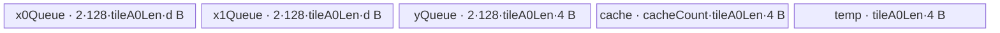

# SoftmaxBackward 950 ACLNN 算子知识

## 算子速览

| 项目 | 内容 |
|---|---|
| 实际入口 | `aclnnSoftmaxBackwardGetWorkspaceSize` / `aclnnSoftmaxBackward`，公开两段式 ACLNN，无更高版本入口 |
| 计算语义 | 令 `S=output`、`D=gradOutput`，沿 `dim`：`out = S*D - S*sum(S*D)` |
| 输入输出 | `gradOutput`、`output` 同 shape/同 dtype、ND、0–8 维；950公开可达路线可闭合 FP16/FP32；BF16虽见于文档/OpDef/binary，但入口SoC guard的枚举取值在固定仓不可见，故不把它列为已闭合；`out` shape 与输入相同，可非连续 |
| 执行类型 | executor 框架节点（`Contiguous`/`Cast`/`ViewCopy`）+ 一个算子拥有的 `AIV_VECTOR` Kernel；`g_coreType == AIC` 明确直接返回 |
| Kernel 路线 | R-001 AR 小 R（key 500）；R-002 AR 全载（1000）；R-003 AR 重计算（2000）；R-004 ARA 全载（10000）；R-005 ARA 重计算（20000） |
| 核心资源 | GM 输入/输出；AIV UB 的双缓冲 `TQue`、FP32 `TBuf`/寄存器；算子 tiling 固定请求 16 MiB workspace，但 Kernel 参数 `workspace` 未读取 |
| 来源闭包 | `source_closed`：公开 ACLNN→L0 `SoftmaxGrad`→950 OpDef/优先级 Tiling→五 key router→五个 AIV body→ascend950 binary/CMake 已闭合；A2/A3 不在本卡 |
| 验证状态 | 已完成源码闭包检查；本次知识提取未执行编译、真机、数值或性能测试。 |

## 接口与语义

### 计算语义

把逻辑 shape 沿 `dim` 融合为 `[A1, R, A0]`：`R=shape[dim]`，`A1=prod(shape[:dim])`，`A0=prod(shape[dim+1:])`。对每个 `(a1,a0)`，先以 FP32（FP32 输入直接使用；FP16/BF16 body 先升精度）计算

```text
sum = Σ(r=0..R-1) output[a1,r,a0] * gradOutput[a1,r,a0]
out[a1,r,a0] = output[a1,r,a0] * gradOutput[a1,r,a0]
                  - output[a1,r,a0] * sum
```

`SoftmaxGrad` L0 调用把 ACLNN 的 `output` 放到底层输入 0（`softmax`），把 `gradOutput` 放到底层输入 1（`grad_softmax`）。当 `R==1` 时 Host 将融合形状改为 `[1,1,A1*A0]`；公式输出逐元素为零，Device 仍按 ARA 路线执行（只有总元素数为 1 时可命中 AR 小 R）。

### 输入、输出与属性

| 参数 | shape/layout | dtype | 约束、默认值与语义 |
|---|---|---|---|
| `gradOutput` | ND；公开接口 0–8 维 | 950 ACLNN 已闭合 FP16、FP32；BF16见下述冲突 | 非空时须与 `output` 同 shape/同 dtype；支持非连续，先 `Contiguous` |
| `output` | 与 `gradOutput` 相同 | 与 `gradOutput` 相同 | Softmax 正向输出；支持非连续，先 `Contiguous` |
| `dim` | 标量属性 | `int64_t` | 标量 tensor 按 1 维校验；合法域 `[-rank, rank-1]`，底层负轴归一化；L0 转为单元素 `ListInt axes` |
| `out` | 与 `gradOutput` 同 shape；可非连续 | 未由 `CheckParams` 限定；末尾 `Cast` 到其 dtype | 由 `ViewCopy` 写入用户 view；公开文档说明额外 dtype 依赖自动 cast 并可能增加 workspace |
| `workspaceSize` | 标量输出 | `uint64_t*` | executor 聚合所需 Device workspace；空输入返回 0 |
| `executor` | Host 对象 | `aclOpExecutor**` | 第一段创建并移交，第二段消费 |
| `stream` | runtime stream | `aclrtStream` | `CommonOpExecutorRun` 在该 stream 执行 executor |

公开文档和 OpDef/binary 都列 BF16；但 `CheckSocVersionIsSupportBf16` 只用 `ASCEND910B <= socVersion <= ASCEND910E` 判断，未显式列 `ASCEND950`。`SocVersion` 的枚举数值定义不在固定仓中，所以固定源码不能证明 950 命中该范围；本卡不把 BF16 当作已闭合的公开 950 路线。BF16 Kernel specialization 的存在本身不能补足入口可达性。

### 入口与版本

唯一公开版本族是 `aclnnSoftmaxBackwardGetWorkspaceSize` + `aclnnSoftmaxBackward`。第一段顺序为 `CheckParams`→`CREATE_EXECUTOR`→两个 `Contiguous`→`l0op::SoftmaxGrad`→`Cast`→`ViewCopy`→`GetWorkspaceSize`。第二段仅调用 `CommonOpExecutorRun`。

公开 README/API 产品表声明 A2、A3、950 均支持；但活动 `activation/softmax_grad/CMakeLists.txt` 只设置 `SUPPORT_COMPUTE_UNIT "ascend950"`、`SUPPORT_TILING_DIR "arch35"`，OpDef 也只 `AddConfig("ascend950", ...)`，固定仓没有 A2/A3 的 SoftmaxGrad Host/Tiling/Kernel/binary 活动接线。因此本次仅 950 达到 `source_closed`；不生成 A2/A3 无后缀卡。

## Host/Launcher 执行流程

### 参数校验与前处理

1. `CheckNotNull` 校验 `gradOutput/output/out`；`workspaceSize/executor` 没有算子自有显式空指针检查，交由宏/框架边界。
2. 任一输入为空时，`CheckParams` 在 dtype、dim、shape 校验之前返回成功；第一段随后返回 `workspaceSize=0` 的空 executor，不加入任何节点。
3. 非空时 `CheckDtypeValid` 要求两个输入同 dtype 且在 FP32/FP16/BF16 列表内；BF16另受 `ASCEND910B..ASCEND910E` 数值范围 guard，950枚举取值在固定仓不可见。
4. `CheckDim` 对 rank-0 临时视作 rank 1；其余要求 `-rank <= dim < rank`。
5. `CheckShape` 要求输入最大 8 维，两个输入与 `out` shape 相同；底层 Tiling 再要求三者 dtype 相同、rank/逐维相同且每维正数。
6. 两输入各经 `l0op::Contiguous`。L0 分配与 `gradOutput` storage shape/dtype 相同的临时输出，构造单元素 `axes={dim}`，以 `OP_INPUT(output, gradOutput)` 加入 `SoftmaxGrad` AICore launcher。
7. 结果经框架 `Cast(op_out, out->dtype)` 和 `ViewCopy(cast_out,out)`；这些生成代码、分片和内部 Kernel 不在固定算子源码中，属于明确框架边界。

### 参数、Workspace 与生命周期

Tiling 公共阶段从平台取得 `blockSize=GetUbBlockSize()`、`vlFp32=GetVRegSize()/4`、`vlFp16=GetVRegSize()/2`、AIV core 数与 UB 字节数；shape/axis 融合为 `[a1,r,a0]`。模板按数值由小到大尝试，先成功者写 key、POD、`blockDim=usedCoreNums`。

每条模板的 `GetWorkspaceSize` 都把 SoftmaxGrad 自有 workspace slice 设为 `MINIMAL_WORKSPACE=16*1024*1024` 字节。Kernel entry 虽接收 `workspace`，五个 body 均不读取它；这是 Host/debug 占位，不是中间结果交接。公开第一段返回的是 executor 聚合值，还可能包含非连续转换、Cast、ViewCopy 的框架 workspace；固定仓没有公开这些 slice 的 offset、对齐和精确总式。caller 持有 `workspace` 至第二段完成，executor 持有节点和临时 tensor 描述；运行顺序与可见性由同一 executor/stream 的框架边界保证。

### 启动图与失败传播

```text
aclnnSoftmaxBackwardGetWorkspaceSize
  -> Contiguous(gradOutput)                         [framework boundary, conditional copy]
  -> Contiguous(output)                             [framework boundary, conditional copy]
  -> l0op::SoftmaxGrad
       -> A5 TilingRegistry priority selector
       -> softmax_grad<<<blockDim, stream>>>(output, gradOutput, op_out,
                                             softmax_workspace_16MiB, tiling)
          -> exactly one AIV body selected by key 500/1000/2000/10000/20000
  -> Cast(op_out, out.dtype)                        [framework boundary]
  -> ViewCopy(cast_out, out)                        [framework boundary]
aclnnSoftmaxBackward(workspace, size, executor, stream)
  -> CommonOpExecutorRun                            [same executor order on stream]
```

| 节点/边 | producer / consumer | 介质与范围 | ordering / owner / lifetime | 失败传播 |
|---|---|---|---|---|
| 输入 view→连续输入 | `Contiguous`→`SoftmaxGrad` | executor 临时 GM tensor；精确 slice 固定仓不可见 | executor 管理，运行期间有效，同一 executor/stream 顺序 | 任一 `nullptr` 立即返回 `ACLNN_ERR_INNER_NULLPTR`，不再建后续节点 |
| SoftmaxGrad 节点 | `l0op::SoftmaxGrad`→`softmax_grad` | 输入 0=`output`、输入 1=`gradOutput`、输出=`op_out`；POD+16 MiB占位 workspace | framework launcher；`op_out` 活到 Cast 完成 | L0 分配或 launcher 构建失败返回空，第一段阻断 |
| `op_out`→Cast→ViewCopy | SoftmaxGrad→Cast→ViewCopy | executor 临时 GM；dtype/layout 由框架转换 | executor 管理至 copy 完成 | 每步空结果阻断后续；运行错误由 `CommonOpExecutorRun` 返回 |
| Tiling→Kernel | Tiling template→entry/router | raw tiling buffer；各 Route 独立 POD | framework 在 launch 前完成 Tiling；Kernel launch 期间只读 | 校验失败返回 `GRAPH_FAILED`；资源不适配返回 `GRAPH_PARAM_INVALID` 尝试下一模板 |

空输入没有 Device 节点。非空时 SoftmaxGrad 自有 launch graph 始终是单 Kernel、无跨 Kernel workspace 边、无 Atomic/跨核归约；每核负责互不重叠的行或 `(a1,a0 tile)`。

## Route 与参数设计

### 分核与资源计算

公共融合与平台量：

```text
d = sizeof(input dtype)                  # FP32=4, FP16/BF16=2 bytes
A1 = prod(shape[0:axis])
R  = shape[axis]
A0 = prod(shape[axis+1:])
if R == 1: A0 = A1*A0; A1 = 1
B  = platform UB block bytes
VL32 = vector-register bytes / 4
VL16 = vector-register bytes / 2
C = AIV core count
```

所有 `CeilDiv`/乘积在 Host 以 `int64_t` 保存；固定源码没有对 shape 乘积、字节乘积或转成 Device `uint16_t/uint32_t` 循环变量的显式溢出检查。五 Route 均将连续 tile 分给 `usedCoreNums`，末核/末 tile由 POD 尾值收口。

### Route 选择

| 顺序 | Route | Key/模板 | 精确选择条件与优先级 | 不适用去向 |
|---:|---|---|---|---|
| 1 | R-001 AR 小 R | 500 / `SoftmaxGradTilingARSmallR` | priority 50（越小越先）；`A0==1 && R<=16 && !(R>8 && dtype==FP32)`，且 `a0TileNumMax>0` | capability false 或资源式 `<=0`→R-002 |
| 2 | R-002 AR 全载 | 1000 / `SoftmaxGradTilingAR` | priority 100；`A0==1 && R<=16384`，且 `ubFactor=floor((UB-1024-512)/(2*rAligned*(2d+d)))>0` | →R-003 |
| 3 | R-003 AR 重计算 | 2000 / `SoftmaxGradTilingARRecompute` | priority 200；`A0==1`，且 `baseFactor=4d+8 <= UB-32-2048`；通常由 R-001/R-002 未命中后到达 | →R-004；该模板资源失败返回 `GRAPH_PARAM_INVALID` |
| 4 | R-004 ARA 全载 | 10000 / `SoftmaxGradARATiling` | priority 300；`A0!=1`，且 `factorMax=floor(UB/a0TileBase/(2R(4+2d)+4))>0` | →R-005 |
| 5 | R-005 ARA 重计算 | 20000 / `SoftmaxGradARARecomputeTiling` | priority 400；`A0!=1`，且 `factorMax=floor(UB/a0TileBase/[128*2*(4+2d)+4*cacheCount+4])>0` | 无后续；`GRAPH_PARAM_INVALID` 后 registry 返回 `GRAPH_FAILED` |

```text
priority 50:  if A0==1 && R<=16 && !(FP32 && R>8) && smallR_UB_fits -> key 500
priority 100: else if A0==1 && R<=16384 && AR_full_UB_fits             -> key 1000
priority 200: else if A0==1 && AR_recompute_UB_fits                    -> key 2000
priority 300: else if A0!=1 && ARA_full_UB_fits                        -> key 10000
priority 400: else if A0!=1 && ARA_recompute_UB_fits                   -> key 20000
else -> GRAPH_FAILED
```

### 模板/实现执行矩阵

| Route | key/selector | dtype/shape/platform 完整命中条件 | 执行拓扑与 Kernel 节点 | 实际模板/body | 内存与同步特征 | tail/fallback |
|---|---|---|---|---|---|---|
| R-001 AR 小 R | 500 | 950；ACLNN 可达 FP16/FP32；上述小 R 谓词与 UB guard | 单 `AIV_VECTOR` | `SoftmaxGradARSmallR<DTYPE_SOFTMAX>::Process` | 两输入/输出队列均 2 buffer；FP32 product 双份临时；RA reduce；tile 间预取 | `tileA0Tail`、mask；失败到1000 |
| R-002 AR 全载 | 1000 | 950；A0=1；R≤16384；R-001未取；全行 UB 可装入 | 单 `AIV_VECTOR` | `SoftmaxGradAR<T>::Process` | 两输入+输出 2 buffer，512B reduce 临时；行内寄存器融合 | `blockA`/`lastUbFactor`、R mask；失败到2000 |
| R-003 AR 重计算 | 2000 | 950；A0=1；前两路未取；切 R 可装入 | 单 `AIV_VECTOR` | `SoftmaxGradArRecompute<T>::Process` | 输入双缓冲；输出队列按 FP32 容量兼作 product 临时；32B sum+2048B cache；两遍读输入 | 每行尾 `ubFactorTail`；资源失败后无 A0=1 路线 |
| R-004 ARA 全载 | 10000 | 950；A0≠1；整 R 跨 A0 tile 可装入 | 单 `AIV_VECTOR` | `SoftmaxGradARA<T>::Process` | AIV 内部 loop-mode `DataCopyPad` 搬运 `[A1,R,A0]` strided tile；输出队列按 FP32容量先存 product 再原位写结果 | `tileA0Tail`、`a1Tail`、mask；失败到20000 |
| R-005 ARA 重计算 | 20000 | 950；A0≠1；R-004资源失败；128行块可装入 | 单 `AIV_VECTOR` | `SoftmaxGradARARecompute<T>::Process` | strided R×A0 tile；输出队列兼 product；二分 cache；求 sum 后再读输入输出 | R尾、A0尾 mask；失败为最终错误 |

### 隐藏性能 Guard

| Guard | Host/Tiling 条件 | Device/资源原因 | 影响 Route | 不满足时去向 | 源码符号 |
|---|---|---|---|---|---|
| priority 顺序 | `std::map<int32_t,...>` 升序；数值越小越优先 | 使特化在通用重计算前 | 全部 | 下一数值 priority | `TilingRegistry::DoTilingImpl`、`REGISTER_OPS_TILING_TEMPLATE` |
| 小 R dtype 上限 | `R<=16` 且 FP32 时 `R<=8` | `TransDataTo5HD` 的 16/8 元素块与转置布局 | R-001 | R-002 | `SoftmaxGradTilingARSmallR::IsCapable` |
| AR 全载 R 上限 | `R<=16384` | full-load 二分 reduce 的公开 Host 上界 | R-002 | R-003 | `SoftmaxGradTilingAR::IsCapable` |
| DMA 行对齐 | `rAligned=ceilAlign(R,B/d)` | UB 每行 stride 为整 UB block；GM只搬有效 R | R-001/R-002 | 进入各自资源公式 | `DoOpTiling`、`CopyInX`/`CopyOutY` |
| AR 全载保留量 | `UB-1024-512` 后计算 `ubFactor` | 512B `binaryTmpLocalBuffer_`；另1024B只见于 Host保留 | R-002 | R-003 | `SoftmaxGradTilingAR::DoOpTiling` |
| AR 重计算对齐 | `ubFactor=min(R,floor((UB-2080)/(4d+8)/lcm)*lcm)`，`lcm=LCM(B,LCM(B/d,B/4))` | 两输入、FP32容量输出和 cache/sum 对齐 | R-003 | `baseFactor>UB-2080` 时后续；对齐后 0 未显式保护 | `SoftmaxGradTilingARRecompute::DoOpTiling` |
| ARA 全载容量 | `a0TileBase=VL32/16`；先切A0再切A1 | 整 R product 与输入同时驻留 | R-004 | R-005 | `SoftmaxGradARATiling::DoOpTiling` |
| ARA 重计算基本块 | `binAddRFactor=128`；A0基本块=FP32 8/FP16 16 | 固定 R 块配合二分 cache，确保 A0 DMA block对齐 | R-005 | 最终失败 | `ComputeBinaryAddParams`、`DoOpTiling` |
| AIC 禁止 | `if (g_coreType == AIC) return` | entry 仅允许 AIV 执行 | 全部 | AIC节点无输出；正常调度声明 `KERNEL_TYPE_AIV_ONLY` | `softmax_grad` |
| 空域 | ACLNN 任一输入 empty | 不建 launcher；底层 Tiling拒绝非正维 | 全部 | API成功、workspace 0、无写 Kernel | `CheckParams`、`GetDimsAndCheckShapeValid` |

### POD/ABI

五个 POD 均由 `BEGIN_TILING_DATA_DEF`/`TILING_DATA_FIELD_DEF` 定义，字段源码类型均为有符号 64 位并按下表声明顺序序列化；这些宏的实现来自固定仓外部构建依赖，因此 `sizeof/alignof/offsetof` 在固定仓不可见，不能推定显式 padding。inactive 字段不存在于别的 POD，而不是携带默认值。

| 结构 | 字段 | 类型/位宽 | ABI 布局 | 单位 | Host/launcher producer | Device consumer | 边界 |
|---|---|---|---|---|---|---|---|
| `SoftmaxGradARSmallRTilingData` | `totalA0Len` | `int64_t`/64 | 宏布局不可见；声明序1 | 元素 | `a0New=A1` | 路线元数据；地址域 | >0 |
| 同上 | `totalRLen` | `int64_t`/64 | 声明序2 | 元素 | `R` | GM offset、循环、DMA | 1..16（FP32路线≤8） |
| 同上 | `tileA0Outer` | `int64_t`/64 | 声明序3 | tile | `ceil(A1/tileA0Len)` | 最后 tile 判定 | ≥1 |
| 同上 | `totalTiles` | `int64_t`/64 | 声明序4 | tile | `a0Outer` | 每核 end、尾判定 | ≥1 |
| 同上 | `tilesPerCore` | `int64_t`/64 | 声明序5 | tile/core | `ceil(totalTiles/C)` | `begin/end` | ≥1 |
| 同上 | `tileA0Len` | `int64_t`/64 | 声明序6 | 元素 | `a0TileNum*VL32` | UB、offset、stride | VL32倍数 |
| 同上 | `tileA0Tail` | `int64_t`/64 | 声明序7 | 元素 | `A1-tileA0Len*(outer-1)` | 最后 tile mask/DMA | `1..tileA0Len` |
| 同上 | `rTileBase` | `int64_t`/64 | 声明序8 | 元素 | FP32=8，否则16 | 转置分块 | 8/16 |
| 同上 | `rAligned` | `int64_t`/64 | 声明序9 | 元素 | `ceilAlign(R,rTileBase)` | UB转置布局 | rTileBase倍数 |
| `SoftmaxGradARTilingData` | `a` | `int64_t`/64 | 宏布局不可见；声明序1 | 行 | `A1` | 末核行数 | >0 |
| 同上 | `r` | `int64_t`/64 | 声明序2 | 元素/行 | `R` | GM/DMA/计算 mask | >0 |
| 同上 | `rAligned` | `int64_t`/64 | 声明序3 | 元素/行 | `ceilAlign(R,B/d)` | UB row stride | B/d倍数 |
| 同上 | `ubFactor` | `int64_t`/64 | 声明序4 | 行/tile | `min(capacity,aBlockFactor)` | UB循环与容量 | >0 |
| 同上 | `aBlockFactor` | `int64_t`/64 | 声明序5 | 行/core | `ceil(A1/C)` | GM base、blockA | >0 |
| 同上 | `rLoopCount` | `int64_t`/64 | 声明序6 | VL loop | `ceil(rAligned/VL32)` | 后半计算遍历R | ≥1，Device窄化为uint16 |
| `SoftmaxGradARRecomputeTilingData` | `a` | `int64_t`/64 | 宏布局不可见；声明序1 | 行 | `A1` | 当前核行数 | >0 |
| 同上 | `r` | `int64_t`/64 | 声明序2 | 元素/行 | `R` | 行 offset | >0 |
| 同上 | `ubFactor` | `int64_t`/64 | 声明序3 | 元素/tile | 对齐容量式 | UB、GM tile | 应>0；对齐后0无显式guard |
| 同上 | `ubFactorTail` | `int64_t`/64 | 声明序4 | 元素 | `R-ubFactor*floor(R/ubFactor)` | 最后 tile | 0表示整除 |
| 同上 | `aBlockFactor` | `int64_t`/64 | 声明序5 | 行/core | `ceil(A1/C)` | 核起始与尾行 | >0 |
| 同上 | `aLoopCountCeil` | `int64_t`/64 | 声明序6 | tile/行 | `ceil(R/ubFactor)` | 两遍R循环 | ≥1 |
| 同上 | `basicBlockLoop` | `int64_t`/64 | 声明序7 | tile pair | `FindNearestPower2(aLoopCountCeil)` | sum主块循环 | 0或2幂 |
| 同上 | `mainFoldCount` | `int64_t`/64 | 声明序8 | tile | `floor(R/ubFactor)-basicBlockLoop` | fold有效范围 | 可为0 |
| `SoftmaxGradARATilingData` | `totalRLen` | `int64_t`/64 | 宏布局不可见；声明序1 | 元素 | `R` | R循环/DMA | >0；Device多处uint16窄化 |
| 同上 | `totalA0Len` | `int64_t`/64 | 声明序2 | 元素 | `A0` | GM stride | >1 |
| 同上 | `totalTiles` | `int64_t`/64 | 声明序3 | tile | `a1Outer*a0Outer` | 每核范围 | ≥1 |
| 同上 | `tilesPerCore` | `int64_t`/64 | 声明序4 | tile/core | `ceil(totalTiles/C)` | begin/end | ≥1 |
| 同上 | `tileA0Outer` | `int64_t`/64 | 声明序5 | tile | `ceil(A0/tileA0Len)` | tile→a0映射 | ≥1 |
| 同上 | `tileA0Len` | `int64_t`/64 | 声明序6 | 元素 | `a0Inner*a0TileBase` | UB、DMA stride | VL倍数 |
| 同上 | `tileA0Tail` | `int64_t`/64 | 声明序7 | 元素 | `A0-tileA0Len*(outer-1)` | 尾 mask/DMA | 1..tileA0Len |
| 同上 | `a1Outer` | `int64_t`/64 | 声明序8 | tile | `ceil(A1/a1Inner)` | 最后a1 tile | ≥1 |
| 同上 | `a1Inner` | `int64_t`/64 | 声明序9 | 行/tile | `min(A1,a1FactorMax)` | UB、GM loop-mode stride | ≥1 |
| 同上 | `a1Tail` | `int64_t`/64 | 声明序10 | 行 | `A1-a1Inner*(outer-1)` | 最后a1 tile | 1..a1Inner |
| `SoftmaxGradARARecomputeTilingData` | `totalRLen` | `int64_t`/64 | 宏布局不可见；声明序1 | 元素 | `R` | GM offsets | >0 |
| 同上 | `totalA0Len` | `int64_t`/64 | 声明序2 | 元素 | `A0` | strided DMA | >1 |
| 同上 | `totalTiles` | `int64_t`/64 | 声明序3 | tile | `A1*a0Outer` | 每核范围 | ≥1 |
| 同上 | `tilesPerCore` | `int64_t`/64 | 声明序4 | tile/core | `ceil(totalTiles/C)` | begin/end | ≥1 |
| 同上 | `usedCoreNums` | `int64_t`/64 | 声明序5 | core | Host `usedCoreNums_` | body未读取 | inactive consumer |
| 同上 | `tileA0Outer` | `int64_t`/64 | 声明序6 | tile | `ceil(A0/tileA0Len)` | tile映射 | ≥1 |
| 同上 | `tileA0Len` | `int64_t`/64 | 声明序7 | 元素 | `a0Inner*a0TileBase` | UB/cache stride | block对齐倍数 |
| 同上 | `tileA0Tail` | `int64_t`/64 | 声明序8 | 元素 | `A0-tileA0Len*(outer-1)` | A0 tail | 1..tileA0Len |
| 同上 | `binAddRFactor` | `int64_t`/64 | 声明序9 | R元素/block | 常量128 | UB/GM block | 128 |
| 同上 | `binAddRLoop` | `int64_t`/64 | 声明序10 | 完整block | `floor(R/128)` | body未读取 | inactive consumer |
| 同上 | `binAddRTotalLoop` | `int64_t`/64 | 声明序11 | block | `ceil(R/128)` | reduce/output循环 | ≥1 |
| 同上 | `binAddRTail` | `int64_t`/64 | 声明序12 | 元素 | `R-(totalLoop-1)*128` | 最后R block | 1..128 |
| 同上 | `binAddBasicBlockLoop` | `int64_t`/64 | 声明序13 | block pair | 最高2幂≤`totalLoop-1`，totalLoop=1时0 | binary主循环 | 0或2幂 |
| 同上 | `binAddMainFoldCount` | `int64_t`/64 | 声明序14 | block | `floor(R/128)-basicBlockLoop` | fold范围 | 可为0 |
| 同上 | `binAddCacheBufferCount` | `int64_t`/64 | 声明序15 | cache slot | 1或`log2(basic)+1` | cache UB容量 | ≥1 |
| 同上 | `binAddResultCacheID` | `int64_t`/64 | 声明序16 | slot id | `GetCacheID(basic-1)`或0 | sum tensor基址 | 有效slot |

### Route 源码闭包

| Route | Key/selector | Host/Tiling producer | POD/参数 | Kernel entry/router 节点 | Kernel body/直接依赖 | 构建接线 |
|---|---|---|---|---|---|---|
| R-001 | 500/priority50 | `softmax_grad_tiling_ar_small_r.cpp` / `IsCapable,DoOpTiling,PostTiling` | `SoftmaxGradARSmallRTilingData` | `softmax_grad_apt.cpp::softmax_grad`→`softmax_grad_AR_SMALL_R_IMPL` | `softmax_grad_ar_small_r.h::SoftmaxGradARSmallR` + `softmax_grad_base.h` cast traits | `CMakeLists.txt` ascend950/arch35；`softmax_grad_binary.json` dtype bins |
| R-002 | 1000/priority100 | `softmax_grad_tiling_ar_full_load.cpp` / 同名类方法 | `SoftmaxGradARTilingData` | router→`softmax_grad_AR_IMPL` | `softmax_grad_ar_full_load.h::SoftmaxGradAR` + base helper | 同上 |
| R-003 | 2000/priority200 | `softmax_grad_tiling_ar_recompute.cpp` / 同名类方法 | `SoftmaxGradARRecomputeTilingData` | router→`softmax_grad_AR_RECOMPUTE_IMPL` | `softmax_grad_ar_recompute.h::SoftmaxGradArRecompute` + `UpdateCache` | 同上 |
| R-004 | 10000/priority300 | `softmax_grad_tiling_ara_full_load.cpp` / 同名类方法 | `SoftmaxGradARATilingData` | router→`softmax_grad_ARA_IMPL` | `softmax_grad_ara_full_load.h::SoftmaxGradARA` + base cast traits | 同上 |
| R-005 | 20000/priority400 | `softmax_grad_tiling_ara_recompute.cpp` / 同名类方法 | `SoftmaxGradARARecomputeTilingData` | router→`softmax_grad_ARA_RECOMPUTE_IMPL` | `softmax_grad_ara_recompute.h::SoftmaxGradARARecompute` + `UpdateCache` | 同上 |

## Kernel 实现

### 公共执行流程

`softmax_grad` 的参数顺序固定为 `(softmax, grad_softmax, grad_x, workspace, tiling)`。entry 先排除 AIC，再声明 `KERNEL_TYPE_AIV_ONLY`，按 key 解析对应 POD，创建局部 `TPipe` 和单一模板实例，依次 `Init`、`Process`；未知 key 没有 else 错误或写输出。`workspace` 在 router/body 都未消费。

五条路线都在每核互斥 GM 域内执行 `CopyIn→FP32 product/reduce→broadcast correction→Cast(若需要)→CopyOut`。Queue 的 `Alloc/EnQue/DeQue/FreeTensor` 构成 MTE/Vector/MTE 的生产消费同步；MicroAPI `UpdateMask` 保护 VL 尾 lane，DMA只提交有效 GM extent。没有跨核共享、Atomic、event 或跨 Kernel同步。

### Route R-001：AR 小 R 转置向量化

#### 适用条件

##### 选择证据

| 层级 | 文件 | 符号 | 源码谓词/参数 | 结果/下一跳 |
|---|---|---|---|---|
| API | `activation/softmax_grad/op_api/aclnn_softmax_backward.cpp` | `CheckParams` | 非空、950可达FP16/FP32、shape/dim合法 | 加入SoftmaxGrad |
| Registry | `common/inc/op_host/tiling_templates_registry.h` | `DoTilingImpl` | priority升序；50先试 | 构造小R模板 |
| Tiling | `.../softmax_grad_tiling_ar_small_r.cpp` | `IsCapable` | `A0==1 && R<=16 && !(R>8 && dtype==FP32)` | true→计算容量；false→100 |
| Tiling | 同上 | `DoOpTiling` | `a0TileNumMax=UB/[VL32*(rAligned*2*(4+3d)+4)] > 0` | key500；否则`GRAPH_PARAM_INVALID`→100 |
| Router | `activation/softmax_grad/op_kernel/softmax_grad_apt.cpp` | `TILING_KEY_IS(500)` | 精确key | `SoftmaxGradARSmallR<DTYPE_SOFTMAX>` |

#### Device 数据流

##### 函数级调用链

```text
TilingRegistry(priority=50)
  -> SoftmaxGradTilingARSmallR::{DoOpTiling,PostTiling}
softmax_grad(..., tiling)
  -> softmax_grad_AR_SMALL_R_IMPL<T>
    -> SoftmaxGradARSmallR<T>::Init
    -> SoftmaxGradARSmallR<T>::Process
      -> CopyInAndTransPose(current tile)            # MultiCopy GM [A,R] -> UB [R,A]
      -> for each owned tile with one-tile prefetch:
           DeQue(x0,x1)
           CalcReduceSum                            # FP32 S*D, duplicate product, RA reduce
           CopyInAndTransPose(next tile)
           CalcOutput                               # product - S*sum
           CalcTranspose                            # UB [R,A] -> [A,R]
           CopyOutY
```

##### 源码等价伪码

```text
begin = blockIdx * tilesPerCore
end = min(begin + tilesPerCore, totalTiles)
prefetch tile(begin)
for tile in [begin,end):
  curA = tile==last ? tileA0Tail : tileA0Len
  x0,x1 = dequeue transposed [R, tileA0Len]
  for a-vector k, r in [0,R):
    p = fp32(x0[r,k]) * fp32(x1[r,k])
    tmp0[r,k] = p; tmp1[r,k] = p
  sum[k] = ReduceSum_RA(tmp0[0:R,k])
  if tile+1<end: prefetch tile+1 into alternate queue slot
  for a-vector k, r:
    tmp_as_T[r,k] = cast_T(tmp1[r,k] + (-fp32(x0[r,k])) * sum[k])
  transpose tmp [R,A] -> yUB [A,R]
  DMA only curA*R valid elements to GM at tile*tileA0Len*R
```

#### 内存与数据搬运

##### 资源与搬运表

| 层级/缓冲区 | offset/地址公式 | extent/容量公式 | dtype/layout | producer | consumer | owner/lifetime | 对齐/复用 |
|---|---|---|---|---|---|---|---|
| GM `x0/x1/y` | `tile*tileA0Len*R` | `curA*R`有效元素 | T，[A,R] | caller/body | MultiCopy/CopyOut | caller；Kernel期 | tile互斥 |
| `x0Queue_` | slot0/1 | 每slot `L=tileA0Len*rAligned` 个T | T，[R,A]转置 | `CopyInAndTransPose` | `CalcReduceSum/CalcOutput` | pipe；DeQue到Free | `InitBuffer(...,2,L*d)`双缓冲 |
| `x1Queue_` | slot0/1 | 每slot `L` 个T | T，[R,A] | CopyIn | Reduce | 同上 | 双缓冲 |
| `yQueue_` | slot0/1 | 每slot `L` 个T | T，[A,R aligned] | `CalcTranspose` | `CopyOutY` | EnQue到Free | 双缓冲 |
| `xTmpBuf_` | `[0,L)`、`[L,2L)` | `2*L*4` B | FP32，[R,A] | product | Reduce/CalcOutput | 全Kernel；逐tile覆盖 | 两份product，第二份保留到输出 |
| `xSumBuffer_` | 0 | `tileA0Len*4` B | FP32，[A] | `ReduceSum<RA>` | `CalcOutput` | 逐tile覆盖 | mask只消费curA |

##### 分层内存布局


##### 字节账与复用顺序

```text
L = tileA0Len * rAligned
UB_total = 2L*d + 2L*d + 2L*d + 2L*4 + tileA0Len*4
         = tileA0Len * [rAligned*(6d+8)+4]
Host guard: a0TileNumMax = floor(UB / (VL32*[rAligned*(6d+8)+4])) > 0
UB_total <= platform UB by tileA0Len=a0TileNum*VL32
dynamic_ub = N/A
workspace_total (operator-owned) = 16 MiB placeholder; body does not access it
```

| 复用子区 | 写入者 | 读取者/消费点 | 下一次覆盖 | 同步或释放依据 | 安全条件 |
|---|---|---|---|---|---|
| queue slot0/1 | tile CopyIn | current Calc | 下次同奇偶tile | `EnQue→DeQue→FreeTensor` | 预取只占另一个slot |
| `xTmpBuf_[0:L]` | product | RA reduce | 下一tile product | 同步函数顺序 | reduce完成后才覆盖 |
| `xTmpBuf_[L:2L]` | product副本 | `CalcOutput` | 下一tile | 同一`__VEC_SCOPE__`写完后调用 | 避免reduce临时破坏原product |
| `xSumBuffer_` | RA reduce | output broadcast | 下一tile reduce | 顺序调用 | `CalcOutput`完成 |

#### 同步、精度与尾块

##### 同步与数值边界表

| 阶段 | primitive/机制 | producer | consumer/等待点 | 保护对象 | 精度/尾块 |
|---|---|---|---|---|---|
| GM→UB | `MultiCopy`+Queue | MTE | `DeQue` | 两输入slot | `curTileA0Len`控制有效A；R固定有效 |
| 乘积 | MicroAPI `Mul` | x0/x1 register | 两份FP32 UB | product | FP16先`DIST_UNPACK_B16`+FP32 Cast；`UpdateMask(curA)` |
| 归约 | `ReduceSum<RA,true>` | tmp0 | xSum | `[R,A]` | FP32；src shape使用`R,tileA0Len`，tail lane来自mask写入边界 |
| 校正 | `Neg`+`MulAddDst` | S、sum、product | tmp as T | 输出 | 等价`p-S*sum`；FP16用`CAST_RINT`降精度 |
| UB转置/输出 | `TransDataTo5HD`、`DataCopyPad` | tmp | GM y | layout/tail | FP32 8元素块、FP16 16元素块；CopyOut只写`curA*R` |

#### 关键实现

##### 符号证据表

| 阶段 | 文件 | 符号/模板实例 | 实现事实 |
|---|---|---|---|
| Host/Tiling producer | `activation/softmax_grad/op_host/arch35/softmax_grad_tiling_ar_small_r.cpp` | `SoftmaxGradTilingARSmallR::*` | 小R谓词、tile/核数、POD、key500 |
| Kernel entry/router | `activation/softmax_grad/op_kernel/softmax_grad_apt.cpp` | `softmax_grad_AR_SMALL_R_IMPL` | POD解析与模板实例 |
| Device body/helper | `activation/softmax_grad/op_kernel/arch35/softmax_grad_ar_small_r.h` | `Process/CopyInAndTransPose/CalcReduceSum/CalcOutput/CalcTranspose` | 双缓冲预取、转置、RA reduce、tail |

### Route R-002：AR 全载

#### 适用条件

##### 选择证据

| 层级 | 文件 | 符号 | 源码谓词/参数 | 结果/下一跳 |
|---|---|---|---|---|
| Registry | `common/inc/op_host/tiling_templates_registry.h` | `DoTilingImpl` | priority100且R-001未成功 | 尝试全载 |
| Tiling | `.../softmax_grad_tiling_ar_full_load.cpp` | `IsCapable` | `A0==1 && R<=16384` | true→容量 |
| Tiling | 同上 | `DoOpTiling` | `rAligned=ceilAlign(R,B/d)`；容量行数>0 | key1000，否则→200 |
| Router | `.../softmax_grad_apt.cpp` | `TILING_KEY_IS(1000)` | key1000 | `SoftmaxGradAR<T>` |

#### Device 数据流

##### 函数级调用链

```text
SoftmaxGradTilingAR::{DoOpTiling,PostTiling}
softmax_grad -> softmax_grad_AR_IMPL<T>
  -> SoftmaxGradAR<T>::Init
  -> Process
     -> for ub row tile: ProcessUB
        -> CopyInX
        -> if R<=2*VL32: NormComputeSmallR
           else: NormCompute -> NormComputePost
        -> CopyOutY
```

##### 源码等价伪码

```text
blockA = lastCore ? A1-aBlockFactor*(blockNum-1) : aBlockFactor
for rows in chunks of ubFactor:
  DMA ubA rows, each R valid elements, into rAligned-stride x0/x1 queues
  if R <= 2*VL32:
    per row load 1 or 2 register vectors
    sum = reduce(fp32(S)*fp32(D))
    y = fp32(S)*fp32(D) - fp32(S)*broadcast(sum)
  else:
    fold pairs of VL blocks around power-of-two foldPoint
    reduce each folded vector into binaryTmp[rows,foldPoint]
    NormComputePost reduces foldPoint scalars and traverses original R again in registers
  cast/store y in UB and DMA ubA rows*R to GM
```

#### 内存与数据搬运

##### 资源与搬运表

| 层级/缓冲区 | offset/地址公式 | extent/容量公式 | dtype/layout | producer | consumer | owner/lifetime | 对齐/复用 |
|---|---|---|---|---|---|---|---|
| GM per core | `aBlockFactor*blockIdx*R + ubLoop*ubFactor*R` | `ubA*R` T | [A,R] | caller | CopyIn/Out | caller | last core/UB tail |
| x0/x1 queues | slot0/1 | each `ubFactor*rAligned*d` B | T rows | `CopyInX` | Norm | pipe | `dstStride=(rAligned-R)*d/B` |
| y queue | slot0/1 | each `ubFactor*rAligned*d` B | T rows | Norm | CopyOut | pipe | only R valid copied |
| binary tmp | 0 | 512 B =128 FP32 | FP32 partial sums | `NormCompute` | `NormComputePost` | TBuf整个Kernel | smallR分支不读取 |
| registers | per VL | 固定仓不提供字节占用 | FP32 | loads/casts | reduce/FMA/store | `__VEC_SCOPE__` | tail masks |

##### 分层内存布局


##### 字节账与复用顺序

```text
UB_allocated = 6 * ubFactor * rAligned * d + 512
Host capacity uses UB-1024-512 before division:
  ubFactor_raw=floor((UB-1536)/(6*rAligned*d))
  ubFactor=min(ubFactor_raw,aBlockFactor)
=> UB_allocated + 1024 <= UB
dynamic_ub=N/A
workspace_total=16 MiB placeholder, unused
```

| 复用子区 | 写入者 | 读取者/消费点 | 下一次覆盖 | 同步或释放依据 | 安全条件 |
|---|---|---|---|---|---|
| input slots | CopyIn | Norm | next UB tile | Queue Free | compute完成 |
| y slots | Norm | CopyOut | next UB tile | EnQue/DeQue/Free | CopyOut完成 |
| 512B tmp | fold partial reduce | `NormComputePost` | next UB tile | 函数顺序 | R>2VL时才有效 |

#### 同步、精度与尾块

##### 同步与数值边界表

| 阶段 | primitive/机制 | producer | consumer/等待点 | 保护对象 | 精度/尾块 |
|---|---|---|---|---|---|
| DMA | Queue | CopyIn | DeQue | row tiles | GM R有效，UB rAligned；末UB `lastUbFactor` |
| R≤2VL | register ReduceSum | product | broadcast correction | row | 1/2 VL特殊化；尾mask合并后全mask reduce |
| R>2VL | power-of-two fold | product pairs | `NormComputePost` | partials | tailFold mask、unfold块；R≤16384 Host guard |
| output | `Mul`,`Neg`,`MulAddDst`,`Cast` | FP32 regs | y queue | y | B16→FP32→`CAST_RINT`；每个R loop `UpdateMask(oriR)` |

#### 关键实现

##### 符号证据表

| 阶段 | 文件 | 符号/模板实例 | 实现事实 |
|---|---|---|---|
| Host/Tiling producer | `activation/softmax_grad/op_host/arch35/softmax_grad_tiling_ar_full_load.cpp` | `SoftmaxGradTilingAR::*` | R上限、容量、核/行切分 |
| Kernel entry/router | `activation/softmax_grad/op_kernel/softmax_grad_apt.cpp` | `softmax_grad_AR_IMPL<T>` | key1000映射 |
| Device body/helper | `activation/softmax_grad/op_kernel/arch35/softmax_grad_ar_full_load.h` | `SoftmaxGradAR::NormCompute*` | 寄存器融合、二分VL归约、DMA参数 |

### Route R-003：AR 分段重计算

#### 适用条件

##### 选择证据

| 层级 | 文件 | 符号 | 源码谓词/参数 | 结果/下一跳 |
|---|---|---|---|---|
| Registry | `common/inc/op_host/tiling_templates_registry.h` | `DoTilingImpl` | priority200；50/100未成功 | 尝试AR重计算 |
| Tiling | `.../softmax_grad_tiling_ar_recompute.cpp` | `IsCapable` | `A0==1` | true→容量 |
| Tiling | 同上 | `DoOpTiling/BinarySummationTiling` | `4d+8<=UB-2080`；按LCM向下对齐`ubFactor` | key2000；资源失败→300 |
| Router | `.../softmax_grad_apt.cpp` | `TILING_KEY_IS(2000)` | key2000 | `SoftmaxGradArRecompute<T>` |

#### Device 数据流

##### 函数级调用链

```text
SoftmaxGradTilingARRecompute::{DoOpTiling,BinarySummationTiling,PostTiling}
softmax_grad -> softmax_grad_AR_RECOMPUTE_IMPL<T>
  -> SoftmaxGradArRecompute<T>::Init
  -> Process
     -> for each owned row:
          CalcReduceSum
            -> CopyInX(main) -> MainBlockVF
            -> [CopyInX(fold) -> FoldBlockVF]
            -> ReduceSum<AR> -> UpdateCache
          for each R tile:
            CopyInX -> CalcOutVF -> CopyOutY
```

##### 源码等价伪码

```text
rowsForCore = blockIdx<floor(A/aBlockFactor) ? aBlockFactor : A%aBlockFactor
for row:
  allocate yQueue slot as FP32 xTmp
  for b in [0,basicBlockLoop):
    xTmp = product(main block b)
    if b<mainFoldCount: xTmp += product(fold block basic+b)
    else if b==mainFoldCount && tail>0: xTmp += product(fold tail)
    scalar = ReduceSum_AR(xTmp[0:ubFactor])
    UpdateCache(cache, scalar, GetCacheID(b), stride=8, count=1)
  if basicBlockLoop==0: scalar=reduce(product(first/tail block))
  sum = cache[resultCacheID*8] or scalar
  free FP32 xTmp slot
  for each R tile (second input pass):
    y = S*D - S*broadcast(sum); cast/store valid ubFactor; DMA to GM
```

#### 内存与数据搬运

##### 资源与搬运表

| 层级/缓冲区 | offset/地址公式 | extent/容量公式 | dtype/layout | producer | consumer | owner/lifetime | 对齐/复用 |
|---|---|---|---|---|---|---|---|
| GM row/tile | `(aBlockFactor*blockIdx+row)*R + ubIdx*ubFactor` | current `ubFactor` T | [A,R] | caller | two CopyIn passes / CopyOut | caller | tail uses `ubFactorTail` |
| x0/x1 queues | slot0/1 | each `ubFactor*d` B | T vector | CopyIn | Main/Fold/CalcOut | pipe | 2 buffers each |
| y queue | slot0/1 | each `ubFactor*4` B | phase1 FP32 product；phase2 T output | Main/Fold or CalcOut | Reduce or CopyOut | pipe | same physical queue changes logical type after Free |
| xSum | 0 | 32 B =8 FP32 | scalar + aligned room | Reduce | broadcast | TBuf | per row |
| cache | slot*8 FP32 | 2048 B =512 FP32 | binary cache | `UpdateCache` | final sum | TBuf | cacheID tree |

##### 分层内存布局


##### 字节账与复用顺序

```text
UB_total = 2*ubFactor*d + 2*ubFactor*d + 2*ubFactor*4 + 32 + 2048
         = ubFactor*(4d+8)+2080
Host: ubFlexible=UB-2080; baseFactor=4d+8
ubFactor=min(R,floor(floor(ubFlexible/baseFactor)/LCM)*LCM)
UB_total<=UB when ubFactor>0
dynamic_ub=N/A; workspace_total=16MiB placeholder, unused
```

| 复用子区 | 写入者 | 读取者/消费点 | 下一次覆盖 | 同步或释放依据 | 安全条件 |
|---|---|---|---|---|---|
| yQueue FP32 slot | Main/Fold product | `ReduceSum<AR>` | next binary block或输出phase | `FreeTensor(xTmp)` after sum | sum已进入xSum/cache |
| yQueue T slot | CalcOut | CopyOut | next tile | EnQue/DeQue/Free | DMA完成 |
| cache slots | `UpdateCache` | later UpdateCache/final selector | cacheId再次作为dst | 函数顺序 | `GetCacheID`二进制进位协议不变 |
| xSum | each block reduce | UpdateCache / final | next block | UpdateCache完成 | basic=0时直接作为最终sum |

#### 同步、精度与尾块

##### 同步与数值边界表

| 阶段 | primitive/机制 | producer | consumer/等待点 | 保护对象 | 精度/尾块 |
|---|---|---|---|---|---|
| 分块积 | Queue+MicroAPI | CopyIn | Main/Fold | input slots | FP16升FP32；`UpdateMask(ubFactor)` |
| fold/cache | `Add`+`ReduceSum<AR>`+`UpdateCache` | product blocks | sum broadcast | y/xSum/cache | FP32二分累加；尾块只在唯一fold条件加入 |
| 第二遍输出 | Queue+`MulAddDst` | second CopyIn | CopyOut | output slot | 尾R tile由`ubFactorTail>0`替换；B16 RINT |
| 核间 | N/A | 每核独立行 | N/A | GM rows | 无Atomic/共享 |

#### 关键实现

##### 符号证据表

| 阶段 | 文件 | 符号/模板实例 | 实现事实 |
|---|---|---|---|
| Host/Tiling producer | `activation/softmax_grad/op_host/arch35/softmax_grad_tiling_ar_recompute.cpp` | `DoOpTiling/BinarySummationTiling` | LCM tile、binary参数、key2000 |
| Kernel entry/router | `activation/softmax_grad/op_kernel/softmax_grad_apt.cpp` | `softmax_grad_AR_RECOMPUTE_IMPL` | POD与body映射 |
| Device body/helper | `activation/softmax_grad/op_kernel/arch35/softmax_grad_ar_recompute.h` | `CalcReduceSum/MainBlockVF/FoldBlockVF/CalcOutVF` | 两遍输入、yQueue复用、tail |
| Device helper | `activation/softmax_grad/op_kernel/arch35/softmax_grad_base.h` | `UpdateCache/GetCacheID` | 二进制cache加和协议 |

### Route R-004：ARA 全载

#### 适用条件

##### 选择证据

| 层级 | 文件 | 符号 | 源码谓词/参数 | 结果/下一跳 |
|---|---|---|---|---|
| Registry | `common/inc/op_host/tiling_templates_registry.h` | `DoTilingImpl` | priority300；前路因A0≠1不适用 | 尝试ARA全载 |
| Tiling | `.../softmax_grad_tiling_ara_full_load.cpp` | `IsCapable` | `A0!=1` | true→容量 |
| Tiling | 同上 | `DoOpTiling` | 整R的A0/A1 tile容量`factorMax>0` | key10000；否则→400 |
| Router | `.../softmax_grad_apt.cpp` | `TILING_KEY_IS(10000)` | key10000 | `SoftmaxGradARA<T>` |

#### Device 数据流

##### 函数级调用链

```text
SoftmaxGradARATiling::{DoOpTiling,PostTiling}
softmax_grad -> softmax_grad_ARA_IMPL<T>
  -> SoftmaxGradARA<T>::Init
  -> Process
     -> for owned (a1Tile,a0Tile):
          CopyInX                              # AIV内部loop-mode DataCopy strided gather
          for each a1 row in tile:
             CalcReduceSum                    # product materialized in yMain FP32; RA reduce over R
             CalcOutput                       # overwrite same yMain physical region as T result
          CopyOutY                            # loop-mode strided scatter
```

##### 源码等价伪码

```text
curIdx -> a0Idx=curIdx%a0Outer, a1Idx=curIdx/a0Outer
curA0 = last a0 tile ? tileA0Tail : tileA0Len
curA1 = last a1 tile ? a1Tail : a1Inner
xOffset = a1Idx*R*A0*a1Inner + a0Idx*tileA0Len
loop-mode DMA x0/x1: curA1 repetitions, each R blocks of curA0 T,
                     GM row stride A0, UB row stride tileA0Len
allocate yMain as FP32-capacity queue slot
for j in [0,curA1):
  product[r,a0] = fp32(S)*fp32(D) in yMain
  sum[a0] = ReduceSum_RA(product[R,tileA0Len])
  overwrite yMain physical region with T(S*D-S*sum)
enqueue and strided DMA only curA1*R*curA0 valid T to GM
```

#### 内存与数据搬运

##### 资源与搬运表

| 层级/缓冲区 | offset/地址公式 | extent/容量公式 | dtype/layout | producer | consumer | owner/lifetime | 对齐/复用 |
|---|---|---|---|---|---|---|---|
| GM tile | `a1Idx*R*A0*a1Inner+a0Idx*tileA0Len` | `curA1*R*curA0` strided valid | T，[A1,R,A0] | caller | loop-mode DMA | caller | GM stride `A0`; tail curA0/curA1 |
| x0/x1 queues | slot0/1 | each `L*d`, `L=a1Inner*tileA0Len*R` | T packed `[a1Inner,R,tileA0Len]` | CopyIn | Calc | pipe | 2 slots each |
| y queue | slot0/1 | each `L*4` B | first FP32 product then T output | CalcReduce/CalcOutput | CopyOut | pipe | same physical slot phase reuse |
| xSum | 0 | `tileA0Len*4` B | FP32 [A0tile] | RA reduce | CalcOutput | TBuf | reused each a1 row |

##### 分层内存布局


##### 字节账与复用顺序

```text
L=a1Inner*tileA0Len*R
UB_total=2L*d+2L*d+2L*4+tileA0Len*4
        =tileA0Len*[a1Inner*R*(4d+8)+4]
Host first ensures one A0 basic tile fits, then:
 a1FactorMax=floor((UB-tileA0Len*4)/(tileA0Len*2R*(4+2d)))
 a1Inner=min(A1,a1FactorMax)
=> UB_total<=UB
dynamic_ub=N/A; workspace_total=16MiB placeholder, unused
```

| 复用子区 | 写入者 | 读取者/消费点 | 下一次覆盖 | 同步或释放依据 | 安全条件 |
|---|---|---|---|---|---|
| yMain row region | `CalcReduceSum` product | RA reduce | `CalcOutput` writes T result | direct function order | sum已写xSum；输出所需product会从x0/x1寄存器重算 |
| xSum | row j reduce | row j output | row j+1 reduce | `CalcOutput`完成 | 按a1串行 |
| queues | CopyIn/Calc | output/CopyOut | next tile | Queue lifecycle | strided DMA完成 |

#### 同步、精度与尾块

##### 同步与数值边界表

| 阶段 | primitive/机制 | producer | consumer/等待点 | 保护对象 | 精度/尾块 |
|---|---|---|---|---|---|
| strided CopyIn | `SetLoopModePara(OUT_TO_UB)`+`DataCopyPad` | GM | DeQue | A1×R blocks | blockLen=`curA0*d`; srcStride=`(A0-curA0)d`; UB补到tileA0Len |
| reduce | FP32 product+`ReduceSum<RA>` | yMain | xSum | R×A0 | `UpdateMask(curA0)`；R循环Device窄化uint16 |
| output | `MulAddDst`+Cast | x0/x1/xSum | yMain | valid lanes | FP16升FP32、RINT降精度 |
| strided CopyOut | loop-mode UB_TO_OUT | y queue | GM | valid A1/R/A0 | `srcStride=(tileA0Len-curA0)d/B`、`dstStride=(A0-curA0)d` |

#### 关键实现

##### 符号证据表

| 阶段 | 文件 | 符号/模板实例 | 实现事实 |
|---|---|---|---|
| Host/Tiling producer | `activation/softmax_grad/op_host/arch35/softmax_grad_tiling_ara_full_load.cpp` | `SoftmaxGradARATiling::*` | 先切A0再切A1、分核、key10000 |
| Kernel entry/router | `activation/softmax_grad/op_kernel/softmax_grad_apt.cpp` | `softmax_grad_ARA_IMPL<T>` | key映射 |
| Device body/helper | `activation/softmax_grad/op_kernel/arch35/softmax_grad_ara_full_load.h` | `Process/CopyInX/CalcReduceSum/CalcOutput/CopyOutY` | loop-mode二维DMA、y buffer复用、tail |

### Route R-005：ARA 分段重计算

#### 适用条件

##### 选择证据

| 层级 | 文件 | 符号 | 源码谓词/参数 | 结果/下一跳 |
|---|---|---|---|---|
| Registry | `common/inc/op_host/tiling_templates_registry.h` | `DoTilingImpl` | priority400；R-004容量失败 | 最后模板 |
| Tiling | `.../softmax_grad_tiling_ara_recompute.cpp` | `IsCapable` | `A0!=1` | true→binary参数/容量 |
| Tiling | 同上 | `ComputeBinaryAddParams/DoOpTiling` | R块128；cacheCount派生；A0 tile `factorMax>0` | key20000；否则最终`GRAPH_FAILED` |
| Router | `.../softmax_grad_apt.cpp` | `TILING_KEY_IS(20000)` | key20000 | `SoftmaxGradARARecompute<T>` |

#### Device 数据流

##### 函数级调用链

```text
SoftmaxGradARARecomputeTiling::{ComputeBinaryAddParams,DoOpTiling,PostTiling}
softmax_grad -> softmax_grad_ARA_RECOMPUTE_IMPL<T>
  -> SoftmaxGradARARecompute<T>::Init
  -> Process
     -> for owned (a1,a0Tile):
          CalcReduceSum
            -> ProcessMainBlock -> [ProcessFoldBlock]
            -> ProcessSummation -> UpdateCache
          for each R block:
            CopyInX -> CalcOutput -> CopyOutY
```

##### 源码等价伪码

```text
curIdx -> a1Idx=curIdx/a0Outer, a0Idx=curIdx%a0Outer
xOffset=a1Idx*R*A0+a0Idx*tileA0Len
for b in [0,basicBlockLoop):
  yMain = product(main R-block b, A0tile)
  if b<mainFoldCount: yMain += product(fold R-block basic+b)
  else if b==mainFoldCount && tail<128: yMain += product(fold tail)
  temp[A0tile]=ReduceSum_RA(yMain[128,A0tile])
  free yMain; UpdateCache(cache,temp,GetCacheID(b),stride=tileA0Len,count=tileA0Len)
if basicBlockLoop==0: reduce sole tail block and update cache0
sum=cache[resultCacheID*tileA0Len]
for every R block again:
  CopyIn strided block; y=S*D-S*sum; CopyOut valid block
```

#### 内存与数据搬运

##### 资源与搬运表

| 层级/缓冲区 | offset/地址公式 | extent/容量公式 | dtype/layout | producer | consumer | owner/lifetime | 对齐/复用 |
|---|---|---|---|---|---|---|---|
| GM tile/block | `xOffset + rBlock*128*A0` | `curR*curA0` strided T | [R,A0] | caller | CopyIn/Out | caller | src/dst stride A0 |
| x0/x1 queues | slot0/1 | each `L*d`, `L=tileA0Len*128` | T [Rblock,A0tile] | CopyIn | Main/Fold/Output | pipe | 2 slots each |
| y queue | slot0/1 | each `L*4` B | FP32 product或T output | Main/Output | Reduce/CopyOut | pipe | phase alias |
| cache | slot-major | `cacheCount*tileA0Len*4` B | FP32 [cache,A0tile] | UpdateCache | final sum | TBuf | cacheID tree |
| temp | 0 | `tileA0Len*4` B | FP32 [A0tile] | RA reduce | UpdateCache | TBuf | every binary block |

##### 分层内存布局



##### 字节账与复用顺序

```text
UB_total = tileA0Len * [128*(4d+8) + 4*cacheCount + 4]
a0TileBase = FP32 ? 8 : 16
factorMax = floor(UB/a0TileBase/[128*2*(4+2d)+4*cacheCount+4])
tileA0Len = min(ceil(A0/a0TileBase), min(ceil(A1*ceil(A0/a0TileBase)/C),factorMax))*a0TileBase
=> UB_total<=UB
dynamic_ub=N/A; workspace_total=16MiB placeholder, unused
```

| 复用子区 | 写入者 | 读取者/消费点 | 下一次覆盖 | 同步或释放依据 | 安全条件 |
|---|---|---|---|---|---|
| yMain FP32 | Main/Fold product | RA reduce | next block/output phase | `ProcessSummation`先reduce后Free | partial已进入temp/cache |
| y queue T | CalcOutput | CopyOut | next R block | Queue lifecycle | DMA完成 |
| temp | each RA reduce | UpdateCache | next reduce | direct call order | cache更新完成 |
| cache slot | UpdateCache | later tree update/final sum | carry到相同slot | 顺序、cacheID | cacheCount与resultID来自同一Host算法 |

#### 同步、精度与尾块

##### 同步与数值边界表

| 阶段 | primitive/机制 | producer | consumer/等待点 | 保护对象 | 精度/尾块 |
|---|---|---|---|---|---|
| strided DMA | `DataCopyPad` | GM | Queue DeQue | R×A0 block | R tail `binAddRTail`；A0 tail mask |
| binary reduce | Main/Fold+`ReduceSum<RA>`+`UpdateCache` | product | final cache sum | cache tree | FP32；fold tail只在`tail!=128`时加入 |
| second pass | `MulAddDst` | reloaded inputs + sum | y queue | result | FP16升FP32、RINT降精度；只写valid lane |
| output DMA | `blockCount=curR` | y UB | GM | strided result | blockLen=`curA0*d`，src/dst stride保持layout |

#### 关键实现

##### 符号证据表

| 阶段 | 文件 | 符号/模板实例 | 实现事实 |
|---|---|---|---|
| Host/Tiling producer | `activation/softmax_grad/op_host/arch35/softmax_grad_tiling_ara_recompute.cpp` | `ComputeBinaryAddParams/DoOpTiling` | 128R块、cache、A0切分、key20000 |
| Kernel entry/router | `activation/softmax_grad/op_kernel/softmax_grad_apt.cpp` | `softmax_grad_ARA_RECOMPUTE_IMPL` | key/body映射 |
| Device body/helper | `activation/softmax_grad/op_kernel/arch35/softmax_grad_ara_recompute.h` | `CalcReduceSum/ProcessMainBlock/ProcessFoldBlock/ProcessSummation/CalcOutput` | 两遍strided输入、二分cache、tail |
| Device helper | `activation/softmax_grad/op_kernel/arch35/softmax_grad_base.h` | `UpdateCache/GetCacheID` | 向量cache累加 |

## 算子特定优化

### Trick T-001：优先级模板把小 R 转成跨行向量计算

#### 触发与源码依据

- 适用 Route：R-001。
- 触发条件：`A0==1 && R<=16 && !(R>8 && dtype==FP32)`，且小R UB容量式可放下至少一个 `VL32` A tile。
- Golden 来源：[`activation/softmax_grad/op_host/arch35/softmax_grad_tiling_ar_small_r.cpp:17-21`](../../../../../../../cann-ops-raw/ascendc/ops-nn/955f8b33985b6d72989ebff341bb9c2c564a51bc/activation/softmax_grad/op_host/arch35/softmax_grad_tiling_ar_small_r.cpp#L17-L21)

**官方源码（固定 Commit 连续逐字摘录）**：

```cpp
bool SoftmaxGradTilingARSmallR::IsCapable()
{
    OP_CHECK_IF((a0_ != DIM_NUM_ONE) || (r_ > DATA_BLOCK_COUNT) || (r_ > CONST_EIGHT && yDtype_ == ge::DT_FLOAT), OP_LOGI(context_->GetNodeName(), "AR small r template is not capable. "),
                    return false);
    return true;
}
```

#### 机制与设计原因

常规 AR 布局沿短 R 归约会浪费向量 lane。该路线先以二维 `MultiCopy` 把 `[A,R]` 变成 UB `[R,A]`，使 A 成为连续向量维；`Mul`、RA `ReduceSum`、broadcast correction 都以 `UpdateMask(curTileA0Len)` 覆盖大量行，再用 `TransDataTo5HD` 转回。FP32 的转置基本块为8，FP16为16，因此 Host 的 R上限与 dtype联动。源码证明它改变了向量并行维度与DMA布局，但本次未测量性能收益。

#### 迁移边界

- 适用：归约轴在末维、R很小、外部A足以向量化的同类逐行归约。
- 前提：950 AIV；对应dtype转置块约束；双缓冲与两份FP32 product能放入UB。
- 失效：A0≠1或R超限转R-002/R-003；容量不足按priority fallthrough。
- 未验证：本次知识提取未执行编译、真机、数值或性能测试。

#### 错误做法

固定仓给出的可验证反例是把 FP32 的 `8<R<=16` 仍送入该转置模板；Host 明确排除它并转入后续 AR 路线。除此之外固定仓未提供可验证反例。

### Trick T-002：重计算路线复用输出队列承载 FP32 product

#### 触发与源码依据

- 适用 Route：R-003。
- 触发条件：AR 全载不适用，输入按 R tile 两遍读取。
- Golden 来源：[`activation/softmax_grad/op_kernel/arch35/softmax_grad_ar_recompute.h:140-181`](../../../../../../../cann-ops-raw/ascendc/ops-nn/955f8b33985b6d72989ebff341bb9c2c564a51bc/activation/softmax_grad/op_kernel/arch35/softmax_grad_ar_recompute.h#L140-L181)

**官方源码（固定 Commit 连续逐字摘录）**：

```cpp
LocalTensor<float> xTmp = yQueue_.AllocTensor<float>();  // 复用y做二分累加
__local_mem__ float* xTmpLocal = (__local_mem__ float*)xTmp.GetPhyAddr();

// ub间累加fold折叠到main
for (uint64_t basicBlockIdx = 0; basicBlockIdx < tl_->basicBlockLoop; basicBlockIdx++) {
```

#### 机制与设计原因

`yQueue_` 按每slot `ubFactor*sizeof(float)` 分配。求和第一遍把它解释成 FP32 product 临时，完成 `ReduceSum`/cache 后 `FreeTensor`；第二遍才把同一队列解释为 `T` 输出。这样不另设一个 `ubFactor*4` TBuf，并用重读输入换取低于整R全载的UB峰值。复用安全来自 `CalcReduceSum` 在进入输出第二遍之前释放 `xTmp`，而 sum 已落在独立的32B/2048B区域。

#### 迁移边界

- 适用：结果需第二遍输入、product临时和输出生命周期不重叠的分块归约。
- 前提：输出queue物理容量按较宽FP32配置；Queue释放顺序不变；GM重读可接受。
- 失效：若需要同时保留product与输出，必须拆分物理buffer；整R可装时R-002避免第二遍GM读取。
- 未验证：本次知识提取未执行编译、真机、数值或性能测试。

#### 错误做法

不能在 `ReduceSum`/`UpdateCache` 消费完成前把 `yQueue_` slot分配给输出，否则会提前覆盖product。该后果直接由源码的 `FreeTensor(xTmp)` 时序约束支持。

### Trick T-003：以二进制进位 cache 限制跨 R 块累加存储

#### 触发与源码依据

- 适用 Route：R-003、R-005。
- 触发条件：R被切成多个UB块，`basicBlockLoop>0`；单块时直接使用slot 0/独立sum。
- Golden 来源：[`activation/softmax_grad/op_kernel/arch35/softmax_grad_base.h:882-908`](../../../../../../../cann-ops-raw/ascendc/ops-nn/955f8b33985b6d72989ebff341bb9c2c564a51bc/activation/softmax_grad/op_kernel/arch35/softmax_grad_base.h#L882-L908)

**官方源码（固定 Commit 连续逐字摘录）**：

```cpp
for (uint16_t j = 0; j < innerLoopTimes; ++j) {
    DataCopy(bReg, (__local_mem__ float*)dst + i * outerLoopStride + j * innerLoopStride);
    Add<float, AscendC::MicroAPI::MaskMergeMode::ZEROING>(aReg, aReg, bReg, pMask);
}
DataCopy((__local_mem__ float*)cah + i * outerLoopStride, aReg, pMask);
```

#### 机制与设计原因

Host 和 Device 用同一 `GetCacheID(idx)=popcount(idx^(idx+1))-1` 协议：新块归约先与低位已有cache槽相加，再写到进位槽。R-005只需 `log2(basicBlockLoop)+1` 个 `tileA0Len` FP32槽，而不是为每个R块物化一个partial；R-003固定分配2048B并以8 FP32 stride保存标量。最后由 Host/Device同算法得到的 `resultCacheID` 选择总和。

#### 迁移边界

- 适用：顺序到达、可结合的FP32分块和；标量或向量partial均可。
- 前提：Host与Device的cacheID、stride、cacheCount完全一致；累加顺序的数值差异被接口精度要求允许。
- 失效：不可结合操作或要求另一固定累加顺序时不能复用；单块走直接sum路径。
- 未验证：本次知识提取未执行编译、真机、数值或性能测试。

#### 错误做法

若只覆盖目标cache槽而不先累加所有较低进位槽，会丢失此前partial；`UpdateCache` 的内层循环是固定仓给出的真实防错机制。

## 模板与实现对比

| 对比维度 | R-001 AR小R | R-002 AR全载 | R-003 AR重计算 | R-004 ARA全载 | R-005 ARA重计算 | 设计选择依据 |
|---|---|---|---|---|---|---|
| 命中条件/优先级 | A0=1，短R，50 | A0=1，R≤16384且全载，100 | A0=1，前路失败，200 | A0≠1且整R tile全载，300 | A0≠1且全载失败，400 | 小数值先试，`GRAPH_PARAM_INVALID` fallthrough |
| 模板与 dtype | `ARSmallR<T>`；950 ACLNN已闭合F16/F32 | `AR<T>` | `ArRecompute<T>` | `ARA<T>` | `ARARecompute<T>` | binary有F16/F32/BF16；950 BF16入口guard因枚举定义缺失而未闭合 |
| 循环与分核 | tile A，跨行向量 | 核分A行、UB再分行 | 核分A行、每行分R两遍 | 二维(a1Tile,a0Tile) | 一维(a1,a0Tile)，每tile分R两遍 | A0是否为1决定AR/ARA |
| Queue/TBuf | 3队列双缓冲+2份product+sum | 3队列双缓冲+512B | 输出队列兼product+32B/2048B | 输出队列兼FP32 product+sum | 输出队列兼product+cache/temp | 全载与重计算权衡UB驻留/GM重读 |
| 内存总占用与复用 | `tileA0Len[rAligned(6d+8)+4]` | `6*ubFactor*rAligned*d+512`（另Host保留1024） | `ubFactor(4d+8)+2080` | `tileA0Len[a1Inner*R(4d+8)+4]` | `tileA0Len[128(4d+8)+4cache+4]` | 所有式均来自InitBuffer与Host guard |
| 搬运/Vector API | MultiCopy转置、RA reduce、TransData | 行DMA、寄存器fold | 连续R tile DMA、AR reduce/cache | loop-mode strided DMA、RA reduce | strided DMA、RA reduce/cache | 非末轴必须保持A0 stride |
| 同步、精度与 tail | Queue；FP32；A尾/转置块 | Queue；FP32；行/R尾 | Queue；FP32 cache；R尾 | Queue；FP32；A1/A0尾 | Queue；FP32 cache；R/A0尾 | B16升FP32，`CAST_RINT`回写 |
| fallback/失败边界 | →100 | →200 | A0=1最终失败 | →400 | registry失败 | 未知key静默无写；无通用CPU/AICPU fallback在闭包中 |

## 平台差异

| 项目 | A2 | A3 | 950 |
|---|---|---|---|
| 支持状态 | 公开文档写支持，但固定提交无活动Host/Kernel/build闭包；未生成卡 | 同左 | 公开支持；ascend950 OpDef、binary、arch35 Tiling/Kernel、CMake闭合 |
| Host/Launcher | 固定仓不可见 | 固定仓不可见 | 五级priority Tiling；key 500/1000/2000/10000/20000 |
| Kernel/资源 | 固定仓不可见 | 固定仓不可见 | 单AIV Kernel；AIC入口返回；950 ACLNN BF16公开可达性因前置Soc范围guard与枚举定义缺失而未闭合 |

## 限制与失败边界

- 950公开文档、OpDef、binary列BF16，但 `CheckSocVersionIsSupportBf16` 只写 `ASCEND910B..ASCEND910E` 数值范围，且固定仓没有 `SocVersion` 枚举值；无法证明950是否命中，故BF16公开路线标为未闭合，不以body存在代替入口证据。
- 公开API说空Tensor受支持；实现任一输入为空即在dtype/dim/shape检查前返回空executor，workspace 0，且不写Device输出。空输入之间或与out的shape关系不会再由本算子检查。
- ACLNN只检查输入最大8维；底层Tiling要求非空shape每维严格正数。scalar由`EnsureNotScalar`转为长度1处理。
- `out` dtype没有在 `CheckParams` 中限制；可否Cast到额外dtype、其workspace和失败语义属于外部框架边界，固定仓不可见。
- SoftmaxGrad自有16MiB workspace在Kernel未使用；整个ACLNN executor的聚合workspace slice offset、alignment、临时owner细节不可见，不得用16MiB当作公开返回值的完整公式。
- AR重计算只检查 `baseFactor<=ubFlexible`，随后把容量向下对齐到LCM；源码没有对对齐后 `ubFactor==0` 再保护，极小/异常UB下可能在后续`CeilDiv(R,ubFactor)`前失去安全终点。
- 多处将 `int64_t` 的R、行数、loop数窄化为`uint16_t`或`uint32_t`，Host只对AR全载给出R≤16384显式上限；ARA路线未见对应窄化上限检查。
- shape融合乘积、UB字节乘积和POD序列化宏布局没有额外溢出/ABI断言证据；固定仓不可见部分不作推测。
- router未知key没有错误分支；会不写输出即返回。正常Host只生成五个已知key。
- 本次知识提取未执行编译、真机、数值或性能测试。

## 源码索引

### 链路索引

| 链路阶段 | 文件 | 关键符号 | 支撑内容 |
|---|---|---|---|
| 入口声明/约束 | `activation/softmax_grad/docs/aclnnSoftmaxBackward.md` | ACLNN原型、产品表、参数/错误码 | 公开性、A2/A3/950声明、接口约束 |
| 入口声明 | `activation/softmax_grad/op_api/aclnn_softmax_backward.h` | 两段式函数声明 | C ABI与参数顺序 |
| 入口实现 | `activation/softmax_grad/op_api/aclnn_softmax_backward.cpp` | `CheckParams`、两段式函数 | 校验、空域、executor链、BF16 guard |
| L0 launcher | `activation/softmax_grad/op_api/softmax_grad.cpp` | `l0op::SoftmaxGrad` | 输入重排、axes构造、AICore launcher |
| OpDef | `activation/softmax_grad/op_host/softmax_grad_def.cpp` | `ops::SoftmaxGrad` | dtype/format与仅ascend950 config |
| POD/selector声明 | `activation/softmax_grad/op_host/arch35/softmax_grad_tiling.h` | 五POD、五类、priority/key、workspace | ABI字段、资源常量 |
| 公共Tiling | `activation/softmax_grad/op_host/arch35/softmax_grad_tiling_base.cpp` | `GetShapeAttrsInfo/GetPlatformInfo/TilingForSoftmaxGrad` | shape融合、平台量、registry入口 |
| R-001 Tiling | `activation/softmax_grad/op_host/arch35/softmax_grad_tiling_ar_small_r.cpp` | `SoftmaxGradTilingARSmallR` | key500谓词、tile、核数 |
| R-002 Tiling | `activation/softmax_grad/op_host/arch35/softmax_grad_tiling_ar_full_load.cpp` | `SoftmaxGradTilingAR` | key1000容量/R上限 |
| R-003 Tiling | `activation/softmax_grad/op_host/arch35/softmax_grad_tiling_ar_recompute.cpp` | `SoftmaxGradTilingARRecompute` | key2000对齐、binary参数 |
| R-004 Tiling | `activation/softmax_grad/op_host/arch35/softmax_grad_tiling_ara_full_load.cpp` | `SoftmaxGradARATiling` | key10000二维tile |
| R-005 Tiling | `activation/softmax_grad/op_host/arch35/softmax_grad_tiling_ara_recompute.cpp` | `SoftmaxGradARARecomputeTiling` | key20000 R块/cache/tile |
| Kernel router | `activation/softmax_grad/op_kernel/softmax_grad_apt.cpp` | `softmax_grad`、五_IMPL宏 | AIV-only与key映射 |
| 公共Kernel | `activation/softmax_grad/op_kernel/arch35/softmax_grad_base.h` | cast traits、reduce、`UpdateCache` | 精度、MicroAPI与二分helper |
| R-001 body | `activation/softmax_grad/op_kernel/arch35/softmax_grad_ar_small_r.h` | `SoftmaxGradARSmallR` | 转置、预取、UB与tail |
| R-002 body | `activation/softmax_grad/op_kernel/arch35/softmax_grad_ar_full_load.h` | `SoftmaxGradAR` | 全载寄存器归约 |
| R-003 body | `activation/softmax_grad/op_kernel/arch35/softmax_grad_ar_recompute.h` | `SoftmaxGradArRecompute` | 分段两遍、queue复用/cache |
| R-004 body | `activation/softmax_grad/op_kernel/arch35/softmax_grad_ara_full_load.h` | `SoftmaxGradARA` | loop-mode搬运与整R全载 |
| R-005 body | `activation/softmax_grad/op_kernel/arch35/softmax_grad_ara_recompute.h` | `SoftmaxGradARARecompute` | 128R块与binary cache |
| 构建接线 | `activation/softmax_grad/CMakeLists.txt` | `SUPPORT_COMPUTE_UNIT/SUPPORT_TILING_DIR` | 只接ascend950/arch35 |
| binary接线 | `activation/softmax_grad/op_host/config/ascend950/softmax_grad_binary.json` | `SoftmaxGrad_{float16,float32,bfloat16}` | 950三dtype binary配置 |
| Tiling框架 | `common/inc/op_host/tiling_base.h` | `TilingBaseClass::DoTiling` | capability、资源、workspace、Post/key顺序 |
| priority框架 | `common/inc/op_host/tiling_templates_registry.h` | `TilingRegistry::DoTilingImpl` | 升序priority与fallthrough |

### 实现复用检查

| 检查项 | 可复用事实 | 不得改变的约束 | 源码符号 |
|---|---|---|---|
| ABI/POD | 五POD按Route独立；字段都是`int64_t` | key必须匹配对应POD；声明顺序、单位、inactive字段不可混用；宏offset不可臆测 | `softmax_grad_tiling.h`五个`*_TILING_DATA_DEF` |
| 调用顺序 | API的Contiguous→SoftmaxGrad→Cast→ViewCopy；Kernel Init→Process | L0输入0必须是`output/softmax`，输入1是`gradOutput`；先求sum再输出 | `aclnnSoftmaxBackwardGetWorkspaceSize`、`l0op::SoftmaxGrad` |
| workspace/内存 | 每Route UB式与16MiB占位 | Queue buffer count=2必须计入；yQueue的FP32/T相位复用需保持生命周期；workspace不可作为中间结果 | 各`InitBuffer`、`GetWorkspaceSize` |
| 同步 | Queue提供MTE/Vector生产消费；单Kernel无跨核同步 | `EnQue/DeQue/FreeTensor`与loop-mode Set/Reset顺序不可改；cache更新后才覆盖temp | 各Route `Process/Copy*` |
| 精度与尾块 | B16升FP32，FP32归约/FMA，`CAST_RINT`回T | `UpdateMask`、fold tail、A0/A1/R尾和只拷有效GM范围不可删除 | `castTrait*`、各Calc/Copy方法 |
| 失败边界 | priority不适配用`GRAPH_PARAM_INVALID`继续；硬校验失败终止 | 不得把A2/A3或950 BF16标为公开source_closed；最终资源失败/未知key不可伪造fallback | `DoTilingImpl`、`CheckDtypeValid`、`softmax_grad` |