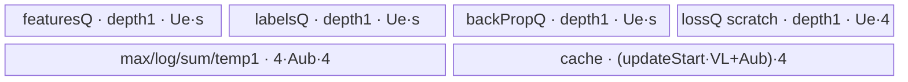

# SoftmaxCrossEntropyWithLogits 950 ACLNN 算子知识

## 算子速览

| 项目 | 内容 |
|---|---|
| 实际入口 | `aclnnSoftmaxCrossEntropyWithLogitsGetWorkspaceSize` + `aclnnSoftmaxCrossEntropyWithLogits`，公开两段式 ACLNN；L0 为 `l0op::SoftmaxCrossEntropyWithLogits`。 |
| 计算语义 | 对二维 `features=[A,R]` 的末轴做稳定 softmax；`loss[a]=-sum_r(labels[a,r]*(features[a,r]-max-logSumExp))`，`backprop=softmax(features)-labels`。 |
| 输入输出 | ND；公开 ACLNN 要求两个输入 rank=2、同 shape/dtype，输出分别 `[A]` 与 `[A,R]`；950 支持 FLOAT/FLOAT16/BFLOAT16 和非连续 Tensor。 |
| 执行类型 | 单 AIV_VECTOR Kernel；广播搬入 specialization 使用 NDDMA。所有 Host 可达 Device 节点均无 Cube/AIC/MIX_CV。 |
| Kernel 路线 | R-001 全载；R-002 R 轴切分。每条路线的 `labelsBrc=0/1/2` 编译 specialization 分别代表同形、轴广播、标量广播；后端 `schId=2` 被公开 ACLNN 空输入短路，不是本入口 Device Route。 |
| 核心资源 | executor workspace、固定 16 MiB backend workspace、AIV `TQue/TBuf`、MicroAPI `RegTensor`；Split-R 用 UB cache 做分块树式累加。 |
| 来源闭包 | `source_closed`：公开 ACLNN→Contiguous/L0 launcher→950 OpDef/arch35 Tiling/POD/key→单 AIV entry→FullLoad/SplitR body→ascend950 binary config/CMake。 |
| 验证状态 | 已完成源码闭包检查；本次知识提取未执行编译、真机、数值或性能测试。 |

## 接口与语义

### 计算语义

设输出域为 `A×R`，`m_a=max_j features[a,j]`，`s_a=sum_j exp(features[a,j]-m_a)`。Device 实际顺序为先求 `m_a`，再求 `exp(features-m_a)` 与 `s_a`，最后计算：

```text
backprop[a,j] = exp(features[a,j]-m_a) / s_a - labels[a,j]
loss[a] = sum_j labels[a,j] * (log(s_a) - (features[a,j]-m_a))
```

这与公开公式 `-Σ labels*log(softmax(features))` 等价。FP16/BF16 输入在 MicroAPI 中转 FP32 后完成减、Exp、Div、Log、Mul 和归约，写回时以 `CAST_RINT` 降到输入 dtype；FLOAT 全程 FP32。公开 ACLNN 对任一空输入直接返回空 executor 图，不进入 Device 公式。

### 输入、输出与属性

| 参数 | shape/layout | dtype | 约束、默认值与语义 |
|---|---|---|---|
| `features` | ND，公开接口 rank=2，可非连续 | FLOAT/FLOAT16/BFLOAT16 | logits；支持空 Tensor。950 三 dtype 均由 `IsRegbase()` API 分支与 ascend950 binary config 支撑。 |
| `labels` | ND，公开接口 rank=2，可非连续 | 同上 | 文档要求 shape、dtype 与 features 一致；支持空 Tensor。API 层未显式比较 shape/dtype，后端 dtype 不同会在 Tiling 失败，广播 shape 是源码可见但不属于公开契约。 |
| `loss` | ND，rank=1，可非连续 | 与 features 相同 | L0 临时输出固定为 `[features.dim0]`，最终 `ViewCopy` 到用户输出。 |
| `backprop` | ND，rank=2，可非连续 | 与 features 相同 | L0 临时输出固定为 features view shape，最终 `ViewCopy`。 |

### 入口与版本

固定 Commit 中公开入口只有无版本后缀的 `aclnnSoftmaxCrossEntropyWithLogitsGetWorkspaceSize/aclnnSoftmaxCrossEntropyWithLogits`。公开文档产品表声明 A2、A3、Ascend 950 均支持；但本实现的 OpDef 只 `AddConfig("ascend950")`，模块 CMake 只设置 `SUPPORT_COMPUTE_UNIT "ascend950"` 与 `SUPPORT_TILING_DIR "arch35"`，全仓 binary config 也只为该算子列 `ascend950`。因此当前卡仅覆盖固定源码可闭合的 950 最新活动实现；A2/A3 不以目录存在或公开声明推测补齐。

## Host/Launcher 执行流程

### 参数校验与前处理

第一段接口依次执行：

1. `CheckNotNull` 检查 features、labels、loss、backprop；workspaceSize/executor 的框架级检查在固定算子源码中不可见。
2. `CheckDtypeValid` 取平台 dtype 表；950 因 `AclnnUtil::IsRegbase()` 选择 FLOAT/FLOAT16/BFLOAT16，逐张量检查支持集，并显式要求 loss/backprop dtype 等于 features。
3. `CheckShape` 对四张量检查最大 rank，并只显式要求两个输入 rank=2。公开文档中同 shape/dtype 与输出 rank 约束没有全部落实为 API 检查。
4. features 或 labels 任一为空时，不加入任何算子节点，直接返回 executor 当前 workspace 大小。
5. 非空时依次 `Contiguous(features)`、`Contiguous(labels)`；随后 L0 分配 `[features.dim0]` 的 loss 和 features view shape 的 backprop，并加入一个 `SoftmaxCrossEntropyWithLogits` AICore launcher。
6. 两个临时输出分别 `ViewCopy` 到用户 loss/backprop；任一步返回空指针即返回对应 ACLNN 内部错误。

第二段 `aclnnSoftmaxCrossEntropyWithLogits` 通过 `CommonOpExecutorRun(workspace, workspaceSize, executor, stream)` 在调用者 stream 上执行完整图并返回运行状态。

### 参数、Workspace 与生命周期

Tiling 从平台读取 `GetCoreNumAiv()`、UB 字节数、UB block size、vector register size 和 cache-line size。后端总是设置一个 `16*1024*1024` 字节 workspace slice，但 entry 仅调用 `GetUserWorkspace(workspace)` 后把地址传入 `Init`，两种 body 均不读取该参数；它仍由 executor/框架拥有，在 stream 执行完成前有效。ACLNN workspace 还可能包含 Contiguous/ViewCopy 的框架 slice，其总量由 `uniqueExecutor->GetWorkspaceSize()` 汇总，固定算子源码不公开各 slice offset。

POD、launcher 临时张量与框架节点都归 executor 管理。单 K0 完成前 features/labels 连续临时张量与 L0 输出有效；两个 ViewCopy 完成前 L0 输出不可回收。调用者负责 workspace 与 stream 生命周期。

### 启动图与失败传播

```text
features ─ F0 Contiguous ─┐
                           ├─ K0 softmax_cross_entropy_with_logits<schId,0,labelsBrc,0>
labels   ─ F1 Contiguous ─┘       ├─ lossTmp ─ F2 ViewCopy ─ loss
                                  └─ backpropTmp ─ F3 ViewCopy ─ backprop
```

K0 是单 AIV launch，entry 参数顺序为 `(features, labels, loss, backProp, workspace, tiling)`，`blockDim=realCoreNum`。POD 是 `SoftmaxCrossEntropyWithLogitsTilingData`；`schId` 决定 Empty/FullLoad/SplitR，`featuresBrc` 在公开 L0 shape 下恒为 0，`labelsBrc` 为 0/1/2。所有节点由同一 executor/stream 保序；第一段校验、分配、Tiling 或任一节点构造失败即不产生可执行结果，第二段运行错误由 `CommonOpExecutorRun` 传播。

## Route 与参数设计

### 分核与资源计算

非广播时 `R=backpropShape[last]`，`A=shapeSize/R`；`R=0` 时避免除零，令 `A=labelsStorageShape` 除末轴各维之积。广播时 `DimensionCollapse(inputs, backpropOutput)` 必须得到恰好二维，得到 `[A,R]` 及广播轴。

令 `C=GetCoreNumAiv()`、`B=UB block bytes`、`s=sizeof(T)`、`U=UB bytes`：

```text
useCore = min(A,C)
blockFactor = ceil(A/useCore)
realCoreNum = ceil(A/blockFactor)
tailBlockFactor = A - blockFactor*(realCoreNum-1)
perBlock = B/s
rAligned = ceil(R/perBlock)*perBlock
```

全载估算：`arBuf=(2*3)*rAligned*s + 4*rAligned*4`，`aBuf=(2*1)*s + 3*4`，`aNum=floor(U/(arBuf+aBuf))`。若 `aNum>=perBlock`，选 FullLoad，`aUbNumFactor=min(aNum,blockFactor)` 后向下对齐到 `perBlock`（不足则取 `perBlock`），再分别计算主/尾核的 A 循环商和余数。

否则选 SplitR：`aUbNumFactor=perBlock`。Host 先保留 `cacheUbSize=(63*VL_FP32+aUbNumFactor)*4` 和 `4*aUbNumFactor*4` 字节 A 向量区；余量按 FP16/BF16 的 `5*aUbNumFactor` 或 FP32 的 `4*aUbNumFactor` 计算每行可用字节，向下对齐 cache line 后除以 `s` 得 `rUbNumFactor`。随后：

```text
rLoopTime = ceil(R/rUbNumFactor)
rLoopTile = (R % rUbNumFactor == 0 ? rUbNumFactor : R % rUbNumFactor)
rLoopTileAlign = ceilAlign(rLoopTile, perBlock)
kTimes = (rLoopTime==1 ? 1 : 2^floor(log2(rLoopTime-1)))
kTimesTail = rLoopTime-kTimes
```

### Route 选择

| 顺序 | Route | Key/模板 | 精确选择条件与优先级 | 不适用去向 |
|---:|---|---|---|---|
| 1 | R-001 FullLoad | `schId=0, featuresBrc=0, labelsBrc∈{0,1,2}, db=0` | 公开 ACLNN 非空，`R!=0 && aNum>=perBlock` | 条件不成立转 R-002 |
| 2 | R-002 SplitR | `schId=1, featuresBrc=0, labelsBrc∈{0,1,2}, db=0` | 公开 ACLNN 非空，`R!=0 && aNum<perBlock` | 无进一步 Device fallback |

```text
validate dtype/shape -> derive A,R,broadcast flags -> CalTilingData
if aNum < perBlock: schIdNum=1 and CalTilingDataRSplit
else: schIdNum=0
if R==0: schId=2 else schId=schIdNum       # ACLNN 在此之前已短路空输入
key=GET_TPL_TILING_KEY(schId, featuresBrc, labelsBrc, 0)
```

### 模板/实现执行矩阵

| Route | key/selector | dtype/shape/platform 完整命中条件 | 执行拓扑与 Kernel 节点 | 实际模板/body | 内存与同步特征 | tail/fallback |
|---|---|---|---|---|---|---|
| R-001 FullLoad | tpl `(0,0,L,0)` | 950；`R>0 && aNum>=perBlock` | 单 K0 AIV；`L!=0` 的 labels CopyIn 为 NDDMA | `SoftmaxCrossEntropyWithLogitsFullLoad<T,0,0,L,0>` | 双缓冲四队列、FP32 max/sub/exp/sum/log/loss 中间量；Queue 隐式同步 | A 核尾与 A tile 尾；R 用 mask 与 padding |
| R-002 SplitR | tpl `(1,0,L,0)` | 950；`R>0 && aNum<perBlock` | 单 K0 AIV；`L!=0` 的 labels CopyIn 为 NDDMA | `SoftmaxCrossEntropyWithLogitsSplitR<T,1,0,L,0>` | 单深度 queues；R 分块多遍读取；cache 树式累加；MTE2→V event | R 尾对齐、A 核尾/A tile 尾；无 fallback |

`L=0` 是公开文档同 shape 路线；`L=1` 是源码可达的单轴广播，`L=2` 是标量广播。后两者是 API 未拦截但公开契约未承诺的边界，不应作为可移植调用约定。

### 隐藏性能 Guard

| Guard | Host/Tiling 条件 | Device/资源原因 | 影响 Route | 不满足时去向 | 源码符号 |
|---|---|---|---|---|---|
| AIV 资源 | `coreNum>0 && ubSize>0` | 分核与所有 UB 公式依赖平台值 | 全部 | Tiling `GRAPH_FAILED` | `SoftmaxCrossEntropyWithLogitsRegbaseTiling::Init` |
| 二维折叠 | broadcast 时 `collapseOutput.size()==2` | body 地址统一按 A×R | 全部广播 specialization | Tiling 失败 | `DoDimCollapse` |
| FullLoad UB | `aNum>=perBlock` | 每个 A tile 同时容纳完整对齐 R 及 A 向量 | R-001 | R-002 | `CalTilingData` |
| R 对齐 | `rAligned=ceil(R/(B/s))*(B/s)` | DMA block 和 UB 行布局 | R-001 | padding lane 由最小值/mask 隔离 | `CalTilingData/CopyInPad` |
| SplitR cache | Host 固定预留 `63*VL_FP32` FP32 元素 | 覆盖 `updateStart=log2(kTimes)` 层的树式部分和 | R-002 | 若资源公式无正值路线则固定仓没有显式失败 guard | `CalTilingDataRSplit/Init` |
| dtype 相等 | Tiling `labelsDtype==featuresDtype` | entry 只有一个 `DTYPE_FEATURES` 模板 T | 全部 | `GRAPH_FAILED` | `CheckInputDtype` |
| empty precedence | API 的 `features->IsEmpty()` 或 `labels->IsEmpty()` | 公开入口不启动 schId2 Device body | 全部 ACLNN Routes | workspace/executor 直接返回 | `ExecSoftmaxCrossEntropyWithLogitsGetWorkspaceSize` |
| Vector tail | `repeat=R/VL`、`UpdateMask(R%VL)`；SplitR 对每个 R tile 同理 | 无效 lane 不得进入输出/归约 | R-001/002 | padding + mask，无 fallback | `VfReduceMax/VfSubExp/VfBackProp` 与 SplitR helpers |

### POD/ABI

`SoftmaxCrossEntropyWithLogitsTilingData` 是 18 个连续 `int64_t`：固定源码下 `sizeof=144`、`alignof=8`，offset 每字段递增 8 字节。Host 先 `memset_s` 为零，再由 `FillTilingData` 全字段覆盖；entry 用同一结构 `GET_TILING_DATA_WITH_STRUCT` 解码。

| 结构 | 字段 | 类型/位宽 | ABI 布局 | 单位 | Host/launcher producer | Device consumer | 边界 |
|---|---|---|---|---|---|---|---|
| `SoftmaxCrossEntropyWithLogitsTilingData` | `realCoreNum` | int64/64 | size144 align8 off0 | core | `ceil(A/blockFactor)` | 两 body 的越界/末核判定 | `>0` 依赖 A 非负及平台核数 |
| 同上 | `a` | int64/64 | off8 | row | 输出折叠首轴 | FullLoad 保存；SplitR 保存 | R=0 时单独计算 |
| 同上 | `r` | int64/64 | off16 | element/row | 输出末轴 | GM 地址、R 循环 | ACLNN Device Route 中 `>0`；0 仅后端 schId2 |
| 同上 | `blockFactor` | int64/64 | off24 | row/core | `ceil(A/useCore)` | `coreStartOffset`、主核范围 | 主核值 |
| 同上 | `tailBlockFactor` | int64/64 | off32 | row | 余下 A | 末核范围 | 正数化尾核 |
| 同上 | `rUbNumFactor` | int64/64 | off40 | element/row tile | FullLoad=`rAligned`；SplitR=UB 余量结果 | UB 容量、R 地址步长 | 以 UB block 对齐 |
| 同上 | `aUbNumFactor` | int64/64 | off48 | row/tile | UB 预算并按 `perBlock` 处理 | UB 容量、A 循环 | SplitR=`perBlock` |
| 同上 | `aLoopTimes` | int64/64 | off56 | loop | `blockFactor/aUbNumFactor` | 主核 `ProcessEachCore` | 可为0 |
| 同上 | `aLoopTimesT` | int64/64 | off64 | loop | `tailBlockFactor/aUbNumFactor` | 尾核 `ProcessEachCore` | 可为0 |
| 同上 | `aLoopTail` | int64/64 | off72 | row | 主核取模 | 主核尾 tile | 0 时不执行 |
| 同上 | `aLoopTailT` | int64/64 | off80 | row | 尾核取模 | 尾核尾 tile | 0 时不执行 |
| 同上 | `rLoopTime` | int64/64 | off88 | loop | `ceil(R/rUbNumFactor)` | SplitR 三遍 R 扫描 | FullLoad inactive=0 |
| 同上 | `rLoopTile` | int64/64 | off96 | element | R 余数正数化 | SplitR 末 R tile | FullLoad inactive=0 |
| 同上 | `rLoopTileAlign` | int64/64 | off104 | element | `ceilAlign(rLoopTile,perBlock)` | SplitR UB stride/mask | FullLoad inactive=0 |
| 同上 | `kTimesTail` | int64/64 | off112 | tile pair | `rLoopTime-kTimes` | SplitR 非 2 次幂配对循环 | FullLoad inactive=0 |
| 同上 | `kTimes` | int64/64 | off120 | tile | 最大 2 次幂基数 | SplitR cache 层与循环 | FullLoad inactive=0 |
| 同上 | `featuresBrcDim` | int64/64 | off128 | axis id | `DoDimCollapse` | NDDMA feature stride | 公开入口实际 inactive，值0 |
| 同上 | `labelsBrcDim` | int64/64 | off136 | axis id | `DoDimCollapse` | NDDMA labels stride | `labelsBrc=0` 时不读 |

### Route 源码闭包

| Route | Key/selector | Host/Tiling producer | POD/参数 | Kernel entry/router 节点 | Kernel body/直接依赖 | 构建接线 |
|---|---|---|---|---|---|---|
| R-001 FullLoad | `GET_TPL_TILING_KEY(0,0,L,0)` | `CalTilingData` | `SoftmaxCrossEntropyWithLogitsTilingData` | entry 的 `schId==0` branch | `FullLoad::ProcessEachCore/Compute/Vf*` | ascend950 CMake、OpDef、json、global config |
| R-002 SplitR | `GET_TPL_TILING_KEY(1,0,L,0)` | `CalTilingDataRSplit` | 同上 | entry 的 `schId==1` branch | `SplitR::ProcessEachCore/Compute` 及全部 helper | 同上 |

## Kernel 实现

### 公共执行流程

entry 注册默认 POD，解码 tiling，取得 user workspace，构造单个 `TPipe`。`schId==1` 实例化 SplitR；`schId==0||2` 实例化 FullLoad。两类 body 均把四个 GM 地址绑定为同一模板 dtype `T`，按 `GetBlockIdx()` 映射连续 A 行。计算路线均采用稳定 softmax：max→`x-max`→exp→sum→归一化；loss 复用 `log(sum)-(x-max)`。广播输入通过二维 `MultiCopy` NDDMA 写成相同 UB 行布局，后续 Vector 计算不再分支。

### Route R-001：FullLoad

#### 适用条件

##### 选择证据

| 层级 | 文件 | 符号 | 源码谓词/参数 | 结果/下一跳 |
|---|---|---|---|---|
| API | `op_api/aclnn_softmax_cross_entropy_with_logits.cpp` | `Exec...GetWorkspaceSize` | 非空、rank2、dtype 支持 | L0 launcher |
| Tiling | `op_host/arch35/..._tiling.cpp` | `CalTilingData` | `aNum>=perBlock && R!=0` | schId0 |
| Router | `op_kernel/softmax_cross_entropy_with_logits_apt.cpp` | entry | `schId==0` | `FullLoad<T,0,0,L,0>` |
| Body | `..._full_load.h` | `Process` | 主/尾核 A loop | `Compute(tileNum,aOffset)` |

#### Device 数据流

##### 函数级调用链

```text
softmax_cross_entropy_with_logits<0,0,L,0>
  -> FullLoad::Init/Process/ProcessEachCore
    -> Compute
      -> CopyInPad(features) -> VfReduceMax -> VfSubExp -> ReduceSum(exp)
      -> CopyInPad(labels) or CopyInNDDMA(labels)
      -> VfBackProp -> CopyOutPadBackProp
      -> ReduceSum(loss terms) -> Cast/Copy -> CopyOutPadLoss
```

##### 源码等价伪码

```text
rows = tailBlockFactor on last core else blockFactor
for each A tile at aOffset:
  x = DMA/NDDMA features[aOffset:aOffset+tileNum, 0:R], pad each row to rAligned with -INF
  max[a] = reduce_max_fp32(x[a,:R])
  sub = fp32(x)-max; expBuf=exp(sub); sum=reduce_sum(expBuf)
  y = DMA/NDDMA labels into same [tileNum,rAligned] layout
  for valid r lanes:
    p=expBuf/sum; backprop=cast_T(p-fp32(y))
    lossTerm=fp32(y)*(log(sum)-sub)
  write backprop only R valid columns
  loss=reduce_sum(lossTerm); cast_T and write tileNum rows
```

#### 内存与数据搬运

##### 资源与搬运表

| 层级/缓冲区 | offset/地址公式 | extent/容量公式 | dtype/layout | producer | consumer | owner/lifetime | 对齐/复用 |
|---|---|---|---|---|---|---|---|
| GM features/labels | `aOffset*R` | `tileNum*R` | T/[A,R] | caller | CopyIn | executor | direct DMA；labels broadcast 用 NDDMA |
| `featuresQueue_` | VECIN queue slot | depth2 × `Ue*s` | T/[Aub,Ralign] | CopyIn | max/sub-exp | TPipe | `Ue=Aub*Ralign` |
| `labelsQueue_` | VECIN queue slot | depth2 × `Ue*s` | T/同上 | DMA/NDDMA | `VfBackProp` | TPipe | scalar/axis广播物化 |
| `backPropQueue_` | VECOUT queue slot | depth2 × `Ue*s` | T/同上 | `VfBackProp` | CopyOut | TPipe | 只搬 R 有效列 |
| `lossQueue_` | VECOUT queue slot | depth2 × `Aub*s` | T/[Aub] | cast/copy | CopyOut | TPipe | A tail 有效长度 |
| `maxBuf_/logBuf_/sumBuf_` | 独立 TBuf | 各 `Aub*4` | FP32/[Aub] | reduce/log | vector broadcast | TPipe | tile 间覆盖 |
| `subBuf_/temp1Buf_/temp2Buf_` | 独立 TBuf | 各 `Ue*4` | FP32/[Aub,Ralign] | sub/exp/loss term | 后继 reduce | TPipe | tile 间覆盖 |
| GM backprop/loss | `aOffset*R` / `aOffset` | `tileNum*R` / `tileNum` | T | CopyOut | user | executor | DataCopyPad 有效区 |

##### 分层内存布局


##### 字节账与复用顺序

```text
Ue = rUbNumFactor*aUbNumFactor
UB_body = Ue*(6*s+12) + aUbNumFactor*(2*s+12)
UB_host_budget = Ue*(6*s+16) + aUbNumFactor*(2*s+12) <= platform UB
dynamic_ub = N/A
workspace_total(K0 backend) = 16 MiB; body workspace use = 0
```

Host 比 body 多预算 `4*Ue`，是保守余量，不可把它当作可复用 TBuf。

| 复用子区 | 写入者 | 读取者/消费点 | 下一次覆盖 | 同步或释放依据 | 安全条件 |
|---|---|---|---|---|---|
| features queue slot | CopyIn | `VfReduceMax/VfSubExp` | 下个 A tile | `DeQue/FreeTensor` | 源码在 `VfSubExp` 后已 Free；末尾存在同一 tensor 的第二次 Free 调用，固定源码行为需保留审计 |
| labels queue slot | CopyIn | `VfBackProp` | 下个 tile | Compute 末尾 `FreeTensor` | Vector 完成读取 |
| backprop queue slot | `VfBackProp` | CopyOut | 下个 tile | `EnQue→DeQue→FreeTensor` | MTE3 消费后 |
| FP32 TBuf | 当前 tile vector/reduce | 同 tile后继 | 下个 tile | 顺序调用与 Vector primitive 完成 | 不跨 tile 保存 |

#### 同步、精度与尾块

##### 同步与数值边界表

| 阶段 | primitive/机制 | producer | consumer/等待点 | 保护对象 | 精度/尾块 |
|---|---|---|---|---|---|
| GM→UB | TQue EnQue/DeQue | DataCopyPad/NDDMA | Vector body | input queue slot | R 右侧 pad 为 FP32/BF16 最小值或 FP16 -65504 |
| max/softmax | MicroAPI masks + Reduce | CopyIn | loss/backprop | RegTensor/TBuf | B16 unpack/cast FP32；`UpdateMask(R%VL)` |
| output | TQue + DataCopyPad | Vector | GM | output queue slot | B16 `CAST_RINT`；仅 R/tileNum 有效元素 |

#### 关键实现

##### 符号证据表

| 阶段 | 文件 | 符号/模板实例 | 实现事实 |
|---|---|---|---|
| Host/Tiling producer | `op_host/arch35/softmax_cross_entropy_with_logits_tiling.cpp` | `CalTilingData` | FullLoad UB 判定与 A 分核 |
| Kernel entry/router | `op_kernel/softmax_cross_entropy_with_logits_apt.cpp` | `schId==0` | 模板到 FullLoad body |
| Device body/helper | `op_kernel/arch35/softmax_cross_entropy_with_logits_full_load.h` | `Compute/VfReduceMax/VfSubExp/VfBackProp` | 完整稳定 softmax、loss/backprop、搬运与 tail |

### Route R-002：SplitR

#### 适用条件

##### 选择证据

| 层级 | 文件 | 符号 | 源码谓词/参数 | 结果/下一跳 |
|---|---|---|---|---|
| Tiling | `op_host/arch35/..._tiling.cpp` | `CalTilingData` | `aNum<perBlock && R!=0` | `CalTilingDataRSplit`, schId1 |
| Tiling | 同上 | `CalTilingDataRSplit` | UB/cache-line/dtype 公式 | R tile 与 cache 参数 |
| Router | `op_kernel/softmax_cross_entropy_with_logits_apt.cpp` | entry | `schId==1` | `SplitR<T,1,0,L,0>` |
| Body | `..._split_r.h` | `Compute` | 每个 A tile | max pass→sum pass→result pass |

#### Device 数据流

##### 函数级调用链

```text
softmax_cross_entropy_with_logits<1,0,L,0>
  -> SplitR::Init/Process/ProcessEachCore/Compute
    -> CleanMaxUb -> GetRowMax [R tiles: CopyIn -> ReduceMax -> ComputeMaxLast]
    -> ComputeSubExpReduceSum [R tiles: exp(x-max) -> ReduceSum -> UpdateCache] -> ComputeLog
    -> ComputeRst [R tiles: CopyIn x/y -> PipeM2V -> loss/backprop -> CopyOut -> ReduceSum -> UpdateCache]
    -> CopyOutLoss
```

##### 源码等价伪码

```text
for each A tile at aOffset:
  max=-FLT_MAX
  for each R tile: max=max(max, reduce_max(x_tile))
  cache=0
  for tiles in power-of-two pairing order:
    partial=reduce_sum(exp(fp32(x_tile)-max)); UpdateCache(partial,tileIndex)
  sum=final cache level; logSum=log(sum)
  cache=0
  for same tile order:
    load x_tile and labels_tile; MTE2_V event
    backprop=cast_T(exp(x-max)/sum-labels); write valid GM slice
    partialLoss=reduce_sum(labels*(logSum-(x-max))); UpdateCache(partialLoss,tileIndex)
  loss=cast_T(final cache level); write A rows
```

#### 内存与数据搬运

##### 资源与搬运表

| 层级/缓冲区 | offset/地址公式 | extent/容量公式 | dtype/layout | producer | consumer | owner/lifetime | 对齐/复用 |
|---|---|---|---|---|---|---|---|
| GM R tile | `aOffset*R+rUbNumFactor*ci` | `tileNum*tailC` | T/[A,R] | caller | CopyIn | executor | `srcStride=(R-tailC)*s` |
| feature/label/backprop queues | feature 为 VECIN slot0；label/backprop 为 VECOUT slot0 | 各 `Ue*s` | T/[Aub,RtileAlign] | DMA/NDDMA/Vector | Vector/CopyOut | TPipe | depth1；labels 虽作输入但源码声明 VECOUT；R tail pad/alignment |
| `lossQueue_` | VECOUT slot0 | `Ue*4` | FP32 scratch，随后前部作 T loss | mixed Vector/reduce | UpdateCache/CopyOut | TPipe | 同一物理 queue buffer按阶段复用 |
| max/log/sum/temp1 TBuf | 独立 | 各 `Aub*4` | FP32/[Aub] | reduce/cache | vector | TPipe | 每 A tile覆盖 |
| cache TBuf | level-major | `(updateStart*VL_FP32+Aub)*4` | FP32 | `UpdateCache` | ComputeLog/CopyOutLoss | TPipe | level stride=`ceil(A/VL)*VL`；Host 预留63层 |
| GM backprop | `aOffset*R+rTileOffset` | `tileNum*tailC` | T | CopyOut | user | executor | dstStride 恢复完整 R |
| GM loss | `aOffset` | `tileNum` | T/[A] | DataCopyOutLoss | user | executor | 单 block copy |

##### 分层内存布局



##### 字节账与复用顺序

```text
Ue = rUbNumFactor*aUbNumFactor
UB_body = Ue*(3*s+4) + 20*aUbNumFactor + 4*updateStart*VL_FP32
UB_host_budget reserves:
  4*aUbNumFactor*4 + (63*VL_FP32+aUbNumFactor)*4
  + R-tile bytes selected by (5*aUbNumFactor) for B16 or (4*aUbNumFactor) for FP32
UB_body <= host conservative platform UB budget
dynamic_ub = N/A
workspace_total(K0 backend)=16 MiB; body workspace use=0
```

| 复用子区 | 写入者 | 读取者/消费点 | 下一次覆盖 | 同步或释放依据 | 安全条件 |
|---|---|---|---|---|---|
| feature/label slot | DataCopy | current tile vector | next R tile | `DeQue/FreeTensor` + `PipeM2V` where paired | depth1 不得提前搬下一 tile |
| lossQueue FP32 buffer | exp/loss-term helper | ReduceSum | next R tile；最终作为 loss staging | `AllocTensor/FreeTensor` 分阶段 | scratch 已完成归约才覆盖 |
| cache level | `UpdateCache` | 后续 level合并或 ComputeLog/CopyOutLoss | 下一 A tile | 单核顺序 Vector 代码 | `cacheID` 与 level stride 不重叠 |
| backprop slot | result helper | GM CopyOut | next R tile | queue EnQue/DeQue/FreeTensor | MTE3 完成 |

#### 同步、精度与尾块

##### 同步与数值边界表

| 阶段 | primitive/机制 | producer | consumer/等待点 | 保护对象 | 精度/尾块 |
|---|---|---|---|---|---|
| R tile CopyIn | queue；结果阶段另有 `SetFlag/WaitFlag<MTE2_V>` | MTE2 | Vector | feature/label UB | tail 用 `rLoopTile/rLoopTileAlign` 与 mask |
| 分块归约 | `ReduceMax/ReduceSum + UpdateCache` | 当前 R tile | 下一 cache level/最终读取 | FP32 cache | 2 次幂基数+尾配对，避免跨核 atomic |
| 数值 | MicroAPI FP32 | B16 Cast | Cast back | RegTensor/cache | max-shift；B16 写回 `CAST_RINT` |
| GM 输出 | DataCopyPad | result helper | stream 后继 | backprop/loss GM | `blockLen=tailC*s`，跳过 UB pad |

#### 关键实现

##### 符号证据表

| 阶段 | 文件 | 符号/模板实例 | 实现事实 |
|---|---|---|---|
| Host/Tiling producer | `op_host/arch35/softmax_cross_entropy_with_logits_tiling.cpp` | `CalTilingDataRSplit` | R tile、2次幂配对和 cache 预算 |
| Kernel entry/router | `op_kernel/softmax_cross_entropy_with_logits_apt.cpp` | `schId==1` | 模板到 SplitR body |
| Device body/helper | `op_kernel/arch35/softmax_cross_entropy_with_logits_split_r.h` | `GetRowMax/ComputeSubExpReduceSum/ComputeRst/UpdateCache` | 三遍 R 扫描、树式累加、NDDMA、event、tail |

## 算子特定优化

### Trick T-001：max-shift 与 FP32 中间链合并 loss/backprop

#### 触发与源码依据

- 适用 Route：R-001、R-002。
- 触发条件：`R>0`；FP16/BFLOAT16 输入先 unpack/cast，FLOAT 直接装入 FP32 RegTensor。
- Golden 来源：[`op_kernel/arch35/softmax_cross_entropy_with_logits_full_load.h:477-500`](../../../../../../../cann-ops-raw/ascendc/ops-nn/955f8b33985b6d72989ebff341bb9c2c564a51bc/activation/softmax_cross_entropy_with_logits/op_kernel/arch35/softmax_cross_entropy_with_logits_full_load.h#L477-L500)

**官方源码（固定 Commit 连续逐字摘录）**：

```cpp
AscendC::MicroAPI::Div(temp1Reg, temp1Reg, sumReg, pregMain);
AscendC::MicroAPI::Sub(backPropReg32, temp1Reg, labelsReg32, pregMain);
AscendC::MicroAPI::Log(logReg, sumReg, pregMain);
AscendC::MicroAPI::Sub(temp2Reg, logReg, subReg, pregMain);
AscendC::MicroAPI::Mul(temp2Reg, temp2Reg, labelsReg32, pregMain);
```

#### 机制与设计原因

`subReg=x-max` 与 `temp1Reg=exp(sub)` 已由 softmax 分母阶段产生；同一 tile 内直接用 `temp1/sum-label` 生成 backprop，并用 `label*(log(sum)-sub)` 生成 loss term，避免再次求 softmax/log-softmax或把概率中间量写回 GM。B16 的算术在 FP32 RegTensor 中完成，仅最终输出 `CAST_RINT`。

#### 迁移边界

- 适用：同时需要交叉熵与 logits 梯度的末轴 softmax。
- 前提：max、sum、sub/exp 中间量仍在 UB/寄存器；labels 与输出域可对齐或广播物化。
- 失效：只输出 loss/只输出 softmax 时应重新做 liveness 预算；不能照搬多余 buffer。
- 未验证：本次知识提取未执行编译、真机、数值或性能测试。

#### 错误做法

固定仓未提供可验证反例；源码明确要求保留 max-shift 和 FP32 算术顺序，不能据此推断未稳定化公式在极值输入上等价。

### Trick T-002：Split-R 的层级 cache 合并任意 R tile 数

#### 触发与源码依据

- 适用 Route：R-002。
- 触发条件：FullLoad UB gate 失败；`kTimes` 取不超过主 tile 数的最大 2 次幂，`kTimesTail=rLoopTime-kTimes`。
- Golden 来源：[`op_kernel/arch35/softmax_cross_entropy_with_logits_split_r.h:403-434`](../../../../../../../cann-ops-raw/ascendc/ops-nn/955f8b33985b6d72989ebff341bb9c2c564a51bc/activation/softmax_cross_entropy_with_logits/op_kernel/arch35/softmax_cross_entropy_with_logits_split_r.h#L403-L434)

**官方源码（固定 Commit 连续逐字摘录）**：

```cpp
const int64_t cacheID = ScalarGetCountOfValue<1>(index ^ (index + 1)) - 1;
for (uint16_t j = 0; j < innerLoopTimes; ++j) {
    AscendC::MicroAPI::DataCopy(bReg, dstUbAddr, srcOffsetJ);
    AscendC::MicroAPI::Add<float, AscendC::MicroAPI::MaskMergeMode::ZEROING>(aReg, aReg, bReg, pMask);
}
AscendC::MicroAPI::DataCopy(cahUbAddr, aReg, srcOffset, pMask);
```

#### 机制与设计原因

`index^(index+1)` 的连续低位 1 数决定当前 tile 完成后可折叠的层数；当前部分和与已有低层 cache 依次相加，再写入对应高层。Host 把 tile 数拆为 2 次幂主体与配对尾部，让 exp-sum 和 loss-sum 都用同一机制，不需要 GM workspace 或跨核 atomic。cache 按 `ceil(A/VL)*VL` 的 level stride 布局，mask 只更新有效 A 行。

#### 迁移边界

- 适用：单核内大量连续分块的逐行 FP32 加法规约。
- 前提：运算可结合到分层部分和；cache 层数和 A 向量对齐必须纳入 UB 预算。
- 失效：跨核共享归约需要额外同步/atomic；本机制只有核内可见性。
- 未验证：本次知识提取未执行编译、真机、数值或性能测试。

#### 错误做法

固定仓未提供可验证反例；若把 cache 当一条未对齐 A 数组，`srcOffsetJ` 的 level stride 会交叠，已不满足源码布局。

### Trick T-003：Host 保守 UB 预算覆盖 Device 实际层数

#### 触发与源码依据

- 适用 Route：R-001、R-002。
- 触发条件：Tiling 选择 tile；SplitR 固定预留 63 个 FP32 vector level，FullLoad 比实际 body 多计一个 R×A FP32 buffer。
- Golden 来源：[`op_host/arch35/softmax_cross_entropy_with_logits_tiling.cpp:240-248`](../../../../../../../cann-ops-raw/ascendc/ops-nn/955f8b33985b6d72989ebff341bb9c2c564a51bc/activation/softmax_cross_entropy_with_logits/op_host/arch35/softmax_cross_entropy_with_logits_tiling.cpp#L240-L248)

**官方源码（固定 Commit 连续逐字摘录）**：

```cpp
int64_t cacheUbSize = (CONST_CACHE * vfLenB32 + baseTiling_.aUbNumFactor) * DTYPE_LEN_FP32;
int64_t arAllUbSize =
    static_cast<int64_t>(ubSize) - (baseTiling_.aUbNumFactor * A_UB_NUMS * DTYPE_LEN_FP32) - cacheUbSize;
int64_t oneRowRNum = static_cast<int64_t>(Ops::Base::FloorDiv(arAllUbSize,
    (baseTiling_.aUbNumFactor * AR_UB_NUMS_B16)));
```

#### 机制与设计原因

Host 不依赖某个具体 shape 的最小 cache 层数来把 UB 填满，而用 63 层上界与 dtype 分母计算保守 R tile；Device 只分配 `updateStart*VL+A`。FullLoad Host 的 `TEMP_BUF_AR_NUM=4` 也比 body 明确的三个 R×A FP32 TBuf 多一份。这减少 Host/Device 资源估算临界不一致的风险，但保守余量不能在移植实现里偷偷复用。

#### 迁移边界

- 适用：Host 选择 tile、Device 由 shape 再确定实际临时层数的实现。
- 前提：保守常量必须覆盖 POD 位宽和最大循环层数，且所有单位统一为字节。
- 失效：UB 容量或 vector width 变化时必须重新推导，不能固定复制数值 63。
- 未验证：本次知识提取未执行编译、真机、数值或性能测试。

#### 错误做法

把 Host 余量计入另一个未登记 TBuf 会破坏 `UB_body<=Host budget` 的证明；固定仓没有这种额外分配。

## 模板与实现对比

| 对比维度 | R-001 FullLoad | R-002 SplitR | 设计选择依据 |
|---|---|---|---|
| 命中条件/优先级 | `R>0,aNum>=perBlock` | `R>0,aNum<perBlock` | 以完整 R 是否可驻 UB 分流 |
| 模板与 dtype | FullLoad schId0，T 三 dtype | SplitR schId1，T 三 dtype | B16 均升 FP32中间计算 |
| 循环与分核 | A 核×A tile×R vector repeat | A 核×A tile×三遍 R tile×vector repeat | SplitR 用更多 GM 读取换 UB 可行性 |
| Queue/TBuf/寄存器/dynamic UB | depth2，六 TBuf，RegTensor | depth1，五 TBuf含 cache，RegTensor | 都无 dynamic UB |
| 内存总占用与复用 | `Ue*(6s+12)+Aub*(2s+12)` | `Ue*(3s+4)+20Aub+4updateStartVL` | Host 均保守预算 |
| 搬运/Vector/SIMT/NDDMA/通信 API | DataCopyPad/MultiCopy、MicroAPI、Reduce | 分块 DataCopyPad/MultiCopy、MicroAPI、Reduce、cache | 无 SIMT/通信/Cube |
| 同步、精度与 tail | TQue；mask/pad；B16 RINT | TQue+MTE2_V event；R tile tail；B16 RINT | 输出只提交有效域 |
| fallback/失败边界 | UB gate失败到 SplitR | 无 Device fallback | 无未知 key runtime分支；模板系统只实例化合法 key |

## 平台差异

| 项目 | A2 | A3 | 950 |
|---|---|---|---|
| 支持状态 | 公开 README/API 表声明支持，但固定 Commit 无活动构建实现，未达 `source_closed` | 同 A2 | 支持；公开文档、OpDef、CMake、binary config 四层闭合 |
| Host/Launcher | 固定仓不可见 | 固定仓不可见 | arch35 `SoftmaxCrossEntropyWithLogitsRegbaseTiling`，单 AIV launch |
| Kernel/资源 | 固定仓不可见 | 固定仓不可见 | FullLoad/SplitR MicroAPI，必要时 NDDMA；16 MiB backend workspace |

## 限制与失败边界

- 公开 ACLNN 只承诺二维、同 shape/dtype 的 features/labels。API 源码没有显式验证两者 shape/dtype 相同；不同 dtype 最终由 Tiling 拒绝，广播 shape 虽有实现 specialization，也不应视为公开扩展。
- API 只显式比较 loss/backprop dtype 与 features，未显式比较用户输出 shape；L0 始终按 `[features.dim0]` 和 features shape 分配临时输出，错误的用户 view 最终由框架 ViewCopy 边界处理，其完整规则不在固定算子源码中。
- FullLoad `Compute` 在 `VfSubExp` 后调用一次 `featuresQueue_.FreeTensor(featuresBuf)`，函数尾又对同一 local tensor 调用一次；本卡按源码记录，未通过编译/真机判断该生命周期调用是否由框架容忍。
- Empty-R body 的 `processNumA` 条件使用 `blockIdx_<realCoreNum`，在前置越界返回后恒真，未选择 `tailBlockFactor`；公开 ACLNN 空输入在 API 层短路，不启动该 body。图模式使用该 route 时应按固定源码边界审计末核写入范围。
- Tiling 对部分极端整数运算没有显式溢出/正值 guard，例如 `A*R`、UB 减法、`log(mainTile)`；固定仓未给出额外 fallback，不推测补齐。
- backend 固定申请 16 MiB workspace，但 Kernel 不读 user workspace；ACLNN executor 的 Contiguous/ViewCopy slice offset 和框架同步细节固定仓不可见。
- 固定仓无 A2/A3 Host/Tiling/Kernel 活动接线，未创建 A2/A3 正式卡。所有结论固定于 Commit `955f8b33985b6d72989ebff341bb9c2c564a51bc`。

## 源码索引

### 链路索引

| 链路阶段 | 文件 | 关键符号 | 支撑内容 |
|---|---|---|---|
| 入口声明/约束 | `activation/softmax_cross_entropy_with_logits/docs/aclnnSoftmaxCrossEntropyWithLogits.md` | 两段式原型、产品表、参数表 | 公开性、语义、平台与接口约束 |
| 入口实现 | `activation/softmax_cross_entropy_with_logits/op_api/aclnn_softmax_cross_entropy_with_logits.cpp` | `CheckParams/Exec.../aclnn...` | 校验、空输入、Contiguous、ViewCopy、executor |
| 入口实现 | `activation/softmax_cross_entropy_with_logits/op_api/softmax_cross_entropy_with_logits.cpp` | `l0op::SoftmaxCrossEntropyWithLogits` | 临时输出 shape 与单 launcher |
| 平台注册 | `activation/softmax_cross_entropy_with_logits/op_host/softmax_cross_entropy_with_logits_def.cpp` | `SoftmaxCrossEntropyWithLogits` OpDef | 三 dtype、ascend950、apt 文件 |
| Host/Tiling/Launcher | `activation/softmax_cross_entropy_with_logits/op_host/arch35/softmax_cross_entropy_with_logits_tiling.cpp` | `SoftmaxCrossEntropyWithLogitsRegbaseTiling` | 分核、UB、Route、POD、workspace |
| POD | `activation/softmax_cross_entropy_with_logits/op_kernel/arch35/softmax_cross_entropy_with_logits_tiling_data.h` | `SoftmaxCrossEntropyWithLogitsTilingData` | 18 字段 ABI |
| Router config | `activation/softmax_cross_entropy_with_logits/op_kernel/arch35/softmax_cross_entropy_with_logits_tiling_key.h` | `SOFTMAX...TPL_*` | schId/broadcast/db 模板域 |
| Kernel entry/body | `activation/softmax_cross_entropy_with_logits/op_kernel/softmax_cross_entropy_with_logits_apt.cpp` | `softmax_cross_entropy_with_logits` | entry 参数与 schId router |
| Kernel entry/body | `activation/softmax_cross_entropy_with_logits/op_kernel/arch35/softmax_cross_entropy_with_logits_full_load.h` | `SoftmaxCrossEntropyWithLogitsFullLoad` | Empty/FullLoad 完整 AIV body |
| Kernel entry/body | `activation/softmax_cross_entropy_with_logits/op_kernel/arch35/softmax_cross_entropy_with_logits_split_r.h` | `SoftmaxCrossEntropyWithLogitsSplitR` | SplitR 完整 AIV/NDDMA body |
| 构建接线 | `activation/softmax_cross_entropy_with_logits/op_host/config/ascend950/softmax_cross_entropy_with_logits_binary.json` | 三条 dtype binary | 950 dtype binary 接线 |
| 构建接线 | `activation/softmax_cross_entropy_with_logits/CMakeLists.txt` | `SUPPORT_COMPUTE_UNIT/SUPPORT_TILING_DIR` | ascend950+arch35 活动模块 |
| 构建接线 | `scripts/kernel/binary_config/ascendc_config.json` | `SoftmaxCrossEntropyWithLogits` | 全仓 ascend950 kernel config、no-dcache-flush option |

每行文件都已列入 Frontmatter `sources`，URL 固定到同一 40 位 Commit。

### 实现复用检查

| 检查项 | 可复用事实 | 不得改变的约束 | 源码符号 |
|---|---|---|---|
| ABI/POD | A/R 分核、Full/Split 参数可直接作为 Host-Device 契约 | 18×int64 顺序、字节/元素单位、inactive 字段零值 | `SoftmaxCrossEntropyWithLogitsTilingData/FillTilingData` |
| 调用顺序 | max→exp-sum→loss/backprop；SplitR 三遍 R | max-shift、最终 cache level、单 stream K0→ViewCopy | `FullLoad::Compute/SplitR::Compute` |
| workspace/内存 | Full/Split UB 公式与 Host 保守预算 | queue depth、R/A 对齐、cache level stride、workspace owner | 两 body `Init`、两 Host tiling函数 |
| 同步 | TQue 生命周期与 SplitR `MTE2_V` event | depth1 SplitR 不得提前覆盖，输出需 stream 可见 | `PipeM2V`、CopyIn/CopyOut helpers |
| 精度与尾块 | B16 升 FP32、RINT 写回；mask+pad | padding 不进入有效输出/归约，R tail stride不可改 | `Vf*`、`Compute*TailBlock` |
| 失败边界 | dtype/二维折叠/资源失败均返回 GRAPH_FAILED | 不把广播实现冒充公开 shape 契约，不补 A2/A3 | `CheckInputDtype/DoDimCollapse/Init` |
