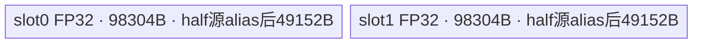
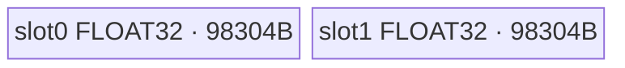
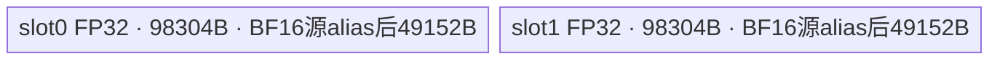

# SquaredRelu 950 ACLNN 算子知识

## 算子速览

| 项目 | 内容 |
|---|---|
| 实际入口 | 公开两段式 `aclnnSquaredReluGetWorkspaceSize` / `aclnnSquaredRelu`，无版本后缀 |
| 计算语义 | `y[i] = max(x[i], 0)^2` |
| 输入输出 | `input/out`：ND、1～8 维、FLOAT16/BFLOAT16/FLOAT，同 shape、dtype、format；允许非连续和空 Tensor |
| 执行类型 | 单 Kernel `squared_relu`，`AIV_VECTOR`；无 Cube/AIC/MIX_CV |
| Kernel 路线 | R-001 FLOAT16 升 FP32；R-002 FLOAT32 原生；R-003 BFLOAT16 升 FP32 |
| 核心资源 | GM；192 KiB `TBuf<VECCALC>`，两个 96 KiB event-protected slot；无 TQue、dynamic UB、Kernel 间 workspace 边 |
| 来源闭包 | `source_closed`：公开 ACLNN/生成 bridge 边界→OpDef/InferShape→Tiling/POD/key→AIV entry→三种模板 body→950 binary/CMake 接线闭合 |
| 验证状态 | 已完成源码闭包检查；本次知识提取未执行编译、真机、数值或性能测试。 |

## 接口与语义

### 计算语义

对每个有效元素先计算 `r=max(x[i],0)`，再计算 `y[i]=r*r`。公开契约规定 NaN→NaN、`+Inf`→`+Inf`、`-Inf`→0；Kernel 顺序是 FP32 `Relu` 后原地 `Mul`。

### 输入、输出与属性

| 参数 | shape/layout | dtype | 约束、默认值与语义 |
|---|---|---|---|
| `input` | ND，1～8 维；可非连续、可空 | FLOAT16/BFLOAT16/FLOAT | 输入；OpDef `AutoContiguous()` |
| `out` | 与 input 同 shape/ND；可非连续、可空 | 与 input 相同 | 输出；OpDef `AutoContiguous()` |
| `workspaceSize` | Host 标量输出 | `uint64_t*` | 第一段返回 executor 全流程 workspace |
| `executor` | Host 对象 | `aclOpExecutor**` | 第一段生成，第二段消费 |
| `workspace/stream` | Device 地址/运行流 | `void*` / `aclrtStream` | 第二段在指定 stream 执行 |

### 入口与版本

固定 Commit `955f8b33985b6d72989ebff341bb9c2c564a51bc` 只公开无后缀两段式 ACLNN，故为本平台实际最新公开版本。README/API 明确支持 Ascend 950PR/Ascend 950DT；OpDef 注册 `ascend950`，对应 binary config 发布三种 dtype。ACLNN C bridge/executor 壳由 `ACLNNTYPE aclnn` 生成，固定目录未展开，按框架边界记录。

## Host/Launcher 执行流程

### 参数校验与前处理

公开第一段契约校验必需指针、dtype、1～8 维以及 input/out 同 shape、dtype、format；空 Tensor、非连续 Tensor 受支持。OpDef 限制 ND 三 dtype并声明 `AutoContiguous()`；`InferShape4SquaredRelu` 与 `InferDataType4SquaredRelu` 分别复制输入 shape、dtype。生成 bridge 内具体 `Contiguous/ViewCopy` 节点与检查顺序不可见。Tiling 检查输入 Tensor/描述非空，按 dtype 选 key；其它 dtype 返回 `GRAPH_FAILED`。

### 参数、Workspace 与生命周期

Tiling 令 `N=GetOriginShape().GetShapeSize()`，读取 `GetCoreNumAiv()`，生成 `elementNum=N`、`needCoreNum`、key、`blockDim`。节点固定申报 `16*1024*1024=16 MiB` workspace；entry 传 `userWs=nullptr`，`Init` 不绑定 workspace，故核心 Kernel 消耗 0 B，但 Host 请求不能删除。executor 总 workspace与通用非连续转换的额外 slice 固定仓不可见。调用者持有 Tensor/workspace，executor与 workspace至少存活到 stream 执行完成。

### 启动图与失败传播

```text
aclnnSquaredReluGetWorkspaceSize
  -> [生成式连续化/输出回写边界]
  -> SquaredRelu Tiling: key + POD + blockDim + 16 MiB request
  -> squared_relu(input, output, workspace, tiling)  # 单 AIV_VECTOR 节点
aclnnSquaredRelu(workspace, size, executor, stream)
```

核心 grid=`needCoreNum`，POD=`SquaredReluTilingData`，直接读 input、写 output，无 Kernel 间边。Tiling失败阻断 launch；未知 key或平台 guard不命中时 entry无 body。`N=0` 时 `blockDim=1`、Device `loopNum=0`且不访问 GM；bridge 是否提前短路空 Tensor不可见。

## Route 与参数设计

### 分核与资源计算

令 `P=24576`、平台 AIV 核数 `C`：

```text
tiles = ceil(N/P)
needCoreNum = min(max(tiles,1), C)
baseLoops = floor(tiles/needCoreNum)
extra = tiles % needCoreNum
loopNum(b) = baseLoops + (b < extra ? 1 : 0)
start(b) = loopNum(b)*b*P
if extra>0 && b>=extra: start(b) += N % (P*needCoreNum)
```

若 `remain=N%P>0`，短 tile由 `lastCore=(extra==0 ? needCoreNum-1 : extra-1)` 的最后一轮处理；offset修正把短 tile实际长度计入后续核起点。每 slot为 `P*4=98304 B`，两个 slot恰为192 KiB。

### Route 选择

| 顺序 | Route | Key/模板 | 精确选择条件与优先级 | 不适用去向 |
|---:|---|---|---|---|
| 1 | R-001 FLOAT16升精度 | key 1 / `SquaredReluND<half>` | 950 FLOAT16 binary；Tiling `DT_FLOAT16` | 继续检查 FLOAT |
| 2 | R-002 FLOAT32原生 | key 2 / `SquaredReluND<float>` | 950 FLOAT binary；Tiling `DT_FLOAT` | 继续检查 BF16 |
| 3 | R-003 BFLOAT16升精度 | key 3 / `SquaredReluND<bfloat16_t>` | 950 BFLOAT16 binary；Tiling `DT_BF16` | 其它 dtype失败 |

```text
DT_FLOAT16 -> key 1 -> SquaredReluND<half>
DT_FLOAT   -> key 2 -> SquaredReluND<float>
DT_BF16    -> key 3 -> SquaredReluND<bfloat16_t>
other      -> GRAPH_FAILED
```

### 模板/实现执行矩阵

| Route | key/selector | dtype/shape/platform 完整命中条件 | 执行拓扑与 Kernel 节点 | 实际模板/body | 内存与同步特征 | tail/fallback |
|---|---|---|---|---|---|---|
| R-001 | 1/FLOAT16 binary | 950、ND 1～8D、同构 FLOAT16 | 单 AIV `squared_relu` | `SquaredReluND<half>` | 16-bit源在 slot +48KiB，FP32计算，CAST_NONE回 half；双 event | `calNum=remain`；无 fallback |
| R-002 | 2/FLOAT binary | 950、ND 1～8D、同构 FLOAT | 同上 | `SquaredReluND<float>` | FP32 GM直接进96KiB slot；双 event | 同上 |
| R-003 | 3/BFLOAT16 binary | 950、ND 1～8D、同构 BFLOAT16 | 同上 | `SquaredReluND<bfloat16_t>` | 16-bit源 alias、FP32计算、CAST_RINT回 BF16；双 event | 同上 |

### 隐藏性能 Guard

| Guard | Host/Tiling 条件 | Device/资源原因 | 影响 Route | 不满足时去向 | 源码符号 |
|---|---|---|---|---|---|
| tile/UB | Host以 `ceil(N/24576)` 分核 | 两个 `24576*4` slot恰占192KiB | 全部 | 多 tile时每核循环 | `MAX_ELEMENT_NUM_EACH_CORE` / `PP_ELEMENT_NUM` / `MAX_UB_SIZE` |
| dtype/key | 三段有序 dtype判断 | key决定 cast/round模板 | 全部 | 其它 dtype失败；未知 key无 body | `RunBigKernelTiling` / `squared_relu` |
| 编译平台 | `__CCE_AICORE__==220`、Kirin arch值或 `==310` | 仅 guard内实例化；Kirin排除 BF16 | 全部 | entry空结束 | `squared_relu` |
| slot复用 | 覆盖前等待 `MTE3_MTE2(eventId)` | 防 MTE2覆盖尚在 CopyOut的 slot | 全部 | 无替代 Route | `CopyInAndCast` |
| 空域 | `N=0 -> needCoreNum=1, loopNum=0` | 避免除零与 GM访问 | 全部 | 成功空循环 | `GetNeedCoreNum` / `Process` |

### POD/ABI

| 结构 | 字段 | 类型/位宽 | ABI 布局 | 单位 | Host/launcher producer | Device consumer | 边界 |
|---|---|---|---|---|---|---|---|
| `SquaredReluTilingData` | `elementNum` | `int64_t`/64 | 声明顺序1；宏的 `sizeof/alignof/offsetof` 不可见 | 元素 | `set_elementNum(inputShapeSize)` | `Init`→`elementNum`，控制 tile/offset/tail | shape乘积溢出检查不可见 |
| `SquaredReluTilingData` | `needCoreNum` | `uint32_t`/32 | 声明顺序2；精确 offset不可见 | AIV core数 | `set_needCoreNum(GetNeedCoreNum(GetCoreNumAiv()))` | `Process`分核/越界保护 | 至少1，不超过平台核数 |

Host `SaveToBuffer` 与 Device `GET_TILING_DATA` 使用同一宏生成类型；不得手工猜 padding。

### Route 源码闭包

| Route | Key/selector | Host/Tiling producer | POD/参数 | Kernel entry/router 节点 | Kernel body/直接依赖 | 构建接线 |
|---|---|---|---|---|---|---|
| R-001 | key1/FLOAT16 | `squared_relu_tiling.cpp::RunBigKernelTiling` | `SquaredReluTilingData` | `squared_relu`→`SquaredReluND<half>` | `squared_relu.h`全部方法 | 950 binary + ACLNN/global config |
| R-002 | key2/FLOAT | 同上 | 同上 | entry→`SquaredReluND<float>` | 同模板FP32分支 | 同上 |
| R-003 | key3/BFLOAT16 | 同上 | 同上 | entry→`SquaredReluND<bfloat16_t>` | 同模板BF16分支 | 同上 |

## Kernel 实现

### 公共执行流程

entry解析 POD并按 key构造模板；`Init`绑定 input/output GM、读取POD、记录 `GetBlockIdx()`并分配192KiB TBuf。`Process`计算本核连续区间，预置event 0/1，逐 tile调用 `CopyInAndCast→Compute→CastAndCopyOut`并翻转 slot，最后等待两路 MTE3。`workspace`不被 body消费。

### Route R-001：FLOAT16 升 FP32 计算

#### 适用条件

##### 选择证据

| 层级 | 文件 | 符号 | 源码谓词/参数 | 结果/下一跳 |
|---|---|---|---|---|
| API/OpDef | `docs/aclnnSquaredRelu.md` / `squared_relu_def.cpp` | dtype契约 / `SquaredRelu` | FLOAT16、ND、同构输出 | FLOAT16 binary |
| Tiling | `squared_relu_tiling.cpp` | `RunBigKernelTiling` | `dataType==DT_FLOAT16` | key1、POD/blockDim |
| Router | `squared_relu.cpp` | `squared_relu` | 平台guard且 `TILING_KEY_IS(1)` | `SquaredReluND<half>` |

#### Device 数据流

##### 函数级调用链

```text
squared_relu -> SquaredReluND<half>::Init -> Process
  -> CopyInAndCast(GM half -> slot后半 -> FP32 slot)
  -> Compute(FP32 Relu -> in-place Mul)
  -> CastAndCopyOut(FP32 -> half CAST_NONE -> GM)
```

##### 源码等价伪码

```text
for tile: calNum=full_or_remain; slot=ping; wait MTE3_MTE2(slot)
  copy calNum*2B GM[offset] -> slot+49152; wait MTE2_V
  cast half->float at slot起点; barrier
  Relu(fp32,fp32,calNum); barrier; Mul(fp32,fp32,fp32,calNum); barrier
  cast fp32->half(CAST_NONE); wait V_MTE3; copy calNum*2B -> output[offset]
  signal MTE3_MTE2(slot); ping ^= 1
```

#### 内存与数据搬运

##### 资源与搬运表

| 层级/缓冲区 | offset/地址公式 | extent/容量公式 | dtype/layout | producer | consumer | owner/lifetime | 对齐/复用 |
|---|---|---|---|---|---|---|---|
| input/output GM | `start(b)+i*24576` | `calNum` | FLOAT16/ND | caller/MTE3 | MTE2/caller | 外部 | blockCount=1、blockLen=`calNum*2B`、stride=0 |
| slot0/1 | `slot*98304` | 98304B | FLOAT32 | Cast/Vector | Vector/Cast/MTE3 | TBuf | event双缓冲 |
| half源 alias | `slot*98304+49152` | 49152B | FLOAT16 | MTE2 | Cast | slot后半 | 不重复计物理内存 |

##### 分层内存布局



##### 字节账与复用顺序

```text
UB_total = 2*98304 = 196608 B
dynamic_ub = N/A
workspace_total = 16777216 B requested; Kernel consumed = 0 B
```

| 复用子区 | 写入者 | 读取者/消费点 | 下一次覆盖 | 同步或释放依据 | 安全条件 |
|---|---|---|---|---|---|
| slot后半源/整个slot | MTE2/Cast/Relu/Mul | Cast/Vector/MTE3 | 当前扩展及同 parity后续 tile | `MTE2_V`、`PIPE_V`、`MTE3_MTE2` | +49152B alias与event parity不变 |

#### 同步、精度与尾块

##### 同步与数值边界表

| 阶段 | primitive/机制 | producer | consumer/等待点 | 保护对象 | 精度/尾块 |
|---|---|---|---|---|---|
| CopyIn→Vector | `MTE2_V` | `DataCopyPad` | input Cast | half源 | 精确 `calNum*2B` |
| Vector链 | `PIPE_V` | Cast/Relu/Mul/output Cast | 下一 Vector op | FP32 slot | FP32计算；half回写 `CAST_NONE` |
| CopyOut/复用 | `V_MTE3`、`MTE3_MTE2` | Vector/MTE3 | CopyOut/下次CopyIn | slot | 尾块只提交 `calNum` |

#### 关键实现

##### 符号证据表

| 阶段 | 文件 | 符号/模板实例 | 实现事实 |
|---|---|---|---|
| Host/Tiling producer | `activation/squared_relu/op_host/squared_relu_tiling.cpp` | `RunBigKernelTiling` | key1/POD/blockDim/workspace |
| Kernel entry/router | `activation/squared_relu/op_kernel/squared_relu.cpp` | `SquaredReluND<half>` | key1映射 |
| Device body/helper | `activation/squared_relu/op_kernel/squared_relu.h` | 模板全部方法 | alias、FP32链、同步、tail |

### Route R-002：FLOAT32 原生计算

#### 适用条件

##### 选择证据

| 层级 | 文件 | 符号 | 源码谓词/参数 | 结果/下一跳 |
|---|---|---|---|---|
| API/OpDef | 文档 / `squared_relu_def.cpp` | dtype契约 / `SquaredRelu` | FLOAT、ND、同构输出 | FLOAT binary |
| Tiling | `squared_relu_tiling.cpp` | `RunBigKernelTiling` | `dataType==DT_FLOAT` | key2 |
| Router | `squared_relu.cpp` | `squared_relu` | `TILING_KEY_IS(2)` | `SquaredReluND<float>` |

#### Device 数据流

##### 函数级调用链

```text
squared_relu -> SquaredReluND<float>::Init -> Process
  -> CopyInAndCast(GM float -> FP32 slot)
  -> Compute(Relu -> in-place Mul)
  -> CastAndCopyOut(FP32 slot -> GM float)
```

##### 源码等价伪码

```text
按公共分核选择slot并等待；copy calNum*4B到slot；wait MTE2_V
Relu(slot,slot,calNum); barrier; Mul(slot,slot,slot,calNum); barrier
wait V_MTE3；copy calNum*4B到同元素offset；signal slot可复用
```

#### 内存与数据搬运

##### 资源与搬运表

| 层级/缓冲区 | offset/地址公式 | extent/容量公式 | dtype/layout | producer | consumer | owner/lifetime | 对齐/复用 |
|---|---|---|---|---|---|---|---|
| input/output GM | 公共元素offset | `calNum` | FLOAT/ND | caller/MTE3 | MTE2/caller | 外部 | 单block、`calNum*4B` |
| slot0/1 | `slot*98304` | 98304B | FLOAT32 | MTE2/Vector | Vector/MTE3 | TBuf | event双缓冲，无源alias |

##### 分层内存布局



##### 字节账与复用顺序

```text
UB_total = 196608 B
dynamic_ub = N/A
workspace_total = 16777216 B requested; Kernel consumed = 0 B
```

| 复用子区 | 写入者 | 读取者/消费点 | 下一次覆盖 | 同步或释放依据 | 安全条件 |
|---|---|---|---|---|---|
| 当前 FP32 slot | MTE2/Relu/Mul | MTE3 | 同 parity后续 tile | `MTE2_V/V_MTE3/MTE3_MTE2` | event不可跨slot错配 |

#### 同步、精度与尾块

##### 同步与数值边界表

| 阶段 | primitive/机制 | producer | consumer/等待点 | 保护对象 | 精度/尾块 |
|---|---|---|---|---|---|
| MTE2→V→MTE3 | event + `PIPE_V` | GM copy/Relu/Mul | 下一阶段 | slot | 全程FLOAT32；精确 `calNum` |
| 平方 | `Mul(dst,src,src,dataCount)` | Relu | MTE3 | 同一tensor | 原地，无中间物化 |

#### 关键实现

##### 符号证据表

| 阶段 | 文件 | 符号/模板实例 | 实现事实 |
|---|---|---|---|
| Host/Tiling producer | `squared_relu_tiling.cpp` | `RunBigKernelTiling` | key2与公共参数 |
| Kernel entry/router | `squared_relu.cpp` | `SquaredReluND<float>` | FLOAT实例 |
| Device body/helper | `squared_relu.h` | FLOAT分支 / `Compute` | 直接搬运、原地平方 |

### Route R-003：BFLOAT16 升 FP32 计算

#### 适用条件

##### 选择证据

| 层级 | 文件 | 符号 | 源码谓词/参数 | 结果/下一跳 |
|---|---|---|---|---|
| API/OpDef | 文档 / `squared_relu_def.cpp` | dtype契约 / `SquaredRelu` | BFLOAT16、ND、同构输出 | BFLOAT16 binary |
| Tiling | `squared_relu_tiling.cpp` | `RunBigKernelTiling` | `dataType==DT_BF16` | key3 |
| Router | `squared_relu.cpp` | `squared_relu` | 平台guard且 key3；仅Kirin分支排除 | `SquaredReluND<bfloat16_t>` |

#### Device 数据流

##### 函数级调用链

```text
squared_relu -> SquaredReluND<bfloat16_t>::Init -> Process
  -> CopyInAndCast(BF16 GM -> slot后半 -> FP32 slot)
  -> Compute(FP32 Relu -> in-place Mul)
  -> CastAndCopyOut(FP32 -> BF16 CAST_RINT -> GM)
```

##### 源码等价伪码

```text
与R-001相同offset/event/alias；copy BF16到+49152B
Cast BF16->FP32(CAST_NONE)；FP32 Relu、原地Mul
Cast FP32->BF16(CAST_RINT)；精确搬出calNum*2B
```

#### 内存与数据搬运

##### 资源与搬运表

| 层级/缓冲区 | offset/地址公式 | extent/容量公式 | dtype/layout | producer | consumer | owner/lifetime | 对齐/复用 |
|---|---|---|---|---|---|---|---|
| input/output GM | 公共offset | `calNum` | BFLOAT16/ND | caller/MTE3 | MTE2/caller | 外部 | 单block、`calNum*2B` |
| FP32 slot0/1 | `slot*98304` | 98304B | FLOAT32 | Cast/Vector | Vector/Cast/MTE3 | TBuf | event双缓冲 |
| BF16源alias | `slot*98304+49152` | 49152B | BFLOAT16 | MTE2 | Cast | slot后半 | 不重复计数 |

##### 分层内存布局



##### 字节账与复用顺序

```text
UB_total = 196608 B；BF16 source为内部alias
dynamic_ub = N/A
workspace_total = 16777216 B requested; Kernel consumed = 0 B
```

| 复用子区 | 写入者 | 读取者/消费点 | 下一次覆盖 | 同步或释放依据 | 安全条件 |
|---|---|---|---|---|---|
| BF16源/FP32结果同slot | MTE2/Cast/Vector | Cast/Vector/MTE3 | 当前扩展及同 parity后续tile | `MTE2_V`、`PIPE_V`、slot event | alias offset与顺序不变 |

#### 同步、精度与尾块

##### 同步与数值边界表

| 阶段 | primitive/机制 | producer | consumer/等待点 | 保护对象 | 精度/尾块 |
|---|---|---|---|---|---|
| 升精度 | `Cast(...CAST_NONE)` + `PIPE_V` | BF16源 | FP32 Relu | slot | `calNum`元素 |
| 计算/降精度 | FP32 Relu/Mul；`CAST_RINT` | FP32 slot | MTE3 | slot | 仅搬 `calNum*2B` |
| slot | 三类event | MTE2/V/MTE3 | 对应等待点 | parity slot | 防提前覆盖 |

#### 关键实现

##### 符号证据表

| 阶段 | 文件 | 符号/模板实例 | 实现事实 |
|---|---|---|---|
| Host/Tiling producer | `squared_relu_tiling.cpp` | `RunBigKernelTiling` | key3与公共参数 |
| Kernel entry/router | `squared_relu.cpp` | `SquaredReluND<bfloat16_t>` | BF16实例/编译排除 |
| Device body/helper | `squared_relu.h` | 16-bit/BF16分支 | FP32计算、RINT、alias、tail |

## 算子特定优化

### Trick T-001：双 event 驱动两个 96 KiB slot 交替复用

#### 触发与源码依据

- 适用 Route：R-001～R-003
- 触发条件：本核 `loopNum>0`，每轮翻转 `pingPongFlag`
- Golden 来源：[`op_kernel/squared_relu.h:107-127`](../../../../../../../cann-ops-raw/ascendc/ops-nn/955f8b33985b6d72989ebff341bb9c2c564a51bc/activation/squared_relu/op_kernel/squared_relu.h#L107-L127)

**官方源码（固定 Commit 连续逐字摘录）**：

```cpp
int32_t calNum = PP_ELEMENT_NUM;
int64_t lastCoreNum = loopRemain == 0 ? needCoreNumber - 1 : loopRemain - 1;
pingPongFlag = 0;
SetFlag<HardEvent::MTE3_MTE2>(EVENT_ID0);
SetFlag<HardEvent::MTE3_MTE2>(EVENT_ID1);
for (int64_t i = 0; i < loopNum; i++) {
    int64_t localOffset = i * PP_ELEMENT_NUM;

    // 最后一轮的最后一个核处理余数
    if (remain > 0 && i == loopNum -1 && blockIdx == lastCoreNum) {
        calNum = remain;
    }
    eventId = pingPongFlag ? EVENT_ID1 : EVENT_ID0;
    CopyInAndCast(eachCoreStartOffset + localOffset, calNum);

    Compute(calNum);
    CastAndCopyOut(eachCoreStartOffset + localOffset, calNum);
    pingPongFlag = 1 - pingPongFlag;
}
WaitFlag<HardEvent::MTE3_MTE2>(EVENT_ID0);
WaitFlag<HardEvent::MTE3_MTE2>(EVENT_ID1);
```

#### 机制与设计原因

slot parity与event 0/1一一对应；同 slot再次 CopyIn前等待上次 CopyOut完成。192KiB因此支撑两个96KiB计算区交替复用；`calNum`贯穿尾块搬入、计算、搬出，避免尾部额外 GM提交。

#### 迁移边界

- 适用：逐元素、输出输入等长、MTE3完成后即可覆盖本地结果的 Vector流水。
- 前提：slot大小、event parity、`P=24576`与尾长同步维护。
- 失效：消费者跨两轮持有旧slot或 UB不足时必须重设缓冲/同步；固定实现无 fallback。
- 未验证：本次知识提取未执行编译、真机、数值或性能测试。

#### 错误做法

同步依赖可证明删除同 parity `MTE3_MTE2`等待会允许 MTE2在 MTE3读完前覆盖输出源；固定仓未提供独立反例实现。

### Trick T-002：16-bit 源后置并在同 slot 扩展为 FP32

#### 触发与源码依据

- 适用 Route：R-001、R-003
- 触发条件：`T` 为 `half` 或 `bfloat16_t`
- Golden 来源：[`op_kernel/squared_relu.h:140-157`](../../../../../../../cann-ops-raw/ascendc/ops-nn/955f8b33985b6d72989ebff341bb9c2c564a51bc/activation/squared_relu/op_kernel/squared_relu.h#L140-L157)

**官方源码（固定 Commit 连续逐字摘录）**：

```cpp
if (std::is_same_v<T, bfloat16_t> || std::is_same_v<T, half>) {
    int32_t elementByte = PP_ELEMENT_NUM * sizeof(T);
    xTmp = pingPongFlag ?
            tmpTensor[elementByte + MAX_UB_SIZE / 2].ReinterpretCast<T>() :
            tmpTensor[elementByte].ReinterpretCast<T>();
    DataCopyPad(xTmp, inputGm[inputOffset], dataCopyParams, padParams);
} else {
    DataCopyPad(xTensor, inputGm[inputOffset], dataCopyParams, padParams);
}

SetFlag<HardEvent::MTE2_V>(eventId);
WaitFlag<HardEvent::MTE2_V>(eventId);

xTensorFp32 = xTensor.template ReinterpretCast<float>();
if (std::is_same_v<T, bfloat16_t> || std::is_same_v<T, half>) {
    Cast(xTensorFp32, xTmp, RoundMode::CAST_NONE, dataCount);
    PipeBarrier<PIPE_V>();
}
```

#### 机制与设计原因

24576个16-bit源占49152B，FP32结果占98304B。源码把源放在同一 slot后半、目标从起点展开，省去独立窄类型 TBuf；Relu与 `Mul(dst,src,src)`继续原地使用同一 FP32区。

#### 迁移边界

- 适用：窄类型向两倍宽类型扩展且 primitive支持该重叠方向。
- 前提：源在目标后半，元素上限、字节倍率与同步顺序不变。
- 失效：宽度倍率变化、后续仍需窄源或 Cast不允许 alias时需独立源区。
- 未验证：本次知识提取未执行编译、真机、数值或性能测试。

#### 错误做法

固定仓未提供可验证反例；把源改到 slot起点不能视为与官方后置 alias等价。

## 模板与实现对比

| 对比维度 | R-001 FLOAT16 | R-002 FLOAT32 | R-003 BFLOAT16 | 设计选择依据 |
|---|---|---|---|---|
| 命中条件/优先级 | key1 | key2 | key3 | Host dtype决策树 |
| 模板与 dtype | `<half>` | `<float>` | `<bfloat16_t>` | binary specialization |
| 循环与分核 | 24576/tile | 相同 | 相同 | Host/Device常量一致 |
| Queue/TBuf/寄存器/dynamic UB/通信 window | 192KiB TBuf+half alias | 192KiB TBuf | 192KiB TBuf+BF16 alias | 无 TQue/dynamic UB/通信 |
| 内存总占用与复用 | 196608B | 196608B | 196608B | alias不重复计数 |
| 搬运/Vector/SIMT/NDDMA/通信 API | 2B copy+FP32 Vector | 4B copy+FP32 Vector | 2B copy+FP32 Vector | 均 AIV Vector |
| 同步、精度与 tail | 双event；NONE回half | 双event；原生FP32 | 双event；RINT回BF16 | constexpr分支 |
| fallback/失败边界 | 无Device fallback | 同 | 同 | 未知key/guard无body |

## 平台差异

| 项目 | A2 | A3 | 950 |
|---|---|---|---|
| 支持状态 | 公开支持，另见无后缀卡 | 公开支持，另见无后缀卡 | 公开支持；`ascend950`三dtype，`source_closed` |
| Host/Launcher | 共用同一 ACLNN/Tiling/POD | 同 A2 | 本卡链路；同一 Host/Tiling/POD |
| Kernel/资源 | 共用模板，构建目标不同 | 同 A2 | 同模板，固定192KiB/24576元素；命中 `__CCE_AICORE__==310` |

## 限制与失败边界

- ACLNN/README为1～8维，图原型注释为0D～8D；本卡按公开 ACLNN入口，不扩展到0D。
- 生成 bridge、通用非连续转换节点与额外 workspace slice不可见；仅作为框架边界。
- Tiling请求16MiB而 Kernel不使用；不可删除。POD宏未展开，精确布局不可见。
- `GetShapeSize`、`CeilA2B(a+b-1)`与 `dataCount*sizeof(T)`窄化前无算子内显式溢出检查。
- `selMaskOne/selMaskTwo/ONE_REPEAT_ELE_NUM_FP32`未被 body使用，不计额外 UB，不臆造 mask流程。
- 本次知识提取未执行编译、真机、数值或性能测试。

## 源码索引

### 链路索引

| 链路阶段 | 文件 | 关键符号 | 支撑内容 |
|---|---|---|---|
| 入口声明/约束 | `activation/squared_relu/docs/aclnnSquaredRelu.md` | 两段式原型/产品表 | API、dtype、shape、平台 |
| 入口声明/约束 | `activation/squared_relu/README.md` | 公式/产品表 | 语义与平台交叉证据 |
| 入口实现 | `activation/squared_relu/op_host/CMakeLists.txt` | `ACLNNTYPE aclnn` | 自动 bridge边界 |
| Host/Tiling/Launcher | `activation/squared_relu/op_host/squared_relu_def.cpp` | `SquaredRelu::SquaredRelu` | OpDef/平台注册 |
| Host/Tiling/Launcher | `activation/squared_relu/op_host/squared_relu_infershape.cpp` | 两个 Infer函数 | shape/dtype |
| Host/Tiling/Launcher | `activation/squared_relu/op_host/squared_relu_tiling.h` | `SquaredReluTilingData` | POD |
| Host/Tiling/Launcher | `activation/squared_relu/op_host/squared_relu_tiling.cpp` | `RunBigKernelTiling` | key/分核/workspace |
| Kernel entry/body | `activation/squared_relu/op_kernel/squared_relu.cpp` | `squared_relu` | guard/router |
| Kernel entry/body | `activation/squared_relu/op_kernel/squared_relu.h` | `SquaredReluND<T>` | 完整body |
| 构建接线 | `activation/squared_relu/op_host/config/ascend950/squared_relu_binary.json` | `op_list` | 950三dtype |
| 构建接线 | `scripts/kernel/binary_config/ascendc_config.json` | `SquaredRelu` | 活动compute_units |

### 实现复用检查

| 检查项 | 可复用事实 | 不得改变的约束 | 源码符号 |
|---|---|---|---|
| ABI/POD | 两字段端到端对应 | 顺序、位宽、单位、同一生成宏 | `SquaredReluTilingData/GET_TILING_DATA` |
| 调用顺序 | CopyIn→Compute→CopyOut | slot parity/offset/event顺序 | `Process` |
| workspace/内存 | 192KiB TBuf；16MiB请求 | 96KiB slot、+48KiB alias | `Init/RunBigKernelTiling` |
| 同步 | 双event + `MTE2_V/V_MTE3/PIPE_V` | 等待不可删除 | 三个helper |
| 精度与尾块 | 16-bit升FP32；BF16 RINT、half NONE | Relu后原地Mul；`calNum` | `Compute/CastAndCopyOut` |
| 失败边界 | dtype失败；未知key无body；空域零循环 | 不补造fallback | `RunBigKernelTiling/squared_relu/Process` |