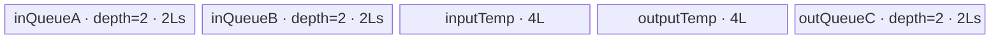
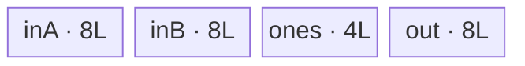
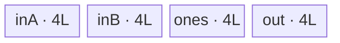

# SwiGlu A2/A3 ACLNN 算子知识

## 算子速览

| 项目 | 内容 |
|---|---|
| 实际入口 | 公开两段式 `aclnnSwiGluGetWorkspaceSize` / `aclnnSwiGlu`；固定仓只有这一版公开 SwiGlu，Grad、Quant、GroupQuant 是不同语义算子。 |
| 计算语义 | 沿 `dim` 把 `x` 等分为 `A,B`，逐元素计算 `y = A / (1 + exp(-A)) * B`。 |
| 输入输出 | `x,y` 均为连续 ND；A2/A3 支持 FP16、FP32、BF16；`rank(x)>0`，`dim` 合法且该轴为偶数，`shape(y)` 等于 `shape(x)` 但该轴减半。 |
| 执行类型 | 单 Kernel、单节点 `AIV_VECTOR`；只使用 GM、AIV UB、Vector API 和 DataCopy，不含 Cube/AIC/MIX_CV。 |
| Kernel 路线 | R-001～R-004：FP16/BF16 或 FP32 × double/single buffer；每条路线内部保留 32B 对齐 `DataCopy` 与非对齐 `DataCopyPad` 子路。 |
| 核心资源 | 三个 `TQue`、FP16/BF16 的两个 FP32 `TBuf` 或 FP32 的一个常量 `TBuf`；Tiling 请求 16 MiB workspace，但 Kernel 不解引用 `workspace`。 |
| 来源闭包 | `source_closed`：公开 ACLNN 声明→生成式 ACLNN/OpDef 框架边界→`Tiling4SwiGlu`→`swi_glu` router→`SwigluSingle` 与真实 Vector body→A2/A3 binary config/build 接线闭合。 |
| 验证状态 | 已完成源码闭包检查；本次知识提取未执行编译、真机、数值或性能测试。 |

## 接口与语义

### 计算语义

令规范化轴 `d = dim < 0 ? dim + rank(x) : dim`。把 `x` 在轴 `d` 上对半切为前半 `A` 和后半 `B`，输出有效域为 `shape(y)[d]=shape(x)[d]/2`，其它维不变：

```text
swish(A) = A / (1 + exp(-A))
y        = swish(A) * B
```

Kernel 将 `[轴前乘积, 轴及其后缀乘积]` 展平为 `rowLen × (2*colLen)`；每行前 `colLen` 元素为 A，后 `colLen` 元素为 B。

### 输入、输出与属性

| 参数 | shape/layout | dtype | 约束、默认值与语义 |
|---|---|---|---|
| `x` | rank>0，ND，OpDef `AutoContiguous()` | FP16/FP32/BF16 | 公开 API 不接受非连续 Tensor；支持表明确 A2/A3 三种 dtype。 |
| `dim` | 标量属性 | INT64 | 默认 -1；范围 `[-rank, rank-1]`；对应轴长度必须为偶数。 |
| `out` | ND；输入轴 `dim` 减半 | 与 `x` 相同 | 非连续 Tensor 不支持；InferDataType 直接复制输入 dtype。 |

### 入口与版本

公开文档声明最新且唯一的两段式入口：第一段校验参数并返回 workspace/executor，第二段接收 workspace、executor 和 stream 执行。固定仓未提供手写 `op_api` bridge；`op_host/CMakeLists.txt` 以 `ACLNNTYPE aclnn` 接入生成框架，`SwiGlu` OpDef、InferShape/Tiling 和 Kernel 均可见，因此把 bridge、executor 封装与 stream launch 视为明确的生成式框架边界，不臆造其内部符号。

## Host/Launcher 执行流程

### 参数校验与前处理

1. ACLNN 文档规定空指针、dtype、`dim` 非法分别在第一段返回 161001/161002；OpDef 把 `x` 自动连续化并限定 ND/FP16/FP32/BF16。
2. `InferShapeForSwiGlu` 规范化负轴，拒绝越界轴和非偶数轴，输出在该轴除二；dtype 原样传播。
3. `Tiling4SwiGlu` 取得 AIV 核数、NPU arch 和 UB 字节数，读取 origin shape、dtype 与属性。源码存在 `int64_t* -> uint32_t -> int32_t` 的 `dim` 转换；合法小范围负轴依赖目标实现的窄化结果，固定仓没有额外防溢出证明。
4. `SetTotalShape` 计算 `rowLen=prod(shape[0:d])`、`colLen=prod(shape[d:])/2`；乘积为 `int64_t` 且无显式溢出检查。显式偶数检查针对后缀乘积，轴本身的偶数性由前置 InferShape/API 校验保证。

### 参数、Workspace 与生命周期

`GetWorkspaceSizes(1)[0]` 对非空正常路线固定写入 `16*1024*1024` 字节；ACLNN executor 负责返回、持有 launch 描述，调用者在第二段执行期间持有 workspace，stream 完成后才可释放。Kernel entry 的第三参数存在但所有可达 body 均不读取，固定仓未说明这 16 MiB 的其它框架用途。Tiling POD 随 launch 有效；输入输出由调用者拥有。

### 启动图与失败传播

```text
aclnnSwiGluGetWorkspaceSize(x, dim, out)
  -> 生成式 ACLNN/OpDef 框架边界（AutoContiguous + InferShape）
  -> Tiling4SwiGlu<SWIGLU_SINGLE>
     -> SetTotalShape -> CalcTiling -> SaveToBuffer
     -> blockDim=usedCoreNum, key=dtype, workspace[0]=16 MiB
aclnnSwiGlu(workspace, executor, stream)
  -> 单节点 swi_glu<<<blockDim, stream>>>(x, y, workspace, tiling)
     -> 当前 dtype/DB 对应的 SwigluSingle 模板实例::Process
```

唯一节点输入 `x`、输出 `y`，没有 Kernel 间边。Tiling、selector、workspace 获取或 launch 失败都会阻断节点；框架的精确错误码映射除公开文档列项外固定仓不可见。stream 提供节点完成顺序，示例在读取输出前调用 `aclrtSynchronizeStream`。

## Route 与参数设计

### 分核与资源计算

设元素字节 `s∈{2,4}`，`B=32/s` 元素，cache line `P=512/s` 元素，`U` 为可用 UB：

```text
aligned = (colLen % B == 0)
maxTileLen = floor((U / bytes_per_element_bundle) / B) * B
baseCol 上界 = min(colLen, maxTileLen, aligned ? 65535 : floor(65535/s))
若发生列切分且上界>P，则 baseCol 向下对齐 P
baseRow = min(floor(maxTileLen / align_up(baseCol,B)), min(rowLen,4095))
totalTiles = ceil(rowLen/baseRow) * ceil(colLen/baseCol)
usedCoreNum = min(totalTiles, AIV_core_num)
```

候选 base shape 以“更多使用核→更少 tile→更大 base 面积→更多整 tile”的字典序选优。若多行 DMA stride 超过 65535（对齐路径单位 32B，非对齐路径单位 byte），强制 `baseRow=1`。先按 `bufferNum=2` 计算；仅当 DB 候选每核 2 tile、single-buffer 候选每核 1 tile 且核数不减少时关闭 DB。

### Route 选择

| 顺序 | Route | Key/模板 | 精确选择条件与优先级 | 不适用去向 |
|---:|---|---|---|---|
| 1 | R-001 half/bf16 DB2 | key 1/27；`bufferNum=2` | dtype∈{FP16,BF16} 且 DB 关闭条件不成立；`aligned` 再选 DataCopy/DataCopyPad | dtype 或 DB 分支的下一 Route |
| 2 | R-002 half/bf16 DB1 | key 1/27；`bufferNum=1` | dtype∈{FP16,BF16} 且 DB 候选每核2 tile、SB候选每核1 tile、SB核数≥DB核数 | FP32 Route 或 Tiling 失败 |
| 3 | R-003 fp32 DB2 | key 0；`bufferNum=2` | dtype=FP32 且 DB 关闭条件不成立 | R-004 |
| 4 | R-004 fp32 DB1 | key 0；`bufferNum=1` | dtype=FP32 且完整 DB 关闭条件成立 | 不支持 dtype 无 router body |

```text
SetTotalShape/CalcTiling 失败 -> GRAPH_FAILED
Calc DB2 -> tileNumPerCore != 2 -> isDoubleBuffer=1
         -> tileNumPerCore == 2 -> 尝试 SB
              -> SB成功 && SB.tileNumPerCore==1 && SB.cores>=DB.cores -> isDoubleBuffer=0
              -> 否则 -> isDoubleBuffer=1
key = dtype: 1(FP16), 0(FP32), 27(BF16)
Process: is32BAligned ? DataCopy : DataCopyPad
```

### 模板/实现执行矩阵

| Route | key/selector | dtype/shape/platform 完整命中条件 | 执行拓扑与 Kernel 节点 | 实际模板/body | 内存与同步特征 | tail/fallback |
|---|---|---|---|---|---|---|
| R-001 | 1/27, DB=1 | A2/A3，FP16/BF16，DB关闭条件假 | 单 `swi_glu` AIV | `SwigluSingle<SwigluVectorBF16<T,float,T,2>,T,T>` | `20*L` UB；Queue+PIPE_V | 四种 row/col tile；非对齐用 Pad |
| R-002 | 1/27, DB=0 | A2/A3，FP16/BF16，完整 DB关闭条件真 | 同左 | `...BF16<T,float,T,1>` | `14*L` UB | 同左 |
| R-003 | 0, DB=1 | A2/A3，FP32，DB关闭条件假 | 同左 | `SwigluSingle<SwigluVector<float,float,2>,float,float>` | `28*L` UB | 同左 |
| R-004 | 0, DB=0 | A2/A3，FP32，完整 DB关闭条件真 | 同左 | `...Vector<float,float,1>` | `16*L` UB | 同左 |

### 隐藏性能 Guard

| Guard | Host/Tiling 条件 | Device/资源原因 | 影响 Route | 不满足时去向 | 源码符号 |
|---|---|---|---|---|---|
| 32B 对齐 | `colLen % (32/s)==0` | 决定 blockLen/stride 单位及 DataCopy vs DataCopyPad | 全部 | 非对齐子路 | `CalcTiling`, `SwigluSingle::Process` |
| DMA blockCount | `baseRow<=min(rowLen,4095)` | DataCopy 连续块计数为 uint16 且 API 上限4095 | 全部 | 缩小 baseRow/失败 | `getBaseRowLenUpBound` |
| DMA blockLen | aligned `baseCol<=65535`；unaligned `baseCol<=65535/s` | 对齐单位32B，非对齐单位byte | 全部 | 缩小 baseCol | `getBaseColLenUpBound` |
| DMA stride | 多行时 `(2*colLen-baseCol)` 对应 stride≤65535 | stride 字段/API 上限 | 全部 | 强制 baseRow=1 | `MustBeSingleBaseRowLen` |
| UB | `L<=floor(U/bundleBytes)` 并向下对齐 B | Queue depth 和 FP32 temp 必须同时装入 UB | 全部 | Tiling失败 | `GetBufferNumAndDataLenPerUB` |
| BF16 编译 | key27 body 受 `__CCE_AICORE__==220` 保护 | 只在相应 A2/A3 AIV 架构实例化 | R-001/2 | 无匹配 body | `swi_glu` |

### POD/ABI

正式结构由外部 `tilingdata_base.h` 宏生成，固定仓能确认字段声明顺序和位宽，但宏的 `sizeof/alignof/offsetof` 实现不可见；以下不得按普通 C++ 对齐自行重排。Forward 只生产/消费前六字段，其余共享字段在本逻辑算子中 inactive。

| 结构 | 字段 | 类型/位宽 | ABI 布局 | 单位 | Host/launcher producer | Device consumer | 边界 |
|---|---|---|---|---|---|---|---|
| `SwiGluTilingData` | `is32BAligned` | uint32/32 | 第1字段；精确 offset 不可见 | bool | `CalcTiling: colLen%B==0` | `GetTilingAndOffset`, `Process` | 0/1 |
| 同上 | `isDoubleBuffer` | uint32/32 | 第2字段；不可见 | bool | `CalcTiling` 先1，满足关闭谓词改0 | entry router | 0/1 |
| 同上 | `rowLen` | uint64/64 | 第3字段；不可见 | 元素行数 | `SetTotalShape: prod(shape[0:d])` | `GetTilingAndOffset` | 乘积溢出未查 |
| 同上 | `colLen` | uint64/64 | 第4字段；不可见 | 元素/半行 | `SetTotalShape: prod(shape[d:])/2` | 同上 | 必须可二分 |
| 同上 | `baseRowLen` | uint32/32 | 第5字段；不可见 | 行/tile | `CalcTiling: optBaseRowLen` | 同上 | 1..4095 |
| 同上 | `baseColLen` | uint32/32 | 第6字段；不可见 | 元素/tile | `CalcTiling: optBaseColLen` | 同上 | DMA/UB 上限 |
| 同上 | `activateLeft` | uint32/32 | 第7字段；不可见 | N/A | forward 无 producer | forward 无 consumer | inactive |
| 同上 | `biasIsEmpty` | uint32/32 | 第8字段；不可见 | N/A | 无 | 无 | inactive |
| 同上 | `quantScaleIsEmpty` | uint32/32 | 第9字段；不可见 | N/A | 无 | 无 | inactive |
| 同上 | `activateScaleIsEmpty` | uint32/32 | 第10字段；不可见 | N/A | 无 | 无 | inactive |
| 同上 | `swiColLen` | uint64/64 | 第11字段；不可见 | N/A | 无 | 无 | inactive |
| 同上 | `perRowLen` | uint64/64 | 第12字段；不可见 | N/A | 无 | 无 | inactive |
| 同上 | `modRowLen` | uint64/64 | 第13字段；不可见 | N/A | 无 | 无 | inactive |
| 同上 | `usedCoreNum` | uint32/32 | 第14字段；不可见 | N/A | 无；blockDim 独立设置 | 无 | inactive |

### Route 源码闭包

| Route | Key/selector | Host/Tiling producer | POD/参数 | Kernel entry/router 节点 | Kernel body/直接依赖 | 构建接线 |
|---|---|---|---|---|---|---|
| R-001 | 1/27, DB2 | `swi_glu_tiling.cpp::Tiling4SwiGlu/CalcTiling` | `SwiGluTilingData`, buffer=2 | `swi_glu.cpp::swi_glu` | `SwigluSingle`；`SwigluVectorBF16<T,float,T,2>`；`SwigluSingleTilingKernel` | ascend910b/ascend910_93 JSON + global `SwiGlu` config |
| R-002 | 1/27, DB1 | 同上 | 同上，buffer=1 | 同上 | `SwigluVectorBF16<T,float,T,1>` | 同上 |
| R-003 | 0, DB2 | 同上 | 同上，buffer=2 | 同上 | `SwigluVector<float,float,2>` | 同上 |
| R-004 | 0, DB1 | 同上 | 同上，buffer=1 | 同上 | `SwigluVector<float,float,1>` | 同上 |

## Kernel 实现

### 公共执行流程

单节点 entry 读取 POD，先按 `isDoubleBuffer`，再按 dtype key 实例化模板。`SwigluSingle::Init` 解析二维 tile、绑定 `aGm/cGm`、申请 UB；`Process` 以 `tileIdx=blockIdx; tileIdx<totalTiles; tileIdx+=blockNum` 轮转 tile。每 tile 计算 GM A/B/output 偏移，按 base/tail row×base/tail col 选搬运参数，执行 CopyIn→Compute→CopyOut。A/B 队列和 C 队列提供 MTE↔V 同步，Vector 指令之间显式 `PipeBarrier<PIPE_V>`。

### Route R-001：FP16/BF16 double buffer

#### 适用条件

##### 选择证据

| 层级 | 文件 | 符号 | 源码谓词/参数 | 结果/下一跳 |
|---|---|---|---|---|
| Host | `op_host/swi_glu_tiling.cpp` | `CalcTiling` | DB关闭完整谓词为假 | `isDoubleBuffer=1` |
| Tiling | 同上 | `Tiling4SwiGlu` | dtype FP16/BF16 | key 1/27 |
| Router | `op_kernel/swi_glu.cpp` | `swi_glu` | DB=1 && key1/27 | `SwigluVectorBF16<T,float,T,2>` |
| Device | `op_kernel/swi_glu_single.hpp` | `Process` | `is32BAligned` | DataCopy 或 DataCopyPad |

#### Device 数据流

##### 函数级调用链

```text
Tiling4SwiGlu -> swi_glu(x,y,workspace,tiling)
  -> SwigluSingle<SwigluVectorBF16<T,float,T,2>>::Init
  -> Process -> CaclOneTileParam -> CopyIn[/_Non32BAligned]
  -> SwigluVectorBF16::Compute -> CopyOut[/_Non32BAligned]
```

##### 源码等价伪码

```text
for tile=blockIdx; tile<ceil(R/br)*ceil(C/bc); tile+=blockNum:
  (rr,cc)=tile div/mod colTiles; choose actual r,c and calLen=r*(aligned?c:align_up(c,32/s))
  Aoff=rr*br*(2C)+cc*bc; Boff=Aoff+C; Yoff=rr*br*C+cc*bc
  copy r rows of c elements A/B to depth-2 queues (Pad when !aligned)
  af=float(A); tmp=-af; tmp=exp(tmp)+1; tmp=af/tmp
  reuse inputTemp: bf=float(B); tmp*=bf; Y=cast_rint<T>(tmp)
  queue Y; copy only r*c valid elements to GM
```

#### 内存与数据搬运

##### 资源与搬运表

| 层级/缓冲区 | offset/地址公式 | extent/容量公式 | dtype/layout | producer | consumer | owner/lifetime | 对齐/复用 |
|---|---|---|---|---|---|---|---|
| GM x(A/B) | `Aoff`, `Aoff+C` | `R*2C` | T/row-major ND | caller | CopyIn | caller/stream | row strided |
| `inQueueA/B` | UB allocator | each `2*L*s` | T | CopyIn | Compute | TPipe/tile | depth2 |
| `inputTempBuffer` | UB allocator | `4L` | FP32 | Cast A then Cast B | Vector body | TPipe/kernel | A/B 原地时序复用 |
| `outputTempBuffer` | UB allocator | `4L` | FP32 | swish/mul | cast | TPipe/kernel | 原地 Vector dst |
| `outQueueC` | UB allocator | `2*L*s` | T | cast | CopyOut | TPipe/tile | depth2 |
| GM y | `Yoff` | `R*C` | T | CopyOut | caller | caller/stream | 仅写有效 c |

##### 分层内存布局



##### 字节账与复用顺序

```text
UB_total = 3*(2*L*2) + 2*(L*4) = 20L bytes
UB_total <= U；Host 用 U/20 计算 maxTileLen
dynamic_ub = N/A
workspace_total = 16 MiB（Kernel 不读取）
```

| 复用子区 | 写入者 | 读取者/消费点 | 下一次覆盖 | 同步或释放依据 | 安全条件 |
|---|---|---|---|---|---|
| inputTemp | Cast A | Div 的 numerator | Div 后 Cast B | PIPE_V barrier | B cast 必须晚于 Div |
| queues depth槽 | Copy/Compute | 后续阶段 | FreeTensor 后下一 tile | EnQue/DeQue/FreeTensor | 不提前释放 |

#### 同步、精度与尾块

##### 同步与数值边界表

| 阶段 | primitive/机制 | producer | consumer/等待点 | 保护对象 | 精度/尾块 |
|---|---|---|---|---|---|
| GM→UB | TQue | CopyIn | DeQue | A/B槽 | 非对齐行尾补至32B，calLen包含 padding |
| compute | `PipeBarrier<PIPE_V>` | Cast/Muls/Exp/Adds/Div/Mul | 下一指令 | FP32 temp | FP16/BF16升 FP32；输出 RINT |
| UB→GM | TQue | EnQue | CopyOut DeQue | C槽 | DMA 仅提交实际 r*c，padding 不写出 |

#### 关键实现

##### 符号证据表

| 阶段 | 文件 | 符号/模板实例 | 实现事实 |
|---|---|---|---|
| Host/Tiling producer | `op_host/swi_glu_tiling.cpp` | `CalcTiling` | DB2 默认、tile/core/UB 计算 |
| Kernel entry/router | `op_kernel/swi_glu.cpp` | `swi_glu`, key1/27 DB2 | dtype→模板 |
| Device body/helper | `op_kernel/swi_glu_bf16.hpp` | `SwigluVectorBF16<T,float,T,2>::Compute` | FP32 swish、temp复用、RINT |

### Route R-002：FP16/BF16 single buffer

#### 适用条件

##### 选择证据

| 层级 | 文件 | 符号 | 源码谓词/参数 | 结果/下一跳 |
|---|---|---|---|---|
| Host | `op_host/swi_glu_tiling.cpp` | `CalcTiling` | DB每核2 tile且 SB每核1 tile且 SB核数≥DB核数 | DB=0 |
| Tiling | 同上 | `Tiling4SwiGlu` | dtype FP16/BF16 | key1/27 |
| Router | `op_kernel/swi_glu.cpp` | `swi_glu` | DB=0 && key1/27 | `SwigluVectorBF16<T,float,T,1>` |
| Device | `swi_glu_single.hpp` | `Process` | aligned field | Copy/Pad |

#### Device 数据流

##### 函数级调用链

```text
Tiling4SwiGlu -> swi_glu -> SwigluSingle<SwigluVectorBF16<T,float,T,1>>::Init
  -> Process -> CaclOneTileParam -> CopyIn -> Compute -> CopyOut
```

##### 源码等价伪码

```text
与 R-001 相同的 block-stride tile 循环、offset、FP32 swish 与有效尾块提交；唯一资源变化是三条 queue 的 depth=1。
```

#### 内存与数据搬运

##### 资源与搬运表

| 层级/缓冲区 | offset/地址公式 | extent/容量公式 | dtype/layout | producer | consumer | owner/lifetime | 对齐/复用 |
|---|---|---|---|---|---|---|---|
| GM x/y | 同 R-001 | x=`2RC`, y=`RC` | T/ND | caller/CopyOut | CopyIn/caller | stream | Copy 或 Pad |
| inQueueA/B | UB | each `L*s` | T | CopyIn | Compute | TPipe | depth1 |
| input/output temp | UB | each `4L` | FP32 | Cast/Vector | Vector/cast | TPipe | inputTemp A/B复用 |
| outQueueC | UB | `L*s` | T | cast | CopyOut | TPipe | depth1 |

##### 分层内存布局


##### 字节账与复用顺序

```text
UB_total = 3*L*2 + 2*L*4 = 14L <= U
dynamic_ub=N/A; workspace_total=16 MiB（unused by body）
```

| 复用子区 | 写入者 | 读取者/消费点 | 下一次覆盖 | 同步或释放依据 | 安全条件 |
|---|---|---|---|---|---|
| inputTemp | Cast A | Div | Cast B | PIPE_V | Div 已完成 |
| queue唯一槽 | Copy/Compute | 下一阶段 | Free 后下一 tile | Queue协议 | single buffer 无重叠槽 |

#### 同步、精度与尾块

##### 同步与数值边界表

| 阶段 | primitive/机制 | producer | consumer/等待点 | 保护对象 | 精度/尾块 |
|---|---|---|---|---|---|
| Copy/Compute/Copy | Queue + PIPE_V | 各阶段 | 下一阶段 | UB槽/temp | 与R-001相同，depth1不改变数值 |

#### 关键实现

##### 符号证据表

| 阶段 | 文件 | 符号/模板实例 | 实现事实 |
|---|---|---|---|
| Host/Tiling producer | `op_host/swi_glu_tiling.cpp` | `CalcTiling` | 严格关闭 DB 谓词 |
| Kernel entry/router | `op_kernel/swi_glu.cpp` | key1/27 DB0 | bufferNum=1 |
| Device body/helper | `op_kernel/swi_glu_bf16.hpp` | `SwigluVectorBF16<T,float,T,1>` | 同 FP32 管线、单深度队列 |

### Route R-003：FP32 double buffer

#### 适用条件

##### 选择证据

| 层级 | 文件 | 符号 | 源码谓词/参数 | 结果/下一跳 |
|---|---|---|---|---|
| Host | `swi_glu_tiling.cpp` | `CalcTiling` | DB关闭谓词假 | DB=1 |
| Tiling | 同上 | `Tiling4SwiGlu` | dtype FP32 | key0 |
| Router | `swi_glu.cpp` | `swi_glu` | DB1,key0 | `SwigluVector<float,float,2>` |
| Device | `swi_glu_single.hpp` | `Process` | aligned | Copy/Pad |

#### Device 数据流

##### 函数级调用链

```text
Tiling4SwiGlu -> swi_glu -> SwigluSingle<SwigluVector<float,float,2>>::Init
  -> Process -> CopyIn -> SwigluVector::Compute -> CopyOut
```

##### 源码等价伪码

```text
预先 Duplicate(tmpQueue,1,L)
for block-stride tile:
  copy A/B; c=-A; c=exp(c)+1; c=ones/c; c*=A; c*=B; queue/copy valid output
```

#### 内存与数据搬运

##### 资源与搬运表

| 层级/缓冲区 | offset/地址公式 | extent/容量公式 | dtype/layout | producer | consumer | owner/lifetime | 对齐/复用 |
|---|---|---|---|---|---|---|---|
| GM x/y | 同 R-001 | x=`2RC`,y=`RC` | FP32/ND | caller/CopyOut | CopyIn/caller | stream | row DMA |
| inQueueA/B/outQueueC | UB | each `2*L*4` | FP32 | Copy/calc | calc/Copy | TPipe | depth2 |
| tmpQueue | UB | `4L` | FP32 ones | Init Duplicate | Div | kernel | 只初始化一次，跨 tile 复用 |

##### 分层内存布局



##### 字节账与复用顺序

```text
UB_total = 3*(2*L*4)+L*4 = 28L <= U
dynamic_ub=N/A; workspace_total=16 MiB（unused by body）
```

| 复用子区 | 写入者 | 读取者/消费点 | 下一次覆盖 | 同步或释放依据 | 安全条件 |
|---|---|---|---|---|---|
| tmpQueue ones | InitUbBuffer | 每 tile Div | 不覆盖 | Init 后 PIPE_V 次序 | L覆盖所有calLen |
| cLocal | Muls→Exp→Adds→Div→Mul | 下一指令 | 原地下一指令 | PIPE_V barriers | 严格源码顺序 |

#### 同步、精度与尾块

##### 同步与数值边界表

| 阶段 | primitive/机制 | producer | consumer/等待点 | 保护对象 | 精度/尾块 |
|---|---|---|---|---|---|
| Vector | PIPE_V | 每条算术 | 下一条 | cLocal/ones | 全程 FP32，无 cast；Pad lane算但不写 GM |
| Copy | Queue | MTE/Vector | DeQue | depth2槽 | base/tail 四类 |

#### 关键实现

##### 符号证据表

| 阶段 | 文件 | 符号/模板实例 | 实现事实 |
|---|---|---|---|
| Host/Tiling producer | `op_host/swi_glu_tiling.cpp` | `GetBufferNumAndDataLenPerUB` | FP32 DB2 bundle=28B/element |
| Kernel entry/router | `op_kernel/swi_glu.cpp` | key0 DB1 | FP32模板 |
| Device body/helper | `op_kernel/swi_glu_impl.hpp` | `SwigluVector<float,float,2>` | ones复用、原地FP32管线 |

### Route R-004：FP32 single buffer

#### 适用条件

##### 选择证据

| 层级 | 文件 | 符号 | 源码谓词/参数 | 结果/下一跳 |
|---|---|---|---|---|
| Host | `swi_glu_tiling.cpp` | `CalcTiling` | 完整DB关闭谓词真 | DB=0 |
| Tiling | 同上 | `Tiling4SwiGlu` | FP32 | key0 |
| Router | `swi_glu.cpp` | `swi_glu` | DB0,key0 | `SwigluVector<float,float,1>` |
| Device | `swi_glu_single.hpp` | `Process` | aligned | Copy/Pad |

#### Device 数据流

##### 函数级调用链

```text
Tiling4SwiGlu -> swi_glu -> SwigluSingle<SwigluVector<float,float,1>>::Init
  -> Process -> CopyIn -> Compute -> CopyOut
```

##### 源码等价伪码

```text
与 R-003 相同；queue depth=1，tile/core 由 single-buffer 候选重新计算，非简单沿用 DB2 的 base shape。
```

#### 内存与数据搬运

##### 资源与搬运表

| 层级/缓冲区 | offset/地址公式 | extent/容量公式 | dtype/layout | producer | consumer | owner/lifetime | 对齐/复用 |
|---|---|---|---|---|---|---|---|
| GM x/y | 同R-003 | `2RC`/`RC` | FP32 | caller/body | body/caller | stream | Copy/Pad |
| inA/inB/outC | UB | each `4L` | FP32 | Copy/calc | calc/Copy | TPipe | depth1 |
| ones | UB | `4L` | FP32 | Duplicate | Div | kernel | 跨tile只读 |

##### 分层内存布局



##### 字节账与复用顺序

```text
UB_total=3*4L+4L=16L <= U
dynamic_ub=N/A; workspace_total=16 MiB（unused by body）
```

| 复用子区 | 写入者 | 读取者/消费点 | 下一次覆盖 | 同步或释放依据 | 安全条件 |
|---|---|---|---|---|---|
| ones | Init | Div | 不覆盖 | kernel顺序 | `curCalLen<=L` |
| queue槽 | Copy/Compute | 下一阶段 | Free后下一tile | Queue | depth1 |

#### 同步、精度与尾块

##### 同步与数值边界表

| 阶段 | primitive/机制 | producer | consumer/等待点 | 保护对象 | 精度/尾块 |
|---|---|---|---|---|---|
| 全管线 | Queue+PIPE_V | Copy/Vector | 下一阶段 | UB | FP32；四类tail；非对齐padding不写出 |

#### 关键实现

##### 符号证据表

| 阶段 | 文件 | 符号/模板实例 | 实现事实 |
|---|---|---|---|
| Host/Tiling producer | `op_host/swi_glu_tiling.cpp` | `CalcTiling` | SB重新选base shape |
| Kernel entry/router | `op_kernel/swi_glu.cpp` | key0 DB0 | bufferNum1 |
| Device body/helper | `op_kernel/swi_glu_impl.hpp` | `SwigluVector<float,float,1>` | 16L UB与ones复用 |

## 算子特定优化

### Trick T-001：只在能把每核两次搬运压成一次时关闭 double buffer

#### 触发与源码依据

- 适用 Route：R-002、R-004。
- 触发条件：DB候选 `tileNumPerCore==2`，重新按单 buffer 计算成功，且 SB `tileNumPerCore==1`、`totalUsedCoreNum>=DB.totalUsedCoreNum`。
- Golden 来源：[`activation/swi_glu/op_host/swi_glu_tiling.cpp:415-432`](../../../../../../../cann-ops-raw/ascendc/ops-nn/955f8b33985b6d72989ebff341bb9c2c564a51bc/activation/swi_glu/op_host/swi_glu_tiling.cpp#L415-L432)

**官方源码（固定 Commit 连续逐字摘录）**：

```cpp
tilingData->set_isDoubleBuffer(1);
GluSingleTilingOptParam optTilingDb;
if (!CalcOptTiling<Glu_Flag, 2>(ubSize, dtype, optTilingDb)) {
    return false;
}
GluSingleTilingOptParam *optTiling = &optTilingDb;
if (optTilingDb.tileNumPerCore == static_cast<uint64_t>(2)) {
    GluSingleTilingOptParam optTilingNoDb;
    if (CalcOptTiling<Glu_Flag, 1>(ubSize, dtype, optTilingNoDb) &&
        (optTilingNoDb.tileNumPerCore == static_cast<uint64_t>(1)) && (optTilingNoDb.totalUsedCoreNum >= optTilingDb.totalUsedCoreNum)) {
        optTiling = &optTilingNoDb;
        tilingData->set_isDoubleBuffer(0);
    }
}
```

#### 机制与设计原因

single buffer 释放一半 Queue depth 的 UB，使 tile 可扩大；只有扩大后每核从两 tile 变一 tile且不损失核并行度才采用，避免为不确定收益无条件关闭流水。Host 还把 single-buffer 候选自己的 base shape 写入 POD。

#### 迁移边界

- 适用：相同三 Queue + temp UB 架构的 elementwise tile Kernel。
- 前提：重新计算完整 UB/base shape，且保持核数。
- 失效：任一谓词不成立留在 R-001/R-003 DB2。
- 未验证：本次知识提取未执行编译、真机、数值或性能测试。

#### 错误做法

固定仓可验证的错误边界是只改 `isDoubleBuffer` 而沿用 DB base shape：这会破坏 Queue depth 与 Host UB 字节账的一致性；源码通过重新 `CalcOptTiling<SWIGLU_SINGLE,1>` 避免该问题。

### Trick T-002：FP16/BF16 的单 FP32 输入暂存区按依赖顺序复用 A 与 B

#### 触发与源码依据

- 适用 Route：R-001、R-002。
- 触发条件：FP16/BF16 body；A 已被 Div 消费后才 cast B。
- Golden 来源：[`activation/swi_glu/op_kernel/swi_glu_bf16.hpp:74-85`](../../../../../../../cann-ops-raw/ascendc/ops-nn/955f8b33985b6d72989ebff341bb9c2c564a51bc/activation/swi_glu/op_kernel/swi_glu_bf16.hpp#L74-L85)

**官方源码（固定 Commit 连续逐字摘录）**：

```cpp
Div(cLocal, aLocal, cLocal, curTileLen);
PipeBarrier<PIPE_V>();

LocalTensor<inType> bLocal_ = inQueueB.template DeQue<inType>();

LocalTensor<calcType> bLocal = inputTempBuffer.Get<calcType>();
Cast(bLocal, bLocal_, RoundMode::CAST_NONE, curTileLen);
PipeBarrier<PIPE_V>();
inQueueB.template FreeTensor(bLocal_);

Mul(cLocal, cLocal, bLocal, curTileLen);
```

#### 机制与设计原因

`aLocal` 和 `bLocal` 都映射到 `inputTempBuffer`；在 `Div` 及其 barrier 后 A 不再需要，B 才覆盖该区，因此只需一个 `4L` 输入暂存而不是两个，同时整个非线性仍在 FP32 计算。

#### 迁移边界

- 适用：两个低精度输入按严格先后被 FP32 消费的逐元素管线。
- 前提：最后一个 A consumer 完成并有 PIPE_V 顺序保证。
- 失效：若后续仍读取 A，必须拆 buffer 或重排计算。
- 未验证：本次知识提取未执行编译、真机、数值或性能测试。

#### 错误做法

在 `Div` 完成前把 B cast 到同一 TBuf 会覆盖 A；这是由固定源码的 consumer/覆盖顺序直接证明的边界。

## 模板与实现对比

| 对比维度 | R-001 half/bf16 DB2 | R-002 half/bf16 DB1 | R-003 fp32 DB2 | R-004 fp32 DB1 | 设计选择依据 |
|---|---|---|---|---|---|
| 命中条件/优先级 | key1/27, DB=1 | key1/27, DB=0 | key0, DB=1 | key0, DB=0 | dtype 后由完整 DB 谓词 |
| 模板与 dtype | BF16模板，T=half/bf16 | 同，depth1 | FP32模板 | 同，depth1 | 低精度升 FP32 |
| 循环与分核 | block-stride tile | SB重算 tile | 同 | SB重算 | 核数优先选 base shape |
| Queue/TBuf/寄存器/dynamic UB/通信 window | 3Q depth2+2TBuf | 3Q depth1+2TBuf | 3Q depth2+ones | 3Q depth1+ones | 无dynamic UB/通信 |
| 内存总占用与复用 | 20L | 14L | 28L | 16L | Queue depth与temp数量 |
| 搬运/Vector/SIMT/NDDMA/通信 API | Copy/Pad+Cast/Exp/Div/Mul | 同 | Copy/Pad+Exp/Div/Mul | 同 | 全部AIV Vector |
| 同步、精度与 tail | Queue+PIPE_V，FP32，RINT | 同 | Queue+PIPE_V，FP32 | 同 | base/tail row×col |
| fallback/失败边界 | Tiling失败/无key body | 同 | 同 | 同 | 无SIMT/AICPU fallback |

## 平台差异

| 项目 | A2 | A3 | 950 |
|---|---|---|---|
| 支持状态 | 公开支持；ascend910b config | 公开支持；ascend910_93 config | 公开支持，见独立 `_950` 卡 |
| Host/Launcher | 共用 `Tiling4SwiGlu` | 同左 | 共用非空 Tiling；增加显式 empty key |
| Kernel/资源 | `swi_glu.cpp` 非 arch35 body | 同左 | `swi_glu_apt.cpp` + arch35 body；非对齐使用 Ext params |

## 限制与失败边界

- 只覆盖普通 SwiGlu；Grad、原地、量化、GroupQuant 不属于本版本族。
- 输入输出只支持连续 ND、FP16/FP32/BF16；公开 API 要求 rank>0、dim 合法、切分轴偶数。
- A2/A3 Tiling 没有 950 的显式 empty-key 分支；公开 API 所述空 Tensor 是否由生成式 ACLNN 框架提前短路在固定仓不可见，因此不得从当前 Kernel 源码推断其 launch 行为。
- shape 乘积、`dim` 两次窄化及宏生成 ABI 的精确 offset/size 缺少固定仓内证明；迁移时不能扩大范围或重排字段。
- 未知 key 或编译 guard 未实例化时 entry 没有 fallback/body；Tiling 资源或 DMA 上限失败返回失败。

## 源码索引

### 链路索引

| 链路阶段 | 文件 | 关键符号 | 支撑内容 |
|---|---|---|---|
| 入口声明/约束 | `activation/swi_glu/docs/aclnnSwiGlu.md` | `aclnnSwiGluGetWorkspaceSize`, `aclnnSwiGlu` | 公开接口、平台、dtype、shape、错误码 |
| 入口实现 | `activation/swi_glu/op_host/swi_glu_def.cpp` | `ops::SwiGlu`, `OP_ADD` | OpDef、AutoContiguous、A2/A3配置 |
| 入口实现 | `activation/swi_glu/op_host/swi_glu_infershape.cpp` | `InferShapeForSwiGlu` | 轴规范化/偶数检查/输出shape |
| Host/Tiling/Launcher | `activation/swi_glu/op_host/swi_glu_tiling.h` | `SwiGluTilingData` | POD字段顺序与类型 |
| Host/Tiling/Launcher | `activation/swi_glu/op_host/swi_glu_tiling.cpp` | `Tiling4SwiGlu`, `GluSingleTilingCalculator` | Route、tile/core/UB/workspace |
| Kernel entry/body | `activation/swi_glu/op_kernel/swi_glu.cpp` | `swi_glu` | DB/dtype router |
| Kernel entry/body | `activation/swi_glu/op_kernel/glu_tiling_kernel.hpp` | `SwigluSingleTilingKernel` | tile/offset/DMA参数/循环 |
| Kernel entry/body | `activation/swi_glu/op_kernel/swi_glu_single.hpp` | `SwigluSingle` | GM绑定、Copy/Pad |
| Kernel entry/body | `activation/swi_glu/op_kernel/swi_glu_bf16.hpp` | `SwigluVectorBF16` | 低精度FP32 body |
| Kernel entry/body | `activation/swi_glu/op_kernel/swi_glu_impl.hpp` | `SwigluVector` | FP32 body |
| 构建接线 | `activation/swi_glu/op_host/config/ascend910b/swi_glu_binary.json` | `SwiGlu_1/2/3` | A2三dtype binary |
| 构建接线 | `activation/swi_glu/op_host/config/ascend910_93/swi_glu_binary.json` | `SwiGlu_1/2/3` | A3三dtype binary |
| 构建接线 | `scripts/kernel/binary_config/ascendc_config.json` | `SwiGlu` | A2/A3活动compute_units |

### 实现复用检查

| 检查项 | 可复用事实 | 不得改变的约束 | 源码符号 |
|---|---|---|---|
| ABI/POD | 前六字段闭合普通 forward | 字段顺序/位宽；后八字段 inactive | `SwiGluTilingData` |
| 调用顺序 | CopyIn→Compute→CopyOut | block-stride tile和四类tail | `SWIGLU_SINGLE_PROCESS*` |
| workspace/内存 | DB/SB的20/14/28/16 L字节账 | Queue depth、temp容量、16MiB请求 | `InitUbBuffer`, `CalcTiling` |
| 同步 | Queue + PIPE_V | A consumer完成后才覆盖 temp | `Compute` |
| 精度与尾块 | half/bf16升FP32、RINT；FP32原精度 | Pad calLen与GM有效长度分离 | `Compute`, `CaclTileCopyParams` |
| 失败边界 | 资源/DMA guard和unknown key | 不添加不存在的fallback | `CalcTiling`, `swi_glu` |