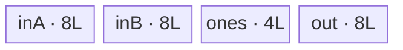
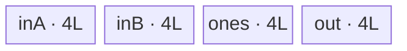

# SwiGlu 950 ACLNN 算子知识

## 算子速览

| 项目 | 内容 |
|---|---|
| 实际入口 | 公开两段式 `aclnnSwiGluGetWorkspaceSize` / `aclnnSwiGlu`；固定仓普通 SwiGlu 只有这一公开版本。 |
| 计算语义 | 沿 `dim` 对半切成 A/B，`y=A/(1+exp(-A))*B`。 |
| 输入输出 | 连续 ND；FP16、FP32、BF16；rank>0，dim合法、切分轴偶数；支持空 Tensor。 |
| 执行类型 | R-001 是 AIV entry 空域早退；R-002～R-005 是单 Kernel、单节点 `AIV_VECTOR`；无 Cube/AIC/MIX_CV。 |
| Kernel 路线 | R-001 empty key100；R-002/3 FP16/BF16 DB2/DB1；R-004/5 FP32 DB2/DB1；非空 Route 内含 aligned DataCopy 与 unaligned DataCopyPadExt 子路。 |
| 核心资源 | 非空：三 TQue + 两 FP32 TBuf或一个 FP32 ones TBuf；空域无 UB。非空 Tiling 请求16 MiB workspace但 body不读取。 |
| 来源闭包 | `source_closed`：公开 ACLNN→生成式 OpDef边界→共同 Tiling→950 `opFile=swi_glu_apt`→arch35 Vector body→ascend950 binary/build 接线闭合。 |
| 验证状态 | 已完成源码闭包检查；本次知识提取未执行编译、真机、数值或性能测试。 |

## 接口与语义

### 计算语义

规范化 `d=dim<0?dim+rank:dim`，沿 d 把 x 等分为 A/B，输出该轴减半：

```text
y = swish(A)*B = A/(1+exp(-A))*B
rowLen=prod(shape[0:d]); colLen=prod(shape[d:])/2
```

每个逻辑 row 在 GM 中为 `[A(row,0:C), B(row,0:C)]`。

### 输入、输出与属性

| 参数 | shape/layout | dtype | 约束、默认值与语义 |
|---|---|---|---|
| `x` | ND、rank>0、自动连续化 | FP16/FP32/BF16 | 公开文档允许 empty；非连续 ACL Tensor 不支持。 |
| `dim` | scalar | INT64 | 默认-1；范围 `[-rank,rank-1]`；对应轴偶数。 |
| `out` | ND，dim轴减半 | 与x相同 | empty x 时必须为 empty；InferDataType复制输入。 |

### 入口与版本

公开文档明确支持 Ascend 950PR/950DT。`SwiGlu` OpDef 的 ascend950 config 以 `ExtendCfgInfo("opFile.value", "swi_glu_apt")` 选择 950 entry；ascend950 binary JSON 含三种 dtype，活动全局 config 也列出 ascend950。手写 ACLNN bridge 未入仓；`ACLNNTYPE aclnn` 的生成 executor/launch 是允许的框架边界，算子自有 OpDef、InferShape、Tiling、router/body 已闭合。

## Host/Launcher 执行流程

### 参数校验与前处理

ACLNN 第一段执行公开的空指针、dtype、dim 检查；OpDef `AutoContiguous`，InferShape 规范化轴并拒绝奇数轴。Tiling 读取 AIV core/UB/NPU arch；`IsRegbaseSocVersion` 对 DAV_3510/DAV_5102 为真。950 forward 在 `xTotalLength==0` 时进入 `processEmptyTensor`；非空时通过 `SetTotalShape` 和 `CalcTiling` 生成二维 tile。`dim` 经 `int64_t*→uint32_t→int32_t`，shape 乘积用 int64 且没有显式溢出检查。

### 参数、Workspace 与生命周期

空域：验证 output storage size 为0，写 POD data size、`blockDim=totalCore`、`key=100`；该函数未写 user workspace，精确 ACLNN 返回值由生成框架决定。非空：`workspace[0]=16*1024*1024`；caller 持有 workspace 至 stream 完成，Kernel 参数 `workspace` 不被任何 body 解引用。POD/executor 对 launch 有效，input/output 由 caller 持有。

### 启动图与失败传播

```text
aclnnSwiGluGetWorkspaceSize
  -> generated bridge -> InferShape -> Tiling4SwiGlu
     -> empty: processEmptyTensor(key100, blockDim=all AIV)
     -> nonempty: SetTotalShape -> CalcTiling(key=dtype, blockDim=used cores, ws=16MiB)
aclnnSwiGlu(stream)
  -> swi_glu_apt.cpp::swi_glu(x,y,workspace,tiling)
     -> key100: return
     -> otherwise: 当前 dtype/DB 对应的 SwigluSingle 模板实例::Process
```

单 Device 节点、无 Kernel 间 workspace 边。empty output 非空、资源不足、shape/dtype不合法会在 launch 前失败；未知 key 在 entry 无 body。stream 负责节点可见性，caller 同步后才能读取/释放。

## Route 与参数设计

### 分核与资源计算

空域使用所有可用 AIV 核作 blockDim（entry 每核立即 return）。非空设元素字节 s、`B=32/s`、`P=512/s`、UB=U：FP16/BF16 bundle bytes 为 `3*bufferNum*2+2*4`，FP32 为 `3*bufferNum*4+4`；`maxTileLen=floor((U/bundle)/B)*B`。`baseCol` 受 colLen、maxTileLen、DataCopy的65535 blockLen限制，列切分时优先512B对齐；`baseRow<=4095`。枚举 baseCol 后以核数、tile总数、面积、整tile数排序选 base shape。DB2先算，只有能把每核2 tile变1 tile且不减核时采用DB1。

### Route 选择

| 顺序 | Route | Key/模板 | 精确选择条件与优先级 | 不适用去向 |
|---:|---|---|---|---|
| 1 | R-001 empty | key100 | `xTotalLength==0 && IsRegbaseSocVersion`，且 y storage size=0 | y非空失败；x非空下一Route |
| 2 | R-002 half/bf16 DB2 | key1/27, buffer2 | 非空、dtype∈{FP16,BF16}、DB关闭谓词假 | R-003或FP32 |
| 3 | R-003 half/bf16 DB1 | key1/27, buffer1 | 非空、dtype∈{FP16,BF16}、完整DB关闭谓词真 | FP32/失败 |
| 4 | R-004 fp32 DB2 | key0, buffer2 | 非空、FP32、DB关闭谓词假 | R-005 |
| 5 | R-005 fp32 DB1 | key0, buffer1 | 非空、FP32、完整DB关闭谓词真 | unsupported |

```text
x.size==0 -> y.size==0 ? key100 : GRAPH_FAILED
x.size>0 -> Calc DB2
  -> if DB.tiles/core==2: Calc SB; if SB.tiles/core==1 && SB.cores>=DB.cores => DB=0
  -> else DB=1
key=dtype; Process chooses aligned DataCopy or unaligned DataCopyPadExt
```

### 模板/实现执行矩阵

| Route | key/selector | dtype/shape/platform 完整命中条件 | 执行拓扑与 Kernel 节点 | 实际模板/body | 内存与同步特征 | tail/fallback |
|---|---|---|---|---|---|---|
| R-001 | 100 | 950且x/y empty | 单entry no-op | `swi_glu` early return | 无UB/workspace consumer | 无写出 |
| R-002 | 1/27,DB1 | 950非空 half/bf16，DB关闭假 | 单AIV | `SwigluVectorBF16<T,float,T,2>` | 20L UB | base/tail，PadExt |
| R-003 | 1/27,DB0 | 同dtype，DB关闭真 | 单AIV | `SwigluVectorBF16<T,float,T,1>` | 14L UB | 同左 |
| R-004 | 0,DB1 | 950非空 FP32，DB关闭假 | 单AIV | `SwigluVector<float,float,2>` | 28L UB | 同左 |
| R-005 | 0,DB0 | 950非空 FP32，DB关闭真 | 单AIV | `...Vector<float,float,1>` | 16L UB | 同左 |

### 隐藏性能 Guard

| Guard | Host/Tiling 条件 | Device/资源原因 | 影响 Route | 不满足时去向 | 源码符号 |
|---|---|---|---|---|---|
| empty一致性 | xsize=0且ysize=0 | key100不写GM | R-001 | GRAPH_FAILED | `processEmptyTensor` |
| 32B aligned | `C%(32/s)==0` | 对齐 API按32B单位；非对齐Ext按byte | R-002~5 | PadExt子路 | `CalcTiling`, `Process` |
| blockCount | `baseRow<=4095` | DataCopy count上限 | R-002~5 | 缩小/失败 | `getBaseRowLenUpBound` |
| blockLen | aligned `bc<=65535`; unaligned `bc<=65535/s` | 共享Host仍按16-bit上限约束 | R-002~5 | 缩小 | `getBaseColLenUpBound` |
| stride | r>1时输入/输出stride≤65535 | aligned路径最终cast uint16；共享策略也约束Ext | R-002~5 | baseRow=1 | `MustBeSingleBaseRowLen` |
| UB/DB | L≤U/bundle且完整DB关闭谓词 | Queue/TBuf总和 | R-002~5 | DB2/失败 | `CalcTiling` |

### POD/ABI

外部宏生成正式 ABI，固定仓不能证明 `sizeof/alignof/offsetof`；字段顺序/类型可见。empty只依赖 key，不读字段；非空 forward只读前六字段。

| 结构 | 字段 | 类型/位宽 | ABI 布局 | 单位 | Host/launcher producer | Device consumer | 边界 |
|---|---|---|---|---|---|---|---|
| `SwiGluTilingData` | `is32BAligned` | uint32/32 | 第1字段；offset不可见 | bool | `C%(32/s)==0` | `GetTilingAndOffset/Process` | 非空 |
| 同上 | `isDoubleBuffer` | uint32/32 | 第2字段；不可见 | bool | `CalcTiling` | entry router | 非空 |
| 同上 | `rowLen` | uint64/64 | 第3字段；不可见 | 行 | `prod(shape[0:d])` | tile helper | 非空、溢出未查 |
| 同上 | `colLen` | uint64/64 | 第4字段；不可见 | 元素/半行 | `prod(shape[d:])/2` | tile helper | 非空 |
| 同上 | `baseRowLen` | uint32/32 | 第5字段；不可见 | 行/tile | opt base row | tile helper | 1..4095 |
| 同上 | `baseColLen` | uint32/32 | 第6字段；不可见 | 元素/tile | opt base col | tile helper | DMA/UB上限 |
| 同上 | `activateLeft` | uint32/32 | 第7字段；不可见 | N/A | forward无producer | 无consumer | inactive |
| 同上 | `biasIsEmpty` | uint32/32 | 第8字段；不可见 | N/A | 无 | 无 | inactive |
| 同上 | `quantScaleIsEmpty` | uint32/32 | 第9字段；不可见 | N/A | 无 | 无 | inactive |
| 同上 | `activateScaleIsEmpty` | uint32/32 | 第10字段；不可见 | N/A | 无 | 无 | inactive |
| 同上 | `swiColLen` | uint64/64 | 第11字段；不可见 | N/A | 无 | 无 | inactive |
| 同上 | `perRowLen` | uint64/64 | 第12字段；不可见 | N/A | 无 | 无 | inactive |
| 同上 | `modRowLen` | uint64/64 | 第13字段；不可见 | N/A | 无 | 无 | inactive |
| 同上 | `usedCoreNum` | uint32/32 | 第14字段；不可见 | N/A | 无；blockDim独立写 | 无 | inactive |

### Route 源码闭包

| Route | Key/selector | Host/Tiling producer | POD/参数 | Kernel entry/router 节点 | Kernel body/直接依赖 | 构建接线 |
|---|---|---|---|---|---|---|
| R-001 | key100 | `processEmptyTensor` | key/blockDim，POD未消费 | `swi_glu_apt.cpp::swi_glu` | line25 return | OpDef apt + ascend950 config |
| R-002 | 1/27 DB2 | `Tiling4SwiGlu/CalcTiling` | 前六字段 | apt entry | arch35 Single/BF16/helper | 同上 |
| R-003 | 1/27 DB1 | 同上 | 同上 | 同上 | `SwigluVectorBF16<T,float,T,1>` | 同上 |
| R-004 | 0 DB2 | 同上 | 同上 | 同上 | arch35 Single/Vector2 | 同上 |
| R-005 | 0 DB1 | 同上 | 同上 | 同上 | Vector1 | 同上 |

## Kernel 实现

### 公共执行流程

apt entry 先检查 key100；非空再读取 POD，以 DB flag→dtype key 选择模板。`SwigluSingle::Init` 直接接收已解析 POD，生成 tile/DMA参数、绑定GM和申请UB。每核 block-stride 遍历 tile；每tile按 base/tail row/col计算 offset与calLen，aligned用 `DataCopyParams`，unaligned用 `DataCopyExtParams`/`DataCopyPadExtParams`，再执行 Vector Compute 和有效区域写回。

### Route R-001：空 Tensor 早退

#### 适用条件

##### 选择证据

| 层级 | 文件 | 符号 | 源码谓词/参数 | 结果/下一跳 |
|---|---|---|---|---|
| Host | `op_host/swi_glu_tiling.cpp` | `Tiling4SwiGlu` | xsize=0且Regbase | `processEmptyTensor` |
| Host | 同上 | `processEmptyTensor` | ysize必须0 | key100/blockDim=totalCore |
| Router | `op_kernel/swi_glu_apt.cpp` | `swi_glu` | `TILING_KEY_IS(100)` | return |

#### Device 数据流

##### 函数级调用链

```text
processEmptyTensor -> swi_glu(key100) -> return
```

##### 源码等价伪码

```text
if x.size==0:
  require y.size==0; launch metadata key=100
kernel: if key==100 return; no GM/UB/workspace access
```

#### 内存与数据搬运

##### 资源与搬运表

| 层级/缓冲区 | offset/地址公式 | extent/容量公式 | dtype/layout | producer | consumer | owner/lifetime | 对齐/复用 |
|---|---|---|---|---|---|---|---|
| x/y GM | N/A | 0元素 | 任一支持dtype/ND | caller | 无 | caller | 无访问 |
| UB/workspace | N/A | 0 body占用 | N/A | 无 | 无 | N/A | N/A |

##### 分层内存布局

N/A：entry 在解析 POD 和申请 UB 前返回，实际替代路径是 key100 空域 no-op。

##### 字节账与复用顺序

```text
UB_total=0; dynamic_ub=N/A; workspace_total=固定仓中 processEmptyTensor 未写，生成框架返回值不可见
```

| 复用子区 | 写入者 | 读取者/消费点 | 下一次覆盖 | 同步或释放依据 | 安全条件 |
|---|---|---|---|---|---|
| N/A | N/A | N/A | N/A | entry直接return | x/y均empty |

#### 同步、精度与尾块

##### 同步与数值边界表

| 阶段 | primitive/机制 | producer | consumer/等待点 | 保护对象 | 精度/尾块 |
|---|---|---|---|---|---|
| empty | early return | Host key | entry | 零长度输出 | 无计算/写出 |

#### 关键实现

##### 符号证据表

| 阶段 | 文件 | 符号/模板实例 | 实现事实 |
|---|---|---|---|
| Host/Tiling producer | `op_host/swi_glu_tiling.cpp` | `processEmptyTensor` | y空校验、key100 |
| Kernel entry/router | `op_kernel/swi_glu_apt.cpp` | `swi_glu` | key100立即return |
| Device body/helper | 同上 | early return | 无body/helper可达 |

### Route R-002：FP16/BF16 double buffer

#### 适用条件

##### 选择证据

| 层级 | 文件 | 符号 | 源码谓词/参数 | 结果/下一跳 |
|---|---|---|---|---|
| Host | `swi_glu_tiling.cpp` | `CalcTiling` | DB关闭谓词假 | DB1 |
| Tiling | 同上 | `Tiling4SwiGlu` | 非空,key1/27 | dtype key |
| Router | `swi_glu_apt.cpp` | `swi_glu` | DB1,key1/27 | BF16模板 depth2 |
| Device | `arch35/swi_glu_single.hpp` | `Process` | aligned | DataCopy或PadExt |

#### Device 数据流

##### 函数级调用链

```text
Tiling4SwiGlu -> apt::swi_glu -> SwigluSingle<SwigluVectorBF16<T,float,T,2>>::Init
 -> Process -> CaclOneTileParam -> CopyIn[/Non32] -> Compute -> CopyOut[/Non32]
```

##### 源码等价伪码

```text
for tile=blockIdx; tile<totalTiles; tile+=blockNum:
  derive r,c,Aoff,Boff=Aoff+C,Yoff and calLen=r*(aligned?c:align_up(c,32/s))
  copy/pad A,B; af=float(A); z=af/(1+exp(-af))
  overwrite inputTemp with float(B); z*=B; Y=cast_rint<T>(z)
  write only r*c valid elements
```

#### 内存与数据搬运

##### 资源与搬运表

| 层级/缓冲区 | offset/地址公式 | extent/容量公式 | dtype/layout | producer | consumer | owner/lifetime | 对齐/复用 |
|---|---|---|---|---|---|---|---|
| GM x/y | A=`row*2C+col`,B=A+C,Y=`row*C+col` | `2RC`/`RC` | T/ND | caller/body | body/caller | stream | valid r*c |
| inA/inB/outC | UB | each `2Ls` | T | Copy/cast | Compute/Copy | TPipe | depth2 |
| inputTemp | UB | `4L` | FP32 | Cast A/B | Div/Mul | kernel | A/B时序复用 |
| outputTemp | UB | `4L` | FP32 | swish/mul | cast | kernel | 原地 |

##### 分层内存布局


##### 字节账与复用顺序

```text
UB_total=3*(2*L*2)+2*(4L)=20L<=U
dynamic_ub=N/A; workspace_total=16MiB（body不读）
```

| 复用子区 | 写入者 | 读取者/消费点 | 下一次覆盖 | 同步或释放依据 | 安全条件 |
|---|---|---|---|---|---|
| inputTemp | Cast A | Div | Cast B | PIPE_V barrier | Div完成 |
| queue槽 | MTE/Vector | 后级 | Free后 | Queue协议 | depth2 |

#### 同步、精度与尾块

##### 同步与数值边界表

| 阶段 | primitive/机制 | producer | consumer/等待点 | 保护对象 | 精度/尾块 |
|---|---|---|---|---|---|
| Copy | Queue | DataCopy/PadExt | DeQue | input槽 | 非对齐padding至32B |
| Vector | PIPE_V | Cast/Muls/Exp/Adds/Div/Mul | 下一指令 | FP32 temp | 最后RINT到T |
| Output | Queue | EnQue | DataCopy/PadExt | out槽 | 只写实际r*c |

#### 关键实现

##### 符号证据表

| 阶段 | 文件 | 符号/模板实例 | 实现事实 |
|---|---|---|---|
| Host/Tiling producer | `op_host/swi_glu_tiling.cpp` | `CalcTiling` | 20L bundle/DB2 |
| Kernel entry/router | `op_kernel/swi_glu_apt.cpp` | key1/27 DB1 | 950无BF16 compile guard |
| Device body/helper | `op_kernel/arch35/swi_glu_bf16.hpp` | `SwigluVectorBF16<T,float,T,2>` | FP32与temp复用 |

### Route R-003：FP16/BF16 single buffer

#### 适用条件

##### 选择证据

| 层级 | 文件 | 符号 | 源码谓词/参数 | 结果/下一跳 |
|---|---|---|---|---|
| Host | `swi_glu_tiling.cpp` | `CalcTiling` | DB每核2、SB每核1且SB核数不减 | DB0 |
| Router | `swi_glu_apt.cpp` | `swi_glu` | DB0,key1/27 | BF16模板 depth1 |
| Device | arch35 Single | `Process` | aligned field | Copy/PadExt |

#### Device 数据流

##### 函数级调用链

```text
Tiling4SwiGlu -> apt::swi_glu -> SwigluSingle<SwigluVectorBF16<T,float,T,1>>
 -> Process -> CopyIn -> Compute -> CopyOut
```

##### 源码等价伪码

```text
同R-002的offset、FP32计算与tail；三Queue仅一个槽，且Host按bufferNum=1重新选择L/base shape。
```

#### 内存与数据搬运

##### 资源与搬运表

| 层级/缓冲区 | offset/地址公式 | extent/容量公式 | dtype/layout | producer | consumer | owner/lifetime | 对齐/复用 |
|---|---|---|---|---|---|---|---|
| GM x/y | 同R-002 | `2RC`/`RC` | T | caller/body | body/caller | stream | Copy/PadExt |
| inA/inB/outC | UB | each `Ls` | T | Copy/cast | Compute/Copy | TPipe | depth1 |
| input/output temp | UB | each `4L` | FP32 | Cast/Vector | Vector/cast | kernel | input A/B复用 |

##### 分层内存布局


##### 字节账与复用顺序

```text
UB_total=3*L*2+2*4L=14L<=U; dynamic_ub=N/A; workspace_total=16MiB unused
```

| 复用子区 | 写入者 | 读取者/消费点 | 下一次覆盖 | 同步或释放依据 | 安全条件 |
|---|---|---|---|---|---|
| inputTemp | CastA | Div | CastB | PIPE_V | Div完成 |
| single queue slot | Copy/Compute | 后级 | Free后下一tile | Queue | 无提前覆盖 |

#### 同步、精度与尾块

##### 同步与数值边界表

| 阶段 | primitive/机制 | producer | consumer/等待点 | 保护对象 | 精度/尾块 |
|---|---|---|---|---|---|
| 全管线 | Queue+PIPE_V | 各阶段 | 下一阶段 | UB/temp | FP32计算、RINT、Pad不写出 |

#### 关键实现

##### 符号证据表

| 阶段 | 文件 | 符号/模板实例 | 实现事实 |
|---|---|---|---|
| Host/Tiling producer | `op_host/swi_glu_tiling.cpp` | `CalcOptTiling<SWIGLU_SINGLE,1>` | SB重算tile |
| Kernel entry/router | `op_kernel/swi_glu_apt.cpp` | key1/27 DB0 | depth1 |
| Device body/helper | `op_kernel/arch35/swi_glu_bf16.hpp` | `SwigluVectorBF16<T,float,T,1>` | 14L UB |

### Route R-004：FP32 double buffer

#### 适用条件

##### 选择证据

| 层级 | 文件 | 符号 | 源码谓词/参数 | 结果/下一跳 |
|---|---|---|---|---|
| Host | `swi_glu_tiling.cpp` | `CalcTiling` | 非空 FP32、DB关闭假 | key0,DB1 |
| Router | `swi_glu_apt.cpp` | `swi_glu` | key0,DB1 | Vector<float,2> |
| Device | arch35 Single | `Process` | aligned | Copy/PadExt |

#### Device 数据流

##### 函数级调用链

```text
Tiling4SwiGlu -> apt::swi_glu -> SwigluSingle<SwigluVector<float,float,2>>
 -> Process -> CopyIn -> Compute -> CopyOut
```

##### 源码等价伪码

```text
Duplicate(ones,1,L) once; each tile: copy A/B; c=-A; c=exp(c)+1;
c=ones/c; c*=A; c*=B; copy valid r*c output.
```

#### 内存与数据搬运

##### 资源与搬运表

| 层级/缓冲区 | offset/地址公式 | extent/容量公式 | dtype/layout | producer | consumer | owner/lifetime | 对齐/复用 |
|---|---|---|---|---|---|---|---|
| GM x/y | 同R-002 | `2RC`/`RC` | FP32 | caller/body | body/caller | stream | Copy/PadExt |
| inA/inB/outC | UB | each `8L` | FP32 | Copy/calc | calc/Copy | TPipe | depth2 |
| tmpQueue | UB | `4L` | FP32 ones | Duplicate | Div | kernel | 跨tile只读 |

##### 分层内存布局



##### 字节账与复用顺序

```text
UB_total=3*8L+4L=28L<=U; dynamic_ub=N/A; workspace_total=16MiB unused
```

| 复用子区 | 写入者 | 读取者/消费点 | 下一次覆盖 | 同步或释放依据 | 安全条件 |
|---|---|---|---|---|---|
| ones | InitUbBuffer | all tile Div | never | kernel顺序 | calLen<=L |
| cLocal | Muls/Exp/Adds/Div/Mul | next op | in-place next op | PIPE_V | 源码顺序 |

#### 同步、精度与尾块

##### 同步与数值边界表

| 阶段 | primitive/机制 | producer | consumer/等待点 | 保护对象 | 精度/尾块 |
|---|---|---|---|---|---|
| Vector | PIPE_V | every arithmetic | next | cLocal | 全FP32；padding lane不提交 |
| Copy | Queue | Copy/calc | DeQue | depth2 slots | 四类tail |

#### 关键实现

##### 符号证据表

| 阶段 | 文件 | 符号/模板实例 | 实现事实 |
|---|---|---|---|
| Host/Tiling producer | `op_host/swi_glu_tiling.cpp` | bundle calc | FP32 DB2=28L |
| Kernel entry/router | `op_kernel/swi_glu_apt.cpp` | key0 DB1 | FP32 depth2 |
| Device body/helper | `op_kernel/arch35/swi_glu_impl.hpp` | Vector<float,float,2> | ones跨tile复用 |

### Route R-005：FP32 single buffer

#### 适用条件

##### 选择证据

| 层级 | 文件 | 符号 | 源码谓词/参数 | 结果/下一跳 |
|---|---|---|---|---|
| Host | `swi_glu_tiling.cpp` | `CalcTiling` | FP32且完整DB关闭谓词真 | key0,DB0 |
| Router | `swi_glu_apt.cpp` | `swi_glu` | key0,DB0 | Vector<float,1> |
| Device | arch35 Single | `Process` | aligned | Copy/PadExt |

#### Device 数据流

##### 函数级调用链

```text
Tiling4SwiGlu -> apt::swi_glu -> SwigluSingle<SwigluVector<float,float,1>>
 -> Process -> CopyIn -> Compute -> CopyOut
```

##### 源码等价伪码

```text
同R-004，queue depth=1，Host按16L bundle重新计算L/base shape。
```

#### 内存与数据搬运

##### 资源与搬运表

| 层级/缓冲区 | offset/地址公式 | extent/容量公式 | dtype/layout | producer | consumer | owner/lifetime | 对齐/复用 |
|---|---|---|---|---|---|---|---|
| GM x/y | 同R-004 | `2RC`/`RC` | FP32 | caller/body | body/caller | stream | Copy/PadExt |
| inA/inB/outC | UB | each `4L` | FP32 | Copy/calc | calc/Copy | TPipe | depth1 |
| ones | UB | `4L` | FP32 | Duplicate | Div | kernel | 只读 |

##### 分层内存布局



##### 字节账与复用顺序

```text
UB_total=16L<=U; dynamic_ub=N/A; workspace_total=16MiB unused
```

| 复用子区 | 写入者 | 读取者/消费点 | 下一次覆盖 | 同步或释放依据 | 安全条件 |
|---|---|---|---|---|---|
| ones | Init | Div | none | kernel order | calLen<=L |
| queue slot | each stage | next | Free after use | Queue | depth1 |

#### 同步、精度与尾块

##### 同步与数值边界表

| 阶段 | primitive/机制 | producer | consumer/等待点 | 保护对象 | 精度/尾块 |
|---|---|---|---|---|---|
| pipeline | Queue+PIPE_V | Copy/Vector | next | UB | FP32；tail/padding同R-004 |

#### 关键实现

##### 符号证据表

| 阶段 | 文件 | 符号/模板实例 | 实现事实 |
|---|---|---|---|
| Host/Tiling producer | `op_host/swi_glu_tiling.cpp` | `CalcOptTiling<SWIGLU_SINGLE,1>` | 16L bundle |
| Kernel entry/router | `op_kernel/swi_glu_apt.cpp` | key0 DB0 | depth1 |
| Device body/helper | `op_kernel/arch35/swi_glu_impl.hpp` | Vector<float,float,1> | FP32原地管线 |

## 算子特定优化

### Trick T-001：950 空域专用 key 在任何 POD/GM/UB 访问前早退

#### 触发与源码依据

- 适用 Route：R-001。
- 触发条件：Host确认 x/y storage size 均为0并设置 key100。
- Golden 来源：[`activation/swi_glu/op_kernel/swi_glu_apt.cpp:21-27`](../../../../../../../cann-ops-raw/ascendc/ops-nn/955f8b33985b6d72989ebff341bb9c2c564a51bc/activation/swi_glu/op_kernel/swi_glu_apt.cpp#L21-L27)

**官方源码（固定 Commit 连续逐字摘录）**：

```cpp
#define TILING_KEY_EMPTY 100

extern "C" __global__ __aicore__ void swi_glu(GM_ADDR input_gm, GM_ADDR output_gm,
                                              GM_ADDR workspace, GM_ADDR tiling) {
  if TILING_KEY_IS(TILING_KEY_EMPTY) {
    return;
  }
```

#### 机制与设计原因

key 检查位于 `GET_TILING_DATA` 之前，使 empty 路线不解析可能只写了 data size 的 POD，也不绑定 GM 或申请 UB；这是空域避免无意义搬运和除零 tile 参数的明确机制。

#### 迁移边界

- 适用：输出也为空、语义无副作用的 elementwise算子。
- 前提：Host先校验所有输出为空并设置独占 key。
- 失效：任何输出非空必须在Host失败，不能早退伪造成功。
- 未验证：本次知识提取未执行编译、真机、数值或性能测试。

#### 错误做法

把 `GET_TILING_DATA` 或 tile除法放在 empty key 检查之前会破坏该边界；固定源码明确把 return 放在最前。

### Trick T-002：非32B路径用 950 Ext DMA 参数保留 byte 级 stride

#### 触发与源码依据

- 适用 Route：R-002～R-005 的 `is32BAligned==0` 子路。
- 触发条件：`colLen % (32/sizeof(T)) != 0`。
- Golden 来源：[`activation/swi_glu/op_kernel/arch35/swi_glu_single.hpp:81-96`](../../../../../../../cann-ops-raw/ascendc/ops-nn/955f8b33985b6d72989ebff341bb9c2c564a51bc/activation/swi_glu/op_kernel/arch35/swi_glu_single.hpp#L81-L96)

**官方源码（固定 Commit 连续逐字摘录）**：

```cpp
__aicore__ inline void CopyIn_Non32BAligned(SwiGluSingleTileOffsetParam &offsetParam, SwiGluSinlgeTileCopyParam &SwiGluCopyParam)
{
    DataCopyExtParams splitCopyinParams{ static_cast<uint16_t>(SwiGluCopyParam.splitVecCopyParam.blockCount), static_cast<uint32_t>(SwiGluCopyParam.splitVecCopyParam.blockLen),
    static_cast<uint32_t>(SwiGluCopyParam.splitVecCopyParam.stride), static_cast<uint32_t>(0),
    static_cast<uint32_t>(0) };

    DataCopyPadExtParams<inType> copyPadParams{ false, static_cast<uint8_t>(0), static_cast<uint8_t>(0),
    static_cast<float>(0) };
```

#### 机制与设计原因

Tiling 在非对齐路线以 byte 生成 blockLen/stride；950 body 用 Ext 结构的 uint32 字段把这些参数交给 Pad DMA，UB行仍补齐到32B，而 CopyOut 只提交真实字节，避免要求用户 shape 人工补齐。

#### 迁移边界

- 适用：二维行搬运、逻辑行宽非32B对齐。
- 前提：Host同时约束 blockCount/blockLen/stride并按补齐后的 L 做UB账。
- 失效：对齐路线应使用普通 DataCopy；超过共享Host限制需重新设计tiling。
- 未验证：本次知识提取未执行编译、真机、数值或性能测试。

#### 错误做法

固定仓可证明的错误是按逻辑 `r*c` 分配UB却让 DataCopyPad 写入 `r*align_up(c,32/s)`；当前代码以 padded `tileLength/calLen` 避免越界。

## 模板与实现对比

| 对比维度 | R-001 empty | R-002 half/bf16 DB2 | R-003 half/bf16 DB1 | R-004 fp32 DB2 | R-005 fp32 DB1 | 设计选择依据 |
|---|---|---|---|---|---|---|
| 命中条件/优先级 | xsize=0,key100 | key1/27,DB1 | key1/27,DB0 | key0,DB1 | key0,DB0 | empty最高优先，后dtype/DB |
| 模板与 dtype | 无模板 | BF16<T,float,T,2> | depth1 | Vector<float,2> | depth1 | 精度与UB |
| 循环与分核 | 无循环 | block-stride tile | SB重算 | 同 | SB重算 | empty用all AIV metadata |
| Queue/TBuf/寄存器/dynamic UB/通信 window | N/A | 3Q+2TBuf | 同depth1 | 3Q+ones | 同depth1 | 无dynamic/通信 |
| 内存总占用与复用 | 0 | 20L | 14L | 28L | 16L | A/B temp或ones |
| 搬运/Vector/SIMT/NDDMA/通信 API | none | Copy/PadExt+Vector | 同 | Copy/PadExt+Vector | 同 | 全部非Cube |
| 同步、精度与 tail | none | Queue/PIPE_V,FP32,RINT | 同 | Queue/PIPE_V,FP32 | 同 | 四类tail |
| fallback/失败边界 | y必须empty | resource/unknown key失败 | 同 | 同 | 同 | 无其它fallback |

## 平台差异

| 项目 | A2 | A3 | 950 |
|---|---|---|---|
| 支持状态 | 公开支持，见无后缀卡 | 公开支持，见无后缀卡 | 公开支持 |
| Host/Launcher | 共用非空Tiling，无显式key100 | 同左 | explicit `processEmptyTensor` |
| Kernel/资源 | 非arch35；非对齐旧DataCopyPad参数 | 同左 | apt/arch35；Ext Pad params，empty早退 |

## 限制与失败边界

- 仅普通 SwiGlu，不合并 Grad/Quant/GroupQuant 等语义。
- 输入输出为连续 ND、FP16/FP32/BF16；dim合法且切分轴偶数。
- empty Host未写 workspace slot，生成ACLNN第一段最终返回的workspace字节固定仓不可见；不可擅自宣称必为0。
- 共享Tiling仍按65535限制非对齐 Ext DMA参数；这是活动实现的保守上界，不应按Ext字段位宽自行放宽。
- 正式 tilingdata 宏 ABI offset/size、shape乘积溢出与dim窄化没有固定仓内补充证明。

## 源码索引

### 链路索引

| 链路阶段 | 文件 | 关键符号 | 支撑内容 |
|---|---|---|---|
| 入口声明/约束 | `activation/swi_glu/docs/aclnnSwiGlu.md` | 两段ACLNN | 950公开支持/API约束 |
| 入口实现 | `activation/swi_glu/op_host/swi_glu_def.cpp` | `SwiGlu`, `opFile.value` | 950选择apt |
| 入口实现 | `activation/swi_glu/op_host/swi_glu_infershape.cpp` | `InferShapeForSwiGlu` | shape/dtype |
| Host/Tiling/Launcher | `activation/swi_glu/op_host/swi_glu_tiling.h` | `SwiGluTilingData` | POD |
| Host/Tiling/Launcher | `activation/swi_glu/op_host/swi_glu_tiling.cpp` | `Tiling4SwiGlu`, `processEmptyTensor` | empty/nonempty selector、资源 |
| Host/Tiling/Launcher | `common/inc/op_host/tiling_util.h` | `IsRegbaseSocVersion` | DAV3510/5102判定 |
| Kernel entry/body | `activation/swi_glu/op_kernel/swi_glu_apt.cpp` | `swi_glu` | key100、DB/dtype router |
| Kernel entry/body | `activation/swi_glu/op_kernel/arch35/glu_tiling_kernel.hpp` | `SwigluSingleTilingKernel` | tile/offset/DMA参数 |
| Kernel entry/body | `activation/swi_glu/op_kernel/arch35/swi_glu_single.hpp` | `SwigluSingle` | Copy/DataCopyPadExt |
| Kernel entry/body | `activation/swi_glu/op_kernel/arch35/swi_glu_bf16.hpp` | `SwigluVectorBF16` | 低精度body |
| Kernel entry/body | `activation/swi_glu/op_kernel/arch35/swi_glu_impl.hpp` | `SwigluVector` | FP32 body |
| 构建接线 | `activation/swi_glu/op_host/config/ascend950/swi_glu_binary.json` | `SwiGlu_1/2/3` | 三dtype binary |
| 构建接线 | `scripts/kernel/binary_config/ascendc_config.json` | `SwiGlu` | ascend950活动接线 |

### 实现复用检查

| 检查项 | 可复用事实 | 不得改变的约束 | 源码符号 |
|---|---|---|---|
| ABI/POD | 前六字段服务非空，empty只看key | 字段顺序/位宽、macro ABI不可猜 | `SwiGluTilingData` |
| 调用顺序 | key100先于GET_TILING；非空Copy→Compute→Copy | empty检查不可后移 | apt `swi_glu`/Process |
| workspace/内存 | 0/20L/14L/28L/16L body账 | 非空16MiB请求、Queue depth与padded L | `InitUbBuffer` |
| 同步 | Queue+PIPE_V | temp覆盖和FreeTensor顺序 | `Compute` |
| 精度与尾块 | low dtype升FP32 RINT；FP32原精度 | Pad calLen与GM有效区域分离 | BF16/Vector/tiling helper |
| 失败边界 | empty y校验、DMA/UB guard、unknown key | 不添加未实现fallback | `processEmptyTensor`, `CalcTiling`, entry |