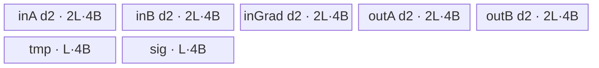

# SwiGluGrad A2/A3 ACLNN 算子知识

## 算子速览

| 项目 | 内容 |
|---|---|
| 实际入口 | `aclnnSwiGluGradGetWorkspaceSize` + `aclnnSwiGluGrad`，固定仓唯一公开版本 |
| 计算语义 | 将 `x` 沿 `dim` 等分为 A/B，计算 `dA=yGrad*sigmoid(A)*(1+(1-sigmoid(A))*A)*B` 与 `dB=yGrad*sigmoid(A)*A` 后按原布局拼接 |
| 输入输出 | `yGrad, x -> out`；ND；FP16/FP32/BF16；rank 1–8；`out.shape=x.shape` |
| 执行类型 | 单 Kernel `swi_glu_grad`，AIV_VECTOR；无 Cube/AIC/MIX_CV、SIMT、NDDMA 或通信节点 |
| Kernel 路线 | R-001 FP32 双缓冲；R-002 FP32 单缓冲；R-003 FP16/BF16 双缓冲升精度；R-004 FP16/BF16 单缓冲升精度 |
| 核心资源 | GM；5 个 TQue；FP32 路线 2 个 TBuf，FP16/BF16 路线 5 个 FP32 TBuf；固定 16 MiB workspace 仅满足框架 ABI，Kernel 不读写 |
| 来源闭包 | `source_closed`：公开 ACLNN 契约（生成式 inner bridge 为框架边界）→ `SwiGluGrad` OpDef/Tiling 注册→`Tiling4SwiGlu<SWIGLU_GRAD_SINGLE>`→`swi_glu_grad`→模板 body/公共分片 helper→A2/A3 binary config |
| 验证状态 | 已完成源码闭包检查；本次知识提取未执行编译、真机、数值或性能测试。 |

## 接口与语义

### 计算语义

令规范化轴 `d = dim < 0 ? rank(x)+dim : dim`，`x` 在 `d` 轴均分为 A、B，`s=1/(1+exp(-A))`。逐元素输出为 `outA=yGrad*s*(1+(1-s)*A)*B`、`outB=yGrad*s*A`；二者在 `d` 轴按 A/B 原位置写回。Host 将形状折叠成 `rowLen=prod(x.shape[0:d])`、`colLen=prod(x.shape[d:])/2`，所以每行 GM 布局为 `[A(colLen), B(colLen)]`。

### 输入、输出与属性

| 参数 | shape/layout | dtype | 约束、默认值与语义 |
|---|---|---|---|
| `yGrad` | ND，rank 1–8 | FP16/FP32/BF16 | 非空；除 `dim` 外同 `x`，该轴为 `x` 的一半；与 `x` 同 dtype；公开文档标为不支持非连续 |
| `x` | ND，rank 1–8 | FP16/FP32/BF16 | 非空，rank>0；`dim` 轴可二等分；公开文档要求 shape 支持 64 B 对齐；OpDef `AutoContiguous()` |
| `dim` | 标量属性 | int64 | 范围 `[-rank(x), rank(x)-1]`，OpDef 默认 `-1` |
| `out` | ND，shape 与 `x` 相同 | 同 `x` | 写回 A/B 两段梯度；可为非连续，具体 ViewCopy 属生成式 ACLNN 框架边界 |

### 入口与版本

固定 Commit 只公开上述无版本后缀的两段式 ACLNN API，没有更高版本符号。第一段返回 workspace 大小和 executor，第二段在给定 stream 执行。ACLNN 生成实现未落在固定仓；其参数检查、连续化和 executor 编排以文档与 OpDef 的 `AutoContiguous` 为可见框架边界，算子拥有的 Host/Tiling、POD、Kernel 与构建接线已闭合。文档明确支持 A2/A3，OpDef 的 `ascend910b`、`ascend910_93` 与两个 binary config 互相印证。

## Host/Launcher 执行流程

### 参数校验与前处理

公开契约要求非空指针、受支持 dtype、合法 `dim`；生成式 ACLNN 层不可见。算子 Host 从输入 1 `x` 读取 origin shape，以 `SetTotalShape` 校验 `dim` 和折叠后 `shapeAfter%2==0`，再生成 `rowLen/colLen`。OpDef 对 `y_grad/x` 均声明 `AutoContiguous`。旧 Tiling 本身没有再次比较 `yGrad` 与 `x` 的逐维关系，因此复用时不能删掉 ACLNN 契约层的 shape 校验。

### 参数、Workspace 与生命周期

`Tiling4SwiGlu` 读取 AIV 核数和 UB 字节，`UB_RESERVED_BUFF=0`。它先尝试 bufferNum=2；仅当双缓冲方案每核恰好 2 tile，且单缓冲可降为每核 1 tile且用核数不减少，才写 `isDoubleBuffer=0`。最终 `blockDim=totalUsedCoreNum`、`TilingKey=dataType`（FP32=0、FP16=1、BF16=27），workspace 固定 `16*1024*1024` B。workspace/executor 由 ACLNN 调用者持有至第二段完成；Kernel 形参保留 workspace 但没有读写。

### 启动图与失败传播

单节点图：executor 在同一 stream 启动 `swi_glu_grad(gradout_gm,input_gm,output_gm,workspace,tiling)`，`blockDim=totalUsedCoreNum`，POD 为 `SwiGluTilingData`。不存在 Kernel 间 workspace 边。Host 的 null、非法 dim、奇数折叠长度、unsupported dtype、UB/tiling 失败会在 launch 前返回失败；router 未知 key 没有 body、也没有 fallback。

## Route 与参数设计

### 分核与资源计算

设 `e=sizeof(T)`、`a=32/e`、`c=512/e`。Host 计算 `is32BAligned=(colLen%a==0)`。对 bufferNum=`b`，梯度路线每元素 UB 系数为：FP32 `b*5*4+2*4` B，FP16/BF16 `b*5*2+5*4` B；`maxTileLen=AlignDown(UB/coefficient,a)`。候选 `baseColLen<=min(colLen,maxTileLen,DataCopy上限)`，被切列时向下对齐到 `c`；`baseRowLen<=min(rowLen,4095,maxTileLen/AlignUp(baseColLen,a))`。Host 枚举列块并优先最大用核数、较少 tile、较大 base shape。`totalTileNum=ceil(rowLen/baseRowLen)*ceil(colLen/baseColLen)`，`blockDim=min(totalTileNum,AIV核数)`；Device 用 `tileIdx=blockIdx+k*blockNum` 轮转领取 tile。

### Route 选择

| 顺序 | Route | Key/模板 | 精确选择条件与优先级 | 不适用去向 |
|---:|---|---|---|---|
| 1 | R-001 FP32 双缓冲 | key 0，`SwiGluGradVector<...,2>` | dtype FP32 且 `isDoubleBuffer==1` | R-002 或 dtype 路线 |
| 2 | R-002 FP32 单缓冲 | key 0，`SwiGluGradVector<...,1>` | dtype FP32 且 Host 的单缓冲替换条件成立 | dtype 路线或失败 |
| 3 | R-003 低精度双缓冲 | key 1/27，`SwiGluGradBF16<T,float,T,2>` | dtype FP16，或在 `__CCE_AICORE__==220` 下 BF16；`isDoubleBuffer==1` | R-004 或失败 |
| 4 | R-004 低精度单缓冲 | key 1/27，`SwiGluGradBF16<T,float,T,1>` | 同上且 Host 的单缓冲替换条件成立 | 失败 |

```text
Tiling: 先求 b=2；若 tileNumPerCore==2，再比较 b=1，满足 1 tile/core 且不减核才选 b=1
Router: isDoubleBuffer ? (key 1 -> FP16, key 0 -> FP32, key 27 -> BF16) : 同 dtype 的 b=1 模板
Process: is32BAligned ? DataCopy : (__CCE_AICORE__==220 ? DataCopyPad : 无该分支)
```

### 模板/实现执行矩阵

| Route | key/selector | dtype/shape/platform 完整命中条件 | 执行拓扑与 Kernel 节点 | 实际模板/body | 内存与同步特征 | tail/fallback |
|---|---|---|---|---|---|---|
| R-001 | 0 + DB=1 | FP32，合法非空 shape | 单 AIV Kernel | `SwiGluGradSingle<SwiGluGradVector<float,...,2>>` | 5×depth2 queue + 2 FP32 TBuf；Queue/PipeBarrier | 四类 row/col tile；非32B走 pad |
| R-002 | 0 + DB=0 | FP32，单缓冲替换谓词 | 单 AIV Kernel | 同上，bufferNum=1 | 5×depth1 queue + 2 FP32 TBuf | 同 R-001 |
| R-003 | 1/27 + DB=1 | FP16/BF16；BF16 受 arch220 guard | 单 AIV Kernel | `SwiGluGradBF16<T,float,T,2>` | 5×depth2 queue + 5 FP32 TBuf；显式 cast/barrier | 四类 tile；无可达 key 则无输出 |
| R-004 | 1/27 + DB=0 | 同 R-003，单缓冲替换谓词 | 单 AIV Kernel | 同上，bufferNum=1 | 5×depth1 queue + 5 FP32 TBuf | 同 R-003 |

### 隐藏性能 Guard

| Guard | Host/Tiling 条件 | Device/资源原因 | 影响 Route | 不满足时去向 | 源码符号 |
|---|---|---|---|---|---|
| 双缓冲替换 | `db.tileNumPerCore==2 && noDb.tileNumPerCore==1 && noDb.cores>=db.cores` | 单次更大 tile 可减少一次流水循环且不牺牲并行核数 | 全部 Route | 保持 DB=2 | `GluSingleTilingCalculator::CalcTiling` |
| 32B 对齐 | `colLen%(32/e)==0` | 对齐 DataCopy 的 blockLen/stride 单位为32B；否则需 byte 单位 DataCopyPad | 全部 Route | arch220 pad path；其他编译目标无该 Device 分支 | `SwigluSingleTilingKernel::CaclOneTileCopyParam` |
| DMA 上限 | blockCount≤4095，blockLen/stride≤65535 | AscendC DataCopy 字段为 uint16 | 全部 Route | Host 缩小 baseRow/baseCol；无候选则失败 | `MustBeSingleBaseRowLen`、`getBaseColLenUpBound` |
| BF16 guard | key 27 且 `__CCE_AICORE__==220` | router 只在该编译 guard 内实例化 BF16 | R-003/R-004 | 未知 key，无 fallback | `swi_glu_grad` |

### POD/ABI

`SwiGluTilingData` 由 tiling 宏生成；固定仓未展开生成后的 `sizeof/alignof/offsetof`，故不臆造偏移。下表每个字段均由 `Tiling4SwiGlu`/calculator 写入，Device 通过 `GET_TILING_DATA` 读取。

| 结构 | 字段 | 类型/位宽 | ABI 布局 | 单位 | Host/launcher producer | Device consumer | 边界 |
|---|---|---|---|---|---|---|---|
| `SwiGluTilingData` | `is32BAligned` | uint32/32 | 生成布局不可见 | bool | `colLen%(32/e)==0` | `SwiGluGradSingle::Process`、copy 参数 | 0/1 |
| 同上 | `isDoubleBuffer` | uint32/32 | 同上 | bool | DB 选择逻辑 | entry router | 0/1 |
| 同上 | `rowLen` | uint64/64 | 同上 | element rows | `shapeBefore` | `GetTilingAndOffset` | 正数；公开 API 不支持空 Tensor |
| 同上 | `colLen` | uint64/64 | 同上 | elements/half-row | `shapeAfter/2` | offset/copy helper | 正数 |
| 同上 | `baseRowLen` | uint32/32 | 同上 | rows/tile | 最优候选 | Device tile helper | 1..4095 |
| 同上 | `baseColLen` | uint32/32 | 同上 | elements/tile-row | 最优候选 | Device tile helper | DataCopy 上限内 |
| 同上 | `activateLeft` | uint32/32 | 同上 | N/A | SwiGluGrad 路线未赋值 | 当前 Kernel 不读 | inactive |
| 同上 | `biasIsEmpty` | uint32/32 | 同上 | N/A | 未赋值 | 不读 | inactive |
| 同上 | `quantScaleIsEmpty` | uint32/32 | 同上 | N/A | 未赋值 | 不读 | inactive |
| 同上 | `activateScaleIsEmpty` | uint32/32 | 同上 | N/A | 未赋值 | 不读 | inactive |
| 同上 | `swiColLen` | uint64/64 | 同上 | N/A | 未赋值 | 不读 | inactive |
| 同上 | `perRowLen` | uint64/64 | 同上 | N/A | 未赋值 | 不读 | inactive |
| 同上 | `modRowLen` | uint64/64 | 同上 | N/A | 未赋值 | 不读 | inactive |
| 同上 | `usedCoreNum` | uint32/32 | 同上 | cores | 未写入序列化数据 | 当前 Kernel 用 `GetBlockNum`，不读此字段 | inactive |

### Route 源码闭包

| Route | Key/selector | Host/Tiling producer | POD/参数 | Kernel entry/router 节点 | Kernel body/直接依赖 | 构建接线 |
|---|---|---|---|---|---|---|
| R-001/R-002 | 0 + DB | `swi_glu_tiling.cpp::Tiling4SwiGlu/CalcTiling` | `SwiGluTilingData` | `swi_glu_grad.cpp::swi_glu_grad` | `SwiGluGradSingle`、`SwiGluGradVector`、`SwigluSingleTilingKernel` | `ascend910b/ascend910_93` binary JSON + `ascendc_config.json` |
| R-003/R-004 | 1/27 + DB | 同上 | 同上 | 同上 | `SwiGluGradSingle`、`SwiGluGradBF16`、公共 tile helper | 同上 |

## Kernel 实现

### 公共执行流程

entry 解析 POD 后按 `isDoubleBuffer` 和 dtype key 实例化模板。`Init` 计算每核 tile 地址和四种 base/tail copy 参数，绑定 `x/yGrad/out` GM 并按 `tileLength` 分配 UB。`Process` 以 `blockIdx` 为起点、`blockNum` 为步长遍历 tile；每 tile 顺序为 CopyIn(A,yGrad,B)→Compute→CopyOut(outA,outB)。Queue 的 EnQue/DeQue 建立 MTE2→V 与 V→MTE3 依赖，Compute 内的 `PipeBarrier<PIPE_V>` 保护同一 TBuf/输出的向量依赖。

### Route R-001：FP32 双缓冲

#### 适用条件

##### 选择证据

| 层级 | 文件 | 符号 | 源码谓词/参数 | 结果/下一跳 |
|---|---|---|---|---|
| Host | `activation/swi_glu/op_host/swi_glu_tiling.cpp` | `CalcTiling` | DB 方案保留 | `isDoubleBuffer=1` |
| Router | `activation/swi_glu_grad/op_kernel/swi_glu_grad.cpp` | `swi_glu_grad` | DB=1且key=0 | FP32, bufferNum=2 |

#### Device 数据流

##### 函数级调用链

```text
swi_glu_grad -> SwiGluGradSingle::Init/Process
  -> tile helper -> CopyIn -> SwiGluGradVector::Compute -> CopyOut
```

##### 源码等价伪码

```text
for tile=blockIdx; tile<totalTileNum; tile+=blockNum:
  derive row/col base-or-tail, xA/xB/grad offsets and DMA params
  enqueue A, grad, B
  s=1/(1+exp(-A)); outB=s*A*grad
  outA=(s + s*(1-s)*A)*B*grad
  enqueue outA/outB; strided copy to their original half-row positions
```

#### 内存与数据搬运

##### 资源与搬运表

| 层级/缓冲区 | offset/地址公式 | extent/容量公式 | dtype/layout | producer | consumer | owner/lifetime | 对齐/复用 |
|---|---|---|---|---|---|---|---|
| GM A/B | `row*2C+col`, A+`C` | tile rows×cols | FP32, ND folded | caller | CopyIn | caller/executor | strided by `2C` |
| GM grad | `row*C+col` | tile rows×cols | FP32 | caller | CopyIn | caller | strided by C |
| 5 queues | N/A | each depth2×`tileLength*4` | FP32 | pipe/CopyIn/Compute | Compute/CopyOut | Kernel tile | double buffer |
| `tmpQueue/sigQueue` | N/A | each `tileLength*4` | FP32 | Compute | Compute | Kernel | reused across tiles after barriers |

##### 分层内存布局



##### 字节账与复用顺序

```text
UB_total = 5*2*L*4 + 2*L*4 = 48L bytes <= Host UB
dynamic_ub = N/A
workspace_total = 16 MiB（Kernel 不消费）
```

| 复用子区 | 写入者 | 读取者/消费点 | 下一次覆盖 | 同步或释放依据 | 安全条件 |
|---|---|---|---|---|---|
| `sigLocal` | sigmoid 链 | outA/outB 链 | 下一 tile | PIPE_V barriers + Compute 完成 | 当前 tile 两输出均已生成 |
| Queue node | CopyIn/Compute | Compute/CopyOut | 后续 tile | DeQue/FreeTensor | depth2 生命周期完整 |

#### 同步、精度与尾块

##### 同步与数值边界表

| 阶段 | primitive/机制 | producer | consumer/等待点 | 保护对象 | 精度/尾块 |
|---|---|---|---|---|---|
| GM→UB | Queue | CopyIn EnQue | Compute DeQue | A/B/grad node | base/tail DMA |
| Vector | `PipeBarrier<PIPE_V>` | Muls/Exp/Adds/Div/Mul | 下一依赖指令 | sig/tmp/output | 全 FP32；`curCalLen` 含 pad lane，CopyOut 只提交有效列 |
| UB→GM | Queue | Compute EnQue | CopyOut DeQue | outA/outB | strided有效范围 |

#### 关键实现

##### 符号证据表

| 阶段 | 文件 | 符号/模板实例 | 实现事实 |
|---|---|---|---|
| Host/Tiling producer | `activation/swi_glu/op_host/swi_glu_tiling.cpp` | `CalcTiling` | DB=2 与 base tile 生产 |
| Kernel entry/router | `activation/swi_glu_grad/op_kernel/swi_glu_grad.cpp` | `swi_glu_grad` | key0/DB1映射（字段值1表示双缓冲） |
| Device body/helper | `activation/swi_glu_grad/op_kernel/swi_glu_grad_float.hpp` | `SwiGluGradVector::Compute` | FP32 sigmoid/梯度链 |

### Route R-002：FP32 单缓冲

#### 适用条件

##### 选择证据

| 层级 | 文件 | 符号 | 源码谓词/参数 | 结果/下一跳 |
|---|---|---|---|---|
| Host | `activation/swi_glu/op_host/swi_glu_tiling.cpp` | `CalcTiling` | DB每核2 tile；noDB每核1 tile且不减核 | DB=0 |
| Router | `activation/swi_glu_grad/op_kernel/swi_glu_grad.cpp` | entry | DB=0,key=0 | FP32 bufferNum1 |

#### Device 数据流

##### 函数级调用链

```text
entry -> SwiGluGradSingle<SwiGluGradVector<float,...,1>>::Init/Process -> CopyIn/Compute/CopyOut
```

##### 源码等价伪码

```text
同 R-001 的 tile、地址、计算和 tail；Queue depth 从2改为1，Host 选择更大 tile 使每核一次搬运完成。
```

#### 内存与数据搬运

##### 资源与搬运表

| 层级/缓冲区 | offset/地址公式 | extent/容量公式 | dtype/layout | producer | consumer | owner/lifetime | 对齐/复用 |
|---|---|---|---|---|---|---|---|
| GM/Queue/TBuf | 同 R-001 | 5×`L*4` queue + 2×`L*4` TBuf | FP32 | CopyIn/Compute | Compute/CopyOut | 单 tile | depth1 |

##### 分层内存布局


##### 字节账与复用顺序

```text
UB_total=5*L*4+2*L*4=28L bytes <= Host UB; workspace_total=16 MiB; dynamic_ub=N/A
```

| 复用子区 | 写入者 | 读取者/消费点 | 下一次覆盖 | 同步或释放依据 | 安全条件 |
|---|---|---|---|---|---|
| depth1 queue node | 当前 tile | Compute/CopyOut | 无下一 tile或释放后 | FreeTensor | noDB方案每核1 tile |

#### 同步、精度与尾块

##### 同步与数值边界表

| 阶段 | primitive/机制 | producer | consumer/等待点 | 保护对象 | 精度/尾块 |
|---|---|---|---|---|---|
| 全流程 | Queue + PIPE_V | CopyIn/Vector | Compute/CopyOut | 当前唯一 tile | 与 R-001 相同 |

#### 关键实现

##### 符号证据表

| 阶段 | 文件 | 符号/模板实例 | 实现事实 |
|---|---|---|---|
| Host/Tiling producer | `activation/swi_glu/op_host/swi_glu_tiling.cpp` | `CalcTiling` | noDB替换闭包 |
| Kernel entry/router | `activation/swi_glu_grad/op_kernel/swi_glu_grad.cpp` | key0,bufferNum1 | 单缓冲实例 |
| Device body/helper | `activation/swi_glu_grad/op_kernel/swi_glu_grad_single.hpp` | `Process/CopyIn/CopyOut` | 地址、DMA、tail |

### Route R-003：FP16/BF16 双缓冲升精度

#### 适用条件

##### 选择证据

| 层级 | 文件 | 符号 | 源码谓词/参数 | 结果/下一跳 |
|---|---|---|---|---|
| Router | `activation/swi_glu_grad/op_kernel/swi_glu_grad.cpp` | entry | DB=1,key1；或 arch220 key27 | `SwiGluGradBF16<T,float,T,2>` |

#### Device 数据流

##### 函数级调用链

```text
entry -> SwiGluGradSingle::Process -> CopyIn
  -> ComputeSigLocal(cast A→FP32,sigmoid)
  -> ComputeGradN(cast grad→FP32,outB→T)
  -> Compute(outA, cast B→FP32,outA→T) -> CopyOut
```

##### 源码等价伪码

```text
A32=cast(A); G32=cast(grad); s=1/(1+exp(-A32)); outB=cast(s*A32*G32)
B32=cast(B) by reusing aLocal; outA=cast(s*(1+(1-s)*A32)*G32*B32)
```

#### 内存与数据搬运

##### 资源与搬运表

| 层级/缓冲区 | offset/地址公式 | extent/容量公式 | dtype/layout | producer | consumer | owner/lifetime | 对齐/复用 |
|---|---|---|---|---|---|---|---|
| 5 TQue | 同 R-001 | each depth2×`L*2` | T | DMA/Compute | Compute/DMA | tile | double buffer |
| 5 TBuf | N/A | each `L*4` | FP32 | cast/vector | vector/cast | Compute | `outputTemp` 先outB后outA；`aTemp` 后复用B |

##### 分层内存布局


##### 字节账与复用顺序

```text
UB_total=5*2*L*2+5*L*4=40L bytes <= Host UB; workspace_total=16 MiB; dynamic_ub=N/A
```

| 复用子区 | 写入者 | 读取者/消费点 | 下一次覆盖 | 同步或释放依据 | 安全条件 |
|---|---|---|---|---|---|
| `outputTempBuffer` | outB FP32 | cast outB | outA计算 | PIPE_V barrier + EnQue outB | outB已降精度提交 |
| `aTempBuffer` | cast A | sigmoid/outA/outB | cast B | outB与含A的outA前半计算完成 | 源码调用顺序与barrier |

#### 同步、精度与尾块

##### 同步与数值边界表

| 阶段 | primitive/机制 | producer | consumer/等待点 | 保护对象 | 精度/尾块 |
|---|---|---|---|---|---|
| cast up | `Cast(...CAST_NONE)` + barrier | T input | FP32 math | A/grad/B TBuf | 所有非线性和乘法在FP32 |
| cast down | `CAST_RINT` on arch220，否则 `CAST_NONE` | FP32 result | output Queue | outA/outB | 只写有效 DMA 列；pad lane不提交 |

#### 关键实现

##### 符号证据表

| 阶段 | 文件 | 符号/模板实例 | 实现事实 |
|---|---|---|---|
| Host/Tiling producer | `activation/swi_glu/op_host/swi_glu_tiling.cpp` | `GetBufferNumAndDataLenPerUB` | 低精度5 TBuf字节模型 |
| Kernel entry/router | `activation/swi_glu_grad/op_kernel/swi_glu_grad.cpp` | key1/key27 DB2 | 模板映射和BF16 guard |
| Device body/helper | `activation/swi_glu_grad/op_kernel/swi_glu_grad_bf16.hpp` | `Compute*` | FP32升降精度与TBuf复用 |

### Route R-004：FP16/BF16 单缓冲升精度

#### 适用条件

##### 选择证据

| 层级 | 文件 | 符号 | 源码谓词/参数 | 结果/下一跳 |
|---|---|---|---|---|
| Host/Router | `swi_glu_tiling.cpp` / `swi_glu_grad.cpp` | `CalcTiling` / entry | noDB谓词且key1/27 | bufferNum1升精度实例 |

#### Device 数据流

##### 函数级调用链

```text
entry -> SwiGluGradSingle<SwiGluGradBF16<T,float,T,1>> -> CopyIn -> ComputeSigLocal/ComputeGradN/Compute -> CopyOut
```

##### 源码等价伪码

```text
同 R-003 的 FP32 计算与复用；Queue depth=1，Host保证每核单 tile。
```

#### 内存与数据搬运

##### 资源与搬运表

| 层级/缓冲区 | offset/地址公式 | extent/容量公式 | dtype/layout | producer | consumer | owner/lifetime | 对齐/复用 |
|---|---|---|---|---|---|---|---|
| Queue/TBuf | 同 R-003 | queues=`5L*2`，TBuf=`5L*4` | T/FP32 | CopyIn/Compute | Compute/CopyOut | 单 tile | depth1 + 同 R-003 alias |

##### 分层内存布局


##### 字节账与复用顺序

```text
UB_total=5*L*2+5*L*4=30L bytes <= Host UB; workspace_total=16 MiB; dynamic_ub=N/A
```

| 复用子区 | 写入者 | 读取者/消费点 | 下一次覆盖 | 同步或释放依据 | 安全条件 |
|---|---|---|---|---|---|
| FP32 TBuf aliases | 同 R-003 | 同 R-003 | 当前 tile内 | PIPE_V | 同 R-003 |

#### 同步、精度与尾块

##### 同步与数值边界表

| 阶段 | primitive/机制 | producer | consumer/等待点 | 保护对象 | 精度/尾块 |
|---|---|---|---|---|---|
| 全流程 | Queue + PIPE_V + cast | CopyIn/FP32 math | CopyOut | 单 tile | 同 R-003 |

#### 关键实现

##### 符号证据表

| 阶段 | 文件 | 符号/模板实例 | 实现事实 |
|---|---|---|---|
| Host/Tiling producer | `activation/swi_glu/op_host/swi_glu_tiling.cpp` | noDB选择 | 单缓冲条件 |
| Kernel entry/router | `activation/swi_glu_grad/op_kernel/swi_glu_grad.cpp` | key1/key27 DB0 | bufferNum1实例 |
| Device body/helper | `activation/swi_glu_grad/op_kernel/swi_glu_grad_bf16.hpp` | `Compute` | FP32计算与复用 |

## 算子特定优化

### Trick T-001：只在能消除一次 tile 循环时关闭双缓冲

#### 触发与源码依据

- 适用 Route：R-002、R-004
- 触发条件：双缓冲方案每核2 tile；单缓冲方案每核1 tile且使用核数不少于双缓冲
- Golden 来源：[`activation/swi_glu/op_host/swi_glu_tiling.cpp:415-432`](../../../../../../../cann-ops-raw/ascendc/ops-nn/955f8b33985b6d72989ebff341bb9c2c564a51bc/activation/swi_glu/op_host/swi_glu_tiling.cpp#L415-L432)

**官方源码（固定 Commit 连续逐字摘录）**：

```cpp
tilingData->set_isDoubleBuffer(1);
GluSingleTilingOptParam optTilingDb;
if (!CalcOptTiling<Glu_Flag, 2>(ubSize, dtype, optTilingDb)) {
    return false;
}
GluSingleTilingOptParam *optTiling = &optTilingDb;
if (optTilingDb.tileNumPerCore == static_cast<uint64_t>(2)) {
    GluSingleTilingOptParam optTilingNoDb;
    if (CalcOptTiling<Glu_Flag, 1>(ubSize, dtype, optTilingNoDb) &&
        (optTilingNoDb.tileNumPerCore == static_cast<uint64_t>(1)) && (optTilingNoDb.totalUsedCoreNum >= optTilingDb.totalUsedCoreNum)) {
        optTiling = &optTilingNoDb;
        tilingData->set_isDoubleBuffer(0);
    }
}
```

#### 机制与设计原因

depth 从2降到1释放一半 Queue 容量，使 `maxTileLen` 增大；但 Host 只在这能把每核两次 tile 变成一次、且并行核数不下降时采用，避免无条件关闭流水。该选择同时改变 POD、模板实参和实际 UB 字节账。

#### 迁移边界

- 适用：Queue 容量限制 tile、且一次扩容能完全覆盖每核数据的单 Kernel Vector 算子。
- 前提：单缓冲方案通过相同 DMA/UB guard，使用核数不低于双缓冲。
- 失效：否则保留 R-001/R-003 双缓冲。
- 未验证：本次知识提取未执行编译、真机、数值或性能测试。

#### 错误做法

固定仓提供的可验证反例是仅因“每核2 tile”就关闭双缓冲：源码还要求 noDB 达到1 tile/core且不减核；缺少任一条件必须保留双缓冲。

## 模板与实现对比

| 对比维度 | R-001/R-002 FP32 | R-003/R-004 FP16/BF16 | 设计选择依据 |
|---|---|---|---|
| 命中条件/优先级 | key0 | key1/key27 | ge dtype key |
| 模板与 dtype | 原生 FP32 | T输入输出、FP32计算 | 低精度稳定性 |
| 循环与分核 | 相同 tile helper | 相同 | Host候选 |
| Queue/TBuf | 5 Queue+2 TBuf | 5 Queue+5 FP32 TBuf | cast中间量 |
| 内存总占用与复用 | DB 48L / noDB 28L | DB 40L / noDB 30L | dtype字节和TBuf数 |
| 搬运/Vector API | DataCopy/Pad，FP32 Vector | DataCopy/Pad+Cast+FP32 Vector | dtype |
| 同步、精度与 tail | PIPE_V，FP32 | PIPE_V，升/降精度 | arch round mode |
| fallback/失败边界 | unknown key无fallback | BF16受guard | router源码 |

## 平台差异

| 项目 | A2 | A3 | 950 |
|---|---|---|---|
| 支持状态 | 公开支持 | 公开支持 | 公开支持但见独立 `_950` 卡 |
| Host/Launcher | 非 regbase `Tiling4SwiGlu` | 同左 | regbase Tiling |
| Kernel/资源 | `swi_glu_grad.cpp`，Vector API | 同活动源族 | `swi_glu_grad_apt.cpp`，MicroAPI |

## 限制与失败边界

- 公开 ACLNN 不支持空 Tensor；`dim` 非法、折叠后不能二等分、dtype 不支持或 tiling 资源/DMA guard 无合法解时失败。
- 文档要求 `x` shape 支持 64 B 对齐；Device 仍实现按半行 `colLen` 的32B aligned/padded路径，二者不可混为同一约束。
- 旧 Tiling 未自行复核 `yGrad` 全 shape；生成式 ACLNN 层源码不可见，复用必须保持公开契约校验。
- Tiling 字段的宏展开 ABI 偏移、ACLNN inner bridge 实体和 framework ViewCopy 实现固定仓不可见；未推测补齐。

## 源码索引

### 链路索引

| 链路阶段 | 文件 | 关键符号 | 支撑内容 |
|---|---|---|---|
| 入口声明/约束 | `activation/swi_glu_grad/docs/aclnnSwiGluGrad.md` | `aclnnSwiGluGrad*` | API、平台、shape/dtype |
| 入口实现 | `activation/swi_glu_grad/op_host/swi_glu_grad_def.cpp` | `SwiGluGrad` | OpDef、AutoContiguous、平台 |
| Host/Tiling/Launcher | `activation/swi_glu/op_host/swi_glu_tiling.cpp` | `Tiling4SwiGlu` | shape、DB、key、workspace |
| Host/Tiling/Launcher | `activation/swi_glu/op_host/swi_glu_tiling.h` | `SwiGluTilingData` | POD字段声明与注册 |
| Kernel entry/body | `activation/swi_glu_grad/op_kernel/swi_glu_grad.cpp` | `swi_glu_grad` | router |
| Kernel entry/body | `activation/swi_glu_grad/op_kernel/swi_glu_grad_single.hpp` | `SwiGluGradSingle` | DMA、Process |
| Kernel entry/body | `activation/swi_glu/op_kernel/glu_tiling_kernel.hpp` | `SwigluSingleTilingKernel` | tile、offset、copy参数与循环 |
| Kernel entry/body | `activation/swi_glu_grad/op_kernel/swi_glu_grad_float.hpp` | `SwiGluGradVector` | 原生FP32 body |
| Kernel entry/body | `activation/swi_glu_grad/op_kernel/swi_glu_grad_bf16.hpp` | `SwiGluGradBF16` | 升精度 body |
| 构建接线 | `activation/swi_glu_grad/op_host/config/ascend910b/swi_glu_grad_binary.json` | `SwiGluGrad_1/2/3` | A2 dtype binaries |
| 构建接线 | `activation/swi_glu_grad/op_host/config/ascend910_93/swi_glu_grad_binary.json` | `SwiGluGrad_1/2/3` | A3 dtype binaries |

### 实现复用检查

| 检查项 | 可复用事实 | 不得改变的约束 | 源码符号 |
|---|---|---|---|
| ABI/POD | row/col/base/DB字段 | 宏生成顺序、类型、inactive字段 | `SwiGluTilingData` |
| 调用顺序 | CopyIn→Compute→CopyOut | Queue生命周期 | `SWIGLU_SINGLE_PROCESS_TILE` |
| workspace/内存 | 16MiB；UB系数 | depth必须计入 | `CalcTiling`、`InitUbBuffer` |
| 同步 | Queue+PIPE_V | TBuf复用前barrier | `Compute*` |
| 精度与尾块 | 低精度FP32计算；四类tile | cast round、pad lane不写回 | `SwiGluGradBF16`、tile helper |
| 失败边界 | Host失败/unknown key | 不得补自定义fallback | `Tiling4SwiGlu`、entry |