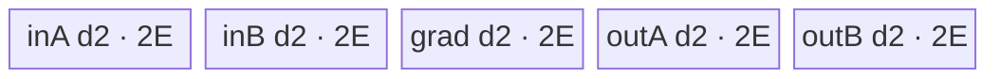
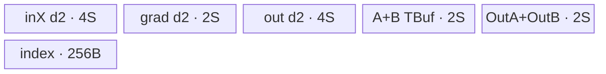

# SwiGluGrad 950 ACLNN 算子知识

## 算子速览

| 项目 | 内容 |
|---|---|
| 实际入口 | `aclnnSwiGluGradGetWorkspaceSize` + `aclnnSwiGluGrad`，固定仓唯一公开版本 |
| 计算语义 | `x=[A,B]`；`outA=yGrad*sigmoid(A)*(1+(1-sigmoid(A))*A)*B`，`outB=yGrad*sigmoid(A)*A` |
| 输入输出 | ND FP16/FP32/BF16；rank 1–8；`out.shape=x.shape` |
| 执行类型 | 单 Kernel `swi_glu_grad`，`KERNEL_TYPE_AIV_ONLY`，AIV_VECTOR/MicroAPI；无 Cube/AIC/MIX_CV |
| Kernel 路线 | R-001 MoveAlign整列；R-002 MoveAlign切列；R-003 UB重排逐行；R-004 UB重排gather/scatter |
| 核心资源 | MoveAlign：5个depth2 TQue；UB重排：3个depth2 TQue、5个TBuf、寄存器；workspace=`16MiB+usedCoreNum*UB_BLOCK`，Kernel只检查非空 |
| 来源闭包 | `source_closed`：公开 ACLNN 契约（生成式 inner bridge 为框架边界）→950 OpDef→regbase Host/POD→apt router→MoveAlign/UB-rearrange/MicroAPI body→ascend950 config |
| 验证状态 | 已完成源码闭包检查；本次知识提取未执行编译、真机、数值或性能测试。 |

## 接口与语义

### 计算语义

将 `dim` 规范化后，把 `x` 沿该轴等分为 A/B。令 `s=1/(1+exp(-A))`，逐元素计算 `outA=yGrad*s*(1+(1-s)*A)*B`、`outB=yGrad*s*A`。Host 折叠为二维：`M=prod(x.shape[0:d])`、`N=prod(x.shape[d:])/2`，GM 每行是 `[A_N,B_N]`；输出保持相同布局。

### 输入、输出与属性

| 参数 | shape/layout | dtype | 约束、默认值与语义 |
|---|---|---|---|
| `yGrad` | ND rank 1–8 | FP16/FP32/BF16 | 非空；与 `x` 同 rank/dtype，非 `dim` 轴相同，`dim` 轴为一半；公开文档不支持非连续 |
| `x` | ND rank 1–8 | FP16/FP32/BF16 | 非空、rank>0、切分轴为偶数；OpDef `AutoContiguous`；公开文档要求 shape 支持64B对齐 |
| `dim` | 标量 | int64 | `[-rank,rank-1]`，默认-1 |
| `out` | ND，shape同x | 同x | A/B梯度按原半区写回；可为非连续的框架输出 |

### 入口与版本

固定 Commit 无 v2 或其它更高公开版本。文档明确支持 Ascend 950PR/950DT；OpDef 为 `ascend950` 指定 `opFile.value=swi_glu_grad_apt`，binary JSON 有三种 dtype 实例，活动 `ascendc_config.json` 也列出 ascend950。ACLNN inner bridge 为固定仓未展开的生成式框架边界，算子拥有链路均已闭合。

## Host/Launcher 执行流程

### 参数校验与前处理

公开 ACLNN 第一段负责 null/dtype/dim 契约；OpDef 自动连续化两个输入。`Tiling4SwiGlu<SWIGLU_GRAD_SINGLE>` 识别 regbase 后构造 `GluBaseTiling4RegBase`。`GetShapeAttrsInfo` 精确校验 yGrad/x rank、各维关系、dim范围与可二等分性，并把 x storage shape 折叠成 M/N；失败立即返回，不启动 Kernel。

### 参数、Workspace 与生命周期

Host 读取 AIV 核数和完整 UB。设 dtype字节 `e`、`base=512/e`、`colNumAlign=ceil(N/base)`，初始 `used=min(AIV核数, M*colNumAlign*base/8192)`，至少1。`AutoTiling` 枚举 `m*n<=used` 的行/列切分，`N*e<1024` 时禁止列切分；优先 exact divide，否则按负载差和较小 n 排序。最终 `blockDim=rowTileNum*colTileNum`。workspace 为 `16MiB + usedCoreNum*GetUbBlockSize(context)`；executor/调用者持有到第二段 stream 完成，Kernel 只用 `workspace!=nullptr` 作为入口 guard。

### 启动图与失败传播

单节点：`swi_glu_grad(gradout,x,out,workspace,tiling)`，POD=`GluBaseTilingData`，`blockDim=usedCoreNum`。同一节点完成全部搬运、重排、计算和写回，无 workspace 交接边或跨 Kernel 同步。workspace null 时 Kernel 直接返回；未知 key 无 fallback；Host shape/platform/tiling 失败阻断 launch。

## Route 与参数设计

### 分核与资源计算

Host 将二维 M×N 切成 `rowTileNum×colTileNum`。普通块 `rowBase=floor(M/m)`、`colBase=floor(N/n)`，尾块公式为 `rowTail=M-rowBase*m+rowBase`、`colTail=N-colBase*n+colBase`。Device `blockIdx` 映射 `rowOffset=blockIdx/colTileNum`、`colOffset=blockIdx%colTileNum`，A/B/grad 起点分别为 `rowBase*rowOffset*(2N)+colBase*colOffset`、前者+N、`rowBase*rowOffset*N+colBase*colOffset`。key=`1000000 + dtypeEnum*10 + moveAlign`；dtypeEnum FP16/FP32/BF16=0/1/2，`moveAlign=(N*e>=1024)`。

### Route 选择

| 顺序 | Route | Key/模板 | 精确选择条件与优先级 | 不适用去向 |
|---:|---|---|---|---|
| 1 | R-001 MoveAlign整列 | 1000001/11/21 | `N*e>=1024` 且本核 `colProcess*e<=E`，`E=RoundDownVL(UB/10)` | R-002 |
| 2 | R-002 MoveAlign切列 | 同上 | `N*e>=1024` 且 `colProcess*e>E` | 无；Device内部切列 |
| 3 | R-003 UB重排逐行 | 1000000/10/20 | `N*e<1024` 且本核 `colProcess*e>=32` | R-004 |
| 4 | R-004 UB重排Gather | 同上 | `N*e<1024` 且 `colProcess*e<32` | 无；使用 gather/scatter |

```text
Host: moveAlign = (N*sizeof(T) < 1024 ? 0 : 1); key=1000000+dtypeEnum*10+moveAlign
Router: key末位1 -> MoveAlign<T>; key末位0 -> UbRearrange<T,indexType>
MoveAlign::Init: colProcess*sizeof(T)>E ? split-column : pack multiple rows
UbRearrange::Init: colProcess*sizeof(T)<32 ? gather/scatter : row-wise unaligned rearrange
```

### 模板/实现执行矩阵

| Route | key/selector | dtype/shape/platform 完整命中条件 | 执行拓扑与 Kernel 节点 | 实际模板/body | 内存与同步特征 | tail/fallback |
|---|---|---|---|---|---|---|
| R-001 | `...1` + `needSplitCol=false` | 950，N字节≥1024，本核列可装一个queue node | 单 AIV | `SwiGluGradMoveAlignKernel<T>::ProcessNotSplitCol` | 5 depth2 queues；DataCopyPad+MicroAPI | row UB tail |
| R-002 | `...1` + true | 同前但列超过E | 单 AIV | `ProcessSplitCol` | 同UB；行=1、列循环 | col tail后跨行 |
| R-003 | `...0` + `needGather=false` | N字节<1024，本核列字节≥32 | 单 AIV | `SwiGluGradUbRearrangeKernel<T,U>::ProcessNotGather` | 连续搬入2N，UB拆A/B，计算再交织 | row tail、unaligned tail |
| R-004 | `...0` + true | N字节<1024，本核列字节<32 | 单 AIV | `ProcessWithGather` | index TBuf；gather拆分/scatter合并 | VF组与tail mask |

### 隐藏性能 Guard

| Guard | Host/Tiling 条件 | Device/资源原因 | 影响 Route | 不满足时去向 | 源码符号 |
|---|---|---|---|---|---|
| 1KiB selector | `N*e<1024` | 短行避免逐行 GM stride搬运，改为整段搬入后UB重排 | R-003/4 | R-001/2 | `GetTilingKey` |
| UB node | `E=RoundDownVL(UB/5/2)` | MoveAlign 5 queue×depth2 | R-001/2 | split column | `MoveAlign::Init` |
| gather | `colProcess*e<32` | 一行不足一个32B块，用一个VF聚合多行 | R-004 | R-003 | `UbRearrange::Init` |
| active core | `blockIdx<usedCoreNum` | 防空闲核访问 | 全部 | `InitBase=false`；正常blockDim已等于used | `InitBase` |
| workspace | `workspace!=nullptr` | entry显式guard | 全部 | 直接return | `swi_glu_grad` |

### POD/ABI

`GluBaseTilingData` 的源码声明为依次排列的10个 `int64_t` 字段；固定仓没有输出目标编译器的 `sizeof/alignof/offsetof`，下表不推测具体 ABI 数字。

| 结构 | 字段 | 类型/位宽 | ABI 布局 | 单位 | Host/launcher producer | Device consumer | 边界 |
|---|---|---|---|---|---|---|---|
| `GluBaseTilingData` | `rowTotal` | int64/64 | 声明序号0；精确ABI不可见 | rows M | `CalcShapeTo2D`/`SetTilingData` | `InitBase` | 正数 |
| 同上 | `colTotal` | int64/64 | 序号1；精确ABI不可见 | elems N | 同上 | `InitBase` | 正数 |
| 同上 | `rowBase` | int64/64 | 序号2；精确ABI不可见 | rows/core | `DoOpTiling` | `InitBase` | >0 |
| 同上 | `colBase` | int64/64 | 序号3；精确ABI不可见 | elems/core-row | 同上 | `InitBase` | >0 |
| 同上 | `rowTail` | int64/64 | 序号4；精确ABI不可见 | rows | 尾块公式 | `InitBase` | 1..rowBase |
| 同上 | `colTail` | int64/64 | 序号5；精确ABI不可见 | elems | 尾块公式 | `InitBase` | 1..colBase |
| 同上 | `ubSize` | int64/64 | 序号6；精确ABI不可见 | bytes/core | `GetPlatformInfo` | 两类 `Init` | >0 |
| 同上 | `rowTileNum` | int64/64 | 序号7；精确ABI不可见 | tiles | `AutoTiling` | `InitBase` | >0，Device窄化uint32 |
| 同上 | `colTileNum` | int64/64 | 序号8；精确ABI不可见 | tiles | `AutoTiling` | `InitBase` | >0，Device窄化uint32 |
| 同上 | `usedCoreNum` | int64/64 | 序号9；精确ABI不可见 | cores | `m*n` | `InitBase` | Device窄化uint32 |

### Route 源码闭包

| Route | Key/selector | Host/Tiling producer | POD/参数 | Kernel entry/router 节点 | Kernel body/直接依赖 | 构建接线 |
|---|---|---|---|---|---|---|
| R-001/R-002 | 1000001/11/21 | `GluBaseTiling4RegBase::*` | `GluBaseTilingData` | `swi_glu_grad_apt.cpp::swi_glu_grad` | `MoveAlign::*` + `Base::Compute` | ascend950 JSON/OpDef apt |
| R-003/R-004 | 1000000/10/20 | 同上 | 同上 | 同上 | `UbRearrange::*` + `Base::Compute` | 同上 |

## Kernel 实现

### 公共执行流程

entry 声明 AIV-only、检查 workspace、解析 POD并按六个 key实例化模板。`InitBase` 完成本核二维块和GM起点映射。两类 body 最终都调用公共 `Compute`：MicroAPI 每次按 FP32 VF lane数循环，FP16/BF16先 unpack/cast到FP32，生成 tail mask；计算 sigmoid、outA/outB，低精度以 `CAST_RINT` pack写UB。单 Kernel内通过 TQue 和代码顺序同步，无跨核归约、atomic或workspace数据边。

### Route R-001：MoveAlign 整列

#### 适用条件

##### 选择证据

| 层级 | 文件 | 符号 | 源码谓词/参数 | 结果/下一跳 |
|---|---|---|---|---|
| Host | `swi_glu_grad_tiling_regbase.cpp` | `GetTilingKey` | `N*e>=1024` | key末位1 |
| Device | `swi_glu_grad_move_align.h` | `Init` | `colProcess*e<=E` | `ProcessNotSplitCol` |

#### Device 数据流

##### 函数级调用链

```text
swi_glu_grad -> MoveAlign::Init -> ProcessNotSplitCol
  -> CopyIn(A,B,grad) -> ComputePerLoop -> Base::Compute -> CopyOut(A,B)
```

##### 源码等价伪码

```text
E=RoundDownVL(UB/10); rowsPerLoop=E/(AlignUp(colProcess,32/e)*e)
for normal row chunk, then tail:
  DataCopyPad strided A/B/grad into 3 queues
  MicroAPI masked FP32 sigmoid and two gradients
  DataCopyPad two output queues back with destination stride 2N-colProcess
```

#### 内存与数据搬运

##### 资源与搬运表

| 层级/缓冲区 | offset/地址公式 | extent/容量公式 | dtype/layout | producer | consumer | owner/lifetime | 对齐/复用 |
|---|---|---|---|---|---|---|---|
| GM A/B/grad | `partA/BStart+offset`, `gradStart+gradOffset` | rows×colProcess | T, folded ND | caller | CopyIn | caller | src strides `(2N-col)*e`,`(N-col)*e` |
| 5 TQue | N/A | each depth2×E bytes | T | pipe/stages | Compute/CopyOut | Kernel | total10E≤UB |
| RegTensor | VF local | fixed compiler registers | FP32 | LoadOneTensor | Compute/Store | one repeat | tail mask |

##### 分层内存布局



##### 字节账与复用顺序

```text
E=RoundDownVL(UB/10); UB_total=5*2*E=10E<=UB
dynamic_ub=N/A; workspace_total=16MiB+cores*UB_BLOCK（仅null guard）
```

| 复用子区 | 写入者 | 读取者/消费点 | 下一次覆盖 | 同步或释放依据 | 安全条件 |
|---|---|---|---|---|---|
| queue node | CopyIn/Compute | Compute/CopyOut | 后续row chunk | EnQue/DeQue/FreeTensor | depth2队列协议 |

#### 同步、精度与尾块

##### 同步与数值边界表

| 阶段 | primitive/机制 | producer | consumer/等待点 | 保护对象 | 精度/尾块 |
|---|---|---|---|---|---|
| 搬运 | TQue | MTE2 | Vector | 3 inputs | 每行rightPad到32B |
| 计算 | `UpdateMask<float>(dataCount)` | load | store | VF lanes | FP32 math；低精度RINT |
| 写回 | TQue/DataCopyPad | Vector | MTE3 | 2 outputs | 只写 `colLen*e` 有效字节 |

#### 关键实现

##### 符号证据表

| 阶段 | 文件 | 符号/模板实例 | 实现事实 |
|---|---|---|---|
| Host/Tiling producer | `activation/swi_glu_grad/op_host/swi_glu_grad_tiling_regbase.cpp` | `GetTilingKey/AutoTiling` | key和分核 |
| Kernel entry/router | `activation/swi_glu_grad/op_kernel/swi_glu_grad_apt.cpp` | `swi_glu_grad` | 三dtype MoveAlign |
| Device body/helper | `activation/swi_glu_grad/op_kernel/arch35/swi_glu_grad_move_align.h` | `ProcessNotSplitCol` | 行循环和DMA |

### Route R-002：MoveAlign 切列

#### 适用条件

##### 选择证据

| 层级 | 文件 | 符号 | 源码谓词/参数 | 结果/下一跳 |
|---|---|---|---|---|
| Device | `swi_glu_grad_move_align.h` | `Init` | `colProcess*e>E` | `rowPerLoop=1`,`ProcessSplitCol` |

#### Device 数据流

##### 函数级调用链

```text
entry -> MoveAlign::Init -> ProcessSplitCol -> nested row/col loop -> CopyIn/Compute/CopyOut
```

##### 源码等价伪码

```text
colUbNorm=E/e; for each row: for full column chunk then tail:
  load A/B/grad at running offsets; compute aligned dataCount; write effective columns
  after tail, advance by (2N-colProcess) for x/out and (N-colProcess) for grad
```

#### 内存与数据搬运

##### 资源与搬运表

| 层级/缓冲区 | offset/地址公式 | extent/容量公式 | dtype/layout | producer | consumer | owner/lifetime | 对齐/复用 |
|---|---|---|---|---|---|---|---|
| GM/queues | 同 R-001 的基址 | 每次1×`colUbNorm/tail` | T | CopyIn | Compute/CopyOut | column chunk | 5×depth2×E |

##### 分层内存布局


##### 字节账与复用顺序

```text
UB_total=10E<=UB; workspace_total同R-001; dynamic_ub=N/A
```

| 复用子区 | 写入者 | 读取者/消费点 | 下一次覆盖 | 同步或释放依据 | 安全条件 |
|---|---|---|---|---|---|
| queue nodes | 当前列块 | Compute/CopyOut | 下一列块 | FreeTensor | tail写回后才跨行 |

#### 同步、精度与尾块

##### 同步与数值边界表

| 阶段 | primitive/机制 | producer | consumer/等待点 | 保护对象 | 精度/尾块 |
|---|---|---|---|---|---|
| 列循环 | Queue+mask | CopyIn | CopyOut | 当前列块 | `colUbTailAlign`参与计算，DMA只写tail有效列 |

#### 关键实现

##### 符号证据表

| 阶段 | 文件 | 符号/模板实例 | 实现事实 |
|---|---|---|---|
| Host/Tiling producer | `swi_glu_grad_tiling_regbase.cpp` | `AutoTiling` | 大N允许列分核 |
| Kernel entry/router | `swi_glu_grad_apt.cpp` | MoveAlign keys | dtype实例 |
| Device body/helper | `swi_glu_grad_move_align.h` | `ProcessSplitCol` | 双层循环/offset |

### Route R-003：UB重排逐行

#### 适用条件

##### 选择证据

| 层级 | 文件 | 符号 | 源码谓词/参数 | 结果/下一跳 |
|---|---|---|---|---|
| Host | `GetTilingKey` | moveAlign | `N*e<1024` | key末位0 |
| Device | `UbRearrange::Init` | needGather | `colProcess*e>=32` | `ProcessNotGather` |

#### Device 数据流

##### 函数级调用链

```text
entry -> UbRearrange::Init -> ProcessNotGather
  -> CopyIn(contiguous [A,B],grad) -> RearrangeUbIn
  -> Base::Compute -> RearrangeUbOut -> CopyOut(contiguous [outA,outB])
```

##### 源码等价伪码

```text
for row chunk:
  copy rowLen*(2N) x and rowLen*N grad as contiguous blocks
  for each row, unaligned-register copy A/B into separate TBufs
  masked FP32 compute into OutA/OutB TBufs
  interleave A/B back into output queue and copy one contiguous GM span
```

#### 内存与数据搬运

##### 资源与搬运表

| 层级/缓冲区 | offset/地址公式 | extent/容量公式 | dtype/layout | producer | consumer | owner/lifetime | 对齐/复用 |
|---|---|---|---|---|---|---|---|
| `inQueX/outQue` | current GM span | each depth2×2S | T interleaved | DMA/rearrange | rearrange/DMA | row chunk | S=`RoundDownVL(UB/20)` |
| `inQueGrad` | grad span | depth2×S | T | DMA | Compute | row chunk | contiguous |
| A/B/OutA/OutB | N/A | each S | T planar | rearrange/Compute | Compute/rearrange | row chunk | 4 TBuf |
| indexBuf | N/A | 256B | U | unused in R-003 | none | Kernel | allocated但inactive |

##### 分层内存布局



##### 字节账与复用顺序

```text
S=RoundDownVL((UB/10)/2); UB_total=14S+256B <= UB（按源码分配）
workspace_total=16MiB+cores*UB_BLOCK; dynamic_ub=N/A
```

| 复用子区 | 写入者 | 读取者/消费点 | 下一次覆盖 | 同步或释放依据 | 安全条件 |
|---|---|---|---|---|---|
| inX queue | CopyIn | RearrangeUbIn | 下一row chunk | FreeTensor | A/B均拆出后 |
| Out TBuf | Compute | RearrangeUbOut | 下一row chunk | 函数顺序 | 已EnQue交织结果 |

#### 同步、精度与尾块

##### 同步与数值边界表

| 阶段 | primitive/机制 | producer | consumer/等待点 | 保护对象 | 精度/尾块 |
|---|---|---|---|---|---|
| UB重排 | UnalignPre/Copy/Post | inX | planar TBuf | row数据 | main VF + tail元素 |
| compute | mask+RegTensor | planar A/B/G | planar out | valid count | FP32计算/RINT降精度 |
| 回排 | Unalign copy | planar out | output queue | A/B layout | 每行tail post提交 |

#### 关键实现

##### 符号证据表

| 阶段 | 文件 | 符号/模板实例 | 实现事实 |
|---|---|---|---|
| Host/Tiling producer | `swi_glu_grad_tiling_regbase.cpp` | `GetTilingKey` | 短行key |
| Kernel entry/router | `swi_glu_grad_apt.cpp` | UB_REARRANGE keys | T/U实例 |
| Device body/helper | `swi_glu_grad_ub_rearrange.h` | `ProcessNotGather/RearrangeUb*` | 重排网络 |

### Route R-004：UB重排 Gather/Scatter

#### 适用条件

##### 选择证据

| 层级 | 文件 | 符号 | 源码谓词/参数 | 结果/下一跳 |
|---|---|---|---|---|
| Device | `swi_glu_grad_ub_rearrange.h` | `Init` | `colProcess*e<32` | `needGather=true` |

#### Device 数据流

##### 函数级调用链

```text
entry -> Init -> ProcessWithGather -> GenerateGatherIndex
  -> CopyIn -> RearrangeUbInByGather -> Compute
  -> RearrangeUbOutByScatter -> CopyOut
```

##### 源码等价伪码

```text
generate index mapping packed planar lane k to interleaved row address
group floor(VF/colProcess) rows per VF; gather A and B, compute; scatter outA/outB
use UpdateMask(main/tail) for incomplete row group; write contiguous GM span
```

#### 内存与数据搬运

##### 资源与搬运表

| 层级/缓冲区 | offset/地址公式 | extent/容量公式 | dtype/layout | producer | consumer | owner/lifetime | 对齐/复用 |
|---|---|---|---|---|---|---|---|
| indexBuf | generated `row*2col + withinRow` | 256B | U16 for FP16/BF16, U32 for FP32 | `GenerateGatherIndex` | gather/scatter | entire Kernel | reused all row loops |
| other Queue/TBuf | 同 R-003 | 14S bytes | T | stages | stages | row chunk | gather聚合短行 |

##### 分层内存布局


##### 字节账与复用顺序

```text
UB_total=14S+256B<=UB; workspace_total同R-003; dynamic_ub=N/A
```

| 复用子区 | 写入者 | 读取者/消费点 | 下一次覆盖 | 同步或释放依据 | 安全条件 |
|---|---|---|---|---|---|
| indexBuf | GenerateGatherIndex | all gather/scatter loops | 不覆盖 | Process调用顺序 | colProcess在本核固定 |

#### 同步、精度与尾块

##### 同步与数值边界表

| 阶段 | primitive/机制 | producer | consumer/等待点 | 保护对象 | 精度/尾块 |
|---|---|---|---|---|---|
| gather/scatter | `UpdateMask<T>(main/tail)` | index+inX | planar/out interleave | 不完整VF组 | tail只访问有效元素 |
| compute | 公共 RegTensor | gathered data | scatter | valid count | FP32 math/RINT |

#### 关键实现

##### 符号证据表

| 阶段 | 文件 | 符号/模板实例 | 实现事实 |
|---|---|---|---|
| Host/Tiling producer | `swi_glu_grad_tiling_regbase.cpp` | `AutoTiling` | 短行不列分核 |
| Kernel entry/router | `swi_glu_grad_apt.cpp` | UB keys | index类型随dtype |
| Device body/helper | `swi_glu_grad_ub_rearrange.h` | `GenerateGatherIndex/Rearrange*ByGather` | gather/scatter地址网络 |

## 算子特定优化

### Trick T-001：以 1KiB 半行阈值切换 GM stride 搬运与 UB 重排

#### 触发与源码依据

- 适用 Route：R-001–R-004
- 触发条件：`colTotalNum_ * dataSize_ < 1024` 选择 UB_REARRANGE，否则 MOVEALIGN
- Golden 来源：[`activation/swi_glu_grad/op_host/swi_glu_grad_tiling_regbase.cpp:178-204`](../../../../../../../cann-ops-raw/ascendc/ops-nn/955f8b33985b6d72989ebff341bb9c2c564a51bc/activation/swi_glu_grad/op_host/swi_glu_grad_tiling_regbase.cpp#L178-L204)

**官方源码（固定 Commit 连续逐字摘录）**：

```cpp
uint32_t moveAlign = 1;
if (static_cast<uint64_t>(colTotalNum_) * dataSize_ < static_cast<uint64_t>(MOVE_ALIGN_LIMIT_BYTE)) {
    moveAlign = static_cast<uint32_t>(0);
}

uint64_t tilingKey = ComputeTiling({static_cast<uint32_t>(inDtype), moveAlign});
```

#### 机制与设计原因

长半行使用逐行 `DataCopyPad` 直接把 A/B/grad 搬入独立 queues，避免额外 UB 重排；短半行则一次连续搬入 `[A,B]` 多行，再在 UB 中拆/合，从源码可证明减少大量窄行 GM DMA 段。dtype 十位与模式个位共同编码，Host selector和router一一对应。

#### 迁移边界

- 适用：GM为行内A/B拼接、计算需要平面A/B的逐元素反向算子。
- 前提：950 regbase、ND折叠布局、相同1024B阈值和UB重排资源账。
- 失效：阈值上方使用 MoveAlign；短于32B的本核半行进一步进入R-004。
- 未验证：本次知识提取未执行编译、真机、数值或性能测试。

#### 错误做法

固定仓提供的可验证错误边界是把所有短行仍按列分核：`AutoTiling` 在 `N*e<1024 && n>1` 时明确跳过候选，否则会破坏UB重排按完整半行处理的地址假设。

## 模板与实现对比

| 对比维度 | R-001/002 MoveAlign | R-003 逐行重排 | R-004 Gather | 设计选择依据 |
|---|---|---|---|---|
| 命中条件/优先级 | N字节≥1024 | N字节<1024且核列≥32B | 核列<32B | Host阈值+Device guard |
| 模板与 dtype | `MoveAlign<T>` | `UbRearrange<T,U>` | 同左 | dtype key |
| 循环与分核 | 行/列UB循环 | row chunk | VF聚合多行 | 列宽 |
| Queue/TBuf/寄存器 | 5 depth2 queues | 3 queues+5 TBuf | 同左+active index | layout处理 |
| 内存总占用与复用 | 10E | 14S+256 | 14S+256 | InitBuffer |
| 搬运/Vector API | DataCopyPad | unaligned MicroAPI | gather/scatter | 行宽 |
| 同步、精度与 tail | Queue+mask | Queue+unaligned post+mask | Queue+gather mask | tail策略 |
| fallback/失败边界 | 内部分列 | 内部逐行 | 内部gather | unknown key无fallback |

## 平台差异

| 项目 | A2 | A3 | 950 |
|---|---|---|---|
| 支持状态 | 支持，见无后缀卡 | 支持，见无后缀卡 | 公开支持 |
| Host/Launcher | 通用 Tiling + dtype key | 同左 | `GluBaseTiling4RegBase` + 复合key |
| Kernel/资源 | Vector API，1/2 buffer | 同左 | apt MicroAPI，MoveAlign/UB重排 |

## 限制与失败边界

- 公开 ACLNN 不支持空 Tensor；shape关系、dim、偶数切分、dtype 或平台资源不合法时 Host 失败。
- `AutoTiling` 对乘法和若干 int64→uint32/uint16 窄化未显式做溢出保护；固定仓没有更大 shape 的 fallback，不能推测支持边界。
- Device 的 `rowProcess_`/`colProcess_` 必须按 `InitBase` 的原谓词复刻：列尾由 `(blockIdx+1)%colTileNum` 判定，行尾由 `(blockIdx+1)/colTileNum < rowTileNum-1` 判定；不得改写为未经源码证明的常见二维尾块公式。
- workspace 内容不被 Kernel 读写，但 entry 强制非空；调用者不得因“未使用”而传 null。
- ACLNN生成式 inner bridge、ViewCopy和executor内部布局固定仓不可见；未推测补齐。

## 源码索引

### 链路索引

| 链路阶段 | 文件 | 关键符号 | 支撑内容 |
|---|---|---|---|
| 入口声明/约束 | `activation/swi_glu_grad/docs/aclnnSwiGluGrad.md` | `aclnnSwiGluGrad*` | API/平台/约束 |
| 入口实现 | `activation/swi_glu_grad/op_host/swi_glu_grad_def.cpp` | `SwiGluGrad` | 950 apt接线 |
| Host/Tiling/Launcher | `activation/swi_glu/op_host/swi_glu_tiling.cpp` | `Tiling4SwiGlu<SWIGLU_GRAD_SINGLE>` | regbase选择与Tiling注册 |
| Host/Tiling/Launcher | `activation/swi_glu_grad/op_host/swi_glu_grad_tiling_regbase.cpp` | `GluBaseTiling4RegBase` | shape/key/core/workspace/POD |
| Host/Tiling/Launcher | `activation/swi_glu_grad/op_kernel/arch35/swi_glu_grad_regbase_tiling.h` | `GluBaseTilingData` | POD字段声明 |
| Kernel entry/body | `activation/swi_glu_grad/op_kernel/swi_glu_grad_apt.cpp` | `swi_glu_grad` | AIV router |
| Kernel entry/body | `activation/swi_glu_grad/op_kernel/arch35/swi_glu_grad_base.h` | `Base::Compute` | MicroAPI计算/精度 |
| Kernel entry/body | `activation/swi_glu_grad/op_kernel/arch35/swi_glu_grad_move_align.h` | `MoveAlign::*` | strided DMA与行/列UB循环 |
| Kernel entry/body | `activation/swi_glu_grad/op_kernel/arch35/swi_glu_grad_ub_rearrange.h` | `UbRearrange::*` | 重排/gather |
| 构建接线 | `activation/swi_glu_grad/op_host/config/ascend950/swi_glu_grad_binary.json` | `SwiGluGrad_1/2/3` | 950三dtype binaries |

### 实现复用检查

| 检查项 | 可复用事实 | 不得改变的约束 | 源码符号 |
|---|---|---|---|
| ABI/POD | 10×int64字段 | 顺序、offset、窄化 | `GluBaseTilingData` |
| 调用顺序 | 搬入→可选重排→计算→回排→写回 | row/col offset更新 | `Process*` |
| workspace/内存 | workspace公式；两类UB账 | 非空guard、depth2 | `PostTiling`、`Init` |
| 同步 | Queue与MicroAPI函数顺序 | Free/EnQue时点 | `CopyIn/ComputePerLoop/CopyOut` |
| 精度与尾块 | FP32 RegTensor、RINT低精度输出 | UpdateMask和pad有效范围 | `Base::Compute` |
| 失败边界 | Host失败、null workspace、unknown key | 不得补fallback | Tiling/entry |