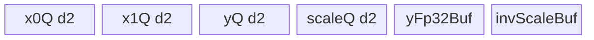
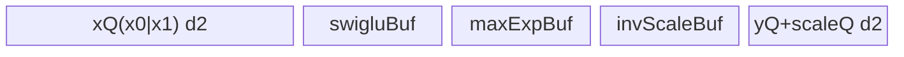
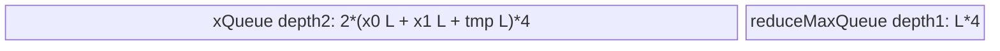
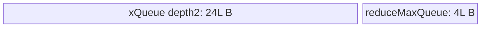
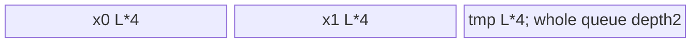
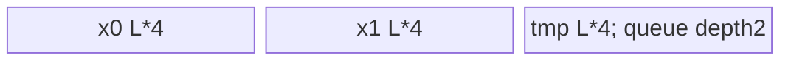

# SwigluGroupQuant 950 ACLNN 算子知识

## 算子速览

| 项目 | 内容 |
|---|---|
| 实际入口 | `aclnnSwigluGroupQuantGetWorkspaceSize` + `aclnnSwigluGroupQuant`，固定仓唯一公开版本，ACLNN 两段式入口 |
| 计算语义 | 将 `x[..., 0:H]` 与 `x[..., H:2H]` 做 `SwiGLU = x0/(1+exp(-x0))*x1`，可选 clamp/逐 token weight，再做 Block FP8、MX FP8/FP4、HiFloat8 静态或动态量化 |
| 输入输出 | `x/weight/groupIndex/scale -> y/yScale/yOrigin`；ND；公开 API 要求 `x` rank 2–8、`D>=256 && D%256==0` |
| 执行类型 | 所有 Host 可达节点均为单 `AIV_VECTOR` Kernel；无 Cube/AIC、MIX_CV、SIMT或 NDDMA 节点 |
| Kernel 路线 | R-001 Block FP8；R-002 MX FP8；R-003 MX FP4；R-004/R-005 Dynamic HiFp8 非 group/group；R-006/R-007 Static HiFp8 非 group/group |
| 核心资源 | GM + AIV UB；Block/MX 用 `TBufPool`/double-buffer Queue；HiFp8 用 double-buffer `xQueue_`；R-004 额外用 user workspace 保存逐核 max |
| 来源闭包 | `source_closed`：公开 ACLNN 声明→生成 executor 边界→`SwigluGroupQuant` OpDef/InferShape→Tiling selector/POD→`swiglu_group_quant`→逐 Route body/helper→ascend950 构建与 binary config 已闭合 |
| 验证状态 | 已完成源码闭包检查；本次知识提取未执行编译、真机、数值或性能测试。 |

## 接口与语义

### 计算语义

设 `x` 最后一维为 `D=2H`，外维元素积为 `N`。对有效 token `n`：

```text
x0 = x[n, 0:H]
x1 = x[n, H:2H]
if clampLimit > 0: x0=min(x0,c), x1=min(max(x1,-c),c)
s = x0 / (1 + exp(-x0)) * x1
if weight != nullptr: s *= weight[n]
```

`quantMode=0` 每 128 元素求 `amax`，输出 FP8 及 FP32 scale；`quantMode=1` 每 32 元素输出 E8M0 scale，数据为 FP8 或两个 FP4 打包/字节；`quantMode=2` 用输入 `scale` 作 invScale 输出 HiFloat8；`quantMode=3` 按全局或 group 求 `max(abs(s),1e-8)/dstTypeMax`，再以其倒数量化。Block/MX 的 `groupIndex` 先求和并取 `min(sum,N)`；HiFp8 group body 按 prefix-sum 直接分组，不做该裁剪，见限制章节。

### 输入、输出与属性

| 参数 | shape/layout | dtype | 约束、默认值与语义 |
|---|---|---|---|
| `x` | `[...,D]`, ND, rank 2–8 | FP16/BF16；HiFp8 还支持 FP32 | 公开 API：非空，`D>=256 && D%256==0` |
| `weightOptional` | 元素数 `N` | FP32 | 可空；逐 token 乘在 SwiGLU 结果上 |
| `groupIndexOptional` | `[G]`, ND | INT64 | 可空；count 模式 group token 数 |
| `scaleOptional` | 无 group `[1]`，有 group `[G]` | FP32 | `quantMode=2` 必需，语义为 invScale |
| `dstType` | scalar | int64 | 默认 36/E4M3FN；0/1 模式可为 35/36/40/41 |
| `quantMode` | scalar | int64 | 0 Block FP8，1 MX，2 Static HiFp8，3 Dynamic HiFp8 |
| `blockSize` | scalar | int64 | 默认 0；mode 0 可 0/128，mode 1 可 0/32 |
| `roundScale` | scalar | bool | 默认 false；MX 必须 true |
| `clampLimit` | scalar | double→Host float | 默认 -1；启用时必须 `>0` |
| `dstTypeMax` | scalar | double→Host float | HiFp8 dynamic 有效，默认 15；公开规格列 15/56/224/32768 |
| `outputOrigin` | scalar | bool | mode 0/1 只支持 false；mode 2/3 支持 true/false |
| `yOut` | FP8/HiFp8: `[...,H]`；FP4: `[...,ceil(H/2)]` 字节 | FP8 E4M3/E5M2、FP4 E2M1/E1M2、HiFloat8 | 必需、非空 |
| `yScaleOut` | Block `[...,ceil(H/128)]`；MX `[...,ceil(ceil(H/32)/2),2]`；dynamic HiFp8 `[1]`/`[G]` | FP32 或 E8M0 | Static HiFp8 InferShape 生成 `[0]`，Kernel 不写 `yScale` |
| `yOriginOut` | `[...,H]` | 同 `x` | ACLNN 参数必须非空；只在支持且 `outputOrigin=true` 时写入 |

### 入口与版本

公开文档只声明无版本后缀的 `aclnnSwigluGroupQuantGetWorkspaceSize(...)` 和 `aclnnSwigluGroupQuant(workspace, workspaceSize, executor, stream)`，因而它是固定 Commit 下 950 实际支持的最新且唯一公开版本。两段式 ACLNN 生成 bridge/executor 代码未在该算子源码目录公开，作为框架边界；算子自有的 OpDef、InferShape、Tiling、POD、router 和 body 均已追踪。README 和 API 文档明确 A2/A3 不支持，所以不存在可发布的 A2/A3 版本。

## Host/Launcher 执行流程

### 参数校验与前处理

1. ACLNN 第一段检查必需 tensor/`workspaceSize`/`executor`、dtype、shape 与属性组合；公开文档明确不支持非连续 tensor，因而无算子自有 `Contiguous/ViewCopy` 节点。
2. `InferShape4SwigluGroupQuant` 令 `H=D/2`；FP4 的 `y` 最后维为 `ceil(H/2)`；Block/MX/HiFp8 分别生成 scale shape。`InferDtype4SwigluGroupQuant` 依 `quantMode/dstType` 生成 `y/yScale/yOrigin` dtype。
3. `TilingForSwigluGroupQuant` 先读 attr #1 `quantMode`；2/3 进入 `SwigluGroupQuantHifp8Tiling`，其余进入 `SwigluGroupQuantTiling`。后者对 mode 0/1 要求 FP16/BF16、`D>=256 && D%256==0`、weight/groupIndex/output dtype 匹配，并明确拒绝 `outputOrigin=true`。
4. HiFp8 Host 要求 `x` FP32/FP16/BF16、`y` HiFloat8；static 要求 FP32 `scale` 存在且 shape 为 `[1]`/`[G]`；dynamic 要求 FP32 `yScale`。

### 参数、Workspace 与生命周期

Block/MX/FP4 Host 取 AIV core 数与 UB 字节，以实际 Queue/TBuf 公式选 `rowFactor/dFactor`，workspace 固定 32 B。HiFp8 以 `ubAvailable=ubSize-1024`，static 每 token 预算 `6*H*4` B，dynamic 预算 `7*H*4` B，有 weight 再加 8 B/token；`tileTokens=max(1,floor(ubAvailable/ubPerToken))`。

HiFp8 实机 Host workspace 先包含 `GetLibApiWorkSpaceSize()`。仅 R-004 在系统 slice 后增加 `(usedCoreNum+1)*4+32` B；entry 用 `GetUserWorkspace` 取 user slice，`coreMaxGm_[core]` 在两次 `SyncAll` 之间有效。executor 持有输入/输出、tiling 与启动信息直到第二段提交 stream；workspace 由调用者按第一段返回值分配并保持至 stream 使用结束。

### 启动图与失败传播

```text
aclnnSwigluGroupQuantGetWorkspaceSize
  -> generated ACLNN executor boundary
  -> InferShape/InferDtype + TilingForSwigluGroupQuant
  -> POD + tilingKey + blockDim + workspaceSize
aclnnSwigluGroupQuant(workspace, executor, stream)
  -> [single stream node] swiglu_group_quant(x, weight, groupIndex, scale,
                                             y, yScale, yOrigin, workspace, tiling)
     -> key 1000/2000/3000/4000/4100 AIV body
```

| 节点/边 | entry/blockDim/POD | 交接与 ordering | owner/lifetime | 失败传播 |
|---|---|---|---|---|
| 单 Device 节点 | `swiglu_group_quant`；Block/MX 无 group 为 `usedCoreNums`、有 groupIndex 为平台 `coreNum`；HiFp8 为 `usedCoreNum`；两类 POD | executor 在指定 stream 上提交 | executor/ACL runtime | Host/Tiling 失败则不启动；entry 见空 workspace/userWs 直接 return |
| R-004 workspace 内部边 | `coreMax[0:usedCoreNum]`, FP32, contiguous | 每核写→`SyncAll`→core0 reduce/写 `yScale[0]`→`SyncAll`→全核量化 | ACL workspace user slice，Kernel 期间 | 无独立返回码；Kernel 内同步必须完整到达 |

## Route 与参数设计

### 分核与资源计算

Block/MX 令 `N=bs`、`H=splitD`，初始 `rowFormer=ceil(N/coreNum)`、`used=min(ceil(N/rowFormer),coreNum)`、`rowTail=N-(used-1)*rowFormer`。若有 groupIndex，每核先在 UB 求和，取 `realBs=min(sum,N)` 后在 Device 重算分核。`dFactor` 先按 Block/FP4 的 128/32 或 MX FP8 的 128 B16 向量步长增大至 UB 上界；当整 H 可入 UB 时再二分最大 `rowFactor`。

HiFp8 无 group 令 `usedCore=min(coreNum,N)`，余数优先每核多分 1 token；有 group 令 `usedCore=min(coreNum,G,64)`，Device 依 `targetLoad=ceil(sum(groupIndex)/usedCore)` 将连续 group 贪心分配到核。

### Route 选择

| 顺序 | Route | Key/模板 | 精确选择条件与优先级 | 不适用去向 |
|---:|---|---|---|---|
| 1 | R-001 Block FP8 | 1000 | `quantMode==0 && dstType∈{E4M3,E5M2} && outputOrigin==false` | 属性非法则 Host 失败 |
| 2 | R-002 MX FP8 | 2000 | `quantMode==1 && dstType∈{E4M3,E5M2} && roundScale==true && outputOrigin==false` | FP4 进 R-003，否则失败 |
| 3 | R-003 MX FP4 | 3000 | `quantMode==1 && dstType∈{E2M1,E1M2} && roundScale==true && outputOrigin==false` | Host 失败 |
| 4 | R-004 Dynamic HiFp8 non-group | 4000 | `quantMode==3 && groupIndex==nullptr` | group 进 R-005 |
| 5 | R-005 Dynamic HiFp8 group | 4000 + `isGroup=1` | `quantMode==3 && groupIndex!=nullptr` | Host 失败 |
| 6 | R-006 Static HiFp8 non-group | 4100 | `quantMode==2 && groupIndex==nullptr && scale.shape==[1]` | group 进 R-007 |
| 7 | R-007 Static HiFp8 group | 4100 + `isGroup=1` | `quantMode==2 && groupIndex!=nullptr && scale.shape==[G]` | Host 失败 |

```text
quantMode in {2,3} ?
  yes -> Hifp8Tiling -> quantMode==2 ? key 4100 : key 4000
                      -> isGroup ? group Route : non-group Route
  no  -> quantMode==0 ? key 1000
        : dstType is FP4 ? key 3000 : key 2000
```

### 模板/实现执行矩阵

| Route | key/selector | dtype/shape/platform 完整命中条件 | 执行拓扑与 Kernel 节点 | 实际模板/body | 内存与同步特征 | tail/fallback |
|---|---|---|---|---|---|---|
| R-001 | 1000 | 950，FP16/BF16→FP8，`D%256=0` | 单 AIV | `SwigluGroupQuantPerf<X,Y,float,false>` | x0/x1/y/scale DB，可选 weight DB | row/d tail；无 fallback |
| R-002 | 2000 | 950，FP16/BF16→FP8+E8M0 | 单 AIV | `SwigluMxQuantPerf<DTYPE_X,DTYPE_Y,DTYPE_Y_SCALE,false>` | 额外 FP32 SwiGLU/invScale TBuf | row/d tail；无 fallback |
| R-003 | 3000 | 950，FP16/BF16→FP4+E8M0 | 单 AIV | `SwigluMxFp4QuantPerf<DTYPE_X,DTYPE_Y,DTYPE_Y_SCALE>` | 合并 x Queue，swiglu/maxExp/invScale TBuf，字节打包 | row/d tail；无 fallback |
| R-004 | 4000 | 950，HiFp8，无 group | 单 AIV 内三阶段 | `DynamicHifp8Kernel<X>` | x DB + reduceMax Queue + coreMax workspace；两次 `SyncAll` | token tail |
| R-005 | 4000 | 950，HiFp8，有 group | 单 AIV，逐核连续 groups | 同上 | 每 group 本核 reduce/量化，无跨核 workspace | group/token tail；余下 token 填 0 |
| R-006 | 4100 | 950，HiFp8 static，无 group | 单 AIV | `StaticHifp8Kernel<X>` | x DB，直接标量读 `scale[0]` | token tail |
| R-007 | 4100 | 950，HiFp8 static，有 group | 单 AIV，逐 group | 同上 | 每 group 标量读 `scale[g]` | group/token tail；余下 token 填 0 |

### 隐藏性能 Guard

| Guard | Host/Tiling 条件 | Device/资源原因 | 影响 Route | 不满足时去向 | 源码符号 |
|---|---|---|---|---|---|
| 950 接线 | `SUPPORT_COMPUTE_UNIT=ascend950` | 仅 arch35 body/binary | 全部 | 不发布 A2/A3 | `activation/swiglu_group_quant/CMakeLists.txt:add_modules_sources` |
| D 对齐 | mode 0/1: `D>=256 && D%256==0` | R-001 每 128 分组且 vector 两折 64 lane；MX 的 dStep=128 B16 | R-001–003 | Host 失败 | `SwigluGroupQuantTiling::GetShapeAttrsInfoInner` |
| UB selector | `Calc*TotalSize(row,d)<=ubSize` | Queue depth=2 必须纳入字节账 | R-001–003 | 缩小 dFactor，整 H 可容纳后再放大 rowFactor | `CalcDAndRowFactorTiling` |
| MX 属性 | `roundScale==1` | E8M0 使用 2 的整次幂 | R-002/R-003 | Host 失败 | `SwigluGroupQuantTiling::GetAttr` |
| outputOrigin | mode 0/1 要求 0 | Host 不可达 router 1100/2100 | R-001–003 | Host 失败 | `SwigluGroupQuantTiling::GetAttr/SetTilingKey` |
| HiFp8 UB | `(ubSize-1024)/ubPerToken`，下限强制 1 | static 6 个 FP32 H 区等价，dynamic 再加 reduce H 区 | R-004–007 | 无其他 Route；强制 1 不再验证实际 UB 可容纳 | `SwigluGroupQuantHifp8Tiling::CalcTileTokens` |
| group core 上限 | `used=min(coreNum,G,64)` | Device 固定 64 项 group 分配数组 | R-005/R-007 | 减少核数 | `CalcCoreDistribution/CalcCoreGroupDistribution` |
| FP4 字节 ABI | GM/CopyOut 必须 `int8_t` | `fp4x2_*` 的 `sizeof()==2`，按 T1 索引会倍增 offset | R-003 | 无 fallback | `SwigluMxFp4QuantPerf::Init/Process` |

### POD/ABI

`BEGIN_TILING_DATA_DEF` 宏的实体定义不在固定算子仓中，因而以下 ABI 只能固定字段声明顺序、源类型和 Host/Device 同名消费；`sizeof/alignof/offsetof` 固定仓不可见，不推测填充。

| 结构 | 字段 | 类型/位宽 | ABI 布局 | 单位 | Host/launcher producer | Device consumer | 边界 |
|---|---|---|---|---|---|---|---|
| `SwigluGroupQuantTilingData` | `bs` | int64/64 | #0；offset 不可见 | element | `bs_=prod(x[:-1])` | group sum clamp | >0 由非空 API 约束 |
| 同上 | `d` | int64/64 | #1 | element/row | `d_=x[-1]` | x row stride | `>=256`, `%256=0` |
| 同上 | `splitD` | int64/64 | #2 | element | `d_/2` | x1/y row stride | H |
| 同上 | `scaleCol` | int64/64 | #3 | element/row | `ceil(H,splitFactor)` | scale GM stride | Block 128, MX 32 |
| 同上 | `rowOfFormerBlock` | int64/64 | #4 | row/core | `InitCoreTiling` | core base | group 时 Device 重算 |
| 同上 | `rowOfTailBlock` | int64/64 | #5 | row | 同上 | tail core | 同上 |
| 同上 | `rowLoopOfFormerBlock` | int64/64 | #6 | loop | `SetRowLoopTiling` | `Process` | group 时重算 |
| 同上 | `rowLoopOfTailBlock` | int64/64 | #7 | loop | 同上 | `Process` | 同上 |
| 同上 | `rowFactor` | int64/64 | #8 | row/tile | UB selector | Queue extent/loop | >=1 |
| 同上 | `tailRowFactorOfFormerBlock` | int64/64 | #9 | row | remainder | former-core tail | 1..rowFactor |
| 同上 | `tailRowFactorOfTailBlock` | int64/64 | #10 | row | remainder | tail-core tail | 1..rowFactor |
| 同上 | `dLoop` | int64/64 | #11 | loop | `ceil(H/dFactor)` | inner loop | >=1 |
| 同上 | `dFactor` | int64/64 | #12 | element/tile | UB selector | Queue extent/GM offset | Block/FP4 分组步长，MX 128 B16 步长 |
| 同上 | `tailDFactor` | int64/64 | #13 | element | H remainder | tail copy/mask | >0 |
| 同上 | `roundScale` | int64/64 | #14 | bool | attr | Block dispatcher | MX 固定 1 |
| 同上 | `outputOrigin` | int64/64 | #15 | bool | attr | router/body template | 活动 R-001–003 固定 0 |
| 同上 | `clampLimit` | float/32 | #16 | value | attr double 窄化为 float | vector clamp | inactive 时值 0 |
| 同上 | `hasClampLimit` | int64/64 | #17 | bool | `clampLimit!=-1` | template dispatcher | 0/1 |
| 同上 | `g` | int64/64 | #18 | element | groupIndex element count | group reduce | 无 group 为 0 |
| 同上 | `ubSize` | int64/64 | #19 | byte | platform UB | `InitBufPool` | >0 |
| 同上 | `gLoop` | int64/64 | #20 | loop | group UB selector | group reduce loop | 无 group 为 0 |
| 同上 | `gFactor` | int64/64 | #21 | int64 element/tile | group UB selector | group Queue | 有 group >=1 |
| 同上 | `tailGFactor` | int64/64 | #22 | element | remainder | group tail | 有 group >0 |
| 同上 | `coreNum` | int64/64 | #23 | AIV core | platform | group Device 重分核 | >0 |
| `SwigluGroupQuantHifp8TilingData` | `totalTokens` | int64/64 | #0；offset 不可见 | token | `prod(x[:-1])` | token range/fill | 无 group 不能为 0 |
| 同上 | `dim2H` | int64/64 | #1 | element | `x[-1]` | x stride | 偶数 |
| 同上 | `dimH` | int64/64 | #2 | element | `dim2H/2` | compute/copy | 公开规格更强 |
| 同上 | `isGroup` | int64/64 | #3 | bool | optional input shape | CRTP dispatcher | 0/1 |
| 同上 | `hasWeight` | int64/64 | #4 | bool | optional input shape | weight Queue | 0/1 |
| 同上 | `hasClamp` | int64/64 | #5 | bool | `clampLimit>0` | vector clamp | 0/1 |
| 同上 | `outputOrigin` | int64/64 | #6 | bool | attr | origin copy | 0/1 |
| 同上 | `clampLimit` | float/32 | #7 | value | attr double→float | clamp | inactive -1 |
| 同上 | `dstTypeMax` | float/32 | #8 | value | attr double→float | dynamic scale | static inactive |
| 同上 | `tileTokens` | int64/64 | #9 | token/tile | UB formula | tile loop/Queue | Host 强制 >=1 |
| 同上 | `usedCoreNum` | int64/64 | #10 | core | core distribution | block guard/range | <=64 in group |
| 同上 | `tokensPerCore` | int64/64 | #11 | token/core | non-group division | non-group range | group 为 0 |
| 同上 | `groupNum` | int64/64 | #12 | group | groupIndex dim0 | group distribution | non-group 为 0 |
| 同上 | `tileLength` | int64/64 | #13 | FP32 element | `tileTokens*H` | UB offsets | >0 |

### Route 源码闭包

| Route | Key/selector | Host/Tiling producer | POD/参数 | Kernel entry/router 节点 | Kernel body/直接依赖 | 构建接线 |
|---|---|---|---|---|---|---|
| R-001 | 1000 | `swiglu_group_quant_tiling.cpp:CalcBlockQuantOpTiling/SetTilingKey` | `SwigluGroupQuantTilingData` | `swiglu_group_quant.cpp:swiglu_group_quant` | `swiglu_group_quant_perf.h:SwigluGroupQuantPerf`; `swiglu_group_quant_base.h` | root/kernel CMake + ascend950 binary JSON |
| R-002 | 2000 | `CalcMxQuantOpTiling` | 同上 | 同上 | `swiglu_mx_quant_perf.h:SwigluMxQuantPerf`; base helpers | 同上 |
| R-003 | 3000 | `CalcMxFp4QuantOpTiling` | 同上 | 同上 | `swiglu_mxfp4_quant_perf.h:SwigluMxFp4QuantPerf`; FP4 helpers | 同上 |
| R-004/R-005 | 4000 | `swiglu_group_quant_hifp8_tiling.cpp:CalcOpTiling/SetTilingKey` | `SwigluGroupQuantHifp8TilingData` | 同上 | `swiglu_dynamic_group_quant_hifp8.h`; `swiglu_group_quant_hifp8_base.h` | 同上 |
| R-006/R-007 | 4100 | 同上 | 同上 | 同上 | `swiglu_static_group_quant_hifp8.h`; HiFp8 base | 同上 |

## Kernel 实现

### 公共执行流程

`swiglu_group_quant` 先要求 `workspace` 和 `GetUserWorkspace(workspace)` 非空，保存浮点 overflow control，依 key 解析两种 POD 之一并实例化对应 AIV class，结束后恢复 control。所有 Route 都在一个 Kernel entry 中完成，没有 Host 级中间 Kernel 边。Block/MX/FP4 共用 groupIndex 分块求和、former/tail 核分配、`DataCopyPad` 和 AIV `VF_CALL`；HiFp8 共用 FP32 UB SwiGLU 管线、CRTP group/non-group dispatcher 和硬 event helper。unknown key 没有 `else` 报错，仅恢复 control 后无输出返回。

### Route R-001：Block FP8

#### 适用条件

##### 选择证据

| 层级 | 文件 | 符号 | 源码谓词/参数 | 结果/下一跳 |
|---|---|---|---|---|
| Host | `op_host/arch35/swiglu_group_quant_tiling.cpp` | `GetAttr` | `quantMode==0`, FP8 dst, `outputOrigin==0` | `CalcBlockQuantOpTiling` |
| Tiling | 同上 | `SetTilingKey` | `quantMode==BLOCK_QUANT` | key 1000 |
| Router | `op_kernel/swiglu_group_quant.cpp` | `swiglu_group_quant` | `TILING_KEY_IS(1000)` | `SwigluGroupQuantPerf<DTYPE_X,DTYPE_Y,DTYPE_Y_SCALE,false>` |

#### Device 数据流

##### 函数级调用链

```text
swiglu_group_quant -> SwigluGroupQuantPerf::Init -> ProcessGroupIndexTiling(optional)
  -> SwigluGroupQuantPerf::Process
    -> CopyIn(x0,x1,weight?)
    -> SwigluGroupQuantDispatcher -> VFProcessSwigluGroupQuantVf
    -> CopyOut(y, yScale)
```

##### 源码等价伪码

```text
for owned row tile:
  for dTile in [0,H) step dFactor:
    DMA x0/x1 as curRows bursts, row stride D-curD
    for each row, each pair of 64 FP32 lanes:
      optional clamp; s=swiglu(x0,x1)*optional_weight
      finiteMask = ((s*0)==(s*0)); amax=max(abs(s[finiteMask]),1e-4)
      rawScale=amax/fp8Max
      scale,invScale = raw pair or power-of-two rounded pair
      castInput = isfinite(s*invScale) ? s*invScale : s
      y=cast_fp8_rint(castInput)
    compact DMA scale; DMA y; free queues
```

#### 内存与数据搬运

##### 资源与搬运表

| 层级/缓冲区 | offset/地址公式 | extent/容量公式 | dtype/layout | producer | consumer | owner/lifetime | 对齐/复用 |
|---|---|---|---|---|---|---|---|
| GM x0/x1 | `core*rowFormer*D + rowTile*rowFactor*D + dTile`; x1 +H | `curRows*curD` | X/ND | caller | CopyIn | caller | row-strided DMA |
| x0Q/x1Q | pool subregions | each depth2: `2*rowFactor*align16(dFactor)*2` B | X | MTE2 | VF | tile | 32 B aligned |
| yQ | pool | `2*rowFactor*align32(dFactor)` B | FP8 | VF | MTE3 | tile | depth2 |
| scaleQ | pool | `2*align8(rowFactor*ceil(dFactor/128))*4` B | FP32 packed rows | VF | Compact MTE3 | tile | depth2 |
| weightQ | pool | optional `2*align8(rowFactor)*4` B | FP32 | MTE2 | broadcast load | row tile | conditional |

##### 分层内存布局


##### 字节账与复用顺序

```text
UB_total = 4*r*align16(df)*2 + 2*r*align32(df)
         + 2*align8(r*ceil(df/128))*4 + optional(2*align8(r)*4)
UB_total <= ubSize
dynamic_ub = N/A
workspace_total = 32 B
```

| 复用子区 | 写入者 | 读取者/消费点 | 下一次覆盖 | 同步或释放依据 | 安全条件 |
|---|---|---|---|---|---|
| x0Q/x1Q slot | CopyIn | VF | next tile | EnQue/DeQue/FreeTensor | 先 Free |
| yQ/scaleQ slot | VF | CopyOut | next tile | EnQue/DeQue/FreeTensor | MTE3 消费后 Free |

#### 同步、精度与尾块

##### 同步与数值边界表

| 阶段 | primitive/机制 | producer | consumer/等待点 | 保护对象 | 精度/尾块 |
|---|---|---|---|---|---|
| copy/compute | TQue | MTE2/VF | DeQue | UB slot | curRows/curD 显式 tail |
| compute | register mask | VF | Store | lane | FP16/BF16 升 FP32，FP8 `CAST_RINT` |
| groupIndex | `V_S` event | vector reduce | scalar GetValue | group sum | `min(sum,bs)` |

#### 关键实现

##### 符号证据表

| 阶段 | 文件 | 符号/模板实例 | 实现事实 |
|---|---|---|---|
| Host/Tiling producer | `op_host/arch35/swiglu_group_quant_tiling.cpp` | `CalcBlockQuantTotalSize/CalcBlockQuantOpTiling` | UB 与 row/d tile |
| Kernel entry/router | `op_kernel/swiglu_group_quant.cpp` | key 1000 branch | 映射 false-origin body |
| Device body/helper | `op_kernel/arch35/swiglu_group_quant_perf.h`; `swiglu_group_quant_base.h` | `Process`; `VFProcessSwigluGroupQuantVf` | DMA、SwiGLU、amax、scale、FP8 cast |

### Route R-002：MX FP8

#### 适用条件

##### 选择证据

| 层级 | 文件 | 符号 | 源码谓词/参数 | 结果/下一跳 |
|---|---|---|---|---|
| Host | `op_host/arch35/swiglu_group_quant_tiling.cpp` | `GetAttr` | mode 1, FP8, round=true, origin=false | `CalcMxQuantOpTiling` |
| Tiling | 同上 | `SetTilingKey` | `!isMxFp4Quant_` | 2000 |
| Router | `op_kernel/swiglu_group_quant.cpp` | key 2000 | POD | `SwigluMxQuantPerf<...,false>` |

#### Device 数据流

##### 函数级调用链

```text
SwigluMxQuantPerf::Process
 -> CopyIn -> VFProcessSwigluMxFp8InvScale (SwiGLU + per-32 E8M0/invScale)
 -> VFProcessSwigluMxFp8Quant -> CopyOut(y,scale)
```

##### 源码等价伪码

```text
for row/d tile:
  load B16 halves; cast even/odd layouts to FP32; optional clamp/weight
  materialize FP32 SwiGLU in yFp32Buf
  each 32 values -> amax>=1e-4 -> ceil(log2(amax/fp8Max))
  write E8M0 exponent byte and expanded FP32 invScale
  reload FP32 y, broadcast invScale per group, multiply, cast_rint FP8
  compact-copy E8M0 scale and copy y
```

#### 内存与数据搬运

##### 资源与搬运表

| 层级/缓冲区 | offset/地址公式 | extent/容量公式 | dtype/layout | producer | consumer | owner/lifetime | 对齐/复用 |
|---|---|---|---|---|---|---|---|
| x0/x1/y/scale Queue | 同 R-001 GM tile | `x0+x1=4*r*align16(df)*2`; `y=2*r*align32(df)`; `scale=2*align32(r*ceil(df/32))` B | B16/FP8/E8M0 | DMA/VF | VF/DMA | tile | depth2 |
| yFp32Buf | pool | `r*align8(df)*4` B | FP32 | first VF | quant VF | tile | 同 tile 两阶段 |
| invScaleBuf | pool | `r*align8(ceil(df/8))*4` B | FP32 expanded | first VF | quant VF | tile | 按 32-group broadcast |
| weightQ | pool | optional `2*align8(r)*4` B | FP32 | DMA | VF | row tile | conditional |

##### 分层内存布局



##### 字节账与复用顺序

```text
UB_total = x0+x1+y+scale+yFp32+invScale+optional(weightQ) <= ubSize
dynamic_ub=N/A; workspace_total=32 B
```

| 复用子区 | 写入者 | 读取者/消费点 | 下一次覆盖 | 同步或释放依据 | 安全条件 |
|---|---|---|---|---|---|
| yFp32/invScale | first VF | quant VF | next d tile | 同一 `Process` 顺序 | quant 完成前不覆盖 |
| Queue slots | DMA/VF | VF/DMA | next tile | Queue lifecycle | 同 R-001 |

#### 同步、精度与尾块

##### 同步与数值边界表

| 阶段 | primitive/机制 | producer | consumer/等待点 | 保护对象 | 精度/尾块 |
|---|---|---|---|---|---|
| B16→FP32 | register cast/layout | load | SwiGLU | lanes | FP32 compute |
| scale | exponent bit operations | amax | E8M0/invScale | group 32 | ceil power-of-two，tail 由 aligned/mask |
| output | Queue | VF | MTE3 | y/scale | FP8 RINT；Compact scale rows |

#### 关键实现

##### 符号证据表

| 阶段 | 文件 | 符号/模板实例 | 实现事实 |
|---|---|---|---|
| Host/Tiling producer | `op_host/arch35/swiglu_group_quant_tiling.cpp` | `CalcMxQuantTotalSize` | exact selector bytes |
| Kernel entry/router | `op_kernel/swiglu_group_quant.cpp` | key 2000 | body mapping |
| Device body/helper | `op_kernel/arch35/swiglu_mx_quant_perf.h`; base | `Process`; `VFProcessSwigluMxFp8*` | two-stage FP32/E8M0/FP8 pipeline |

### Route R-003：MX FP4

#### 适用条件

##### 选择证据

| 层级 | 文件 | 符号 | 源码谓词/参数 | 结果/下一跳 |
|---|---|---|---|---|
| Host | `op_host/arch35/swiglu_group_quant_tiling.cpp` | `GetAttr/CalcOpTiling` | mode 1, FP4, round=true, origin=false | FP4 tiling |
| Tiling | 同上 | `SetTilingKey` | `isMxFp4Quant_` | 3000 |
| Router | `op_kernel/swiglu_group_quant.cpp` | key 3000 | POD | `SwigluMxFp4QuantPerf` |

#### Device 数据流

##### 函数级调用链

```text
SwigluMxFp4QuantPerf::Process
 -> CopyIn(two halves into xQueue)
 -> VFProcessSwiglu
 -> VFComputeMaxExpMXFP4 -> VFComputeScaleMXFP4
 -> Compact CopyOut(scale)
 -> VFComputeDataMXFP4 -> byte-addressed CopyOut(y)
```

##### 源码等价伪码

```text
load x0 and x1 into two subregions of one DB queue
compute B16 SwiGLU; extract per-32 maximum exponent, treating special values explicitly
derive E8M0 shared exponent and B16 reciprocal scale
multiply by reciprocal, RINT-cast to fp4x2, pack two FP4 values/byte
copy scale in Compact mode; copy y through int8 GM with byte lengths and half-sized strides
```

#### 内存与数据搬运

##### 资源与搬运表

| 层级/缓冲区 | offset/地址公式 | extent/容量公式 | dtype/layout | producer | consumer | owner/lifetime | 对齐/复用 |
|---|---|---|---|---|---|---|---|
| xQueue | x1 UB at `r*align16(df)` elements | `2*r*align16(df)*2*2` B | X, two halves | DMA | SwiGLU | tile | depth2 |
| swiglu/maxExp/invScale | pool | `r*align16(df)*2 + 2*r*align16(ceil(df/32))*2` B | B16 | VF stages | next VF | tile | TBuf |
| yQueue | packed | Device: `2*r*align32(ceil(df/2))*sizeof(T1)` B | fp4x2 storage | VF | byte MTE3 | tile | depth2; `sizeof(T1)==2` per source comment |
| scaleQueue | packed rows | `2*r*align32(ceil(df/32))` B | E8M0 | VF | Compact MTE3 | tile | depth2 |

##### 分层内存布局



##### 字节账与复用顺序

```text
Host_selector_total = x0+x1+swiglu+maxExp+invScale
                    + 2*r*align32(ceil(df/2))*1
                    + 2*r*align32(ceil(df/32))*1 + optional(weight)
Device yQueue term = 2*r*align32(ceil(df/2))*sizeof(T1), source states sizeof(T1)==2
dynamic_ub=N/A; workspace_total=32 B
=> fixed source exposes a Host/Device yQueue byte-formula mismatch; no additional guard is visible.
```

| 复用子区 | 写入者 | 读取者/消费点 | 下一次覆盖 | 同步或释放依据 | 安全条件 |
|---|---|---|---|---|---|
| xQ two halves | MTE2 | SwiGLU | next tile | Queue Free | 两次 CopyIn 后才 EnQue |
| swiglu/maxExp/invScale | VF stages | next VF | next tile | sequential VF calls | stage consumer 完成 |

#### 同步、精度与尾块

##### 同步与数值边界表

| 阶段 | primitive/机制 | producer | consumer/等待点 | 保护对象 | 精度/尾块 |
|---|---|---|---|---|---|
| exponent | register mask/reduce | SwiGLU | scale | per-32 group | FP16 special converted through BF16 exponent representation |
| FP4 cast | `CAST_RINT` | scaled B16 | packed store | fp4 lanes | E2M1/E1M2 compile-time branch |
| GM output | Compact + int8 CopyOut | packed UB | GM | row boundaries | `ceil(curD/2)` valid bytes |

#### 关键实现

##### 符号证据表

| 阶段 | 文件 | 符号/模板实例 | 实现事实 |
|---|---|---|---|
| Host/Tiling producer | `op_host/arch35/swiglu_group_quant_tiling.cpp` | `CalcMxFp4QuantTotalSize` | Host UB formula |
| Kernel entry/router | `op_kernel/swiglu_group_quant.cpp` | key 3000 | body mapping |
| Device body/helper | `op_kernel/arch35/swiglu_mxfp4_quant_perf.h`; base | `Process`; `VFCompute*MXFP4` | exponent scale, FP4 packing, byte addressing |

### Route R-004：Dynamic HiFp8 non-group

#### 适用条件

##### 选择证据

| 层级 | 文件 | 符号 | 源码谓词/参数 | 结果/下一跳 |
|---|---|---|---|---|
| Selector | `op_host/arch35/swiglu_group_quant_tiling_register.cpp` | `TilingForSwigluGroupQuant` | quantMode 3 | Hifp8 Tiling |
| Tiling | `swiglu_group_quant_hifp8_tiling.cpp` | `SetTilingKey/CalcCoreDistribution` | no group | 4000, token-balanced cores |
| Router | `op_kernel/swiglu_group_quant.cpp` | key 4000 | Hifp8 POD | Dynamic body |

#### Device 数据流

##### 函数级调用链

```text
Dynamic::ProcessNonGroupQuant
 -> ProcessCoreMax -> workspace[core]
 -> SyncAll -> ComputeGlobalMax(core0)->yScale[0] -> SyncAll
 -> ProcessSwigluQuant -> QuantizeOut
```

##### 源码等价伪码

```text
range = balanced contiguous tokens for blockIdx
pass1: per tile CopyIn/cast FP32 -> clamp/SwiGLU/weight -> optional yOrigin
       accumulate abs max; write one FP32 coreMax to workspace
all cores barrier; core0 reduce coreMax and write yScale=max/dstTypeMax; barrier
pass2: recompute SwiGLU tiles; multiply by 1/yScale[0]; CAST_ROUND HiFloat8; DMA y
```

#### 内存与数据搬运

##### 资源与搬运表

| 层级/缓冲区 | offset/地址公式 | extent/容量公式 | dtype/layout | producer | consumer | owner/lifetime | 对齐/复用 |
|---|---|---|---|---|---|---|---|
| xQueue_ | x0=0, x1=L, tmp=2L | depth2 * `3*L*4` | FP32 working layout | MTE2/cast | vector/MTE3 | tile | x0 overwritten by SwiGLU; tmp reused for exp/cast |
| weightQueue_ | 0 | optional depth2*`tileTokens*4` | FP32 | MTE2 | scalar+broadcast vector | tile | conditional |
| reduceMaxQueue_ | 0 | `L*4` | FP32 | vector | scalar/MTE3 | pass/group | depth1 |
| user workspace | `4*blockIdx` | `usedCoreNum*4` used; Host reserves more | FP32 array | every core | core0 | between barriers | GM-visible + SyncAll |

##### 分层内存布局



##### 字节账与复用顺序

```text
L=tileTokens*H
UB_total = 2*3*L*4 + L*4 + optional(2*tileTokens*4)
         = 28*L + optional(8*tileTokens) <= ubSize-1024 reserve
workspace_total = sysWorkspace + (usedCoreNum+1)*4 + 32 B
```

| 复用子区 | 写入者 | 读取者/消费点 | 下一次覆盖 | 同步或释放依据 | 安全条件 |
|---|---|---|---|---|---|
| xQueue x0 | cast/CopyIn | SwiGLU/result | quant cast or max | `PIPE_V`, Queue Free | stage barrier honored |
| tmp region | exp | reduction scratch/HiFp8 cast | next operation | `PIPE_V`, V→MTE3 event | DMA 前完成 cast |
| workspace coreMax | each core | core0 | kernel end | two `SyncAll` | all launched blocks participate |

#### 同步、精度与尾块

##### 同步与数值边界表

| 阶段 | primitive/机制 | producer | consumer/等待点 | 保护对象 | 精度/尾块 |
|---|---|---|---|---|---|
| pass1→global | `SyncAll` | core max writes | core0 reduce | workspace | max lower bound 1e-8 |
| global→pass2 | `SyncAll` | core0 yScale | every core | yScale GM | FP32 scale |
| vector/DMA | hard events + PipeBarrier | V/MTE | peer pipeline | UB/GM | input B16 cast FP32; origin B16 RINT; HiFp8 CAST_ROUND |
| token tail | min(tileStart+tileTokens,end) | loop | copy/compute | last tile | exact `curTileTokens*H` |

#### 关键实现

##### 符号证据表

| 阶段 | 文件 | 符号/模板实例 | 实现事实 |
|---|---|---|---|
| Host/Tiling producer | `op_host/arch35/swiglu_group_quant_hifp8_tiling.cpp` | `CalcTileTokens/GetWorkspaceSize` | UB/workspace/core |
| Kernel entry/router | `op_kernel/swiglu_group_quant.cpp` | key 4000 | Dynamic body |
| Device body/helper | `op_kernel/arch35/swiglu_dynamic_group_quant_hifp8.h`; hifp8 base | `ProcessNonGroupQuantAndScale`; `ComputeSwiGLU` | two-pass global reduce and quantization |

### Route R-005：Dynamic HiFp8 group

#### 适用条件

##### 选择证据

| 层级 | 文件 | 符号 | 源码谓词/参数 | 结果/下一跳 |
|---|---|---|---|---|
| Host | `swiglu_group_quant_hifp8_tiling.cpp` | `CheckGroupIndexInfo` | groupIndex shape `[G]`, G>0 | `isGroup=1` |
| Tiling | 同上 | `CalcCoreDistribution` | `min(coreNum,G,64)` | key 4000 |
| Device | hifp8 base | `Process` | `isGroup_` | `ProcessGroupQuant` |

#### Device 数据流

##### 函数级调用链

```text
CalcCoreGroupDistribution -> ForEachGroup
 -> Dynamic::ProcessGroup -> ProcessCoreMax(yScale[group])
 -> ProcessSwigluQuant
 -> FillRemainingTokens
```

##### 源码等价伪码

```text
all cores independently read groupIndex and greedily assign contiguous groups
for each owned nonempty group [prefix[g],prefix[g+1]):
  pass1 recompute SwiGLU, reduce local group max, write yScale[g]=max(max,1e-8)/dstTypeMax
  pass2 recompute and quantize with dstTypeMax/max
minimum-load core zeros y[groupSum:N] and optionally recomputes origin there
```

#### 内存与数据搬运

##### 资源与搬运表

| 层级/缓冲区 | offset/地址公式 | extent/容量公式 | dtype/layout | producer | consumer | owner/lifetime | 对齐/复用 |
|---|---|---|---|---|---|---|---|
| xQueue/weight/reduce | 同 R-004 | 同 R-004 | FP32 | DMA/VF | VF/DMA | group tile | same |
| groupIndex GM | prefix reads | G int64 | INT64 | caller | every core scalar | kernel | no UB copy |
| yScale GM | groupIdx | 1 FP32/group | FP32 | owning core | same core quant pass | call | no cross-core sharing |

##### 分层内存布局



##### 字节账与复用顺序

```text
UB_total = 28*L + optional(8*tileTokens) <= ubSize-1024
workspace_total = sysWorkspace only; user workspace not consumed by this Route
```

| 复用子区 | 写入者 | 读取者/消费点 | 下一次覆盖 | 同步或释放依据 | 安全条件 |
|---|---|---|---|---|---|
| reduceMaxQueue | current group pass1 | scalar/group scale | next group | FreeTensor | group scale copied out first |
| xQueue | pass1/pass2 | compute | next tile | Queue + events | 同 R-004 |

#### 同步、精度与尾块

##### 同步与数值边界表

| 阶段 | primitive/机制 | producer | consumer/等待点 | 保护对象 | 精度/尾块 |
|---|---|---|---|---|---|
| group scale | V→S→MTE3 events | reduce | scalar/GM | yScale[g] | lower bound 1e-8 |
| group ordering | same core program order | scale copy | quant pass | yScale scalar/globalScale_ | no SyncAll required |
| remainder | one chosen core | FillYZero | GM | `[groupSum,N)` | only when groupSum<N |

#### 关键实现

##### 符号证据表

| 阶段 | 文件 | 符号/模板实例 | 实现事实 |
|---|---|---|---|
| Host/Tiling producer | `op_host/arch35/swiglu_group_quant_hifp8_tiling.cpp` | `CheckGroupIndexInfo/CalcCoreDistribution` | G/core |
| Kernel entry/router | `op_kernel/swiglu_group_quant.cpp` | key 4000 | shared entry |
| Device body/helper | hifp8 base + dynamic header | `CalcCoreGroupDistribution/ForEachGroup/ProcessGroup` | contiguous group assignment and per-group two-pass quant |

### Route R-006：Static HiFp8 non-group

#### 适用条件

##### 选择证据

| 层级 | 文件 | 符号 | 源码谓词/参数 | 结果/下一跳 |
|---|---|---|---|---|
| Host | hifp8 tiling | `CheckScaleInfo` | mode2, no group, FP32 scale `[1]` | static |
| Tiling | 同上 | `SetTilingKey` | mode2 | 4100 |
| Router | entry | key4100 | POD | Static body |

#### Device 数据流

##### 函数级调用链

```text
Static::ProcessNonGroupQuant -> CalcNonGroupTokenRange
 -> scaleGm.GetValue(0) -> ProcessTokensWithScale
 -> CopyIn -> ComputeSwiGLU -> CopyOutOrigin? -> QuantizeOut
```

##### 源码等价伪码

```text
for balanced token tiles:
  load/cast FP32; optional clamp/weight; SwiGLU
  optional cast/copy yOrigin
  multiply by supplied invScale; CAST_ROUND HiFloat8; copy y
```

#### 内存与数据搬运

##### 资源与搬运表

| 层级/缓冲区 | offset/地址公式 | extent/容量公式 | dtype/layout | producer | consumer | owner/lifetime | 对齐/复用 |
|---|---|---|---|---|---|---|---|
| xQueue | x0/x1/tmp | depth2*`3L*4` | FP32 | DMA/cast | vector/MTE3 | tile | same base reuse |
| weightQueue | optional | depth2*`tileTokens*4` | FP32 | DMA | vector | tile | conditional |
| scale GM | index0 | 4 B | FP32 invScale | caller | scalar | call | no UB queue |

##### 分层内存布局



##### 字节账与复用顺序

```text
UB_total = 24*L + optional(8*tileTokens) <= ubSize-1024
workspace_total = sysWorkspace only
```

| 复用子区 | 写入者 | 读取者/消费点 | 下一次覆盖 | 同步或释放依据 | 安全条件 |
|---|---|---|---|---|---|
| x0 | cast | SwiGLU result / quant | next tile | PIPE_V + FreeTensor | quant complete |
| tmp | exp then origin/HiFp8 cast | MTE3 | next op/tile | hard event | MTE3 complete before reuse |

#### 同步、精度与尾块

##### 同步与数值边界表

| 阶段 | primitive/机制 | producer | consumer/等待点 | 保护对象 | 精度/尾块 |
|---|---|---|---|---|---|
| origin→quant | `MTE3_V` | origin DMA | scale multiply | shared x0/tmp | only outputOrigin |
| quant output | V→MTE3, MTE3→MTE2 | vector | DMA/next input | UB regions | FP32 compute, HiFp8 CAST_ROUND |
| tail | exact curTileTokens | loop | DMA | token tail | no padded GM write |

#### 关键实现

##### 符号证据表

| 阶段 | 文件 | 符号/模板实例 | 实现事实 |
|---|---|---|---|
| Host/Tiling producer | hifp8 tiling cpp | `CheckScaleInfo/CalcTileTokens` | scale and UB |
| Kernel entry/router | entry cpp | key4100 | static mapping |
| Device body/helper | static header + hifp8 base | `ProcessNonGroupQuant/ProcessTokensWithScale` | supplied invScale pipeline |

### Route R-007：Static HiFp8 group

#### 适用条件

##### 选择证据

| 层级 | 文件 | 符号 | 源码谓词/参数 | 结果/下一跳 |
|---|---|---|---|---|
| Host | hifp8 tiling | `CheckGroupIndexInfo/CheckScaleInfo` | group `[G]`, scale `[G]` | group static |
| Tiling | 同上 | `CalcCoreDistribution/SetTilingKey` | mode2 | 4100 |
| Device | hifp8 base | `Process` | `isGroup_` | Static `ProcessGroupQuant` |

#### Device 数据流

##### 函数级调用链

```text
CalcCoreGroupDistribution -> ForEachGroup
 -> Static::ProcessGroup -> scaleGm.GetValue(groupIdx)
 -> ProcessTokensWithScale -> FillRemainingTokens
```

##### 源码等价伪码

```text
greedily assign contiguous groups
for each owned group: invScale=scale[g]; process prefix range tile by tile once
minimum-load core zeros y[groupSum:N]; if outputOrigin, recomputes origin for remainder
```

#### 内存与数据搬运

##### 资源与搬运表

| 层级/缓冲区 | offset/地址公式 | extent/容量公式 | dtype/layout | producer | consumer | owner/lifetime | 对齐/复用 |
|---|---|---|---|---|---|---|---|
| x/weight Queue | 同 R-006 | `24L + optional 8*tileTokens` | FP32 | DMA/cast | vector | tile | depth2 |
| groupIndex/scale GM | g/prefix | G*8 + G*4 | INT64/FP32 | caller | scalar body | call | each group owned by one core |
| y remainder | `groupSum*H` | `(N-groupSum)*H` | HiFp8 | selected core | caller | end | zero fill when positive |

##### 分层内存布局



##### 字节账与复用顺序

```text
UB_total = 24*L + optional(8*tileTokens) <= ubSize-1024
workspace_total = sysWorkspace only
```

| 复用子区 | 写入者 | 读取者/消费点 | 下一次覆盖 | 同步或释放依据 | 安全条件 |
|---|---|---|---|---|---|
| xQueue | group tile | compute/DMA | next tile/group | Queue + events | prior output DMA complete |
| tmp | exp/cast | vector/MTE3 | next phase | barriers/events | same as R-006 |

#### 同步、精度与尾块

##### 同步与数值边界表

| 阶段 | primitive/机制 | producer | consumer/等待点 | 保护对象 | 精度/尾块 |
|---|---|---|---|---|---|
| group | scalar program order | scale read | tile quant | scale[g] | supplied FP32 invScale |
| pipeline | hard events/PipeBarrier | V/MTE | next stage | UB | same casts as R-006 |
| remainder | selected core | zero/recompute origin | kernel end | GM tail | only groupSum<N |

#### 关键实现

##### 符号证据表

| 阶段 | 文件 | 符号/模板实例 | 实现事实 |
|---|---|---|---|
| Host/Tiling producer | hifp8 tiling cpp | `CheckScaleInfo/CalcCoreDistribution` | `[G]` scale and cores |
| Kernel entry/router | entry cpp | key4100 | shared static entry |
| Device body/helper | static header + hifp8 base | `ProcessGroup/ForEachGroup/FillRemainingTokens` | per-group static quant and remainder |

## 算子特定优化

### Trick T-001：Block FP8 在一次 register 管线中融合非有限值屏蔽、scale 和量化

#### 触发与源码依据

- 适用 Route：R-001
- 触发条件：`quantMode=0`，每 128 元素 group；`roundScale` 选 raw 或 power-of-two 分支
- Golden 来源：[`activation/swiglu_group_quant/op_kernel/arch35/swiglu_group_quant_base.h:602-620`](../../../../../../../cann-ops-raw/ascendc/ops-nn/955f8b33985b6d72989ebff341bb9c2c564a51bc/activation/swiglu_group_quant/op_kernel/arch35/swiglu_group_quant_base.h#L602-L620)

**官方源码（固定 Commit 连续逐字摘录）**：

```cpp
Muls(xAbsLeft, xLeft, 0.0f, pregMain);
Compare<float, CMPMODE::NE>(compareLeft, xAbsLeft, xAbsLeft, pregMain);
MaskNot(compareLeft, compareLeft, pregMain);
Abs(xAbsLeft, xLeft, compareLeft);
ReduceMax(scale0, xAbsLeft, pregMain);
```

#### 机制与设计原因

`Inf*0` 和 `NaN*0` 产生 NaN，自比较不等用于生成非有限 mask；取反后只对有限 lane 做 abs/max。同一 VF 随即把 `amax` 限制到 `1e-4`，生成 scale/invScale，并以 `CAST_RINT` 写 FP8，避免将中间 SwiGLU 结果物化到独立 TBuf 或 GM。

#### 迁移边界

- 适用：分组 amax + FP8 量化且 group 可由两个 64-lane 向量覆盖的融合算子
- 前提：FP32 register 计算、D 分片为 128 倍数、输出支持 RINT cast
- 失效：MX 分组需切换 R-002/R-003；HiFp8 需 R-004–007
- 未验证：本次知识提取未执行编译、真机、数值或性能测试。

#### 错误做法

若直接对含 NaN/Inf 的 abs 做 `ReduceMax`，将破坏源码明确的非有限屏蔽语义；固定仓未提供可验证性能反例。

### Trick T-002：MX FP4 把打包结果强制以字节寻址并 Compact 搬出 scale

#### 触发与源码依据

- 适用 Route：R-003
- 触发条件：MX + FP4 E2M1/E1M2
- Golden 来源：[`activation/swiglu_group_quant/op_kernel/arch35/swiglu_mxfp4_quant_perf.h:170-179`](../../../../../../../cann-ops-raw/ascendc/ops-nn/955f8b33985b6d72989ebff341bb9c2c564a51bc/activation/swiglu_group_quant/op_kernel/arch35/swiglu_mxfp4_quant_perf.h#L170-L179)

**官方源码（固定 Commit 连续逐字摘录）**：

```cpp
CopyOut(yLocal.template ReinterpretCast<int8_t>(),
    yGm[yGmBaseOffset + rowOuterIdx * tilingData->rowFactor * (tilingData->splitD / FP4_PACK_NUM) +
        dLoopIdx * (tilingData->dFactor / FP4_PACK_NUM)],
    curRowFactor, CeilDiv(curDFactor, FP4_PACK_NUM),
    tilingData->splitD / FP4_PACK_NUM - CeilDiv(curDFactor, FP4_PACK_NUM));
```

#### 机制与设计原因

两个 FP4 共一字节，但 `fp4x2_*` C++ 类型在此实现中 `sizeof()==2`。GM 绑定和 CopyOut 都 reinterpret 为 `int8_t`，所以 offset、长度与 stride 都以真实字节计算；scale 行在 UB 中紧密排布，使用 `PaddingMode::Compact` 避免 Normal 模式把每行误视为 32 B 起点。

#### 迁移边界

- 适用：低于 8 bit 打包输出与紧密 scale 行
- 前提：明确逻辑元素/打包字节/C++ wrapper 三种尺寸
- 失效：未打包 FP8 使用 R-002 的元素寻址
- 未验证：本次知识提取未执行编译、真机、数值或性能测试。

#### 错误做法

源码注释明确：以 `GlobalTensor<T1>` 索引会把每个字节 offset/长度加倍并越过相邻行；scale 使用 Normal CopyOut 会误读第 2 行及之后的紧密数据。

### Trick T-003：Dynamic HiFp8 在单 Kernel 内用 workspace + 两次全核屏障完成全局 scale

#### 触发与源码依据

- 适用 Route：R-004
- 触发条件：`quantMode=3 && groupIndex==nullptr`
- Golden 来源：[`activation/swiglu_group_quant/op_kernel/arch35/swiglu_dynamic_group_quant_hifp8.h:84-93`](../../../../../../../cann-ops-raw/ascendc/ops-nn/955f8b33985b6d72989ebff341bb9c2c564a51bc/activation/swiglu_group_quant/op_kernel/arch35/swiglu_dynamic_group_quant_hifp8.h#L84-L93)

**官方源码（固定 Commit 连续逐字摘录）**：

```cpp
ProcessCoreMax(tokenStart, tokenEnd, coreMaxGm_[this->blockIdx_]);
SyncAll();
ComputeGlobalMax();
SyncAll();
ProcessSwigluQuant(tokenStart, tokenEnd);
```

#### 机制与设计原因

每核只写独占 FP32 `coreMax[blockIdx]`，第一次屏障使其对 core0 可见；core0 归约并写唯一 `yScale[0]`，第二次屏障使全核量化前看到 scale。这在一个 Device launch 内闭合了逐核归约与第二遍量化，不需要 Host 额外启动 reduce Kernel。

#### 迁移边界

- 适用：支持全核屏障、中间 GM/workspace 的全局小归约
- 前提：Host blockDim 与 `usedCoreNum` 一致，所有 block 无早退地达到两次 `SyncAll`
- 失效：group 模式的 scale 互相独立，切换 R-005 的逐 group 本核归约
- 未验证：本次知识提取未执行编译、真机、数值或性能测试。

#### 错误做法

去掉任一屏障会分别导致 core0 读到未完成的 coreMax，或其它核在 `yScale[0]` 可见前开始量化。

## 模板与实现对比

| 对比维度 | R-001 Block | R-002 MX FP8 | R-003 MX FP4 | R-004/005 Dynamic HiFp8 | R-006/007 Static HiFp8 | 设计选择依据 |
|---|---|---|---|---|---|---|
| 命中条件/优先级 | mode0 | mode1+FP8 | mode1+FP4 | mode3 | mode2 | quantMode 先分 Host class，再分 dtype/group |
| 模板与 dtype | B16→FP8 | B16→FP8/E8M0 | B16→FP4/E8M0 | F32/B16→HiFp8 | F32/B16→HiFp8 | 与 binary config 15 个 dtype 组合一致 |
| 循环与分核 | row×d tile | row×d tile | row×d tile | token tile，group/non-group | token tile，group/non-group | 量化 group 形态决定 |
| Queue/TBuf/寄存器/dynamic UB/通信 window | pool Queue + Reg | + yFp32/invScale | + exponent TBuf | FP32 x/reduce Queue | FP32 x Queue | 无通信 window/dynamic UB |
| 内存总占用与复用 | selector exact | selector exact | FP4 yQueue 公式存在差异 | 28L + weight | 24L + weight | dynamic 多一个 reduce L |
| 搬运/Vector API | fused register | two-stage FP32 | packed byte | two-pass/non-group | one-pass | scale 语义决定是否重算 |
| 同步、精度与 tail | Queue/mask, RINT | Queue/mask, RINT | Compact/int8, RINT | events + optional SyncAll, CAST_ROUND | events, CAST_ROUND | 均精确 cur row/d/token tail |
| fallback/失败边界 | 无 fallback | 无 fallback | 无 fallback | attr/shape 失败 | scale/shape 失败 | unknown key 静默无输出 |

## 平台差异

| 项目 | A2 | A3 | 950 |
|---|---|---|---|
| 支持状态 | 公开 README/API 明确不支持 | 公开 README/API 明确不支持 | Ascend 950PR/950DT 公开支持 |
| Host/Launcher | 无活动接线 | 无活动接线 | `SUPPORT_TILING_DIR=arch35`; OpDef `AddConfig("ascend950")` |
| Kernel/资源 | 无 | 无 | `COMPUTE_UNITS ascend950`，AIV/Vector，ascend950 binary JSON |

## 限制与失败边界

- 公开 API 的输入约束比部分 Host 实现更强：API 要求 rank 2–8、`D>=256 && D%256==0`；HiFp8 Host 仅检查 rank>=1 和 D 为偶数，且未强制文档列出的 B/S/H/`dstTypeMax` 集合。对外复用必须遵循公开 API 约束，不得以 Host 检查较宽推导额外支持。
- README/API 语义说明 group token 数以 `min(sum,N)` 确定有效范围。R-001–003 确实实现该 clamp；R-005/R-007 的 `CalcCoreGroupDistribution/ForEachGroup` 却直接用 INT64 prefix sum，不检查负数也不裁剪 `sum>N`。因此 HiFp8 group 路线的安全迁移前提是每个 count 非负且 `sum(groupIndex)<=N`；这是固定源码暴露的公开语义/实现差异，不推测运行时外部会补齐。
- R-003 Host `CalcMxFp4QuantTotalSize` 以 1 B/打包元素计 yQueue，Device `InitBuffer` 又乘 `sizeof(T1)`，且同文件明言 `sizeof(fp4x2_*)==2`。固定仓未提供证明 Host tile 在此差异下仍总能满足真实 UB 上限的额外 guard。
- `CalcTileTokens` 在可用 UB 不足一 token 时强制 `tileTokens=1`，之后不再校验 `UB_total<=ubSize`；实际调用必须满足公开 H 规格与平台 UB 约束。
- Block/MX router 中 keys 1100/2100 和 `outputOrigin=true` 模板存在，但当前 Host `GetAttr` 无条件拒绝 mode 0/1 的 `outputOrigin=true`，因而二者不是可达 Route。
- POD 宏展开、自动生成 ACLNN executor 内部和 AscendC primitive 实体属固定仓不可见边界；本卡未推测 ABI offset 或 primitive 内部延迟。
- 本次知识提取未执行编译、真机、数值或性能测试。

## 源码索引

### 链路索引

| 链路阶段 | 文件 | 关键符号 | 支撑内容 |
|---|---|---|---|
| 入口声明/约束 | `activation/swiglu_group_quant/docs/aclnnSwigluGroupQuant.md` | `aclnnSwigluGroupQuant*` | 公开 API、平台、shape/dtype/error |
| 入口声明/约束 | `activation/swiglu_group_quant/README.md` | 产品支持表/公式 | 950 支持、A2/A3 不支持、数学语义 |
| 入口实现 | `activation/swiglu_group_quant/op_host/swiglu_group_quant_def.cpp` | `ops::SwigluGroupQuant` | OpDef attr/dtype 与 ascend950 config |
| 入口实现 | `activation/swiglu_group_quant/op_host/swiglu_group_quant_infershape.cpp` | `InferShape4SwigluGroupQuant/InferDtype4SwigluGroupQuant` | 输出 shape/dtype |
| Host/Tiling/Launcher | `activation/swiglu_group_quant/op_host/arch35/swiglu_group_quant_tiling_base.h` | 两个 TilingData | POD 字段与 key 注册 |
| Host/Tiling/Launcher | `activation/swiglu_group_quant/op_host/arch35/swiglu_group_quant_tiling_register.cpp` | `TilingForSwigluGroupQuant` | mode 2/3 selector |
| Host/Tiling/Launcher | `activation/swiglu_group_quant/op_host/arch35/swiglu_group_quant_tiling.cpp` | `SwigluGroupQuantTiling::*` | R-001–003 校验、分核、UB、key |
| Host/Tiling/Launcher | `activation/swiglu_group_quant/op_host/arch35/swiglu_group_quant_hifp8_tiling.cpp` | `SwigluGroupQuantHifp8Tiling::*` | R-004–007 UB/core/workspace/key |
| Kernel entry/body | `activation/swiglu_group_quant/op_kernel/swiglu_group_quant.cpp` | `swiglu_group_quant` | entry/router |
| Kernel entry/body | `activation/swiglu_group_quant/op_kernel/arch35/swiglu_group_quant_base.h` | `VFProcess*`, CopyIn/Out, group helpers | Block/MX/FP4 共用 vector 与 DMA |
| Kernel entry/body | `activation/swiglu_group_quant/op_kernel/arch35/swiglu_group_quant_perf.h` | `SwigluGroupQuantPerf` | R-001 |
| Kernel entry/body | `activation/swiglu_group_quant/op_kernel/arch35/swiglu_mx_quant_perf.h` | `SwigluMxQuantPerf` | R-002 |
| Kernel entry/body | `activation/swiglu_group_quant/op_kernel/arch35/swiglu_mxfp4_quant_perf.h` | `SwigluMxFp4QuantPerf` | R-003 |
| Kernel entry/body | `activation/swiglu_group_quant/op_kernel/arch35/swiglu_group_quant_hifp8_base.h` | `SwigluGroupQuantHifp8KernelBase` | HiFp8 公共 dataflow/group/UB |
| Kernel entry/body | `activation/swiglu_group_quant/op_kernel/arch35/swiglu_dynamic_group_quant_hifp8.h` | `SwigluGroupQuantDynamicHifp8Kernel` | R-004/R-005 |
| Kernel entry/body | `activation/swiglu_group_quant/op_kernel/arch35/swiglu_static_group_quant_hifp8.h` | `SwigluGroupQuantStaticHifp8Kernel` | R-006/R-007 |
| 构建接线 | `activation/swiglu_group_quant/CMakeLists.txt` | `SUPPORT_COMPUTE_UNIT/SUPPORT_TILING_DIR` | ascend950/arch35 ACLNN Host |
| 构建接线 | `activation/swiglu_group_quant/op_kernel/CMakeLists.txt` | `add_kernel_sources` | ascend950 Kernel，AUTO_SYNC false |
| 构建接线 | `activation/swiglu_group_quant/op_host/config/ascend950/swiglu_group_quant_binary.json` | `op_list` | 15 个活动 dtype/binary 组合 |

### 实现复用检查

| 检查项 | 可复用事实 | 不得改变的约束 | 源码符号 |
|---|---|---|---|
| ABI/POD | 两类 POD 可分别复用于 1000–3000 和 4000/4100 | 字段顺序、int64/float 位宽、Host/Device 同名语义 | `swiglu_group_quant_tiling_base.h` |
| 调用顺序 | 单 entry/router + body | workspace/userWs 空检查、overflow control 恢复 | `swiglu_group_quant.cpp:swiglu_group_quant` |
| workspace/内存 | R-004 coreMax 交接；其余单 Kernel UB | R-004 slice extent/两屏障；Queue depth 必须计入；FP4 公式差异不得隐去 | `GetWorkspaceSize`; 各 `InitBuffer` |
| 同步 | TQue、PipeBarrier、hard event、SyncAll 图可复用 | 不可删除 R-004 两次 SyncAll 或 origin/quant 间 event | dynamic/static/base helpers |
| 精度与尾块 | FP32 SwiGLU、RINT/CAST_ROUND、cur row/d/token tail | 非有限屏蔽、`1e-4/1e-8`、FP4 打包字节数 | vector helpers/逐 Route Process |
| 失败边界 | Host 非法组合失败，unknown key 静默返回 | 不把 1100/2100 当作 Host 可达；不外推 A2/A3 | `GetAttr/SetTilingKey/swiglu_group_quant` |