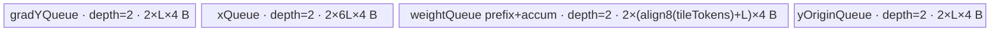

# SwigluGroupQuantGrad 950 ACLNN 算子知识

## 算子速览

| 项目 | 内容 |
|---|---|
| 实际入口 | 公开两段式 `aclnnSwigluGroupQuantGradGetWorkspaceSize` / `aclnnSwigluGroupQuantGrad`；内部 OpType `SwigluGroupQuantGrad` |
| 计算语义 | 对 `x=[x0,x1]` 求 SwiGLU 反向梯度；可选乘 `weight` 并求 `grad_weight`，可选 Clamp mask，可选按 `group_index` 截断有效 token |
| 输入输出 | `grad_y:[...,H]`、`x:[...,2H]`、可选 `weight:[...,1]`、`y_origin:[...,H]`、`group_index:[G]`；输出 `grad_x:[...,2H]`、可选 `grad_weight:[...,1]`；ND；主 dtype FP16/BF16/FP32 |
| 执行类型 | 单 Kernel，节点 K1=`AIV_VECTOR`；无可达 Cube/AIC、MIX_CV、SIMT、NDDMA 或 AICPU 节点 |
| Kernel 路线 | R-001 基础；R-002 Clamp；R-003 Weight；R-004 Weight+Clamp；每条含可选 GroupIndex 与 Full-H/Split-H 子模式 |
| 核心资源 | GM、AIV UB、`TQue<VECIN,2>`、Vector pipe barrier、V→MTE3 event；workspace 仅由 Host 预留，算子 body 不读取 |
| 来源闭包 | `source_closed`：公开 ACLNN 声明/约束→生成式 ACLNN 框架边界→OpDef/InferShape→Tiling/POD→950 binary config→单 AIV Kernel entry/body→活动构建接线已闭合 |
| 验证状态 | 已完成源码闭包检查；本次知识提取未执行编译、真机、数值或性能测试。 |

## 接口与语义

### 计算语义

把最后一维拆成 `x0=x[...,0:H]`、`x1=x[...,H:2H]`。令 `c=clamp_limit`；当 `c>0` 时，`x0'=min(x0,c)`、`x1'=min(max(x1,-c),c)`，否则 `x0'=x0,x1'=x1`。源码用 `exp(x0')/(exp(x0')+1)` 得到 `sigmoid(x0')`，再计算：

```text
s = sigmoid(x0')
silu = x0' * s
dsilu = s * (1 + x0' * (1 - s))
g = weight ? grad_y * weight : grad_y
grad_x0 = g * x1' * dsilu
grad_x1 = g * silu
```

启用 Clamp 时再乘严格不等式 mask：`grad_x0 *= I(x0<c)`，`grad_x1 *= I(-c<x1<c)`。提供 `weight` 时，`grad_weight[t]=sum_h(grad_y[t,h]*y_origin[t,h])`；注意该归约使用原始 `grad_y`，之后才用 `weight` 更新 `grad_y` 以计算 `grad_x`。提供 `group_index` 时每个 AIV 核对其 `int64` 元素求和并截到 `totalTokens`，只计算前 `trunc` 行；当 `0<trunc<totalTokens` 时，后续行的 `grad_x` 与存在时的 `grad_weight` 清零。`trunc==0` 是固定 Device 控制流的特殊失败边界：所有 block 都在进入同步/清零阶段前早退，输出不会由该 Kernel 写零。

### 输入、输出与属性

| 参数 | shape/layout | dtype | 约束、默认值与语义 |
|---|---|---|---|
| `gradY` / `grad_y` | `[T,H]` 或 `[B,S,H]`，ND | FP16/BF16/FP32 | 必选；与 `x` 同 rank、前导维一致，dtype 与 `x` 相同 |
| `x` | `[T,2H]` 或 `[B,S,2H]`，ND | FP16/BF16/FP32 | 必选；末维为偶数且是 `grad_y` 末维两倍 |
| `weightOptional` / `weight` | `[T,1]` 或 `[B,S,1]`，ND | FP32 | 可选；前导维等于 `grad_y`；存在时 `y_origin` 必须存在 |
| `yOriginOptional` / `y_origin` | 与 `grad_y` 相同，ND | FP16/BF16/FP32 | 可选；公开文档要求主 dtype 一致；固定 Tiling 源码只校验其属于三种主 dtype，未再次校验等于 `x` |
| `groupIndexOptional` / `group_index` | `[G]`，ND | INT64 | 可选；count 模式；Device 将每项窄化为 `uint32_t` 后累加，固定源码未校验元素非负或和的溢出 |
| `clampLimit` / `clamp_limit` | 标量属性 | FP32/double API 入参 | 默认 `-1.0`；只接受 `-1.0` 或 `>0` |
| `gradXOut` / `grad_x` | 与 `x` 相同，ND | 与 `x` 相同 | 必选 |
| `gradWeightOutOptional` / `grad_weight` | 与 `weight` 相同，ND | FP32 | 可选；`weight` 存在时产生 |

公开规格还限定 `B=1..31`、`S=0..128K`，`H∈{512,768,1024,1536,1792,2048,2560,4096}`；这些离散 H/B/S 限制未在本目录 Tiling 校验中逐项重验，调用方不得据此扩大公开有效域。

### 入口与版本

固定 Commit 只公开一组无版本后缀 ACLNN 符号：第一段返回 workspace 大小和 executor，第二段在给定 stream 执行。仓内没有手写 `op_api` 实现；`op_host/CMakeLists.txt:add_modules_sources(... ACLNNTYPE aclnn)` 将 OpDef 标为 ACLNN，生成式 inner bridge、executor 与两段式封装是明确框架边界。其后 `SwigluGroupQuantGrad` OpDef、InferShape、Tiling 和 Kernel 都在固定仓内闭合。

README 和 ACLNN 文档仅公开支持 Ascend 950PR/950DT，明确把 Atlas A2/A3 标为不支持；`SwigluGroupQuantGrad` OpDef 也只 `AddConfig("ascend950")`，因此本卡只覆盖 950，无 A2/A3 版本族。

## Host/Launcher 执行流程

### 参数校验与前处理

1. 生成式 ACLNN 第一段接收必选 `gradY/x/gradXOut`、四个可选 tensor/输出与 `clampLimit`，创建 executor；非连续 tensor 在公开文档中标为不支持，不存在算子自有 `Contiguous/ViewCopy` 路线。
2. `InferShapeForSwigluGroupQuantGrad` 校验 `grad_y/x` rank 与前导维、`2H`；若存在 `weight/y_origin/group_index`，分别校验 `[...,1]`、与 `grad_y` 同 shape、1-D，并推导 `grad_x=x.shape`、`grad_weight=weight.shape`。
3. `Tiling4SwigluGroupQuantGrad` 依次执行 `GetCompileInfo`、`CheckOpAllParams`。后者按 dtype→属性→输入 shape/可选组合→输出 shape 的顺序失败返回；`weight && !y_origin` 明确失败。
4. Host 从平台取 `AIV core` 数和 UB 大小，产生基础 POD、四类条件 UB 参数、`blockDim` 与 workspace；任一步返回 `GRAPH_FAILED` 即不启动 K1。

### 参数、Workspace 与生命周期

设 `N=totalTokens=∏ grad_y.shape[0:-1]`、`C=GetCoreNumAiv()`、`L=tileTokens*tileH`：

```text
blockDim = min(N, C)
system_ws = PlatformAscendC::GetLibApiWorkSpaceSize()
workspace[0] = system_ws + blockDim * 32 bytes
```

workspace 由第一段 ACLNN 报告、调用方在 Device 分配，并随 executor 在第二段提交给 K1；Kernel entry 虽有 `workspace` 参数，但 `SwigluGroupQuantGrad::Init/Process` 不绑定也不读取它，因此固定源码没有算子自有 workspace slice 或跨 Kernel 交接。executor 和输入输出需至少存活到第二段在 `stream` 上提交完成；更细的生成式 executor owner 规则在固定仓不可见。

### 启动图与失败传播

```text
aclnnSwigluGroupQuantGradGetWorkspaceSize
  -> generated ACLNN bridge (fixed-repo framework boundary)
  -> InferShapeForSwigluGroupQuantGrad
  -> Tiling4SwigluGroupQuantGrad
  -> executor + workspaceSize

aclnnSwigluGroupQuantGrad(workspace, workspaceSize, executor, stream)
  -> K1 swiglu_group_quant_grad<<<blockDim=min(N,C), AIV>>>
       POD=SwigluGroupQuantGradTilingData
       inputs=gradY,x,weight?,yOrigin?,groupIndex?
       outputs=gradX,gradWeight?
       workspace=passed but unused by body
```

这是单 Kernel 图，没有节点间边。Host Tiling 失败阻断 K1；公开第二段返回 ACLNN status。K1 内先处理 `[0,trunc)`，随后 `SyncAll()`，重置 pipe 后并行清零 `[trunc,N)`。固定仓没有额外 stream/event launch wrapper 源码，stream ordering 属于生成式 ACLNN 框架边界。

## Route 与参数设计

### 分核与资源计算

Host 先取 `ubAvailable=platformUB-32-8192`。令 `F=12 + (hasClamp?8:0) + (hasWeight?4:0)`，每个完整 H token 的保守预算为 `F*H*4 + (hasWeight?16*4:0)` 字节：

```text
if budget_per_token_full_H <= ubAvailable:
    needSplitH = 0
    tileH = H
    tileTokens = max(floor(ubAvailable / budget_per_token_full_H), 1)
else:
    needSplitH = 1
    if hasWeight: ubAvailable -= 16*4
    tileH = max(align_down(floor(ubAvailable/(F*4)), 16), 16)
    tileTokens = 1
numHTiles = ceil_div(H, tileH)
```

Host launch 核数由 `N` 决定；Device 若存在 `group_index`，求 `trunc=min(sum(uint32(group_index[g])),N)`，再令 `usedCoreNum=min(trunc,C)`、`tokensPerCore=ceil_div(trunc,usedCoreNum)`、`tokenStart=blockIdx*tokensPerCore`。每核按 token tile，再按 H tile 循环；最后一个 token/H tile分别取剩余量。`N=0` 时 Host `blockDim=0`，固定仓未显示运行时是否接受零 block launch；`N>0 && trunc==0` 时所有已启动 block 因 `blockIdx>=usedCoreNum` 早退，不能到达尾行清零。

### Route 选择

| 顺序 | Route | Key/模板 | 精确选择条件与优先级 | 不适用去向 |
|---:|---|---|---|---|
| 1 | R-001 基础 | 无 TilingKey；`SwigluGroupQuantGrad<DTYPE_X>` | `hasWeight==0 && hasClampLimit==0`；`y_origin` 可独立存在但不参与计算 | 条件不符按 flags 进入 R-002/R-003/R-004 |
| 2 | R-002 Clamp | 同上 | `hasWeight==0 && hasClampLimit==1` | 条件不符进入其它 flags 组合 |
| 3 | R-003 Weight | 同上 | `hasWeight==1 && hasYOrigin==1 && hasClampLimit==0` | `weight&&!y_origin` Host 失败；Clamp 则 R-004 |
| 4 | R-004 Weight+Clamp | 同上 | `hasWeight==1 && hasYOrigin==1 && hasClampLimit==1` | `weight&&!y_origin` Host 失败 |

```text
check dtype/shape/output/clamp
  -> hasWeight && !hasYOrigin ? GRAPH_FAILED
  -> flags (hasWeight,hasClampLimit)
       (0,0) -> R-001
       (0,1) -> R-002
       (1,0) -> R-003
       (1,1) -> R-004
  -> each Route: full-H budget fits ? Full-H : Split-H
  -> each Route: group_index present ? dynamic trunc/zero-tail : trunc=N
  -> dtype binary config selects FP16/BF16/FP32 DTYPE_X instance
```

### 模板/实现执行矩阵

| Route | key/selector | dtype/shape/platform 完整命中条件 | 执行拓扑与 Kernel 节点 | 实际模板/body | 内存与同步特征 | tail/fallback |
|---|---|---|---|---|---|---|
| R-001 基础 | flags `(0,0)` | 950；合法主 dtype/shape；无 weight；`clamp=-1` | 单 K1 AIV | `SwigluGroupQuantGrad<half/bfloat16_t/float>::Process` | gradY+x queues；Vector barriers；无 gradWeight | token/H tail；可选 group trunc 与 zero phase |
| R-002 Clamp | flags `(0,1)` | R-001 且 `clamp>0` | 单 K1 AIV | 同 body，启用 `ClampX/ApplyClampMask` | xQueue 扩为 10L FP32 子区；mask/截断值原位复用 | 同 R-001；非法 clamp Host 失败 |
| R-003 Weight | flags `(1,0)` | 950；weight FP32、yOrigin 存在且 shape 合法；`clamp=-1` | 单 K1 AIV | 同 body，启用 gradWeight 与 `UpdateGradY` | 新增 weight/yOrigin queues；V→MTE3 event 输出 gradWeight | H 分片归约；token/H tail；group zero phase |
| R-004 Weight+Clamp | flags `(1,1)` | R-003 且 `clamp>0` | 单 K1 AIV | R-002+R-003 条件方法 | 四队列、最大 xQueue、Vector barriers、V→MTE3 event | 两类条件尾块合并；失败无 fallback |

### 隐藏性能 Guard

| Guard | Host/Tiling 条件 | Device/资源原因 | 影响 Route | 不满足时去向 | 源码符号 |
|---|---|---|---|---|---|
| Full-H UB | `ubPerTokenFullH<=ubAvailable` | 允许 `tileH=H` 并以多个 token 提高 tile 利用 | 全部 | Split-H 子模式，`tileTokens=1` | `CalculateTilingParams` |
| Split-H 16 元素对齐 | Full-H 不满足；`tileH=align_down(...,16)` | FP16/BF16 32B 对齐粒度，同时 FP32 计算区按统一 L 管理 | 全部 | 最低强制 16；若平台资源仍不足，固定源码没有再次失败检查 | `CalculateTilingParams` |
| Clamp UB | `clampLimit>0` | 保存未截断 `x0/x1`，再生成三个 uint8 mask 和两个 FP32 mask | R-002/R-004 | `-1` 走非 Clamp；其它非正数失败 | `CheckAllAttrs`; `InitBuffer`; `ApplyClampMask` |
| Weight UB | `weight!=nullptr && y_origin!=nullptr` | 保存 token weight、跨 H tile FP32 累加区和 yOrigin tile | R-003/R-004 | 缺 yOrigin 失败；无 weight 走 R-001/R-002 | `CheckInputShape`; `InitBuffer` |
| dtype binary | binary config 中 FP16/BF16/FP32 三项 | `DTYPE_X` 决定 GM dtype 与 Cast 路径 | 全部 | 其它 dtype Host 失败 | `swiglu_group_quant_grad_binary.json`; `CheckAllInputDtype` |
| dynamic trunc | `hasGroupIndex` | 每核读取 group counts；有效核数可能小于 launch blockDim，尾行需独立清零 | 全部 | 无 groupIndex 时 `trunc=N`，zero phase 立即返回 | `Init`; `Process`; `ZeroOutTrunc` |

### POD/ABI

`SwigluGroupQuantGradTilingData` 的宏定义实现不在固定仓内；全部字段均为 32 位且声明顺序如下，但精确 `sizeof/alignof/offsetof` 不能由本仓宏展开验证，不能假定无隐藏 header/padding。

| 结构 | 字段 | 类型/位宽 | ABI 布局 | 单位 | Host/launcher producer | Device consumer | 边界 |
|---|---|---|---|---|---|---|---|
| `SwigluGroupQuantGradTilingData` | `coreNumAll` | `uint32_t/32` | 宏布局不可见 | AIV core | `SetBasicTilingData=totalCore` | `ParseTilingData`; `ComputeTruncRelatedParams` | 平台核数须非 0 |
| 同上 | `ubSize` | `uint32_t/32` | 同上 | byte | `SetBasicTilingData=platform UB` | Kernel 不读取 | inactive Device 字段 |
| 同上 | `totalTokens` | `uint32_t/32` | 同上 | token | `GetTotalTokens` 的 32 位连乘 | GM extent、分核、尾清零 | 乘法/维度窄化未检查 |
| 同上 | `dim2H` | `uint32_t/32` | 同上 | element | `uint32_t(x.lastDim)` | x/gradX stride 与 zero extent | 应为 `2*dimH` |
| 同上 | `dimH` | `uint32_t/32` | 同上 | element | `uint32_t(gradY.lastDim)` | GM stride、H loop | 公开 H 集合至 4096 |
| 同上 | `hasWeight` | `uint32_t/32` | 同上 | bool flag | optional weight 是否存在 | GM binding、UB 分配、计算/output | 1 时 Host 要求 yOrigin |
| 同上 | `hasYOrigin` | `uint32_t/32` | 同上 | bool flag | optional yOrigin 是否存在 | yOrigin GM binding | 无 weight 时绑定但不消费 |
| 同上 | `hasGroupIndex` | `uint32_t/32` | 同上 | bool flag | optional groupIndex 是否存在 | `Init` trunc 分支 | 元素值域未校验 |
| 同上 | `hasClampLimit` | `uint32_t/32` | 同上 | bool flag | `clamp!=-1` 且已验证 `>0` | UB 分配、Clamp/mask 分支 | 仅 0/1 |
| 同上 | `needSplitH` | `uint32_t/32` | 同上 | bool flag | `CalculateTilingParams` | Kernel 不直接读取 | 行为由 tileH/numHTiles 间接体现 |
| 同上 | `clampLimit` | `float/32` | 同上 | 数值 | `CheckAllAttrs` | `ClampX/ApplyClampMask` | `-1` 或正值 |
| 同上 | `groupNum` | `uint32_t/32` | 同上 | element | groupIndex dim0；无输入为 0 | `Init` 的 GM extent/loop | 维度窄化未检查 |
| 同上 | `tileTokens` | `uint32_t/32` | 同上 | token | UB 公式 | tileLength、token tile loop、weight区 | Split-H 固定 1 |
| 同上 | `tileH` | `uint32_t/32` | 同上 | element | UB 公式 | tileLength、H loop、DMA stride、归约 | Split-H 向下对齐 16 |
| 同上 | `numHTiles` | `uint32_t/32` | 同上 | tile | `ceil_div(dimH,tileH)` | H loop、最后 tile/归约条件 | 应至少 1（公开 H>0） |

### Route 源码闭包

| Route | Key/selector | Host/Tiling producer | POD/参数 | Kernel entry/router 节点 | Kernel body/直接依赖 | 构建接线 |
|---|---|---|---|---|---|---|
| R-001 基础 | flags `(0,0)`；无 key | `Tiling4SwigluGroupQuantGrad`; `CalculateTilingParams` | `SwigluGroupQuantGradTilingData` | `swiglu_group_quant_grad`; dtype binary instance | `SwigluGroupQuantGrad::Process/ProcessTile`; base `InitBuffer` | op_host ACLNN registration + ascend950 binary config + `prepare_compile_from_config(.../op_kernel)` |
| R-002 Clamp | flags `(0,1)` | 同上；`CheckAllAttrs` | 同上；Clamp fields | 同 K1 | 加 `ClampX/ApplyClampMask` | 同上 |
| R-003 Weight | flags `(1,0)` | 同上；`CheckWeightShapeDim/CheckYOriginShapeDim` | 同上；Weight fields | 同 K1 | 加 `AccumulateGradWeight/UpdateGradY/CopyOutGradWeight` | 同上 |
| R-004 Weight+Clamp | flags `(1,1)` | 两类条件 producer | 同上 | 同 K1 | R-002 与 R-003 helper 合并 | 同上 |

## Kernel 实现

### 公共执行流程

K1 entry 无 key router：按 binary config 的 `DTYPE_X` 实例化 `SwigluGroupQuantGrad<T>`，调用 `Init` 后 `Process`。`Init` 解析 POD、绑定 GM；每个 block 独立求 group sum，再算有效核与 token 起点并按 flags 分配 queues。`Process` 对每个 token tile 依次遍历 H tile；每 tile 的顺序固定为 CopyIn→可选 gradWeight/weight→可选 Clamp→SiLU grad→gradX→可选 mask→CopyOut。所有有效 token 完成后 `SyncAll`，`pipe.Reset()`，再按 block stride 清零截断尾行。

### Route R-001：基础

#### 适用条件

##### 选择证据

| 层级 | 文件 | 符号 | 源码谓词/参数 | 结果/下一跳 |
|---|---|---|---|---|
| API | `docs/aclnnSwigluGroupQuantGrad.md` | 两段式 ACLNN 原型 | `weightOptional=null`、`clampLimit=-1` | 生成 executor |
| Host | `op_host/...tiling_utils.h` | `CheckAllAttrs/CheckWeightShapeDim` | clamp 保持 -1；weight shape null | flags `(0,0)` |
| Tiling | 同上 | `CalculateTilingParams` | `F=12`；按 UB 决定 Full/Split-H | POD tile fields |
| Router | `op_kernel/swiglu_group_quant_grad.cpp` | `swiglu_group_quant_grad` | binary config 选 `DTYPE_X` | `SwigluGroupQuantGrad<T>` |

#### Device 数据流

##### 函数级调用链

```text
K1 swiglu_group_quant_grad
  -> SwigluGroupQuantGrad<T>::Init
     -> ParseTilingData -> optional group sum -> ComputeTruncRelatedParams -> InitBuffer
  -> Process
     -> [token tile][H tile] ProcessTile
        -> CopyInGradY + CopyInX
        -> ComputeSiLUGrad -> ComputeGradX -> CopyOutGradX
     -> SyncAll -> optional InitZeroOutTruncBuffer -> ZeroOutTrunc
```

##### 源码等价伪码

```text
trunc = hasGroupIndex ? min(sum_g uint32(groupIndex[g]), N) : N
used = min(trunc, C); begin = blockIdx * ceil_div(trunc, used)
if blockIdx >= used: return
for tokenIdx in [begin, min(begin+tokensPerCore,trunc)) step tileTokens:
  curT = min(tileTokens, tokenEnd-tokenIdx)
  for hIdx in [0,numHTiles):
    curH = (last H tile ? H-hIdx*tileH : tileH)
    copy gradY[tokenIdx*H+hIdx*tileH : curT*curH] -> FP32 UB
    copy x0/x1 by curT strided rows -> FP32 UB
    s = exp(x0)/(exp(x0)+1)
    x0 = gradY*x1*(s*(1+x0*(1-s))); x1 = gradY*(x0_original*s)
    cast RINT to T when T!=float; strided copy x0/x1 -> gradX
SyncAll(); reset UB; for t=trunc+blockIdx; t<N; t+=used: zero gradX[t,:]
```

#### 内存与数据搬运

##### 资源与搬运表

| 层级/缓冲区 | offset/地址公式 | extent/容量公式 | dtype/layout | producer | consumer | owner/lifetime | 对齐/复用 |
|---|---|---|---|---|---|---|---|
| gradY GM | `tokenIdx*H+hIdx*tileH` | `curT*curH` elements | T, logical `[token,H]` | caller | `CopyInGradY` | caller through launch | one contiguous DMA |
| x GM x0/x1 | `tokenIdx*2H+hOff` / `+H` | each `curT*curH` | T, `[token,2H]` | caller | `CopyInX` | caller | `blockCount=curT, blockLen=curH*sizeof(T), srcStride=(2H-curH)*sizeof(T)` |
| `gradYQueue` | queue slot 0 | depth 2, slot `L*4` | FP32 after optional cast | CopyIn | ComputeGradX | pipe; freed per tile | FP16/BF16 storage reinterpreted then expanded in same slot |
| `xQueue` | six logical FP32 L-regions | depth 2, slot `6L*4` | FP32 | CopyInX | SiLU/grad/copyout | pipe; freed per tile | x0/x1 updated in place to gradX |
| gradX GM | `tokenIdx*2H+hOff` / `+H` | each `curT*curH` | T | `CopyOutGradX` | caller | output | `dstStride=(2H-curH)*sizeof(T)` |
| zero phase UB | x at 0; one FP32 zero after aligned `2H` | depth 2, slot `(align8(2H)+8)*4` | T+FP32 view | `Duplicate` | `ZeroOutTrunc` | after `pipe.Reset` | main queues no longer live |

##### 分层内存布局


##### 字节账与复用顺序

```text
L = tileTokens * tileH
UB_main = 2*(L*4) + 2*(6L*4) = 56L bytes
Host conservative selector budget = 12L*4 = 48L bytes, additionally reserves 8192+32 bytes
UB_zero_after_pipe_reset = 2*(align8(2H)+8)*4 bytes
dynamic_ub = N/A（AIV TPipe 静态队列）
workspace_total = system_ws + blockDim*32 bytes；算子 body 使用量为 0
```

`InitBuffer` 的 depth=2 计入上式。固定 Host 预算因子与按队列逐项字节账并不相等；卡片不把 8192+32 的保留量推测分摊到具体 queue，复用时必须重新核对目标平台 `TPipe::InitBuffer` ABI 和 UB 上限。

| 复用子区 | 写入者 | 读取者/消费点 | 下一次覆盖 | 同步或释放依据 | 安全条件 |
|---|---|---|---|---|---|
| xQueue region 0/1 | `CopyInX` | SiLU/grad | `ComputeGradX` 原位写 grad_x0/x1 | 每 Vector 步后 `PipeBarrier<PIPE_V>` | CopyOut 前不得覆盖 |
| xQueue tmp region 5 | `Exp/Copy/Add/Div/...` | 下一 SiLU primitive | 同 tile 下一 primitive | Vector barrier | 各 primitive 顺序保持 |
| 全部主 queues | `ProcessTile` | CopyOut | zero phase `pipe.Reset` 后整体重建 | `SyncAll(); pipe.Reset()` | 所有有效 token CopyOut 完成 |

#### 同步、精度与尾块

##### 同步与数值边界表

| 阶段 | primitive/机制 | producer | consumer/等待点 | 保护对象 | 精度/尾块 |
|---|---|---|---|---|---|
| CopyIn→Vector | TQue EnQue/DeQue | MTE2 CopyIn | ProcessTile DeQue | gradY/x slot | 只处理 `computeSize=curT*curH` |
| Vector 链 | `PipeBarrier<PIPE_V>` | 每个 Exp/Div/Mul/Add | 下一 Vector API | 原位 FP32 subregion | 主计算 FP32；源码 sigmoid 为 `exp(x)/(exp(x)+1)` |
| Vector→GM | V_MTE3 event | cast/Vector result | DataCopyPad | gradX subregion | FP16/BF16 用 `CAST_RINT` 降精度；FP32直出 |
| 跨核阶段 | `SyncAll` | 所有有效区 CopyOut | pipe reset/zero phase | 主输出与 UB 生命周期 | Host launch block 数与 Device usedCore 可能因 trunc 不同，固定源码按此协议执行 |
| tail | bounds + DataCopyPad | loop indices | GM write | 末 token/H tile | `curT/curH` 限定有效元素；截断尾行清零 |

#### 关键实现

##### 符号证据表

| 阶段 | 文件 | 符号/模板实例 | 实现事实 |
|---|---|---|---|
| Host/Tiling producer | `op_host/swiglu_group_quant_grad_tiling_utils.h` | `CalculateTilingParams/SetBasicTilingData` | 产生 flags、Full/Split-H tile 与 POD |
| Kernel entry/router | `op_kernel/swiglu_group_quant_grad.cpp` | `swiglu_group_quant_grad`; `SwigluGroupQuantGrad<DTYPE_X>` | 单 entry、无 key router |
| Device body/helper | `op_kernel/swiglu_group_quant_grad.h` | `ProcessTile/ComputeSiLUGrad/ComputeGradX/CopyOutGradX` | FP32 Vector 链、原位输出、tail DMA |

### Route R-002：Clamp

#### 适用条件

##### 选择证据

| 层级 | 文件 | 符号 | 源码谓词/参数 | 结果/下一跳 |
|---|---|---|---|---|
| API/Host | `op_host/...tiling_utils.h` | `CheckAllAttrs` | `clampLimit!=-1 && clampLimit>0` | `hasClampLimit=1` |
| Tiling | 同上 | `CalculateTilingParams` | `F=12+8=20` | Clamp UB tile |
| Router/body | `op_kernel/swiglu_group_quant_grad.h` | `ProcessTile` | `if(hasClampLimit)` | `ClampX` 与 `ApplyClampMask` |

#### Device 数据流

##### 函数级调用链

```text
K1 -> Init -> InitBuffer(xQueue slot=10L*4)
   -> ProcessTile -> CopyIn -> ClampX -> ComputeSiLUGrad -> ComputeGradX
                  -> ApplyClampMask -> CopyOutGradX
   -> SyncAll -> optional zero phase
```

##### 源码等价伪码

```text
save x0_original,x1_original in xQueue regions 8,9
x0=min(x0,c); x1=min(max(x1,-c),c)
compute FP32 SwiGLU gradient as R-001
m0=(x0_original<c); m1=(x1_original>-c)&&(x1_original<c)
overwrite saved-original regions with FP32 masks selected from {1,0}
grad_x0*=m0; grad_x1*=m1; copy out; same token/H/group tails as R-001
```

#### 内存与数据搬运

##### 资源与搬运表

| 层级/缓冲区 | offset/地址公式 | extent/容量公式 | dtype/layout | producer | consumer | owner/lifetime | 对齐/复用 |
|---|---|---|---|---|---|---|---|
| R-001 resources | 同 R-001 | 同 R-001 | 同上 | 同上 | 同上 | 同上 | 同上 |
| xQueue saved originals | regions 8,9 | `2L` FP32 per slot | FP32 | `ClampX::Copy` | CompareScalar | xQueue slot | 比较后原位改作 mask FP32 |
| xQueue byte-mask scratch | region 5 起的 uint8 reinterpret offsets 0,L,2L floats | 三个 `computeSize` uint8 masks | uint8 | CompareScalar/And | Select | tmp region | maskX1Left 原位变成 AND 结果 |

##### 分层内存布局


##### 字节账与复用顺序

```text
UB_main = 2*(L*4) + 2*(10L*4) = 88L bytes
Host conservative selector budget = 20L*4 = 80L bytes, plus reserved 8192+32 bytes
UB_zero/workspace/dynamic_ub = 同 R-001
```

| 复用子区 | 写入者 | 读取者/消费点 | 下一次覆盖 | 同步或释放依据 | 安全条件 |
|---|---|---|---|---|---|
| regions 8/9 | `ClampX` 保存原值 | `CompareScalar` | `Select` 写 FP32 mask | Vector barriers | mask 比较完成后才覆盖原值 |
| tmp uint8 subregions | 三次 Compare | `And/Select` | onesTensor 与下 tile | Vector barriers/FreeTensor | offset 关系保持源码定义 |

#### 同步、精度与尾块

##### 同步与数值边界表

| 阶段 | primitive/机制 | producer | consumer/等待点 | 保护对象 | 精度/尾块 |
|---|---|---|---|---|---|
| Clamp | Copy/Mins/Maxs + V barrier | 原始 x | SiLU | x0/x1及备份 | FP32，严格 mask 边界 `<,>,<` |
| Mask | CompareScalar/And/Select/Mul | originals/grad | CopyOut | mask scratch和grad | 仅 `computeSize` lanes有效 |
| 其它 | 同 R-001 | 同上 | 同上 | 同上 | 同一 cast/tail/zero 协议 |

#### 关键实现

##### 符号证据表

| 阶段 | 文件 | 符号/模板实例 | 实现事实 |
|---|---|---|---|
| Host/Tiling producer | `op_host/swiglu_group_quant_grad_tiling_utils.h` | `CheckAllAttrs/CalculateTilingParams` | Clamp 合法性与 UB factor |
| Kernel entry/router | `op_kernel/swiglu_group_quant_grad.cpp` | `swiglu_group_quant_grad` | 与基础路线同一模板 entry |
| Device body/helper | `op_kernel/swiglu_group_quant_grad.h` | `ClampX/ApplyClampMask` | 保存原值、严格比较、原位 mask 复用 |

### Route R-003：Weight

#### 适用条件

##### 选择证据

| 层级 | 文件 | 符号 | 源码谓词/参数 | 结果/下一跳 |
|---|---|---|---|---|
| Host | `op_host/...tiling_utils.h` | `CheckWeightShapeDim/CheckInputShape` | weight 存在、shape `[...,1]`；必须有 yOrigin | `hasWeight=hasYOrigin=1` |
| Tiling | 同上 | `CalculateTilingParams` | `F=12+4=16`，另加 `16*4` B | Weight tile |
| Body | `op_kernel/swiglu_group_quant_grad.h` | `Process/ProcessTile` | `if(hasWeight)` | weight/yOrigin/gradWeight 路径 |

#### Device 数据流

##### 函数级调用链

```text
K1 -> Process[token tile]
   -> CopyInTopkWeight
   -> each H tile: CopyInGradY/X/YOrigin
      -> AccumulateGradWeight(yOrigin*original_gradY)
      -> UpdateGradY(*weight)
      -> SiLU grad -> gradX CopyOut
   -> CopyOutGradWeight
   -> SyncAll -> optional zero gradX/gradWeight tail
```

##### 源码等价伪码

```text
weightUB = weight[tokenIdx:tokenIdx+curT]
for each H tile:
  p = FP32(yOrigin_tile) * FP32(gradY_tile)
  accum[0:curT*tileH] = (first ? p : accum+p)
  if last H tile: for t: ReduceSum(accum[t*tileH], tileH)
  for t: gradY[t,:] *= weightUB[t]
  compute/copy gradX as R-001
for t: copy one FP32 reduced scalar to gradWeight[tokenIdx+t]
```

#### 内存与数据搬运

##### 资源与搬运表

| 层级/缓冲区 | offset/地址公式 | extent/容量公式 | dtype/layout | producer | consumer | owner/lifetime | 对齐/复用 |
|---|---|---|---|---|---|---|---|
| R-001 resources | 同 R-001 | 同 R-001 | 同上 | 同上 | 同上 | 同上 | 同上 |
| weight GM→queue | `tokenIdx` | `curT` | FP32 token vector | `CopyInTopkWeight` | UpdateGradY | token tile | queue前缀按 8 FP32 对齐 |
| weightQueue accum | `align8(tileTokens)` | `L` FP32 | FP32 `[token,tileH]` | Accumulate | Reduce/CopyOut | 跨全部 H tiles | 与 weight 前缀同一 queue slot的非重叠后缀 |
| yOriginQueue | `tokenIdx*H+hIdx*tileH` | depth 2, slot `L*4` | FP32 after cast | CopyInYOrigin | Accumulate | freed each H tile | Split-H 时 tileTokens=1；Full-H contiguous |
| gradWeight GM | `tokenIdx+t` | one FP32/token | FP32 | CopyOutGradWeight | caller | output | V_MTE3 event；每次 blockLen=4 B |

##### 分层内存布局



##### 字节账与复用顺序

```text
A = align8(tileTokens)
UB_main = 2L*4 + 2*6L*4 + 2*(A+L)*4 + 2L*4 = 72L + 8A bytes
Host conservative selector budget = 16L*4 + 16*4 bytes = 64L+64 bytes
UB_zero = 2*(align8(2H)+8)*4 bytes after pipe reset
workspace_total = system_ws+blockDim*32；body使用0
```

| 复用子区 | 写入者 | 读取者/消费点 | 下一次覆盖 | 同步或释放依据 | 安全条件 |
|---|---|---|---|---|---|
| weightQueue prefix | CopyInTopkWeight | UpdateGradY | next token tile | weightQueue FreeTensor | 所有 H tiles 与 gradWeight CopyOut 完成 |
| weightQueue suffix | first H tile Copy | later H tile Add/Reduce | next token tile | V barriers + FreeTensor | 跨 H tile累积区不得提前释放 |
| yOriginQueue slot | CopyInYOrigin | Mul/Add | next H tile | FreeTensor | Accumulate 完成后释放 |

#### 同步、精度与尾块

##### 同步与数值边界表

| 阶段 | primitive/机制 | producer | consumer/等待点 | 保护对象 | 精度/尾块 |
|---|---|---|---|---|---|
| gradWeight accumulate | Mul/Copy/Add + V barrier | yOrigin、原 gradY | ReduceSum | accum suffix | 全程 FP32；最后 H tile才归约 |
| weight update | scalar `GetValue` + Muls | weight prefix | SiLU grad | gradY tile | 每 token 独立 weight |
| gradWeight out | V_MTE3 event | ReduceSum | DataCopyPad | 每 token scalar | 4-byte有效搬出 |
| group tail | SyncAll + zero phase | valid phase | strided zero loop | gradX和gradWeight尾行 | `hasWeight` 时两输出同时清零 |

#### 关键实现

##### 符号证据表

| 阶段 | 文件 | 符号/模板实例 | 实现事实 |
|---|---|---|---|
| Host/Tiling producer | `op_host/swiglu_group_quant_grad_tiling_utils.h` | `CheckWeightShapeDim/CheckInputShape/CalculateTilingParams` | 组合校验与资源因子 |
| Kernel entry/router | `op_kernel/swiglu_group_quant_grad.cpp` | `swiglu_group_quant_grad` | 同一 dtype 模板 entry |
| Device body/helper | `op_kernel/swiglu_group_quant_grad.h` | `AccumulateGradWeight/UpdateGradY/CopyOutGradWeight` | FP32跨 H tile累积与输出 |

### Route R-004：Weight+Clamp

#### 适用条件

##### 选择证据

| 层级 | 文件 | 符号 | 源码谓词/参数 | 结果/下一跳 |
|---|---|---|---|---|
| Host | `op_host/...tiling_utils.h` | `CheckAllAttrs/CheckInputShape` | `weight&&yOrigin&&clamp>0` | flags `(1,1)` |
| Tiling | 同上 | `CalculateTilingParams` | `F=12+8+4=24`，另加64 B | 最大 UB 路线 |
| Body | `op_kernel/swiglu_group_quant_grad.h` | `ProcessTile` | 两个独立 `if` 均为真 | Weight 路径后 Clamp 路径 |

#### Device 数据流

##### 函数级调用链

```text
K1 -> CopyIn weight
   -> each H tile: CopyIn gradY/x/yOrigin
      -> gradWeight accumulate -> gradY*=weight
      -> ClampX -> SiLUGrad -> GradX -> ApplyClampMask -> CopyOutGradX
   -> CopyOutGradWeight -> SyncAll -> optional two-output zero phase
```

##### 源码等价伪码

```text
执行 R-003 的 gradWeight 累积与 gradY 权重缩放；
随后执行 R-002 的 x clamp、FP32 SwiGLU grad、基于原 x 的严格 mask；
tile、dtype cast、group trunc 与尾部清零规则不变。
```

#### 内存与数据搬运

##### 资源与搬运表

| 层级/缓冲区 | offset/地址公式 | extent/容量公式 | dtype/layout | producer | consumer | owner/lifetime | 对齐/复用 |
|---|---|---|---|---|---|---|---|
| gradYQueue | slot 0 | depth 2, slot `L*4` | FP32 | CopyIn | weight+grad | tile | 同 R-003 |
| xQueue | regions 0..9 | depth 2, slot `10L*4` | FP32/uint8 views | CopyIn/Clamp | SiLU/mask/CopyOut | tile | 同 R-002 |
| weightQueue | prefix/suffix | depth 2, slot `(A+L)*4` | FP32 | weight/accum | update/reduce/output | token tile | 同 R-003 |
| yOriginQueue | slot 0 | depth 2, slot `L*4` | FP32 | CopyIn | accumulate | H tile | 同 R-003 |

##### 分层内存布局


##### 字节账与复用顺序

```text
A = align8(tileTokens)
UB_main = 2L*4 + 2*10L*4 + 2*(A+L)*4 + 2L*4 = 104L + 8A bytes
Host conservative selector budget = 24L*4 + 64 bytes = 96L+64 bytes
UB_zero/workspace/dynamic_ub = 同 R-003
```

| 复用子区 | 写入者 | 读取者/消费点 | 下一次覆盖 | 同步或释放依据 | 安全条件 |
|---|---|---|---|---|---|
| x saved-original→mask | ClampX | Compare/Select/Mul | next tile | V barriers | 同 R-002 |
| weight prefix/suffix | CopyIn/Accumulate | Update/Reduce/CopyOut | next token tile | V barriers、V_MTE3 event、FreeTensor | 同 R-003 |

#### 同步、精度与尾块

##### 同步与数值边界表

| 阶段 | primitive/机制 | producer | consumer/等待点 | 保护对象 | 精度/尾块 |
|---|---|---|---|---|---|
| Weight | 同 R-003 | gradY/yOrigin/weight | gradX与gradWeight | FP32 accum | H tail参与累积 |
| Clamp/mask | 同 R-002 | original x | gradX | xQueue复用区 | 严格边界 mask |
| Output/zero | V_MTE3 + SyncAll | 两类结果 | GM/zero phase | 两输出 | group tail同时清零 |

#### 关键实现

##### 符号证据表

| 阶段 | 文件 | 符号/模板实例 | 实现事实 |
|---|---|---|---|
| Host/Tiling producer | `op_host/swiglu_group_quant_grad_tiling_utils.h` | `CheckAllAttrs/CheckInputShape/CalculateTilingParams` | 最大 factor 与组合 guard |
| Kernel entry/router | `op_kernel/swiglu_group_quant_grad.cpp` | `swiglu_group_quant_grad` | 单 entry |
| Device body/helper | `op_kernel/swiglu_group_quant_grad.h` | `ProcessTile` 及 R-002/R-003 helpers | Weight先于Clamp，两个条件管线在一 tile内融合 |

## 算子特定优化

### Trick T-001：Host 按条件资源选择 Full-H 或 Split-H

#### 触发与源码依据

- 适用 Route：R-001～R-004
- 触发条件：由 `hasClampLimit/hasWeight` 形成 UB factor；完整 H token 超出 `ubAvailable` 时切 Split-H
- Golden 来源：[`activation/swiglu_group_quant_grad/op_host/swiglu_group_quant_grad_tiling_utils.h:400-435`](../../../../../../../cann-ops-raw/ascendc/ops-nn/955f8b33985b6d72989ebff341bb9c2c564a51bc/activation/swiglu_group_quant_grad/op_host/swiglu_group_quant_grad_tiling_utils.h#L400-L435)

**官方源码（固定 Commit 连续逐字摘录）**：

```cpp
uint32_t ubFactor = UB_BASE_FACTOR;
if (hasClampLimit) {
    ubFactor += UB_CLAMP_EXTRA_FACTOR;
}
if (hasWeight) {
    ubFactor += UB_WEIGHT_EXTRA_FACTOR;
}

uint32_t ubAvailable = compileInfo.ubSize - BLOCK_SIZE - TMP_DATA_UB_SIZE;
uint32_t ubPerTokenFullH = ubFactor * dimH * sizeof(float);
```

#### 机制与设计原因

Host 把条件计算需要的额外 UB 纳入 tile 决策：Full-H 可把一行完整隐藏维留在 UB，并用剩余空间批多个 token；放不下时固定 `tileTokens=1`，把 `tileH` 对齐到 16 元素后沿 H 循环。这样避免用一套最大条件缓冲强迫所有场景采用小 tile。Split-H 同时固定 `tileTokens=1`，这与 `CopyInGradY/CopyInYOrigin` 使用单个连续 DMA（没有 token 行 stride）相配套；Full-H 才允许多个 token，因为整行 H 在 GM 中连续。逐 queue 字节账和 Host factor 存在固定源码可见差异，移植时必须重新验证，不能仅复制 factor 常量。

#### 迁移边界

- 适用：有条件 buffer 且可沿最后一维切分的纯 Vector 算子。
- 前提：950 AIV；相同 FP32 计算布局；H tile 归约/尾块语义可保持。
- 失效：资源不足时只能走 Split-H；若连最小 16 元素 tile 都无法安全分配，固定源码没有额外 fallback，应在 Host 失败而非继续缩小。
- 未验证：本次知识提取未执行编译、真机、数值或性能测试。

#### 错误做法

固定仓提供的可验证边界是：忽略 Clamp/Weight flags 会使用错误的 UB 预算；固定仓未提供真机溢出反例。

### Trick T-002：Clamp 原值区原位改作 FP32 mask

#### 触发与源码依据

- 适用 Route：R-002、R-004
- 触发条件：`hasClampLimit==1`
- Golden 来源：[`activation/swiglu_group_quant_grad/op_kernel/swiglu_group_quant_grad.h:295-327`](../../../../../../../cann-ops-raw/ascendc/ops-nn/955f8b33985b6d72989ebff341bb9c2c564a51bc/activation/swiglu_group_quant_grad/op_kernel/swiglu_group_quant_grad.h#L295-L327)

**官方源码（固定 Commit 连续逐字摘录）**：

```cpp
// reuse x0TruncatedLocalTensor/x1TruncatedLocalTensor
LocalTensor<float> maskX0Local = x0TruncatedLocalTensor;
LocalTensor<float> maskX1Local = x1TruncatedLocalTensor;
```

#### 机制与设计原因

Clamp 前保存的 x 原值只需存活到三个严格比较完成；随后同一物理子区被 `Select` 覆盖为 0/1 FP32 mask，再直接乘到已原位写入 x0/x1 区的梯度。它避免另外物化两块 FP32 mask。uint8 比较 scratch 又复用 tmp 区，步骤间用 `PIPE_V` barrier 保证覆盖顺序。

#### 迁移边界

- 适用：原值只服务于后置 mask，比较后不再读取的激活反向算子。
- 前提：严格边界语义保持为 `x0<c` 与 `-c<x1<c`，buffer offsets 与 mask API 容量足够。
- 失效：若后续仍需原值，必须保留独立区或推迟覆盖；非 Clamp 路线不分配这些区。
- 未验证：本次知识提取未执行编译、真机、数值或性能测试。

#### 错误做法

在 `CompareScalar` 完成前覆盖 saved-original 会改变 mask；这是源码生命周期顺序直接排除的做法。

### Trick T-003：主计算统一升到 FP32，输出再受控降精度

#### 触发与源码依据

- 适用 Route：R-001～R-004 的 FP16/BF16 binary instance
- 触发条件：`T` 不是 `float`
- Golden 来源：[`activation/swiglu_group_quant_grad/op_kernel/swiglu_group_quant_grad.h:450-467`](../../../../../../../cann-ops-raw/ascendc/ops-nn/955f8b33985b6d72989ebff341bb9c2c564a51bc/activation/swiglu_group_quant_grad/op_kernel/swiglu_group_quant_grad.h#L450-L467)

**官方源码（固定 Commit 连续逐字摘录）**：

```cpp
LocalTensor<T> x0TLocalTensor = x0FloatLocalTensor.template ReinterpretCast<T>();
Cast(x0TLocalTensor, x0FloatLocalTensor, RoundMode::CAST_RINT, currentTileLength);
PipeBarrier<PIPE_V>();
LocalTensor<T> x1TLocalTensor = x1FloatLocalTensor.template ReinterpretCast<T>();
Cast(x1TLocalTensor, x1FloatLocalTensor, RoundMode::CAST_RINT, currentTileLength);
```

#### 机制与设计原因

CopyIn 后 FP16/BF16 输入在 queue 的同一物理 slot 中转成 FP32，所有 sigmoid、梯度、Clamp 与归约均在 FP32 执行；`grad_x` 最后用 `CAST_RINT` 降回 T。这样避免在非线性链和 H 归约中反复低精度舍入，并复用 queue slot而非另设 cast buffer。FP32实例跳过两端 Cast。

#### 迁移边界

- 适用：输入输出可低精度、非线性和累积需要 FP32 中间值的 AIV Vector 路线。
- 前提：UB按 FP32 L 预算，reinterpret offset 与 T 元素宽度匹配。
- 失效：若接口要求其它 round mode 或逐步低精度语义，不能复用该降精度顺序。
- 未验证：本次知识提取未执行编译、真机、数值或性能测试。

#### 错误做法

固定仓明确以 `CAST_RINT` 输出；替换 round mode 会改变数值语义。固定仓未提供误差对比数据。

### Trick T-004：主计算后重置 Pipe 复用整块 UB 做截断清零

#### 触发与源码依据

- 适用 Route：R-001～R-004 的 `groupIndex` 子模式且 `trunc<totalTokens`
- 触发条件：`0<trunc<totalTokens`，有效区完成并经过 `SyncAll()`
- Golden 来源：[`activation/swiglu_group_quant_grad/op_kernel/swiglu_group_quant_grad_base.h:85-91`](../../../../../../../cann-ops-raw/ascendc/ops-nn/955f8b33985b6d72989ebff341bb9c2c564a51bc/activation/swiglu_group_quant_grad/op_kernel/swiglu_group_quant_grad_base.h#L85-L91)

**官方源码（固定 Commit 连续逐字摘录）**：

```cpp
if (truncValue < totalTokens) {
    pipe.Reset();
    uint32_t zeroOutBufSize = (AlignUp(dim2H, FP32_32B_ALIGN_NUM) + FP32_32B_ALIGN_NUM) * sizeof(float);
    pipe.InitBuffer(zeroQueue, BUFFER_NUM, zeroOutBufSize);
}
```

#### 机制与设计原因

有效 token 的复杂队列不再存活后，Kernel 在同步点后重置 TPipe，把同一 UB 重新解释为覆盖一整行 `2H` 的 zero queue；各核从 `trunc+blockIdx` 起以 `usedCoreNum` 为步长写零。它避免让 zero buffer与最大主计算 UB 同时常驻，并把截断后的两类输出在同一 Kernel 中完成。

#### 迁移边界

- 适用：一个 Kernel 内存在严格先后、无数据依赖重叠的主阶段与尾部初始化阶段。
- 前提：所有主阶段 queue 已释放/完成，跨核同步协议与 launched/used core 关系保持，整行 zero buffer适配平台 UB。
- 失效：若主阶段与清零需重叠或还有未完成 MTE3，不能 Reset；无截断时直接返回；`trunc==0` 时现有控制流在进入该阶段前全部早退。
- 未验证：本次知识提取未执行编译、真机、数值或性能测试。

#### 错误做法

在有效输出提交完成前 `pipe.Reset()` 会破坏 queue 生命周期；源码通过 `SyncAll()` 后调用建立顺序。固定仓未提供可验证运行失败样例。

## 模板与实现对比

| 对比维度 | R-001 基础 | R-002 Clamp | R-003 Weight | R-004 Weight+Clamp | 设计选择依据 |
|---|---|---|---|---|---|
| 命中条件/优先级 | W=0,C=0 | W=0,C=1 | W=1,C=0 | W=1,C=1 | flags 由可选输入与合法属性产生，无 key 优先级 |
| 模板与 dtype | 同一 `SwigluGroupQuantGrad<T>` | 同左 | 同左 | 同左 | binary config 只区分主 dtype |
| 循环与分核 | token×H tile | 同左 | 加跨 H tile归约 | 两者合并 | UB预算决定 Full/Split-H；group动态决定有效核 |
| Queue/TBuf/寄存器/dynamic UB/通信 window | gy+x6 | gy+x10 | gy+x6+w+yo | gy+x10+w+yo | 条件分配；无独立TBuf/dynamic UB/通信window |
| 内存总占用与复用 | `56L` | `88L` | `72L+8A` | `104L+8A` | depth=2逐项账；源码 Host factor另列 |
| 搬运/Vector/SIMT/NDDMA/通信 API | DataCopyPad+Vector | 加 Compare/Select | 加 ReduceSum/Muls | 全部 | 全部仍为 AIV Vector |
| 同步、精度与 tail | V barrier/V_MTE3；FP32；token/H tail | 加 mask顺序 | 加累积与gradWeight out | 两者合并 | 统一 FP32；group tail复用zero phase |
| fallback/失败边界 | 无低资源 fallback | 非法 clamp失败 | 缺 yOrigin失败 | 两者任一失败即终止 | 只有 Full→Split-H 资源降级 |

## 平台差异

| 项目 | A2 | A3 | 950 |
|---|---|---|---|
| 支持状态 | 官方 README/API 文档明确不支持 | 官方 README/API 文档明确不支持 | Ascend 950PR/950DT 公开支持 |
| Host/Launcher | 不生成正式卡 | 不生成正式卡 | OpDef 仅 `AddConfig("ascend950")`；AIV core/UB 驱动 tile |
| Kernel/资源 | 无活动公开实现 | 无活动公开实现 | 单 AIV Vector Kernel；FP16/BF16/FP32 binary instances |

## 限制与失败边界

- 公开有效域以 ACLNN 文档为准：ND、rank 2～3、离散 H、B/S 上限；源码 Infer/Tiling 对 rank 最低只检查 `>=1`，不能把实现宽松性当作公开支持。
- `GetTotalTokens`、末维、groupNum 和 group count 都窄化/累加到 `uint32_t`，固定源码没有溢出、负 group count 或 `sum(groupIndex)>2^32-1` 检查。
- `group_index` 合计为 0 且 `N>0` 时，`usedCoreNum=0`，所有 block 在 `Process` 开头早退，`ZeroOutTrunc` 不会执行；调用方不能假定这种输入会把输出清零。
- `y_origin` Tiling 只校验属于 FP16/BF16/FP32，未显式校验 dtype 等于 `x/grad_y`；Kernel 按 `T` 解释其 GM，调用方必须保持公开文档规定的一致 dtype。
- `weight` 存在时 Host 要求 yOrigin；固定 Tiling 对 `weight` 存在时的可选 `grad_weight` 输出指针未展示独立 null guard，必须按公开 API 配对提供输出。
- Host UB factor 与按 `TQue` depth=2 展开的分配账不完全相等；固定仓没有真机验证或 `TPipe` 外部实现，迁移时必须重新证明 `UB_main<=platformUB`。
- `N=0` 产生 `blockDim=0`；`trunc=0` 时 Device `usedCoreNum=0` 且 block 会在 Process 早退，但固定仓未展示 runtime 对零 launch 与跨核 `SyncAll` 的外部语义。
- workspace 参数在 Device body 未使用；不得将 `usedCoreNum*32` 推测成算子中间结果。
- 生成式 ACLNN bridge/executor 和 AscendC primitive 内部是明确外部边界；算子拥有的 OpDef、Infer、Tiling、POD、entry/body与构建配置已闭合。
- 本次知识提取未执行编译、真机、数值或性能测试。

## 源码索引

### 链路索引

| 链路阶段 | 文件 | 关键符号 | 支撑内容 |
|---|---|---|---|
| 入口声明/约束 | `activation/swiglu_group_quant_grad/docs/aclnnSwigluGroupQuantGrad.md` | 两段式 ACLNN 原型、产品支持表 | API、公开 shape/dtype/平台/错误语义 |
| 公开算子说明 | `activation/swiglu_group_quant_grad/README.md` | `SwigluGroupQuantGrad` | 公式、公开平台与规格 |
| OpDef | `activation/swiglu_group_quant_grad/op_host/swiglu_group_quant_grad_def.cpp` | `ops::SwigluGroupQuantGrad`; `OP_ADD` | I/O/属性与 ascend950 注册 |
| InferShape | `activation/swiglu_group_quant_grad/op_host/swiglu_group_quant_grad_infershape.cpp` | `InferShapeForSwigluGroupQuantGrad` | shape/output 推导 |
| POD | `activation/swiglu_group_quant_grad/op_host/swiglu_group_quant_grad_tiling.h` | `SwigluGroupQuantGradTilingData` | Host/Device 参数字段 |
| Host/Tiling | `activation/swiglu_group_quant_grad/op_host/swiglu_group_quant_grad_tiling.cpp` | `Tiling4SwigluGroupQuantGrad` | 调度模式、blockDim、workspace、注册 |
| Host/Tiling helpers | `activation/swiglu_group_quant_grad/op_host/swiglu_group_quant_grad_tiling_utils.h` | `CheckOpAllParams/CalculateTilingParams` | 校验、flags、tile、UB 公式 |
| 950 binary config | `activation/swiglu_group_quant_grad/op_host/config/ascend950/swiglu_group_quant_grad_binary.json` | `SwigluGroupQuantGrad_float16/bfloat16/float32` | dtype实例与950配置 |
| Kernel entry | `activation/swiglu_group_quant_grad/op_kernel/swiglu_group_quant_grad.cpp` | `swiglu_group_quant_grad` | 单 entry 与模板实例 |
| Kernel base | `activation/swiglu_group_quant_grad/op_kernel/swiglu_group_quant_grad_base.h` | `ParseTilingData/InitBuffer` | POD consumer、queues、zero phase |
| Kernel body | `activation/swiglu_group_quant_grad/op_kernel/swiglu_group_quant_grad.h` | `SwigluGroupQuantGrad<T>` | 完整 Vector 管线、同步、tail |
| ACLNN构建接线 | `activation/swiglu_group_quant_grad/op_host/CMakeLists.txt` | `add_modules_sources(... ACLNNTYPE aclnn)` | 公开 ACLNN OpDef 接线 |
| binary构建接线 | `cmake/gen_ops_info.cmake` | `prepare_compile_from_config` | binary json→op_kernel 活动编译映射 |

### 实现复用检查

| 检查项 | 可复用事实 | 不得改变的约束 | 源码符号 |
|---|---|---|---|
| ABI/POD | 全字段 32 位、顺序固定、无 key | 宏布局外部不可猜；inactive `ubSize/needSplitH` 仍在 POD | `SwigluGroupQuantGradTilingData`; `ParseTilingData` |
| 调用顺序 | Weight累积→gradY乘weight→Clamp→SiLU grad→mask→CopyOut | gradWeight 必须使用未乘 weight 的 gradY；Clamp mask用原 x | `ProcessTile` |
| workspace/内存 | 条件队列与 Full/Split-H 公式可复用 | depth、L/A、pipe reset时点与 Host/queue预算差异必须重证 | `CalculateTilingParams`; `InitBuffer` |
| 同步 | TQue、逐 Vector barrier、V_MTE3 event、SyncAll/Reset | 原位覆盖前的 barrier 和 Reset 前全局顺序不可删 | `ApplyClampMask`; `CopyOutGradX`; `Process` |
| 精度与尾块 | 输入升 FP32、FP32 compute/accumulate、`CAST_RINT` 输出 | strict clamp mask、curT/curH、group tail zero协议 | `CopyInGradY/X`; `CopyOutGradX`; `ZeroOutTrunc` |
| 失败边界 | Host 严格失败，无 Device fallback；仅 UB Full→Split-H | 不扩展 A2/A3、dtype、公开 H/B/S 或非法可选组合 | `CheckOpAllParams`; README/API支持表 |