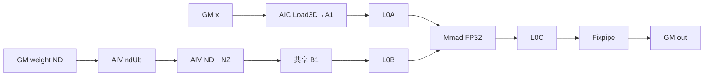
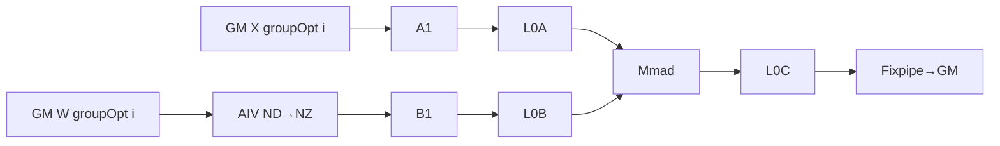
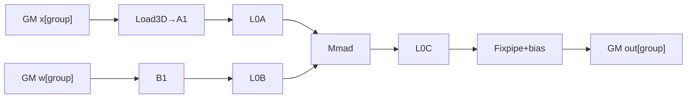
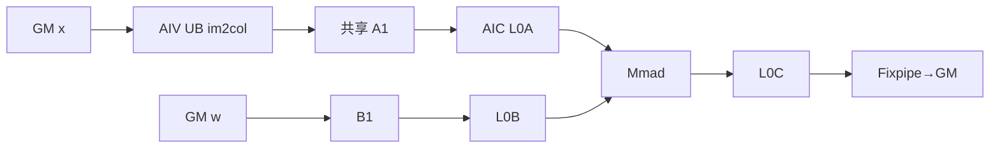
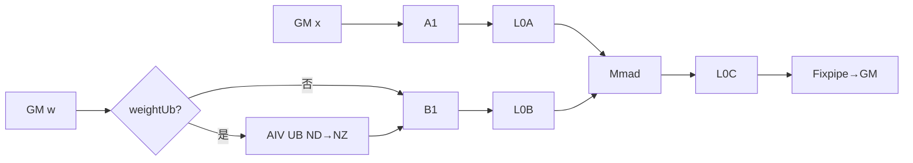
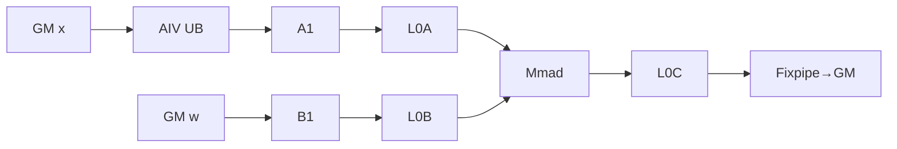

# ConvDepthwise2d 950 ACLNN 算子知识

## 算子速览

| 项目 | 内容 |
|---|---|
| 实际入口 | `aclnnConvDepthwise2dGetWorkspaceSize` + `aclnnConvDepthwise2d`，公开 ACLNN 两段式接口；固定仓只公开这一版。 |
| 计算语义 | 对每个输入通道独立做二维互相关；`groups=Cin`，`Cout` 必须是 `Cin` 的整数倍，可选 bias 在 Cube/Fixpipe 输出前按输出通道加入。 |
| 输入输出 | `self[N,Cin,Hi,Wi]`、`weight[Cout,1,Kh,Kw]`、`out[N,Cout,Ho,Wo]` 均 NCHW；950 支持 FP16/BF16/FP32/HIFLOAT8，bias 为 ND 一维。 |
| 执行类型 | 非空输入只有一个 `conv2dv2` Device 节点；按 key 为 AIC_CUBE 或 MIX_CV。MIX 路线的 AIV 执行权重 ND→NZ 或 fmap DMA/im2col，AIC 执行 Load3D/L1→L0→Mmad→Fixpipe。 |
| Kernel 路线 | R-001 优化分组预取；R-002 优化分组常规；R-003 原始分组 Load3D；R-004 原始分组 DMA；R-005 `Cin=1` Load3D key 家族（下分连续/HWNC、single/inner-batch、weight-UB 开关的精确子路径）；R-006 `Cin=1` DMA。NCHW filter 的 key 强制 `SmallKernel=0`，专用小 Kernel 不可达。 |
| 核心资源 | 输入/权重/输出 GM；系统 workspace 固定 16 MiB 且本 kernel 只建立系统 workspace、用户 slice 未读写；A1/B1、L0A/L0B/L0C、bias BT；MIX 路线另用 UB 和跨 AIC/AIV flag。 |
| 来源闭包 | source_closed：公开 ACLNN 参数检查、950 `Conv2DV2` L0 注册、Tiling/POD/key、单 Kernel router、所有 depthwise 可达 Cube/MIX body、公共卷积 helper 与 ascend950 binary config 均在固定 Commit 闭合。 |
| 验证状态 | 已完成源码闭包检查；本次知识提取未执行编译、真机、数值或性能测试。 |

## 接口与语义

### 计算语义

令 `m=Cout/Cin`，输出通道 `co` 对应输入通道 `ci=floor(co/m)`。对有效输出位置：

```text
Ho = floor((Hi + 2*padH - dilationH*(Kh-1) - 1) / strideH) + 1
Wo = floor((Wi + 2*padW - dilationW*(Kw-1) - 1) / strideW) + 1
out[n,co,ho,wo] = bias[co] + Σkh,kw self[n,ci,ho*strideH-padH+kh*dilationH,
                                         wo*strideW-padW+kw*dilationW] * weight[co,0,kh,kw]
```

越界输入按零处理。BF16、HIFLOAT8 的 `GetDstType` 选择 FP32 L0C；FP16 的 helper 在 `__NPU_ARCH__==5102` 时选择 INT32、否则选择 FP32，本仓 ascend950 构建接线未展开该预处理常量，故不进一步臆断。FP32 可由 `cubeMathType`/`enable_hf32` 选择 HF32。最后由 `Fixpipe` 加 bias、按输出 dtype 转换并写 GM；HIFLOAT8 输入时 API 允许 bias 为 FP32。

### 输入、输出与属性

| 参数 | shape/layout | dtype | 约束、默认值与语义 |
|---|---|---|---|
| `self` | `[N,Cin,Hi,Wi]` / NCHW | FP16/BF16/FP32/HIFLOAT8 | `N>=0,Cin>=1,Hi/Wi>=0`；允许非连续，但 depthwise 的 `groups>1` 会在 ACLNN 前处理成连续张量。 |
| `weight` | `[Cout,1,Kh,Kw]` / NCHW | 与 `self/out` 相同 | 各维正；`Cout % Cin == 0`；第二维只能为 1；`kernelSize=[Kh,Kw]`。 |
| `kernelSize` | 长度 2 | INT64 | 必须逐项等于 weight 的 H/W。 |
| `bias` | `[Cout]` / ND | FP16/BF16/FP32；HIFLOAT8 输入时为 FP32 | 可空；非 HIFLOAT8 时必须与输入 dtype 相同。 |
| `stride` | `[strideH,strideW]` | INT64 容器、实现窄化为 uint32 | 每项大于 0；公开文档给出 `[1,63]`。 |
| `padding` | `[padH,padW]`，Host 展开成 `[padH,padH,padW,padW]` | INT64 容器、实现窄化为 uint32 | 每项非负；公开文档给出 `[0,255]`。 |
| `dilation` | `[dilationH,dilationW]` | INT64 容器、实现窄化为 uint32 | 每项大于 0；公开文档给出 `[1,255]`。 |
| `out` | `[N,Cout,Ho,Wo]` / NCHW | 与 `self/weight` 相同 | shape 必须严格等于 Host 推导；空输入/权重要求空输出。 |
| `cubeMathType` | 标量 | INT8 | 0 保持；1 允许 FP32 降精度；2 强制 FP16（BF16 不支持）；3 对 FP32 使用 HF32。 |

### 入口与版本

公开接口是 `aclnnConvDepthwise2dGetWorkspaceSize`/`aclnnConvDepthwise2d`。第一段创建一次性 `aclOpExecutor` 并记录前处理、`Conv2DV2` 与后处理任务；第二段由 `CommonOpExecutorRun` 在用户 stream 上执行，之后 executor 不再可用。950 的 `IsSupportND()` 由 `NpuArch::DAV_3510` 判定，因而使用仓内 `Conv2DV2`；`Conv2DV2` OpDef 只注册 `ascend950`，这是本卡的平台边界。

## Host/Launcher 执行流程

### 参数校验与前处理

`CheckConvDepthwise2dParams` 按 null→dtype→rank/list 长度→NCHW format→shape/stride/dilation/pad/channel/bias→输出 shape→Cube math type 的顺序检查；随后 `CheckConvDepthwise2dKernelSize` 比对 `kernelSize`。任一 `self/weight/out` 为空时不添加任何计算节点，workspace 来自空 executor。非空时 `groups=self.C`，构造 `Conv2dImpl`；`PreProcess` 把两项 padding 展开为四项，计算 dtype/HF32 信息，对 input/weight/bias 分别做所需 `Contiguous` 和 `Cast`。950 `needChangeFormat=false`，因此不做 5HD/FZ TransData；depthwise 的 `groups>1` 禁止 HWNC 非连续直通优化。`Cin=groups=1` 时，只有 FP16/BF16/FP32、`N*Cin<=UINT16_MAX`、view offset 为 0、stride 恰为 HWNC 视图且 `isNotDMA` 成立，Host 才保留 HWNC storage view；否则先 Contiguous。

### 参数、Workspace 与生命周期

`Conv2dImpl::Impl` 通过 `FUNCTION_CALL_BY_OPTYPE` 以名字 `Conv2DV2` 分发，把 input、weight、bias、outputDtype、stride、四项 pad、dilation、groups、useHf32 加入 executor。Tiling 的 `GetWorkspaceSize` 将该节点 workspace[0] 固定为 `16*1024*1024` 字节；entry 检查 workspace 非空，调用 `SetSysWorkspace`，但计算 body 不读写 `GetUserWorkspace()` 返回值。若前处理实际创建 Contiguous/Cast/ViewCopy 节点，其 workspace 也计入同一 executor，故公开 `workspaceSize` 取整个 executor 的总量，而不是仅 16 MiB。

### 启动图与失败传播

```text
GetWorkspaceSize
  -> 参数校验
  -> [可选] Contiguous/Cast(input,weight,bias)
  -> Conv2DV2(x,filter,bias -> convOut), 同一 executor/stream，单个 conv2dv2 kernel
  -> [可选] Cast(convOut)
  -> ViewCopy(convOut -> out)
aclnnConvDepthwise2d
  -> CommonOpExecutorRun(workspace, workspaceSize, executor, stream)
```

空 tensor 分支无 Device 节点。非空分支中任何前处理、L0 注册、Tiling、launch 或后处理返回空/失败都会立即返回，后继不再加入/执行。`PostTiling` 的 blockDim 为 M 模式 `batchDim*mDim*nDim*groupDim`，HW 模式为 `batchDim*nDim*hoDim*woDim*groupDim`。

## Route 与参数设计

### 分核与资源计算

Tiling 先解析 `N,Cin,Hi,Wi,Cout,Kh,Kw,Ho,Wo` 与属性；depthwise 取 `groups=Cin`、`ciPerGroup=1`、`coPerGroup=Cout/Cin`。当 `groups>1` 时：

```text
enlarge = min(lcm(ciPerGroup,k0)/ciPerGroup,
              lcm(coPerGroup,n0)/coPerGroup,
              groups)
groupOpt = ceil(groups/enlarge)
cinOpt = enlarge
coutOpt = coPerGroup*enlarge
```

若 `align(cinOpt,k0)*Kh*Kw*align(coutOpt,n0)*2*sizeof(weight) <= UB-OPT_GROUP_RESERVED_SIZE`，选择优化分组；否则原始分组。Load3D 或 L1 full-load 限制不满足时切 DMA，并把 group 强制为原始分组。基础块生成 `singleCore*`、`hoL1/woL1/kAL1/kBL1/nBL1`、`hoL0/woL0/kL0/nL0`、`pBufferFlag`；M 模式令 `singleCoreHo` 表示展平的 `M=Ho*Wo`。`aL1SpaceSize` 按输出 tile 反推所需输入高宽，DMA 路线为 `hoL1*woL1*kAL1*sizeof(fmap)`。

### Route 选择

| 顺序 | Route | Key/模板 | 精确选择条件与优先级 | 不适用去向 |
|---:|---|---|---|---|
| 1 | R-001 优化分组预取 | `GroupType=OPT_GROUP`, `AL1={full,other}`, `BL1=full`, `L1=ALL_OPEN` | `groups>1`、优化分组 UB guard 成立，Load3D 可用，且 key 满足预取组合 | R-002 |
| 2 | R-002 优化分组常规 | `GroupType=OPT_GROUP` | `groups>1`、优化分组 UB guard 成立、Load3D 可用，非 R-001 | R-003 |
| 3 | R-003 原始分组 Load3D | `GroupType=ORI_GROUP`, `FmapCopyMode=LOAD3D` | `groups>1`，优化分组 UB guard 不成立；或其它逻辑回落到原始分组，且 Load3D/L1 limit 成立 | R-004 |
| 4 | R-004 原始分组 DMA | `GroupType=ORI_GROUP`, `FmapCopyMode=DMA` | `groups>1` 且 Load3D 或 L1 full-load limit 失败；非连续输入在此直接 Tiling 失败 | Tiling 失败 |
| 5 | R-005 `Cin=1` Load3D key 家族 | `GroupType=NORMAL`, `FmapCopyMode=LOAD3D` | `groups=1`；再按 `DisContinuous={0,INPUT_HWNC}`、`InnerBatch={SINGLE,KERNEL_1X1_MULTI,MULTI}`、`WeightUbTrans={0,1}` 分成 R-005a～R-005h；权重 UB guard 见下表 | R-006 |
| 6 | R-006 `Cin=1` 普通 DMA | `GroupType=NORMAL`, `FmapCopyMode=DMA` | `groups=1` 且 Load3D/L1 limit 失败 | Tiling 失败 |

```text
空 tensor -> 无 launch
非空 -> groups=Cin
  -> NCHW filter: BatchOne/NoPad/SmallWeight/SmallKernel key 位固定为 0
  -> groups>1
       -> Load3D/L1 limit fail -> R-004
       -> EnableOptGroup? -> preload key ? R-001 : R-002
       -> otherwise -> R-003
  -> groups==1
       -> DMA? R-006
       -> Load3D: (HWNC? × innerBatch? × weightUbFlag?) -> R-005a～R-005h
```

### 模板/实现执行矩阵

| Route | key/selector | dtype/shape/platform 完整命中条件 | 执行族与 kernel 节点 | 实际模板/body | 内存与同步特征 | tail/fallback |
|---|---|---|---|---|---|---|
| R-001 | opt-group preload key | `groups>1`、UB guard、Load3D、BL1 full、L1 all-open | 单 `conv2dv2`，MIX_CV(1 AIC:2 AIV) | `GroupConv2d` 的 `GroupType=OPT_GROUP` 实例 + `ConvKernelImplOptGroupPreload` | AIV 权重 GM→UB ND→NZ→B1，AIC Load3D→A1；双缓冲 flag | 最后 group 用 `enlargeTail`；零 `singleCoOpt` 直接返回 |
| R-002 | opt-group non-preload | 同 R-001，排除 preload | 单 `conv2dv2`，MIX_CV | 同上 + `ConvKernelImplOptGroup` | 两个 AIV 轮转 groupOpt，MTE1/MTE3 交叉核 flag | 每 groupOpt 调整 N/group tail |
| R-003 | ori-group Load3D | `groups>1, EnableOptGroup=false, feature=LOAD3D/CONV1D` | 单 `conv2dv2`，AIC_CUBE | `GroupConv2d` + `ConvKernelImplOriGroup` | 每组直接从 GM 装 A1/B1；Cube 内部 pipe 同步 | group、N、Ho/Wo/M、batch tail 调 `SetSingleOutputShape` |
| R-004 | ori-group DMA | `groups>1, feature=DMA` | 单 `conv2dv2`，MIX_CV | `GroupConv2d` + `DmaProcessTools` | AIV GM→UB im2col→A1；AIC 等 flag 后装 L0A | ci/kh/kw/Ho/Wo tail；无可用 key/Tiling 失败 |
| R-005a | normal、连续、single、无 weight UB | `Cin=1, LOAD3D, DisContinuous=0, InnerBatch=SINGLE, WeightUbTrans=0` | 单 `conv2dv2`，AIC_CUBE | `Conv2dBase`/公共 `IterateAll` | GM x/w→A1/B1；固定 `L0C_SIZE` | M/N/K 与空间 tail |
| R-005b | normal、HWNC、single、无 weight UB | 同 R-005a，但 `DisContinuous=INPUT_HWNC` | 单 `conv2dv2`，AIC_CUBE | `Conv2dBase` + `LoadAL1*InputHWNC` | AIC 以 ND2NZ 从 HWNC storage 装 A1；固定 L0C | `N*Cin<=UINT16_MAX`，DMA 禁止 |
| R-005c | normal、连续、inner、无 weight UB | 同 R-005a，但 `InnerBatch=KERNEL_1X1_MULTI/MULTI` | 单 `conv2dv2`，AIC_CUBE | inner-batch selector + 公共 body | A1 容量乘 `innerBatch`；queueCL0 按 tile×innerBatch 分配 | batch tail |
| R-005d | normal、HWNC、inner、无 weight UB | R-005b 与 R-005c 条件同时成立 | 单 `conv2dv2`，AIC_CUBE | input-HWNC inner-batch selector | HWNC ND2NZ + inner-batch queueCL0 | HWNC、batch 双重 tail |
| R-005e | normal、连续、single、weight UB | R-005a 且 weight UB guard 成立 | 单 `conv2dv2`，MIX_CV | `WeightUbProcessTools` + 公共 body | AIV W:GM→UB ND→NZ→B1，AIC x:GM→A1 | 权重 K/N tail |
| R-005f | normal、HWNC、single、weight UB | R-005b 且 weight UB guard 成立 | 单 `conv2dv2`，MIX_CV | weight-UB selector + HWNC A1 load | AIV 转 W；AIC HWNC ND2NZ 装 x | HWNC/权重 tail |
| R-005g | normal、连续、inner、weight UB | R-005c 且 weight UB guard 成立 | 单 `conv2dv2`，MIX_CV | inner-batch weight-UB selector | AIV 转 W；AIC queueCL0×innerBatch | batch/权重 tail |
| R-005h | normal、HWNC、inner、weight UB | R-005d 且 weight UB guard 成立 | 单 `conv2dv2`，MIX_CV | inner-batch weight-UB + HWNC body | R-005f 的搬运加 R-005g 的 L0C 生命周期 | HWNC/batch/权重 tail |
| R-006 | normal DMA | `Cin=1, feature=DMA` | 单 `conv2dv2`，MIX_CV | `Conv2dBase` + `DmaProcessTools` | 与 R-004 相同的 AIV fmap 生产/AIC 消费 | 同 R-004 |

### 隐藏性能 Guard

| Guard | Host/Tiling 条件 | Device/资源原因 | 影响 Route | 不满足时去向 | 源码符号 |
|---|---|---|---|---|---|
| 优化分组 UB | `align(cinOpt,k0)*Kh*Kw*align(coutOpt,n0)*2*sizeof(W) <= UB-reserved` | AIV 同时持有 ND/NZ 两块权重 UB | R-001/R-002 | R-003 | `Conv2dBaseTiling::EnableOptGroup` |
| Load3D/L1 | `CheckLoad3DLimits && CheckL1SizeLimitsKernelFullLoad` | Load3D 指令与 A1 容量必须可编码 | R-001/2/3/5 | R-004/R-006 | `GetFeatureFlag` |
| DMA 非连续禁止 | `feature=DMA && disContinuousFlag` | DMA helper 不支持 HWNC view | R-004/R-006 | Tiling 失败 | `GetFeatureFlag` |
| BL1 双缓冲 | `pBufferFlag` 中 BL1 bit | 决定 B1 queue 深度及 flag 等待提前一轮 | R-001/R-002/R-005 | 同 route 单缓冲子型 | `GetL1PingPongVal`, `OptGroupSyncSet` |
| inner-batch | NORMAL、非 C04、非 DMA；`innerBatch=min(N, floor(availableL1/(4*k0*sizeof(X)*Hi*Wi)))` 再受 `basicBlockM<=1024` 限制且结果 `>1`；若当前切分已可在 core 数内完成且 `ceil(N/aicoreNum)=1` 则不启用 | 把多个 batch 合入 A1/L0C tile 只有在 L1/L0C 容量和并行度收益同时成立时才有效 | R-005c/d/g/h | R-005a/b/e/f | `EnableInnerBatchBasicBlock` |
| M/HW 模式 | `mSplitModeFlag` | 决定 blockDim、地址公式与 Fixpipe layout | 全部 | 另一同 route 子型 | `GetOutputOrderVal`, `PostTiling` |
| HF32 | FP32 且 `cubeMathType` 1/3 | `SetHF32Mode/SetHF32TransMode` 改 Cube 乘法精度 | 全部 FP32 | FP32 原精度 | `InitHf32Mode` |
| NCHW scalar key | `IsWeightNZFormat=false`，且编译宏非 FZ/FZ_C04 | NCHW binary 不实例化 `SmallKernel=1` 等 FZ scalar key | 全部 | `SmallKernel=0` 的通用 body | `SetTilingKey`, `CONV2D_SCALAR_OPT_SEL` |
| 系统 workspace | workspace 指针非空，Tiling 固定 16 MiB | entry 先建立系统 workspace | 全部非空 | entry 直接 return | `GetWorkspaceSize`, `conv2dv2` |

### POD/ABI

`Conv2DTilingData` 由 `BEGIN_TILING_DATA_DEF` 生成；固定仓给出字段顺序和标量类型，但宏展开后的 `sizeof/alignof/offsetof` 不在仓内，因此下表 ABI 布局统一记为“声明顺序；精确 offset/总大小固定仓不可见”，不得手工按自然对齐推测。未被 ACLNN ConvDepthwise2d 使用的 Extend/Quant 字段仍由 Host 初始化为零并被普通路线忽略。

| 结构 | 字段 | 类型/位宽 | ABI 布局 | 单位 | Host/launcher producer | Device consumer | 边界 |
|---|---|---|---|---|---|---|---|
| `Conv2DTilingData` | `orgHi` | `uint64_t` | 声明顺序；offset/总大小固定仓不可见 | 元素 | `SetTilingData` | 输入 GM 地址 | 正维 |
| 同上 | `orgWi` | `uint64_t` | 同上 | 元素 | `SetTilingData` | 输入 GM 地址 | 正维 |
| 同上 | `orgHo` | `uint64_t` | 同上 | 元素 | `SetTilingData` | 输出空间循环 | 正维 |
| 同上 | `orgWo` | `uint64_t` | 同上 | 元素 | `SetTilingData` | 输出空间循环 | 正维 |
| 同上 | `orgHixWi` | `uint64_t` | 同上 | 元素 | `SetScalarParams` | 输入 GM 地址 | `orgHi*orgWi` |
| 同上 | `singleCoreBatch` | `uint64_t` | 同上 | batch/core | basic-block Tiling | 分核、batch tail | 不超过 batch |
| 同上 | `singleCoreHo` | `uint64_t` | 同上 | 元素/core | basic-block Tiling | 分核、M/Ho tail | M 模式表示展平 M |
| 同上 | `singleCoreWo` | `uint64_t` | 同上 | 元素/core | basic-block Tiling | 分核、Wo tail | HW 模式有效 |
| 同上 | `unionDataXt` | `uint64_t` | 同上 | 标量 | `SetAttrsTilingData` | 本入口不读 | inactive=0 |
| 同上 | `hin` | `uint64_t` | 同上 | 元素 | `GetConv2dOpsTiling` | group 输入地址 | 逻辑输入高 |
| 同上 | `win` | `uint64_t` | 同上 | 元素 | `GetConv2dOpsTiling` | group 输入地址 | 逻辑输入宽 |
| 同上 | `hout` | `uint64_t` | 同上 | 元素 | `GetConv2dOpsTiling` | group 输出地址 | 逻辑输出高 |
| 同上 | `wout` | `uint64_t` | 同上 | 元素 | `GetConv2dOpsTiling` | group 输出地址 | 逻辑输出宽 |
| 同上 | `orgCi` | `uint32_t` | 同上 | 通道 | API Tiling | K/GM offset | Host 校验后窄化 |
| 同上 | `orgCo` | `uint32_t` | 同上 | 通道 | API Tiling | N/GM offset | Host 校验后窄化 |
| 同上 | `singleCoreCi` | `uint32_t` | 同上 | 通道/core | basic-block Tiling | K tail | 不超过 `orgCi` |
| 同上 | `singleCoreCo` | `uint32_t` | 同上 | 通道/core | basic-block Tiling | N tail | 不超过 `orgCo` |
| 同上 | `hoL1` | `uint32_t` | 同上 | 元素 | API Tiling | A1 循环 | 受 L1 容量约束 |
| 同上 | `woL1` | `uint32_t` | 同上 | 元素 | API Tiling | A1 循环 | 受 L1 容量约束 |
| 同上 | `kAL1` | `uint32_t` | 同上 | 元素 | API Tiling | A1 K 循环 | K0 对齐 |
| 同上 | `kBL1` | `uint32_t` | 同上 | 元素 | API Tiling | B1 K 循环 | K0 对齐 |
| 同上 | `khL1` | `uint32_t` | 同上 | 元素 | API Tiling | A1 kernel loop | `<=kernelH` |
| 同上 | `kwL1` | `uint32_t` | 同上 | 元素 | API Tiling | A1 kernel loop | `<=kernelW` |
| 同上 | `nBL1` | `uint32_t` | 同上 | 元素 | API Tiling | B1 N 循环 | N0 对齐 |
| 同上 | `hoL0` | `uint32_t` | 同上 | 元素 | API Tiling | L0/Mmad | M0 对齐后使用 |
| 同上 | `woL0` | `uint32_t` | 同上 | 元素 | API Tiling | L0/Mmad | M0 对齐后使用 |
| 同上 | `kL0` | `uint32_t` | 同上 | 元素 | API Tiling | L0A/B | K0 对齐 |
| 同上 | `nL0` | `uint32_t` | 同上 | 元素 | API Tiling | L0B/C | N0 对齐且非零 |
| 同上 | `pBufferFlag` | `uint32_t` | 同上 | bit mask | API Tiling | A1/B1/L0C queue depth | bit 决定单/双缓冲 |
| 同上 | `groups` | `uint32_t` | 同上 | group | Group Tiling | `GroupConv2d` | depthwise=`Cin` |
| 同上 | `enlarge` | `uint32_t` | 同上 | group | Group Tiling | opt-group tail | ori-group inactive |
| 同上 | `singleCoreGroups` | `uint32_t` | 同上 | group/core | Group Tiling | group 分核 | `<=groups` |
| 同上 | `singleCoreGroupOpt` | `uint32_t` | 同上 | opt-group/core | Group Tiling | opt-group 分核 | 非 opt-group inactive |
| 同上 | `bUbNStep` | `uint32_t` | 同上 | 元素 | `SetUbTiling` | 权重 UB helper | 非权重 UB/opt-group 为 0 |
| 同上 | `bUbKStep` | `uint32_t` | 同上 | 元素 | `SetUbTiling` | 权重 UB helper | 同上 |
| 同上 | `khUb` | `uint32_t` | 同上 | 元素 | `SetUbTiling` | 权重 UB helper | 同上 |
| 同上 | `kwUb` | `uint32_t` | 同上 | 元素 | `SetUbTiling` | 权重 UB helper | 同上 |
| 同上 | `kernelHxkernelW` | `uint32_t` | 同上 | 元素 | `SetScalarParams` | K/weight offset | `Kh*Kw` |
| 同上 | `kernelHxkernelWxkernelD` | `uint32_t` | 同上 | 元素 | `SetScalarParams` | K/weight offset | 2D 为 `Kh*Kw` |
| 同上 | `aL1SpaceSize` | `uint32_t` | 同上 | 字节 | `CalcAL1SpaceSize` | A1 buffer init | 已含 fmap 字节数 |
| 同上 | `multiNBL1` | `uint32_t` | 同上 | tile 数 | `ceil(nBL1/nL0)` | N 循环 | `nL0!=0` |
| 同上 | `cinAInCore` | `uint32_t` | 同上 | 通道 | `SetScalarParams` | A1 K 循环 | 由 `kAL1/(Kh*Kw)` |
| 同上 | `cinATailInCore` | `uint32_t` | 同上 | 通道 | `SetScalarParams` | A1 K tail | 末块有效 |
| 同上 | `cinBInCore` | `uint32_t` | 同上 | 通道 | `SetScalarParams` | B1 K 循环 | 由 `kBL1/(Kh*Kw)` |
| 同上 | `cinBTailInCore` | `uint32_t` | 同上 | 通道 | `SetScalarParams` | B1 K tail | 末块有效 |
| 同上 | `mStep` | `uint32_t` | 同上 | Cube block | `SetScalarParams` | LoadData/Mmad | 按 M0 推导 |
| 同上 | `kStep` | `uint32_t` | 同上 | Cube block | `SetScalarParams` | LoadData/Mmad | 按 K0 推导 |
| 同上 | `nStep` | `uint32_t` | 同上 | Cube block | `SetScalarParams` | LoadData/Mmad | 按 N0 推导 |
| 同上 | `fmapKStride` | `uint32_t` | 同上 | block stride | `SetScalarParams` | L0A load | 由 M/K tile 推导 |
| 同上 | `weightKStride` | `uint32_t` | 同上 | block stride | `SetScalarParams` | L0B load | 由 N/K tile 推导 |
| 同上 | `cinOffsetBlockInGM` | `uint32_t` | 同上 | block | `SetScalarParams` | fmap GM 地址 | 输入通道步进 |
| 同上 | `coutOffsetBlock` | `uint32_t` | 同上 | 元素 | `SetScalarParams` | weight GM 地址 | depthwise=`Kh*Kw` |
| 同上 | `nL1DivBlockSize` | `uint32_t` | 同上 | block | `SetScalarParams` | B1 地址 | 由 N tile 推导 |
| 同上 | `kernelH` | `uint32_t` | 同上 | 元素 | API attrs | Load3D/DMA | 校验后窄化 |
| 同上 | `kernelW` | `uint32_t` | 同上 | 元素 | API attrs | Load3D/DMA | 校验后窄化 |
| 同上 | `strideH` | `uint32_t` | 同上 | 元素 | API attrs | Load3D/DMA 地址 | `[1,63]` |
| 同上 | `strideW` | `uint32_t` | 同上 | 元素 | API attrs | Load3D/DMA 地址 | `[1,63]` |
| 同上 | `dilationH` | `uint32_t` | 同上 | 元素 | API attrs | Load3D/DMA 地址 | `[1,255]` |
| 同上 | `dilationW` | `uint32_t` | 同上 | 元素 | API attrs | Load3D/DMA 地址 | `[1,255]` |
| 同上 | `padTop` | `uint32_t` | 同上 | 元素 | pad 展开/Tiling | 越界处理 | 对称 padH |
| 同上 | `padBottom` | `uint32_t` | 同上 | 元素 | pad 展开/Tiling | 越界处理 | 对称 padH |
| 同上 | `padLeft` | `uint32_t` | 同上 | 元素 | pad 展开/Tiling | 越界处理 | 对称 padW |
| 同上 | `padRight` | `uint32_t` | 同上 | 元素 | pad 展开/Tiling | 越界处理 | 对称 padW |
| 同上 | `innerBatch` | `uint32_t` | 同上 | batch/tile | API Tiling | inner-batch 合并/L0C 容量 | group route 通常为 1 |
| 同上 | `batch` | `uint32_t` | 同上 | batch | `GetConv2dOpsTiling` | GM 地址 | 原始 N |
| 同上 | `cin` | `uint32_t` | 同上 | 通道 | `GetConv2dOpsTiling` | group 地址 | 原始 Cin |
| 同上 | `cout` | `uint32_t` | 同上 | 通道 | `GetConv2dOpsTiling` | group 地址 | 原始 Cout |
| 同上 | `kh` | `uint32_t` | 同上 | 元素 | `GetConv2dOpsTiling` | weight 地址 | 原始 Kh |
| 同上 | `kw` | `uint32_t` | 同上 | 元素 | `GetConv2dOpsTiling` | weight 地址 | 原始 Kw |
| 同上 | `batchDim` | `uint32_t` | 同上 | block 分割 | basic-block Tiling | blockIdx 解码 | 与其它 dim 乘积为 blockDim |
| 同上 | `groupDim` | `uint32_t` | 同上 | block 分割 | basic-block Tiling | blockIdx 解码 | 同上 |
| 同上 | `nDim` | `uint32_t` | 同上 | block 分割 | basic-block Tiling | blockIdx 解码 | 同上 |
| 同上 | `hoDim` | `uint32_t` | 同上 | block 分割 | basic-block Tiling | blockIdx 解码 | HW 模式 |
| 同上 | `woDim` | `uint32_t` | 同上 | block 分割 | basic-block Tiling | blockIdx 解码 | HW 模式 |
| 同上 | `cinOpt` | `uint32_t` | 同上 | 通道 | opt-group Tiling | AIC/AIV opt group | R-001/2 有效 |
| 同上 | `coutOpt` | `uint32_t` | 同上 | 通道 | opt-group Tiling | AIC/AIV opt group | R-001/2 有效 |
| 同上 | `groupOpt` | `uint32_t` | 同上 | group | opt-group Tiling | AIC/AIV opt group | R-001/2 有效 |
| 同上 | `iterateMNOrder` | `uint8_t` | 同上 | enum | API Tiling | M-first/N-first | 0/1 |
| 同上 | `biasFullLoadFlag` | `uint8_t` | 同上 | bool | API Tiling | bias L1 生命周期 | 0/1 |
| 同上 | `fixpParamsFullLoadFlag` | `uint8_t` | 同上 | bool | API Tiling | Fixpipe 参数 | 本入口 inactive |
| 同上 | `hf32Enable` | `uint8_t` | 同上 | bool | API Tiling | Cube HF32 mode | 0/1 |
| 同上 | `hf32TransMode` | `uint8_t` | 同上 | enum | API Tiling | HF32 transform | cubeMathType 派生 |
| 同上 | `hasBias` | `uint8_t` | 同上 | bool | API Tiling | Mmad/Fixpipe | 0/1 |
| 同上 | `hasScale` | `uint8_t` | 同上 | bool | API Tiling | 本入口不读 | 0 |
| 同上 | `dualOutput` | `uint8_t` | 同上 | bool | API Tiling | 本入口不读 | 0 |
| 同上 | `quantMode0` | `uint8_t` | 同上 | enum | `SetExtendConv2DParams` | 本入口不读 | 0 |
| 同上 | `reluMode0` | `uint8_t` | 同上 | enum | `SetExtendConv2DParams` | 本入口不读 | 0 |
| 同上 | `clipMode0` | `uint8_t` | 同上 | enum | `SetExtendConv2DParams` | 本入口不读 | 0 |
| 同上 | `quantMode1` | `uint8_t` | 同上 | enum | `SetExtendConv2DParams` | 本入口不读 | 0 |
| 同上 | `reluMode1` | `uint8_t` | 同上 | enum | `SetExtendConv2DParams` | 本入口不读 | 0 |
| 同上 | `clipMode1` | `uint8_t` | 同上 | enum | `SetExtendConv2DParams` | 本入口不读 | 0 |
| 同上 | `offsetx` | `int8_t` | 同上 | 标量 | attrs Tiling | 本入口不读 | 0 |
| 同上 | `roundMode` | `int8_t` | 同上 | enum | attrs Tiling | 本入口不读 | 0 |

### Route 源码闭包

| Route | Key/selector | Host/Tiling producer | POD/参数 | Kernel entry/router | Kernel body/直接依赖 | 构建接线 |
|---|---|---|---|---|---|---|
| R-001/2 | `OPT_GROUP`/preload | `base_tiling.cpp`, `api_tiling.cpp` | `Conv2DTilingData` | `conv2d_v2.cpp::conv2dv2`→`GroupConv2d` | `conv2d_v2_group.h`, `conv_group_common.h`, `conv_opt_group_impl.h` | `conv2d_v2_def.cpp`, `conv2d_v2_binary.json` |
| R-003 | `ORI_GROUP+LOAD3D` | 同上 | 同上 | 同上→`GroupConv2d` | `conv_group_common.h`, `conv_common_func.h`, `conv_instr_impl.h` | 同上 |
| R-004 | `ORI_GROUP+DMA` | `GetFeatureFlag`, API Tiling | 同上 | 同上→`GroupConv2d` | 上述公共 body + `conv2d_v2_dma_impl.h` | 同上 |
| R-005a/c | `NORMAL+LOAD3D+continuous+WeightUb=0`，single/inner | `SetTilingKey/GetEnableInnerBatch` | 同上 | 同上→`Conv2dBase` | `conv2d_v2.h`, `conv2d_v2_inner_batch_tilingkey.h`, common body | 同上 |
| R-005b/d | 上述 key + `INPUT_HWNC`，single/inner | `isSupportInputHWNC`, `SetTilingKey` | 同上 | 同上→`Conv2dBase` | `conv2d_v2_input_hwnc_tilingkey.h`, `conv2d_v2_instr_impl.h` | 同上 |
| R-005e/g | `WeightUb=1+continuous`，single/inner | `SetUbTiling`, `SetTilingKey` | 同上 | 同上→`Conv2dBase` | weight UB helper、inner-batch key、common body | 同上 |
| R-005f/h | `WeightUb=1+INPUT_HWNC`，single/inner | 上述 producer | 同上 | 同上→`Conv2dBase` | weight UB helper、HWNC/inner key 与 instr body | 同上 |
| R-006 | `NORMAL+DMA` | `GetFeatureFlag` | 同上 | 同上→`Conv2dBase` | common body + `conv2d_v2_dma_impl.h` | 同上 |

## Kernel 实现

### 公共执行流程

`conv2dv2` 要求 workspace 非空，解析同一份 `Conv2DTilingData`。本入口的 NCHW weight binary 将 `SmallKernel` key 固定为 0；`GroupType=NORMAL` 构造 `Conv2dBase`，其余构造 `GroupConv2d`。AIC 公共数据流为 GM→A1/B1→L0A/L0B→`Mmad`→L0C→`Fixpipe`→GM；bias 为 GM→A1→BT 后参加 Mmad/Fixpipe。L0A/L0B 固定分别初始化为 `L0A_SIZE/L0B_SIZE`，非 inner-batch 路线 L0C 使用 `L0C_SIZE`；A1 容量是 `aL1SpaceSize*(1 或 2)`，B1 是 `nBL1*kBL1*sizeof(W)*(1 或 2)`。单 kernel 无跨-kernel workspace 边。

### Route R-001：优化分组预取

#### 适用条件

##### 选择证据

| 层级 | 文件 | 符号 | 源码谓词/参数 | 结果/下一跳 |
|---|---|---|---|---|
| Tiling | `base_tiling.cpp` | `EnableOptGroup` | opt-group UB 公式成立 | `GroupType=OPT_GROUP` |
| Key | `conv2d_v2_tilingkey.h` | `CONV2D_OPT_GROUP_PRELOAD_SEL` | BL1 full、L1 all-open、Load3D | preload specialization |

#### Device 数据流

##### 函数级调用链

```text
conv2dv2 -> GroupConv2d::RunConv2dKernel -> ConvKernelImplOptGroupPreload
  -> AIV OptGroupPreloadVecImpl: GM weight -> UB ND -> UB NZ -> B1
  -> AIC IterateAll: Load3D x -> A1 -> L0A; B1 -> L0B -> Mmad -> L0C -> Fixpipe
```

##### 源码等价伪码

```text
AIV0/AIV1 按 groupOpt 奇偶分工：权重 GM->ndUb，ND2NZ 到 nzUb，再送 B1；
首两组无需等待，更后组 wait 前一 B1 消费 flag，写 B1 后 set 可读 flag；
AIC 预设 opt group 参数，仅调用一次 IterateAll；ReduceK 在需要新 B1 时 wait 可读，
消费完成后 set 可覆盖；Mmad 累加，Fixpipe 写对应 group/channel。
```

#### 内存与数据搬运

##### 资源与搬运表

| 层级/缓冲区 | offset/地址公式 | extent/容量公式 | dtype/layout | producer | consumer | owner/lifetime | 对齐/复用 |
|---|---|---|---|---|---|---|---|
| GM weight | `groupOptIter*weightOneGroupSize` | `coutOpt*ciPerGroup*Kh*Kw` | NCHW/ND | Host | AIV | 调用方 | group tail |
| ndUb/nzUb | 0 | `ci1Opt*Kh*Kw*co1Opt*k0*n0*sizeof(W)` 各一块 | ND/NZ | MTE2/Vector | Vector/MTE3 | AIV | 双块不 alias |
| B1 | A1 字节之后 | `nBL1*kBL1*sizeof(W)*(1或2)` | NZ | AIV | AIC LoadData | kernel | cross-core flags |
| A1/L0A/L0B/L0C | tile | 同公共公式 | Cube layout | AIC | AIC | kernel | Tiling/ping-pong |
| GM out | opt group 地址 | 有效 output tile | NCHW | Fixpipe | 调用方 | 调用方 | tail shape |

##### 分层内存布局



##### 字节账、交接边与复用顺序

```text
UB_total = 2*ubBufSize*sizeof(W) + REG_SIZE
B1_total = nBL1*kBL1*sizeof(W)*(bL1DB?2:1)
A1_total = aL1SpaceSize*(AL1DB?2:1)
workspace_node = 16 MiB system workspace；无 user slice
```

| 边/复用子区 | producer | offset/extent | dtype/layout | consumer | ordering/sync | owner/lifetime | 安全条件 |
|---|---|---|---|---|---|---|---|
| AIV→AIC B1 | `LoadUB2L1` | B1 ping/pong，`nBL1*kBL1` 元素 | weight/NZ | AIC `LoadBL0` | AIV set `MTE3_MTE1`；AIC wait；AIC set `MTE1_MTE3` | kernel | DB 时 AIV 从第 3 次 load 才等，单缓冲从第 2 次等 |

#### 同步、精度与尾块

##### 同步与数值边界表

| 阶段 | primitive/机制 | producer | consumer/等待点 | 保护对象 | 精度/尾块 |
|---|---|---|---|---|---|
| GM→UB→NZ | `V_MTE2/MTE2_V/MTE3_V/V_MTE3` | AIV pipeline | 下一阶段 | nd/nz UB | `enlargeTail` 补零/有效通道控制 |
| AIV/AIC | CrossCore flags | AIV/AIC | B1 更新点 | B1 | 防覆盖 |
| Cube | Mmad/Fixpipe | AIC | GM | L0C | FP32 acc；输出 cast/HF32 mode |

#### 关键实现

##### 符号证据表

| 阶段 | 文件 | 符号/模板实例 | 实现事实 |
|---|---|---|---|
| Host/Tiling producer | `conv/conv2d_v2/op_host/op_tiling/arch35/conv2d_v2_base_tiling.cpp` | `GetGroupsInfo/EnableOptGroup` | 合并 group 及 UB guard |
| Kernel entry/router | `conv/conv2d_v2/op_kernel/conv2d_v2.cpp` | `GroupConv2d` 的 `GroupType=OPT_GROUP` 实例 | MIX 实例 |
| Device body/helper | `conv/common/op_kernel/arch35/conv_group_common.h`, `conv/common/op_kernel/arch35/conv_opt_group_impl.h` | `ConvKernelImplOptGroupPreload/OptGroupPreloadVecImpl` | AIV 预取、AIC 消费与 flag |

### Route R-002：优化分组常规

#### 适用条件

##### 选择证据

| 层级 | 文件 | 符号 | 源码谓词/参数 | 结果/下一跳 |
|---|---|---|---|---|
| Tiling | `base_tiling.cpp` | `GetGroupsInfo` | UB guard 成立 | OPT_GROUP |
| Router | `conv_group_common.h` | `ConvKernelImplOptGroup` | `IS_OPTGROUP_PRELOAD=false` | 按 groupOpt 循环 |

#### Device 数据流

##### 函数级调用链

```text
conv2dv2 -> GroupConv2d -> for groupOpt: SetIterIndex
  -> AIV OptGroupVecImpl(weight GM->UB->NZ->B1)
  -> AIC IterateAll(A1/B1->L0->Mmad->Fixpipe) -> End
```

##### 源码等价伪码

```text
for groupOptIter:
  尾组更新 singleGroups/singleCoOpt；空 N tail break；
  AIV(groupOptIter%2) 转换权重并按 B1 load 次数等待/通知；
  AIC 设置 fmap/weight/bias 起点，执行全部 M/N/K tile，Fixpipe 写当前 opt group；
  End 释放 queue event。
```

#### 内存与数据搬运

##### 资源与搬运表

| 层级/缓冲区 | offset/地址公式 | extent/容量公式 | dtype/layout | producer | consumer | owner/lifetime | 对齐/复用 |
|---|---|---|---|---|---|---|---|
| GM/A1/L0/out | `groupOptIter*fmapOneGroupSize/outputOneGroupSize` | 当前 opt group | NCHW/Cube | AIC | AIC/用户 | kernel/调用方 | 每轮复用 |
| UB/B1 | 同 R-001 | 同 R-001 | ND→NZ/B1 | AIV | AIC | kernel | vec0/vec1 交替 |

##### 分层内存布局



##### 字节账、交接边与复用顺序

```text
与 R-001 相同；区别是 UB/B1 每个 groupOpt 重新建立生产—消费周期，而非一次预取覆盖全部 groupOpt。
```

| 边/复用子区 | producer | offset/extent | dtype/layout | consumer | ordering/sync | owner/lifetime | 安全条件 |
|---|---|---|---|---|---|---|---|
| groupOpt 轮转 | AIV i | B1 ping/pong | NZ | AIC i | `V_ROTATE` + `MTE3_MTE1/MTE1_MTE3` | kernel | 只有 `groupOptIter%2` 对应 AIV 工作 |

#### 同步、精度与尾块

##### 同步与数值边界表

| 阶段 | primitive/机制 | producer | consumer/等待点 | 保护对象 | 精度/尾块 |
|---|---|---|---|---|---|
| AIV 轮转 | `CV_SYUC_ID_V_ROTATE` | 前一 AIV | 下一 AIV | B1 生产资格 | 最后组 `enlargeTail` |
| Cube | 同 R-001 | AIC | GM | L0 | 同 R-001 |

#### 关键实现

##### 符号证据表

| 阶段 | 文件 | 符号/模板实例 | 实现事实 |
|---|---|---|---|
| Host/Tiling producer | `conv/conv2d_v2/op_host/op_tiling/arch35/conv2d_v2_base_tiling.cpp` | `GetGroupsInfo` | OPT_GROUP |
| Kernel entry/router | `conv/conv2d_v2/op_kernel/arch35/conv2d_v2_group.h` | `Conv2dKernelImpl` | 选择 opt body |
| Device body/helper | `conv/common/op_kernel/arch35/conv_group_common.h`, `conv/common/op_kernel/arch35/conv_opt_group_impl.h` | `ConvKernelImplOptGroup/OptGroupVecImpl` | 逐组交接 |

### Route R-003：原始分组 Load3D

#### 适用条件

##### 选择证据

| 层级 | 文件 | 符号 | 源码谓词/参数 | 结果/下一跳 |
|---|---|---|---|---|
| Tiling | `base_tiling.cpp` | `EnableOptGroup/GetFeatureFlag` | opt UB 不足且 Load3D 可用 | ORI_GROUP+LOAD3D |
| Router | `conv2d_v2.cpp` | `GroupType!=NORMAL` | ORI_GROUP | `GroupConv2d` |

#### Device 数据流

##### 函数级调用链

```text
conv2dv2 -> GroupConv2d::InitSingleCoreDataOriGroup
  -> ConvGroupCommon::CalcStartAddrOriGroupCHW
  -> ConvKernelImplOriGroup -> Conv2d::IterateAll
  -> Load3D x→A1 -> LoadData A1/B1→L0A/B -> Mmad -> Fixpipe
```

##### 源码等价伪码

```text
解码 block 到 batch/group/N/(M 或 Ho/Wo)；
for groupIter in singleGroups:
  fmap += groupIter*Hi*Wi；weight += groupIter*coPerGroup*Kh*Kw；
  bias/output 同步偏移；直接从 GM 装 A1/B1；
  遍历 K/N/M 或 Ho/Wo tile，Mmad 累加，Fixpipe 写出；End。
```

#### 内存与数据搬运

##### 资源与搬运表

| 层级/缓冲区 | offset/地址公式 | extent/容量公式 | dtype/layout | producer | consumer | owner/lifetime | 对齐/复用 |
|---|---|---|---|---|---|---|---|
| GM x | `batch*Cin*HiWi + group*HiWi + spatial` | 单组 `HiWi` | NCHW | Host | Load3D | 调用方 | pad/tail |
| GM w | `group*coPerGroup*KhKw+n*KhKw` | 单组 `coPerGroup*KhKw` | NCHW | Host | B1 load | 调用方 | K0/N0 pad |
| A1/B1 | tile | `aL1SpaceSize`; `nBL1*kBL1*sizeof(W)*(1/2)` | A1/B1 | GM | L0 | kernel | queue event |
| L0A/B/C | tile | 固定 L0A/B；L0C≤L0C_SIZE | Cube | LoadData/Mmad | Mmad/Fixpipe | kernel | ping-pong |
| UB | N/A | N/A | N/A | N/A | N/A | N/A | AIC-only |

##### 分层内存布局



##### 字节账、交接边与复用顺序

```text
A1_total=aL1SpaceSize*(AL1DB?2:1)
B1_total=nBL1*kBL1*sizeof(W)*(BL1DB?2:1)
L0A/L0B=L0A_SIZE/L0B_SIZE；L0C=L0C_SIZE 上限；UB=0；user workspace=0
```

| 边/复用子区 | producer | offset/extent | dtype/layout | consumer | ordering/sync | owner/lifetime | 安全条件 |
|---|---|---|---|---|---|---|---|
| A1/B1 queues | GM load | 当前 tile | A1/B1 | L0 load | TQue EnQue/DeQue/FreeTensor | kernel | queue 深度来自 pBufferFlag |

#### 同步、精度与尾块

##### 同步与数值边界表

| 阶段 | primitive/机制 | producer | consumer/等待点 | 保护对象 | 精度/尾块 |
|---|---|---|---|---|---|
| L1/L0 | TQue + HardEvent | MTE1 | Mmad | A1/B1/L0 | K tail 以 `kAL0Tail/kL0Tail` |
| 输出 | Fixpipe | `GetDstType` 选出的 L0C dtype | GM | output tile | N/M/H/W tail、bias、dtype cast |

#### 关键实现

##### 符号证据表

| 阶段 | 文件 | 符号/模板实例 | 实现事实 |
|---|---|---|---|
| Host/Tiling producer | `conv/conv2d_v2/op_host/op_tiling/arch35/conv2d_v2_base_tiling.cpp` | `GetGroupsInfo/GetFeatureFlag` | ORI_GROUP Load3D |
| Kernel entry/router | `conv/conv2d_v2/op_kernel/conv2d_v2.cpp` | `GroupConv2d` | group 实例 |
| Device body/helper | `conv/common/op_kernel/arch35/conv_group_common.h` | `CalcStartAddrOriGroupCHW/ConvKernelImplOriGroup` | 每组地址与循环 |

### Route R-004：原始分组 DMA

#### 适用条件

##### 选择证据

| 层级 | 文件 | 符号 | 源码谓词/参数 | 结果/下一跳 |
|---|---|---|---|---|
| Tiling | `base_tiling.cpp` | `GetFeatureFlag` | Load3D/L1 limit 失败且连续 | DMA，并强制 ORI_GROUP |
| Key | `conv2d_v2_tilingkey.h` | `CONV2D_DMA_*` | `FmapCopyMode=DMA`、ORI_GROUP | MIX_CV |

#### Device 数据流

##### 函数级调用链

```text
conv2dv2 -> GroupConv2d -> Conv2d::Init
  -> AIV DmaVecImpl: DmaLoadGM2UB -> DmaUB2L1
  -> AIC ReduceK: DmaSyncWait -> A1->L0A; B1->L0B -> Mmad -> Fixpipe
```

##### 源码等价伪码

```text
AIV0/1 按 Cin block、Kh/Kw、Ho/Wo tile 分工：GM x→UB，形成 im2col tile 后 UB→A1；
完成一轮 A1 后 set MTE3_MTE1；AIC 在需要更新 A1 时 wait，装 L0A 并计算，
消费完成 set MTE1_MTE3；AIV 下一轮覆盖前先 wait。B 路仍 GM→B1→L0B。
```

#### 内存与数据搬运

##### 资源与搬运表

| 层级/缓冲区 | offset/地址公式 | extent/容量公式 | dtype/layout | producer | consumer | owner/lifetime | 对齐/复用 |
|---|---|---|---|---|---|---|---|
| GM x | group/spatial/ci tile | 有效 input tile | NCHW | Host | AIV MTE2 | 调用方 | 边界补零 |
| UB img2col | 0 | `hoL1*align(woL1,m0)*khUb*kwUb*k0*sizeof(X)` | im2col | AIV MTE2 | AIV MTE3 | AIV | 两 AIV 分 Cin |
| A1 | 0 | `aL1SpaceSize` | A1 | AIV | AIC | kernel | cross-core flag |
| B1/L0/GM y | 同 R-003 | 同 R-003 | Cube/NCHW | AIC | AIC/用户 | kernel/调用方 | 同 R-003 |

##### 分层内存布局



##### 字节账、交接边与复用顺序

```text
UB_total=hoL1*align(woL1,m0)*khUb*kwUb*k0*sizeof(X)
A1_total=aL1SpaceSize；B1/L0 同 R-003；user workspace=0
```

| 边/复用子区 | producer | offset/extent | dtype/layout | consumer | ordering/sync | owner/lifetime | 安全条件 |
|---|---|---|---|---|---|---|---|
| AIV→AIC A1 | `DmaLoadUB2L1Tools` | A1 tile | fmap/A1 | AIC LoadAL0 | AIV set `MTE3_MTE1`，AIC wait；AIC set `MTE1_MTE3`，AIV wait | kernel | 若 `cinAInCore>k0` 同时使用 vec1 flag |

#### 同步、精度与尾块

##### 同步与数值边界表

| 阶段 | primitive/机制 | producer | consumer/等待点 | 保护对象 | 精度/尾块 |
|---|---|---|---|---|---|
| GM/UB/A1 | HardEvent + CrossCore | AIV | AIC | UB/A1 | ci/kh/kw/Ho/Wo tail，越界零填 |
| Cube | 同 R-003 | AIC | GM | L0 | 同 R-003 |

#### 关键实现

##### 符号证据表

| 阶段 | 文件 | 符号/模板实例 | 实现事实 |
|---|---|---|---|
| Host/Tiling producer | `conv/conv2d_v2/op_host/op_tiling/arch35/conv2d_v2_base_tiling.cpp` | `GetFeatureFlag` | DMA fallback |
| Kernel entry/router | `conv/conv2d_v2/op_kernel/arch35/conv2d_v2_tilingkey.h` | `CONV2D_DMA_*` | MIX key |
| Device body/helper | `conv/conv2d_v2/op_kernel/arch35/conv2d_v2_dma_impl.h` | `DmaVecImpl/DmaSyncWait` | AIV→AIC A1 协议 |

### Route R-005：Cin=1 Load3D 精确子路径

#### 适用条件

##### 选择证据

| 层级 | 文件 | 符号 | 源码谓词/参数 | 结果/下一跳 |
|---|---|---|---|---|
| API | `aclnn_convolution.cpp` | `groups=self.C` | `Cin=1` | NORMAL_CONV |
| Host | `aclnn_convolution.cpp` | `isSupportInputHWNC` | FP16/BF16/FP32、`N*Cin<=UINT16_MAX`、HWNC stride、offset=0、`isNotDMA` | 保留 HWNC；否则连续输入 |
| Tiling | `base_tiling_basic_block.cpp`, `base_tiling_tilingkey.cpp` | `EnableInnerBatchBasicBlock/GetEnableInnerBatch` | NORMAL、非 C04/DMA，L1/L0C 容量公式给出 `innerBatch>1` 且并行度 guard 不提前 return；1x1/no-pad/stride1/dilation1 取 `KERNEL_1X1_MULTI`，其它取 `MULTI` | inner-batch；否则 single key |
| Tiling | `api_tiling.cpp` | `weightUbFlag` | groups=1、NCHW、非 FP32 原精度、`Kh*Kw!=1`、不整除 VGATHER limit、BL1 非 full、BL1 双缓冲、UB guard | weight-UB 或直接 B1 |

下列子路径的 key、buffer 生命周期或跨核同步至少一项不同，不能互相合并：

| 子路径 | `DisContinuous` | `InnerBatch` | `WeightUbTrans` | 执行族 | A1/L0C/权重路径 |
|---|---:|---:|---:|---|---|
| R-005a | 0 | SINGLE | 0 | AIC_CUBE | 连续 GM→A1；固定 L0C；GM→B1 |
| R-005b | INPUT_HWNC | SINGLE | 0 | AIC_CUBE | HWNC GM 经 AIC ND2NZ→A1；固定 L0C；GM→B1 |
| R-005c | 0 | KERNEL_1X1_MULTI/MULTI | 0 | AIC_CUBE | A1 extent 乘 innerBatch；queueCL0；GM→B1 |
| R-005d | INPUT_HWNC | KERNEL_1X1_MULTI/MULTI | 0 | AIC_CUBE | HWNC ND2NZ→A1；queueCL0；GM→B1 |
| R-005e | 0 | SINGLE | 1 | MIX_CV | 连续 GM→A1；固定 L0C；AIV 权重 UB→B1 |
| R-005f | INPUT_HWNC | SINGLE | 1 | MIX_CV | HWNC ND2NZ→A1；固定 L0C；AIV 权重 UB→B1 |
| R-005g | 0 | KERNEL_1X1_MULTI/MULTI | 1 | MIX_CV | A1×innerBatch；queueCL0；AIV 权重 UB→B1 |
| R-005h | INPUT_HWNC | KERNEL_1X1_MULTI/MULTI | 1 | MIX_CV | HWNC ND2NZ→A1；queueCL0；AIV 权重 UB→B1 |

#### Device 数据流

##### 函数级调用链

```text
conv2dv2 -> Conv2dBase::RunConv2dKernel -> Conv2d::IterateAll
  -> [R-005e/f/g/h: AIV WeightUb: GM W->UB ND->NZ->B1]
  -> [R-005b/d/f/h: AIC LoadAL1InputHWNC: GM HWNC->ND2NZ->A1]
     [其它: AIC Load3D x->A1]
  -> A1/B1->L0A/B; Mmad; Fixpipe
```

##### 源码等价伪码

```text
R-005a～d 由 AIC 直接装 B1；R-005e～h 由 AIV 转换 NCHW 权重并以与 opt-group 同方向的
MTE3_MTE1/MTE1_MTE3 flag 交给 AIC。连续子路径以 Load3D 装 A1；HWNC 子路径在 AIC 用 ND2NZ 装 A1。
inner-batch 子路径将多批合入一次 tile，并为每次输出 tile Alloc/Free queueCL0；首 K 清零、后续累加，Fixpipe 写出。
```

#### 内存与数据搬运

##### 资源与搬运表

| 层级/缓冲区 | offset/地址公式 | extent/容量公式 | dtype/layout | producer | consumer | owner/lifetime | 对齐/复用 |
|---|---|---|---|---|---|---|---|
| 普通 A1/B1/L0 | tile | 同 R-003 | NCHW/Cube | AIC | AIC | kernel | key 决定 DB |
| HWNC A1 | `batch/kh/kw/kAL1` 推导 storage offset | `aL1SpaceSize*(1或2)` | HWNC storage→NZ/A1 | AIC ND2NZ | L0A | 当前 A1 tile | R-005b/d/f/h |
| inner queueCL0 | 0 | `mStep*nL0*innerBatch*sizeof(L0c)*(1或2)` | L0C dtype | Mmad | Fixpipe | 每输出 tile Alloc/Free | R-005c/d/g/h；DB 由 `pBufferFlag` |
| weight UB nd/nz | 0 | `bUbNStep*bUbKStep` 对齐后两块 | ND/NZ | AIV | AIV/B1 | kernel | 仅 weightUbFlag |
| GM y | block offset | output tile | NCHW | Fixpipe | 用户 | 调用方 | M/N tail |

##### 分层内存布局



##### 字节账、交接边与复用顺序

```text
普通：UB=0；weight-UB：UB=nd+nz+REG_SIZE；A1/B1/L0 同公共公式；user workspace=0
```

| 边/复用子区 | producer | offset/extent | dtype/layout | consumer | ordering/sync | owner/lifetime | 安全条件 |
|---|---|---|---|---|---|---|---|
| weight UB→B1 | AIV | B1 ping/pong | NZ | AIC | CrossCore flags | kernel | 仅 weightUbFlag，BL1 双缓冲 |

#### 同步、精度与尾块

##### 同步与数值边界表

| 阶段 | primitive/机制 | producer | consumer/等待点 | 保护对象 | 精度/尾块 |
|---|---|---|---|---|---|
| R-005a～d | TQue/HardEvent | AIC pipeline | AIC | L1/L0 | M/N/K；inner-batch 有 batch tail |
| HWNC | AIC ND2NZ + pipeline event | AIC MTE2 | AIC Cube | HWNC GM/A1 | `N*Cin` 与 K/空间 tail |
| weight UB | HardEvent/CrossCore | AIV | AIC | UB/B1 | ND→NZ pad；Cube 精度同公共 |

#### 关键实现

##### 符号证据表

| 阶段 | 文件 | 符号/模板实例 | 实现事实 |
|---|---|---|---|
| Host/Tiling producer | `conv/conv2d_v2/op_host/op_tiling/arch35/conv2d_v2_api_tiling.cpp` | `SetUbTiling` | weightUbFlag |
| Kernel entry/router | `conv/conv2d_v2/op_kernel/conv2d_v2.cpp` | `Conv2dBase` | NORMAL 路由 |
| Device key | `conv2d_v2_inner_batch_tilingkey.h`, `conv2d_v2_input_hwnc_tilingkey.h` | inner/HWNC selectors | R-005a～h 的可构建实例 |
| Device body/helper | `conv2d_v2_instr_impl.h`, `conv2d_v2_weight_ub_trans_impl.h`, `conv/common/op_kernel/arch35/conv_common_func.h` | `LoadAL1*InputHWNC`, `WeightUbProcessTools`, `InitBufferWithDoubleBuf` | HWNC ND2NZ、可选 AIV 权重转置、inner queueCL0 |

### Route R-006：Cin=1 普通 DMA

#### 适用条件

##### 选择证据

| 层级 | 文件 | 符号 | 源码谓词/参数 | 结果/下一跳 |
|---|---|---|---|---|
| API/Tiling | `aclnn_convolution.cpp`, `base_tiling.cpp` | `groups=1`, `GetFeatureFlag` | `Cin=1` 且 Load3D/L1 limit 失败 | NORMAL+DMA |

#### Device 数据流

##### 函数级调用链

```text
conv2dv2 -> Conv2dBase -> AIV DmaVecImpl -> A1 -> AIC IterateAll -> Mmad -> Fixpipe
```

##### 源码等价伪码

```text
与 R-004 相同的 fmap GM→UB→A1 协议，但无 group 外层循环；AIC 直接按 normal-conv block 的
batch/N/Ho/Wo 处理，B 路从 GM→B1，完成 Mmad/Fixpipe。
```

#### 内存与数据搬运

##### 资源与搬运表

| 层级/缓冲区 | offset/地址公式 | extent/容量公式 | dtype/layout | producer | consumer | owner/lifetime | 对齐/复用 |
|---|---|---|---|---|---|---|---|
| GM→UB→A1 | normal block offset | 同 R-004 | NCHW/im2col/A1 | AIV | AIC | kernel | tail/pad |
| B1/L0/out | normal N/M offset | 同 R-005 | Cube/NCHW | AIC | AIC/用户 | kernel/调用方 | Tiling 对齐 |

##### 分层内存布局



##### 字节账、交接边与复用顺序

```text
与 R-004 相同，删除 group 相关偏移；workspace user slice=0。
```

| 边/复用子区 | producer | offset/extent | dtype/layout | consumer | ordering/sync | owner/lifetime | 安全条件 |
|---|---|---|---|---|---|---|---|
| AIV→AIC A1 | `DmaLoadUB2L1Tools` | A1 tile | fmap/A1 | LoadAL0 | CrossCore flags | kernel | 同 R-004 |

#### 同步、精度与尾块

##### 同步与数值边界表

| 阶段 | primitive/机制 | producer | consumer/等待点 | 保护对象 | 精度/尾块 |
|---|---|---|---|---|---|
| DMA/Cube | 同 R-004 | AIV/AIC | AIC/GM | UB/A1/L0 | 同 R-004，无 group tail |

#### 关键实现

##### 符号证据表

| 阶段 | 文件 | 符号/模板实例 | 实现事实 |
|---|---|---|---|
| Host/Tiling producer | `conv/conv2d_v2/op_host/op_tiling/arch35/conv2d_v2_base_tiling.cpp` | `GetFeatureFlag` | normal DMA |
| Kernel entry/router | `conv/conv2d_v2/op_kernel/conv2d_v2.cpp` | `Conv2dBase` | NORMAL 路由 |
| Device body/helper | `conv/conv2d_v2/op_kernel/arch35/conv2d_v2_dma_impl.h` | `DmaVecImpl` | AIV fmap 生产 |

## 算子特定优化

### Trick T-001：将多个 depthwise group 合并为 Cube 友好的 opt group

#### 触发与源码依据

- 适用 Route：R-001、R-002
- 触发条件：`groups>1` 且合并后两份权重 UB 容量不超过可用 UB。
- Golden 来源：[`conv2d_v2_base_tiling.cpp:122-143`](../../../../../../../cann-ops-raw/ascendc/ops-nn/955f8b33985b6d72989ebff341bb9c2c564a51bc/conv/conv2d_v2/op_host/op_tiling/arch35/conv2d_v2_base_tiling.cpp#L122-L143)

**官方源码（固定 Commit 连续逐字摘录）**：

```cpp
if (attrInfo_.groups == 1) {
    flagInfo_.convGroupType = ConvGroupType::NORMAL_CONV;
    return;
}
oriGroupInfo_.ciPerGroup = shapeInfo_.ci / attrInfo_.groups;
oriGroupInfo_.coPerGroup = shapeInfo_.co / attrInfo_.groups;
conv2dApiTiling_.CalcOptGroupParams(oriGroupInfo_, optGroupInfo_);
if (EnableOptGroup()) {
    flagInfo_.convGroupType = ConvGroupType::OPT_GROUP_CONV;
} else {
    flagInfo_.convGroupType = ConvGroupType::ORI_GROUP_CONV;
}
```

#### 机制与设计原因

单个 depthwise group 的 K=1、N=`coPerGroup` 常小于 Cube 基本块。Tiling 取能同时对齐 K0/N0 的 `enlarge`，把相邻 group 合并成 `cinOpt/coutOpt`，AIV 将原 NCHW 权重补零并转成 NZ，AIC 以更完整的 Cube 块计算；UB guard 同时计入 ND 和 NZ 两份权重，避免以逻辑元素数低估物理容量。

#### 迁移边界

- 适用：950、NCHW depthwise、UB 可容纳合并后的双份权重。
- 前提：保持 `enlarge/groupOpt/cinOpt/coutOpt` 与 AIV ND→NZ、B1 flag 协议一致。
- 失效：UB guard 失败走 R-003；Load3D/L1 limit 失败走 R-004。
- 未验证：本次知识提取未执行编译、真机、数值或性能测试。

#### 错误做法

只按 `cinOpt*coutOpt*Kh*Kw*sizeof(W)` 计算 UB 会漏掉 ND/NZ 双缓冲并导致容量越界；源码 guard 明确乘 `WEIGHT_UB_NUMS`。

### Trick T-002：AIV 权重转置与 AIC Cube 的 B1 ping-pong 交接

#### 触发与源码依据

- 适用 Route：R-001、R-002
- 触发条件：OPT_GROUP + NCHW weight，对应 MIX_AIC_1_2 key。
- Golden 来源：[`conv_opt_group_impl.h:250-299`](../../../../../../../cann-ops-raw/ascendc/ops-nn/955f8b33985b6d72989ebff341bb9c2c564a51bc/conv/common/op_kernel/arch35/conv_opt_group_impl.h#L250-L299)

**官方源码（固定 Commit 连续逐字摘录）**：

```cpp
self->ctx.optGroupLoadGm2UBTools.LoadGM2UB();
SetFlag<HardEvent::MTE2_V>(eventId);
WaitFlag<HardEvent::MTE2_V>(eventId);
self->ctx.optGroupTransND2NZTools.TransND2NZ();
SetFlag<HardEvent::V_MTE3>(eventId);
WaitFlag<HardEvent::V_MTE3>(eventId);
self->ctx.optGroupLoadUB2L1Tools.LoadUB2L1();
CrossCoreSetFlag<CV_ENHANCE_MODE, PIPE_MTE3>(CV_SYNC_ID_MTE3_MTE1);
```

#### 机制与设计原因

AIV 负责不规则小 group 权重的 GM→UB、ND→NZ 和 UB→B1，AIC 只消费 Cube 友好 B1。硬事件保证同一 AIV 内 MTE2→Vector→MTE3 顺序；交叉核 flag 保证 AIC 看到完整 B1，且 AIV 不在 AIC 完成 MTE1 消费前覆盖。BL1 双缓冲把首次等待推迟一轮。

#### 迁移边界

- 适用：MIX_CV 中 B1 由 AIV 生产、AIC 消费的场景。
- 前提：保留 flag ID、vec0/vec1 轮转、单/双缓冲等待差异和 B1 offset。
- 失效：原始分组 R-003 无 AIV 权重转换；DMA R-004/R-006 的跨族对象改为 A1。
- 未验证：本次知识提取未执行编译、真机、数值或性能测试。

#### 错误做法

不能把 kernel launch 顺序当作 AIV/AIC 可见性；两者同一 MIX launch 并发，缺少 cross-core flag 会产生未完成读取或覆盖。

### Trick T-003：Load3D 不可用时由 AIV 显式生成 A1

#### 触发与源码依据

- 适用 Route：R-004、R-006
- 触发条件：`CheckLoad3DLimits` 或 `CheckL1SizeLimitsKernelFullLoad` 失败，且输入不是不支持的非连续 view。
- Golden 来源：[`conv2d_v2_base_tiling.cpp:415-431`](../../../../../../../cann-ops-raw/ascendc/ops-nn/955f8b33985b6d72989ebff341bb9c2c564a51bc/conv/conv2d_v2/op_host/op_tiling/arch35/conv2d_v2_base_tiling.cpp#L415-L431)

**官方源码（固定 Commit 连续逐字摘录）**：

```cpp
if (CheckLoad3DLimits() != ge::GRAPH_SUCCESS ||
    CheckL1SizeLimitsKernelFullLoad(IsEnableC04()) != ge::GRAPH_SUCCESS) {
    if (flagInfo_.disContinuousFlag) {
        return ge::GRAPH_FAILED;
    }
    featureFlagInfo_ = ConvAscendcFeatureFlag::IS_DMA_FLAG;
    if (attrInfo_.groups > 1) {
        flagInfo_.convGroupType = ConvGroupType::ORI_GROUP_CONV;
    }
    return ge::GRAPH_SUCCESS;
}
```

#### 机制与设计原因

当硬件 Load3D 编码或 L1 full-load 条件无法满足时，AIV 用 MTE2/UB 显式完成带 pad/dilation/tail 的 im2col，再送 A1；AIC 的 L0/Mmad/Fixpipe 主体保持不变。对 group conv 强制 ORI_GROUP，避免同时承担 opt-group 权重转换与 fmap DMA 的复合 UB/同步图。

#### 迁移边界

- 适用：连续 NCHW 输入且 AIV/AIC 比例为 2:1 的 950 MIX_CV。
- 前提：UB、`khUb/kwUb`、`aL1SpaceSize` 与 A1 cross-core flag 一致。
- 失效：非连续输入直接 Tiling 失败；Load3D 成立时使用 R-001/2/3/5。
- 未验证：本次知识提取未执行编译、真机、数值或性能测试。

#### 错误做法

固定仓已有明确反例：对非连续输入强行进入 DMA 会被 `GetFeatureFlag` 拒绝，而不是安全 fallback。

## 模板与实现对比

| 对比维度 | R-001/2 Opt group | R-003 Ori Load3D | R-004 Ori DMA | R-005/6 Cin=1 normal | 设计选择依据 |
|---|---|---|---|---|---|
| 命中条件/优先级 | opt-group 且 preload key | opt-group 非 preload | UB guard 失败或 Load3D 失败 | groups=1 | 资源与 group 粒度 |
| 执行族/节点图 | MIX_CV 单节点 | MIX_CV 单节点 | R-003 AIC、R-004 MIX_CV | AIC 或 MIX_CV 单节点 | 是否需要 AIV 预处理 |
| M/N/K、tile 与 scheduler | 专用 M→K | K/N 以 enlarge 合组 | 每原始 group | 普通卷积 | Cube 基本块利用方式 |
| workspace/L1/L0/UB | 无 UB | 双权重 UB+B1 | Load3D 无 UB；DMA fmap UB | 可选 weight/fmap UB | specialization 决定 |
| AIC/AIV 或 kernel 交接 | N/A | B1 flags | DMA 时 A1 flags | weightUB 为 B1、DMA 为 A1 | producer 所在 pipeline |
| 同步、精度与 tail | HardEvent+CrossCore | HardEvent+CrossCore | TQue 或 CrossCore | 同左 | buffer 防覆盖；L0C dtype 由 `GetDstType` 决定 |
| fallback/失败边界 | 常规 key | Ori group | DMA 或失败 | DMA 或失败 | guard 顺序 |

## 平台差异

| 项目 | A2 | A3 | 950 |
|---|---|---|---|
| 支持状态 | 公开 API 文档支持，但固定仓缺少可达 L0 `Conv2d5Hd*` 的 Tiling/Kernel body，不能在本卡外推 | 同 A2 | 支持且源码闭合 |
| Host/Launcher | `IsSupportND=false`，走预置 `Conv2d5Hd*` 注册 | 同 A2 | `DAV_3510`，走 `Conv2DV2` |
| Kernel/资源 | 固定仓不可见 | 固定仓不可见 | arch35 AIC/MIX_CV，16 MiB system workspace |

## 限制与失败边界

- 固定仓未展开 `BEGIN_TILING_DATA_DEF` 的最终 C++ struct，因此 POD 的精确 `sizeof/alignof/offsetof` 不可见；字段顺序、类型和 producer/consumer 可见。
- 950 `Conv2DV2` OpDef/binary config覆盖 NCHW FP16/BF16/FP32/HIFLOAT8；本 ACLNN 不公开 FP8_E4M3FN。
- 所有 shape/属性先经 ACLNN 和 Tiling 双重校验；Tiling 中的 uint32 窄化只在这些检查后发生，复用实现时不得绕过 Host 检查。
- 空 tensor 不 launch kernel；workspace 指针为空时 entry 静默 return，因此调用方必须使用第一段返回的 workspace。
- A2/A3 虽有公开支持声明，但固定仓只见 ACLNN Host 对预置 L0 的调用，不见对应 Tiling/POD/Kernel body；不能声明 source_closed，故不生成无后缀卡。
- 本次知识提取未执行编译、真机、数值或性能测试。

## 源码索引

### 链路索引

| 链路阶段 | 文件 | 关键符号 | 支撑内容 |
|---|---|---|---|
| 入口声明/约束 | `conv/convolution_forward/docs/aclnnConvDepthwise2d.md` | 产品表、约束表 | A2/A3/950公开支持、dtype/shape/math type |
| 入口声明/约束 | `conv/convolution_forward/op_host/op_api/aclnn_convolution.h` | `aclnnConvDepthwise2d*` | 两段式 ABI |
| 入口实现 | `conv/convolution_forward/op_host/op_api/aclnn_convolution.cpp` | checker、`Conv2dImpl`、入口 | Host 全流程与 950 L0 路由 |
| Host/Tiling/Launcher | `conv/conv2d_v2/op_host/conv2d_v2_def.cpp` | `Conv2DV2` | ascend950 OpDef |
| Host/Tiling/Launcher | `conv/conv2d_v2/op_host/op_tiling/conv2d_v2_tiling.cpp` | `Conv2DV2TilingFunc` | Tiling 注册 |
| Host/Tiling/Launcher | `conv/conv2d_v2/op_host/op_tiling/conv2d_v2_tiling.h` | `Conv2DTilingData` | POD 字段 |
| Host/Tiling/Launcher | `conv/conv2d_v2/op_host/op_tiling/arch35/conv2d_v2_base_tiling.cpp` | `GetGroupsInfo/GetFeatureFlag/PostTiling` | route、blockDim、workspace |
| Host/Tiling/Launcher | `conv/conv2d_v2/op_host/op_tiling/arch35/conv2d_v2_base_tiling_tilingkey.cpp` | `SetTilingKey` | key producer |
| Host/Tiling/Launcher | `conv/conv2d_v2/op_host/op_tiling/arch35/conv2d_v2_api_tiling.cpp` | `SetTilingData/SetScalarParams` | POD producer、容量公式 |
| Host/Tiling/Launcher | `conv/conv2d_v2/op_host/op_tiling/arch35/conv2d_v2_base_tiling_basic_block.cpp` | inner-batch 计算 | inner-batch tile 与 L1 容量 |
| Host/Tiling/Launcher | `conv/conv2d_v2/op_host/op_tiling/arch35/conv2d_v2_base_tiling_check_input.cpp` | `CheckDisContinuousInput` | HWNC storage view 识别 |
| Kernel entry/body | `conv/conv2d_v2/op_kernel/conv2d_v2.cpp` | `conv2dv2` | entry/router |
| Kernel entry/body | `conv/conv2d_v2/op_kernel/arch35/conv2d_v2_tilingkey.h` | template selector | AIC/MIX key 构建 |
| Kernel entry/body | `conv/conv2d_v2/op_kernel/arch35/conv2d_v2_inner_batch_tilingkey.h` | inner-batch selectors | single/multi 与 weight-UB 实例 |
| Kernel entry/body | `conv/conv2d_v2/op_kernel/arch35/conv2d_v2_input_hwnc_tilingkey.h` | input-HWNC selectors | single/inner HWNC 实例 |
| Kernel entry/body | `conv/conv2d_v2/op_kernel/arch35/conv2d_v2_group.h` | `GroupConv2d` | group 分核和 dispatch |
| Kernel entry/body | `conv/conv2d_v2/op_kernel/arch35/conv2d_v2_common_func.h` | `Init` | AIC/AIV 初始化 |
| Kernel entry/body | `conv/conv2d_v2/op_kernel/arch35/conv2d_v2_instr_impl.h` | `LoadAL1*InputHWNC` | HWNC ND2NZ→A1 |
| Kernel entry/body | `conv/conv2d_v2/op_kernel/arch35/conv2d_v2_dma_impl.h` | `DmaProcessTools` | fmap DMA MIX body |
| Kernel entry/body | `conv/conv2d_v2/op_kernel/arch35/conv2d_v2.h` | `Conv2dBase` | 普通卷积 body 与 A1/B1/L0 调度 |
| Kernel entry/body | `conv/conv2d_v2/op_kernel/arch35/conv2d_v2_weight_ub_trans_impl.h` | `WeightUbProcessTools` | `Cin=1` 权重 UB 转置子型 |
| Kernel entry/body | `conv/common/op_kernel/arch35/conv_group_common.h` | `ConvKernelImpl*` | group 地址/循环 |
| Kernel entry/body | `conv/common/op_kernel/arch35/conv_opt_group_impl.h` | `OptGroup*VecImpl` | 权重 AIV body/flags |
| Kernel entry/body | `conv/common/op_kernel/arch35/conv_common_func.h` | `InitBuffer/End` | L1/L0/queue 容量与生命周期 |
| Kernel entry/body | `conv/common/op_kernel/arch35/conv_instr_impl.h` | `LoadBL0Tools/MMadTools` | LoadData/Mmad/Fixpipe 基础 |
| 构建接线 | `conv/conv2d_v2/op_host/config/ascend950/conv2d_v2_binary.json` | NCHW binaries | 950 dtype/format 实例 |

每行只写一个文件，并确保该文件存在于 Frontmatter `sources`。

### 实现复用检查

| 检查项 | 可复用事实 | 不得改变的约束 | 源码符号 |
|---|---|---|---|
| ABI/POD | `Conv2DTilingData` 字段顺序、类型和单位 | Host/Device 同一生成 ABI；不能猜 offset | `conv2d_v2_tiling.h` |
| 调用顺序 | 校验→前处理→Conv2DV2→Cast/ViewCopy | 空 tensor 无 launch；失败阻止后继 | ACLNN entry/`Conv2dImpl` |
| workspace/内存 | 16 MiB system workspace；L1/L0/UB 公式 | workspace 非空；DB depth 必须计入 | `GetWorkspaceSize`, `InitBuffer` |
| 同步 | opt group B1 flags；DMA A1 flags | flag ID、wait/set 顺序、vec 轮转不可互换 | `OptGroupSyncSet`, `DmaSyncSet/Wait` |
| 精度与尾块 | L0C dtype 由 `GetDstType` 决定；HF32 可选；Fixpipe 输出 cast | bias 顺序、首 K 清零、最后 group/M/N/K tail | `GetDstType`, Mmad/Fixpipe helpers |
| 失败边界 | UB guard→ORI；Load3D guard→DMA；非连续 DMA 失败 | 不得把 fallback 外推成总可用 | `EnableOptGroup`, `GetFeatureFlag` |
