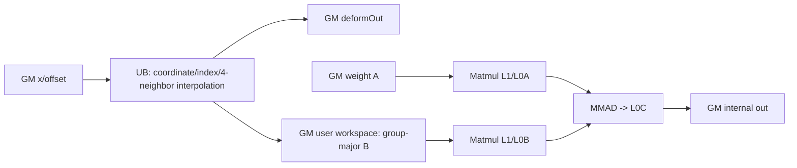
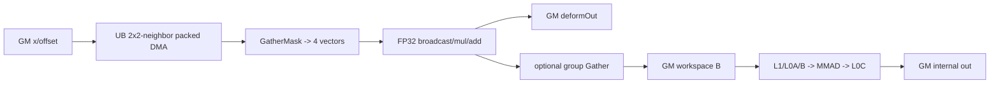

# DeformableConv2d A2/A3 ACLNN 算子知识

## 算子速览

| 项目 | 内容 |
|---|---|
| 实际入口 | `aclnnDeformableConv2dGetWorkspaceSize` + `aclnnDeformableConv2d`，公开 ACLNN 两段式接口，无显式版本后缀 |
| 计算语义 | offset 给出每个卷积采样点的 x/y 偏移与 mask；四邻域双线性插值得到 `deformOut`，再执行分组卷积并可选加 bias |
| 输入输出 | API 为 NCHW/ND 四维 `x/weight/offset/out/deformOut`，dtype 同为 FP32/FP16/BF16；内部主算子使用 NHWC 风格 ND 物理顺序 |
| 执行类型 | 单个 `__aicore__` Hybrid 节点：Vector 双线性采样 + `matmul::Matmul` AIC_CUBE；不把单 Kernel 当作执行族 |
| Kernel 路线 | R-001 常规通道分片；R-002 `deformableGroups==1` 小通道批量采样；二者均在同一 tiling key 后进入同一分组 Matmul |
| 核心资源 | 输入/输出 GM；`convInputGm` user workspace；Matmul system workspace；Vector UB 184320/186368 B；Matmul 的 L1/L0A/L0B/L0C 由 `TCubeTiling` 和库对象管理 |
| 来源闭包 | source_closed：公开 API→预处理→`DeformableConv2d` launcher→tiling/POD→key 1 entry→Vector body→user workspace→Matmul→输出及构建均固定到同一 Commit |
| 验证状态 | 已完成源码闭包检查；本次知识提取未执行编译、真机、数值或性能测试。 |

## 接口与语义

### 计算语义

令 API 输入为 `x[N,inC,inH,inW]`、`weight[outC,inC/groups,kH,kW]`，输出空间为
`outH=(inH+padTop+padBottom-((kH-1)*dilationH+1))/strideH+1`，`outW` 同理。内部先转为 NHWC 风格。对 `(n,oh,ow,kh,kw,c)`，标准坐标为 `py=oh*strideH-padTop+kh*dilationH`、`px=ow*strideW-padLeft+kw*dilationW`，再加 offset 的 y/x 分量。四邻域越界点视为 0，FP16/BF16 输入先转 FP32 进行坐标、权重和插值累加，最后 `CAST_RINT` 回 T；mask 是 offset 的第三段并乘到四个权重。`deformOut` 同时写正式可选输出和按卷积分组重排的 workspace，随后 `weight[outC/group,K] × workspace[K,outW]`，其中 `K=kH*kW*inC/groups`。A2/A3 的 bias 在 API 结果处理中以独立 `Add` 节点加入；FP16/BF16 主算子为规避内部精度先被 API cast 为 FP32，主输出再 cast 回原 dtype。

### 输入、输出与属性

| 参数 | shape/layout | dtype | 约束、默认值与语义 |
|---|---|---|---|
| `x` | API `[N,inC,inH,inW]`，ND/NCHW；内部 `[N,inH,inW,inC]` | FP32/FP16/BF16 | 非空，`inH*inW<=INT32_MAX` |
| `weight` | API `[outC,inC/groups,kH,kW]`；内部 `[outC,kH,kW,inC/groups]` | 同 `x` | 非空；A2/A3 经 transpose；`K<=65535` |
| `offset` | API `[N,3*deformableGroups*kH*kW,outH,outW]`；内部 `[N,outH,outW,3*...]` | 同 `x` | x/y/mask 三段，当前只允许 modulated |
| `biasOptional` | `[outC]` ND | 同 `x` | 可空；A2/A3 主算子不消费，API 在卷积后 reshape 为 `[1,1,outC,1]` 再 Add |
| `kernelSize` | `[kH,kW]` | int64 array | 两项正数，`kH*kW<=2048` |
| `stride` | API `[1,1,strideH,strideW]` | int64 array | 四项，空间两项正数 |
| `padding` | `[top,bottom,left,right]` | int64 array | 四项；计算只把 top/left 下发 Device，bottom/right 已折入 out shape |
| `dilation` | `[1,1,dilationH,dilationW]` | int64 array | 四项，空间两项正数 |
| `groups` | 标量 | int64 | `>0`，整除 inC/outC |
| `deformableGroups` | 标量 | int64 | `>0`，整除 inC |
| `modulated` | 标量 | bool | 固定要求 `true` |
| `out` | `[N,outC,outH,outW]` ND/NCHW | 同 `x` | 非空；确定性输出 |
| `deformOutOptional` | `[N,inC,outH*kH,outW*kW]` | 同 `x` | 可空；内部仍生成临时 deformOut 供卷积使用 |

### 入口与版本

固定 Commit 中公开符号无 V2/V3 后缀。`docs/aclnnDeformableConv2d.md` 明确支持 A2/A3；`CalculateDeformableConv2d` 在非 `DAV_3510` 分支唯一调用 l0 `DeformableConv2d`。FP16/BF16 在进入该 l0 节点前提升为 FP32，因此 Host/Tiling/Kernel 虽保留三种编译 dtype，公开 A2/A3 路线的可达实例是 FP32 主 kernel，结果再降回 API dtype。

## Host/Launcher 执行流程

### 参数校验与前处理

第一段依次执行空指针、dtype、format、属性长度和值、rank、shape 和 `K` 上界检查。虽然代码保留空 Tensor 快返，前面的 shape 约束与公开文档均把核心输入定义为非空。有效输入按 `Contiguous(x/offset/weight)` 后用 perm `[0,2,3,1]` 转内部 NHWC 风格；bias 只 contiguous。FP16/BF16 的 x/offset/weight/bias cast 到 FP32。主 kernel 返回 `[N,outH,outC,outW]` 和 `[N,outH*kH,outW*kW,inC]`；API 可选 Add bias、cast 回原 dtype，分别以 `[0,2,1,3]`、`[0,3,1,2]` transpose，再 ViewCopy 到用户输出。任一 l0 返回空指针立即以 inner error 终止 executor 构造。

### 参数、Workspace 与生命周期

Tiling 为主节点申请 `user_bytes=n*outH*outW*kH*kW*inC*sizeof(T)`，再加固定 `16 MiB` system workspace。entry 以 `GetUserWorkspace(workspace)` 获得 user slice，并把它解释为 `convInputGm<T>`；`REGIST_MATMUL_OBJ(...GetSysWorkSpacePtr()...)` 使用 system slice。user slice 在 Vector 阶段由每个 `(n,oh)` 分片写成 `[n,oh,group,ow,kh,kw,cin/group]`，随后的 Matmul 把它作为 B。整个 workspace 由两段式 executor 统一持有到 stream 上所有节点完成，输出临时 Tensor 由 executor 持有；第二段 `CommonOpExecutorRun` 保持节点在同一 stream 的添加顺序。

### 启动图与失败传播

```text
aclnnDeformableConv2dGetWorkspaceSize
  -> Contiguous/Transpose/Cast（框架节点）
  -> l0op::DeformableConv2d
     -> ADD_TO_LAUNCHER_LIST_AICORE(DeformableConv2d)
     -> Tiling4DeformableConv2dTiling: key=1, blockDim=GetCoreNumAic()
     -> deformable_conv2d
        -> DeformableConv2dND<float>::Process
           -> Vector 双线性采样 -> deform_out + user workspace
           -> matmulObj.IterateAll -> 主 out
  -> optional Add/Cast/Transpose/ViewCopy（框架节点）
  -> CommonOpExecutorRun(workspace, executor, stream)
```

launcher 添加失败返回 `(nullptr,nullptr)`，API 随即报 inner null；Tiling 参数/shape/Matmul tiling 失败返回 `GRAPH_FAILED`；entry 的 user workspace 为空时不写输出并直接返回。executor 中某个前置节点失败时框架不应继续提交其依赖节点，具体框架错误码映射属于生成 launcher 边界。

## Route 与参数设计

### 分核与资源计算

Host 取 `coreNumPlatform=GetCoreNumAic()`，以 `vecNum=2*coreNumPlatform` 对 `N*outH` 做整除：`singleVecNum=floor(N*outH/vecNum)`，`tailVecNum=(N*outH)%vecNum`；Device 用 blockIdx 计算 `[slideStart,slideEnd)`。当 `deformableGroups*kH*kW>2048` 时 `slideSizeW=1`、`groupLen=floor(2048/(kH*kW))`；否则先按 8（FP32）或 16（FP16/BF16）元素对齐 `deformableGroups*kH*kW`，以 2048 元素上限反推宽度 tile 并再次均分 outW，`groupLen=deformableGroups`。每 tile 的 `dataCount=align_up(owActualLen*groupActualLen*kH*kW,64)`。Matmul 固定原始/计算 shape `M=outC/groups,N=outW,K=kH*kW*inC/groups`，A/B/C 均 GM ND，B transpose=true，具体 L1/L0 tile 由 `MatmulApiTiling::GetTiling` 写入 `TCubeTiling`。

### Route 选择

| 顺序 | Route | Key/模板 | 精确选择条件与优先级 | 不适用去向 |
|---:|---|---|---|---|
| 1 | R-002 小通道批量采样 | key 1；`DeformableConv2dND<float>`；`calW>0` | `deformableGroups==1 && inC%8==0 && kH*kW*inC<=1024`，令 `calW=min(1024/(kH*kW*inC),slideSizeW)`，且 `align_up(calW*kH*kW*inC/groups,8)*groups<=1024` | 条件失败令 `calW=0`，到 R-001 |
| 2 | R-001 常规通道分片 | key 1；`DeformableConv2dND<float>` | 所有通过 Host/Tiling 检查且 `calW==0` 的 A2/A3 公开输入 | Tiling/shape/Matmul tiling 失败 |

```text
平台 != DAV_3510
  -> FP16/BF16 API 输入先 Cast(FP32)，三者均实例化 T=float
  -> key 1
  -> small-C 完整谓词成立 ? R-002 : R-001
  -> 每个 (n,oh) 采样完后进入同一 Conv2d/Matmul 尾段
```

### 模板/实现执行矩阵

| Route | key/selector | dtype/shape/platform 完整命中条件 | 执行族与 kernel 节点 | 实际模板/body | 内存与同步特征 | tail/fallback |
|---|---|---|---|---|---|---|
| R-001 常规通道分片 | key 1, `calW==0` | A2/A3；API dtype FP32/FP16/BF16；检查通过；small-C 谓词失败 | 单 Hybrid kernel：Vector body→GM workspace→AIC Matmul | `DeformableConv2dND<float>::BilinearInterp/ComputeEntireC/Conv2d` + `Matmul<GM ND,false; GM ND,true; GM ND>` | 2048 点坐标 tile；通道每次最多 1024；MTE2/V/MTE3 event；Matmul system WS | 宽、group、通道均显式 Min/align tail；无备用 kernel |
| R-002 小通道批量采样 | key 1, `calW>0` | A2/A3；`deformableGroups==1`、通道/容量完整谓词成立 | 同一 Hybrid kernel | `BilinearInterpSmallC/CalculateBilinearSmallC/DeformOutSmallC/Conv2d` | 一次搬四邻域，GatherMask 拆四点，broadcast 权重；workspace 仍为 Matmul B | `calW` 缩小 slide；groups>1 时 Gather 重排；失败转 R-001 |

### 隐藏性能 Guard

| Guard | Host/Tiling 条件 | Device/资源原因 | 影响 Route | 不满足时去向 | 源码符号 |
|---|---|---|---|---|---|
| 坐标 tile 上限 | `owTile*groupTile*kH*kW` 对齐后 `<=2048` | xy/offset/weight/index UB 按 2048 点固定分配 | 两路线 | 缩小 `slideSizeW` 或 `groupLen` | `SplitCore`, `DATA_COUNT` |
| 常规通道 tile | `cLen<=1024` | 四邻域 input 和 bilinear UB 固定 1024 元素 | R-001 | `cLoop=ceil(inC/deformableGroups/1024)` | `MAX_INPUT_SIZE`, `ComputeEntireC` |
| small-C | 见 Route 精确谓词 | 四邻域批量数据与重排结果必须落入 1024 元素工作区 | R-002 | `calW=0`，R-001 | `ParseTilingData` |
| offset DMA 整块 | `groupKernelSize%blockNum==0` | 32 B block 完整对齐可直接按宽多 block 搬入 | 两路线 | 先按行搬，再 GatherMask 去 padding | `CopyInOffset` |
| Matmul K | `kH*kW*inC/groups<=65535` | `MatmulApiTiling` 与公开 API K 上界 | 两路线 | API/Tiling 失败 | `CheckShape`, `GetShapes` |
| 空输出空间 | `outH>0 && outW>0` | 防止负/零迭代域 | 两路线 | Tiling 失败 | `GetShapes` |

### POD/ABI

`DeformableConv2dTilingData` 由 tiling 宏生成；固定仓能确认字段顺序和标量位宽，但宏展开后的 `sizeof/alignof/offsetof` 以及 `TCubeTiling` 内部 ABI 不在本算子源码中，复用时必须使用同版本生成头，不能手工打包。

| 结构 | 字段 | 类型/位宽 | ABI 布局 | 单位 | Host/launcher producer | Device consumer | 边界 |
|---|---|---|---|---|---|---|---|
| `DeformableConv2dTilingData` | `n,inC,inH,inW,outC,outH,outW,kH,kW`（逐字段连续声明） | 各 int64/64b | 顺序可见；精确 offset/总大小由宏生成，固定算子源码不可见 | 元素维度 | `GetShapes`/`FillTilingData` | `ParseTilingData` | 正值；乘积受 API 上界约束 |
| 同上 | `padTop,padLeft,strideH,strideW,dilationH,dilationW`（逐字段连续声明） | 各 int64/64b | 同上 | 元素 | `GetAttrs`/`FillTilingData` | 坐标公式 | stride/dilation>0 |
| 同上 | `deformableGroups,groups`（逐字段连续声明） | 各 int64/64b | 同上 | group 数 | `GetAttrs` | 分组和地址计算 | >0 且整除通道 |
| 同上 | `hasBias` | bool/实现定义位宽 | 位于 groups 后；精确 padding 不可见 | 布尔 | `RunBigKernelTiling` | 当前 Device body 不读取 | A2/A3 bias 由 API Add 消费，字段 inactive |
| 同上 | `slideSizeW,groupLen,singleVecNum,tailVecNum`（逐字段连续声明） | 各 int64/64b | 同上 | 输出宽/group/slide 数 | `SplitCore` | `ParseTilingData`/`Process` | `slideSizeW,groupLen>=1`；single/tail 可 0 |
| 同上 | `mmTilingData` | `TCubeTiling` | 嵌套结构，ABI 由 `tiling/tiling_api.h` 定义 | Matmul tile/资源参数 | `GetTCubeTiling` | `REGIST_MATMUL_OBJ`/`matmulObj` | `GetTiling==-1` 时整条 Route 失败 |

### Route 源码闭包

| Route | Key/selector | Host/Tiling producer | POD/参数 | Kernel entry/router | Kernel body/直接依赖 | 构建接线 |
|---|---|---|---|---|---|---|
| R-001 | key 1, `calW==0` | `deformable_conv2d_tiling.cpp::RunBigKernelTiling/SplitCore/GetTCubeTiling` | `DeformableConv2dTilingData` + `TCubeTiling` | `deformable_conv2d.cpp::deformable_conv2d` | `deformable_conv2d_base.h/.cpp::BilinearInterp/ComputeEntireC/Conv2d` | `deformable_conv2d_def.cpp` ascend910b/ascend910_93；`op_host/CMakeLists.txt`；global ascendc config |
| R-002 | key 1, `calW>0` | 同上 | 同上 | 同上 | `BilinearInterpSmallC/CalculateBilinearSmallC/DeformOutSmallC/Conv2d` | 同上 |

## Kernel 实现

### 公共执行流程

entry 解析 key 1/POD，注册 `matmulObj`，把 GM 指针和 user workspace 交给 `Init`。`Process` 先初始化全部 UB view 与六个 event ID，再按本核 `[slideStart,slideEnd)`、宽 tile、deform group tile：搬 offset，生成或增量调整标准坐标，算 floor/ceil、索引、边界 mask 和四权重，乘 offset mask，选择 R-001/R-002 插值并同时写 `deformOutGm` 与 `convInputGm`。每完成一个 `(n,oh)` 的全部宽/group，按卷积 groups 循环调用 Matmul。最后释放 event ID。

### Route R-001：常规通道分片

#### 适用条件

##### 选择证据

| 层级 | 文件 | 符号 | 源码谓词/参数 | 结果/下一跳 |
|---|---|---|---|---|
| API | `op_host/op_api/aclnn_deformable_conv2d.cpp` | `CalculateDeformableConv2d` | `curArch!=DAV_3510` | l0 `DeformableConv2d` |
| Tiling | `op_host/deformable_conv2d_tiling.cpp` | `RunBigKernelTiling` | checks success | key 1，blockDim=AIC core 数 |
| Device | `op_kernel/deformable_conv2d_base.h` | `ParseTilingData` | small-C 完整谓词失败，`calW=0` | `BilinearInterp` |

#### Device 数据流

##### 函数级调用链

```text
deformable_conv2d -> Init -> Process
  -> CopyInOffset -> CalculateStandard/AdjustStandard
  -> CalculateWeight -> ProcessZero
  -> BilinearInterp -> ComputeEntireC -> CopyInAndCalculate -> CopyOut
  -> Conv2d -> matmulObj.SetTensorA/B -> IterateAll
```

##### 源码等价伪码

```text
for slide=(n,oh) owned by block:
  for ow tile, deform-group tile:
    DMA offset[x,y,mask]; compact unaligned rows
    p = standard_grid + offset
    q0=floor(p); q1=q0+1; index=-1 and weight=0 for OOB
    w00..w11 = bilinear_fraction * mask
    for each sample and channel tile<=1024:
      DMA valid four neighbors; cast T->fp32
      v = sum(fp32(neighbor)*w); cast_rint fp32->T
      DMA v to deform_out and group-major convInput workspace
  for convolution group:
    Matmul(weight[M,K], convInput[K,N], B_transpose=true) -> out[M,N]
```

#### 内存与数据搬运

##### 资源与搬运表

| 层级/缓冲区 | offset/地址公式 | extent/容量公式 | dtype/layout | producer | consumer | owner/lifetime | 对齐/复用 |
|---|---|---|---|---|---|---|---|
| GM x | `n*inH*inW*inC + (y*inW+x)*inC+c` | `N*inH*inW*inC*sizeof(T)` | T/NHWC | API transpose/cast | MTE2 sampling | executor/input | c tile DMA，越界不读 |
| GM offset | `(n*outH*outW+oh*outW+ow)*3*dg*kSize + component*dg*kSize+g*kSize` | `N*outH*outW*3*dg*kSize*sizeof(T)` | T/NHWC packed x,y,mask | API transpose/cast | `CopyInOffset` | executor/input | 32 B 对齐时直搬，否则 GatherMask |
| UB 坐标/索引/权重/mask | 固定别名见 `InitTensor` | 143360 B | FP32/int32/u8 | 坐标与权重步骤 | 插值 | pipe/整个 kernel | 以 `dataCount=align64` 复用 |
| UB input/bilinear/srcOffset/gather | 固定 TBuf | FP32 路线 43008 B | T/FP32/int32 | MTE2/Vector | MTE3 | pipe/每个 c tile | inputBuf 的 T/float view 按 dtype 别名 |
| GM deformOut | `(n*outH+oh)*outW*kSize*inC + ow*kW*inC + kh*outW*kW*inC + kw*inC+c` | `N*outH*outW*kSize*inC*sizeof(T)` | T/[N,outH,kH,outW,kW,C] 物理 | `CopyOut` | API transpose/ViewCopy | executor/temp/output | c tail 精确字节 |
| user workspace convInput | `(n*outH+oh)*groups*outW*kSize*CinG + group*outW*kSize*CinG + ow*kSize*CinG + k*CinG+c` | `N*outH*outW*kSize*inC*sizeof(T)` | T/group-major `[N,OH,G,OW,K,CinG]` | `CopyOut` | Matmul B | executor/主 kernel | 未 alias deformOut；同 slice 在消费后可复用 |
| L1/L0A/L0B/L0C | Matmul library 根据 `TCubeTiling` | 精确容量在嵌套 POD/库实现中 | A=weight ND，B=workspace ND transpose，C=out ND | Matmul prologue/MMAD | IterateAll epilogue | matmulObj | 固定算子源码边界，不能外推具体 tile |

##### 分层内存布局



##### 字节账、交接边与复用顺序

```text
workspace_total = 16 MiB system + N*outH*outW*kH*kW*inC*sizeof(T) user
Vector UB_total(T=float) = 186368 B
公开 A2/A3 FP16/BF16 先 cast FP32，因此实际主 kernel 同样使用 186368 B
L1/L0 = TCubeTiling 当前实例；本算子源码未展开精确字节
```

| 边/复用子区 | producer | offset/extent | dtype/layout | consumer | ordering/sync | owner/lifetime | 安全条件 |
|---|---|---|---|---|---|---|---|
| sample→conv B | `CopyOut` | 上表 group-major offset；总 user bytes | T/ND B-transpose view | `Conv2d::SetTensorB` | 同一 `Process` 中写完该 `(n,oh)` 后才调用 `Conv2d`；MTE3 event 保护 UB→GM | executor workspace，stream 完成后释放 | 每核拥有独立 slide；group/ow/c 地址不重叠 |
| UB input reuse | `CopyInAndCalculate` | 每次最多 4*1024*T/FP32 view | 四邻域 | Vector Axpy | `V_MTE2/MTE2_V/MTE3_V/V_MTE3` + PIPE_V barrier | pipe，下一 c tile 覆盖 | 上次 MTE3 完成后覆盖 |

#### 同步、精度与尾块

##### 同步与数值边界表

| 阶段 | primitive/机制 | producer | consumer/等待点 | 保护对象 | 精度/尾块 |
|---|---|---|---|---|---|
| offset 搬入 | `MTE2_V` event | DataCopyPad | Vector/GatherMask | offsetBuf | 非 block 对齐行用 GatherMask 紧缩 |
| 标量坐标 | `S_V` event | scalar SetValue | Vector 运算 | xyBuf | 坐标/权重 FP32 |
| 邻域搬入 | `V_MTE2` + `MTE2_V` | 上轮 Vector/本轮 DMA | DMA/Vector | inputBuf | 越界 index=-1，不发 GM 读 |
| 输出 | `V_MTE3` + `MTE3_V` | Vector/Axpy | DataCopyPad/下轮 Vector | bilinear/gather | FP16/BF16 时 `CAST_RINT`；cLen 精确 tail |
| Matmul | 方法程序顺序 + Matmul 内部同步 | workspace MTE3 | `IterateAll` | 当前 slide B 矩阵 | 累加/尾 K 由 `TCubeTiling` 当前实例控制 |

#### 关键实现

##### 符号证据表

| 阶段 | 文件 | 符号/模板实例 | 实现事实 |
|---|---|---|---|
| Host/Tiling producer | `op_host/deformable_conv2d_tiling.cpp` | `SplitCore/GetTCubeTiling` | 2048 点 tile、slide 分核和 M/N/K |
| Kernel entry/router | `op_kernel/deformable_conv2d.cpp` | key 1, `DeformableConv2dND<T>` | dtype 实例和 Matmul 注册 |
| Device body/helper | `op_kernel/deformable_conv2d_base.cpp` | `BilinearInterp/CopyOut/Conv2d` | 四点插值、双输出、workspace 重排和 Matmul |

### Route R-002：小通道批量采样

#### 适用条件

##### 选择证据

| 层级 | 文件 | 符号 | 源码谓词/参数 | 结果/下一跳 |
|---|---|---|---|---|
| Device selector | `op_kernel/deformable_conv2d_base.h` | `ParseTilingData` | `dg==1 && inC%blockNum==0 && kSize*inC<=1024`，二次容量检查通过 | `calW>0` |
| Device body | 同文件 | `Process` | `if (calW>0)` | `BilinearInterpSmallC`；否则 R-001 |

#### Device 数据流

##### 函数级调用链

```text
deformable_conv2d -> Init -> Process
  -> CopyInOffset -> CalculateStandard/AdjustStandard -> CalculateWeight -> ProcessZero
  -> BilinearInterpSmallC -> CopyInSmallC -> CalculateBilinearSmallC
  -> DeformOutSmallC (+ groups>1 Gather workspace)
  -> Conv2d -> matmulObj.IterateAll
```

##### 源码等价伪码

```text
for ow,kh,kw in small batch:
  DMA adjacent 2x2 rows when all four indices valid, otherwise only valid spans
GatherMask four interleaved neighbors -> four contiguous vectors
Broadcast each scalar sampling weight across inC
fp32 sum four products; cast_rint to T
2D DMA to deformOut
if groups>1: Gather by conv group then strided DMA to workspace else direct DMA
Matmul per convolution group
```

#### 内存与数据搬运

##### 资源与搬运表

| 层级/缓冲区 | offset/地址公式 | extent/容量公式 | dtype/layout | producer | consumer | owner/lifetime | 对齐/复用 |
|---|---|---|---|---|---|---|---|
| GM/Workspace/L1/L0 | 与 R-001 相同 | 与 R-001 相同 | 同上 | 同上 | 同上 | 同上 | 同上 |
| UB inputBuf | `inputOffset += 4*inC` | 固定 32768 B | 四邻域交织 T 与 FP32 view | `CopyInSmallC` | GatherMask/Vector | 每个 ow batch | `calW*kSize*inC<=1024` 保证容量 |
| UB weight temp | inputBuf 后半的 FP32 aliases | 4*1024*4 B | FP32 broadcast | BroadCast | Mul/Add | 当前 batch | 与输入 view 的阶段生命周期分离 |
| UB gather | groupIdx*align_up(owLen*kSize*CinG,blockNum) | <=1024*T | T/group-major | Gather | workspace MTE3 | 当前 batch | groups>1 才使用 |

##### 分层内存布局



##### 字节账、交接边与复用顺序

```text
workspace_total 与 UB 总分配同 R-001；R-002 只改变 inputBuf 内的阶段布局，不另申请 UB。
```

| 边/复用子区 | producer | offset/extent | dtype/layout | consumer | ordering/sync | owner/lifetime | 安全条件 |
|---|---|---|---|---|---|---|---|
| packed input→weights temp alias | MTE2/GatherMask | inputBuf 固定 32 KiB | T/FP32 | Broadcast/Mul | MTE2_V + PIPE_V，后续 MTE3_V 后才清零复用 | pipe/当前 batch | small-C 容量谓词 |
| sample→workspace | direct或group Gather | 与 R-001 相同 | T/group-major | Matmul | V_MTE3 后程序顺序 | executor | ceilConvC 总量<=1024 |

#### 同步、精度与尾块

##### 同步与数值边界表

| 阶段 | primitive/机制 | producer | consumer/等待点 | 保护对象 | 精度/尾块 |
|---|---|---|---|---|---|
| packed DMA | MTE2_V | `CopyInSmallC` | GatherMask | inputBuf | 部分越界时分段搬，未搬区域已置 0 |
| 四点计算 | PIPE_V | Gather/Broadcast/Mul | Add | FP32 views | `batchCount=owActualLen*kSize*inC` |
| group 重排 | V_MTE3 | Gather | DataCopyPad | gatherBuf/workspace | group extent 精确；dstStride 跳过其它 ow |
| Matmul | 同 R-001 | workspace | IterateAll | B | 同 R-001 |

#### 关键实现

##### 符号证据表

| 阶段 | 文件 | 符号/模板实例 | 实现事实 |
|---|---|---|---|
| selector | `op_kernel/deformable_conv2d_base.h` | `ParseTilingData` | calW 与容量二次检查 |
| sampling | `op_kernel/deformable_conv2d_base.cpp` | `CopyInSmallC/CalculateBilinearSmallC` | 连续 2x2 搬运、GatherMask 和 broadcast |
| output/conv | 同文件 | `DeformOutSmallC/Conv2d` | deformOut 2D DMA、group workspace 重排和 Matmul |

## 算子特定优化

### Trick T-001：按 2048 点容量联合切宽度与 deformable group

#### 触发与源码依据

- 适用 Route：R-001、R-002
- 触发条件：所有通过 Tiling 的 shape；`deformableGroups*kH*kW>2048` 时强制宽度 1 并切 group，否则优先保留完整 group 并均衡 outW
- Golden 来源：[`deformable_conv2d_tiling.cpp:SplitCore`](../../../../../../../cann-ops-raw/ascendc/ops-nn/955f8b33985b6d72989ebff341bb9c2c564a51bc/conv/deformable_conv2d/op_host/deformable_conv2d_tiling.cpp)

**官方源码（固定 Commit 连续逐字摘录）**：

```cpp
if (*deformableGroups * kH * kW > MAX_KERNEL_SIZE) {
    slideSizeW = 1;
    groupLen = MAX_KERNEL_SIZE / (kH * kW);
} else {
    int32_t blockNum = (dataType == ge::DT_FLOAT) ? FLOAT_BLOCK_NUM : HALF_BLOCK_NUM;
    int64_t ceilSize = CeilA2B(*deformableGroups * kH * kW, blockNum) * blockNum;
    slideSizeW = MAX_KERNEL_SIZE / ceilSize;
}
```

#### 机制与设计原因

xy/offset/index/weight TBuf 都以 2048 采样点为硬上限。Host 同时切输出宽与 deform group，使 Device 内层循环无需动态分配 UB；完整 group 可容纳时保留 group 连续性，超限时用 `groupLen` 切分。

#### 迁移边界

- 适用：固定点数 UB 元数据明显大于通道数据的采样/重排算子。
- 前提：tile 地址域互不重叠，tail 用真实 `groupActualLen/owActualLen`。
- 失效：`kH*kW>2048` 已在 API/Tiling 失败，不能靠 `groupLen=0` 兜底。
- 未验证：本次知识提取未执行编译、真机、数值或性能测试。

#### 错误做法

把对齐前点数直接用于 DMA repeat 会让 offset 行 padding 混入下一行；源码在非 block 对齐时使用 GatherMask 紧缩。

### Trick T-002：小通道四邻域连续搬运与批量 broadcast

#### 触发与源码依据

- 适用 Route：R-002
- 触发条件：`deformableGroups==1 && inC%blockNum==0 && kSize*inC<=1024` 及二次 group 容量检查
- Golden 来源：[`deformable_conv2d_base.h:ParseTilingData`](../../../../../../../cann-ops-raw/ascendc/ops-nn/955f8b33985b6d72989ebff341bb9c2c564a51bc/conv/deformable_conv2d/op_kernel/deformable_conv2d_base.h)

**官方源码（固定 Commit 连续逐字摘录）**：

```cpp
if (deformableGroups == 1 && inC % blockNum == 0 && kSize * inC <= MAX_INPUT_SIZE) {
    calW = Min(MAX_INPUT_SIZE / (kSize * inC), slideSizeW);
    if (CeilA2B(calW * kSize * inC_conv_group, blockNum) * blockNum * groups <= MAX_INPUT_SIZE) {
        slideSizeW = calW;
    } else {
        calW = 0;
    }
}
```

#### 机制与设计原因

满足条件时一次搬入相邻两列×两行，并用 GatherMask 抽出四点；每点标量权重 broadcast 到整段通道，减少逐采样点四次短 DMA 与标量 Axpy 调度。二次检查同时保证 group 重排的对齐容量。

#### 迁移边界

- 适用：NHWC、通道连续且四邻域总数据能放入固定 UB 的双线性采样。
- 前提：通道按 32 B block 对齐，越界分支保持未搬区域为 0。
- 失效：多 deform group、通道不对齐或容量超限，必须回 R-001。
- 未验证：本次知识提取未执行编译、真机、数值或性能测试。

#### 错误做法

固定源码提供的 fallback 是令 `calW=0` 回常规路线；不能在容量不满足时继续复用 small-C buffer 布局。

### Trick T-003：一次插值同时物化用户 deformOut 与 Matmul-B 重排

#### 触发与源码依据

- 适用 Route：R-001、R-002
- 触发条件：全部有效 tile
- Golden 来源：[`deformable_conv2d_base.cpp:CopyOut`](../../../../../../../cann-ops-raw/ascendc/ops-nn/955f8b33985b6d72989ebff341bb9c2c564a51bc/conv/deformable_conv2d/op_kernel/deformable_conv2d_base.cpp)

**官方源码（固定 Commit 连续逐字摘录）**：

```cpp
DataCopyPad(deformOutGm[deformOutOffset], deformOutTensor, copyOutParams);

int64_t cStart = deformOutOffset % inC;
int64_t groupStart = cStart / inC_conv_group;
int64_t groupOffset = cStart % inC_conv_group;
```

#### 机制与设计原因

同一 FP32 插值结果只计算一次：一份按公开 deformOut 物理顺序写正式临时输出，另一份按卷积分组与 K/N 顺序写 workspace，直接成为 Matmul B，避免卷积前再执行全量 layout-transform kernel。

#### 迁移边界

- 适用：采样结果既要公开输出又要作为后续矩阵输入的融合流水线。
- 前提：两份 GM 区域不 alias，group offset/stride 与 Matmul B transpose 语义完全一致。
- 失效：若只需 deformOut 而不需卷积，当前公开 API 仍会执行主卷积，不是该接口的可选路线。
- 未验证：本次知识提取未执行编译、真机、数值或性能测试。

#### 错误做法

固定仓未提供可验证反例。

## 模板与实现对比

| 对比维度 | R-001 常规通道分片 | R-002 小通道批量采样 | 设计选择依据 |
|---|---|---|---|
| 命中条件/优先级 | `calW==0` fallback | small-C 完整容量谓词优先 | 1024 元素通道工作区 |
| 执行族/节点图 | 单 Hybrid：Vector→GM WS→Cube | 相同 | 只替换采样 body |
| M/N/K、tile 与 scheduler | `M=outC/G,N=outW,K=kSize*inC/G`；c 每 1024 | M/N/K 相同；ow batch=`calW` | Matmul tiling不变 |
| workspace/L1/L0/UB | user WS + 186368 B UB | 相同总量，inputBuf 布局不同 | 固定 TBuf 复用 |
| AIC/AIV 或 kernel 交接 | 同 kernel 的 GM user WS | 同 | 写完 slide 后 Matmul |
| 同步、精度与 tail | 多次短 DMA+Axpy；c tail | packed DMA+Gather/Broadcast；ow tail | event/PIPE_V |
| fallback/失败边界 | 无后继，Tiling 失败 | 回 R-001 | `calW=0` |

## 平台差异

| 项目 | A2 | A3 | 950 |
|---|---|---|---|
| 支持状态 | 公开 ACLNN 支持 | 公开 ACLNN 支持 | 本卡不覆盖；见 `_950` 卡 |
| Host/Launcher | 非 DAV_3510，主节点前 FP16/BF16→FP32 | 同 A2 | 分解为 DeformableOffsets+Conv2DV2 |
| Kernel/资源 | ascend910b 配置；key 1 Hybrid | ascend910_93 配置；同 body/POD | 不使用本卡主 kernel |

## 限制与失败边界

- 只支持 FP32/FP16/BF16 同 dtype，`modulated=true`，四维输入输出，groups/deformableGroups 正数且整除对应通道。
- `kH*kW<=2048`、`kH*kW*inC/groups<=65535`、`inH*inW<=INT32_MAX`，输出空间必须为正；乘法发生在 int64，公开代码未额外检查所有中间乘积溢出。
- 固定算子源码未展开 `TCubeTiling` ABI、Matmul 库内部 L1/L0 容量和 MMAD tail；这些是同版本 AscendC Matmul 库边界，复用不得手工改 POD 或假定 tile。
- 本次知识提取未执行编译、真机、数值或性能测试。

## 源码索引

### 链路索引

| 链路阶段 | 文件 | 关键符号 | 支撑内容 |
|---|---|---|---|
| 入口声明/约束 | `docs/aclnnDeformableConv2d.md` | 公开 API 原型/产品表 | A2/A3 支持、参数和公式 |
| 入口实现 | `op_host/op_api/aclnn_deformable_conv2d.cpp` | `aclnnDeformableConv2d*` | 校验、预后处理、executor |
| l0 launcher | `op_host/op_api/deformable_conv2d.cpp` | `l0op::DeformableConv2d` | 临时 shape 与 AICORE 节点添加 |
| Host/Tiling | `op_host/deformable_conv2d_tiling.cpp` | `RunBigKernelTiling` | workspace、分核、key、Matmul tiling |
| POD | `op_host/deformable_conv2d_tiling.h` | `DeformableConv2dTilingData` | 字段顺序与类型 |
| Kernel entry | `op_kernel/deformable_conv2d.cpp` | `deformable_conv2d` | key/dtype router、Matmul 注册 |
| Kernel body | `op_kernel/deformable_conv2d_base.h` | `Process/ParseTilingData` | Route selector 与主循环 |
| Kernel helper | `op_kernel/deformable_conv2d_base.cpp` | `BilinearInterp*/Conv2d` | 搬运、计算、同步、tail |
| 构建接线 | `op_host/deformable_conv2d_def.cpp` | `AICore().AddConfig` | ascend910b/ascend910_93 |
| 构建依赖 | `op_host/CMakeLists.txt` | `add_modules_sources` | ACLNN host 与 convolution_forward 依赖 |
| Kernel binary 配置 | `scripts/kernel/binary_config/ascendc_config.json` | `DeformableConv2d` | ascend910b/ascend910_93 compute units |

每行只写一个文件，并确保该文件存在于 Frontmatter `sources`。

### 实现复用检查

| 检查项 | 可复用事实 | 不得改变的约束 | 源码符号 |
|---|---|---|---|
| ABI/POD | shape/attr/split 字段 + 嵌套 `TCubeTiling` | 顺序、位宽、宏生成 ABI、inactive hasBias | `DeformableConv2dTilingData` |
| 调用顺序 | sampling→双 GM 输出→Matmul→API 后处理 | 每个 `(n,oh)` 全部 tile 完成后才 Conv2d | `Process` |
| workspace/内存 | user slice 即 Matmul B | 总字节、group-major offset、system/user 分界 | `RunBigKernelTiling`, `CopyOut` |
| 同步 | MTE2/V/MTE3 event + PIPE_V | event 分配/释放和覆盖顺序 | `InitEventId`, body methods |
| 精度与尾块 | 坐标/权重/累加 FP32；T cast_rint | OOB=0、mask 后乘、align/gather tail | `CalculateWeight`, `ProcessZero` |
| 失败边界 | launcher/Tiling/Matmul tiling fail closed | 不能用 950 分解路线替代 A2/A3 实现事实 | API/Tiling return paths |