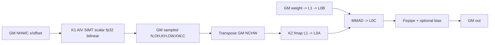

# DeformableConv2d 950 ACLNN 算子知识

## 算子速览

| 项目 | 内容 |
|---|---|
| 实际入口 | `aclnnDeformableConv2dGetWorkspaceSize` + `aclnnDeformableConv2d`，公开 ACLNN 两段式接口 |
| 计算语义 | AIV SIMT 计算 offset+mask 双线性采样，再以采样结果为输入执行 stride=(kH,kW) 的 `Conv2DV2`，可在卷积 Fixpipe 中加 bias |
| 输入输出 | 950 API 只接受 NCHW，FP32/FP16/BF16；`out[N,outC,outH,outW]`，可选 `deformOut[N,inC,outH*kH,outW*kW]` |
| 执行类型 | 多 Kernel：`DeformableOffsets` 为 SIMT/AIV_ONLY；`Conv2DV2` 在本 API 的 NCHW/NCHW/NCHW 编译格式为 MIX_CV `MIX_AIC_1_2`，含 Cube mainloop 与按 key 激活的 AIV 数据变换 |
| Kernel 路线 | R-001 32 位索引采样→动态 Conv2DV2 specialization；R-002 64 位索引采样→相同 Conv2DV2 selector |
| 核心资源 | 节点间 executor 临时 GM；两个核心节点各报 16 MiB system workspace；Conv2DV2 使用 L1/L0A/L0B/L0C，特定 MIX key 另用 UB/SSBUF 同步 |
| 来源闭包 | source_closed：公开 API→DAV_3510 分解→DeformableOffsets Host/POD/SIMT→Transpose 临时边→Conv2DV2 Host/16 维 key/MIX_CV body→ViewCopy 与构建均在固定 Commit 闭合 |
| 验证状态 | 已完成源码闭包检查；本次知识提取未执行编译、真机、数值或性能测试。 |

## 接口与语义

### 计算语义

输出空间公式与 A2/A3 相同。950 先把 x/offset 转成 NHWC 临时张量。`DeformableOffsets` 的每个 SIMT 线程处理一个 `(n,oh,ow,c)`，循环全部 `(kh,kw)`：从 offset 的 x/y/mask 三段取值，四邻域越界视 0，以 FP32 计算双线性权重和累加，再 cast 回 T 写物理 `[n,oh,kh,ow,kw,c]`。Host 将它 transpose 为 NCHW `[n,c,oh*kh,ow*kw]`，再以原 weight `[outC,inC/groups,kH,kW]`、零 padding、单位 dilation、stride `[kH,kW]` 调用 `Conv2DV2`，因此窗口互不重叠且恰好恢复 `(oh,ow)`。bias 直接传给 Conv2DV2；950 不再执行 API 侧 Add/Cast/输出 transpose。

### 输入、输出与属性

| 参数 | shape/layout | dtype | 约束、默认值与语义 |
|---|---|---|---|
| `x` | `[N,inC,inH,inW]` NCHW | FP32/FP16/BF16 | 非空；950 不接受 ND storage format |
| `weight` | `[outC,inC/groups,kH,kW]` NCHW | 同 x | 950 不 transpose weight，直接交 Conv2DV2 |
| `offset` | `[N,3*dg*kH*kW,outH,outW]` NCHW | 同 x | x/y/mask；内部 NHWC |
| `biasOptional` | `[outC]` ND | 同 x | 可空；Conv2DV2 `hasBias` 控制 Fixpipe/bias 路径 |
| `kernelSize` | `[kH,kW]` | int64 array | 正数；积<=2048 |
| `stride` | `[1,1,sH,sW]` | int64 array | DeformableOffsets 中使用；sH/sW>0 |
| `padding` | `[top,bottom,left,right]` | int64 array | DeformableOffsets 使用；Conv2DV2 被重设全 0 |
| `dilation` | `[1,1,dH,dW]` | int64 array | DeformableOffsets 使用；Conv2DV2 被重设全 1 |
| `groups` | 标量 | int64 | >0 且整除 inC/outC |
| `deformableGroups` | 标量 | int64 | >0 且整除 inC |
| `modulated` | 标量 | bool | 只支持 true |
| `out` | `[N,outC,outH,outW]` NCHW | 同 x | Conv2DV2 直接生成后 ViewCopy |
| `deformOutOptional` | `[N,inC,outH*kH,outW*kW]` NCHW | 同 x | 可空；即 Conv2DV2 输入的可选公开副本 |

### 入口与版本

公开文档在同一固定 Commit 明确列出 Ascend 950PR/950DT 支持和 NCHW-only 限制。目录 README 对内部单节点 `DeformableConv2d` 标成 950 不支持，与公开 API 不冲突：`CalculateDeformableConv2d` 在 `DAV_3510` 上不启动该内部节点，而调用 `DeformableConv2dV2` 分解图。固定仓只有这一公开入口版本。

## Host/Launcher 执行流程

### 参数校验与前处理

校验顺序与 A2/A3 相同；`CheckFormat` 在 `DAV_3510` 明确只接受 NCHW。x/offset 先 Contiguous 和 `[0,2,3,1]` transpose，并把临时 Tensor 的 storage/original/view format 全设为 NHWC；weight 仅 Contiguous，不 transpose；bias 仅 Contiguous。DeformableOffsets 参数的 stride/dilation 经 `ParamsTranspose` 从 NCHW `[N,C,H,W]` 变为 NHWC `[N,H,W,C]`。采样后用 `[0,3,1,2]` transpose 为 NCHW，随后 padding 重置 `[0,0,0,0]`、dilation 重置 `[1,1,1,1]`、卷积 stride 重建 `[kH,kW]`。任一 Alloc/InferShape/launcher 返回空立即失败。

### 参数、Workspace 与生命周期

`DeformableOffsets` Tiling 报 user 0 + system 16 MiB；`Conv2DV2::GetWorkspaceSize` 同样报 16 MiB。公开第一段返回的是 executor 对全部框架节点和两个核心节点统一规划后的 `GetWorkspaceSize()`，固定算子源码不暴露 executor 的 slice offset，不能把两个 16 MiB 简单相加或 alias。中间 NHWC deformOut、transpose 后 NCHW deformOut、Conv 输出均由 executor 持有到 stream 完成；用户可选 deformOut 通过最后 ViewCopy 接收同一 NCHW 临时结果。

### 启动图与失败传播

```text
API NCHW x/offset
  -> Contiguous -> Transpose[0,2,3,1] -> NHWC temps
  -> K1 DeformableOffsets (AIV_ONLY SIMT, key 1000/1001, blockDim<=AIV cores)
     -> GM temp [N,OH,KH,OW,KW,C]
  -> framework Transpose[0,3,1,2]
     -> GM temp NCHW [N,C,OH*KH,OW*KW]
  -> K2 Conv2DV2 (NCHW/NCHW/NCHW, MIX_AIC_1_2, dynamic 16-axis key)
     -> GM internal out [N,outC,OH,OW]
  -> ViewCopy(out) + optional ViewCopy(deformOut)
  -> CommonOpExecutorRun on one stream
```

K1 launcher 添加当前代码未检查返回值，但其 InferShape 失败会先返回空；K2 `Conv2dWithFlag` 会把 InferShape/launcher 错误传回内部状态，`Conv2dV2NCHW` 当前未检查该返回值而返回所分配 output，属于固定源码失败传播边界。跨 kernel 可见性来自同一 executor/stream 的节点依赖和 launch 顺序，不使用 K1/K2 间显式 event。K2 内部 MIX AIC/AIV 变换路线使用 `CrossCoreSetFlag/WaitFlag` 与 MTE event。

## Route 与参数设计

### 分核与资源计算

K1 定义 `numKernels=N*OH*OW*C`，初始 `blockDim=ceil(numKernels/512)`，再 clamp 到 AIV 核数；每个 block 固定 512 threads，线程从 `blockId*512+threadIdx.x` 开始，以 `blockNum*512` 为步长。若 x、offset 或 output 任一元素总数超过 INT32_MAX，key 1001 使用 int64/uint64 地址和除法 magic，否则 key 1000 使用 int32/uint32。

K2 的逻辑输入为 `Hi=OH*KH,Wi=OW*KW,Ci=inC`，kernel=`KH*KW`，stride=`KH,KW`，padding=0，dilation=1，Co=outC。Conv2d Tiling 先尝试 cache，再 runtime knowledge bank，再 fast tiling；生成 `singleCore*`、`hoL1/woL1/kAL1/kBL1/nBL1/hoL0/woL0/kL0/nL0`、batch/Ho/Wo/N/group 分核和 ping-pong。blockDim 为 `batchDim*mDim*nDim*groupDim`（M-mode）或 `batchDim*nDim*hoDim*woDim*groupDim`。16 维 key 逐项编码 fmap/weight full-load、L1/L0 ping-pong、output/iteration order、group type、small channel、weight UB transform、Load3D/DMA、inner-batch、discontinuous input、batch-one、no-pad、small-weight、small-kernel；模板选择表只实例化合法组合。

### Route 选择

| 顺序 | Route | Key/模板 | 精确选择条件与优先级 | 不适用去向 |
|---:|---|---|---|---|
| 1 | R-002 64 位采样索引 + Conv | K1 key 1001；K2 16 维 tuple | 950 且 `xSize>INT32_MAX \|\| offsetSize>INT32_MAX \|\| deformOutputSize>INT32_MAX` | shape/attr 失败 |
| 2 | R-001 32 位采样索引 + Conv | K1 key 1000；K2 16 维 tuple | 950 且三者均 `<=INT32_MAX` | shape/attr 失败 |

```text
DAV_3510
  -> K1 size overflow? key1001<int64,uint64> : key1000<int32,uint32>
  -> transpose edge
  -> K2 cache hit ? cached tiling : knowledge-bank hit ? repo tiling : fast tiling
  -> SetTilingKey(16 axes) -> matching Conv2dBase/GroupConv2d/SmallKernel specialization
```

### 模板/实现执行矩阵

| Route | key/selector | dtype/shape/platform 完整命中条件 | 执行族与 kernel 节点 | 实际模板/body | 内存与同步特征 | tail/fallback |
|---|---|---|---|---|---|---|
| R-001 | K1=1000；K2 tuple | 950 NCHW，三节点 size<=INT32_MAX，API checks pass | K1 SIMT AIV→Transpose→K2 MIX_CV | `DeformableOffset<T,int32_t,uint32_t>`；K2 `Conv2dBase`/`GroupConv2d`/half small-kernel by tuple | K1 direct GM; K2 GM→L1→L0A/B→MMAD→L0C→Fixpipe；特定 transform 用 UB+cross-core flag | 线程 grid-stride；K2 singleCore tail；无跨平台 fallback |
| R-002 | K1=1001；K2 tuple | 950 NCHW，任一 size>INT32_MAX，其余 checks pass | 同 R-001 | `DeformableOffset<T,int64_t,uint64_t>`；相同 K2 selector | 地址/除法宽化；其余相同 | 同上 |
| K2 子路线族 | 16 维 key | 由当前 shape/dtype/group/L1/L0 容量、cache/repo/fast tiling共同决定 | NCHW weight 编译格式声明 MIX_AIC_1_2 | normal `Conv2dBase`、group `GroupConv2d`；仅 half+NCHW+M-mode+SmallKernel 走 `Conv2dSmallKernel` | full-load/partial、ping-pong、Load3D/DMA、weight-UB-trans 精确随 key | tuple 不在编译选择表则 kernel 查找失败 |

### 隐藏性能 Guard

| Guard | Host/Tiling 条件 | Device/资源原因 | 影响 Route | 不满足时去向 | 源码符号 |
|---|---|---|---|---|---|
| K1 index width | 三个 shape size 与 INT32_MAX 比较 | SIMT 地址、magic division 位宽 | R-001/R-002 | key1000↔1001 | `DeformableOffsetTiling` |
| K1 grid | `blockDim=min(ceil(numKernels/512),AIV cores)` | 每 block 512 threads | 两路线 | grid-stride loop 覆盖 tail | `CalDeformableOffsetsOffset`, `ComputeDeformableOffset` |
| K2 no-pad | Conv 重设 padding 全 0 | 允许 no-pad specialization | K2 tuple | 一般 has-pad tuple（本 API 不命中） | `ResetParams`, `GetNoPad` |
| K2 group type | `groups`、每组 Ci/Co 与容量条件 | normal/original/optimized group body 与 AIV transform 不同 | K2 tuple | 其它 group tuple或失败 | `SetTilingKey`, `conv2d_v2_group.h` |
| L1/L0 full-load | kAL1/kBL1/nBL1/hoL0/woL0/kL0/nL0 与完整维度比较 | 决定搬运次数、ping-pong 与循环顺序 | K2 tuple | OTHER tiling specialization | `GetFmpTilingVal/GetWeightTilingVal` |
| small kernel | half、NCHW→NCHW、M-mode、key SmallKernel=1 | 专用小卷积 body | K2 tuple | `Conv2dBase/GroupConv2d` | `conv2d_v2.cpp::if constexpr` |

### POD/ABI

两个 POD 都由 tiling 宏生成；字段类型/顺序可见，宏展开后的精确 `sizeof/alignof/offsetof` 固定算子源码不可见，必须使用 CANN 9.1 同版本生成 ABI。

| 结构 | 字段 | 类型/位宽 | ABI 布局 | 单位 | Host/launcher producer | Device consumer | 边界 |
|---|---|---|---|---|---|---|---|
| `DeformableOffsetsTilingDataSimt` | `blockNum` | int64/64b | 第1字段；offset由宏生成 | block | `SetDeformableOffsetsTilingData` | SIMT loop stride | 1..AIV cores |
| 同上 | `strideHeight,strideWidth,dilationHeight,dilationWidth` | 各 int64/64b | 顺序连续 | 元素 | attr parser | 坐标公式 | stride非0 |
| 同上 | `padsHeight,padsWidth,dimKHeight,dimKWidth` | 各 int64/64b | 顺序连续 | 元素 | attr parser | 坐标/khkw循环 | kernel>0 |
| 同上 | `imgChannel,imgWidth,imgHeight,imgWidthStride` | 各 int64/64b | 顺序连续 | 元素 | shape calculator | 地址公式 | channel>0 |
| 同上 | `imgOutHeight,imgOutWidth` | 各 int64/64b | 顺序连续 | 元素 | output formula | thread decode | >0 |
| 同上 | `offsetKernelElementStride,offsetPointStride,offsetWidthStride` | 各 int64/64b | 顺序连续 | 元素 | `CheckOffsetArgs` | offset addressing | 与3段x/y/mask一致 |
| 同上 | `offsetValueDim,deformableGroups` | 各 int64/64b | 顺序连续 | count | attrs/offset shape | group decode | 固定3；group整除C |
| 同上 | `outputPointWidthStride,outputWidthStride,outputKernelWidthStride` | 各 int64/64b | 顺序连续 | 元素 | shape calculator | output addressing | `[N,H,KH,W,KW,C]` |
| 同上 | `numKernels` | int64/64b | 顺序连续 | threads-domain elements | shape product | grid-stride bound | N*OH*OW*C |
| 同上 | `imgBatchStride,offsetBatchStride,outputBatchStride,imgBatchNum` | 各 int64/64b | 末尾顺序连续 | 元素/batch | shape calculator | batch addressing | 乘积需匹配 shape |
| `Conv2DTilingData` | `orgHi/orgWi/orgHo/orgWo/orgHixWi` | uint64/64b | 开头顺序连续 | 元素 | Conv2d tiling | Load3D/addressing | 本 API Hi=OH*KH, Wi=OW*KW |
| 同上 | `singleCoreBatch/singleCoreHo/singleCoreWo/unionDataXt` | uint64/64b | 顺序连续 | tile/编码 | tiling | core mapper/API | tail由实际值覆盖 |
| 同上 | `orgCi/orgCo/singleCoreCi/singleCoreCo` | uint32/32b | uint64段后 | channel | tiling | Cube body | <=uint32 可表示 |
| 同上 | `hoL1/woL1/kAL1/kBL1/khL1/kwL1/nBL1` | 各 uint32/32b | 顺序连续 | 元素/block | API tiling/repo/cache | L1 loaders | 容量校验通过 |
| 同上 | `hoL0/woL0/kL0/nL0/pBufferFlag` | 各 uint32/32b | 顺序连续 | 元素/bitmask | tiling | L0/MMAD | ping-pong由flag/key一致选择 |
| 同上 | `groups/singleCoreGroups/singleCoreGroupOpt` | 各 uint32/32b | 顺序连续 | group | group tiling | group body | >0 |
| 同上 | `mStep/kStep/nStep` 及 A/B stride/offset字段 | 各 uint32/32b | 中段顺序见声明 | step/block | tiling | mainloop | 必须与 key full-load一致 |
| 同上 | `kernelH/kernelW,strideH/strideW,dilationH/dilationW,pad*` | 各 uint32/32b | 顺序连续 | 元素 | attr parser | Load3D | 本 API Conv阶段 pad0/dilation1/strideKH,KW |
| 同上 | `batch/cin/cout/kh/kw,batchDim/groupDim/nDim/hoDim/woDim` | 各 uint32/32b | 顺序连续 | dim/core | tiling | core mapper | blockDim乘积 |
| 同上 | `iterateMNOrder,biasFullLoadFlag,fixpParamsFullLoadFlag,hf32Enable,hf32TransMode,hasBias,...` | uint8/8b | 尾部 byte flags | flag | tiling | scheduler/Fixpipe | 本 API `useHf32=false` |
| 同上 | `offsetx,roundMode` | int8/8b | 最后字段 | scalar enum | tiling | padding/Fixpipe | dtype匹配 |

### Route 源码闭包

| Route | Key/selector | Host/Tiling producer | POD/参数 | Kernel entry/router | Kernel body/直接依赖 | 构建接线 |
|---|---|---|---|---|---|---|
| R-001 | K1 1000 + K2 tuple | deformable offsets arch35 tiling + Conv2dBaseTiling | 两个 POD | `deformable_offsets` + `conv2dv2<16 axes>` | SIMT header + Conv2dBase/Group/Conv API | offsets ascend950 binary JSON；Conv2DV2 global ascend950 config |
| R-002 | K1 1001 + K2 tuple | 同上 | K1 consumer改 int64/uint64 | 同上 | 同上 | 同上 |

## Kernel 实现

### 公共执行流程

K1 从 POD 计算 fast-div magic，调用 `asc_vf_call` 启动 512-thread VF；每线程解码 batch/oh/ow/channel/deform group，循环 kh/kw 并直接从 GM 取四邻域及 mask，写唯一 GM 地址，无 shared/UB、atomic 或 barrier。框架 transpose 完成后 K2 才可启动。K2 entry 根据编译 format 得到 NCHW/NCHW/NCHW type traits，因 filter 非 FRACTAL_Z/C04 设 `KERNEL_TYPE_MIX_AIC_1_2`；tuple 选择 `Conv2dBase`、`GroupConv2d` 或 half small-kernel。普通 body 根据 M-mode/HW-mode 计算本核 batch/N/M或Ho/Wo tail，设置 fmap/weight/bias，Conv API 执行 GM→L1→L0A/B→MMAD→L0C→Fixpipe→GM 并 `End()`。

### Route R-001：32 位采样索引 + 动态 Conv

#### 适用条件

##### 选择证据

| 层级 | 文件 | 符号 | 源码谓词/参数 | 结果/下一跳 |
|---|---|---|---|---|
| API | `aclnn_deformable_conv2d.cpp` | `CalculateDeformableConv2d` | `curArch==DAV_3510` | `DeformableConv2dV2` |
| K1 Tiling | offsets arch35 tiling | `DeformableOffsetTiling` | all three size<=INT32_MAX | key1000 |
| K2 Tiling | `conv2d_v2_base_tiling.cpp` | `DoOpTiling` | cache→repo→fast；SetTilingKey success | exact tuple |

#### Device 数据流

##### 函数级调用链

```text
deformable_offsets -> DeformableOffset<T,int32_t,uint32_t>::Process
  -> asc_vf_call<ComputeDeformableOffset> -> DeformableOffsetBilinear -> GM sampled
framework Transpose
conv2dv2<16 axes> -> Conv2dBase/GroupConv2d::RunConv2dKernel
  -> Conv2dKernelInit -> Conv2dKernelImpl -> conv.IterateAll -> conv.End
```

##### 源码等价伪码

```text
parallel for idx in [0,N*OH*OW*C):
  decode n,oh,ow,c,g by uint32 magic division
  for kh,kw:
    py/px = base + dilation*kernel + offset[y/x]
    val = fp32 bilinear(four OOB-zero GM reads) * mask
    sampled[n,oh,kh,ow,kw,c] = T(val)
transpose sampled -> NCHW
for Conv2d core tile:
  load fmap window and weight to L1/L0A/L0B
  MMAD across K with configured ping-pong/full-load
  Fixpipe optional bias/cast -> out GM
```

#### 内存与数据搬运

##### 资源与搬运表

| 层级/缓冲区 | offset/地址公式 | extent/容量公式 | dtype/layout | producer | consumer | owner/lifetime | 对齐/复用 |
|---|---|---|---|---|---|---|---|
| K1 GM x/offset | POD strides | full tensors | T/NHWC | API transpose | SIMT scalar loads | executor temp | OOB read suppressed |
| K1 GM sampled | `n*outBatch + oh*outKernelW + ow*outPointW + kh*outW + kw*C+c` | `N*OH*KH*OW*KW*C*sizeof(T)` | T/[N,OH,KH,OW,KW,C] | SIMT thread | transpose | executor temp | unique thread/output tuple，无 atomic |
| edge GM NCHW | transpose output | same bytes | T/[N,C,OH*KH,OW*KW] | framework transpose | Conv fmap GM | executor temp through K2 | same stream dependency |
| K2 L1/L0 | tile fields | `AL1~hoL1/woL1/kAL1`, `BL1~kBL1*nBL1`, `L0A~hoL0/woL0*kL0`, `L0B~kL0*nL0`, `L0C~Mtile*nL0*accSize` | Conv type traits | loaders/MMAD | Fixpipe | Conv API object | pBufferFlag controls double buffer |
| K2 UB/SSBUF | only keys activating C04/DMA/weightUB/group transform | extent from corresponding POD/impl | transform-specific | AIV | AIC L1 | same MIX launch | CrossCore flag prevents overwrite |
| K2 GM out | core batch/N/M or Ho/Wo offset | N*outC*OH*OW*T | NCHW | Fixpipe | ViewCopy | executor temp/output | singleCore tail shape |

##### 分层内存布局



##### 字节账、交接边与复用顺序

```text
K1_workspace = 16 MiB system, user=0
K2_workspace = 16 MiB system
edge_sampled = N*OH*KH*OW*KW*C*sizeof(T) bytes plus same-sized transpose destination
K2 L1/L0 exact = current Conv2DTilingData tile fields; double buffer follows pBufferFlag/key
executor_total = executor planner result，固定节点源码不公开 slice offset/alias
```

| 边/复用子区 | producer | offset/extent | dtype/layout | consumer | ordering/sync | owner/lifetime | 安全条件 |
|---|---|---|---|---|---|---|---|
| K1→Transpose | K1 SIMT | full sampled extent | T/6D physical | framework transpose | same stream dependency | executor temp | K1成功完成后启动 |
| Transpose→K2 | framework | full NCHW extent | T/NCHW | K2 GM fmap loader | same stream dependency | executor temp through K2 | transpose无部分写 |
| K2 AIV→AIC internal | transform-specific AIV | UB/GM/SSBUF slice from body | key-specific | AIC MTE1 | `CrossCoreSetFlag/WaitFlag`，ping/pong ID | K2 object | 仅对应 key 激活；round-trip flag 后覆盖 |

#### 同步、精度与尾块

##### 同步与数值边界表

| 阶段 | primitive/机制 | producer | consumer/等待点 | 保护对象 | 精度/尾块 |
|---|---|---|---|---|---|
| K1 | unique-address SIMT | each thread | none | one `(n,oh,ow,c,kh,kw)` region | FP32 coordinate/interpolation，return cast T；grid-stride tail |
| 跨 kernel | executor stream DAG | K1/Transpose | downstream node | full GM tensor | no partial consumer |
| K2 Cube | Conv API pipeline | L1/L0 loaders/MMAD | Fixpipe | ping-pong buffers | FP32 input可按 hf32 flag；本 API useHf32=false；single-core tail |
| K2 MIX transform | cross-core flags + MTE event | AIV/AIC | paired wait | transform ping/pong | only activated tuple |

#### 关键实现

##### 符号证据表

| 阶段 | 文件 | 符号/模板实例 | 实现事实 |
|---|---|---|---|
| Host/Tiling producer | offsets arch35 tiling | `DeformableOffsetTiling` | key1000、512 threads、blockDim |
| Kernel entry/router | `deformable_offsets_apt.cpp` | `DeformableOffset<T,int32_t,uint32_t>` | 32 位索引实例 |
| Device body/helper | `arch35/deformable_offsets.h` | `ComputeDeformableOffset` | thread映射与双线性 body |
| Conv router | `conv2d_v2.cpp` | `conv2dv2<16 axes>` | MIX task type与body选择 |
| Conv body | `arch35/conv2d_v2.h` | `Conv2dBase::Conv2dKernelImpl` | core tail、Conv API与Fixpipe |

### Route R-002：64 位采样索引 + 动态 Conv

#### 适用条件

##### 选择证据

| 层级 | 文件 | 符号 | 源码谓词/参数 | 结果/下一跳 |
|---|---|---|---|---|
| K1 Tiling | offsets arch35 tiling | `DeformableOffsetTiling` | 任一 x/offset/output shape size>INT32_MAX | key1001 |
| K1 entry | `deformable_offsets_apt.cpp` | key1001 | `T1=int64_t,T2=uint64_t` | 64位 body |
| K2 | Conv2d tiling/router | 与 R-001 相同 | 不依赖 K1 索引宽度 | exact tuple |

#### Device 数据流

##### 函数级调用链

```text
deformable_offsets -> DeformableOffset<T,int64_t,uint64_t>::Process
  -> ComputeDeformableOffset<int64/uint64>
-> Transpose -> same Conv2DV2 dynamic specialization as R-001
```

##### 源码等价伪码

```text
与 R-001 完全相同，但 block/thread线性索引、shape stride、magic division乘子与GM offset均为64位。
```

#### 内存与数据搬运

##### 资源与搬运表

| 层级/缓冲区 | offset/地址公式 | extent/容量公式 | dtype/layout | producer | consumer | owner/lifetime | 对齐/复用 |
|---|---|---|---|---|---|---|---|
| 全部 GM/L1/L0 | 与 R-001 相同 | 与 R-001 相同 | 同上 | 同上 | 同上 | 同上 | K1 地址算术宽化，不增加显式缓冲 |
| K1 registers | index/stride/magic | 每线程标量 | int64/uint64 | POD/Process | SIMT body | thread lifetime | 防止 shape 乘积截断 |

##### 分层内存布局


##### 字节账、交接边与复用顺序

```text
所有内存字节账同 R-001；只把 K1 地址/除法寄存器从32位宽化到64位。
```

| 边/复用子区 | producer | offset/extent | dtype/layout | consumer | ordering/sync | owner/lifetime | 安全条件 |
|---|---|---|---|---|---|---|---|
| K1→K2完整边 | 同 R-001 | 64位计算的相同物理 extent | T | 同 R-001 | 同 stream | executor | shape size可由int64表示 |

#### 同步、精度与尾块

##### 同步与数值边界表

| 阶段 | primitive/机制 | producer | consumer/等待点 | 保护对象 | 精度/尾块 |
|---|---|---|---|---|---|
| K1/K2 | 同 R-001 | 同 | 同 | 同 | 仅地址宽度不同，数值精度不变 |

#### 关键实现

##### 符号证据表

| 阶段 | 文件 | 符号/模板实例 | 实现事实 |
|---|---|---|---|
| Host/Tiling producer | offsets arch35 tiling | `DeformableOffsetTiling` | size overflow选择1001 |
| Kernel entry/router | `deformable_offsets_apt.cpp` | `DeformableOffset<T,int64_t,uint64_t>` | 64位实例 |
| Device body/helper | `arch35/deformable_offsets.h` | templated SIMT body | 地址、magic div与loop宽化 |

## 算子特定优化

### Trick T-001：采样输出物理布局直接服务 stride-kernel 卷积

#### 触发与源码依据

- 适用 Route：R-001、R-002
- 触发条件：950 `DAV_3510` 分解路线
- Golden 来源：[`aclnn_deformable_conv2d.cpp:DeformableConv2dV2`](../../../../../../../cann-ops-raw/ascendc/ops-nn/955f8b33985b6d72989ebff341bb9c2c564a51bc/conv/deformable_conv2d/op_host/op_api/aclnn_deformable_conv2d.cpp)

**官方源码（固定 Commit 连续逐字摘录）**：

```cpp
int64_t newStride[KERNEL_ARRAY_DIM_SIZE];
newStride[INDEX_ZERO] = (*params.kernelSize)[INDEX_ZERO];
newStride[INDEX_ONE] = (*params.kernelSize)[INDEX_ONE];
auto newStrideArray = executor->AllocIntArray(newStride, KERNEL_ARRAY_DIM_SIZE);
```

#### 机制与设计原因

采样 Tensor 把 kh/kw 展开进空间轴；Conv2DV2 使用 stride=(kH,kW)、pad=0、dilation=1，使每个输出窗口恰好覆盖一个 `(oh,ow)` 的全部采样点。这样复用通用高性能 Conv2DV2，无需自定义 Cube kernel。

#### 迁移边界

- 适用：im2col-like 展开严格按 KH/KW 嵌入空间且窗口不重叠的路线。
- 前提：Transpose 后 shape/format 是 NCHW，weight仍为 `[Co,Ci/G,KH,KW]`。
- 失效：改变采样物理顺序时必须同步改变 transpose 或卷积 stride；不能只改一侧。
- 未验证：本次知识提取未执行编译、真机、数值或性能测试。

#### 错误做法

固定源码以 ResetParams 把 Conv padding/dilation重置为0/1；沿用原 deformable padding/dilation 会二次应用空间变换。

### Trick T-002：按 shape 乘积只宽化 SIMT 地址索引

#### 触发与源码依据

- 适用 Route：R-001、R-002
- 触发条件：x/offset/output 任一 size 跨 INT32_MAX
- Golden 来源：[`deformable_offsets_tiling_arch35.cpp:DeformableOffsetTiling`](../../../../../../../cann-ops-raw/ascendc/ops-nn/955f8b33985b6d72989ebff341bb9c2c564a51bc/conv/deformable_offsets/op_host/arch35/deformable_offsets_tiling_arch35.cpp)

**官方源码（固定 Commit 连续逐字摘录）**：

```cpp
int64_t tilingKey = SIMT_COMMON_TILING_KEY;
if (input0Size > DATA_INT32_MAX || input1Size > DATA_INT32_MAX || outputSize > DATA_INT32_MAX) {
    tilingKey = tilingKey + 1;
}
context->SetTilingKey(tilingKey);
```

#### 机制与设计原因

常见 shape 使用 int32/uint32 降低每线程地址与 magic-div 寄存器宽度；只有线性地址可能溢出时才切到 int64/uint64。数值插值始终 FP32，不随地址 key 改变。

#### 迁移边界

- 适用：SIMT 线性索引域可由 Host 精确上界判定的 kernel。
- 前提：检查所有参与地址的 tensor size，不能只看输出。
- 失效：乘积本身超过 int64 表示范围时固定仓无安全 fallback。
- 未验证：本次知识提取未执行编译、真机、数值或性能测试。

#### 错误做法

只检查 `numKernels=N*OH*OW*C` 会漏掉 offset 或展开输出更大的地址域；源码同时检查三者。

### Trick T-003：Conv2DV2 以 16 维 key 绑定内存层级和 MIX specialization

#### 触发与源码依据

- 适用 Route：两路线的 K2
- 触发条件：Conv tiling cache/repo/fast 任一路成功
- Golden 来源：[`conv2d_v2_base_tiling_tilingkey.cpp:SetTilingKey`](../../../../../../../cann-ops-raw/ascendc/ops-nn/955f8b33985b6d72989ebff341bb9c2c564a51bc/conv/conv2d_v2/op_host/op_tiling/arch35/conv2d_v2_base_tiling_tilingkey.cpp)

**官方源码（固定 Commit 连续逐字摘录）**：

```cpp
tilingKeyPara_.fmpTiling = GetFmpTilingVal();
tilingKeyPara_.weightTiling = GetWeightTilingVal();
tilingKeyPara_.l1PingPong = GetL1PingPongVal();
tilingKeyPara_.l0PingPong = GetL0PingPongVal();
tilingKeyPara_.outputOrder = GetOutputOrderVal();
```

#### 机制与设计原因

key 不只是算法编号，而把 full-load、ping-pong、M/HW输出映射、group、Load3D/DMA及AIV变换都固化为编译期参数；Device body 因此以 `if constexpr` 删除未命中的层级、同步和 tail 分支。

#### 迁移边界

- 适用：同一卷积语义跨 shape/容量需要多种内存 specialization。
- 前提：POD tile 与 key 每一轴一致，且 tuple 在编译选择表中。
- 失效：手工只复制 POD、不复制 tiling key 会让 Device 以错误 buffer/sync 协议解释参数。
- 未验证：本次知识提取未执行编译、真机、数值或性能测试。

#### 错误做法

固定源码在 `ReSetTilingKeyPara` 对不合法的“单侧 full-load”组合重置为 OTHER；跳过该规范化会选择不存在或资源不一致的实例。

## 模板与实现对比

| 对比维度 | R-001 32位采样 | R-002 64位采样 | 设计选择依据 |
|---|---|---|---|
| 命中条件/优先级 | 三 tensor size均<=INT32_MAX | 任一超过 | 地址安全 |
| 执行族/节点图 | AIV SIMT→Transpose→MIX_CV Conv | 相同 | 仅K1索引类型变 |
| M/N/K、tile 与 scheduler | K2由16维key动态选择 | 相同 | Conv shape相同 |
| workspace/L1/L0/UB | 两节点各16MiB system；K2动态层级 | 相同 | 地址宽化不增buffer |
| AIC/AIV 或 kernel 交接 | executor stream；K2内部按key cross-core flag | 同 | 完整GM tensor边 |
| 同步、精度与 tail | 32位grid-stride；FP32插值 | 64位grid-stride；FP32插值 | 数值不变 |
| fallback/失败边界 | key查找/Tiling失败 | int64再无更宽fallback | fail closed |

## 平台差异

| 项目 | A2 | A3 | 950 |
|---|---|---|---|
| 支持状态 | 公开支持；见无后缀卡 | 公开支持；见无后缀卡 | 公开支持，NCHW-only |
| Host/Launcher | 单 l0 `DeformableConv2d`，FP16/BF16升FP32 | 同A2 | 分解 K1 offsets + K2 Conv2DV2，不升FP32 |
| Kernel/资源 | 单 Hybrid kernel + user workspace | 同A2 | 多 Kernel；AIV SIMT + MIX_AIC_1_2 Conv；executor临时GM |

## 限制与失败边界

- 950 API storage format 只支持 NCHW；dtype必须同为 FP32/FP16/BF16；modulated只支持true。
- K1无 UB/shared/atomic；每线程直接 GM 访问，四邻域越界返回0。固定源码未提供数值或性能测试结论。
- Conv2DV2 tuple 会随 runtime knowledge/cache/fast tiling变化；复用必须把完整16维 key、POD与相应 body作为一个不可拆分实例，不能宣称固定单一 tile。
- `Conv2dV2NCHW` 对 `Conv2dWithFlag` 返回值未作检查，是固定源码可见的内部失败传播限制；公开 executor 最终状态仍由框架运行返回。
- executor workspace slice offset、framework Transpose/ViewCopy kernel body属于通用框架边界；两个核心语义节点的 Host/Tiling/Device 和跨节点 shape/layout/生命周期已闭合。

## 源码索引

### 链路索引

| 链路阶段 | 文件 | 关键符号 | 支撑内容 |
|---|---|---|---|
| 入口声明/约束 | `conv/deformable_conv2d/docs/aclnnDeformableConv2d.md` | API原型/产品表 | 950支持与NCHW限制 |
| 入口实现 | `conv/deformable_conv2d/op_host/op_api/aclnn_deformable_conv2d.cpp` | `DeformableConv2dV2` | 多节点图和参数重写 |
| K1 launcher | `conv/deformable_conv2d/op_host/op_api/deformable_conv2d.cpp` | `DeformableOffsetsNHWC` | InferShape与AICORE添加 |
| K1 Host/Tiling | `conv/deformable_offsets/op_host/arch35/deformable_offsets_tiling_arch35.cpp` | `DeformableOffsetTiling` | key/grid/POD/workspace |
| K1 POD | `conv/deformable_offsets/op_host/arch35/deformable_offsets_tiling_arch35.h` | `DeformableOffsetsTilingDataSimt` | ABI字段 |
| K1 entry | `conv/deformable_offsets/op_kernel/deformable_offsets_apt.cpp` | `deformable_offsets` | 1000/1001 router |
| K1 body | `conv/deformable_offsets/op_kernel/arch35/deformable_offsets.h` | `ComputeDeformableOffset` | SIMT采样 |
| K1构建 | `conv/deformable_offsets/op_host/config/ascend950/deformable_offsets_binary.json` | 三dtype binary | 950 NHWC接线 |
| K2 launcher | `conv/convolution_forward/op_host/op_api/convolution.cpp` | `Conv2dV2NCHW` | stride/pad/dilation规范化与launcher |
| K2注册 | `conv/conv2d_v2/op_host/op_tiling/conv2d_v2_tiling.cpp` | `CONV_REGISTER_TILING_TEMPLATE` | DAV_3510 tiling注册 |
| K2 POD | `conv/conv2d_v2/op_host/op_tiling/conv2d_v2_tiling.h` | `Conv2DTilingData` | 完整字段声明 |
| K2 binary | `conv/conv2d_v2/op_host/config/ascend950/conv2d_v2_binary.json` | NCHW/NCHW/NCHW entries | 本 API format/dtype binary 接线 |
| K2 selector | `conv/conv2d_v2/op_host/op_tiling/arch35/conv2d_v2_base_tiling.cpp` | `DoOpTiling/PostTiling` | cache/repo/fast和blockDim |
| K2 key | `conv/conv2d_v2/op_host/op_tiling/arch35/conv2d_v2_base_tiling_tilingkey.cpp` | `SetTilingKey` | 16维tuple |
| K2 entry | `conv/conv2d_v2/op_kernel/conv2d_v2.cpp` | `conv2dv2` | format/task/body router |
| K2 body | `conv/conv2d_v2/op_kernel/arch35/conv2d_v2.h` | `Conv2dBase` | core映射与Conv API |
| K2模板 | `conv/conv2d_v2/op_kernel/arch35/conv2d_v2_tilingkey.h` | `ASCENDC_TPL_ARGS_DECL` | 合法specialization |
| K2同步 | `conv/conv2d_v2/op_kernel/arch35/conv2d_v2_common_func.h` | `ASCEND_IS_AIC/AIV_CONV` | MIX两侧初始化和event |
| K2 group body | `conv/conv2d_v2/op_kernel/arch35/conv2d_v2_group.h` | `GroupConv2d` | group specialization |
| K2 Load3D body | `conv/conv2d_v2/op_kernel/arch35/conv2d_v2_instr_impl.h` | `LoadAL1Tools*` | GM→L1 与空间 tail |
| K2 DMA同步 | `conv/conv2d_v2/op_kernel/arch35/conv2d_v2_dma_impl.h` | `DmaSyncSet/Wait` | AIC/AIV cross-core flag |
| K2 C04同步 | `conv/conv2d_v2/op_kernel/arch35/conv2d_v2_c04_impl.h` | `C04SyncSet` | C04 MIX 交接 |
| K2 weight变换 | `conv/conv2d_v2/op_kernel/arch35/conv2d_v2_weight_ub_trans_impl.h` | `WeightUbTransSyncSet` | weight UB transform交接 |
| ACLNN构建 | `conv/deformable_conv2d/op_host/CMakeLists.txt` | `add_modules_sources` | convolution_forward dependency |
| Kernel binary 配置 | `scripts/kernel/binary_config/ascendc_config.json` | `DeformableOffsets/Conv2DV2` | ascend950 compute units |

每行只写一个文件，并确保该文件存在于 Frontmatter `sources`。

### 实现复用检查

| 检查项 | 可复用事实 | 不得改变的约束 | 源码符号 |
|---|---|---|---|
| ABI/POD | K1 stride/layout POD；K2 tile/core/flag POD | 宏生成ABI、字段顺序、key与POD一致 | 两个 tiling header |
| 调用顺序 | offsets→transpose→conv→ViewCopy | pad/dilation reset和stride=kernel必须在K2前 | `DeformableConv2dV2` |
| workspace/内存 | 两核心节点各16MiB system；中间双GM tensor | executor slice未知，不手工alias；中间layout一致 | 两 tiling `GetWorkspaceSize` |
| 同步 | K1/K2间同stream；K2内部cross-core/MTE协议 | producer完整完成后consumer；ping/pong flag ID | executor, Conv helpers |
| 精度与尾块 | K1 FP32插值回T；K2按dtype/Fixpipe；32/64索引分流 | OOB=0、mask最后乘、singleCore tail | offsets body, Conv2dBase |
| 失败边界 | K1 infer/tiling和K2 tuple fail closed | 不回退到A2/A3单kernel；保留wrapper返回值缺口 | Host return paths |