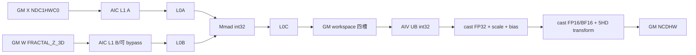
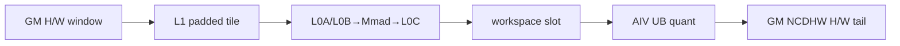

# QuantConvolution A2/A3 ACLNN 算子知识

## 算子速览

| 项目 | 内容 |
|---|---|
| 实际入口 | `aclnnQuantConvolutionGetWorkspaceSize` + `aclnnQuantConvolution`，公开 ACLNN 两段式接口；固定源码未暴露额外版本号 |
| 计算语义 | 仅 3D、per-channel INT8 量化卷积：先 int8×int8→int32 累加，再逐输出通道乘 FP32 `scale`、加 FP32 `bias`，最后 `CAST_RINT` 为 FP16/BF16 |
| 输入输出 | `input/weight`：INT8、NCDHW 视图；Host 转为 NDC1HWC0/FRACTAL_Z_3D；`scale` FP32 ND；`bias` FP32（BF16/FP16 会先 Cast）；输出 FP16/BF16 NCDHW |
| 执行类型 | 前处理 `Contiguous/TransData/Cast` 框架节点 + 核心单 Kernel `MIX_CV`（`KERNEL_TYPE_MIX_AIC_1_2`，一 AIC 对两 AIV）+ `ViewCopy` |
| Kernel 路线 | R-001 M-mode；R-002 HW-mode；两者各由 L0A/L0B ping-pong 与 BL1 bypass 子 key 实例化 |
| 核心资源 | GM；用户 workspace 四槽 int32 L0C 交接区；AIC 的 L1/L0A/L0B/L0C/BT；AIV 的 UB 输入、输出、bias、scale 队列 |
| 来源闭包 | source_closed：公开 ACLNN→校验/转换→`Conv3DV2` Tiling/POD→`conv3dv2` MIX entry→AIC Cube/AIV 量化 body→构建与 A2/A3 binary config 均在固定 Commit 内闭合；通用 Contiguous/TransData/Cast/ViewCopy 为明确框架边界 |
| 验证状态 | 已完成源码闭包检查；本次知识提取未执行编译、真机、数值或性能测试。 |

## 接口与语义

### 计算语义

令输入 `X[N,Cin,D,H,W]`、权重 `W[Cout,Cin,Kd,Kh,Kw]`，A2/A3 强制 `groups=1`、`offsetx=0`。输出空间维满足：

```text
Dout = floor((D + 2*padD - dilationD*(Kd-1) - 1) / strideD) + 1
Hout = floor((H + 2*padH - dilationH*(Kh-1) - 1) / strideH) + 1
Wout = floor((W + 2*padW - dilationW*(Kw-1) - 1) / strideW) + 1
acc[n,co,do,ho,wo] = sum_ci,kd,kh,kw int32(X) * int32(W)
y = cast_rint_fp16_or_bf16(float32(acc) * scale[co] + bias[co])
```

`bias` 在 ACLNN 前处理阶段若为 BF16/FP16 会先转 FP32；Device 的量化 AIV body 顺序是 int32→FP32、乘 `scale`、加 `bias`、FP32→FP16/BF16，再由 `TransDataTo5HD` 形成 NCDHW 所需通道布局。`offset`、`outputPadding`、`transposed`、`offsetx` 和 `roundMode` 在 A2/A3 此路线均不参与计算。

### 输入、输出与属性

| 参数 | shape/layout | dtype | 约束、默认值与语义 |
|---|---|---|---|
| input | `[N,Cin,D,H,W]`，视图 NCDHW；内部 NDC1HWC0 | INT8 | 五维且各维 > 0；非连续输入先 Contiguous |
| weight | `[Cout,Cin,Kd,Kh,Kw]`，视图 NCDHW；内部 FRACTAL_Z_3D | INT8 | 与 input 同 dtype；`Cin(weight)=Cin(input)`；各维 > 0 |
| bias | `[Cout]`，ND | FP32/BF16/FP16 | A2/A3 必填；BF16/FP16 在 Host 转 FP32 |
| scale | `[Cout]`，ND | FP32 | A2/A3 仅支持 FP32 |
| offset | N/A | N/A | 保留参数，公开调用传 `nullptr`；A2/A3 路线未消费 |
| stride | 长度 3 | int64 数组 | 每项 > 0；L0 扩为 `[1,1,sd,sh,sw]` |
| padding | 长度 3 | int64 数组 | 每项 >= 0；按 D/H/W 对称扩为 6 项 |
| dilation | 长度 3 | int64 数组 | 每项 > 0；L0 扩为 `[1,1,dd,dh,dw]` |
| transposed/outputPadding | 标量/数组 | bool/int64 | 只接受非转置语义；公开文档要求 `false/nullptr` |
| groups | 标量 | int64 | 固定为 1 |
| offsetx | 标量 | int32 | 固定为 0 |
| roundMode | 字符串指针 | char | A2/A3 不支持，传 `nullptr` |
| output | `[N,Cout,Dout,Hout,Wout]`，NCDHW | FP16/BF16 | shape 必须与 Host 推导逐维一致且每维 > 0 |

### 入口与版本

固定 Commit 的公开文档明确支持 Atlas A2 与 A3；实现通过 `TemporaryLimitChecker` 接受 `ASCEND910B` 与 `ASCEND910_93`。`IsSocSupportND()==false` 时只允许五维输入，并选择 `QuantConv3d6HdInt8ToNCDHWFp16/Bf16`，二者均进入最新 `Conv3DV2` 实现。950 的 2D、FP8/HIF8 与独立 `QuantConv3D/ExtendConv2D` 不属于本卡。

## Host/Launcher 执行流程

### 参数校验与前处理

`aclnnQuantConvolutionGetWorkspaceSize` 依次执行 `NullPtrChecker→DtypesChecker→DimsChecker→FormatsChecker→ValuesChecker→TemporaryLimitChecker`。通过后创建 executor，按以下顺序组图：

1. `ContiguousPreProcess`：input、weight、scale、bias（非空）连续化。
2. `TransDataPreProcess`：input→NDC1HWC0，weight→FRACTAL_Z_3D。
3. bias 为 BF16/FP16 时由 `l0op::Cast` 转 FP32。
4. output dtype 为 FP16/BF16 时分别调用 `QuantConv3d6HdInt8ToNCDHWFp16/Bf16`；二者调用 `Conv3dv2WithFlag`，构造 stride5/dilation5/pad6，注册 `Conv3DV2` AICore launcher。
5. `ViewCopy` 将内部输出提交到用户 output。

任一转换返回空指针、InferShape 失败、未匹配输出 dtype、Tiling 失败或 launcher 失败都会中止 executor 构造或执行，不提交后继节点。

### 参数、Workspace 与生命周期

第一段接口返回整个 executor 图的 workspace 总量。核心 `Conv3DV2` 量化节点的用户 workspace：

```text
conv_ws = blockDim * 4 * mL0 * nL0 * sizeof(int32)
total_ws = framework/system workspace + conv_ws + 前处理节点所需 workspace
```

每个逻辑 AIC block 的基址为 `(blockIdx*4)*mL0*nL0` 个 int32；`workspaceDbFlag∈[0,3]` 选择四个槽。workspace 由调用方拥有，必须存活到 `CommonOpExecutorRun` 在指定 stream 上完成；executor 在第二段调用后失效。固定仓没有展开框架 system workspace 的具体常数，因此不得以 `MIN_WORKSPACE_SIZE` 推导 ACLNN 返回值。

### 启动图与失败传播

```text
aclnnQuantConvolutionGetWorkspaceSize
  -> Contiguous(input,weight,scale,bias)
  -> TransData(input:NCDHW->NDC1HWC0)
  -> TransData(weight:NCDHW->FRACTAL_Z_3D)
  -> optional Cast(bias:FP16/BF16->FP32)
  -> Conv3DV2[conv3dv2, MIX_AIC_1_2, blockDim=batchDim*nDim*mDim*doDim]
       AIC: GM->L1->L0A/L0B->Mmad->L0C->workspace[slot]
       AIV0/1: wait slot->UB->scale+bias+cast+transpose->GM->release slot
  -> ViewCopy(output)
aclnnQuantConvolution(workspace,executor,stream)
  -> CommonOpExecutorRun（同 stream 顺序保证各节点可见性）
```

## Route 与参数设计

### 分核与资源计算

Host 从原始 N/C/D/H/W 与 Kd/Kh/Kw 推导 `Dout/Hout/Wout`；`M=Hout*Wout`、`N=Cout`、`K=Cin*Kd*Kh*Kw`。Tiling engine 选择 `batchDim/doDim/mDim/nDim`，Device 用 `blockIdx` 按 batch→Dout→N→M 解码；尾核由 `CountIdxTail` 计算真实 `singleCore*`。Cube tile 为 `mL0/nL0/kL0`，L1 tile 为 `mAL1/nBL1/kAL1/kBL1`；`pBufferFlag` 的 L0C/L1A/L1B 位决定队列深度。量化 UB 搜索优先完整 M，再切 N：

```text
UBin  = mUB*nUB*sizeof(int32)
UBout = mUB*nUB*sizeof(output)
channel = singleCoreCo 或 nL0 或 nUB
UBchannel = channel*(sizeof(float scale)+sizeof(float bias))
UBextra = channel*sizeof(float)  // 仅 bias 原始 FP16/BF16；本路线 Host 已转 FP32，通常为 0
UB_total = UBin + UBout + UBchannel + UBextra <= platform.ubSize
```

### Route 选择

| 顺序 | Route | Key/模板 | 精确选择条件与优先级 | 不适用去向 |
|---:|---|---|---|---|
| 1 | R-001 M-mode MIX 量化 Conv3D | `GET_TPL_TILING_KEY(l0PingPong,bl1Bypass,0,M_MODE)` | A2/A3；五维 INT8；FP32 scale；FP16/BF16 output；Tiling `outputOrder_=M_Mode`；`groups=1` | Tiling 若选择 HW order 则 R-002；资源搜索失败则 Tiling 失败 |
| 2 | R-002 HW-mode MIX 量化 Conv3D | `GET_TPL_TILING_KEY(l0PingPong,bl1Bypass,0,HW_MODE)` | 同上，但 `outputOrder_=HW_Mode`；该 key 只允许非 group | 无后续 Kernel fallback；资源搜索失败则 Tiling 失败 |

```text
if SoC not ASCEND910B/ASCEND910_93 -> ACLNN_ERR_PARAM_INVALID
if rank != 5 or dtype/layout/scale/groups constraints fail -> ACLNN_ERR_PARAM_INVALID
preprocess to NDC1HWC0/FRACTAL_Z_3D
engine decides outputOrder
  M_Mode  -> R-001
  HW_Mode -> R-002
for either route:
  l0PingPong = bits(AL0,BL0) of pBufferFlag in {0,1,2,3}
  bl1Bypass = convApiTiling.bl1BypassFlag in {0,1}
```

### 模板/实现执行矩阵

| Route | key/selector | dtype/shape/platform 完整命中条件 | 执行族与 kernel 节点 | 实际模板/body | 内存与同步特征 | tail/fallback |
|---|---|---|---|---|---|---|
| R-001 M-mode | 8 个子 key：L0 ping-pong 0..3 × BL1 bypass 0/1，group=0，order=0 | A2/A3，INT8 NDC1HWC0×INT8 FRACTAL_Z_3D，scale/bias FP32，out FP16/BF16，groups=1 | 单 `conv3dv2` MIX_CV；AIC Cube + 两 AIV | `KernelConv3DV2<...,PER_CHANNEL_NO_OFFSET>`；`IterateAllBase`；`VecCompute` | 四槽 GM workspace；AIC C2V event 0..3，AIV V2C event 4..7；M 连续切分 | `singleCoreM/N/Dout/Batch` 尾核调用 `SetSingleOutputShape`；无 kernel fallback |
| R-002 HW-mode | 8 个子 key：L0 ping-pong 0..3 × BL1 bypass 0/1，group=0，order=1 | 同 R-001，Host 选择 HW order | 同一 MIX entry，`KernelConv3DV2HwMode` | HW-mode 的 LoadAL1/AL0/CopyOut tools | 相同四槽协议；按 H/W 域切分和输出寻址 | H/W、N、Dout、Batch 尾核；无 kernel fallback |

### 隐藏性能 Guard

| Guard | Host/Tiling 条件 | Device/资源原因 | 影响 Route | 不满足时去向 | 源码符号 |
|---|---|---|---|---|---|
| UB 容量 | `UBin+UBout+scale+bias(+castBuf)<=ubSize` | AIV 必须同时容纳 int32 输入、目标输出和逐通道参数 | R-001/R-002 | 继续增大 m/n 切分次数；仍无可行 tile 则 Tiling 失败 | `Conv3dTilingAlgorithm::GetVecTiling` |
| workspace | `blockDim*4*mL0*nL0*sizeof(madType)` | 四轮 C2V/V2C ping-pong 防止 AIC 覆盖 AIV 未消费槽 | 两 Route | workspace 分配或参数不满足则执行失败 | `Conv3dBaseTiling::GetWorkspaceSize` |
| L0C DB | `CalcCL0Size(mL0,nL0)<=l0CSize/2` | 决定 `queueCL0` 深度 1/2 | 两 Route 子 key | 单缓冲 key | `CheckL0CDoubleBuffer` / `InitBufferWithDoubleBuf` |
| L1/L0 ping-pong | `pBufferFlag` 对应位 | 决定 AL1/BL1/CL0 深度以及 tiling key | 两 Route子 key | 关闭相应双缓冲 | `SetTilingKey` |
| scale/bias 装载 | `(sizeof(scale)+sizeof(bias))*singleCoreCo<=QUANT_VEC_MAX_LOAD`，否则测试 `nL0`，否则 `nUB` | 在全核、L0 tile 或 UB tile 粒度复用通道参数 | 两 Route | `LOAD_TOTAL_CORE→LOAD_TOTAL_LC0→NORMAL` | `GetVecTiling` |
| 空域 | ACLNN 要求 input/filter/output 每维 >0 | `CountIdxTail` 虽能拒绝虚核，但公开入口不接受空 tensor | 两 Route | 参数错误 | `ValuesChecker::CheckXShape/CheckFilterShape/CheckOutputValue` |

### POD/ABI

`Conv3DV2TilingData` 以 `#pragma pack(push,8)` 定义，含 `TConv3DTiling convApiTiling` 与 `Conv3DRunInfo convRunInfo`。固定仓未给出生成工具展开后的 `sizeof/alignof/offsetof` 常数；下表保留源码字段顺序、位宽和消费者，offset 必须由同一 CANN 9.1 头生成，不能手工重排。

| 结构 | 字段 | 类型/位宽 | ABI 布局 | 单位 | Host/launcher producer | Device consumer | 边界 |
|---|---|---|---|---|---|---|---|
| Conv3DV2TilingData | convApiTiling | `TConv3DTiling` | 首字段，8-byte pack；具体 offsetof 固定仓未展开 | POD | `Conv3dApiTiling::GetTiling` | `KernelConv3DV2::InitTilingData` | 始终有效 |
| Conv3DV2TilingData | convRunInfo | `Conv3DRunInfo` | 紧随前结构，8-byte pack；具体 offsetof 固定仓未展开 | POD | `Conv3dTilingEngine` | `KernelConv3DV2::InitSingleCoreData` | 始终有效 |
| TConv3DTiling | `orgDo/orgHo/orgWo/orgDi/orgHi/orgWi` | 各 uint64 | 声明顺序；offsetof 未展开 | 元素 | shape/engine | 地址、tail 与 loop helper | >0 |
| TConv3DTiling | `singleCoreBatch/singleCoreDo/singleCoreM/singleCoreWo/singleCoreHo` | 各 uint64 | 同上 | 元素/core | NumBlocks/engine | 单核有效域 | 尾核可缩小 |
| TConv3DTiling | `orgCi/orgCo/kernelD/kernelH/kernelW` | 各 uint32 | 同上 | 元素 | shape extraction | K 维与地址 helper | 正值 |
| TConv3DTiling | `strideD/H/W,dilationD/H/W,padHead/Tail/Top/Bottom/Left/Right` | 各 uint32 | 同上 | 元素 | attr extraction | Load3D/起址 helper | stride/dilation>0，pad>=0 |
| TConv3DTiling | `mL0/nL0/kL0,woL0,hoL0` | 各 uint32 | 同上 | 元素 | API tiling | L0 tile/Mmad/CopyOut | 资源可容纳 |
| TConv3DTiling | `mAL1/nBL1/kAL1/kAL1Tail/kBL1/kBL1Tail,woL1,hoL1` | 各 uint32 | 同上 | 元素 | API tiling | GM→L1 与 L1→L0 loops | tail 字段仅尾迭代有效 |
| TConv3DTiling | `KBL1Divk0/KBL1TailDivk0/nBL1DivnL0/mAL1DivmL0` | 各 uint32 | 同上 | loop 次数 | API tiling | loop bound helper | divisor 非零 |
| TConv3DTiling | `fmapKStride/weightKStride/cinOffsetBlockInGM/coutOffsetBlock/nL1DivBlockSize` | 各 uint32 | 同上 | 元素/块 | API tiling | MTE1/MTE2 地址 helper | route dependent |
| TConv3DTiling | `cin1InAL1/cin1InAL1Tail/cinAInCore/cinATailInCore/cinBInCore/cinBTailInCore` | 各 uint32 | 同上 | C1/元素 | API tiling | A/B load helper | tail 字段仅尾 K |
| TConv3DTiling | `mStep/kStep/nStep,aL1SpaceSize,multiNBL1,nL0xk0` | 各 uint32 | 同上 | step/元素 | API tiling | Iterate/Mmad | 由 tile 推导 |
| TConv3DTiling | pBufferFlag | uint32 | 同上 | bit mask | DB algorithm | buffer 初始化与 key | 各 bit 控制队列深度 |
| TConv3DTiling | `mUB/nUB` | 各 uint32 | 同上 | 元素 | `GetVecTiling` | AIV `DequantCompute` | 16 通道对齐，容量受 UB 限制 |
| TConv3DTiling | scaleAndBiasLoadType | uint32 | 同上 | enum | `GetVecTiling` | `CopyScaleAndBias/oneVecCompute` | 0/1/2 对应 NORMAL/LC0/CORE |
| TConv3DTiling | workspaceSize | uint32 | 同上 | 字节 | API tiling | 固定仓 Device 主流程未直接读取 | 可能仅诊断/兼容 |
| TConv3DTiling | `offsetx/roundMode` | 各 int8 | 同上 | enum/value | attrs | 本 A2/A3 PER_CHANNEL_NO_OFFSET body 不读取 | inactive，必须保持 0 |
| TConv3DTiling | `hasBias/hasScale` | 各 uint8 | 同上 | bool | input extraction | bias/quant branch | 本路线均为 1 |
| TConv3DTiling | `bl1FullLoad/al1FullLoad/bl1BypassFlag/iterateMNOrder/biasFullLoadFlag` | 各 uint8 | 同上 | bool/enum | API tiling | specialization/loops | key/route dependent |
| TConv3DTiling | `hf32Enable/hf32TransMode` | 各 uint8 | 同上 | bool | attrs | Cube init | INT8 route inactive/false |
| TConv3DTiling | quantType | uint8 | 同上 | enum | `SetQuantType` | logging/body guard | PER_CHANNEL_NO_OFFSET |
| Conv3DRunInfo | `batch/cin/din/cout/kd/kh/kw/dout` | 各 uint32 | 声明顺序，8-byte pack | 元素 | engine | block mapping/address | 正值 |
| Conv3DRunInfo | `hin/win/hout/wout` | 各 uint64 | 同上 | 元素 | engine | 地址与 M=Hout*Wout | 正值 |
| Conv3DRunInfo | `batchDim/doDim/mDim/wDim/nDim/groupDim/hoDim` | 各 uint32 | 同上 | core-grid 维 | NumBlocksDecision | blockIdx 解码 | groupDim=1 |
| Conv3DRunInfo | `strideD/H/W,dilationD/H/W,padHead/Tail/Top/Bottom/Left/Right` | 各 uint32 | 同上 | 元素 | attrs | 单核起址 | 同 API 限制 |
| Conv3DRunInfo | `groups/enlarge/cinOpt/coutOpt/groupOpt` | 各 uint32 | 同上 | count | group analysis | group helper | A2/A3 groups=1 |
| Conv3DRunInfo | hasBias | uint8 | 结构尾 | bool | input extraction | `SetBias` guard | 本路线 1 |

### Route 源码闭包

| Route | Key/selector | Host/Tiling producer | POD/参数 | Kernel entry/router | Kernel body/直接依赖 | 构建接线 |
|---|---|---|---|---|---|---|
| R-001 M-mode | L0 DB 0..3 × BL1 bypass 0/1 × group0 × M | `conv3d_base_tiling.cpp::DoOpTiling/SetTilingKey` | `Conv3DV2TilingData` | `conv3d_v2.cpp::conv3dv2`→`DispatchConv3DV2Kernel` | `KernelConv3DV2`、`Conv3dFunc::IterateAll/GetTensorC/VecCompute` | `conv3d_v2_binary.json` + `convolution_forward/op_host/CMakeLists.txt` |
| R-002 HW-mode | L0 DB 0..3 × BL1 bypass 0/1 × group0 × HW | 同上 | 同上 | 同 entry→`KernelConv3DV2HwMode` | HW-mode load/copy helpers + 同量化 AIV body | 同上 |

## Kernel 实现

### 公共执行流程

两条 Route 共用单次 MIX launch。AIV 先把物理 `blockIdx` 除以 `subblocknum`，两 AIV 与一个 AIC 绑定同一逻辑 tile。AIC 和 AIV 共享 tiling POD 与四槽 workspace。AIC 只在 `ASCEND_IS_AIC` 分支执行 Cube；AIV 只在 `ASCEND_IS_AIV` 分支执行 VecCompute。每个 tile 的同步协议为：AIV 预置 V2C 4..7→AIC 等待当前槽→Fixpipe 把 int32 L0C 写 workspace→AIC 置 C2V 0..3→AIV 等待并处理→AIV 置 V2C 4..7→双方 `workspaceDbFlag=(flag+1)&3`。

### Route R-001：M-mode MIX 量化 Conv3D

#### 适用条件

##### 选择证据

| 层级 | 文件 | 符号 | 源码谓词/参数 | 结果/下一跳 |
|---|---|---|---|---|
| ACLNN | `aclnn_quant_convolution.cpp` | `IsSocSupportND/CreateQuantConvolutionImpl` | 非 DAV_3510 且 rank=5 | `QuantConv3dImpl` |
| Host | 同文件 | `QuantConv3dImpl::Impl` | output FP16/BF16 | 对应 L0 wrapper |
| Tiling | `conv3d_base_tiling.cpp` | `SetTilingKey` | `outputOrder_==M_Mode` | R-001 key |
| Router | `conv3d_v2.cpp` | `DispatchConv3DV2Kernel` | NDC1HWC0、groups=1、order M | `KernelConv3DV2` |

#### Device 数据流

##### 函数级调用链

```text
conv3dv2<l0PingPong,bl1Bypass,NoGroup,M_Mode>
  -> DispatchConv3DV2Kernel<...,PER_CHANNEL_NO_OFFSET>
    -> KernelConv3DV2::Init
    -> KernelConv3DV2::Process
      -> Conv3DV2KernelImpl
        -> Conv3d::IterateAll
          -> AIC Iterate -> GM->L1->L0A/L0B->Mmad->L0C
          -> AIC GetTensorC -> workspace slot -> C2V flag
          -> AIV VecCompute -> UB -> scale+bias+cast+TransDataTo5HD -> GM -> V2C flag
```

##### 源码等价伪码

```text
// 伪码
logicalBlock = AIV ? blockIdx/subblocknum : blockIdx
decode logicalBlock -> batchStart, doStart, nStart, mStart and tails
slot = 0
AIV: set V2C flags 4..7
for each assigned batch and each Cube tile:
  AIC:
    wait(V2C[slot]); load fmap/weight GM->L1->L0; mmad int8*int8->int32 L0C
    Fixpipe L0C -> workspace[logicalBlock,slot]; set(C2V[slot])
  AIV0/AIV1:
    split tile by N16 blocks, or by M when N<=16
    wait(C2V[slot]); DataCopy workspace->UB
    cast int32->float; multiply per-channel scale; add bias
    cast_rint float->FP16/BF16; TransDataTo5HD; CopyOut NCDHW
    set(V2C[slot])
  slot = (slot+1)&3
AIC: wait V2C[0..3] before exit
```

#### 内存与数据搬运

##### 资源与搬运表

| 层级/缓冲区 | offset/地址公式 | extent/容量公式 | dtype/layout | producer | consumer | owner/lifetime | 对齐/复用 |
|---|---|---|---|---|---|---|---|
| GM input | batch/do/hi 起点；NDC1HWC0 | 输入 storage shape | int8/NDC1HWC0 | TransData | LoadAL1 | executor input temp | C0 对齐 |
| GM weight | `nIdxStart*c0K` | weight storage | int8/FRACTAL_Z_3D | TransData | LoadBL1/BL0 bypass | executor temp | K0/N0 对齐 |
| L1 A | 当前 `mAL1*kAL1` 映射，真实 H/W/D 覆盖 | `depthA1*align(al1Spacesize,32)` bytes | int8 | MTE2 | LoadAL0 | kernel/迭代 | depth 1/2 由 pBufferFlag |
| L1 B | `nBL1*kBL1` | `depthB1*align(bl1Spacesize,32)` bytes；bypass 时 N/A→GM/L0B | int8 | MTE2 | LoadBL0 | kernel/迭代 | depth 1/2 |
| L0A/L0B | 固定各 `L0A_SIZE/L0B_SIZE`，ping/pong 指向半区 | 平台常量 | int8 fractal | LoadData | Mmad | kernel | key 控制单双缓冲 |
| L0C | 当前 `mL0*nL0` | `depthC*mL0*nL0*4` bytes | int32/CO1 | Mmad | Fixpipe | kernel/tile | depthC=1/2 |
| workspace slot | `((blockIdx*4+slot)*mL0*nL0)*4` bytes | `mL0*nL0*4` bytes/slot | int32，N16-major tile | AIC Fixpipe | AIV CopyIn | caller workspace；tile handoff | 四槽轮换，flags 防覆盖 |
| UB input | 0 | `mUB*nUB*4` bytes | int32 | AIV DataCopy | Cast | AIV tile | depth1 |
| UB output | 0 | `mUB*nUB*sizeof(out)` | FP16/BF16 | Cast/TransData | CopyOut | AIV tile | depth1 |
| UB bias/scale | channel offset | `channel*4` bytes each | FP32/ND | GM copy | vector Add/Mul | AIV core/tile | CORE/LC0/NUB 三种复用 |
| GM output | NCDHW 地址由 batch/co/do/m 推导 | 有效 output shape | FP16/BF16/NCDHW | AIV CopyOut | ViewCopy | executor output temp | tail 只写有效 M/N |

##### 分层内存布局



##### 字节账、交接边与复用顺序

```text
workspace_total(core node) = blockDim * 4 * mL0 * nL0 * 4
L0 = L0A_SIZE + L0B_SIZE + depthC*mL0*nL0*4
L1 = depthA1*align(al1Spacesize,32) + depthB1*align(bl1Spacesize,32) + biasL1
UB = mUB*nUB*4 + mUB*nUB*sizeof(output) + channel*(4+4)
UB <= platform.ubSize
```

| 边/复用子区 | producer | offset/extent | dtype/layout | consumer | ordering/sync | owner/lifetime | 安全条件 |
|---|---|---|---|---|---|---|---|
| C2V slot s | AIC `CopyOut2Workspace` | `(block*4+s)*mL0*nL0`, extent `m*n` int32 | int32/N16 tile | AIV `DequantCompute` | AIC wait V2C(4+s)→write→set C2V(s); AIV wait C2V(s)→read→set V2C(4+s) | caller workspace；到 V2C 后可覆盖 | s 轮换 0..3；AIV 分区不重叠 |
| AIV0/AIV1 tile | logical tile | N16 块一分为二；若仅一 N16 则 M 二分 | int32→FP32→out | 两 AIV | 相同 C2V/V2C round | 各 AIV local UB | 特殊 `mSize==1 && subblockIdx==1` 仅握手不计算 |

#### 同步、精度与尾块

##### 同步与数值边界表

| 阶段 | primitive/机制 | producer | consumer/等待点 | 保护对象 | 精度/尾块 |
|---|---|---|---|---|---|
| 初始槽许可 | `CrossCoreSetFlag<0x2,PIPE_MTE2>(4..7)` | AIV | AIC `GetTensorC` | 四 workspace 槽 | 无数值作用 |
| Cube→Vector | AIC `CrossCoreSetFlag<0x2,PIPE_FIX>(0..3)` | AIC Fixpipe | AIV `VecCompute` | 当前 int32 tile | L0C 有效 m/n |
| Vector→Cube | AIV `CrossCoreSetFlag<0x2,PIPE_MTE2>(4..7)` | AIV | 下次 AIC 覆盖 | 当前 slot 生命周期 | 两 AIV 都按硬件 cross-core 协议参与 |
| 量化 | `Cast(CAST_RINT)`→`Mul`→`PipeBarrier`→`Add`→`Cast(CAST_RINT)` | UB int32 | UB output | 数值顺序 | FP32 中间；尾 M/N 传入 mask/repeat |
| 输出布局 | `TransDataTo5HD` | UB channel-major | CopyOut | output UB | repeat=1 时 repStride=0；只写 `nCurSize` |

#### 关键实现

##### 符号证据表

| 阶段 | 文件 | 符号/模板实例 | 实现事实 |
|---|---|---|---|
| Host/Tiling producer | `conv3d_base_tiling.cpp` | `DoOpTiling/GetWorkspaceSize/SetTilingKey` | 生成 blockDim、四槽 workspace 与 M key |
| Kernel entry/router | `conv3d_v2.cpp` | `conv3dv2<...,M_MODE>` / `DispatchConv3DV2Kernel` | 固定 MIX_AIC_1_2 与 PER_CHANNEL_NO_OFFSET |
| Device body/helper | `conv3dv2.h` | `KernelConv3DV2::Conv3DV2KernelImpl` | 分核、地址、Cube 与量化启动顺序 |
| Device body/helper | `conv3d/conv3d_common_func.h` | `GetTensorC/IterateAllBase` | AIC workspace producer与轮转 |
| Device body/helper | `conv3d/quant_conv3d_common_func.h` | `VecCompute/DequantCompute` | AIV 拆分、量化、layout 与 tail |

### Route R-002：HW-mode MIX 量化 Conv3D

#### 适用条件

##### 选择证据

| 层级 | 文件 | 符号 | 源码谓词/参数 | 结果/下一跳 |
|---|---|---|---|---|
| API/Host | `aclnn_quant_convolution.cpp` | 同 R-001 | A2/A3 五维 INT8 路线 | `Conv3DV2` |
| Tiling | `conv3d_tiling_engine.cpp` | `InitOutputOrder` | engine 选择 HW order | R-002 |
| Router | `conv3d_v2_kernel_dispatch.h` | `OutputOrderT==HW_Mode` | 前置 pointwise/group 条件均 false | `KernelConv3DV2HwMode` |

#### Device 数据流

##### 函数级调用链

```text
conv3dv2<l0PingPong,bl1Bypass,NoGroup,HW_Mode>
  -> DispatchConv3DV2Kernel
    -> KernelConv3DV2HwMode::Init/Process
      -> HW-mode LoadAL1/LoadAL0/Mmad/CopyOut2Workspace
      -> shared VecCompute/DequantCompute -> NCDHW output
```

##### 源码等价伪码

```text
// 伪码；量化与四槽协议同 R-001
decode block -> batch, do, co, ho tile
hiStart = hoStart*strideH - padTop
for HW tile, N tile and K tile:
  AIC load valid H/W window with padding, perform int8 Mmad, write workspace slot
  AIV wait slot, process mUB*nUB chunks, write only valid ho/wo/co tail
```

#### 内存与数据搬运

##### 资源与搬运表

| 层级/缓冲区 | offset/地址公式 | extent/容量公式 | dtype/layout | producer | consumer | owner/lifetime | 对齐/复用 |
|---|---|---|---|---|---|---|---|
| GM/L1/L0 | `hiStart=hoStart*strideH-padTop`，W 由 HW helper 推导 | 与 R-001 同 tile 字节账，实际有效 H/W 可小于物理 tile | int8 | MTE | Mmad | kernel | padding/tail guard |
| workspace/UB/output | 同 R-001 | 同 R-001 | int32→FP32→FP16/BF16 | AIC/AIV | output | caller/kernel | 四槽复用 |

##### 分层内存布局



##### 字节账、交接边与复用顺序

```text
workspace/L0/UB 公式与 R-001 相同；区别仅为 m 域由连续 Hout*Wout 改为 HW tile。
```

| 边/复用子区 | producer | offset/extent | dtype/layout | consumer | ordering/sync | owner/lifetime | 安全条件 |
|---|---|---|---|---|---|---|---|
| HW C2V tile | HW-mode AIC CopyOut | 四槽公式 | int32/N16 | AIV VecCompute | 同 R-001 flags | caller workspace | 有效 H/W/N tail |

#### 同步、精度与尾块

##### 同步与数值边界表

| 阶段 | primitive/机制 | producer | consumer/等待点 | 保护对象 | 精度/尾块 |
|---|---|---|---|---|---|
| HW load | Load3D/padding guards | GM/L1 | Mmad | H/W window | 负起点与超界位置填充 |
| C2V/V2C | events 0..3 / 4..7 | AIC/AIV | 对端 | workspace slot | 同 R-001 |
| quant/output | AIV vector pipeline | workspace | GM | output tile | 同 R-001，按 HW 有效域写出 |

#### 关键实现

##### 符号证据表

| 阶段 | 文件 | 符号/模板实例 | 实现事实 |
|---|---|---|---|
| Host/Tiling producer | `conv3d_base_tiling.cpp` | `SetTilingKey` | `outputOrder_` 写入 HW key |
| Kernel entry/router | `conv3d_v2_kernel_dispatch.h` | `KernelConv3DV2HwMode` | HW-mode specialization |
| Device body/helper | `conv3d/quant_conv3d_common_func.h` | `VecCompute` | 与 R-001 共用 AIV 量化闭包 |

## 算子特定优化

### Trick T-001：四槽 workspace 驱动的 AIC/AIV 流水

#### 触发与源码依据

- 适用 Route：R-001、R-002
- 触发条件：`quantType==PER_CHANNEL_NO_OFFSET` 的 A2/A3 INT8 路线
- Golden 来源：[`conv3d_common_func.h:752-763`](../../../../../../../cann-ops-raw/ascendc/ops-nn/955f8b33985b6d72989ebff341bb9c2c564a51bc/conv/conv3d_v2/op_kernel/conv3d/conv3d_common_func.h#L752-L763)

**官方源码（固定 Commit 连续逐字摘录）**：

```cpp
if constexpr (Intf::quantType == static_cast<int8_t>(QuantType::PER_CHANNEL_NO_OFFSET)) {
    CrossCoreWaitFlag(self->ctx.V2CEvent + self->ctx.workspaceDbFlag);
    self->ctx.copyOutIns.CopyOut2Workspace(self->ctx.workspacegm);
    CrossCoreSetFlag<0x2, PIPE_FIX>(self->ctx.C2VEvent + self->ctx.workspaceDbFlag);
} else {
    self->ctx.copyOutIns.CopyOut(output);
}
```

#### 机制与设计原因

量化路线不让 AIC 直接写目标 dtype；AIC 将 int32 L0C 放入当前 slot，AIV 消费后才归还。四槽通过 `workspaceDbFlag&3` 轮转，使后续 Cube tile 可与前一 tile 的 Vector epilogue 交叠，同时保持显式防覆盖。

#### 迁移边界

- 适用：同样需要 Cube int32 累加后由 AIV 执行逐通道 FP32 epilogue 的 MIX_CV 算子。
- 前提：一 AIC 对两 AIV、四组可用 cross-core event、workspace 按 `blockDim*4*mL0*nL0` 分片。
- 失效：950 Fixpipe 可直接完成量化，或执行族比例/事件资源不同；必须重新设计协议。
- 未验证：本次知识提取未执行编译、真机、数值或性能测试。

#### 错误做法

取消 V2C 等待或少分配一个 slot 会允许 AIC 覆盖尚未被 AIV 消费的 int32 tile；这是固定源码同步反例。

### Trick T-002：按通道参数容量三级选择复用粒度

#### 触发与源码依据

- 适用 Route：R-001、R-002
- 触发条件：量化 route；按 `singleCoreCo`、`nL0`、`nUB` 依次测试 scale+bias 容量
- Golden 来源：[`conv3d_api_tiling_algorithm.cpp:1001-1016`](../../../../../../../cann-ops-raw/ascendc/ops-nn/955f8b33985b6d72989ebff341bb9c2c564a51bc/conv/conv3d_v2/op_host/op_tiling/conv3d_api_tiling_algorithm.cpp#L1001-L1016)

**官方源码（固定 Commit 连续逐字摘录）**：

```cpp
if (scaleAndBiasDTypeSize * tilingIns_->shapeInfo.singleCo <= maxLoadSize) {
    tilingIns_->ubTilingInfo.scaleAndBiasLoadType = SINGLECO_LOAD;
    scaleAndBiasLoadLength = tilingIns_->shapeInfo.singleCo;
} else if (scaleAndBiasDTypeSize * tilingIns_->l0TilingInfo.nL0 <= maxLoadSize) {
    tilingIns_->ubTilingInfo.scaleAndBiasLoadType = NL0_LOAD;
    scaleAndBiasLoadLength = tilingIns_->l0TilingInfo.nL0;
} else {
    tilingIns_->ubTilingInfo.scaleAndBiasLoadType = NUB_LOAD;
}
```

#### 机制与设计原因

能全载单核通道时只搬一次；否则退到每 L0C tile，再退到每 UB N tile。它把参数搬运复用与 UB 主数据 tile 联合约束，避免仅按输出元素切分导致 bias/scale 缓冲溢出。

#### 迁移边界

- 适用：逐输出通道 epilogue，通道参数可按 N tile 复用。
- 前提：通道轴按 N16 对齐，Host 与 AIV 使用一致的 `scaleAndBiasLoadType` 枚举。
- 失效：per-tensor scale、动态稀疏通道或参数布局非 ND 时需另建 load policy。
- 未验证：本次知识提取未执行编译、真机、数值或性能测试。

#### 错误做法

固定仓的真实 fallback 是 `CORE→LC0→NUB`；强制全核装载而不做容量判断会使 UB 字节账失效。

## 模板与实现对比

| 对比维度 | R-001 M-mode | R-002 HW-mode | 设计选择依据 |
|---|---|---|---|
| 命中条件/优先级 | engine `outputOrder=M` | engine `outputOrder=HW` | Tiling engine 的输出域切分成本模型 |
| 执行族/节点图 | 单 MIX_CV；AIC→workspace→AIV | 同 | 量化 epilogue 相同 |
| M/N/K、tile 与 scheduler | M=`Hout*Wout` 连续切分 | H/W 域切分 | shape 与搬运复用 |
| workspace/L1/L0/UB | 四槽；M tile 地址 | 四槽；HW tile 地址 | 其余容量公式相同 |
| AIC/AIV 或 kernel 交接 | events 0..3/4..7 | 同 | 防覆盖协议固定 |
| 同步、精度与 tail | M/N/D/batch tail | H/W/N/D/batch tail | 输出域不同 |
| fallback/失败边界 | 资源失败即 Tiling 失败 | 同 | 无另一算子 fallback |

## 平台差异

| 项目 | A2 | A3 | 950 |
|---|---|---|---|
| 支持状态 | 支持 | 支持 | 见独立 `_950` 卡 |
| Host/Launcher | `ASCEND910B`，共用 3D-only ACLNN 路线 | `ASCEND910_93`，共用 3D-only ACLNN 路线 | DAV_3510 可支持 2D/3D 与更多 dtype |
| Kernel/资源 | `Conv3DV2` MIX、NDC1HWC0/FRACTAL_Z_3D、workspace Vector epilogue | 同源码与 binary 结构，core 数/容量由平台信息提供 | 新 arch35 Conv/ExtendConv 实现，量化多进入 Fixpipe |

## 限制与失败边界

- A2/A3 仅正向 3D 推理；groups=1；input/weight INT8；scale FP32；output FP16/BF16；offsetx=0；roundMode=nullptr。
- 公开入口拒绝任一零维；stride/dilation 必须正，padding 非负，output shape 必须逐维等于 Host 推导。
- `workspaceSize` 必须使用第一段返回值；固定仓未展开通用 executor、TransData、Cast、ViewCopy 的 workspace 切片，不能从核心公式替代 ACLNN 返回值。
- POD 的生成宏没有在固定仓给出最终 `sizeof/alignof/offsetof` 常数；实现复用必须使用同版本头生成 ABI，不得手写压缩结构。
- Tiling 资源搜索失败、unknown key、workspace 为空、InferShape 或任一 launcher 失败均无 Device fallback。
- 本次知识提取未执行编译、真机、数值或性能测试。

## 源码索引

### 链路索引

| 链路阶段 | 文件 | 关键符号 | 支撑内容 |
|---|---|---|---|
| 入口声明/约束 | `conv/convolution_forward/docs/aclnnQuantConvolution.md` | 产品支持/约束 | A2/A3 公开支持与 3D 限制 |
| 入口声明/约束 | `conv/convolution_forward/op_host/op_api/aclnn_quant_convolution.h` | 两段式 API | 参数与生命周期 |
| 入口实现 | `conv/convolution_forward/op_host/op_api/aclnn_quant_convolution.cpp` | checker、`QuantConv3dImpl` | 校验、前后处理、平台分发 |
| 入口实现 | `conv/convolution_forward/op_host/op_api/convolution.cpp` | `QuantConv3d6Hd*`、`Conv3dv2WithFlag` | L0 到 Conv3DV2 |
| Host/Tiling/Launcher | `conv/conv3d_v2/op_host/op_tiling/conv3d_base_tiling.cpp` | `DoOpTiling/GetWorkspaceSize/SetTilingKey` | grid、key、workspace |
| Host/Tiling/Launcher | `conv/conv3d_v2/op_host/op_tiling/conv3d_api_tiling_algorithm.cpp` | `GetVecTiling` | UB 与通道参数策略 |
| Host/Tiling/Launcher | `conv/conv3d_v2/op_host/op_tiling/conv3d_tiling_engine.cpp` | `SelectOutputOrder/GenConv3dTiling` | M/HW Route 与最终 Tiling 参数 |
| Host/Tiling/Launcher | `conv/conv3d_v2/op_kernel/conv3d_v2_tiling_data.h` | `Conv3DV2TilingData` | POD ABI |
| Kernel entry/body | `conv/conv3d_v2/op_kernel/conv3d_v2.cpp` | `conv3dv2` | MIX entry/type traits |
| Kernel entry/body | `conv/conv3d_v2/op_kernel/conv3d_v2_kernel_dispatch.h` | `Conv3DV2KernelType` | key 字段到模板参数的编译期分发 |
| Kernel entry/body | `conv/conv3d_v2/op_kernel/conv3dv2.h` | `KernelConv3DV2` | block mapping/地址/主流程 |
| Kernel entry/body | `conv/conv3d_v2/op_kernel/conv3d/conv3d_common_func.h` | `IterateAll/GetTensorC` | Cube→workspace |
| Kernel entry/body | `conv/conv3d_v2/op_kernel/conv3d/quant_conv3d_common_func.h` | `VecCompute` | AIV epilogue |
| 构建接线 | `conv/conv3d_v2/op_host/config/ascend910b/conv3d_v2_binary.json` | INT8 NDC1HWC0 binaries | A2 dtype/layout binary |
| 构建接线 | `conv/conv3d_v2/op_host/config/ascend910_93/conv3d_v2_binary.json` | INT8 NDC1HWC0 binaries | A3 dtype/layout binary |
| 构建接线 | `conv/conv3d_v2/op_host/CMakeLists.txt` | `add_modules_sources` | Conv3DV2 Host 模块与依赖接线 |
| 构建接线 | `conv/convolution_forward/op_host/CMakeLists.txt` | `DEPENDENCIES ... conv3d_v2` | ACLNN Host 依赖接线 |

每行只写一个文件，并确保该文件存在于 Frontmatter `sources`。

### 实现复用检查

| 检查项 | 可复用事实 | 不得改变的约束 | 源码符号 |
|---|---|---|---|
| ABI/POD | 双结构 POD、8-byte pack、字段顺序 | 位宽、顺序、生成宏 ABI | `Conv3DV2TilingData` |
| 调用顺序 | Contiguous→TransData/Cast→Conv3DV2→ViewCopy | 前处理产物格式必须匹配 binary | `QuantConv3dImpl` |
| workspace/内存 | 每逻辑 block 四个 int32 tile 槽 | `4*mL0*nL0*sizeof(int32)` 与 blockDim | `GetWorkspaceSize/InitBuffer` |
| 同步 | C2V 0..3、V2C 4..7、slot 四轮 | wait/set 方向与 slot 更新不能改变 | `GetTensorC/VecCompute` |
| 精度与尾块 | int32→FP32→Mul→Add→CAST_RINT→output | bias Host cast、scale FP32、有效 nCurSize | `oneVecCompute/CopyOut` |
| 失败边界 | checker/Tiling/launch 任一失败终止 | 不得将错误改写为静默 fallback | `CheckQuantConvParams/CommonOpExecutorRun` |