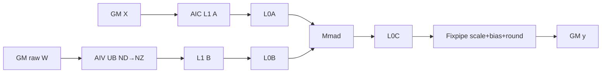
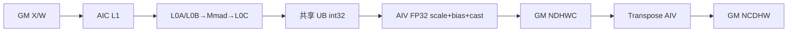
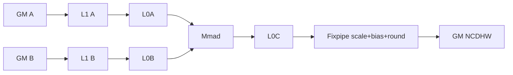

# QuantConvolution 950 ACLNN 算子知识

## 算子速览

| 项目 | 内容 |
|---|---|
| 实际入口 | `aclnnQuantConvolutionGetWorkspaceSize` + `aclnnQuantConvolution`，公开 ACLNN 两段式接口 |
| 计算语义 | 2D/3D per-channel 量化卷积；Cube 累加后按输出通道应用 scale，可选 bias，再按目标 dtype/round mode 输出 |
| 输入输出 | 2D NCHW；3D NCDHW；input/weight 为 INT8、HIFLOAT8 或 FLOAT8_E4M3FN；公开 checker 接受 INT64/UINT64/FP32 scale，但固定 binary 闭合的是 R-001/R-003 的 INT64 与 R-002 的 FP32；output 为 FP16/BF16/FP32/HIF8/FP8（按 binary 组合约束） |
| 执行类型 | R-001 `ExtendConv2D` MIX_CV；R-002 `Conv3DV2` MIX_CV + AIV `Transpose`；R-003 `QuantConv3D` AIC_CUBE；R-004 opt-group specialization MIX_CV；Contiguous/ViewCopy/Transpose 为框架节点 |
| Kernel 路线 | R-001 2D；R-002 3D INT8+FP32 scale；R-003 3D direct Fixpipe；R-004 2D/3D optimized group；各路线内部由完整 tiling key 选择 full-load、ping-pong、M/HW、iteration 等 specialization |
| 核心资源 | GM、system workspace、L1、L0A/L0B/L0C、Fixpipe；MIX 路线另含 UB、跨 AIC/AIV flag 与 weight/dequant staging |
| 来源闭包 | source_closed：对固定 binary 明确列出的组合，公开 ACLNN→平台/维度分发→ExtendConv2D/Conv3DV2/QuantConv3D Tiling/POD→所有可达 Cube/MIX body→binary config/CMake 均在固定 Commit 内闭合；checker-only 组合单列为缺失，不外推；通用 executor、Contiguous、Transpose、ViewCopy 为明确框架边界 |
| 验证状态 | 已完成源码闭包检查；本次知识提取未执行编译、真机、数值或性能测试。 |

## 接口与语义

### 计算语义

```text
acc[n,co,...] = sum_(ci/groups,k...) promote(X)*promote(W)
z[n,co,...] = acc 与 bias[co] 的融合结果
y[n,co,...] = quant_or_cast(z, scale[co], roundMode)
```

输出空间遵循标准卷积：`out=floor((in+pad_before+pad_after-dilation*(kernel-1)-1)/stride)+1`。ACLNN 的数学文档写作 `sum*scale+bias`；源码实现分两类：R-001/R-003/R-004 把 scale/bias/quant mode 交给 Cube 之后的 Fixpipe specialization；R-002 则显式在 AIV UB 中执行 `int32→FP32→Mul(scale)→Add(bias)→CAST_RINT`。不得把两类的量化编码（FP32 数值 scale 与 INT64/UINT64 Fixpipe scale）混用。

### 输入、输出与属性

| 参数 | shape/layout | dtype | 约束、默认值与语义 |
|---|---|---|---|
| input | 2D `[N,C,H,W]` NCHW；3D `[N,C,D,H,W]` NCDHW | INT8/HIF8/FP8 | 与 weight dtype 相同；每维 >0；非连续先 Contiguous |
| weight | 2D `[Cout,Cin/group,Kh,Kw]` NCHW；3D `[Cout,Cin/group,Kd,Kh,Kw]` NCDHW | 与 input 相同 | 每维 >0；ACLNN 非 WeightNz 入口保留原始公开布局 |
| bias | `[Cout]` ND，可空 | INT32/FP32/FP16/BF16，必须命中 checker 与对应 binary 的组合 | 在 Cube/Fixpipe 或 R-002 AIV 中融合；固定 R-001/R-003 binary 分别列出 INT32 或 FP32，R-002 binary 列出可选 FP32 |
| scale | `[Cout]` ND | checker：INT64/UINT64/FP32 | FP32+3D INT8 命中 R-002；固定 binary 对 R-001/R-003 只列 INT64，对 R-002 列 FP32；UINT64 与其它 FP32 组合未闭合 |
| offset | N/A | N/A | 预留，不支持；传 nullptr |
| stride/dilation | 长度 2 或 3 | int64 数组 | 每项 >0；L0 在前补 N/C 两个 1 |
| padding | 2D 长 2/4，3D 长 3/6 | int64 数组 | 每项 >=0；短格式复制为前后对称 pad |
| transposed/outputPadding | 标量/数组 | bool/int64 | 转置量化卷积未支持；`false/nullptr` |
| groups | 标量 | int64 | >0，`Cout%groups==0` 且 `Cin=weightCin*groups` |
| offsetx | 标量 | int32 | [-128,127]；HIF8/FP8 必须 0 |
| roundMode | 字符串 | char | FP8/INT8 输出要求 `rint`；HIF8 输出要求 `round`；其它输出建议 nullptr |
| output | 与 input rank 相同 | FP16/BF16/FP32/HIF8/FP8（组合受 checker/binary 限制） | shape 必须等于 Host 推导；每维 >0 |

### 入口与版本

公开产品表支持 Ascend 950PR/950DT。实现以 `GetCurNpuArch()==DAV_3510` 选择 950 路线；2D 创建 `ExtendConv2dImpl`，3D 创建 `QuantConv3dImpl`。本卡只记录 `aclnnQuantConvolution`，不包含语义独立的 `aclnnQuantConvolutionWeightNz`。

## Host/Launcher 执行流程

### 参数校验与前处理

第一段接口依次执行六类 checker，随后：

```text
rank=4:
  pad 2->4（若需要）
  Contiguous(input,weight,scale,bias)
  ExtendConv2dNCHW -> INFER_SHAPE/ADD_TO_LAUNCHER_LIST_AICORE(ExtendConv2D)
  ViewCopy -> output

rank=5:
  pad 3->6（若需要）
  Contiguous(input,weight,scale,bias)
  if input==INT8 && scale==FP32:
      Conv3dv2L0Func(outputFormat=NDHWC) -> Conv3DV2
      Transpose perm=[0,4,1,2,3] -> NCDHW
  else:
      QuantConv3dNCDHW -> QuantConv3D
  ViewCopy -> output
```

R-002 中 `Transpose` 是核心输出布局恢复节点，位于同一 executor/stream；其通用 AIV 实现属于框架边界，但节点顺序与 perm 已闭合。

### 参数、Workspace 与生命周期

`ExtendConv2D` 和 arch35 `Conv3dBaseTilingV2` 都把 core 节点 workspace 设置为 `MIN_WORKSPACE_SIZE`；Kernel 要求传入非空 workspace，用其设置 system workspace，再通过 `GetUserWorkspace` 得到用户区，但主计算不切用户 workspace。ACLNN 总 workspace 仍包含 Contiguous/Transpose/ViewCopy 等图节点，由 executor 汇总，必须使用第一段返回值。

POD 由 executor 在 launch 前完成；调用方 workspace 与输入输出必须存活到 stream 完成。第二段 `CommonOpExecutorRun` 失败时后继节点不应执行，executor 调用后不可复用。

### 启动图与失败传播

```text
公开 ACLNN
  -> checker + Contiguous
    -> rank4: ExtendConv2D[MIX_CV]
         AIV(按 key 可执行 raw-weight ND->NZ / DMA / opt-group staging)
           --CrossCore flag--> AIC GM->L1->L0A/L0B->Mmad->L0C->Fixpipe->GM
    -> rank5 INT8+FP32 scale: Conv3DV2[MIX_CV]
         AIC L0C --FIX/V flag--> AIV UB dequant -> NDHWC
         -> Transpose[AIV framework] -> NCDHW
    -> rank5 other: QuantConv3D[AIC_CUBE or opt-group MIX_CV]
         GM->L1->L0A/L0B->Mmad->L0C->Fixpipe(scale/bias/round)->GM
    -> ViewCopy
```

checker、InferShape、Tiling、workspace、kernel pointer、launcher 或转换节点任一失败均终止；固定源码没有跨 Route Device fallback。

## Route 与参数设计

### 分核与资源计算

2D：`M=Hout*Wout,N=Cout,K=Cin/group*Kh*Kw`；3D 在每个 Dout 平面用 `M=Hout*Wout,N=Cout,K=Cin/group*Kd*Kh*Kw`。Tiling 从平台提供 AIC 数、UB/L1/L0A/B/C/BT 容量，按 shape/format/dtype/attrs 推导：

```text
grid2d = M-split ? batchDim*mDim*nDim*groupDim
                 : batchDim*nDim*hoDim*woDim*groupDim
grid3d = M-split ? batchDim*doDim*mDim*nDim*groupDim
                 : batchDim*doDim*nDim*hoDim*groupDim
L1 = depthA1*align(A_tile_bytes,32) + depthB1*align(B_tile_bytes,32)
L0 = L0A_SIZE + L0B_SIZE + depthC*mL0*nL0*sizeof(acc)
UB(R-002) = mUB*nUB*sizeof(acc) + nUB*sizeof(scale) + nUB*sizeof(bias/cast)
workspace(core node) = MIN_WORKSPACE_SIZE
```

key 字段完整保留 `FmapTiling/WeightTiling/L1PingPong/L0PingPong/OutputOrder/IterOrder/GroupType`；2D 还带 `EnableSmallChannel/WeightUbTrans/FmapCopyMode/InnerBatch/DisContinuous/BatchOne/NoPad/SmallWeight/SmallKernel`。这些编译期参数决定真实 load body、buffer 深度、调度与 AIC/AIV 任务，不能仅以一个数值 key 代替。

### Route 选择

| 顺序 | Route | Key/模板 | 精确选择条件与优先级 | 不适用去向 |
|---:|---|---|---|---|
| 1 | R-001 2D ExtendConv2D | 16 维 Conv2DV2 key | Host selector 为 `rank==4 && DAV_3510`；正式执行路线再要求命中 `extend_conv2d_binary.json`（scale0 INT64）；ACLNN 输入 weight 为原始 NCHW；key 决定 normal/group、M/HW、raw-weight UB transform 等 | rank5 转 R-002/R-003；checker-only 但 binary 未列组合视为缺失；Tiling 失败即错误 |
| 2 | R-002 3D INT8+FP32 scale | 7 维 Conv3DV2 key；编译条件选择 MIX_AIC_1_2 | `rank==5 && input dtype==INT8 && scale dtype==FP32` | 条件 false 转 R-003 |
| 3 | R-003 3D QuantConv3D normal/original-group | 7 维 Conv3DV2 key，normal/original group 为 AIC_ONLY | `rank==5` 且非 R-002；命中 `quant_conv3d_binary.json`（scale INT64）；`GroupType` 为 normal 或 original-group | optimized group 转 R-004；checker-only 但 binary 未列组合视为缺失 |
| 4 | R-004 optimized group | 2D/3D key 的 `GroupType==OPT_GROUP_CONV` | groups>1 且 Tiling 的 group optimization 判定成立 | original-group specialization 或 Tiling 失败 |

```text
rank 4 -> R-001
rank 5:
  if INT8 && scale FP32 -> R-002 -> Transpose
  else:
    groupType = tiling group analysis
    OPT_GROUP -> R-004
    NORMAL/ORI_GROUP -> R-003
```

### 模板/实现执行矩阵

| Route | key/selector | dtype/shape/platform 完整命中条件 | 执行族与 kernel 节点 | 实际模板/body | 内存与同步特征 | tail/fallback |
|---|---|---|---|---|---|---|
| R-001 2D | Conv2DV2 16-field key | 950 rank4；`extend_conv2d_binary.json` 所列 dtype/layout（scale0 INT64）；raw NCHW weight | `extend_conv2d` MIX_CV | `Conv2dBase<...,IsExtendConv2D::TRUE>`；small-key 可进 `Conv2dSmallKernel` | AIV raw-weight ND→NZ/UB→L1 或 DMA/group staging；AIC Cube+Fixpipe；CrossCore MTE1/MTE3 flags | M/HW、N、batch、group tail；无跨算子 fallback |
| R-002 3D float-scale | Conv3DV2 7-field key；INT8/NCDHW→NDHWC compile guard | `INT8 input && FP32 scale` | `conv3dv2` MIX_CV→`Transpose` AIV | `Conv3dV2Base` dequant specialization + `DeQuantVecImpl` | L0C→UB，不物化用户 GM workspace；`MTE3_FIXP/FIXP_V` 交替；AIV 输出 NDHWC | M/HW/N/D/batch tail；Transpose 失败则整图失败 |
| R-003 3D Fixpipe | Conv3DV2 7-field key，normal/original group | 950 rank5 非 R-002；`quant_conv3d_binary.json` 所列 dtype/layout（scale INT64） | `quant_conv3d` AIC_CUBE | `Conv3dV2Base`/`GroupConv3dV2` + common Fixpipe | scale/bias L1 可 full-load；L0C→Fixpipe→NCDHW GM | 同 key 的 M/HW 与 tail；无 fallback |
| R-004 opt group | groupType=OPT_GROUP_CONV | groups>1 且优化后 `groupOpt/enlarge/cinOpt/coutOpt` 可行 | 单 Kernel MIX_CV | `GroupConv2d/GroupConv3dV2` + `conv_opt_group_impl` | AIV group/weight staging 与 AIC Cube 通过 `CV_SYNC_ID_MTE1_MTE3/MTE3_MTE1` 交接 | 尾 group/Co/Ci；不适用时 original-group key |

### 隐藏性能 Guard

| Guard | Host/Tiling 条件 | Device/资源原因 | 影响 Route | 不满足时去向 | 源码符号 |
|---|---|---|---|---|---|
| rank selector | rank=4/5 | 底层 op 与 POD 不同 | 全部 | 其它 rank 参数错误 | `CreateQuantConvolutionImpl` |
| float-scale special | rank5 && INT8 && scale FP32 | 950 `Conv3DV2` 显式 AIV dequant body 接受 FP32 scale | R-002 | R-003 | `QuantConv3dImpl::Impl/PostProcess` |
| full-load | A/B tile 或 fixpipe params 能装入 L1 | 选择少搬运 specialization | 全部 | other/partial tiling key | `GetTemplateTilingKey`、`fixpParamsFullLoadFlag` |
| DB | tile bytes <= 对应 L1/L0 半容量 | 决定 A/B/L0C queue depth | 全部 | 关闭相应 ping-pong | key producer + `pBufferFlag` |
| raw-weight UB transform | NCHW raw weight且 Host 判定 `WeightUbTrans=OPEN` | AIV 在 UB 完成 ND→NZ 后送 L1 | R-001 | AIC Load3D/其它 weight path | `GetWeightUbTrans/WeightUbTransVecImpl` |
| small kernel | weight 为 NZ、M-mode、NCHW、dtype half/int8 且 small predicate | 专用 Kernel 缩短通用循环 | R-001 内子路线 | 通用 Conv2dBase | `GetSmallKernelVal`/`Conv2dSmallKernel`；ACLNN raw weight通常不命中 NZ 前提 |
| R-002 UB | `mUB*nUB*acc + nUB*scale + nUB*bias/cast <= UB` | 同时容纳 L0C 片、通道参数和输出 | R-002 | 缩小 tile；失败则 Tiling error | `DeQuantInitBuf` / Host API tiling |
| group opt | `groups>1` 且优化参数可构造 | 减少小 group 的 Cube 低利用率，需 AIV staging | R-004 | original-group R-003/R-001 子 key | group tiling helper |

### POD/ABI

R-001 使用 `TConv2DTiling`；R-002/R-003/R-004(3D) 使用 `Conv3DTilingData`（`TConv3DTiling+Conv3DRunInfo`），Device 侧以布局等价的 `Conv3DV2TilingDataV2` 读取。宏生成后的精确 `sizeof/alignof/offsetof` 常数在固定仓不可见；下表保持声明顺序与位宽，复用时必须由 CANN 9.1 同一生成头提供。

| 结构 | 字段 | 类型/位宽 | ABI 布局 | 单位 | Host/launcher producer | Device consumer | 边界 |
|---|---|---|---|---|---|---|---|
| TConv2DTiling | `orgHi/orgWi/orgHo/orgWo/orgHixWi` | 各 uint64 | 声明顺序；offset 未展开 | 元素 | Conv2dBaseTiling | 地址/输出域 helper | >0 |
| TConv2DTiling | `singleCoreBatch/singleCoreHo/singleCoreWo` | 各 uint64 | 同上 | 元素/core | NumBlocksDecision | `InitSingleCoreData` | 尾核缩小 |
| TConv2DTiling | `orgCi/orgCo/singleCoreCi/singleCoreCo` | 各 uint32 | 同上 | 元素 | shape/numBlocks | N/K mapping | >0 |
| TConv2DTiling | `hoL1/woL1/kAL1/kBL1/khL1/kwL1/nBL1` | 各 uint32 | 同上 | 元素 | Conv2d API tiling | L1 loops | tail 由 loop推导 |
| TConv2DTiling | `hoL0/woL0/kL0/nL0` | 各 uint32 | 同上 | 元素 | API tiling | LoadData/Mmad/Fixpipe | 资源可容纳 |
| TConv2DTiling | pBufferFlag | uint32 | 同上 | bit mask | DB selector | queue depth/key | route-dependent |
| TConv2DTiling | `groups/enlarge/singleCoreGroups/singleCoreGroupOpt` | 各 uint32 | 同上 | count | group tiling | GroupConv2d | normal route groups=1 |
| TConv2DTiling | `bUbNStep/bUbKStep/khUb/kwUb` | 各 uint32 | 同上 | tile/step | weight-UB tiling | AIV ND→NZ helper | WeightUbTrans inactive时不读取 |
| TConv2DTiling | `aL1SpaceSize/multiNBL1/cinAInCore/cinATailInCore/cinBInCore/cinBTailInCore` | 各 uint32 | 同上 | 元素 | API tiling | buffer/loop helpers | tail字段末迭代有效 |
| TConv2DTiling | `mStep/kStep/nStep,fmapKStride/weightKStride,cinOffsetBlockInGM/coutOffsetBlock/nL1DivBlockSize` | 各 uint32 | 同上 | step/元素/块 | API tiling | iterate/load helpers | key-dependent |
| TConv2DTiling | `kernelH/kernelW,strideH/strideW,dilationH/dilationW,padTop/Bottom/Left/Right` | 各 uint32 | 同上 | 元素 | attrs | Load3D/address | stride/dilation>0，pad>=0 |
| TConv2DTiling | innerBatch | uint32 | 同上 | batch | inner-batch tiling | output/address loop | inactive=1 |
| TConv2DTiling | `iterateMNOrder/biasFullLoadFlag/fixpParamsFullLoadFlag/hf32Enable/hf32TransMode/hasBias/hasScale/dualOutput` | 各 uint8 | 同上 | bool/enum | flags/tiling | common iterate/Fixpipe | ACLNN dualOutput=false |
| TConv2DTiling | `quantMode0/reluMode0/clipMode0/quantMode1/reluMode1/clipMode1` | 各 uint8 | 同上 | enum | ExtendConv attrs/tiling | Fixpipe | ACLNN只使用 output0，relu/clip关闭 |
| TConv2DTiling | `offsetx/roundMode` | 各 int8 | 结构尾 | value/enum | ACLNN attrs | Fixpipe params | dtype-specific |
| TConv3DTiling | `orgDo/orgHo/orgWo/orgDi/orgHi/orgWi` | 各 uint64 | 声明顺序；offset 未展开 | 元素 | Conv3dBaseTilingV2 | address/tail | >0 |
| TConv3DTiling | `singleCoreBatch/singleCoreDo/singleCoreM/singleCoreWo/singleCoreHo` | 各 uint64 | 同上 | 元素/core | NumBlocksDecision | core mapping | tail可缩小 |
| TConv3DTiling | `orgCi/orgCo/kernelD/kernelH/kernelW` | 各 uint32 | 同上 | 元素 | shape extraction | K/address | >0 |
| TConv3DTiling | `strideD/H/W,dilationD/H/W,padHead/Tail/Top/Bottom/Left/Right` | 各 uint32 | 同上 | 元素 | attrs | Load3D/address | 合法域 |
| TConv3DTiling | `mL0/woL0/kL0/nL0,mAL1/nBL1/kAL1/kAL1Tail/kBL1/kBL1Tail,woL1/hoL0/hoL1` | 各 uint32 | 同上 | 元素 | Conv3d API tiling | memory/loops | tail fields route-dependent |
| TConv3DTiling | `KBL1Divk0/KBL1TailDivk0/nBL1DivnL0/mAL1DivmL0,mStep/kStep/nStep` | 各 uint32 | 同上 | loop/step | API tiling | Iterate | divisor nonzero |
| TConv3DTiling | `fmapKStride/weightKStride/cinOffsetBlockInGM/coutOffsetBlock/nL1DivBlockSize` | 各 uint32 | 同上 | 元素/块 | API tiling | load/address helper | key-dependent |
| TConv3DTiling | `cin1InAL1/cin1InAL1Tail/cinAInCore/cinATailInCore/cinBInCore/cinBTailInCore` | 各 uint32 | 同上 | C1/元素 | API tiling | L1/K loops | tail末迭代有效 |
| TConv3DTiling | `pBufferFlag/groupOpt/cinOpt/coutOpt` | 各 uint32 | 同上 | mask/count | tiling selectors | buffer/group body | route-dependent |
| TConv3DTiling | `mUB/nUB/scaleAndBiasLoadType/workspaceSize` | 各 uint32 | 同上 | 元素/enum/字节 | dequant tiling | R-002 AIV | R-003 Fixpipe 时部分 inactive |
| TConv3DTiling | `offsetx/roundMode` | 各 int8 | 同上 | value/enum | attrs | Fixpipe/dequant | dtype-specific |
| TConv3DTiling | `hasBias/hasScale/bl1FullLoad/al1FullLoad/bl1BypassFlag/iterateMNOrder/biasFullLoadFlag/fixpParamsFullLoadFlag` | 各 uint8 | 同上 | bool/enum | tiling | common body | route-dependent |
| TConv3DTiling | `hf32Enable/hf32TransMode/quantType/resvered1/resvered2/resvered3` | 各 uint8 | 结构尾 | bool/enum/padding | tiling/default | body/ABI padding | reserved 必须保留 |
| Conv3DRunInfo | `batch/cin/din/cout/kd/kh/kw/dout` | 各 uint32 | 声明顺序 | 元素 | Host shape | block mapping | >0 |
| Conv3DRunInfo | `hin/win/hout/wout` | 各 uint64 | 同上 | 元素 | Host shape | address | >0 |
| Conv3DRunInfo | `batchDim/doDim/mDim/wDim/nDim/groupDim/hoDim` | 各 uint32 | 同上 | grid dim | NumBlocksDecision | block decode | product=blockDim |
| Conv3DRunInfo | `stride*/dilation*/pad*` | 各 uint32 | 同上 | 元素 | attrs | address/load | 合法域 |
| Conv3DRunInfo | `groups/enlarge/cinOpt/coutOpt/groupOpt/hasBias` | uint32组 + uint8 | 结构尾 | count/bool | group/input tiling | GroupConv/body | route-dependent |

### Route 源码闭包

| Route | Key/selector | Host/Tiling producer | POD/参数 | Kernel entry/router | Kernel body/直接依赖 | 构建接线 |
|---|---|---|---|---|---|---|
| R-001 2D | 16-field key | `ExtendConv2D`→`Conv2dBaseTiling::SetTilingKey` | `TConv2DTiling` | `extend_conv2d` | `Conv2dBase/GroupConv2d/Conv2dSmallKernel` + common Conv/Fixpipe/weight-UB helpers | `extend_conv2d_binary.json` + ACLNN CMake |
| R-002 3D FP32-scale | 7-field key | `Conv3DV2`→`Conv3dBaseTilingV2` | `Conv3DTilingData` | arch35 `conv3dv2` | `Conv3dV2Base` + `DeQuantVecImpl/DeQuant*Tools` | `conv3d_v2` 950 binary + ACLNN CMake |
| R-003 3D Fixpipe | 7-field key | `QuantConv3D`→`Conv3dBaseTilingV2` | 同上 | `quant_conv3d` | `Conv3dV2Base/GroupConv3dV2` + common Fixpipe | `quant_conv3d_binary.json` + ACLNN CMake |
| R-004 opt group | key groupType=OPT | 同 R-001/R-003 | 对应 2D/3D POD | 对应单 kernel entry | group common + `conv_opt_group_impl` | 对应 binary config |

## Kernel 实现

### 公共执行流程

所有核心 route 均先检查 workspace 非空，`SetSysWorkspace` 后解析 POD。`ConvCommon::Init` 将 MIX 路线的 AIV block 映射为 `GetBlockIdx()/GetSubBlockNum()`，从而与 AIC 共享逻辑 tile。公共 Cube 数据流为 GM→L1(A/B，可 full-load/DB/bypass)→L0A/L0B→Mmad（INT8 为 int32 累加；HIF8/FP8 按 type traits 累加）→L0C→Fixpipe 或 R-002 AIV UB。M/HW order、M/N first、group type 与 full-load 均是 tiling key 的编译期 specialization。

### Route R-001：2D ExtendConv2D MIX_CV

#### 适用条件

##### 选择证据

| 层级 | 文件 | 符号 | 源码谓词/参数 | 结果/下一跳 |
|---|---|---|---|---|
| ACLNN | `aclnn_quant_convolution.cpp` | `CreateQuantConvolutionImpl` | rank=4 && DAV_3510 | `ExtendConv2dImpl` |
| L0 | `quant_convolution.cpp` | `ExtendConv2dL0Inner` | stride/dilation>=2；pad 构造为 4 | `ExtendConv2D` launcher |
| Tiling | `conv2d_v2_base_tiling_tilingkey.cpp` | `SetTilingKey` | 16 个 key 字段 | 具体 specialization |
| Entry | `extend_conv2d.cpp` | `SET_KERNEL_TASK_TYPE` | raw NCHW/NHWC weight 非 FRACTAL_Z/C04 | MIX_AIC_1_2 |

#### Device 数据流

##### 函数级调用链

```text
extend_conv2d<16 key fields>
  -> Conv2dBase::RunConv2dKernel (ACLNN raw weight; small-NZ predicate inactive)
    -> Conv2dKernelInit -> ConvCommon::InitBufferCommon/InitFixpipeBuffer
    -> Conv2dKernelImpl
      -> Conv2d::IterateAll
        -> optional AIV WeightUbTransVecImpl / DMA / opt-group staging
        -> AIC LoadAL1/BL1 -> LoadAL0/BL0 -> Mmad -> L0C
        -> AIC Fixpipe(scale0,bias,round) -> y0 GM
```

##### 源码等价伪码

```text
// 伪码
decode block -> batch, co, M or (ho,wo), group; reject virtual tail block
if key.weightUbTrans:
  AIV: GM raw weight -> UB -> ND2NZ -> L1; set MTE3_MTE1 flag
  AIC: wait transformed L1 tile
for A/B L1 tiles and K tiles:
  load fmap/weight to L0A/L0B; Mmad accumulate to L0C
load scale/bias full-core or per tile according to flags
Fixpipe(L0C, scale, bias, quantPre, roundMode) -> output y0
```

#### 内存与数据搬运

##### 资源与搬运表

| 层级/缓冲区 | offset/地址公式 | extent/容量公式 | dtype/layout | producer | consumer | owner/lifetime | 对齐/复用 |
|---|---|---|---|---|---|---|---|
| GM X | batch + M/HW start | input tensor | INT8/HIF8/FP8 NCHW | ACLNN | LoadAL1 | user/executor | tail guarded |
| GM W | raw NCHW；`nIdxStart*Cin*Kh*Kw` | weight tensor | input dtype/NCHW | ACLNN | AIV transform或AIC load | user/executor | K0/N0 tile |
| AIV UB weight | key 的 `bUbNStep*bUbKStep*khUb*kwUb` | 由 Tiling/UB 容量决定 | raw→NZ | MTE2/V gather | MTE3→L1 | AIV iteration | ping/pong+flags |
| L1 A/B | tiling `hoL1/woL1/kAL1` 与 `nBL1/kBL1` | depth×aligned bytes | internal Cube layout | MTE | L0 loaders | kernel | full-load/partial；depth 1/2 |
| L0A/L0B | platform fixed buffers | L0A_SIZE+L0B_SIZE | fractal | LoadData | Mmad | kernel | key DB |
| L0C | M/N tile | depthC*mL0*nL0*sizeof(acc) | int32/fp32 | Mmad | Fixpipe | kernel | tail m/n |
| L1 scale/bias | channel start `nIdxStart` | full-core或nL0通道对齐字节 | uint64 scale + bias | GM load | Fixpipe | kernel/core或tile | `fixpParamsFullLoadFlag` |
| GM output | NCHW output offset | valid output | target dtype | Fixpipe | ViewCopy | executor | 只写有效 tail |
| workspace | system workspace | `MIN_WORKSPACE_SIZE` | opaque | runtime | runtime | caller | 无用户语义 slice |

##### 分层内存布局



##### 字节账、交接边与复用顺序

```text
workspace_total(core) = MIN_WORKSPACE_SIZE
L1_total = depthA1*align(A_tile_bytes,32) + depthB1*align(B_tile_bytes,32) + aligned(scale/bias bytes)
L0_total = L0A_SIZE + L0B_SIZE + depthC*mL0*nL0*sizeof(acc)
UB_weight = physical allocation selected from bUbNStep/bUbKStep/khUb/kwUb; exact byte expression resides in weight-UB helper and must fit Host-reported UB
```

| 边/复用子区 | producer | offset/extent | dtype/layout | consumer | ordering/sync | owner/lifetime | 安全条件 |
|---|---|---|---|---|---|---|---|
| weight UB→L1 | AIV `LoadUB2L1` | current K/N tile | NZ/internal | AIC BL1 consumer | AIV waits MTE1→MTE3, then set MTE3→MTE1；AIC uses reciprocal flags | kernel local L1 | pingPongFlag/vecId 匹配；末 tile 才 release |
| L0C→GM | AIC Mmad | valid mL0*nL0 | acc→output | Fixpipe | M/MTE/FIX hard events | kernel | scale/bias load completed |

#### 同步、精度与尾块

##### 同步与数值边界表

| 阶段 | primitive/机制 | producer | consumer/等待点 | 保护对象 | 精度/尾块 |
|---|---|---|---|---|---|
| GM→UB→L1 weight | MTE2/V/MTE3 hard events + CrossCore flags | AIV | AIC MTE1 | transformed weight tile | ND→NZ 仅对有效 K/N，padding 对齐 |
| Cube | queue events/Mmad | L0A/B | L0C | tile buffers | INT8 acc int32；FP8/HIF8 traits决定 acc |
| scale/bias→Fixpipe | FIX_MTE2/MTE2_FIX | MTE2 | Fixpipe | L1 params | vector/scalar quant mode来自 POD |
| output | Fixpipe quantPre | L0C | GM | valid output | `GetQuantPre` 按 acc/output/mode选择 VDEQ/VREQ/F32 cast；roundMode来自 POD |

#### 关键实现

##### 符号证据表

| 阶段 | 文件 | 符号/模板实例 | 实现事实 |
|---|---|---|---|
| Host/Tiling producer | `conv2d_v2_base_tiling_tilingkey.cpp` | `SetTilingKey` | 16 字段 key 与 raw/NZ 分支 |
| Kernel entry/router | `extend_conv2d.cpp` | `extend_conv2d` | MIX kernel/type traits/ExtendParams |
| Device body/helper | `conv2d_v2.h` | `Conv2dBase::Conv2dKernelImpl` | 分核、Cube、Fixpipe |
| Device body/helper | `conv2d_v2_weight_ub_trans_impl.h` | `WeightUbTransVecImpl` | AIV weight transform与跨核同步 |
| Device body/helper | `conv_instr_impl.h` | `GetQuantPre*` | quant/cast mode |

### Route R-002：3D INT8 + FP32 scale MIX dequant

#### 适用条件

##### 选择证据

| 层级 | 文件 | 符号 | 源码谓词/参数 | 结果/下一跳 |
|---|---|---|---|---|
| ACLNN | `aclnn_quant_convolution.cpp` | `QuantConv3dImpl::Impl` | rank5 && input INT8 && scale FP32 | `Conv3dV2L0`，outputFormat NDHWC |
| Entry | `conv3d_v2.cpp` | compile guard | ORIG INT8、bias FP16/BF16/FP32、X NCDHW、Y NDHWC | MIX_AIC_1_2 |
| Post | ACLNN cpp | `QuantConv3dImpl::PostProcess` | 同谓词 | Transpose `[0,4,1,2,3]` 到 NCDHW |

#### Device 数据流

##### 函数级调用链

```text
conv3dv2<7 key fields>
  -> Conv3dV2Base::RunConv3dV2Kernel
    -> AIC common Iterate/Mmad -> L0C
    -> AIC DeQuantL0C2UBTools::CopyOut
       <-> AIV DeQuantVecImpl
          -> LoadParams -> Cast/Mul/Add/Cast -> CopyUB2GM(NDHWC)
  -> executor Transpose([0,4,1,2,3]) -> NCDHW
```

##### 源码等价伪码

```text
// 伪码
AIV subblock 0/1 alternates pingPongFlag
AIV first grants MTE3_FIXP
for each L0C tile and mUB strip:
  AIC wait MTE3_FIXP; Fixpipe NoQuant L0C->shared UB; set FIXP_V
  selected AIV wait FIXP_V
  load FP32 scale and bias for current N tile
  cast int32->FP32; mul scale; add bias; cast_rint target
  DataCopyPad UB->GM NDHWC; if more strips set MTE3_FIXP
Host next launches Transpose NDHWC->NCDHW on same stream
```

#### 内存与数据搬运

##### 资源与搬运表

| 层级/缓冲区 | offset/地址公式 | extent/容量公式 | dtype/layout | producer | consumer | owner/lifetime | 对齐/复用 |
|---|---|---|---|---|---|---|---|
| GM/L1/L0 | 与 common 3D tile 映射一致 | 按 POD/DB | INT8 | AIC loads/Mmad | L0C | kernel | M/HW tail |
| UB mmadRes | 0 | `mUB*nUB*sizeof(int32)` | int32，可 reinterpret FP32/out | AIC Fixpipe | AIV | kernel shared UB | subblock交替 |
| UB scale | 0 | `nUB*sizeof(float)` | FP32 ND | GM copy | AIV Mul | AIV | N tile复用 |
| UB bias | 0 | `nUB*sizeof(bias)` + 若16-bit另 `nUB*4` | FP32 | GM/cast | AIV Add | AIV | tail `currentNUb` |
| GM temp output | NDHWC | 全输出 | target dtype | AIV `CopyUB2GM` | Transpose | executor temp | currentMUb/currentNUb |
| GM output | NCDHW | 全输出 | target dtype | Transpose | ViewCopy | executor | stream ordered |

##### 分层内存布局



##### 字节账、交接边与复用顺序

```text
workspace_total(core) = MIN_WORKSPACE_SIZE
UB_total = mUB*nUB*4 + nUB*4(scale) + nUB*sizeof(bias) + optional nUB*4(bias cast)
L1/L0 = common Conv3D tile byte formulas
```

| 边/复用子区 | producer | offset/extent | dtype/layout | consumer | ordering/sync | owner/lifetime | 安全条件 |
|---|---|---|---|---|---|---|---|
| L0C→UB | AIC `Fixpipe<NoQuant>` | current mUB*nUB | int32 row-major UB | AIV dequant | `CV_SYNC_ID_MTE3_FIXP` grant；`CV_SYNC_ID_FIXP_V` ready | kernel UB | subBlockId/vecId交替，下一写前归还 |
| NDHWC→NCDHW | AIV dequant output | full logical output | target dtype | framework Transpose | executor same-stream launch order | executor temp至Transpose完成 | perm固定 `[0,4,1,2,3]` |

#### 同步、精度与尾块

##### 同步与数值边界表

| 阶段 | primitive/机制 | producer | consumer/等待点 | 保护对象 | 精度/尾块 |
|---|---|---|---|---|---|
| AIC→AIV | `CrossCoreWait/SetFlag<CV_ENHANCE_MODE>` | AIC Fixpipe | AIV `DeQuantVecImpl` | shared UB strip | currentMUb/currentNUb |
| AIV→AIC | `MTE3_FIXP` | AIV after GM store | AIC next CopyOut | same UB strip | final strip不再 set |
| dequant | Cast RINT→Mul→Add→Cast RINT | int32 UB | output UB | numeric tile | FP32 intermediate |
| layout | NDHWC CopyUB2GM + stream Transpose | R-002 kernel | public output | full tensor | output tail by currentNUb/MUb |

#### 关键实现

##### 符号证据表

| 阶段 | 文件 | 符号/模板实例 | 实现事实 |
|---|---|---|---|
| Host/Tiling producer | `aclnn_quant_convolution.cpp` | `QuantConv3dImpl::Impl/PostProcess` | special route与Transpose |
| Kernel entry/router | `conv3d_v2.cpp` | arch35 `conv3dv2` | MIX compile guard |
| Device body/helper | `conv3d_v2_dequant_impl.h` | `DeQuantVecImpl` | AIV task/sync |
| Device body/helper | `conv3d_v2_instr_dequant_impl.h` | `DeQuantL0C2UBTools/DeQuantCalcTools` | UB data path与精度 |

### Route R-003：3D QuantConv3D Fixpipe

#### 适用条件

##### 选择证据

| 层级 | 文件 | 符号 | 源码谓词/参数 | 结果/下一跳 |
|---|---|---|---|---|
| ACLNN | `aclnn_quant_convolution.cpp` | `QuantConv3dImpl::Impl` | rank5 且非 INT8+FP32 scale | `QuantConvV2L0` |
| L0 | `quant_convolution.cpp` | `QuantConv3dL0Inner` | stride/dilation>=3，pad6合法 | `QuantConv3D` launcher |
| Tiling | `quant_conv3d_tiling.cpp` | registration | DAV_3510 | `Conv3dBaseTilingV2` |
| Entry | `quant_conv3d.cpp` | `quant_conv3d` | GroupType normal/original | AIC-only Conv3d body |

#### Device 数据流

##### 函数级调用链

```text
quant_conv3d<7 key fields>
  -> Conv3dV2Base::RunConv3dV2Kernel / GroupConv3dV2
    -> ConvCommon::InitBufferCommon(scale in ExtendParams)
    -> Conv3d::IterateAll
      -> GM->L1->L0A/L0B->Mmad->L0C
      -> LoadScale/Bias L1
      -> Fixpipe(quantPre, scale, bias, round) -> GM NCDHW
```

##### 源码等价伪码

```text
// 伪码
decode batch/do/co/M-or-HW/group tile
initialize fmap/weight/bias/scale GM views at tile starts
for K and M/N tiles:
  load A/B L1 and L0, Mmad accumulate L0C
  load per-channel scale/bias once per core when full-load, else per L0 tile
  choose quantPre from input/acc/output dtype
  Fixpipe L0C -> NCDHW output with scale/bias/round and valid-tail sizes
```

#### 内存与数据搬运

##### 资源与搬运表

| 层级/缓冲区 | offset/地址公式 | extent/容量公式 | dtype/layout | producer | consumer | owner/lifetime | 对齐/复用 |
|---|---|---|---|---|---|---|---|
| GM A/B | batch/do/M/N/group address | input/weight | INT8/HIF8/FP8 NCDHW | user | MTE | caller | K0/N0 tail |
| L1 A/B | selected tiles | depth×aligned tile bytes | internal | MTE | L0 loader | kernel | full-load/partial/ping-pong |
| L0A/B/C | mL0/nL0/kL0 | fixed A/B + depthC*mL0*nL0*acc | fractal/acc | Load/Mmad | Fixpipe | kernel | key DB |
| L1 scale/bias | `nIdxStart` or tile offset | aligned coreCo或nL0 | uint64 scale / dtype bias | GM | Fixpipe | kernel | full-load flag |
| GM output | NCDHW address from batch/co/do/M | valid output | target dtype | Fixpipe | ViewCopy | executor | tail sizes |
| UB | N/A | N/A | N/A | N/A | N/A | AIC-only route | Fixpipe直接 L0C→GM |

##### 分层内存布局



##### 字节账、交接边与复用顺序

```text
workspace_total(core) = MIN_WORKSPACE_SIZE
L1_total = depthA1*align(A_tile_bytes,32)+depthB1*align(B_tile_bytes,32)+scale/bias aligned bytes
L0_total = L0A_SIZE+L0B_SIZE+depthC*mL0*nL0*sizeof(acc)
UB = N/A（当前 route 量化由 Fixpipe 完成）
```

| 边/复用子区 | producer | offset/extent | dtype/layout | consumer | ordering/sync | owner/lifetime | 安全条件 |
|---|---|---|---|---|---|---|---|
| L0C→GM | Mmad | current valid tile | acc→target | Fixpipe | local pipe events | kernel | scale/bias ready，tail参数正确 |

#### 同步、精度与尾块

##### 同步与数值边界表

| 阶段 | primitive/机制 | producer | consumer/等待点 | 保护对象 | 精度/尾块 |
|---|---|---|---|---|---|
| A/B load→Mmad | TQue/HardEvent | MTE | Matrix | L1/L0 buffer | K tail/padding由 load params |
| Mmad→Fixpipe | CO1 queue/pipe | Matrix | Fixpipe | L0C | acc dtype由 traits |
| quant | `GetQuantPre*` + Fixpipe | L0C/scale/bias | GM | output tile | INT32→FP16 用 VDEQF16；其它按源码表；roundMode POD |
| tail | `SetSingleOutputShape` + Fixpipe current sizes | Tiling/device | output | M/N/D/batch | 只提交有效域 |

#### 关键实现

##### 符号证据表

| 阶段 | 文件 | 符号/模板实例 | 实现事实 |
|---|---|---|---|
| Host/Tiling producer | `quant_conv3d_tiling.cpp` | `CONV_REGISTER_TILING_TEMPLATE` | 950 绑定 Conv3dBaseTilingV2 |
| Kernel entry/router | `quant_conv3d.cpp` | `quant_conv3d` | type traits、GroupType分支 |
| Device body/helper | `conv3d_v2/arch35/conv3d_v2.h` | `Conv3dV2Base::Conv3dV2KernelImpl` | 分核、Cube、Fixpipe |
| Device body/helper | `common/arch35/conv_instr_impl.h` | `GetQuantPre*` | dtype-specific quant mode |

### Route R-004：optimized group MIX_CV

#### 适用条件

##### 选择证据

| 层级 | 文件 | 符号 | 源码谓词/参数 | 结果/下一跳 |
|---|---|---|---|---|
| ACLNN | | `ValuesChecker::CheckAttrGroups` | groups>0、Cout%groups=0、weightCin*groups=Cin | group合法 |
| Tiling | common group analysis | `convGroupType==OPT_GROUP_CONV` | 生成 groupOpt/enlarge/cinOpt/coutOpt | R-004 |
| Router | 2D/3D entry | `GroupType!=NORMAL` | `GroupConv2d/GroupConv3dV2` | opt-group MIX key |

#### Device 数据流

##### 函数级调用链

```text
extend_conv2d or quant_conv3d<...,OPT_GROUP_CONV>
  -> GroupConv2d / GroupConv3dV2
    -> GroupConvCommon::Init/Process
      -> AIV group/weight staging
      -> AIC grouped Cube loops
      -> per-group Fixpipe scale/bias -> GM
```

##### 源码等价伪码

```text
// 伪码
decode group block; compute groupIdxStart, coPerGroup, optimized cin/cout
AIV stage/rotate group tile and notify AIC
AIC waits, computes group-local M/N/K tile, applies scale/bias at group offset
advance groupIter; protect ping-pong tile with reciprocal cross-core flag
write only original group channels, excluding padded cinOpt/coutOpt
```

#### 内存与数据搬运

##### 资源与搬运表

| 层级/缓冲区 | offset/地址公式 | extent/容量公式 | dtype/layout | producer | consumer | owner/lifetime | 对齐/复用 |
|---|---|---|---|---|---|---|---|
| group GM slice | `groupIdxStart*(Cin/group or Cout/group)` | logical group tile | public layout | user | AIV/AIC | caller | group tail |
| AIV UB/L1 staging | current optimized group | tiling-selected | internal | AIV | AIC | kernel | ping-pong/rotate flags |
| L0A/B/C | group-local M/N/K | common tile bytes | fractal/acc | AIC | Fixpipe | kernel | padded cinOpt/coutOpt |
| scale/bias | `groupIter*coPerGroup+nIdxStart` | valid group Co | ND | GM | Fixpipe | kernel | 不读 padded tail |

##### 分层内存布局


##### 字节账、交接边与复用顺序

```text
workspace_total(core) = MIN_WORKSPACE_SIZE
UB/L1 staging = Host-selected optimized-group tile bytes
L0 = common group mL0*nL0*kL0 allocation
```

| 边/复用子区 | producer | offset/extent | dtype/layout | consumer | ordering/sync | owner/lifetime | 安全条件 |
|---|---|---|---|---|---|---|---|
| AIV→AIC group tile | AIV MTE3 | current groupOpt tile | internal | AIC MTE1 | `CV_SYNC_ID_MTE1_MTE3` / `CV_SYNC_ID_MTE3_MTE1`，vecId/pingPong | kernel L1 | reciprocal wait/set，尾 group有效域 |

#### 同步、精度与尾块

##### 同步与数值边界表

| 阶段 | primitive/机制 | producer | consumer/等待点 | 保护对象 | 精度/尾块 |
|---|---|---|---|---|---|
| group staging | CrossCore MTE1/MTE3 flags | AIV | AIC | group tile | padding不进入有效输出 |
| group Cube/Fixpipe | common queue/pipe | AIC | GM | L0C/params | scale offset按group真实Co；tail只写有效Co |

#### 关键实现

##### 符号证据表

| 阶段 | 文件 | 符号/模板实例 | 实现事实 |
|---|---|---|---|
| Host/Tiling producer | `conv2d_v2_base_tiling.cpp` | `GetGroupsInfo` | 2D opt-group 选择与 `groupOpt/enlarge` 参数 |
| Host/Tiling producer | `conv3d_v2_base_tiling.cpp` | `GetGroupsInfo` | 3D opt-group 选择与 `groupOpt/enlarge` 参数 |
| Kernel entry/router | `extend_conv2d.cpp` | `GroupType` branch | 选择 2D GroupConv body |
| Kernel entry/router | `quant_conv3d.cpp` | `GroupType` branch | 选择 3D GroupConv body |
| Device body/helper | `common/op_kernel/arch35/conv_opt_group_impl.h` | group staging helpers | AIV/AIC交接与ping-pong |
| Device body/helper | `common/op_kernel/arch35/conv_group_common.h` | group scale/Fixpipe offsets | 每组参数与输出 |

## 算子特定优化

### Trick T-001：3D FP32 scale 用 L0C→UB 的单 Kernel MIX dequant

#### 触发与源码依据

- 适用 Route：R-002
- 触发条件：950、rank5、input INT8、scale FP32；编译布局 NCDHW→NDHWC
- Golden 来源：[`conv3d_v2_dequant_impl.h:232-251`](../../../../../../../cann-ops-raw/ascendc/ops-nn/955f8b33985b6d72989ebff341bb9c2c564a51bc/conv/conv3d_v2/op_kernel/arch35/conv3d_v2_dequant_impl.h#L232-L251)

**官方源码（固定 Commit 连续逐字摘录）**：

```cpp
if (unlikely(self->ctx.isFirstIterate)) {
    CrossCoreSetFlag<CV_ENHANCE_MODE, PIPE_MTE3>(CV_SYNC_ID_MTE3_FIXP);
}
if (loadParamsFlag) {
    self->ctx.dequantLoadParamsTools.LoadParams();
    loadParamsFlag = false;
}
CrossCoreWaitFlag<CV_ENHANCE_MODE, PIPE_V>(CV_SYNC_ID_FIXP_V);
self->ctx.dequantCalcTools.DeQuantCalc();
self->ctx.dequantUB2GmTools.CopyUB2GM();
if (self->ctx.fixpTimes < self->ctx.fixpTimesTotal) {
    CrossCoreSetFlag<CV_ENHANCE_MODE, PIPE_MTE3>(CV_SYNC_ID_MTE3_FIXP);
}
```

#### 机制与设计原因

AIC 用 Fixpipe 的 NoQuant 模式直接把 L0C strip 送共享 UB，AIV 在 UB 做 FP32 per-channel 后处理；这避免 A2/A3 路线的 GM 用户 workspace 中间 tile。由于内部自然写 NDHWC，ACLNN 再以独立 Transpose 节点恢复公开 NCDHW。

#### 迁移边界

- 适用：int32 Cube 结果、FP32 scale+bias、950 一 AIC/两 AIV MIX 拓扑。
- 前提：`mUB/nUB` 容量、`MTE3_FIXP/FIXP_V` flag 协议和 NDHWC 临时输出均保留。
- 失效：INT64/UINT64 编码 scale 走 Fixpipe Route；非 950 或输出布局不允许临时 NDHWC 时需重设计。
- 未验证：本次知识提取未执行编译、真机、数值或性能测试。

#### 错误做法

若删去 R-002 后的 perm `[0,4,1,2,3]`，公开 output 会保留 NDHWC 物理语义，与 ACLNN NCDHW 合约不一致。

### Trick T-002：Fixpipe 参数全载与分块复用

#### 触发与源码依据

- 适用 Route：R-001、R-003、R-004
- 触发条件：`fixpParamsFullLoadFlag` 由 L1 容量选择；false 时按当前 N tile 搬运
- Golden 来源：[`conv_iterate_impl.h:947-973`](../../../../../../../cann-ops-raw/ascendc/ops-nn/955f8b33985b6d72989ebff341bb9c2c564a51bc/conv/common/op_kernel/arch35/conv_iterate_impl.h#L947-L973)

**官方源码（固定 Commit 连续逐字摘录）**：

```cpp
if (!self->ctx.convTilingData->fixpParamsFullLoadFlag) {
    if (self->ctx.enableVectorQuant || self->ctx.enableVectorRelu) {
        event_t eventId = static_cast<event_t>(self->ctx.pipe.FetchEventID(HardEvent::FIX_MTE2));
        SetFlag<HardEvent::FIX_MTE2>(eventId);
        WaitFlag<HardEvent::FIX_MTE2>(eventId);
    }
    if (self->ctx.enableVectorQuant) {
        self->ctx.scaleL1 = self->ctx.queueScaleL1.template AllocTensor<typename Intf::ScaleT>();
        self->ctx.loadScaleL1Ins.LoadChannelWiseL1(self->ctx.scaleL1, self->ctx.scalegm);
    }
}
```

#### 机制与设计原因

scale/bias 能全载时跨多次 L0 tile 复用；否则只在当前 N tile 前搬入，并用 FIX↔MTE2 hard event 保证 Fixpipe 不读到正在覆盖的参数。地址函数按 `nBL1Iter*nBL1+nL0Iter*nL0` 选择当前通道片。

#### 迁移边界

- 适用：Fixpipe 支持向量 scale/bias，且通道参数为 ND 连续布局。
- 前提：Host 的 full-load flag、L1 字节账、Device 参数地址必须一致。
- 失效：参数来自 UB、稀疏索引或跨组非连续布局时不能直接套用。
- 未验证：本次知识提取未执行编译、真机、数值或性能测试。

#### 错误做法

固定仓的分块路径显式用 FIX_MTE2/MTE2_FIX；忽略事件并复用同一 L1 区会造成参数覆盖竞争。

### Trick T-003：AIV 原始权重 ND→NZ 后直接交给 AIC L1

#### 触发与源码依据

- 适用 Route：R-001 的 `WeightUbTrans=OPEN` 子 key
- 触发条件：950、2D raw NCHW weight，Host tiling 选择 weight UB transform
- Golden 来源：[`conv2d_v2_weight_ub_trans_impl.h:433-459`](../../../../../../../cann-ops-raw/ascendc/ops-nn/955f8b33985b6d72989ebff341bb9c2c564a51bc/conv/conv2d_v2/op_kernel/arch35/conv2d_v2_weight_ub_trans_impl.h#L433-L459)

**官方源码（固定 Commit 连续逐字摘录）**：

```cpp
self->ctx.weightUbLoadGM2UBTools.LoadGM2UB();
eventId = static_cast<event_t>(self->ctx.pipe.FetchEventID(HardEvent::MTE2_V));
SetFlag<HardEvent::MTE2_V>(eventId);
WaitFlag<HardEvent::MTE2_V>(eventId);
self->ctx.weightUbTransND2NZTools.TransND2NZ();
if (self->ctx.vecKIter == 0 && self->ctx.vecNIter == 0 && !self->ctx.isFirstIterate) {
    CrossCoreWaitFlag<CV_ENHANCE_MODE, PIPE_MTE3>(CV_SYNC_ID_MTE1_MTE3);
}
self->ctx.weightUbLoadUB2L1Tools.LoadUB2L1();
```

#### 机制与设计原因

权重布局转换不落 GM 临时张量：AIV 从原始 GM 搬到 UB，执行 ND→NZ，再 MTE3 到 AIC 可读的 L1；ping-pong flag 允许转换与 Cube 消费交叠，并限制覆盖时机。

#### 迁移边界

- 适用：原始权重布局、转换 tile 能装 UB、MIX_CV 支持 UB→L1。
- 前提：`bUbNStep/bUbKStep/khUb/kwUb`、vecId/pingPong 和 cross-core ID 完全一致。
- 失效：权重已是 FRACTAL_Z/C04、UB 容量不足或平台不支持该跨核搬运时改用其它 key。
- 未验证：本次知识提取未执行编译、真机、数值或性能测试。

#### 错误做法

固定仓已有“不选择 WeightUbTrans”的真实 key；不能在所有 raw-weight shape 上无条件开启该机制。

## 模板与实现对比

| 对比维度 | R-001 2D | R-002 3D FP32 scale | R-003 3D Fixpipe | R-004 opt group | 设计选择依据 |
|---|---|---|---|---|---|
| 命中条件/优先级 | rank4 | rank5 INT8+FP32 scale | rank5 非 R-002、normal/original group | group opt predicate | API rank/dtype selector后再由Tiling key |
| 执行族/节点图 | MIX单 Kernel | MIX Kernel→Transpose | AIC-only单 Kernel | MIX单 Kernel | epilogue和group staging需求 |
| M/N/K、tile 与 scheduler | 2D M/HW + 16-field key | 3D M/HW + mUB/nUB | 3D M/HW + Fixpipe | groupOpt/enlarge | shape/layout/资源 |
| workspace/L1/L0/UB | system WS；weight UB可用 | system WS；共享 dequant UB | system WS；无量化 UB | system WS；group UB/L1 | 中间数据所在层级 |
| AIC/AIV 或 kernel 交接 | weight staging flags | L0C↔UB flags；再stream边到Transpose | N/A | group staging flags | 防覆盖/可见性 |
| 同步、精度与 tail | Fixpipe quant；M/HW tail | FP32 Mul/Add+RINT；NDHWC tail | Fixpipe quant/cast；NCDHW tail | 每组scale/tail | scale编码与输出布局 |
| fallback/失败边界 | key失败即错误 | 无跨route fallback | opt-group不适用可 original-group | original-group | Host selector固定，Tiling内部选择 |

## 平台差异

| 项目 | A2 | A3 | 950 |
|---|---|---|---|
| 支持状态 | 见无后缀卡 | 见无后缀卡 | 公开支持 |
| Host/Launcher | 仅 3D INT8，先 TransData | 同 A2 | 支持2D/3D；按 rank 与 scale dtype 选择三类底层 op |
| Kernel/资源 | 旧 Conv3DV2 MIX，int32 经 GM workspace 给 AIV | 同 | arch35 Conv/ExtendConv；Fixpipe、L0C→UB MIX、weight/group staging |

## 限制与失败边界

- 只记录公开 `aclnnQuantConvolution`；WeightNz、非量化 convolution、grad/in-place 均不是本卡语义。
- `offset`、`transposed`、`outputPadding` 尚不支持；HIF8/FP8 的 `offsetx` 必须 0；roundMode 必须与目标低精度 dtype 匹配。
- ACLNN checker 要求 input/filter/output 每维 >0，且 output shape 与推导完全一致；底层 README 对零维的更宽描述不能覆盖公开入口校验。
- binary config 是实际 dtype/layout 组合的最终约束；OpDef 中存在但 binary 未接线的组合不得外推为可执行路线。
- 固定 Commit 的 checker 接受 INT64/UINT64/FP32 scale，但 `extend_conv2d_binary.json` 与 `quant_conv3d_binary.json` 只列 INT64，`conv3d_v2_binary.json` 只为 3D INT8+FP32 scale 列出 FP32；UINT64、2D FP32、非 INT8 3D FP32 的 binary 接线缺失，因此本卡不把这些 checker-only 组合发布为可执行 Route。
- 核心 workspace 只有 `MIN_WORKSPACE_SIZE`，但 ACLNN 返回值还包含前后处理节点；必须使用第一段结果。
- 生成 tiling data 的精确 `sizeof/alignof/offsetof` 固定仓不可见，复用须使用同版本生成头。
- 通用 Contiguous/Transpose/ViewCopy 的 Device body不在目标算子闭包内；其参数、节点顺序与生命周期已闭合为允许的框架边界。
- 本次知识提取未执行编译、真机、数值或性能测试。

## 源码索引

### 链路索引

| 链路阶段 | 文件 | 关键符号 | 支撑内容 |
|---|---|---|---|
| 入口声明/约束 | `conv/convolution_forward/docs/aclnnQuantConvolution.md` | 产品表/API约束 | 950公开支持与接口语义 |
| 入口声明/约束 | `conv/convolution_forward/op_host/op_api/aclnn_quant_convolution.h` | 两段式API | 参数/lifecycle |
| 入口实现 | `conv/convolution_forward/op_host/op_api/aclnn_quant_convolution.cpp` | checker/Impl selector | rank、dtype与launch graph |
| 入口实现 | `conv/convolution_forward/op_host/op_api/quant_convolution.cpp` | L0 inner/wrappers | ExtendConv2D/QuantConv3D launcher |
| Host/Tiling/Launcher | `conv/extend_conv2d/op_host/op_tiling/extend_conv2d_tiling.cpp` | registration | 950 ExtendConv2D tiling |
| Host/Tiling/Launcher | `conv/quant_conv3d/op_host/op_tiling/quant_conv3d_tiling.cpp` | registration | 950 QuantConv3D tiling |
| Host/Tiling/Launcher | `conv/conv2d_v2/op_host/op_tiling/arch35/conv2d_v2_base_tiling_tilingkey.cpp` | `SetTilingKey` | 2D key |
| Host/Tiling/Launcher | `conv/conv2d_v2/op_host/op_tiling/arch35/conv2d_v2_base_tiling.cpp` | `GetGroupsInfo` | 2D normal/original/optimized group 判定 |
| Host/Tiling/Launcher | `conv/conv3d_v2/op_host/op_tiling/arch35/conv3d_v2_base_tiling.cpp` | workspace/blockDim | 3D resource/grid |
| Host/Tiling/Launcher | `conv/conv3d_v2/op_host/op_tiling/arch35/conv3d_v2_base_tiling_template_tilingkey.cpp` | `GetTemplateTilingKey` | 3D key 与 group type |
| Host/Tiling/Launcher | `conv/conv2d_v2/op_host/op_tiling/arch35/conv2d_v2_api_tilingdata.h` | `TConv2DTiling` | 2D POD |
| Host/Tiling/Launcher | `conv/conv3d_v2/op_host/op_tiling/arch35/conv3d_v2_tiling.h` | 3D tiling structs | 3D POD |
| Kernel entry/body | `conv/extend_conv2d/op_kernel/extend_conv2d.cpp` | `extend_conv2d` | R-001 entry/templates |
| Kernel entry/body | `conv/quant_conv3d/op_kernel/quant_conv3d.cpp` | `quant_conv3d` | R-003/R-004 entry/templates |
| Kernel entry/body | `conv/conv3d_v2/op_kernel/conv3d_v2.cpp` | `conv3dv2` | R-002 MIX entry |
| Kernel entry/body | `conv/conv2d_v2/op_kernel/arch35/conv2d_v2.h` | `Conv2dBase` | R-001 Cube/Fixpipe 主体 |
| Kernel entry/body | `conv/conv2d_v2/op_kernel/arch35/conv2d_v2_api_impl.h` | `Conv2d` interface implementation | R-001 load/iterate/weight-transform 组件聚合 |
| Kernel entry/body | `conv/conv2d_v2/op_kernel/arch35/conv2d_v2_tilingkey.h` | 16-field template selector | R-001/R-004 specialization 与任务类型 |
| Kernel entry/body | `conv/conv2d_v2/op_kernel/arch35/conv2d_v2_group.h` | `GroupConv2d` | R-004 2D grouped 主体 |
| Kernel entry/body | `conv/conv2d_v2/op_kernel/arch35/conv2d_v2_weight_ub_trans_impl.h` | `WeightUbTransVecImpl` | R-001 AIV 权重转换 |
| Kernel entry/body | `conv/conv3d_v2/op_kernel/arch35/conv3d_v2.h` | `Conv3dV2Base` | R-003 Cube/Fixpipe 主体 |
| Kernel entry/body | `conv/conv3d_v2/op_kernel/arch35/conv3d_v2_api_impl.h` | `Conv3d` interface implementation | R-002/R-003 load/iterate/dequant 组件聚合 |
| Kernel entry/body | `conv/conv3d_v2/op_kernel/arch35/conv3d_v2_tilingkey.h` | `CONV3D_KERNEL_TYPE_SEL` | R-002 与 opt-group 的 MIX/AIC 任务类型选择 |
| Kernel entry/body | `conv/conv3d_v2/op_kernel/arch35/conv3d_v2_group.h` | `GroupConv3dV2` | R-004 3D grouped 主体 |
| Kernel entry/body | `conv/common/op_kernel/arch35/conv_common.h` | `ConvCommon` | 地址/Fixpipe params |
| Kernel entry/body | `conv/common/op_kernel/arch35/conv_instr_impl.h` | `GetQuantPre*` | 精度/量化模式 |
| Kernel entry/body | `conv/common/op_kernel/arch35/conv_iterate_impl.h` | `Iterate/LoadFixpipeParams` | Cube 迭代与 Fixpipe 参数 full-load/分块复用 |
| Kernel entry/body | `conv/conv3d_v2/op_kernel/arch35/conv3d_v2_dequant_impl.h` | `DeQuantVecImpl` | R-002 AIV同步/body |
| Kernel entry/body | `conv/conv3d_v2/op_kernel/arch35/conv3d_v2_instr_dequant_impl.h` | `DeQuantL0C2UBTools/DeQuantCalcTools` | R-002 L0C→UB 与显式 dequant |
| Kernel entry/body | `conv/common/op_kernel/arch35/conv_opt_group_impl.h` | optimized-group helpers | R-004 AIV/AIC staging |
| Kernel entry/body | `conv/common/op_kernel/arch35/conv_group_common.h` | `GroupConvCommon` | R-004 group 参数与 Fixpipe offset |
| 构建接线 | `conv/extend_conv2d/op_host/config/ascend950/extend_conv2d_binary.json` | 950 op_list | 2D dtype/layout binaries |
| 构建接线 | `conv/quant_conv3d/op_host/config/ascend950/quant_conv3d_binary.json` | 950 op_list | 3D dtype/layout binaries |
| 构建接线 | `conv/conv3d_v2/op_host/config/ascend950/conv3d_v2_binary.json` | INT8+FP32 scale NCDHW→NDHWC | R-002 dtype/layout binary |
| 构建接线 | `conv/extend_conv2d/op_host/CMakeLists.txt` | `DEPENDENCIES conv2d_v2` | ExtendConv2D Host 接线 |
| 构建接线 | `conv/quant_conv3d/op_host/CMakeLists.txt` | `DEPENDENCIES conv3d_v2` | QuantConv3D Host 接线 |
| 构建接线 | `conv/conv3d_v2/op_host/CMakeLists.txt` | `add_modules_sources` | Conv3DV2 Host 接线 |
| 构建接线 | `conv/convolution_forward/op_host/CMakeLists.txt` | Host module dependencies | ACLNN host接线 |

每行只写一个文件，并确保该文件存在于 Frontmatter `sources`。

### 实现复用检查

| 检查项 | 可复用事实 | 不得改变的约束 | 源码符号 |
|---|---|---|---|
| ABI/POD | 2D/3D tiling字段、位宽、顺序 | 不得混用两个POD或删reserved字段 | `TConv2DTiling/Conv3DTilingData` |
| 调用顺序 | rank分发；R-002 kernel后Transpose | perm `[0,4,1,2,3]` 与同stream顺序 | `QuantConv3dImpl` |
| workspace/内存 | core仅system workspace；中间在L1/L0/UB | 不得按A2四槽GM workspace套用 | `GetWorkspaceSize/kernel entry` |
| 同步 | weight/group MTE flags；R-002 FIX/V flags | flag ID、subblock/vecId、ping-pong轮次 | `WeightUbTransVecImpl/DeQuantVecImpl` |
| 精度与尾块 | scale编码决定route；Fixpipe或显式FP32 epilogue | Mul/Add/cast顺序、quantPre、roundMode、有效M/N | `GetQuantPre/DeQuantCalc` |
| 失败边界 | checker、binary、Tiling、launch、Transpose均可失败 | 不得静默切换不等价scale语义 | ACLNN checker/selector |