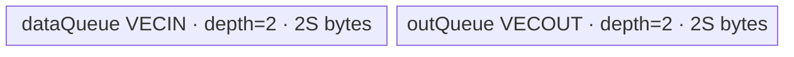

# ForeachAbs A2/A3 ACLNN 算子知识

## 算子速览

| 项目 | 内容 |
|---|---|
| 实际入口 | `aclnnForeachAbsGetWorkspaceSize` + `aclnnForeachAbs`，无版本后缀公开两段式 ACLNN；固定仓无更新的同语义版本。 |
| 计算语义 | 对 TensorList 中每个有效元素计算绝对值。 |
| 输入输出 | 动态 TensorList，FP16/FP32/BF16、ND；列表内 dtype 一致；输入可经框架连续化，公开输出不支持非连续 Tensor。 |
| 执行类型 | 单 AIV_VECTOR Kernel；`ForeachTriangle` → `KernelForeachUnary` → `Abs`。无 Cube/AIC/MIX_CV。 |
| Kernel 路线 | R-001 FP16 direct Abs、R-002 FP32 direct Abs、R-003 BF16→FP32 Abs→BF16。key 1/2/4。 |
| 核心资源 | GM TensorList 地址表；`VECIN`/`VECOUT` double buffer；BF16 另有单 buffer FP32 Queue；Tiling workspace 32 bytes，但 Kernel 显式不使用。 |
| 来源闭包 | `source_closed`：公开 ACLNN → `ForeachAbs` OpDef/生成 bridge 边界 → arch22 公共 Tiling/POD → key router → 公共 Base/Unary/Triangle body → A2/A3 构建与 binary config。 |
| 验证状态 | 已完成源码闭包检查；本次知识提取未执行编译、真机、数值或性能测试。 |

## 接口与语义

### 计算语义

令 `x=[x_0,...,x_(n-1)]`，输出对每个输入 storage element 执行 `y_i[j]=Abs(x_i[j])`。FP16/FP32 直接调用对应 dtype 的 AscendC `Abs`；BF16 逐 cast tile 转 FP32，调用 FP32 `Abs`，以 `RoundMode::CAST_RINT` 转回 BF16。Kernel 只写与输入元素数相同的输出前缀；输出 storage 容量可以更大，剩余区域不写。

### 输入、输出与属性

| 参数 | shape/layout | dtype | 约束、默认值与语义 |
|---|---|---|---|
| `x` | TensorList，每 Tensor 0～8 维，ND | FP16/FP32/BF16，列表内相同 | 非空指针；支持空 Tensor；OpDef 为动态输入配置 `AutoContiguous()`。 |
| `out` | TensorList，每 Tensor 0～8 维，ND | 与 `x` 相同，列表内相同 | 非空指针；对应输出 storage numel≥输入；公开文档不支持非连续输出。 |
| `workspaceSize` | scalar | `uint64_t*` | 第一段输出 executor 总需求；算子 Tiling 固定申请 32 bytes。 |
| `executor` | N/A | `aclOpExecutor**` | 第一段产生、第二段消费。 |
| `workspace/stream` | Device 地址/stream | pointer | 第二段消费；Kernel 将用户 workspace 改为 `nullptr`，这 32 bytes 不进入算子 body。 |

### 入口与版本

固定仓仅公开无后缀 `aclnnForeachAbs`。手写 bridge/header 不在仓内；`op_host/CMakeLists.txt` 的 `ACLNNTYPE aclnn` 是生成边界。OpDef 完整声明动态列表、FP16/FP32/BF16、ND、连续化和 ascend910b/ascend910_93 配置。README/ACLNN 产品表公开支持 Atlas A2 与 A3，Host CMake 将 ascend910b/ascend910_93 均映射到 arch22，Kernel CMake 和两个 binary JSON 均有三 dtype，证据无冲突。

## Host/Launcher 执行流程

### 参数校验与前处理

1. 公开第一段检查 TensorList 指针、dtype 支持与一致性、列表内 dtype、每 Tensor 最大 8 维、输出容量。
2. 框架依 OpDef 对动态输入执行连续化；输出的公开契约仍是不支持非连续。
3. arch22 `Tiling4ForeachAbsTiling` 构造 `ForeachCommonTiling`，以 `FOREACH_ABS_OP_CODE=24` 调 `Init`，再调 `RunBigKernelTiling`。
4. `Init` 最多扫描 `MAX_TENSOR_CONT=50` 个动态输入实例，记录 storage numel、总元素、dtype size 和每 32-byte block 的元素数；列表内 dtype 不一致、shape/输出检查失败时返回 `GRAPH_FAILED`。
5. Host 产生 key、分核区间、UB tile、POD、blockDim 和 32-byte Tiling workspace；框架生成 executor 以 stream 提交单 Kernel。

### 参数、Workspace 与生命周期

记 `E=32/sizeof(T)` 个元素/block、`N=sum(numel)`、平台 AIV 数为 `C`：

```text
needCoreNum = min(50, C, max(1, ceil(N/E)))
blockCount = ceil(N/E)
baseCoreElements = floor(blockCount/needCoreNum)*E
前 blockCount%needCoreNum 个 core 再得 E 个元素
```

`AssignDataToEachCore` 把这个拼接域映射回每 core 的 `tensorStart/end` 与首尾 offset，允许一个 Tensor 被多个 core 切分，也允许一 core 连续处理多个 Tensor。Tiling workspace 固定 32 bytes，但 entry 注释明确 Vector foreach 不需要 workspace，并向 body 传 `nullptr`。GM TensorList 地址表、POD、输入输出和 executor/workspace 必须保持到 stream 完成。

### 启动图与失败传播

```text
aclnnForeachAbsGetWorkspaceSize
  -> generated ForeachAbs bridge / AutoContiguous boundary
    -> Tiling4ForeachAbsTiling
      -> ForeachCommonTiling::Init(24)
      -> ForeachCommonTiling::RunBigKernelTiling
        -> one foreach_abs(xList,yList,workspace,tiling), blockDim=needCoreNum
          -> ForeachTriangle<T,P,AbsAdapter<P>,2,1>::Init/Process
```

单节点，无 Kernel 间 workspace edge。算子 Tiling slice 是 offset 0、extent 32 bytes、owner 为 executor/caller，但 body 不读；输入/输出 TensorList 是 GM 地址表。Host/Tiling 失败阻断 launch；entry 对未知 key 没有 else 错误上报，只是不产生输出，所以公开/OpDef dtype 校验不可省略。

## Route 与参数设计

### 分核与资源计算

POD 大小由字段自然布局为 1408 bytes。记平台 UB bytes 为 `U`、`S=inputsTensorUbSize`：

```text
FP16/FP32: S = align_down(floor((U - 1408 - 2048)/4), 32 bytes)
BF16:      S = align_down(floor(floor((U - 1408 - 2048)/10)/4), 64 bytes)
```

FP16/FP32 每个 Queue depth 2、单 buffer S，故显式 Queue 总量 `4S`。BF16 令 `totalTensorUbSize=9S`，输入/输出 Queue 各为 `2×9S`，另有 `paramsCount=1` 的 FP32 Queue `S`，显式总量 `37S`；Host 约按 `(U-1408-2048)/40` 取 S，保证显式分配留在预算内。额外 2048 bytes 只在 Host 预算中保留，固定 Kernel 源没有对应 `InitBuffer`，不得把它冒充显式 Queue。

### Route 选择

| 顺序 | Route | Key/模板 | 精确选择条件与优先级 | 不适用去向 |
|---:|---|---|---|---|
| 1 | R-001 FP16 direct | key 1，`ForeachTriangle<half,half,AbsAdapter<half>,2,1>` | `dataType==DT_FLOAT16` | dtype FP32/BF16；非法 dtype key 0 |
| 2 | R-002 FP32 direct | key 2，`ForeachTriangle<float,float,AbsAdapter<float>,2,1>` | `dataType==DT_FLOAT` | dtype BF16；非法 dtype key 0 |
| 3 | R-003 BF16 cast | key 4，`ForeachTriangle<bfloat16_t,float,AbsAdapter<float>,2,1>` | `dataType==DT_BF16` 且 AICore compile guard `>=220`、非 Kirin arch 3003/3113 | guard 不成立时 binary 不含该 branch；A2/A3 配置支持 |

```text
OpDef/API dtype validation
  FLOAT16  -> key 1 -> half Abs
  FLOAT32  -> key 2 -> float Abs
  BFLOAT16 -> key 4 -> BF16 load -> FP32 Abs -> BF16 store
  other    -> key 0 / no router branch (must be rejected before Device)
```

### 模板/实现执行矩阵

| Route | key/selector | dtype/shape/platform 完整命中条件 | 执行拓扑与 Kernel 节点 | 实际模板/body | 内存与同步特征 | tail/fallback |
|---|---|---|---|---|---|---|
| R-001 | 1 | A2/A3 FP16，合法 TensorList | 单 AIV Kernel | Triangle half/half → direct `Abs` | VECIN/VECOUT depth2，各 S；PIPE_V barriers | 每 segment 按 S/2 元素 tile；末 tile `DataCopyPad` |
| R-002 | 2 | A2/A3 FP32，合法 TensorList | 单 AIV Kernel | Triangle float/float → direct `Abs` | 同结构，各 S | 每 tile S/4 元素；末 tile pad |
| R-003 | 4 | A2/A3 BF16，compile guard 可用 | 单 AIV Kernel | Triangle BF16/float specialization | in/out 各 depth2×9S，FP32 Queue S；每 cast chunk S/4 元素 | 外 tile 9S/2 元素；内 cast tail；末 DMA tail |

### 隐藏性能 Guard

| Guard | Host/Tiling 条件 | Device/资源原因 | 影响 Route | 不满足时去向 | 源码符号 |
|---|---|---|---|---|---|
| Tensor/POD 上限 | `Init` 循环 `i<50` | POD `tensorDataCountList[50]` | 全部 | 固定仓无显式 >50 错误；正式可复用域必须≤50 | `ForeachCommonTiling::Init` |
| Core/POD 上限 | `needCoreNum=min(...,50)` | core 起止数组 50 项 | 全部 | 截到 50 core | `RunBigKernelTiling` |
| DMA 对齐 | S 向下对齐 32 bytes；BF16 对齐 64 bytes | full tile 用 `DataCopy`，tail 用 byte-count `DataCopyPad` | 全部 | tail route 留在同 Route | `DivideUbMemory7` / `CopyIn/CopyOut` |
| BF16 UB 放大 | `total=(U-H-2048)/10` 后再 `/4` | 两个 `2×9S` Queue + `S` FP32 Queue | R-003 | 无其它 Device fallback | `DivideUbMemory7` / `KernelForeachUnary::Init` |
| dtype compile guard | AICore≥220 且非 arch3003/3113 | BF16 Cast/Abs 实例只在 guard 内 | R-003 | 不生成 BF16 branch | `op_kernel/foreach_abs.cpp` / `foreach_triangle.h` |
| 空 segment | `dataCount=cursorEnd-cursorStart+1` 可为 0 | `copyTimes=0` 时不申请/搬运 | 全部 | 安全跳过 tile loop | `KernelForeachUnary::SingleTensorProcess` |

### POD/ABI

| 结构 | 字段 | 类型/位宽 | ABI 布局 | 单位 | Host/launcher producer | Device consumer | 边界 |
|---|---|---|---|---|---|---|---|
| `ForeachCommonTilingData` | `inputsTensorUbSize` | uint64/64 | offset 0；align 8、sizeof 1408 | bytes/Queue buffer 基准 | `DivideUbMemory7` | Base 初始化/Queue size | FP/BF16 含义不同 |
| 同上 | `tensorDataCountList` | int64[50] | offset 8，400 bytes | elements/Tensor | `Init`: storage shape size | Process cursor 与 total segment | 前 totalTensorCount 项有效 |
| 同上 | `tensorStartList` | uint16[50] | offset 408，100 bytes | Tensor index/core | `AssignDataToEachCore` | Base `tensorStart` | blockIdx<blockDim≤50 |
| 同上 | `tensorEndList` | uint16[50] | offset 508，100 bytes | Tensor index/core | 同上 | Base `tensorEnd` | inclusive |
| 同上 | `tensorStartOffsetList` | int64[50] | offset 608，400 bytes | elements | 同上 | 首 Tensor cursorStart | inclusive |
| 同上 | `tensorEndOffsetList` | int64[50] | offset 1008，400 bytes | elements | 同上 | 尾 Tensor cursorEnd | inclusive；空 segment 可为 -1 |

### Route 源码闭包

| Route | Key/selector | Host/Tiling producer | POD/参数 | Kernel entry/router 节点 | Kernel body/直接依赖 | 构建接线 |
|---|---|---|---|---|---|---|
| R-001 | 1 | arch22 wrapper + `ForeachCommonTiling` | `ForeachCommonTilingData` | `foreach_abs` key 1 | Base→Unary→Triangle half | ascend910b/910_93 common Kernel + binary JSON |
| R-002 | 2 | 同上 | 同上 | key 2 | Base→Unary→Triangle float | 同上 |
| R-003 | 4 | 同上 | 同上 | key 4 under compile guard | BF16 specialized InnerComputer | 同上 |

## Kernel 实现

### 公共执行流程

entry 解析公共 POD，忽略 workspace，按 key 构造 `ForeachTriangle`。Base 以 `GetBlockIdx()` 取本 core 的 Tensor 起止与 offset；Unary 对每个相交 Tensor 绑定真实 GM 地址，从 segment 起点开始分 tile，按 `CopyIn→Triangle::Compute→CopyOut` 流水。TensorList 地址表的首 uint64 是到指针数组的 byte offset，Device 用 `offset>>3` 找第 `i` 个真实指针。Queue 的 `Alloc/EnQue/DeQue/Free` 和 `PIPE_V` barrier 保证 DMA、Vector 与复用顺序。

### Route R-001：FP16 direct Abs

#### 适用条件

##### 选择证据

| 层级 | 文件 | 符号 | 源码谓词/参数 | 结果/下一跳 |
|---|---|---|---|---|
| Host | `foreach_utils/op_host/common_dtype.h` | `GetTilingKeyByDtypeOnly` | `DT_FLOAT16` | key 1 |
| Router | `foreach_abs/op_kernel/foreach_abs.cpp` | `foreach_abs` | `TILING_KEY_IS(1)` | Triangle half instance |
| Body | `foreach_utils/op_kernel/foreach_triangle.h` | generic `InnerComputer<half,half,...>` | non-BF16 template | direct `Abs` |

#### Device 数据流

##### 函数级调用链

```text
foreach_abs key1
  -> ForeachTriangle<half,half,AbsAdapter<half>,2,1>::Init
    -> KernelForeachUnary::Init -> KernelForeachBase::Init/ParseTilingData
  -> Process
    -> SingleTensorProcess
      -> CopyIn -> Triangle::Compute -> InnerComputer::Compute
        -> AbsAdapter<half> -> AscendC::Abs
      -> CopyOut
```

##### 源码等价伪码

```text
core = GetBlockIdx()
for tensor i in [startTensor,endTensor]:
  begin = i==start ? startOffset : 0
  end   = i==end ? endOffset : numel[i]-1
  bind xGM/yGM = addressTable[i] + begin
  for tile k over count=end-begin+1, capacity=S/2 elements:
    if last partial: DataCopyPad exact count*2 bytes else DataCopy count elements
    EnQue(in); DeQue(in); Alloc(out)
    PipeBarrier(V); Abs(out,in,count); PipeBarrier(V)
    Free(in); EnQue(out); DeQue(out)
    tail ? DataCopyPad exact bytes : DataCopy
    Free(out)
```

#### 内存与数据搬运

##### 资源与搬运表

| 层级/缓冲区 | offset/地址公式 | extent/容量公式 | dtype/layout | producer | consumer | owner/lifetime | 对齐/复用 |
|---|---|---|---|---|---|---|---|
| GM x/y table | `base+(*base>>3)+i` | ≤50 pointers | uint64 | framework | `GetTensorAddr` | launch | offset 8-byte based |
| GM segment | `ptr[i]+cursorStart+k*(S/2)` | valid tile count | FP16 ND | caller/CopyIn | CopyIn/caller | stream | exact tail bytes |
| `dataQueue` | UB allocator | depth2×S bytes | FP16 VECIN | CopyIn | Abs | core launch | double buffer |
| `outQueue` | UB allocator | depth2×S bytes | FP16 VECOUT | Abs | CopyOut | core launch | double buffer |

##### 分层内存布局



##### 字节账与复用顺序

```text
S = align_down((U-1408-2048)/4,32)
UB_total = 2S + 2S = 4S <= U-1408-2048
dynamic_ub = N/A
workspace_total = 32 bytes reserved by Tiling; body-used bytes = 0
```

| 复用子区 | 写入者 | 读取者/消费点 | 下一次覆盖 | 同步或释放依据 | 安全条件 |
|---|---|---|---|---|---|
| dataQueue slot | CopyIn | DeQue→Abs | `FreeTensor` 后下一 tile | Queue + PIPE_V | depth2 slot free 后覆盖 |
| outQueue slot | Abs | DeQue→CopyOut | `FreeTensor` 后下一 tile | Queue + PIPE_V | CopyOut 完成后覆盖 |

#### 同步、精度与尾块

##### 同步与数值边界表

| 阶段 | primitive/机制 | producer | consumer/等待点 | 保护对象 | 精度/尾块 |
|---|---|---|---|---|---|
| DMA→Vector | EnQue/DeQue | CopyIn | Compute | input slot | partial tile padded in UB，Abs count 只含有效元素 |
| Vector | `PipeBarrier<PIPE_V>` 前后 | input local | output local | Vector dependency | FP16 direct Abs |
| Vector→DMA | EnQue/DeQue | Compute | CopyOut | output slot | tail 仅写 `count*2` bytes |

#### 关键实现

##### 符号证据表

| 阶段 | 文件 | 符号/模板实例 | 实现事实 |
|---|---|---|---|
| Host/Tiling producer | `foreach_tiling_class.h` | `RunBigKernelTiling`/`DivideUbMemory7` | key/core/S/POD/workspace |
| Kernel entry/router | `foreach_abs/op_kernel/foreach_abs.cpp` | key 1 branch | half template |
| Device body/helper | `kernel_foreach_unary.h` + `foreach_triangle.h` | `CopyIn/Compute/CopyOut` | Queue、Abs、tail |

### Route R-002：FP32 direct Abs

#### 适用条件

##### 选择证据

| 层级 | 文件 | 符号 | 源码谓词/参数 | 结果/下一跳 |
|---|---|---|---|---|
| Host | `common_dtype.h` | `GetTilingKeyByDtypeOnly` | `DT_FLOAT` | key 2 |
| Router | `foreach_abs.cpp` | `TILING_KEY_IS(2)` | true | Triangle float |
| Body | `foreach_triangle.h` | generic InnerComputer | `T=P=float` | direct FP32 Abs |

#### Device 数据流

##### 函数级调用链

```text
foreach_abs key2 -> ForeachTriangle<float,float,AbsAdapter<float>,2,1>
  -> Base::Init -> Unary::Process
    -> CopyIn -> InnerComputer::Compute -> Abs<float> -> CopyOut
```

##### 源码等价伪码

```text
与 R-001 相同的 core/Tensor/segment 循环；tile capacity=S/4 elements；
Abs(outLocal,inLocal,validCount) 以 FP32 执行；partial DMA byteLen=validCount*4。
```

#### 内存与数据搬运

##### 资源与搬运表

| 层级/缓冲区 | offset/地址公式 | extent/容量公式 | dtype/layout | producer | consumer | owner/lifetime | 对齐/复用 |
|---|---|---|---|---|---|---|---|
| GM x/y segment | `ptr[i]+begin+k*(S/4)` | validCount×4 bytes | FP32 ND | caller/CopyIn | CopyIn/caller | stream | tail exact bytes |
| dataQueue | UB | depth2×S | FP32 | CopyIn | Abs | core | double buffer |
| outQueue | UB | depth2×S | FP32 | Abs | CopyOut | core | double buffer |

##### 分层内存布局


##### 字节账与复用顺序

```text
S=align_down((U-1408-2048)/4,32)
UB_total=4S; dynamic_ub=N/A; workspace_total=32 bytes (body uses 0)
```

| 复用子区 | 写入者 | 读取者/消费点 | 下一次覆盖 | 同步或释放依据 | 安全条件 |
|---|---|---|---|---|---|
| Queue slots | CopyIn/Abs | Abs/CopyOut | Free 后 | EnQue/DeQue/Free + PIPE_V | same as R-001 |

#### 同步、精度与尾块

##### 同步与数值边界表

| 阶段 | primitive/机制 | producer | consumer/等待点 | 保护对象 | 精度/尾块 |
|---|---|---|---|---|---|
| pipeline | Queue + PIPE_V | DMA | Abs/CopyOut | each tile | FP32 direct；last validCount guard |

#### 关键实现

##### 符号证据表

| 阶段 | 文件 | 符号/模板实例 | 实现事实 |
|---|---|---|---|
| Host/Tiling producer | `foreach_tiling_class.h` | dtype key/DivideUbMemory7 | key2/S |
| Kernel entry/router | `foreach_abs.cpp` | key2 | float template |
| Device body/helper | `foreach_triangle.h` | generic `InnerComputer` | direct Abs + barriers |

### Route R-003：BF16 分块升精度 Abs

#### 适用条件

##### 选择证据

| 层级 | 文件 | 符号 | 源码谓词/参数 | 结果/下一跳 |
|---|---|---|---|---|
| Host | `common_dtype.h` | `GetTilingKeyByDtypeOnly` | `DT_BF16` | key 4 |
| Router | `foreach_abs.cpp` | compile guard + key4 | A2/A3 | BF16/float Triangle |
| Body | `foreach_triangle.h` | `InnerComputer<bfloat16_t,float,...>` | specialization | cast chunks + FP32 Abs |

#### Device 数据流

##### 函数级调用链

```text
foreach_abs key4
  -> ForeachTriangle<bfloat16_t,float,AbsAdapter<float>,2,1>::Init
    -> Base: totalTensorUbSize=9S, maxDataCount=9S/2, maxCastDataCount=S/4
    -> Unary: in/out Queue depth2×9S; float32Queue depth1×S
  -> Process -> outer tiles
    -> CopyIn BF16
    -> specialized InnerComputer::Compute
      -> ComputePerCast: Cast BF16→FP32 -> Abs FP32 -> Cast RINT FP32→BF16
    -> CopyOut BF16
```

##### 源码等价伪码

```text
for outer tile of up to 9S/2 BF16 elements:
  DMA x -> BF16 inQueue
  for castChunk of up to S/4 elements:
    PipeBarrier(V)
    Cast(f32Buf, bf16In[offset], CAST_NONE, n)
    PipeBarrier(V)
    Abs(f32Buf, f32Buf, n)       # paramsCount=1, offset=0, in-place
    PipeBarrier(V)
    Cast(bf16Out[offset], f32Buf, CAST_RINT, n)
    PipeBarrier(V)
  DMA valid BF16 output -> GM
```

#### 内存与数据搬运

##### 资源与搬运表

| 层级/缓冲区 | offset/地址公式 | extent/容量公式 | dtype/layout | producer | consumer | owner/lifetime | 对齐/复用 |
|---|---|---|---|---|---|---|---|
| GM x/y segment | `ptr[i]+begin+outer*(9S/2)` | valid×2 bytes | BF16 ND | caller/CopyIn | CopyIn/caller | stream | tail pad |
| dataQueue | UB | depth2×9S bytes | BF16 | CopyIn | Cast | core | double buffer |
| outQueue | UB | depth2×9S bytes | BF16 | downcast | CopyOut | core | double buffer |
| float32Queue | UB | depth1×S bytes = S/4 FP32 | FP32 | upcast | in-place Abs/downcast | allocated once for Process | same buffer overwritten per cast chunk |

##### 分层内存布局


##### 字节账与复用顺序

```text
S = align_down(floor(floor((U-1408-2048)/10)/4),64)
UB_total = 2*(9S) + 2*(9S) + S = 37S
37S <= U-1408-2048  # Host 约按 40S 预算，另有整数向下取整
maxDataCount=9S/2 BF16 elements
maxCastDataCount=S/4 FP32 elements
workspace_total=32 bytes reserved; body uses 0
```

| 复用子区 | 写入者 | 读取者/消费点 | 下一次覆盖 | 同步或释放依据 | 安全条件 |
|---|---|---|---|---|---|
| float32Queue slot | BF16→FP32 Cast | in-place FP32 Abs，再 downcast | 下一个 cast chunk | 四个 PIPE_V barrier；slot Process 末 Free | downcast 完成后覆盖 |
| BF16 Queue slots | DMA/Cast | Cast/DMA | Free 后下一 outer tile | Queue protocol | depth2 |

#### 同步、精度与尾块

##### 同步与数值边界表

| 阶段 | primitive/机制 | producer | consumer/等待点 | 保护对象 | 精度/尾块 |
|---|---|---|---|---|---|
| upcast | PIPE_V barrier | BF16 local | FP32 Abs | f32 slot | `CAST_NONE`；cast tail n≤S/4 |
| Abs | in-place Vector | f32 Cast | downcast | same f32 slot | FP32 computation |
| downcast | PIPE_V + Cast | FP32 Abs | BF16 output Queue | BF16 slice | `CAST_RINT` |
| outer DMA | Queue/DataCopyPad | GM/compute | compute/GM | BF16 Queue | exact valid byte count |

#### 关键实现

##### 符号证据表

| 阶段 | 文件 | 符号/模板实例 | 实现事实 |
|---|---|---|---|
| Host/Tiling producer | `foreach_tiling_class.h` | `DivideUbMemory7` | BF16 /10、/4、64-byte align |
| Kernel entry/router | `foreach_abs.cpp` | key4 branch | BF16→P=float instance |
| Device body/helper | `kernel_foreach_base.h`/`kernel_foreach_unary.h`/`foreach_triangle.h` | BF16 specialization | 9S Queue、S float Queue、cast loop |

## 算子特定优化

### Trick T-001：跨 Tensor 连续分核，单 launch 覆盖整个列表

#### 触发与源码依据

- 适用 Route：R-001～R-003
- 触发条件：合法 TensorList，安全闭合域列表长度≤50。
- Golden 来源：[`foreach/foreach_utils/op_host/foreach_tiling_class.h:653-691`](../../../../../../../cann-ops-raw/ascendc/ops-nn/955f8b33985b6d72989ebff341bb9c2c564a51bc/foreach/foreach_utils/op_host/foreach_tiling_class.h#L653-L691)

**官方源码（固定 Commit 连续逐字摘录）**：

```cpp
int64_t blockCount = CeilA2B(totalDataCount, elementsPerBlock);
int64_t tempPerCoreCount = blockCount / needCoreNum * static_cast<int64_t>(elementsPerBlock);
int64_t remainderCount = blockCount % needCoreNum;
uint16_t coreIndex = 0;
int64_t dataCount = 0;
int64_t curCmpCount = 0;
int64_t cursorPosition = 0;
tensorStartList[coreIndex] = static_cast<uint16_t>(0);
tensorStartOffsetList[coreIndex] = 0;
for (uint16_t i = 0; i < totalTensorCount; i++) {
```

#### 机制与设计原因

Host 把所有 Tensor 拼成按 32-byte block 计数的域，给各 core 分配相差最多一个 block 的数据，再写回 Tensor 起止与 offset。这样一个 Kernel 可跨 Tensor 处理列表，避免逐 Tensor launch，同时能切分大 Tensor。`elementsPerBlock=32/sizeof(T)` 来自 dtype。

#### 迁移边界

- 适用：各 Tensor 同 dtype、逐元素独立、允许以 storage numel 拼接的 foreach unary/binary。
- 前提：POD 数组足够、输出对应域不重叠、首尾 offset 为 inclusive。
- 失效：超过 50 Tensor、需要 Tensor 间状态或输出别名冲突时不能直接复用。
- 未验证：本次知识提取未执行编译、真机、数值或性能测试。

#### 错误做法

固定仓未提供可验证反例。

### Trick T-002：BF16 用单 FP32 子区循环复用，而非物化整 tile FP32

#### 触发与源码依据

- 适用 Route：R-003
- 触发条件：dtype BF16、A2/A3 compile guard 成立；`paramsCount=1`。
- Golden 来源：[`foreach/foreach_utils/op_kernel/foreach_triangle.h:51-75`](../../../../../../../cann-ops-raw/ascendc/ops-nn/955f8b33985b6d72989ebff341bb9c2c564a51bc/foreach/foreach_utils/op_kernel/foreach_triangle.h#L51-L75)

**官方源码（固定 Commit 连续逐字摘录）**：

```cpp
uint32_t castTimes = dataCount / maxCastDataCount;
uint32_t castTimesRemainder = dataCount % maxCastDataCount;

for (uint32_t i = 0; i < castTimes; i++) {
    ComputePerCast(x1Local, yLocal, float32Tensor, maxCastDataCount, i, maxCastDataCount);
}

if (castTimesRemainder > 0) {
    ComputePerCast(x1Local, yLocal, float32Tensor, maxCastDataCount, castTimes, castTimesRemainder);
}
```

#### 机制与设计原因

外层 BF16 Queue buffer 可容纳 `9S/2` 元素，但只配置 `S/4` 个 FP32 元素的临时区。内层循环逐块 upcast，`Abs` 原地覆盖同一 FP32 子区，再 downcast 到外层 output buffer；每块用 PIPE_V barrier 约束覆盖。它避免为整个 BF16 outer tile 同时物化 FP32 版本。

#### 迁移边界

- 适用：BF16 输入、FP32 中间计算、逐元素结果可立即降精度的 unary 操作。
- 前提：操作支持原地 FP32 dst/src、每块独立、downcast 完成后才覆盖临时区。
- 失效：计算需要跨 cast chunk 数据依赖、整 tile归约或多个同时存活的 FP32 输入时需扩大/拆分 TBuf。
- 未验证：本次知识提取未执行编译、真机、数值或性能测试。

#### 错误做法

固定仓提供的真实安全边界是不能在 downcast 前覆盖 `float32Tensor`；官方以连续 PIPE_V barrier 保证顺序。

## 模板与实现对比

| 对比维度 | R-001 FP16 | R-002 FP32 | R-003 BF16 | 设计选择依据 |
|---|---|---|---|---|
| 命中条件/优先级 | key1 | key2 | key4 + compile guard | dtype selector |
| 模板与 dtype | half→half | float→float | bfloat16→float→bfloat16 | BF16 Abs 走 FP32 |
| 循环与分核 | S/2 tile | S/4 tile | 9S/2 outer + S/4 cast chunks | UB/dtype size |
| Queue/TBuf/寄存器/dynamic UB/通信 window | in/out depth2 | 同左 | in/out depth2×9S + FP32 depth1×S | BF16 临时精度 |
| 内存总占用与复用 | 4S | 4S | 37S；FP32 原地复用 | Host 分别 /4 与约 /40 |
| 搬运/Vector/SIMT/NDDMA/通信 API | DataCopy/Pad + Abs | 同左 | + Cast NONE/RINT | tail 和精度 |
| 同步、精度与 tail | Queue+PIPE_V，FP16 | Queue+PIPE_V，FP32 | 多 PIPE_V，FP32 compute | 有效 count |
| fallback/失败边界 | unknown key 无输出 | 同左 | guard 不成立无 branch | API/OpDef 必须预校验 |

## 平台差异

| 项目 | A2 | A3 | 950 |
|---|---|---|---|
| 支持状态 | 公开支持 | 公开支持 | 公开支持，见 `_950` 卡 |
| Host/Launcher | ascend910b→arch22 公共 Tiling | ascend910_93→arch22 公共 Tiling | arch35 专用 Tiling |
| Kernel/资源 | 公共 AIV Vector + Queue | 与 A2 同源 | SIMT 直接 GM，无 Queue staging |

## 限制与失败边界

- 公共 POD 只容纳 50 Tensor 和 50 core；Host `Init` 也只扫描前 50 项。固定仓没有显式拒绝长度>50 的逻辑，因此正式复用边界必须限制列表长度≤50，不能假设安全截断等同公开语义。
- Host 的 UB 计算对 `U-tilingDataSize-2048` 没有显式下界检查；目标平台必须提供足够 UB，不能在更小资源平台直接复用。
- workspace Tiling 值是 32 bytes，但 Kernel 显式传 `nullptr`；不能把它用作跨节点数据区。
- unknown key 和不满足 BF16 compile guard 均没有 Device error/fallback；依赖公开 API/OpDef 与 binary config 阻止非法 launch。
- 输出只写输入 numel 的前缀；当输出容量更大时其余元素保持调用前状态，固定仓未定义初始化。
- 生成 ACLNN bridge 的 executor workspace 合并和 cleanup 固定仓不可见；不影响已闭合的算子 Tiling/POD/Kernel。
- 本次知识提取未执行编译、真机、数值或性能测试。

## 源码索引

### 链路索引

| 链路阶段 | 文件 | 关键符号 | 支撑内容 |
|---|---|---|---|
| 入口声明/约束 | `foreach/foreach_abs/docs/aclnnForeachAbs.md` | ACLNN 原型/错误表 | 公开 API 与约束 |
| 公开平台 | `foreach/foreach_abs/README.md` | 产品支持情况 | A2/A3 支持 |
| 入口实现 | `foreach/foreach_abs/op_host/foreach_abs_def.cpp` | `ops::ForeachAbs` | OpDef/dtype/AutoContiguous/平台 |
| Host wrapper | `foreach/foreach_abs/op_host/arch22/foreach_abs_tiling_arch22.cpp` | `Tiling4ForeachAbsTiling` | opCode 24→公共 Tiling |
| Host/Tiling | `foreach/foreach_utils/op_host/foreach_tiling_class.h` | `ForeachCommonTiling` | 校验、分核、UB、POD、workspace |
| POD | `foreach/foreach_utils/op_host/foreach_tiling_def.h` | `ForeachCommonTilingData` | ABI 与注册 |
| dtype key | `foreach/foreach_utils/op_host/common_dtype.h` | `GetTilingKeyByDtypeOnly` | key1/2/4 |
| Kernel entry | `foreach/foreach_abs/op_kernel/foreach_abs.cpp` | `foreach_abs`/`AbsAdapter` | router 与实例 |
| Device base | `foreach/foreach_utils/op_kernel/kernel_foreach_base.h` | `KernelForeachBase` | POD 解析与地址表 |
| Device pipeline | `foreach/foreach_utils/op_kernel/kernel_foreach_unary.h` | `KernelForeachUnary` | Queue、segment、DMA、tail |
| Device compute | `foreach/foreach_utils/op_kernel/foreach_triangle.h` | `InnerComputer`/`ForeachTriangle` | Abs、BF16 cast、barrier |
| Host 构建 | `foreach/foreach_abs/op_host/CMakeLists.txt` | `SUPPORT_TILING_DIR` | A2/A3→arch22 |
| Kernel 构建 | `foreach/foreach_abs/op_kernel/CMakeLists.txt` | `add_kernel_sources` | ascend910b/910_93 common source |
| A2 binary | `foreach/foreach_abs/op_host/config/ascend910b/foreach_abs_binary.json` | `op_list` | FP16/FP32/BF16 |
| A3 binary | `foreach/foreach_abs/op_host/config/ascend910_93/foreach_abs_binary.json` | `op_list` | FP16/FP32/BF16 |

### 实现复用检查

| 检查项 | 可复用事实 | 不得改变的约束 | 源码符号 |
|---|---|---|---|
| ABI/POD | 拼接域→core Tensor segment | 字段顺序/位宽、50 项、inclusive offset | `ForeachCommonTilingData` |
| 调用顺序 | Init→Process→CopyIn→Compute→CopyOut | Queue 生命周期与 key mapping | `KernelForeachUnary` |
| workspace/内存 | S 预算与 double buffer | depth、BF16 9S/S 分配、32-byte Tiling workspace unused | `DivideUbMemory7`/`Init` |
| 同步 | Queue + PIPE_V | BF16 每次 cast/downcast 前后 barrier | `InnerComputer` |
| 精度与尾块 | direct FP16/FP32；BF16 FP32 compute | CAST_NONE/CAST_RINT、validCount byte tail | `AbsAdapter`/`ComputePerCast` |
| 失败边界 | API/Host 校验 | >50 不得静默当完整语义、unknown key 无输出 | `ForeachCommonTiling::Init`/entry router |