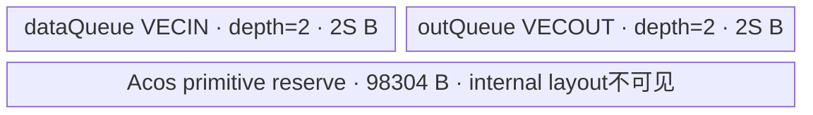
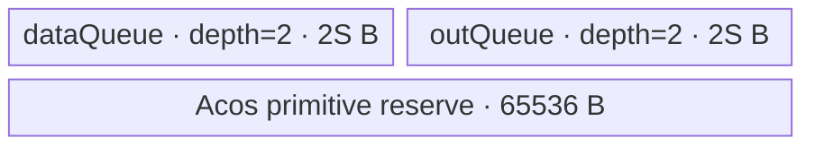
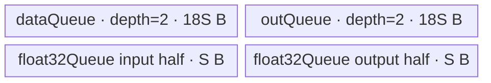

# ForeachAcos A2/A3 ACLNN 算子知识

## 算子速览

| 项目 | 内容 |
|---|---|
| 实际入口 | `aclnnForeachAcosGetWorkspaceSize` + `aclnnForeachAcos`，公开 ACLNN，两段式且无编号版本 |
| 计算语义 | 对列表中每个张量逐元素计算 `y_i[j] = acos(x_i[j])` |
| 输入输出 | 动态 TensorList，ND，FP16/FP32/BF16；列表内 dtype 一致；输出 dtype 一致且容量不小于输入 |
| 执行类型 | 单节点 `AIV_VECTOR`；未发现可达 Cube/AIC/MIX_CV |
| Kernel 路线 | R-001 FP16、R-002 FP32、R-003 BF16 升精度 |
| 核心资源 | GM TensorList descriptor；双缓冲 VECIN/VECOUT TQue；BF16 另有单缓冲 FP32 Queue；Host 报告 32 B workspace、Kernel 不读取 |
| 来源闭包 | `source_closed`：公开 API→OpDef→arch22 公共 Foreach Tiling/POD→dtype router→`ForeachTriangle`/`KernelForeachUnary`/`KernelForeachBase`→Acos 库接口→构建接线闭合；ACLNN inner bridge 与 AscendC Acos primitive 内部是允许的框架/库边界 |
| 验证状态 | 已完成源码闭包检查；本次知识提取未执行编译、真机、数值或性能测试。 |

## 接口与语义

### 计算语义

输入 `x=[x_0,...,x_(n-1)]`，输出 `y` 与其逐项对应，对每个 storage 有效元素执行 `y_i[j]=cos^{-1}(x_i[j])`。Host 以各 Tensor 的元素数拼接全局域并按 32 B block 分核；Kernel 再按核的起止 Tensor 和 offset 逐 Tensor、逐 tile 处理。固定源码未显式裁剪 `[-1,1]`，超域数值交给 AscendC `Acos` primitive。

### 输入、输出与属性

| 参数 | shape/layout | dtype | 约束、默认值与语义 |
|---|---|---|---|
| `x` | 动态 TensorList；每项 ND、0–8 维 | FP16/FP32/BF16，列表内一致 | 可含空 Tensor；输入非连续由 `AutoContiguous()` 框架边界处理 |
| `out` | 动态 TensorList；每项 ND、0–8 维 | 与 `x` 相同且列表内一致 | 输出不支持非连续；同位置输出 storage shape size 不小于输入 |
| `workspaceSize` | 标量 | `uint64_t*` | 第一段返回 executor 总 workspace；ForeachAcos 节点 Tiling 请求 32 B，但 Kernel 将 `userWS=nullptr`，生成式连续化前处理是否追加空间在固定仓不可见 |
| `executor` | 执行器 | `aclOpExecutor**` | 第一段产生、第二段消费 |
| `stream` | Stream | `aclrtStream` | 第二段异步 launch 的顺序载体 |

### 入口与版本

固定仓只有无编号公开 ACLNN 版本，故它是 A2/A3 实际最新版本。公开产品表明确支持 Atlas A2 与 A3；OpDef 注册 `ascend910b`/`ascend910_93`，Host CMake 都选 arch22，Kernel CMake 和全局 binary config 也包含这两个 compute unit。公开 API 的生成 inner bridge 未落盘；参数校验和 executor 组装以文档与 `ACLNNTYPE aclnn` 接线作为框架边界。

## Host/Launcher 执行流程

### 参数校验与前处理

API 文档定义空指针、dtype、shape、列表内 dtype、最大 8 维等错误。OpDef 对动态输入输出均设置 `AutoContiguous()`。`Tiling4ForeachAcosTiling` 构造 `ForeachCommonTiling`，以 `FOREACH_ACOS_OP_CODE=13` 初始化：最多枚举 50 个动态输入项，读取 storage `GetShapeSize()`，累加总元素并确认输入 dtype 一致。`RunBigKernelTiling` 再校验输出 dtype、输入输出容量、各 Tensor 维数和列表 dtype。

### 参数、Workspace 与生命周期

令元素字节数 `B∈{2,4}`、`EPB=32/B`、总元素 `E`、平台 AIV 核数 `Cplat`。`needCoreNum=min(Cplat,ceil(E/EPB),50)`，若 `E=0` 则至少 1。分配以 `ceil(E/EPB)` 个 32 B block 为域：基础每核 `floor(blocks/C)*EPB` 元素，前 `blocks%C` 个核多一个 32 B block；Host 将每核区间编码成起止 Tensor/offset。ForeachAcos 节点 workspace 固定请求 32 B，但 entry 明确设 `userWS=nullptr`；ACLNN 总 workspace 还可能包含生成式连续化前处理，固定仓不可见。POD、descriptor、数据和 executor 必须活到 stream 上 Kernel 完成。

### 启动图与失败传播

单节点图：executor 在 stream 上启动 `foreach_acos(xList,yList,workspace,tiling)`，blockDim=`needCoreNum`。entry 根据 key 1/2/4 构造一种 `ForeachTriangle` 并执行 `Init→Process`；无 Kernel 间 workspace 边。Host 获取 workspace 指针失败、校验失败或不可识别 dtype 导致 Tiling 失败并阻断 launch。entry 对未知 key 无 body、也无 Device fallback；受支持入口不应产生未知 key。

## Route 与参数设计

### 分核与资源计算

公共 POD 记录每个 Tensor 的元素数和每核 `[tensorStart:tensorEnd]`、首尾 offset。UB tile 字节 `S=inputsTensorUbSize` 的 Host 公式为：先保留 POD 序列化区和 Acos primitive 临时区 `extra = calcPro*B*1024*8`，其中 B=2 时 `calcPro=6`、B=4 时 `calcPro=2`；再令 `raw=(UB-POD-extra)`。FP16/FP32 使用 `S=floor_32(raw/4)`；BF16 先 `raw/=10`，再 `S=floor_64(raw/4)`。Kernel FP16/FP32 tile 元素数 `S/B`；BF16 的搬运 tile 是 `9S/2` 元素，而每次 FP32 cast/计算分片是 `S/4` 元素。

### Route 选择

| 顺序 | Route | Key/模板 | 精确选择条件与优先级 | 不适用去向 |
|---:|---|---|---|---|
| 1 | R-001 FP16 | key 1，`ForeachTriangle<half,half,Acos<half,false>>` | 列表 dtype `DT_FLOAT16` | key 2 判断 |
| 2 | R-002 FP32 | key 2，`ForeachTriangle<float,float,Acos<float,false>>` | 列表 dtype `DT_FLOAT` | key 4 判断 |
| 3 | R-003 BF16 | key 4，`ForeachTriangle<bfloat16_t,float,Acos<float,false>>` | 列表 dtype `DT_BF16` 且编译 guard 非 3003/3113 | 其它 dtype 失败/未知 key 无执行 |

```text
dtype FP16 -> GetTilingKeyByDtypeOnly=1 -> half direct Acos
else dtype FP32 -> key 2 -> float direct Acos
else dtype BF16 -> key 4 -> BF16→FP32 chunk→Acos<float>→BF16
else -> public contract rejects / key 0 has no body
```

### 模板/实现执行矩阵

| Route | key/selector | dtype/shape/platform 完整命中条件 | 执行拓扑与 Kernel 节点 | 实际模板/body | 内存与同步特征 | tail/fallback |
|---|---|---|---|---|---|---|
| R-001 FP16 | 1 | A2/A3、列表 FP16、≤50 个被序列化项、校验通过 | 单 AIV_VECTOR | `ForeachTriangle<half,half,Acos<half,false>>` | VECIN/VECOUT 各 depth2；Acos 前后 PIPE_V barrier | 完整 tile `DataCopy`，尾 tile `DataCopyPad` |
| R-002 FP32 | 2 | 同上，列表 FP32 | 单 AIV_VECTOR | `ForeachTriangle<float,float,Acos<float,false>>` | 与 FP16 同结构 | 同上 |
| R-003 BF16 | 4 | 同上，列表 BF16，编译 guard 可用 | 单 AIV_VECTOR | `ForeachTriangle<bfloat16_t,float,Acos<float,false>>` | data/out 各 depth2×9S，FP32 Queue depth1×2S，分片 cast | tile 与 cast 两级尾部；无 fallback |

### 隐藏性能 Guard

| Guard | Host/Tiling 条件 | Device/资源原因 | 影响 Route | 不满足时去向 | 源码符号 |
|---|---|---|---|---|---|
| Tensor 项容量 | `Init` 循环只到 `MAX_TENSOR_CONT=50` | POD 数组和 core 数组均 50 项 | 全部 | 固定实现不会序列化第 51 项；公开文档未给显式上限 | `ForeachCommonTiling::Init` |
| 分核 cap | `needCoreNum<=50` | POD 只有 50 组 core start/end | 全部 | 减少 blockDim | `RunBigKernelTiling` |
| 32 B 分核 | `EPB=32/B`，按 block ceil | DMA 完整 tile 的块对齐 | 全部 | 尾部走 padded copy | `GetNeedCoreNum`、`AssignDataToEachCore` |
| UB 临时区 | `UB>POD+extra` 隐含于无符号减法 | Acos primitive 需要临时空间 | 全部 | 固定代码未显式失败检查，资源不足会产生下溢风险 | `DivideUbMemory4` |
| BF16 放大与 cast | BF16 `raw/=10` 且 `S` 64 B 对齐 | data/out 各放大 9 倍，另有 2S FP32 buffer | R-003 | 无其它 Route | `DivideUbMemory4`、`KernelForeachUnary::Init` |
| BF16 编译 guard | 非 `__NPU_ARCH__==3003/3113` | BF16 特化和 key 4 body 被条件编译 | R-003 | 对 guard 平台无 key 4 body | `foreach_acos.cpp`、`foreach_triangle.h` |

### POD/ABI

`BEGIN_TILING_DATA_DEF` 的宏展开不在固定仓，故下表能证明字段序列、元素类型和数组长度，但 native `sizeof/alignof/offsetof` 不可见；传输采用框架 `SaveToBuffer/GET_TILING_DATA` 序列化契约。

| 结构 | 字段 | 类型/位宽 | ABI 布局 | 单位 | Host/launcher producer | Device consumer | 边界 |
|---|---|---|---|---|---|---|---|
| `ForeachCommonTilingData` | `inputsTensorUbSize` | `uint64_t`/64 | 序列化字段 0；native offset 不可见 | 字节/单 buffer 参数 S | `DivideUbMemory4` | `KernelForeachBase::ParseTilingData` | 32 B 对齐；BF16 64 B |
| 同上 | `tensorDataCountList` | `int64_t[50]` | 序列化字段 1 | 元素/Tensor | `Init` 写 storage size | `Process` 的 cursorEnd | 未枚举项为初始 0 |
| 同上 | `tensorStartList` | `uint16_t[50]` | 序列化字段 2 | Tensor index/core | `AssignDataToEachCore` | `ParseTilingData` | core<blockDim |
| 同上 | `tensorEndList` | `uint16_t[50]` | 序列化字段 3 | Tensor index/core | 同上 | 同上 | inclusive |
| 同上 | `tensorStartOffsetList` | `int64_t[50]` | 序列化字段 4 | 元素 offset | 同上 | `Process` | inclusive start |
| 同上 | `tensorEndOffsetList` | `int64_t[50]` | 序列化字段 5 | 元素 offset | 同上 | `Process` | inclusive end |

### Route 源码闭包

| Route | Key/selector | Host/Tiling producer | POD/参数 | Kernel entry/router 节点 | Kernel body/直接依赖 | 构建接线 |
|---|---|---|---|---|---|---|
| R-001 FP16 | key 1 | `Tiling4ForeachAcosTiling`→`ForeachCommonTiling` | `ForeachCommonTilingData` | `foreach_acos` key 1 | `ForeachTriangle`→`KernelForeachUnary`→`KernelForeachBase`→`Acos<half,false>` | arch22 default source + ascend910b/910_93 config |
| R-002 FP32 | key 2 | 同上 | 同上 | key 2 | 同链，`Acos<float,false>` | 同上 |
| R-003 BF16 | key 4 | 同上 | 同上 | guarded key 4 | BF16 `InnerComputer`→cast→`Acos<float,false>`→cast | 同上 |

## Kernel 实现

### 公共执行流程

entry 解析 POD 并忽略用户 workspace。`KernelForeachBase::Init` 以 `GetBlockIdx()` 读取本核起止 Tensor/offset并计算 tile 上限；`KernelForeachUnary::Init` 建立 Queue。`Process` 对本核覆盖的 Tensor 范围逐项绑定 GM pointer，按 `maxDataCount` 切 tile；`CopyIn` 把 GM 搬到 VECIN，`ForeachTriangle::Compute` 调 `Acos`，`CopyOut` 从 VECOUT 写回 GM。完整 tile 用 `DataCopy`；尾 tile用单 block 的 `DataCopyPad`，`blockLen=dataCount*sizeof(T)` 字节、stride 均 0。

### Route R-001：FP16 Vector

#### 适用条件

##### 选择证据

| 层级 | 文件 | 符号 | 源码谓词/参数 | 结果/下一跳 |
|---|---|---|---|---|
| Host | `foreach_utils/op_host/common_dtype.h` | `GetTilingKeyByDtypeOnly` | `DT_FLOAT16` | key 1 |
| Router | `foreach_acos/op_kernel/foreach_acos.cpp` | `foreach_acos` | `TILING_KEY_IS(1)` | half 模板 |

#### Device 数据流

##### 函数级调用链

```text
foreach_acos key1
  -> ForeachTriangle<half,half,Acos<half,false>>::Init/Process
    -> KernelForeachBase::ParseTilingData
    -> per tensor: CopyIn -> ForeachTriangle::Compute
       -> InnerComputer<half>::Compute -> Acos<half,false>
    -> KernelForeachUnary::CopyOut
```

##### 源码等价伪码

```text
for tensor i in [tensorStart,tensorEnd]:
  begin = (i==start ? startOffset : 0)
  end = (i==end ? endOffset : tensorCount[i]-1)
  bind x/y GM at tensor_ptr(i)+begin
  for tile k over count=end-begin+1, tile=S/2:
    valid=min(tile,remaining)
    CopyIn(x+k*tile, valid)  # tail DataCopyPad
    PipeBarrier(V); Acos<half,false>(out,in,valid); PipeBarrier(V)
    CopyOut(y+k*tile, valid) # tail DataCopyPad
```

#### 内存与数据搬运

##### 资源与搬运表

| 层级/缓冲区 | offset/地址公式 | extent/容量公式 | dtype/layout | producer | consumer | owner/lifetime | 对齐/复用 |
|---|---|---|---|---|---|---|---|
| GM x/y | descriptor pointer + core cursor + `k*S/2` | valid half elements | FP16 ND storage | caller/CopyOut | CopyIn/caller | stream | tail byte length exact |
| `dataQueue` VECIN | Queue slot | depth2×S B | FP16 | CopyIn | Compute | TPipe/slot | Free after Acos |
| `outQueue` VECOUT | Queue slot | depth2×S B | FP16 | Compute | CopyOut | TPipe/slot | Free after DMA |
| Acos temp reserve | library-managed，实际 offset 不可见 | `6*2*1024*8=98304` B Host reserve | primitive internal | AscendC Acos | AscendC Acos | Kernel | 固定仓库内部不可见 |

##### 分层内存布局



##### 字节账与复用顺序

```text
S=floor_32((UB-POD_bytes-98304)/4)
Queue_total=2S+2S=4S
UB_accounted=4S+POD_bytes+98304 <= UB（由 Host floor 公式保证，POD_bytes=tilingData.GetDataSize()）
dynamic_ub=N/A
workspace_total=32 B reported; 0 B consumed by Kernel
```

| 复用子区 | 写入者 | 读取者/消费点 | 下一次覆盖 | 同步或释放依据 | 安全条件 |
|---|---|---|---|---|---|
| dataQueue slot | CopyIn | Compute DeQue | 后续 tile AllocTensor | `FreeTensor(dataLocal)` | depth2 queue 协议 |
| outQueue slot | Compute | CopyOut DeQue | 后续 tile AllocTensor | `FreeTensor(outLocal)` | EnQue/DeQue 顺序 |

#### 同步、精度与尾块

##### 同步与数值边界表

| 阶段 | primitive/机制 | producer | consumer/等待点 | 保护对象 | 精度/尾块 |
|---|---|---|---|---|---|
| GM→UB | TQue EnQue/DeQue | `CopyIn` | Compute | input slot | tail `DataCopyPad`, padding lane 不被 Acos 的 valid count 使用 |
| Acos | `PipeBarrier<PIPE_V>` | input ready | Acos/后续 enqueue | vector pipeline | half primitive，count=valid |
| UB→GM | TQue | Compute | CopyOut | output slot | only valid bytes written |

#### 关键实现

##### 符号证据表

| 阶段 | 文件 | 符号/模板实例 | 实现事实 |
|---|---|---|---|
| Host/Tiling producer | `foreach_utils/op_host/foreach_tiling_class.h` | `RunBigKernelTiling/DivideUbMemory4` | core、S、workspace |
| Kernel entry/router | `foreach_acos/op_kernel/foreach_acos.cpp` | key 1 | half 模板 |
| Device body/helper | `foreach_utils/op_kernel/foreach_triangle.h` | `InnerComputer<half>::Compute` | barrier + Acos |

### Route R-002：FP32 Vector

#### 适用条件

##### 选择证据

| 层级 | 文件 | 符号 | 源码谓词/参数 | 结果/下一跳 |
|---|---|---|---|---|
| Host | `foreach_utils/op_host/common_dtype.h` | `GetTilingKeyByDtypeOnly` | `DT_FLOAT` | key 2 |
| Router | `foreach_acos/op_kernel/foreach_acos.cpp` | `foreach_acos` | `TILING_KEY_IS(2)` | float 模板 |

#### Device 数据流

##### 函数级调用链

```text
foreach_acos key2 -> ForeachTriangle<float,float,Acos<float,false>>
  -> KernelForeachUnary::Process -> CopyIn -> Acos<float,false> -> CopyOut
```

##### 源码等价伪码

```text
按 Host POD 给出的本核 Tensor/offset 范围迭代；每 tile=S/4 个 FP32：
  GM→VECIN；barrier；Acos<float,false>(valid)；barrier；VECOUT→GM
```

#### 内存与数据搬运

##### 资源与搬运表

| 层级/缓冲区 | offset/地址公式 | extent/容量公式 | dtype/layout | producer | consumer | owner/lifetime | 对齐/复用 |
|---|---|---|---|---|---|---|---|
| GM x/y | descriptor+cursor+k*S/4 | valid FP32 | FP32 ND | caller/Kernel | Kernel/caller | stream | tail exact bytes |
| data/out Queue | slot | 各 depth2×S B | FP32 | DMA/compute | compute/DMA | TPipe | 32 B aligned S |
| Acos reserve | internal | `2*4*1024*8=65536` B | primitive | library | library | Kernel | offset invisible |

##### 分层内存布局



##### 字节账与复用顺序

```text
S=floor_32((UB-POD_bytes-65536)/4)
Queue_total=4S
UB_accounted=4S+POD_bytes+65536 <= UB
workspace_total=32 B reported / 0 B consumed
```

| 复用子区 | 写入者 | 读取者/消费点 | 下一次覆盖 | 同步或释放依据 | 安全条件 |
|---|---|---|---|---|---|
| data/out Queue slots | CopyIn/Compute | Compute/CopyOut | 下一 tile | EnQue/DeQue/FreeTensor | depth2 生命周期闭合 |

#### 同步、精度与尾块

##### 同步与数值边界表

| 阶段 | primitive/机制 | producer | consumer/等待点 | 保护对象 | 精度/尾块 |
|---|---|---|---|---|---|
| Vector pipeline | TQue + PIPE_V barrier | FP32 input | `Acos<float>`/CopyOut | slot | 无 cast；valid count 与 tail byte copy 一致 |

#### 关键实现

##### 符号证据表

| 阶段 | 文件 | 符号/模板实例 | 实现事实 |
|---|---|---|---|
| Host/Tiling producer | `foreach_utils/op_host/foreach_tiling_class.h` | `DivideUbMemory4` | FP32 reserve/S |
| Kernel entry/router | `foreach_acos/op_kernel/foreach_acos.cpp` | key 2 | float 模板 |
| Device body/helper | `foreach_utils/op_kernel/kernel_foreach_unary.h` | `CopyIn/CopyOut` | DMA 与 tail |

### Route R-003：BF16 升精度 Vector

#### 适用条件

##### 选择证据

| 层级 | 文件 | 符号 | 源码谓词/参数 | 结果/下一跳 |
|---|---|---|---|---|
| Host | `foreach_utils/op_host/common_dtype.h` | `GetTilingKeyByDtypeOnly` | `DT_BF16` | key 4 |
| Router | `foreach_acos/op_kernel/foreach_acos.cpp` | guarded key 4 | key 4 + arch guard | BF16/float 模板 |

#### Device 数据流

##### 函数级调用链

```text
foreach_acos key4 -> ForeachTriangle<bfloat16_t,float,Acos<float,false>>
  -> KernelForeachUnary::Init: dataQueue/outQueue/float32Queue
  -> tile CopyIn -> BF16 InnerComputer::Compute
     -> chunks: Cast BF16→FP32 -> Acos<float,false> into second FP32 region -> Cast RINT FP32→BF16
  -> CopyOut
```

##### 源码等价伪码

```text
tileCapacity = 9S/2 BF16 elements
for each tile valid:
  CopyIn BF16
  for chunk q of at most S/4 elements:
    fp32[0:S/4] = Cast(input[q], CAST_NONE)
    fp32[S/4:2S/4] = Acos<float,false>(fp32[0:S/4], chunkValid)
    output[q] = Cast(fp32[S/4], CAST_RINT)
  CopyOut only tile valid BF16 elements
```

#### 内存与数据搬运

##### 资源与搬运表

| 层级/缓冲区 | offset/地址公式 | extent/容量公式 | dtype/layout | producer | consumer | owner/lifetime | 对齐/复用 |
|---|---|---|---|---|---|---|---|
| dataQueue | slot | depth2×9S B | BF16 | CopyIn | cast | TPipe | Free after Compute |
| outQueue | slot | depth2×9S B | BF16 | downcast | CopyOut | TPipe | Free after DMA |
| float32Queue | first/second S-byte half | depth1×2S B | FP32 | upcast/Acos | Acos/downcast | whole Process | dequeued once, freed after all Tensor |
| GM x/y | descriptor+cursor+k*(9S/2) | valid BF16 | BF16 ND | caller/Kernel | Kernel/caller | stream | tail byte copy |

##### 分层内存布局



##### 字节账与复用顺序

```text
raw=(UB-POD_bytes-98304)/10
S=floor_64(raw/4)
UB_total=2*9S + 2*9S + 2S = 38S
38S <= 40S <= UB-POD_bytes-98304（忽略 floor 只会更保守）
workspace_total=32 B reported / 0 B consumed
```

| 复用子区 | 写入者 | 读取者/消费点 | 下一次覆盖 | 同步或释放依据 | 安全条件 |
|---|---|---|---|---|---|
| float32 first S B | BF16 upcast | `Acos<float>` src | 下一 chunk | PIPE_V barrier | Acos 已读完 |
| float32 second S B | `Acos<float>` dst | downcast | 下一 chunk | PIPE_V barrier | downcast 已读完 |
| Queue slots | Copy/Compute | Compute/Copy | 下一 tile | TQue FreeTensor | depth2 protocol |

#### 同步、精度与尾块

##### 同步与数值边界表

| 阶段 | primitive/机制 | producer | consumer/等待点 | 保护对象 | 精度/尾块 |
|---|---|---|---|---|---|
| BF16→FP32 | `Cast(...CAST_NONE)` + PIPE_V barrier | dataQueue | Acos | FP32 first region | chunk valid≤S/4 |
| FP32 Acos | `Acos<float,false>` + barrier | first region | downcast | second region offset `maxCastDataCount` | float compute |
| FP32→BF16 | `Cast(...CAST_RINT)` + barrier | second region | outQueue | BF16 output | RINT；chunk remainder explicit |

#### 关键实现

##### 符号证据表

| 阶段 | 文件 | 符号/模板实例 | 实现事实 |
|---|---|---|---|
| Host/Tiling producer | `foreach_utils/op_host/foreach_tiling_class.h` | `DivideUbMemory4` | BF16 `/10` 与 64 B align |
| Kernel entry/router | `foreach_acos/op_kernel/foreach_acos.cpp` | key 4 | BF16 template + arch guard |
| Device body/helper | `foreach_utils/op_kernel/foreach_triangle.h` | BF16 `InnerComputer::ComputePerCast` | 双 FP32 子区与 cast 顺序 |

## 算子特定优化

### Trick T-001：跨异形 Tensor 的连续 32 B block 分核

#### 触发与源码依据

- 适用 Route：R-001/R-002/R-003
- 触发条件：所有 arch22 路线
- Golden 来源：[`foreach_tiling_class.h:653-695`](../../../../../../../cann-ops-raw/ascendc/ops-nn/955f8b33985b6d72989ebff341bb9c2c564a51bc/foreach/foreach_utils/op_host/foreach_tiling_class.h#L653-L695)

**官方源码（固定 Commit 连续逐字摘录）**：

```cpp
int64_t blockCount = CeilA2B(totalDataCount, elementsPerBlock);
int64_t tempPerCoreCount = blockCount / needCoreNum * static_cast<int64_t>(elementsPerBlock);
int64_t remainderCount = blockCount % needCoreNum;
```

#### 机制与设计原因

Host 不为每个 Tensor 分别 launch，而是把整个列表按 32 B block 形成连续域，均匀分给核，并把跨 Tensor 边界编码为 start/end Tensor 和 offset。这样一个 Kernel 覆盖异形列表，同时使除最终有效尾块外的 DMA tile 与分核边界按 32 B 对齐。

#### 迁移边界

- 适用：TensorList 内各元素独立、可按平坦顺序处理的 unary 算子。
- 前提：POD 能容纳 Tensor/core 边界，输出同位置容量足够，descriptor 生命周期稳定。
- 失效：跨 Tensor 依赖、广播或归约需要新的分工；固定实现无 Device fallback。
- 未验证：本次知识提取未执行编译、真机、数值或性能测试。

#### 错误做法

固定仓未提供可验证反例。

### Trick T-002：BF16 用一个持久 FP32 Queue 分片升精度并复用双子区

#### 触发与源码依据

- 适用 Route：R-003
- 触发条件：`T=bfloat16_t` 且 arch guard 开启
- Golden 来源：[`foreach_triangle.h:51-75`](../../../../../../../cann-ops-raw/ascendc/ops-nn/955f8b33985b6d72989ebff341bb9c2c564a51bc/foreach/foreach_utils/op_kernel/foreach_triangle.h#L51-L75)

**官方源码（固定 Commit 连续逐字摘录）**：

```cpp
Cast(float32Tensor, x1Local[index * maxCastDataCount], RoundMode::CAST_NONE, dataCount);
PipeBarrier<PIPE_V>();
uint32_t offset = (paramsCount == 1) ? 0 : maxCastDataCount;
op(float32Tensor[offset], float32Tensor, dataCount);
PipeBarrier<PIPE_V>();
Cast(yLocal[index * maxCastDataCount], float32Tensor[offset], RoundMode::CAST_RINT, dataCount);
```

#### 机制与设计原因

BF16 tile 可以大于 FP32 工作区：`maxDataCount=9S/2`，内部按 `maxCastDataCount=S/4` 分片。一个 depth1 的 2S FP32 Queue 被分成输入和输出两段，跨所有 Tensor/tile 持有并逐 chunk 覆盖，既固定 BF16→FP32→Acos→BF16 的精度次序，也避免为每个 chunk 重建 buffer。

#### 迁移边界

- 适用：低精度 unary 运算需要 FP32 primitive、且计算可分片。
- 前提：两子区互不重叠、每次覆盖前有 PIPE_V barrier、Host 的 `/10` 与 64 B 对齐资源公式保持一致。
- 失效：primitive 需要更多参数区或异步读取跨越 barrier 时必须重算布局；无其它 BF16 fallback。
- 未验证：本次知识提取未执行编译、真机、数值或性能测试。

#### 错误做法

若把 `offset` 置 0，会使 Acos 输出覆盖仍作为输入的 FP32 子区；当前模板以 `paramsCount=2` 强制 offset=`maxCastDataCount`。固定仓未提供独立错误版本。

## 模板与实现对比

| 对比维度 | R-001 FP16 | R-002 FP32 | R-003 BF16 | 设计选择依据 |
|---|---|---|---|---|
| 命中条件/优先级 | key 1 | key 2 | key 4 + guard | dtype router |
| 模板与 dtype | half→half | float→float | BF16 storage/float compute | primitive 能力与精度 |
| 循环与分核 | 32 B block/core，tile S/2 | 同分核，tile S/4 | tile 9S/2，cast chunk S/4 | UB layout |
| Queue/TBuf/寄存器/dynamic UB/通信 window | in/out depth2 | 同左 | in/out depth2×9S + fp32 depth1×2S | BF16 升精度 |
| 内存总占用与复用 | 4S + reserve | 4S + reserve | 38S + reserve | Host divider 对应 |
| 搬运/Vector/SIMT/NDDMA/通信 API | DataCopy(Pad)+Acos half | DataCopy(Pad)+Acos float | DataCopy(Pad)+Cast+Acos+Cast | dtype 路线 |
| 同步、精度与 tail | PIPE_V，half | PIPE_V，float | 多 PIPE_V，RINT | Queue/tail count |
| fallback/失败边界 | 无 Device fallback | 无 | guard 平台无 body | Host 必须先约束 |

## 平台差异

| 项目 | A2 | A3 | 950 |
|---|---|---|---|
| 支持状态 | 支持 | 支持 | 支持；见 `_950` 卡 |
| Host/Launcher | arch22 公共 `ForeachCommonTiling` | 同 A2 | arch35 前缀和专用 Tiling |
| Kernel/资源 | AIV_VECTOR，双 Queue | 同 A2 | SIMT，512 threads，无显式 UB |

## 限制与失败边界

- arch22 公共 POD 容量是 50 Tensor/50 core；`Init` 只枚举前 50 个动态输入，固定源码未对第 51 项给显式错误，不能据此承诺更大列表。
- Host 的 `UB-POD-extra` 使用无符号算术且未显式检查下界；复用时必须保证平台 UB 大于保留区。
- Host 报告 32 B workspace，但 Kernel 显式将 `userWS=nullptr`；不得把该 32 B 当成算法中间结果。
- BF16 body 在 3003/3113 编译宏下被排除；A2/A3 的公开平台配置支持 BF16，但具体宏到产品的映射在固定仓不可见，不推测。
- Tiling serialization 宏、ACLNN inner bridge 与 AscendC `Acos` primitive 内部实现为固定仓外边界。
- 本次知识提取未执行编译、真机、数值或性能测试。

## 源码索引

### 链路索引

| 链路阶段 | 文件 | 关键符号 | 支撑内容 |
|---|---|---|---|
| 入口声明/约束 | `foreach/foreach_acos/docs/aclnnForeachAcos.md` | 两段式 API | 公开接口、错误、平台 |
| OpDef/生成接线 | `foreach/foreach_acos/op_host/foreach_acos_def.cpp` | `ops::ForeachAcos` | dtype、AutoContiguous、A2/A3 config |
| Host wrapper | `foreach/foreach_acos/op_host/arch22/foreach_acos_tiling_arch22.cpp` | `Tiling4ForeachAcosTiling` | op code→公共 Tiling |
| Host/Tiling | `foreach/foreach_utils/op_host/foreach_tiling_class.h` | `ForeachCommonTiling` | 校验、core、UB、workspace |
| POD | `foreach/foreach_utils/op_host/foreach_tiling_def.h` | `ForeachCommonTilingData` | 字段与注册 |
| Kernel entry | `foreach/foreach_acos/op_kernel/foreach_acos.cpp` | `foreach_acos` | key router |
| Compute body | `foreach/foreach_utils/op_kernel/foreach_triangle.h` | `ForeachTriangle/InnerComputer` | Acos 与 BF16 cast |
| DMA/loop | `foreach/foreach_utils/op_kernel/kernel_foreach_unary.h` | `KernelForeachUnary` | Queue、tile、tail |
| descriptor/POD | `foreach/foreach_utils/op_kernel/kernel_foreach_base.h` | `KernelForeachBase` | per-core 参数与地址解析 |
| Host 构建接线 | `foreach/foreach_acos/op_host/CMakeLists.txt` | `SUPPORT_COMPUTE_UNIT/SUPPORT_TILING_DIR` | A2/A3 选择 arch22 |
| Kernel 构建接线 | `foreach/foreach_acos/op_kernel/CMakeLists.txt` | `add_kernel_sources` | arch22 compute units |
| dtype key | `foreach/foreach_utils/op_host/common_dtype.h` | `GetTilingKeyByDtypeOnly` | key 1/2/4 |
| A2 binary config | `foreach/foreach_acos/op_host/config/ascend910b/foreach_acos_binary.json` | `op_list` | 三 dtype binaries |
| A3 binary config | `foreach/foreach_acos/op_host/config/ascend910_93/foreach_acos_binary.json` | `op_list` | 三 dtype binaries |

### 实现复用检查

| 检查项 | 可复用事实 | 不得改变的约束 | 源码符号 |
|---|---|---|---|
| ABI/POD | 六字段序列化 POD | 数组长度50、单位、inclusive end | `ForeachCommonTilingData` |
| 调用顺序 | Init→逐 Tensor→逐 tile→CopyIn/Compute/CopyOut | Queue 生命周期和 descriptor 解析 | `KernelForeachUnary::Process` |
| workspace/内存 | 32 B 仅框架报告；UB 由 S 控制 | depth2 要计入；BF16 是 38S | `DivideUbMemory4` |
| 同步 | TQue + PIPE_V barrier | BF16 两 FP32 子区覆盖顺序 | `InnerComputer::ComputePerCast` |
| 精度与尾块 | BF16 FP32 升精度/RINT；tail exact bytes | valid count、cast chunk 和 DMA tail 一致 | `SingleTensorProcess` |
| 失败边界 | dtype/shape/list/core/UB guard | unknown key 无 fallback | `CheckOpInfo`、entry router |
