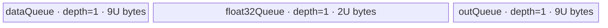

# ForeachAddScalar A2/A3 ACLNN 算子知识

## 算子速览

| 项目 | 内容 |
|---|---|
| 实际入口 | `aclnnForeachAddScalarV2GetWorkspaceSize` + `aclnnForeachAddScalarV2`，公开 ACLNN 两段式 V2 接口；同族旧入口为 `aclnnForeachAddScalar`，A2/A3 取公开版本族中的 V2。 |
| 计算语义 | 对列表中每个张量逐元素计算 `out[i][j] = x[i][j] + scalar`。 |
| 输入输出 | `x/out` 为等长 TensorList，元素 dtype 为 FP16/FP32/INT32/BF16；V2 的 `scalar` 是 `aclScalar`，进入 L0 前物化为单元素 Tensor。公开格式为 ND。 |
| 执行类型 | 公共前处理可含框架 `Contiguous`；核心节点是单个 `AIV_VECTOR` Kernel `foreach_add_scalar`，没有可达 Cube/AIC/MIX_CV 节点。 |
| Kernel 路线 | R-001 FP16 直接 Adds；R-002 FP32 直接 Adds；R-003 INT32 直接 Adds；R-004 BF16→FP32→BF16。 |
| 核心资源 | GM TensorList 描述区、`dataQueue/outQueue`（均 depth=1）；BF16 另有 `float32Queue`；核心 Kernel 不消费 user workspace，Host 固定预留 32 B。 |
| 来源闭包 | `source_closed`：V2 声明/实现、L0 launcher、membase Host/Tiling、`ForeachCommonTilingData`、四个 key 的 router/body/helper、binary config 与 Kernel CMake 均闭合。 |
| 验证状态 | 已完成源码闭包检查；本次知识提取未执行编译、真机、数值或性能测试。 |

## 接口与语义

### 计算语义

令 `x=[x_0,...,x_{n-1}]`，标量为 `s`，则对所有 `0<=i<n` 以及 `x_i` 的每个有效线性元素 `j`，输出 `y_i[j]=x_i[j]+s`。Kernel 按 TensorList 中各张量的线性 storage shape 处理，不改变布局；公开 V2 层要求每个 `out_i` 与对应 `x_i` shape 相同。FP16/FP32/INT32 走其本 dtype 的 `Adds`；BF16 先转 FP32、加 FP32 标量，再以 `CAST_RINT` 转回 BF16。

### 输入、输出与属性

| 参数 | shape/layout | dtype | 约束、默认值与语义 |
|---|---|---|---|
| `x` | TensorList；每个 Tensor 0–8 维；公开 ND | FP16、FP32、INT32、BF16 | 列表内 dtype 一致；允许空 Tensor 和空 TensorList。V2 文档标记非连续 Tensor 不支持，API 实现仍逐项调用框架 `Contiguous`，其内部是框架边界。 |
| `scalar` | `aclScalar`，无 Tensor layout | FP16/FP32/DOUBLE/INT32/INT64，受 `x` dtype 组合约束 | `x=FP32/BF16` 时仅 FP32/DOUBLE；`x=FP16` 时仅 FP16/DOUBLE；`x=INT32` 时仅 INT32/INT64。DOUBLE/INT64 在 executor 中窄化到 Kernel 所需 dtype。 |
| `out` | 与 `x` 等长；公开层逐项 shape 相同；ND | 与 `x` 相同 | 不支持非连续输出。API `ForeachAddScalarV2CheckShape` 比文档“shape size 大于等于”更严格，实际公开执行要求 shape 完全相等。 |
| `workspaceSize` | 标量输出 | `uint64_t` | 空 TensorList 显式返回 0；其余由 executor 汇总，Foreach 核心节点请求 32 B，框架前处理的附加量固定仓不可见。 |
| `executor` | Host 对象 | `aclOpExecutor**` | 第一段创建并转交，第二段以同一 executor 和 stream 执行。 |

### 入口与版本

固定仓同时公开 `aclnnForeachAddScalar`（`scalar` 为单元素 `aclTensor`）与 `aclnnForeachAddScalarV2`（`scalar` 为 `aclScalar`）。A2/A3 的两份公开文档均声明支持；本卡按“同架构取最新版本”选择 V2。`ExecForeachAddScalarV2GetWorkspaceSize` 将 V2 标量转成单元素 Tensor，随后调用 `l0op::ForeachAddScalarV2`，后者把底层 op type `ForeachAddScalar` 加入 AICore launcher；因此 V2 与旧接口共享 Host/Tiling/Kernel 实现，但公开参数契约不同。

## Host/Launcher 执行流程

### 参数校验与前处理

1. `CREATE_EXECUTOR` 创建独占 executor，失败返回 `ACLNN_ERR_INNER_CREATE_EXECUTOR`。
2. `ForeachAddScalarV2CheckNotNull` 检查 `x/scalar/out` 非空，并检查两列表长度相等。
3. `ForeachAddScalarV2GetDtypeSupportList` 在 A2/A3 的 `DAV_2201` 上允许 FP16/FP32/INT32/BF16；随后检查 `x` 列表内 dtype 一致、`out` 与 `x` 一致、scalar 组合合法。
4. `ForeachAddScalarV2CheckShape` 检查每个输入不超过 8 维，且每对 `x_i/out_i` shape 完全相等；`ForeachAddScalarV2CheckFormat` 拒绝 private format。
5. 若 `x->Size()==0`，直接返回 `workspaceSize=0` 和 executor，不创建核心 launch。
6. 非空时逐个 `x_i` 调用框架 `l0op::Contiguous`，再由 executor 组装 `contiguousTensors`。V2 对 BF16 scalar 转成 FP32 Tensor；其余在 A2/A3 上转成 `x` dtype（DOUBLE→FP32/FP16，INT64→INT32）。
7. `l0op::ForeachAddScalarV2` 通过 `ADD_TO_LAUNCHER_LIST_AICORE(ForeachAddScalar, OP_INPUT(x,scalar), OP_OUTPUT(out))` 加入核心节点；失败返回空指针并映射为 `ACLNN_ERR_PARAM_INVALID`。
8. 第一段返回 executor 汇总的 workspace；第二段 `CommonOpExecutorRun` 在调用者 stream 上执行，具体自动生成 launcher 壳为框架边界。

### 参数、Workspace 与生命周期

V2 的 `aclScalar` 及其物化 Tensor 由 executor 持有；每个 Contiguous 结果与新 TensorList 也活到第二段执行结束。核心 Foreach Tiling 将 `workspaces[0]` 写为固定 32 B，但 entry 明确把 `userWS=nullptr`，Device body 不读写该区域；它只是 Host 框架的保留值。若 Contiguous 发生真实拷贝，其额外 workspace/节点数量由框架实现决定，固定仓不可见。调用者持有第一段返回的 executor 与所需 workspace，第二段在给定 stream 上提交后由框架管理节点顺序和失败传播。

### 启动图与失败传播

公开支持域内的核心图是单语义 Kernel；框架前缀按输入项展开：

```text
aclnnForeachAddScalarV2GetWorkspaceSize
  -> Contiguous(x[0]) ... Contiguous(x[n-1])  # 框架边界；连续输入可由框架复用
  -> ConvertToTensor(scalar, target_dtype)
  -> ADD_TO_LAUNCHER_LIST_AICORE(ForeachAddScalar)
aclnnForeachAddScalarV2(workspace, executor, stream)
  -> CommonOpExecutorRun
    -> foreach_add_scalar<<<blockDim, AIV>>>(inputs, scalarTensor, outputs, reservedWS, tiling)
```

核心节点输入为连续 TensorList 描述、单元素 scalar Tensor、输出 TensorList 描述；POD 为 `ForeachCommonTilingData`，blockDim 为 `min(AIV核数,50,ceil(totalElements/elementsPerBlock))` 且空元素域至少 1。所有 executor 节点处于传入 stream，前置节点失败会阻断后续核心 launch；stream 内 ordering、owner 与释放由 executor 框架保证，固定仓未暴露更细 event。

## Route 与参数设计

### 分核与资源计算

设 `s=sizeof(x.dtype)`，`E=32/s` 个元素/32B block，`D=sum_i numel(x_i)`，平台 AIV 核数为 `C`：

```text
blockCount = ceil(D / E)
blockDim = min(max(1, blockCount), C, 50)
basePerCore = floor(blockCount / blockDim) * E
remainderBlocks = blockCount % blockDim
core k elements = basePerCore + (k < remainderBlocks ? E : 0)
```

`AssignDataToEachCore` 将这段连续逻辑域映射回 `[tensorStart,tensorEnd]` 和首尾 offset；因此一个 core 可跨多个 Tensor，也可只处理某个 Tensor 的切片。设 `P=ForeachCommonTilingData::GetDataSize()`、平台 UB 字节为 `Uplat`：直接路线的单 Queue 容量 `U=floor32((Uplat-P)/2)` 字节；BF16 路线先令 `T=floor((Uplat-P)/10)`，再令 `U=floor64(T/2)`，以满足 `9U+9U+2U=20U` 的真实 UB 分配。核心 workspace 固定为 32 B 且 Device 不使用。

### Route 选择

| 顺序 | Route | Key/模板 | 精确选择条件与优先级 | 不适用去向 |
|---:|---|---|---|---|
| 1 | R-001 FP16 直接 Adds | key 1；`ForeachOneScalarBinary<half,half,AddsAdapter<half>,1>` | membase template `IsCapable = !IsRegbaseSocVersion`，且 `x.dtype=FP16`；V2 scalar 已转 FP16 | dtype 不同继续按 key 分派 |
| 2 | R-002 FP32 直接 Adds | key 2；`ForeachOneScalarBinary<float,float,AddsAdapter<float>,1>` | 同上，且 `x.dtype=FP32`；scalar 转 FP32 | dtype 不同继续按 key 分派 |
| 3 | R-003 INT32 直接 Adds | key 3；`ForeachOneScalarBinary<int,int,AddsAdapter<int>,1>` | 同上，`x.dtype=INT32`，且编译目标 `__CCE_AICORE__>=220`；scalar 转 INT32 | dtype 不同继续按 key 分派 |
| 4 | R-004 BF16 FP32 staging | key 4；`ForeachOneScalarBinary<bfloat16_t,float,AddsAdapter<float>,1>` | 同上，`x.dtype=BF16`，`__CCE_AICORE__>=220` 且非 NPU arch 3003/3113；scalar 转 FP32 | 未知/未编译 key：entry 无 body、无输出 |

```text
TilingRegistry 按 std::map 的数值升序尝试（数值越小优先级越高）
  -> priority 10000 ForeachAddScalarMembaseTiling: IsCapable=true on A2/A3
    -> TilingBase: GetShapeAttrsInfo(no-op) -> GetPlatformInfo -> IsCapable -> DoOpTiling
    -> x FP16  -> key 1 -> R-001
    -> x FP32  -> key 2 -> R-002
    -> x INT32 -> key 3 -> R-003
    -> x BF16  -> key 4 -> R-004
    -> other   -> API dtype check fails / GetTilingKeyByDtypeOnly returns 0
  -> priority 30000 ForeachRegbaseTilingUnaryScalar 不再尝试
```

### 模板/实现执行矩阵

| Route | key/selector | dtype/shape/platform 完整命中条件 | 执行拓扑与 Kernel 节点 | 实际模板/body | 内存与同步特征 | tail/fallback |
|---|---|---|---|---|---|---|
| R-001 FP16 | 1 | A2/A3，非空 TensorList，FP16 x/out，scalar FP16/DOUBLE 后物化 FP16 | 单 `foreach_add_scalar` AIV 节点 | `KernelForeachUnary` + `InnerComputer<half,half>` + `Adds` | in/out Queue 各 depth1、各 U；Queue 与 `PIPE_V` barrier | 尾 tile 用 `DataCopyPad`，有效字节 `count*2` |
| R-002 FP32 | 2 | A2/A3，FP32 x/out，scalar FP32/DOUBLE 后物化 FP32 | 同上 | `InnerComputer<float,float>` | in/out Queue 各 U | 尾 tile `count*4` 字节 |
| R-003 INT32 | 3 | A2/A3，INT32 x/out，scalar INT32/INT64 后物化 INT32 | 同上 | `InnerComputer<int,int>` | in/out Queue 各 U | 尾 tile `count*4`；整数溢出语义固定仓未另行定义 |
| R-004 BF16 | 4 | A2/A3，BF16 x/out，scalar FP32/DOUBLE 后物化 FP32；编译 guard 成立 | 同上 | BF16 specialization：Cast→FP32 Adds→Cast | in/out Queue 各 9U，FP32 Queue 2U；显式 `PIPE_V` barrier | 外 tile 以 `9U/2` 元素切分，内 cast tile 以 `U/4` 元素切分；尾部均按有效 count |

### 隐藏性能 Guard

| Guard | Host/Tiling 条件 | Device/资源原因 | 影响 Route | 不满足时去向 | 源码符号 |
|---|---|---|---|---|---|
| membase 平台 | `!IsRegbaseSocVersion(context_)` | A2/A3 使用旧 TensorList 地址协议和 key 1–4 | 全部 | 尝试 regbase template；平台均不匹配则 tiling 失败 | `ForeachAddScalarMembaseTiling::IsCapable` |
| core 上限 | `needCoreNum<=50` | POD 的 per-core 数组长度为 50 | 全部 | 截断到 50，不是 fallback | `RunBigScalarKernelTiling` |
| 32B 分核 | `elementsPerBlock=32/s` | 每核域按 DMA block 粒度分配 | 全部 | `ceil` 补足末 block，Device 仍只处理有效 count | `GetNeedCoreNum`、`AssignDataToEachCore` |
| UB 对齐 | direct `U=floor32((UB-P)/2)`；BF16 `U=floor64(floor((UB-P)/10)/2)` | direct 需 2U；BF16 需 20U | 全部/R-004 | 没有备用 Route；容量为 0 会使 Device 除数失效，Host 未显式报错 | `DivideUbMemory1` |
| 位宽窄化 | `uint64_t ubSizePlatForm-P` 先转 `uint32_t totalSize`；Device `maxDataCount/maxCastDataCount` 也是 `uint32_t` | Queue容量和循环计数受32位上界约束 | 全部 | 无显式溢出 fallback | `DivideUbMemory1`、`KernelForeachBase::Init` |
| BF16 编译 guard | `__CCE_AICORE__>=220 && arch!=3003/3113` | BF16 Cast/模板只在该 guard 下编译 | R-004 | key 4 无分支输出 | `foreach_add_scalar`、`KernelForeachBase::Init` |
| 空 TensorList | `x->Size()==0` | 避免访问 `x[0]` 和创建 launcher | 全部 | API 成功，workspace=0，无 Kernel | `ExecForeachAddScalarV2GetWorkspaceSize` |

### POD/ABI

| 结构 | 字段 | 类型/位宽 | ABI 布局 | 单位 | Host/launcher producer | Device consumer | 边界 |
|---|---|---|---|---|---|---|---|
| `ForeachCommonTilingData` | `inputsTensorUbSize` | `uint64_t`/64 | 字段顺序第 1；宏生成的 `sizeof/alignof/offsetof` 固定仓不可见 | 字节/Queue buffer | `DivideUbMemory1` 写 `inputsTensorUbSize`，`FillTilingData` 序列化 | `KernelForeachBase::ParseTilingData`；决定 Queue 与 tile 容量 | direct 32B 对齐；BF16 64B 对齐 |
| 同上 | `tensorDataCountList` | `int64_t[50]` | 第 2；显式宽度 400 B | 元素/每 Tensor | `Init` 写每个 storage shape size | `KernelForeachUnary::Process` 计算默认 `cursorEnd` | 未使用槽为 0 |
| 同上 | `tensorStartList` | `uint16_t[50]` | 第 3；显式宽度 100 B | Tensor 索引/每 core | `AssignDataToEachCore` | `ParseTilingData[blockIdx]` | `blockDim<=50` |
| 同上 | `tensorEndList` | `uint16_t[50]` | 第 4；显式宽度 100 B | Tensor 索引/每 core | 同上 | 同上 | 闭区间 |
| 同上 | `tensorStartOffsetList` | `int64_t[50]` | 第 5；显式宽度 400 B | 元素/每 core | 同上 | 同上 | 首 Tensor 线性 offset |
| 同上 | `tensorEndOffsetList` | `int64_t[50]` | 第 6；显式宽度 400 B；字段显式宽度合计 1408 B，宏最终 ABI 固定仓不可见 | 元素/每 core | 同上 | 同上 | 闭区间；空域可为 -1 |

### Route 源码闭包

| Route | Key/selector | Host/Tiling producer | POD/参数 | Kernel entry/router 节点 | Kernel body/直接依赖 | 构建接线 |
|---|---|---|---|---|---|---|
| R-001 | key 1 | `foreach/foreach_utils/op_host/foreach_tiling_func.cpp::ForeachAddScalarMembaseTiling`；`foreach/foreach_utils/op_host/foreach_tiling_class.h::RunBigScalarKernelTiling` | `ForeachCommonTilingData` | `foreach/foreach_add_scalar/op_kernel/foreach_add_scalar.cpp::foreach_add_scalar` key1 | `KernelForeachUnary`、`ForeachOneScalarBinary`、`AddsAdapter<half>` | `ascend910b/ascend910_93` binary JSON + `foreach/foreach_add_scalar/op_kernel/CMakeLists.txt` |
| R-002 | key 2 | 同上 | 同上 | 同 entry key2 | `AddsAdapter<float>` | 同上 |
| R-003 | key 3 | 同上 | 同上 | 同 entry key3 | `AddsAdapter<int>` | 同上 |
| R-004 | key 4 | 同上；BF16 UB 特化 | 同上 | 同 entry key4 | `InnerComputer<bfloat16_t,float>` | BF16 binary 条目 + 同 CMake |

## Kernel 实现

### 公共执行流程

四条 Route 共享单 Kernel graph。entry 解析 `ForeachCommonTilingData`，根据 key 实例化 `ForeachOneScalarBinary`。基类用 GM TensorList 头部的地址偏移表解析第 `i` 个 Tensor 地址；`blockIdx` 选择本 core 的首尾 Tensor 与 offset。每个 Tensor 切片再按 `maxDataCount` 分 tile：`CopyIn -> Compute -> CopyOut`。非尾 tile 用按元素的 `DataCopy`；尾 tile 用单 block 的 `DataCopyPad`，`blockLen=count*sizeof(T)`、两侧 stride 为 0 且 input padding 关闭。Queue 的 EnQue/DeQue/FreeTensor 与 `PipeBarrier<PIPE_V>` 构成 DMA/Vector/复用顺序。

### Route R-001：FP16 直接 Adds

#### 适用条件

##### 选择证据

| 层级 | 文件 | 符号 | 源码谓词/参数 | 结果/下一跳 |
|---|---|---|---|---|
| API | `foreach/foreach_add_scalar/op_host/op_api/aclnn_foreach_add_scalar_v2.cpp` | `ForeachAddScalarV2CheckDtypeValid` | `x=DT_FLOAT16` 且 scalar 属 FP16/DOUBLE | scalar 转 FP16 Tensor |
| Tiling | `foreach/foreach_utils/op_host/common_dtype.h` | `GetTilingKeyByDtypeOnly` | `ge::DT_FLOAT16` | key 1 |
| Router | `foreach/foreach_add_scalar/op_kernel/foreach_add_scalar.cpp` | `foreach_add_scalar` | `TILING_KEY_IS(1)` | `ForeachOneScalarBinary<half,half,...,1>` |

#### Device 数据流

##### 函数级调用链

```text
foreach_add_scalar(inputs, scalar, outputs, workspace, tiling)
  -> ForeachOneScalarBinary<half,half,AddsAdapter<half>,1>::Init
    -> KernelForeachUnary::Init -> KernelForeachBase::Init/ParseTilingData
  -> KernelForeachUnary::Process
    -> SingleTensorProcess
      -> CopyIn -> ForeachOneScalarBinary::Compute
        -> InnerComputer<half,half>::Compute -> AddsAdapter<half> -> Adds
      -> CopyOut
```

##### 源码等价伪码

```text
# 伪码
core = blockIdx
for tensor in [start[core], end[core]]:
  begin = (tensor==start ? startOffset : 0)
  end = (tensor==end ? endOffset : numel[tensor]-1)
  bind xGM/yGM at tensor_address + begin
  for tile in ceil((end-begin+1)/(U/2)):
    valid = min(U/2, remaining)
    xLocal = copy_in(valid, tail_uses_DataCopyPad)
    yLocal = Adds(xLocal, half(scalar), mask=valid)
    copy_out(yLocal, valid, tail_uses_DataCopyPad)
```

#### 内存与数据搬运

##### 资源与搬运表

| 层级/缓冲区 | offset/地址公式 | extent/容量公式 | dtype/layout | producer | consumer | owner/lifetime | 对齐/复用 |
|---|---|---|---|---|---|---|---|
| input GM | `tensorAddr(i)+cursorStart+tile*(U/2)` | `valid` 元素 | FP16/线性 ND | caller/Contiguous | CopyIn | caller/executor | tail 按 `valid*2` B |
| `dataQueue` | Queue allocator | U B，depth1 | FP16 | CopyIn | Compute | `TPipe`/每 tile | Compute 后 Free |
| `outQueue` | Queue allocator | U B，depth1 | FP16 | Compute | CopyOut | `TPipe`/每 tile | CopyOut 后 Free |
| output GM | 同 input 线性 offset | `valid` 元素 | FP16 | CopyOut | caller | caller | 只写有效域 |
| workspace | entry 丢弃 | 0 B Device 使用；Host 保留 32 B | N/A | Host | 无 | executor | 不可用于跨核交接 |

##### 分层内存布局


##### 字节账与复用顺序

```text
UB_total = 1*U + 1*U = 2U
U = floor32((Uplat - POD_GetDataSize)/2)
UB_total <= Uplat - POD_GetDataSize
dynamic_ub = N/A
workspace_total(core node) = 32 B reserved, 0 B consumed by Device
=> maxDataCount = U/2 FP16 elements
```

| 复用子区 | 写入者 | 读取者/消费点 | 下一次覆盖 | 同步或释放依据 | 安全条件 |
|---|---|---|---|---|---|
| `dataQueue` slot | CopyIn | `InnerComputer::Compute` | 下一 tile CopyIn | DeQue 后 `FreeTensor` | Adds 完成后才释放 |
| `outQueue` slot | Compute | CopyOut | 下一 tile Compute | EnQue/DeQue 后 `FreeTensor` | GM copy 完成后才释放 |

#### 同步、精度与尾块

##### 同步与数值边界表

| 阶段 | primitive/机制 | producer | consumer/等待点 | 保护对象 | 精度/尾块 |
|---|---|---|---|---|---|
| GM→UB | Queue EnQue/DeQue | CopyIn | Compute | FP16 input tile | tail `DataCopyPad`, no pad, valid mask |
| Vector | `PipeBarrier<PIPE_V>` | input ready | `Adds`/后续 CopyOut | Vector pipeline | FP16 直接加；mask=`dataCount` |
| UB→GM | out Queue | Compute | CopyOut | output tile | 只提交 `valid*2` B |

#### 关键实现

##### 符号证据表

| 阶段 | 文件 | 符号/模板实例 | 实现事实 |
|---|---|---|---|
| Host/Tiling producer | `foreach/foreach_utils/op_host/foreach_tiling_class.h` | `RunBigScalarKernelTiling`、`DivideUbMemory1` | key1、blockDim、U 与 POD |
| Kernel entry/router | `foreach/foreach_add_scalar/op_kernel/foreach_add_scalar.cpp` | `foreach_add_scalar` key1 | FP16 模板映射 |
| Device body/helper | `foreach/foreach_utils/op_kernel/kernel_foreach_unary.h`、`foreach/foreach_utils/op_kernel/foreach_one_scalar_binary.h` | `SingleTensorProcess`、`InnerComputer<half,half>` | tile、Queue、Adds、tail |

### Route R-002：FP32 直接 Adds

#### 适用条件

##### 选择证据

| 层级 | 文件 | 符号 | 源码谓词/参数 | 结果/下一跳 |
|---|---|---|---|---|
| API | `foreach/foreach_add_scalar/op_host/op_api/aclnn_foreach_add_scalar_v2.cpp` | `ForeachAddScalarV2CheckDtypeValid` | `x=DT_FLOAT`，scalar FP32/DOUBLE | 转 FP32 Tensor |
| Tiling | `foreach/foreach_utils/op_host/common_dtype.h` | `GetTilingKeyByDtypeOnly` | `DT_FLOAT` | key2 |
| Router | `foreach/foreach_add_scalar/op_kernel/foreach_add_scalar.cpp` | `foreach_add_scalar` | `TILING_KEY_IS(2)` | float 模板 |

#### Device 数据流

##### 函数级调用链

```text
foreach_add_scalar -> ForeachOneScalarBinary<float,float,AddsAdapter<float>,1>::Init/Process
  -> KernelForeachUnary::Process -> CopyIn
  -> InnerComputer<float,float>::Compute -> AddsAdapter<float> -> Adds
  -> CopyOut
```

##### 源码等价伪码

```text
# 伪码；core/tensor 映射同 R-001
for each owned tensor slice:
  for tile of at most U/4 elements:
    valid = min(U/4, remaining)
    xLocal = GM_to_UB(valid)
    yLocal = Adds(xLocal, float(scalar), mask=valid)
    UB_to_GM(yLocal, valid)
```

#### 内存与数据搬运

##### 资源与搬运表

| 层级/缓冲区 | offset/地址公式 | extent/容量公式 | dtype/layout | producer | consumer | owner/lifetime | 对齐/复用 |
|---|---|---|---|---|---|---|---|
| input/output GM | `tensorAddr+cursorStart+tile*(U/4)` | valid FP32 elements | FP32 ND | caller/Kernel | Kernel/caller | caller | tail `valid*4` B |
| `dataQueue` | Queue slot | U B depth1 | FP32 | CopyIn | Adds | pipe/tile | Free after Adds |
| `outQueue` | Queue slot | U B depth1 | FP32 | Adds | CopyOut | pipe/tile | Free after copy |
| workspace | N/A | Device 0 B | N/A | Host | 无 | executor | Host 32 B reserved |

##### 分层内存布局


##### 字节账与复用顺序

```text
UB_total=2U; U=floor32((Uplat-P)/2); maxDataCount=U/4
dynamic_ub=N/A; workspace_total=32 B reserved / 0 B Device-consumed
```

| 复用子区 | 写入者 | 读取者/消费点 | 下一次覆盖 | 同步或释放依据 | 安全条件 |
|---|---|---|---|---|---|
| in/out Queue slots | CopyIn/Adds | Adds/CopyOut | 下一 tile | Queue + FreeTensor | 当前 consumer 完成 |

#### 同步、精度与尾块

##### 同步与数值边界表

| 阶段 | primitive/机制 | producer | consumer/等待点 | 保护对象 | 精度/尾块 |
|---|---|---|---|---|---|
| copy/compute/copy | Queue + `PIPE_V` barrier | 相邻阶段 | 下一阶段 | U-byte slot | FP32 Adds；tail 精确 valid count |

#### 关键实现

##### 符号证据表

| 阶段 | 文件 | 符号/模板实例 | 实现事实 |
|---|---|---|---|
| Host/Tiling producer | `foreach/foreach_utils/op_host/common_dtype.h`、`foreach/foreach_utils/op_host/foreach_tiling_class.h` | `GetTilingKeyByDtypeOnly`、`DivideUbMemory1` | key2/U |
| Kernel entry/router | `foreach_add_scalar/op_kernel/foreach_add_scalar.cpp` | key2 | float 模板 |
| Device body/helper | `foreach_one_scalar_binary.h` | `InnerComputer<float,float>::Compute` | direct FP32 Adds |

### Route R-003：INT32 直接 Adds

#### 适用条件

##### 选择证据

| 层级 | 文件 | 符号 | 源码谓词/参数 | 结果/下一跳 |
|---|---|---|---|---|
| API | `foreach/foreach_add_scalar/op_host/op_api/aclnn_foreach_add_scalar_v2.cpp` | dtype check/conversion | x INT32，scalar INT32/INT64 | scalar Tensor INT32 |
| Tiling | `foreach/foreach_utils/op_host/common_dtype.h` | `GetTilingKeyByDtypeOnly` | `DT_INT32` | key3 |
| Router | `foreach/foreach_add_scalar/op_kernel/foreach_add_scalar.cpp` | `__CCE_AICORE__>=220` + key3 | guard 成立 | int 模板 |

#### Device 数据流

##### 函数级调用链

```text
foreach_add_scalar -> ForeachOneScalarBinary<int,int,AddsAdapter<int>,1>::Init/Process
  -> CopyIn -> InnerComputer<int,int>::Compute -> Adds<int> -> CopyOut
```

##### 源码等价伪码

```text
# 伪码
for each core-owned tensor slice and U/4-element tile:
  valid = min(U/4, remaining)
  yLocal[0:valid] = Adds<int32>(xLocal[0:valid], scalar_i32)
  commit exactly valid elements
```

#### 内存与数据搬运

##### 资源与搬运表

| 层级/缓冲区 | offset/地址公式 | extent/容量公式 | dtype/layout | producer | consumer | owner/lifetime | 对齐/复用 |
|---|---|---|---|---|---|---|---|
| GM input/output | 同 R-002 | valid INT32 | INT32 ND | caller/Kernel | Kernel/caller | caller | tail `valid*4` B |
| in/out Queue | Queue slot | 各 U B depth1 | INT32 | CopyIn/Adds | Adds/CopyOut | pipe/tile | 复用同 R-002 |
| workspace | N/A | Device 0 B | N/A | Host | 无 | executor | 32 B reserved |

##### 分层内存布局


##### 字节账与复用顺序

```text
UB_total=2U; U=floor32((Uplat-P)/2); maxDataCount=U/4
dynamic_ub=N/A; workspace_total=32 B reserved / 0 B consumed
```

| 复用子区 | 写入者 | 读取者/消费点 | 下一次覆盖 | 同步或释放依据 | 安全条件 |
|---|---|---|---|---|---|
| in/out Queue slots | CopyIn/Adds | Adds/CopyOut | 下一 tile | Queue/FreeTensor | 当前 tile 完成 |

#### 同步、精度与尾块

##### 同步与数值边界表

| 阶段 | primitive/机制 | producer | consumer/等待点 | 保护对象 | 精度/尾块 |
|---|---|---|---|---|---|
| direct integer add | Queue + `PIPE_V` barrier | CopyIn | Adds/CopyOut | tile | INT32 原生 Adds；溢出处理固定仓未单独声明；tail 按 valid |

#### 关键实现

##### 符号证据表

| 阶段 | 文件 | 符号/模板实例 | 实现事实 |
|---|---|---|---|
| Host/Tiling producer | `foreach/foreach_utils/op_host/common_dtype.h` | `GetTilingKeyByDtypeOnly` | INT32→3 |
| Kernel entry/router | `foreach/foreach_add_scalar/op_kernel/foreach_add_scalar.cpp` | key3 compile guard | int 实例 |
| Device body/helper | `foreach_one_scalar_binary.h` | primary `InnerComputer` | direct Adds + barriers |

### Route R-004：BF16 FP32 staging

#### 适用条件

##### 选择证据

| 层级 | 文件 | 符号 | 源码谓词/参数 | 结果/下一跳 |
|---|---|---|---|---|
| API | `foreach/foreach_add_scalar/op_host/op_api/aclnn_foreach_add_scalar_v2.cpp` | BF16 branch | `x=BF16`，scalar FP32/DOUBLE | scalar 转 FP32 Tensor |
| Tiling | `foreach/foreach_utils/op_host/common_dtype.h`、`foreach/foreach_utils/op_host/foreach_tiling_class.h` | key map/`DivideUbMemory1` | BF16 | key4 + 20U budget |
| Router | `foreach/foreach_add_scalar/op_kernel/foreach_add_scalar.cpp` | compile guard + key4 | guard 成立 | BF16/float specialization |

#### Device 数据流

##### 函数级调用链

```text
foreach_add_scalar
  -> ForeachOneScalarBinary<bfloat16_t,float,AddsAdapter<float>,1>::Init/Process
  -> KernelForeachUnary::CopyIn (BF16)
  -> InnerComputer<bfloat16_t,float>::Compute
    -> ComputePerCast
      -> Cast(BF16->FP32, CAST_NONE)
      -> Adds<float>(in-place float32Tensor)
      -> Cast(FP32->BF16, CAST_RINT)
  -> KernelForeachUnary::CopyOut
```

##### 源码等价伪码

```text
# 伪码
outerCap = 9U/2 BF16 elements
castCap = U/4 FP32 elements
for each core-owned slice:
  for outer tile of at most outerCap:
    bf16Local = copy_in(validOuter)
    for cast tile of at most castCap:
      f = Cast(bf16Local[offset:offset+valid], CAST_NONE)
      f = Adds(f, scalar_fp32, mask=valid)       # same FP32 sub-buffer
      outLocal[offset:offset+valid] = Cast(f, CAST_RINT)
    copy_out(outLocal, validOuter)
```

#### 内存与数据搬运

##### 资源与搬运表

| 层级/缓冲区 | offset/地址公式 | extent/容量公式 | dtype/layout | producer | consumer | owner/lifetime | 对齐/复用 |
|---|---|---|---|---|---|---|---|
| input/output GM | Tensor offset + outer tile | valid BF16 | BF16 ND | caller/Kernel | Kernel/caller | caller | tail `valid*2` B |
| `dataQueue` | slot | 9U B depth1 | BF16 | CopyIn | Cast | pipe/outer tile | Free after all cast chunks |
| `outQueue` | slot | 9U B depth1 | BF16 | down-Cast | CopyOut | pipe/outer tile | Free after GM write |
| `float32Queue` | slot offset 0 | 2U B depth1 | FP32 | up-Cast/Adds | down-Cast | pipe/整个 Process | Process 开始 DeQue，结束 Free |
| scalar GM | element0 | 4 B | FP32 | executor conversion | Init | executor/kernel | core 初始化时读取一次 |

##### 分层内存布局



##### 字节账与复用顺序

```text
UB_total = 9U + 9U + 2U = 20U
U = floor64(floor((Uplat-P)/10)/2)
UB_total <= Uplat-P
maxDataCount = 9U/2 BF16 elements
maxCastDataCount = U/4 FP32 elements
dynamic_ub=N/A; workspace_total=32 B reserved / 0 B consumed
```

| 复用子区 | 写入者 | 读取者/消费点 | 下一次覆盖 | 同步或释放依据 | 安全条件 |
|---|---|---|---|---|---|
| FP32 slot `[0,castCap)` | up-Cast | in-place Adds、down-Cast | 下一 cast chunk | consecutive `PIPE_V` barriers | down-Cast 完成前不覆盖 |
| BF16 in/out slots | CopyIn/down-Cast | all cast chunks/CopyOut | 下一 outer tile | Queue FreeTensor | 整个 outer tile 完成 |

#### 同步、精度与尾块

##### 同步与数值边界表

| 阶段 | primitive/机制 | producer | consumer/等待点 | 保护对象 | 精度/尾块 |
|---|---|---|---|---|---|
| BF16→FP32 | `PipeBarrier<PIPE_V>` | Cast | Adds | FP32 slot | `CAST_NONE`，valid cast count |
| FP32 Adds | in-place + barrier | Adds | down-Cast | 同一 FP32 slot | scalar 为 FP32 |
| FP32→BF16 | `CAST_RINT` | FP32 result | CopyOut | BF16 out slot | nearest rounding；outer/cast 双层 tail |

#### 关键实现

##### 符号证据表

| 阶段 | 文件 | 符号/模板实例 | 实现事实 |
|---|---|---|---|
| Host/Tiling producer | `foreach_tiling_class.h` | `DivideUbMemory1` | BF16 20U 保守分区 |
| Kernel entry/router | `foreach/foreach_add_scalar/op_kernel/foreach_add_scalar.cpp` | key4 | BF16/float specialization |
| Device body/helper | `kernel_foreach_base.h`、`foreach_one_scalar_binary.h` | BF16 `Init`、`ComputePerCast` | 9U outer tile、U/4 cast tile、升降精度 |

## 算子特定优化

### Trick T-001：BF16 外层大搬运与内层 FP32 小块复用

#### 触发与源码依据

- 适用 Route：R-004。
- 触发条件：A2/A3、key4、BF16 x/out、FP32 scalar，且 BF16 compile guard 成立。
- Golden 来源：[`foreach_one_scalar_binary.h:51-75`](../../../../../../../cann-ops-raw/ascendc/ops-nn/955f8b33985b6d72989ebff341bb9c2c564a51bc/foreach/foreach_utils/op_kernel/foreach_one_scalar_binary.h#L51-L75)

**官方源码（固定 Commit 连续逐字摘录）**：

```cpp
uint32_t castTimes = dataCount / maxCastDataCount;
uint32_t castTimesRemainder = dataCount % maxCastDataCount;
for (uint32_t i = 0; i < castTimes; i++) {
    ComputePerCast(dataLocal, outLocal, float32Tensor, scalarVal, maxCastDataCount, i, maxCastDataCount);
}

if (castTimesRemainder > 0) {
    ComputePerCast(
        dataLocal, outLocal, float32Tensor, scalarVal, maxCastDataCount, castTimes, castTimesRemainder);
}
```

#### 机制与设计原因

BF16 GM/Queue 外 tile 可达到 `9U/2` 个元素，但 FP32 临时区只需覆盖 `U/4` 个元素。Kernel 以 `maxCastDataCount` 内切，不为整个外 tile 物化 FP32 副本；同一 FP32 子区依次完成 `Cast(CAST_NONE) -> Adds(in-place) -> Cast(CAST_RINT)`。这把真实 UB 约束闭合为 `9U input + 9U output + 2U float = 20U`，同时保持较大的 GM 搬运 tile。

#### 迁移边界

- 适用：输入/输出为 BF16、核心运算可在 FP32 小块内独立完成的逐元素算子。
- 前提：AIV 支持 BF16/FP32 Cast；Host 必须按 20U 真实字节账给出 U，且 tail count 逐层传递。
- 失效：若运算需要跨 tile 状态、多个 FP32 输入副本或更大临时区，必须重算 divider/Queue，不可复用本公式。
- 未验证：本次知识提取未执行编译、真机、数值或性能测试。

#### 错误做法

固定仓未提供可验证反例。

## 模板与实现对比

| 对比维度 | R-001 FP16 | R-002 FP32 | R-003 INT32 | R-004 BF16 | 设计选择依据 |
|---|---|---|---|---|---|
| 命中条件/优先级 | key1 | key2 | key3 | key4 | x dtype 唯一决定 key；membase template priority 10000 |
| 模板与 dtype | half/half | float/float | int/int | bf16/float | scalar 在 ACLNN executor 先物化成目标 dtype |
| 循环与分核 | 32B block；U/2 tile | 32B block；U/4 | 同 FP32 | 外 9U/2，内 U/4 | 类型宽度与 FP32 staging |
| Queue/TBuf/寄存器/dynamic UB/通信 window | 2个 depth1 Queue | 同 | 同 | 2个 9U Queue + 2U FP32 Queue | BF16 避免整 tile FP32 物化 |
| 内存总占用与复用 | 2U | 2U | 2U | 20U | Host divider 与 Device 分配逐项一致 |
| 搬运/Vector/SIMT/NDDMA/通信 API | DataCopy(Pad)+Adds | 同 | 同 | DataCopyPad+Cast+Adds+Cast | 全部 AIV，无 SIMT/NDDMA/通信 |
| 同步、精度与 tail | Queue+barrier，FP16 | FP32 | INT32 | FP32 加、RINT 回 BF16 | 精度路线由 dtype specialization 固定 |
| fallback/失败边界 | 未知 key 无输出 | 同 | compile guard | compile guard | API 先拒绝不支持 dtype |

## 平台差异

| 项目 | A2 | A3 | 950 |
|---|---|---|---|
| 支持状态 | 支持 V2 | 支持 V2 | 支持 V2；详见 `_950` 卡 |
| Host/Launcher | `ascend910b` membase，key1–4，最多50核 | `ascend910_93`，与 A2 共用 membase | regbase priority 30000，key10001–10004，最多80核 |
| Kernel/资源 | 公共 entry；FP16 direct，BF16 FP32 staging | 同 A2 | arch35 entry；FP16/BF16 都 FP32 staging，Queue depth2 |

## 限制与失败边界

- V2 文档支持 A2/A3，但 API 实现只接受 `DAV_2201` 或 regbase；A2/A3 的具体产品到该架构枚举的映射由平台框架提供，固定仓不展开。
- 公开文档把 `x/out` 格式定义为 ND，并标记非连续 x/out 不支持；API 的 private-format 检查比文档宽，且输入仍经过框架 Contiguous。本卡以公开约束为有效域，不把实现保护扩展成公开支持。
- 文档称 out shape size 可大于等于 x，V2 C++ 实现实际用 `OP_CHECK_SHAPE_NOT_EQUAL` 要求逐项 shape 相同；公开入口以更严格的实现检查为准。
- A2/A3 未在公开文档给出 TensorList 最大个数，但 POD 与 Tiling 循环容量为 50；超过容量时 `Init` 只枚举前 50，固定 Host 路线未见显式超限报错，因此工程复用必须把 50 视为硬边界而非推测更大支持。
- `ForeachCommonTilingData` 由外部 tilingdata 宏生成；固定仓能确认字段顺序、类型和显式宽度合计 1408 B，不能确认最终 `sizeof/alignof/offsetof`。
- UB 公式把平台 `uint64_t` UB 差值窄化为 `uint32_t`，Device 又把 tile 元素数写入 `uint32_t maxDataCount/maxCastDataCount`；总元素和逐 Tensor 元素数累加在 `int64_t`，固定源码未提供溢出检查。
- 核心 workspace 固定写 32 B 但 Device 不使用；executor 可能因框架 Contiguous 增加 workspace，精确总公式固定仓不可见。
- unknown key、BF16/int compile guard 不成立时 entry 没有显式错误返回，只是不执行 body；正常公开路径依赖 API、binary config 与 Tiling 保证 key 可达。
- 本次知识提取未执行编译、单元测试、真机、数值或性能测试。

## 源码索引

### 链路索引

| 链路阶段 | 文件 | 关键符号 | 支撑内容 |
|---|---|---|---|
| 入口声明/约束 | `foreach/foreach_add_scalar/docs/aclnnForeachAddScalarV2.md` | 产品表、函数原型、参数表 | V2 公开性、平台、dtype/shape 契约 |
| 入口声明/约束 | `foreach/foreach_add_scalar/op_host/op_api/aclnn_foreach_add_scalar_v2.h` | 两段式 API 声明 | C ABI 参数顺序 |
| 入口实现 | `foreach/foreach_add_scalar/op_host/op_api/aclnn_foreach_add_scalar_v2.cpp` | check/Exec/API functions | 校验、Contiguous、scalar 转换、executor |
| 入口实现 | `foreach/foreach_add_scalar/op_host/op_api/foreach_add_scalar_v2.cpp` | `l0op::ForeachAddScalarV2` | 核心 launcher 添加 |
| Host 注册 | `foreach/foreach_add_scalar/op_host/foreach_add_scalar_def.cpp` | `ForeachAddScalar` | A2/A3 OpDef dtype 与 compute unit |
| 构建接线 | `foreach/foreach_add_scalar/op_host/CMakeLists.txt` | `add_modules_sources` | ACLNN Host源与`foreach_utils`依赖 |
| Host/Tiling | `foreach/foreach_utils/op_host/foreach_tiling_func.cpp` | membase template/registration | selector priority、workspace、入口注册 |
| POD | `foreach/foreach_utils/op_host/foreach_tiling_def.h` | `ForeachCommonTilingData` | 字段顺序与注册 |
| Host/Tiling | `foreach/foreach_utils/op_host/foreach_tiling_class.h` | `ForeachCommonTiling` | 分核、UB、POD producer |
| Host/Tiling | `foreach/foreach_utils/op_host/foreach_regbase_tiling.h` | `ForeachRegbaseTiling::IsCapable` | 后续 regbase 候选的平台谓词 |
| Host/Tiling | `foreach/foreach_utils/op_host/foreach_regbase_tiling.cpp` | priority30000 registration | 完整候选集与 fallthrough 终点 |
| Host/Tiling | `foreach/foreach_utils/op_host/common_dtype.h` | key 常量/map | dtype→key |
| Host/Tiling | `common/inc/op_host/tiling_templates_registry.h` | `TilingRegistry::DoTilingImpl` | priority 数值升序与 `GRAPH_PARAM_INVALID` fallthrough |
| Host/Tiling | `common/inc/op_host/tiling_base.h` | `TilingBaseClass::DoTiling` | GetShape→Platform→IsCapable→DoOp→DoLib→Workspace→Post→SetKey 顺序 |
| 构建接线 | `foreach/foreach_utils/op_host/CMakeLists.txt` | `add_modules_sources` | 公共Tiling/InferShape源进入Host模块 |
| Kernel entry/body | `foreach/foreach_add_scalar/op_kernel/foreach_add_scalar.cpp` | `foreach_add_scalar` | AIV router、四实例 |
| Kernel body | `foreach/foreach_utils/op_kernel/kernel_foreach_base.h` | Parse/GetTensorAddr | POD consumer、TensorList 地址 |
| Kernel body | `foreach/foreach_utils/op_kernel/kernel_foreach_unary.h` | Process/CopyIn/CopyOut | core/tile/DMA/Queue/tail |
| Kernel body | `foreach/foreach_utils/op_kernel/foreach_one_scalar_binary.h` | primary/BF16 `InnerComputer` | Adds、Cast、barrier、复用 |
| 构建接线 | `foreach/foreach_add_scalar/op_host/config/ascend910b/foreach_add_scalar_binary.json` | 四个 binary 条目 | A2 dtype 实例 |
| 构建接线 | `foreach/foreach_add_scalar/op_host/config/ascend910_93/foreach_add_scalar_binary.json` | 四个 binary 条目 | A3 dtype 实例 |
| 构建接线 | `foreach/foreach_add_scalar/op_kernel/CMakeLists.txt` | `add_kernel_sources` | A2/A3 公共 Kernel source |

### 实现复用检查

| 检查项 | 可复用事实 | 不得改变的约束 | 源码符号 |
|---|---|---|---|
| ABI/POD | 六字段可用于同类 TensorList 线性分核 | `inputsTensorUbSize` 是字节；数组长度50；首尾 offset 是闭区间元素索引 | `ForeachCommonTilingData`、`ParseTilingData` |
| 调用顺序 | Contiguous/标量物化→Foreach launch→stream run | 空列表必须在访问 `x[0]` 前短路；launcher 失败阻断 | `ExecForeachAddScalarV2GetWorkspaceSize` |
| workspace/内存 | direct 2U；BF16 20U | depth1、BF16 的 9U/9U/2U 不得漏项；32 B workspace 不参与算法 | `DivideUbMemory1`、各 `InitBuffer` |
| 同步 | Queue 生命周期与 `PIPE_V` barrier 可复用 | BF16 每次 Cast/Adds/Cast 之间不能提前覆盖 FP32 slot | `ComputePerCast` |
| 精度与尾块 | direct Adds 与 BF16 FP32 staging | BF16 回写必须 `CAST_RINT`；tail 必须使用有效 byte count | `InnerComputer`、`CopyIn/CopyOut` |
| 失败边界 | API dtype/shape/format check + template platform selector | 不得把 unknown key、>50 列表或非连续输出当作已支持 fallback | check functions、`IsCapable`、router |