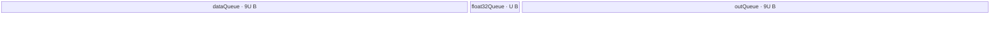

# ForeachAddScalarList A2/A3 ACLNN 算子知识

## 算子速览

| 项目 | 内容 |
|---|---|
| 实际入口 | `aclnnForeachAddScalarListGetWorkspaceSize` + `aclnnForeachAddScalarList`，公开两段式 ACLNN；固定仓未出现更高版本后缀。 |
| 计算语义 | 对列表位置 `i`：`y_i[j] = x_i[j] + scalars_i`，只覆盖 `x_i` 的元素域。 |
| 输入输出 | `x/out` 为 ND TensorList；`x` 支持 FP16/FP32/INT32/BF16，`scalars` 对应 FP32/FP32/INT64/FP32；输出 dtype 同 `x`。 |
| 执行类型 | 单 Kernel：一个 `AIV_VECTOR` 节点 `foreach_add_scalar_list`。 |
| Kernel 路线 | R-001 FP16 原生 Adds；R-002 FP32 原生 Adds；R-003 INT32 原生 Adds；R-004 BF16→FP32→BF16。 |
| 核心资源 | GM TensorList 地址表、GM scalar list、`dataQueue/outQueue`；BF16 另有 `float32Queue`；32 B 预留 workspace 不被 Kernel 使用。 |
| 来源闭包 | `source_closed`：公开 ACLNN 文档→自动生成 ACLNN bridge 边界→`ForeachAddScalarList` OpDef/Infer/Tiling→POD→单 AIV Kernel router→公共 Device body→A2/A3 构建接线闭合。 |
| 验证状态 | 已完成源码闭包检查；本次知识提取未执行编译、真机、数值或性能测试。 |

## 接口与语义

### 计算语义

设 TensorList 长度为 `n`，第 `i` 个输入有 `N_i` 个元素。有效输出域为 `0 <= i < n, 0 <= j < N_i`，计算 `y_i[j] = x_i[j] + scalars_i`。公开接口允许 `out_i` 的 shape size 大于等于 `x_i`；Kernel 仅按 `N_i` 写前缀，额外输出元素的值在固定仓中未定义。

### 输入、输出与属性

| 参数 | shape/layout | dtype | 约束、默认值与语义 |
|---|---|---|---|
| `x` | TensorList；每个 Tensor 为 ND，0–8 维 | FP16/FP32/INT32/BF16 | 列表内 dtype 一致；支持非连续输入与空 Tensor；OpDef 用 `AutoContiguous()` 把实际连续化交给生成 bridge。 |
| `scalars` | ScalarList；元素数等于 `x` Tensor 数 | FP32（浮点输入）或 INT64（INT32 输入） | 每个 Tensor 使用相同位置的一个 scalar。 |
| `out` | TensorList；ND，0–8 维 | 与 `x` 相同 | Tensor 数和 dtype 与 `x` 一致；shape size 不小于对应输入；公开文档明确不支持非连续输出。 |
| `workspaceSize/executor` | Host 输出 | `uint64_t*` / `aclOpExecutor**` | 第一段接口产生；Tiling 报 32 B，作为固定预留。 |
| `workspace/stream` | Device 地址 / runtime stream | - | 第二段接口消费；单 Kernel 在该 stream 上执行。 |

### 入口与版本

固定 Commit 只公开无版本后缀的 `aclnnForeachAddScalarList`。接口实现/header 为构建系统根据 `ACLNNTYPE aclnn` 生成，固定仓没有可逐行读取的 inner bridge；公开原型、错误语义和两段式生命周期由文档固定，算子拥有的 OpDef、InferShape、Tiling、POD、Kernel 与构建均已继续闭合。README 与 ACLNN 文档均公开支持 Atlas A2、A3；OpDef 的 `ascend910b`/`ascend910_93` 和构建配置与之相符。

## Host/Launcher 执行流程

### 参数校验与前处理

1. 生成 ACLNN 第一段接口检查 `x/scalars/out` 非空、dtype 组合、`x/out` dtype 一致；其生成源码固定仓不可见，错误终点以公开文档为准。
2. OpDef 对 `x`、`scalars`、`y` 声明 `AutoContiguous()`；输入的实际转换节点、临时 owner 和 ViewCopy 细节属于生成框架边界。
3. `InferShape4ForeachCommon` 要求动态输入和输出 Tensor 数相等，将每个 `x_i` shape 复制给 `y_i`；`InferDataType4ForeachCommon` 复制 dtype。
4. `Tiling4ForeachAddScalarListTiling` 调用优先级模板注册表。priority 10000 的 `ForeachAddScalarListMembaseTiling::IsCapable()` 在非 regbase SoC 为真；priority 30000 的 950 模板对 A2/A3 不可达。
5. `ForeachCommonTiling::CheckOpInfo` 校验列表 shape/dtype、标量列表长度、输出 dtype/容量与维数；失败返回 `GRAPH_FAILED`，阻断 launch。

### 参数、Workspace 与生命周期

令 `s=sizeof(T)`，`E=32/s`，`N=sum_i N_i`。Host 取 AIV 核数 `C_hw`，计算 `C=min(ceil(N/E), C_hw, 50)`，但 `N=0` 时取 1。按 32 B block 均分总元素域，生成每核的起止 Tensor 索引和 Tensor 内 offset。`U=inputsTensorUbSize` 是字节：非 BF16 为 `floor32((UB_bytes - POD_bytes)/2)`；BF16 为 `floor64(((UB_bytes-POD_bytes)/10)/2)`。Tiling 设置 `blockDim=C`、workspace 32 B并序列化 POD。executor 和 workspace 由 ACLNN 框架持有至第二段调用结束；固定 bridge 未公开更细 owner 代码。

### 启动图与失败传播

```text
aclnnForeachAddScalarListGetWorkspaceSize
  -> generated ACLNN bridge (fixed source unavailable)
  -> ForeachAddScalarList infer/tiling
  -> executor{blockDim, key, ForeachCommonTilingData, workspaceSize=32}
aclnnForeachAddScalarList(workspace, 32, executor, stream)
  -> [K1 AIV_VECTOR] foreach_add_scalar_list(inputs, scalar, outputs, workspace, tiling)
```

K1 是唯一 Device 节点，无跨 Kernel 边。输入、scalar、输出均为调用者/框架管理的 GM 对象；32 B workspace 由调用者按第一段结果分配，但 entry 将 `userWS` 置空，body 不读取 workspace。launch、stream 可见性与失败回传由未展开的 ACLNN executor 边界负责；Tiling 失败时不会生成有效 launch。

## Route 与参数设计

### 分核与资源计算

每核份额先在 32 B block 域均分：`blocks=ceil(N/E)`，基础份额 `floor(blocks/C)*E`，前 `blocks%C` 个核多 `E` 个元素。份额可跨越多个 Tensor，POD 用 `tensorStart/End` 与 `tensorStart/EndOffset` 表达连续的列表前缀区间。每个 Tensor 再以 `maxDataCount` 分 tile；非 BF16 为 `U/s`，BF16 为 `9U/2`，而 BF16 每次 FP32 cast 子块为 `U/4`。

### Route 选择

| 顺序 | Route | Key/模板 | 精确选择条件与优先级 | 不适用去向 |
|---:|---|---|---|---|
| 1 | R-001 FP16 | key 1；`ForeachOneScalarListBinary<half,half,AddsAdapter<half>,1,1>` | priority 10000 membase 且 `x=FP16, scalars=FP32, out=FP16` | dtype 不符看下一 key；未知 key 不执行 body。 |
| 2 | R-002 FP32 | key 2；`<float,float,AddsAdapter<float>,1,1>` | membase 且 `x/scalars/out=FP32` | 下一 key。 |
| 3 | R-003 INT32 | key 3；`<int,int,AddsAdapter<int>,1,1>` | membase、`__CCE_AICORE__>=220` 且 `x/out=INT32, scalars=INT64` | 下一 key。 |
| 4 | R-004 BF16 | key 4；`<bfloat16_t,float,AddsAdapter<float>,1,1>` | membase、`__CCE_AICORE__>=220`、非 NPU arch 3003/3113，且 `x/out=BF16, scalars=FP32` | 无匹配 body。 |

```text
priority 10000: !IsRegbaseSocVersion(A2/A3) ? membase : fallthrough
  dtype FP16 -> key 1
  dtype FP32 -> key 2
  dtype INT32 -> key 3
  dtype BF16 -> key 4
  otherwise -> key 0 -> router无分支
```

### 模板/实现执行矩阵

| Route | key/selector | dtype/shape/platform 完整命中条件 | 执行拓扑与 Kernel 节点 | 实际模板/body | 内存与同步特征 | tail/fallback |
|---|---|---|---|---|---|---|
| R-001 FP16 | 1 | A2/A3；合法列表；FP16/FP32/FP16 | 单 K1 AIV | half `InnerComputer`→`Adds` | 两个 depth-1 Queue，各 `U` B；Queue + `PIPE_V` barrier | 尾 tile 用 `DataCopyPad`，Adds count=`dataCount`。 |
| R-002 FP32 | 2 | A2/A3；合法列表；全 FP32 | 单 K1 AIV | float `InnerComputer`→`Adds` | 同 R-001 | 同 R-001。 |
| R-003 INT32 | 3 | A2/A3；合法列表；INT32/INT64/INT32 | 单 K1 AIV | int `InnerComputer`→`Adds` | 同 R-001；仅 `__CCE_AICORE__>=220` | 同 R-001。 |
| R-004 BF16 | 4 | A2/A3；合法列表；BF16/FP32/BF16；编译 guard 成立 | 单 K1 AIV | BF16 specialization：Cast→float Adds→RINT Cast | input/output Queue 各 `9U` B，float Queue `U` B；`PIPE_V` barrier | GM tail pad；cast 子块 tail；不支持 arch 无 body。 |

### 隐藏性能 Guard

| Guard | Host/Tiling 条件 | Device/资源原因 | 影响 Route | 不满足时去向 | 源码符号 |
|---|---|---|---|---|---|
| 非 regbase | `!IsRegbaseSocVersion(context_)` | 选择旧 Vector body/POD | 全部 | priority 30000 regbase（仅 950）或失败 | `foreach_tiling_def.h::MEMBASE_TILING::IsCapable` |
| 最多 50 Tensor/核记录 | `Init` 扫描 `i<50`，`blockDim<=50` | POD 数组固定长度 | 全部 | 对合法的等长 x/scalars 列表，超过 50 时 scalar 数与已扫描 Tensor 数不等而 Tiling 失败；无专用“x 超 50”错误 | `ForeachCommonTiling::Init/CheckScalarsTenorShapeInfo` |
| UB 对齐 | `U=floor32(...)`；BF16 `floor64(...)` | DMA block 与 BF16 cast buffer 布局 | 全部/R-004 | 只生成对齐后的较小 tile | `ForeachCommonTiling::DivideUbMemory1` |
| BF16 编译 guard | `__CCE_AICORE__>=220` 且 arch 非 3003/3113 | BF16 Cast 路线可用性 | R-004 | router 无 BF16 branch | `foreach_add_scalar_list` |
| 空 TensorList | 固定 membase 未显式拒绝 `totalTensorCount==0` | 会产生 dtype undefined/key 0 | 全部 | router 无 body；不应依赖此行为 | `ForeachCommonTiling::Init/GetTilingKeyByDtypeOnly` |

### POD/ABI

宏生成结构在固定仓未展开，故 `sizeof/alignof/offsetof` 不臆测；下表保留字段声明顺序、数组界和 producer/consumer。

| 结构 | 字段 | 类型/位宽 | ABI 布局 | 单位 | Host/launcher producer | Device consumer | 边界 |
|---|---|---|---|---|---|---|---|
| `ForeachCommonTilingData` | `inputsTensorUbSize` | `uint64_t`/64 | 第 1 字段；精确 offset 不可见 | 字节 | `DivideUbMemory1`→`set_inputsTensorUbSize(U)` | `KernelForeachBase::ParseTilingData`，决定 Queue/tile | 对齐 32 B；BF16 对齐 64 B。 |
| 同上 | `tensorDataCountList[50]` | `int64_t[50]` | 第 2 字段 | 元素 | `Init` 记录每个 `shapeSize` | `Process` 计算 Tensor 末端 | 有效索引 `<totalTensorCount`；总数不在 POD 中。 |
| 同上 | `tensorStartList[50]` | `uint16_t[50]` | 第 3 字段 | Tensor 索引 | `AssignDataToEachCore` | `ParseTilingData[blockIdx]` | blockDim 最多 50。 |
| 同上 | `tensorEndList[50]` | `uint16_t[50]` | 第 4 字段 | Tensor 索引（含） | 同上 | 同上 | 含尾端。 |
| 同上 | `tensorStartOffsetList[50]` | `int64_t[50]` | 第 5 字段 | 元素 | 同上 | Tensor 首地址偏移 | 首端含。 |
| 同上 | `tensorEndOffsetList[50]` | `int64_t[50]` | 第 6 字段 | 元素 | 同上 | 计算 `cursorEnd` | 尾端含；空域可为 -1。 |

### Route 源码闭包

| Route | Key/selector | Host/Tiling producer | POD/参数 | Kernel entry/router 节点 | Kernel body/直接依赖 | 构建接线 |
|---|---|---|---|---|---|---|
| R-001 | 1 | `foreach_tiling_class.h::RunBigScalarKernelTiling` | `ForeachCommonTilingData` | `op_kernel/foreach_add_scalar_list.cpp::foreach_add_scalar_list` | `ForeachOneScalarListBinary`、`KernelForeachUnary`、`InnerComputer<half>` | `op_kernel/CMakeLists.txt::add_kernel_sources(ascend910b,ascend910_93)` |
| R-002 | 2 | 同上 | 同上 | 同上 | `InnerComputer<float>` | 同上 |
| R-003 | 3 | 同上 | 同上 | 同上 | `InnerComputer<int>` | 同上 |
| R-004 | 4 | 同上 | 同上 | 同上 | `InnerComputer<bfloat16_t,float>` | 同上 |

## Kernel 实现

### 公共执行流程

entry 解析 POD，按 key 实例化一个模板；所有 Route 都从列表描述 GM 中取得 `x_i/y_i` 指针。每核遍历 `[tensorStart,tensorEnd]`，对首尾 Tensor 应用 offset，再按 `maxDataCount` 切 tile：GM→`dataQueue`，标量 `scalars[i]` 直读 GM，Vector Adds，结果入 `outQueue`，再写 GM。Queue 的 EnQue/DeQue/FreeTensor 形成搬运—计算—搬运生命周期；`InnerComputer` 在 Adds 前后各有 `PipeBarrier<PIPE_V>()`。

### Route R-001：FP16 原生 Adds

#### 适用条件

##### 选择证据

| 层级 | 文件 | 符号 | 源码谓词/参数 | 结果/下一跳 |
|---|---|---|---|---|
| Host | `foreach_tiling_def.h` | `ForeachAddScalarListMembaseTiling::IsCapable` | 非 regbase | priority 10000 生效。 |
| Tiling | `common_dtype.h` | `GetTilingKeyByDtypeOnly` | `DT_FLOAT16` | key 1。 |
| Router | `foreach_add_scalar_list.cpp` | `foreach_add_scalar_list` | `TILING_KEY_IS(1)` | half 模板。 |

#### Device 数据流

##### 函数级调用链

```text
foreach_add_scalar_list -> ForeachOneScalarListBinary<half,...>::Init/Process
  -> KernelForeachUnary::Process -> CopyIn -> ForeachOneScalarListBinary::Compute
  -> InnerComputer<half>::Compute -> AddsAdapter<half> -> Adds -> CopyOut
```

##### 源码等价伪码

```text
for tensor i in core_range:
  bind x_i/y_i + core_offset; scalarVal = half(scalars[i])
  for tile k: valid=min(U/2, remain)
    DataCopy or tail DataCopyPad x -> inQ
    barrier; Adds(out, in, scalarVal, valid); barrier
    DataCopy or tail DataCopyPad outQ -> y
```

#### 内存与数据搬运

##### 资源与搬运表

| 层级/缓冲区 | offset/地址公式 | extent/容量公式 | dtype/layout | producer | consumer | owner/lifetime | 对齐/复用 |
|---|---|---|---|---|---|---|---|
| GM x/y | list address + `cursorStart+k*(U/2)` | `valid` 元素 | half/ND flattened | caller / CopyOut | CopyIn / caller | 调用期间 | full tile DataCopy；tail Pad。 |
| GM scalar | `scalars+i` | 1 | FP32 scalar list | caller | `ProcessPlusInLoop` | 调用期间 | cast to half register value。 |
| `dataQueue` | UB queue slot | `U` B | half | CopyIn | Compute | depth 1，Compute 后 Free | 与 outQ 不别名。 |
| `outQueue` | UB queue slot | `U` B | half | Compute | CopyOut | depth 1，CopyOut 后 Free | 下一 tile 复用。 |

##### 分层内存布局


##### 字节账与复用顺序

```text
UB_total = U + U = 2U <= UB_bytes - POD_bytes
dynamic_ub = N/A
workspace_total = 32 B reserved; Kernel uses 0 B
```

| 复用子区 | 写入者 | 读取者/消费点 | 下一次覆盖 | 同步或释放依据 | 安全条件 |
|---|---|---|---|---|---|
| dataQueue slot | CopyIn | Compute | 下一 tile CopyIn | EnQue→DeQue→FreeTensor | Free 后覆盖。 |
| outQueue slot | Adds | CopyOut | 下一 tile Compute | EnQue→DeQue→FreeTensor | GM copy 完成后 Free。 |

#### 同步、精度与尾块

##### 同步与数值边界表

| 阶段 | primitive/机制 | producer | consumer/等待点 | 保护对象 | 精度/尾块 |
|---|---|---|---|---|---|
| GM→UB | Queue | CopyIn | Compute DeQue | input slot | tail 按有效字节搬运。 |
| Adds | `PIPE_V` barrier | load/Adds | Adds/store | Vector pipeline | scalar FP32 先转 half，half Adds；count=`valid`。 |
| UB→GM | Queue | Compute EnQue | CopyOut DeQue | output slot | 只写有效元素。 |

#### 关键实现

##### 符号证据表

| 阶段 | 文件 | 符号/模板实例 | 实现事实 |
|---|---|---|---|
| Host/Tiling producer | `foreach_tiling_class.h` | `RunBigScalarKernelTiling/DivideUbMemory1` | key、blockDim、U、POD。 |
| Kernel entry/router | `foreach_add_scalar_list.cpp` | `TILING_KEY_IS(1)` | half 实例。 |
| Device body/helper | `kernel_foreach_unary.h`、`foreach_one_scalar_binary.h` | `SingleTensorProcess/InnerComputer<half>` | tile、DMA、Adds、Queue 与 tail。 |

### Route R-002：FP32 原生 Adds

#### 适用条件

##### 选择证据

| 层级 | 文件 | 符号 | 源码谓词/参数 | 结果/下一跳 |
|---|---|---|---|---|
| Tiling | `common_dtype.h` | `GetTilingKeyByDtypeOnly` | `DT_FLOAT` | key 2。 |
| Router | `foreach_add_scalar_list.cpp` | `TILING_KEY_IS(2)` | float 模板 | R-002。 |

#### Device 数据流

##### 函数级调用链

```text
foreach_add_scalar_list -> ForeachOneScalarListBinary<float,...>::Process
  -> CopyIn -> InnerComputer<float>::Compute -> AddsAdapter<float> -> CopyOut
```

##### 源码等价伪码

```text
每核/每 Tensor/每 tile：bind GM；scalarVal=scalars[i]；搬 valid 个 float；
barrier -> Adds(float,float,scalarVal,valid) -> barrier；写回 valid 个 float。
```

#### 内存与数据搬运

##### 资源与搬运表

| 层级/缓冲区 | offset/地址公式 | extent/容量公式 | dtype/layout | producer | consumer | owner/lifetime | 对齐/复用 |
|---|---|---|---|---|---|---|---|
| GM x/y | `cursorStart+k*(U/4)` | `valid` | FP32 | caller/CopyOut | CopyIn/caller | 调用期间 | tail Pad。 |
| data/out Queue | 独立 slot | 各 `U` B | FP32 | CopyIn/Adds | Adds/CopyOut | depth 1 | Free 后复用。 |

##### 分层内存布局


##### 字节账与复用顺序

```text
UB_total=2U; maxDataCount=U/4; workspace_total=32 B reserved, 0 B consumed
```

| 复用子区 | 写入者 | 读取者/消费点 | 下一次覆盖 | 同步或释放依据 | 安全条件 |
|---|---|---|---|---|---|
| 两个 Queue slot | CopyIn/Compute | Compute/CopyOut | 下一 tile | Queue EnQue/DeQue/Free | 按序释放。 |

#### 同步、精度与尾块

##### 同步与数值边界表

| 阶段 | primitive/机制 | producer | consumer/等待点 | 保护对象 | 精度/尾块 |
|---|---|---|---|---|---|
| 计算 | Queue + `PIPE_V` barrier | CopyIn | Adds/CopyOut | tile | FP32 Adds；tail 只提交 valid。 |

#### 关键实现

##### 符号证据表

| 阶段 | 文件 | 符号/模板实例 | 实现事实 |
|---|---|---|---|
| Host/Tiling producer | `foreach_tiling_class.h` | `GetTilingKeyByDtypeOnly/DivideUbMemory1` | key 2 与 U。 |
| Kernel entry/router | `foreach_add_scalar_list.cpp` | `TILING_KEY_IS(2)` | float 实例。 |
| Device body/helper | `foreach_one_scalar_list_binary.h` | `Compute/ProcessPlusInLoop` | 逐 Tensor scalar 与 Adds。 |

### Route R-003：INT32 原生 Adds

#### 适用条件

##### 选择证据

| 层级 | 文件 | 符号 | 源码谓词/参数 | 结果/下一跳 |
|---|---|---|---|---|
| Tiling | `common_dtype.h` | `GetTilingKeyByDtypeOnly` | `DT_INT32` | key 3。 |
| Router | `foreach_add_scalar_list.cpp` | `__CCE_AICORE__>=220 && TILING_KEY_IS(3)` | int 模板 | R-003。 |

#### Device 数据流

##### 函数级调用链

```text
foreach_add_scalar_list -> ForeachOneScalarListBinary<int,int,...>::Process
  -> scalarVal=int(scalars[i]) -> CopyIn -> Adds<int> -> CopyOut
```

##### 源码等价伪码

```text
对每个 core slice/tile：从 INT64 scalar GM 读 scalars[i] 并转 int；
搬 INT32 x；barrier -> INT32 Adds(valid) -> barrier；搬回 INT32 y。
```

#### 内存与数据搬运

##### 资源与搬运表

| 层级/缓冲区 | offset/地址公式 | extent/容量公式 | dtype/layout | producer | consumer | owner/lifetime | 对齐/复用 |
|---|---|---|---|---|---|---|---|
| GM scalar | `scalars+i` | 1 | INT64 | caller | cast to int | 调用期间 | 窄化规则由 C++ cast；Host 未做范围 guard。 |
| data/out Queue | 各 `U` B | `U/4` 元素 | INT32 | CopyIn/Adds | Adds/CopyOut | depth 1 | Queue 生命周期。 |

##### 分层内存布局


##### 字节账与复用顺序

```text
UB_total=2U; maxDataCount=U/4; workspace_total=32 B reserved, 0 B consumed
```

| 复用子区 | 写入者 | 读取者/消费点 | 下一次覆盖 | 同步或释放依据 | 安全条件 |
|---|---|---|---|---|---|
| Queue slots | CopyIn/Adds | Adds/CopyOut | 下一 tile | FreeTensor | 不在消费前覆盖。 |

#### 同步、精度与尾块

##### 同步与数值边界表

| 阶段 | primitive/机制 | producer | consumer/等待点 | 保护对象 | 精度/尾块 |
|---|---|---|---|---|---|
| scalar | C++ `T(...)` | INT64 GM | Adds | scalar | INT64→INT32 窄化；固定 Host 无范围检查。 |
| tile | Queue/barrier | CopyIn | Adds/CopyOut | tile | INT32 Adds；tail valid count。 |

#### 关键实现

##### 符号证据表

| 阶段 | 文件 | 符号/模板实例 | 实现事实 |
|---|---|---|---|
| Host/Tiling producer | `foreach_tiling_class.h` | `RunBigScalarKernelTiling` | key 3、切核。 |
| Kernel entry/router | `foreach_add_scalar_list.cpp` | key 3 branch | 编译 guard 和 int 实例。 |
| Device body/helper | `foreach_one_scalar_list_binary.h` | `ProcessPlusInLoop` | INT64 scalar 读后转 int。 |

### Route R-004：BF16 升精度 Adds

#### 适用条件

##### 选择证据

| 层级 | 文件 | 符号 | 源码谓词/参数 | 结果/下一跳 |
|---|---|---|---|---|
| Tiling | `foreach_tiling_class.h` | `DivideUbMemory1` | `dataType==DT_BF16` | U 按 `(UB-POD)/20` 量级并 64 B 对齐。 |
| Router | `foreach_add_scalar_list.cpp` | key 4 branch | CCE>=220 且 arch 非 3003/3113 | BF16/float 实例。 |

#### Device 数据流

##### 函数级调用链

```text
foreach_add_scalar_list -> ForeachOneScalarListBinary<bfloat16_t,float,...>
  -> KernelForeachUnary::Process -> InnerComputer<bfloat16_t,float>::Compute
  -> Cast(BF16->FP32) -> AddsAdapter<float> -> Cast(FP32->BF16, CAST_RINT) -> CopyOut
```

##### 源码等价伪码

```text
for BF16 tile up to 9U/2 elements:
  CopyIn BF16
  for cast_chunk up to U/4 elements:
    barrier; Cast BF16->FP32
    barrier; Adds FP32 with scalars[i]
    barrier; Cast FP32->BF16 with RINT
  CopyOut only valid BF16 elements
```

#### 内存与数据搬运

##### 资源与搬运表

| 层级/缓冲区 | offset/地址公式 | extent/容量公式 | dtype/layout | producer | consumer | owner/lifetime | 对齐/复用 |
|---|---|---|---|---|---|---|---|
| dataQueue | slot | `9U` B | BF16 | CopyIn | cast | depth 1 | 64 B-derived U。 |
| outQueue | slot | `9U` B | BF16 | final cast | CopyOut | depth 1 | 独立。 |
| float32Queue | slot | `U` B=`U/4` float | FP32 | input cast/Adds | output cast | depth 1，整个 Process 持有 | 同一 buffer 原地 `Adds(float32Tensor,float32Tensor,...)`。 |

##### 分层内存布局



##### 字节账与复用顺序

```text
UB_total = 9U + 9U + U = 19U <= UB_bytes - POD_bytes
maxDataCount=9U/2 BF16 elements; maxCastDataCount=U/4 FP32 elements
workspace_total=32 B reserved, 0 B consumed
```

| 复用子区 | 写入者 | 读取者/消费点 | 下一次覆盖 | 同步或释放依据 | 安全条件 |
|---|---|---|---|---|---|
| float32Queue slot | BF16 Cast | FP32 Adds/BF16 Cast | 下一 cast chunk | `PIPE_V` barriers；Process 末 Free | output Cast 完成后覆盖。 |
| data/out slots | CopyIn/Cast | Cast/CopyOut | 下一 tile | Queue FreeTensor | 同 R-001。 |

#### 同步、精度与尾块

##### 同步与数值边界表

| 阶段 | primitive/机制 | producer | consumer/等待点 | 保护对象 | 精度/尾块 |
|---|---|---|---|---|---|
| cast/add/cast | `PIPE_V` barriers | 各 Vector 步骤 | 下一 Vector 步骤 | float32 scratch | FP32 Add，`CAST_RINT` 回 BF16；子块尾按 `dataCount`。 |
| GM tail | `DataCopyPad` | GM | UB/GM | 有效前缀 | 不输出 padding lane。 |

#### 关键实现

##### 符号证据表

| 阶段 | 文件 | 符号/模板实例 | 实现事实 |
|---|---|---|---|
| Host/Tiling producer | `foreach_tiling_class.h` | `DivideUbMemory1` | BF16 UB 缩减与 64 B 对齐。 |
| Kernel entry/router | `foreach_add_scalar_list.cpp` | key 4 branch | BF16/float specialization。 |
| Device body/helper | `foreach_one_scalar_binary.h` | `InnerComputer<bfloat16_t,float>::ComputePerCast` | 分块 Cast、FP32 Adds、RINT。 |

## 算子特定优化

### Trick T-001：一个 AIV core slice 跨 Tensor 连续消费列表

#### 触发与源码依据

- 适用 Route：R-001～R-004。
- 触发条件：一个核的 POD `[tensorStart,tensorEnd]` 覆盖一个或多个 Tensor。
- Golden 来源：[`foreach/foreach_utils/op_kernel/kernel_foreach_unary.h:113-129`](../../../../../../../cann-ops-raw/ascendc/ops-nn/955f8b33985b6d72989ebff341bb9c2c564a51bc/foreach/foreach_utils/op_kernel/kernel_foreach_unary.h#L113-L129)

**官方源码（固定 Commit 连续逐字摘录）**：

```cpp
for (uint16_t i = Base::tensorStart; i <= Base::tensorEnd; i++) {
    int64_t cursorStart = 0;
    int64_t cursorEnd = Base::tensorDataCountList[i] - 1;
    int64_t dataCount = 0;
    if (i == Base::tensorStart) {
        cursorStart = Base::tensorStartOffset;
    }
    if (i == Base::tensorEnd) {
        cursorEnd = Base::tensorEndOffset;
    }

    dataCount = cursorEnd - cursorStart + 1;

    inTensorsGM.SetGlobalBuffer(Base::GetTensorAddr(i, inTensorsPtr) + cursorStart);
    outTensorsGM.SetGlobalBuffer(Base::GetTensorAddr(i, outTensorsPtr) + cursorStart);
    ProcessPlusInLoop(i, cursorStart);
    SingleTensorProcess(dataCount, float32Tensor);
}
```

#### 机制与设计原因

Host 在全列表的 32 B block 域切核，Device 用 Tensor 索引和首尾 offset 还原每核连续 slice；一个 kernel launch 即可处理整个列表，且 `ProcessPlusInLoop(i,...)` 在进入每个 Tensor 时只读取一次对应 scalar，避免把每个 Tensor 拆成独立 launch。收益只限于源码可证明的 launch/分发合并，本次未测性能。

#### 迁移边界

- 适用：同 dtype TensorList、每 Tensor 配一个 scalar 的逐元素一元+标量算子。
- 前提：Host 必须生成完全一致的 start/end/offset POD，GM 列表描述 ABI 不变。
- 失效：不同 Tensor 需要不同 body、跨 Tensor 状态或列表超过固定数组容量时必须重新设计 selector/POD。
- 未验证：本次知识提取未执行编译、真机、数值或性能测试。

#### 错误做法

固定仓未提供可验证反例。

### Trick T-002：BF16 tile 与 FP32 scratch 分级复用

#### 触发与源码依据

- 适用 Route：R-004。
- 触发条件：`T=bfloat16_t` 且 BF16 编译 guard 成立。
- Golden 来源：[`foreach/foreach_utils/op_kernel/foreach_one_scalar_binary.h:51-60`](../../../../../../../cann-ops-raw/ascendc/ops-nn/955f8b33985b6d72989ebff341bb9c2c564a51bc/foreach/foreach_utils/op_kernel/foreach_one_scalar_binary.h#L51-L60)

**官方源码（固定 Commit 连续逐字摘录）**：

```cpp
uint32_t castTimes = dataCount / maxCastDataCount;
uint32_t castTimesRemainder = dataCount % maxCastDataCount;
for (uint32_t i = 0; i < castTimes; i++) {
    ComputePerCast(dataLocal, outLocal, float32Tensor, scalarVal, maxCastDataCount, i, maxCastDataCount);
}

if (castTimesRemainder > 0) {
    ComputePerCast(
        dataLocal, outLocal, float32Tensor, scalarVal, maxCastDataCount, castTimes, castTimesRemainder);
}
```

#### 机制与设计原因

大 BF16 input/output tile 保持在各自 Queue，只用一个 `U` B FP32 scratch 分块升精度；`paramsCount=1` 令 Adds 在 scratch offset 0 原地写回，再 RINT 降精度。这样不需要为整个 BF16 tile 物化 FP32 副本，同时保留 FP32 加法语义。

#### 迁移边界

- 适用：可逐块独立升精度计算并立即降精度的 BF16 elementwise。
- 前提：scratch 容量、barrier、cast round 与 Host 的 `/20` UB 预算同时迁移。
- 失效：需要跨 chunk 归约/状态时不能直接覆盖 scratch。
- 未验证：本次知识提取未执行编译、真机、数值或性能测试。

#### 错误做法

固定仓未提供可验证反例。

## 模板与实现对比

| 对比维度 | R-001 FP16 | R-002 FP32 | R-003 INT32 | R-004 BF16 | 设计选择依据 |
|---|---|---|---|---|---|
| 命中条件/优先级 | key1 | key2 | key3 | key4+guard | dtype key。 |
| 模板与 dtype | half/half | float/float | int/int | bf16/float | 是否需升精度。 |
| 循环与分核 | 列表 slice + tile | 同 | 同 | 外 tile + 内 cast chunk | BF16 scratch 较小。 |
| Queue/TBuf/寄存器/dynamic UB/通信 window | 2×U Queue | 同 | 同 | 18U Queue+U scratch | BF16 cast。 |
| 内存总占用与复用 | 2U | 2U | 2U | 19U | Host 相应缩小 U。 |
| 搬运/Vector/SIMT/NDDMA/通信 API | DataCopy(Pad)+Adds | 同 | 同 | 加 Cast | 全部 AIV，无其它族。 |
| 同步、精度与 tail | native half | native float | INT64→int，native int | FP32 add，RINT BF16 | 模板 specialization。 |
| fallback/失败边界 | unknown key 无 body | 同 | CCE guard | CCE/arch guard | 无 Device fallback。 |

## 平台差异

| 项目 | A2 | A3 | 950 |
|---|---|---|---|
| 支持状态 | 公开支持；`ascend910b` | 公开支持；`ascend910_93` | 公开支持，但见独立 `_950` 卡。 |
| Host/Launcher | priority 10000 membase | 同 | priority 30000 regbase。 |
| Kernel/资源 | 旧 `ForeachCommonTilingData` + Vector API body | 同一源码与构建组 | arch35 MicroAPI body、不同 POD/切核/UB。 |

## 限制与失败边界

- TensorList/POD 固定数组最多记录 50 个 Tensor、50 个核；membase `Init` 对 x 超过 50 项先停止扫描，随后合法等长 scalar list 会因数量不等于已扫描 Tensor 数而 Tiling 失败，但没有专用“x 超 50”错误码。
- 输出容量可大于输入，但 Kernel 只写输入元素数；额外元素固定仓未定义。INT64 scalar 在 R-003 被显式窄化为 int，Host 未见范围 guard。
- 空 Tensor 支持；完全空 TensorList 在 membase 会得到 undefined dtype/key 0，固定仓没有有效 body。
- ACLNN inner bridge、连续化临时内存和 executor launch 源码由构建系统生成，在固定仓不可见；32 B workspace 的实际系统用途不可见，但算子 Kernel 明确不读取。
- unknown key 和被编译 guard 排除的 key 在 entry 中没有错误写回或 fallback；Host/构建必须保证不产生不可达组合。
- 本次知识提取未执行编译、真机、数值或性能测试。

## 源码索引

### 链路索引

| 链路阶段 | 文件 | 关键符号 | 支撑内容 |
|---|---|---|---|
| 入口声明/约束 | `foreach/foreach_add_scalar_list/docs/aclnnForeachAddScalarList.md` | 两段式原型、产品表、错误表 | 公开 API、平台、约束。 |
| 入口实现 | `foreach/foreach_add_scalar_list/op_host/foreach_add_scalar_list_def.cpp` | `ops::ForeachAddScalarList` | dtype/layout/AutoContiguous/平台注册。 |
| Infer | `foreach/foreach_utils/op_host/foreach_infershape.cpp` | `InferShape4ForeachCommon` | 输出数、shape、dtype。 |
| Host selector | `foreach/foreach_utils/op_host/foreach_tiling_def.h` | `MEMBASE_TILING` | priority 路线能力谓词。 |
| Host/Tiling | `foreach/foreach_utils/op_host/foreach_tiling_func.cpp` | `Tiling4ForeachAddScalarListTiling` | 注册表入口、workspace producer。 |
| Host/Tiling/POD producer | `foreach/foreach_utils/op_host/foreach_tiling_class.h` | `RunBigScalarKernelTiling` 等 | 校验、切核、U、POD。 |
| Kernel 地址/POD | `foreach/foreach_utils/op_kernel/kernel_foreach_base.h` | `ParseTilingData/GetTensorAddr` | ABI consumer 和列表地址。 |
| Kernel 循环/搬运 | `foreach/foreach_utils/op_kernel/kernel_foreach_unary.h` | `Process/SingleTensorProcess/CopyIn/CopyOut` | core→Tensor→tile。 |
| Kernel scalar/body | `foreach/foreach_utils/op_kernel/foreach_one_scalar_list_binary.h` | `ProcessPlusInLoop/Compute` | scalar 读取和 Queue。 |
| Kernel 精度 helper | `foreach/foreach_utils/op_kernel/foreach_one_scalar_binary.h` | `InnerComputer` | Adds/barrier/BF16 Cast。 |
| Kernel router | `foreach/foreach_add_scalar_list/op_kernel/foreach_add_scalar_list.cpp` | `foreach_add_scalar_list` | key→实例。 |
| 构建接线 | `foreach/foreach_add_scalar_list/op_kernel/CMakeLists.txt` | `add_kernel_sources` | A2/A3 源码选择。 |

### 实现复用检查

| 检查项 | 可复用事实 | 不得改变的约束 | 源码符号 |
|---|---|---|---|
| ABI/POD | 列表 count 与每核首尾元组 | 字段顺序、50 项、字节/元素单位 | `ForeachCommonTilingData` |
| 调用顺序 | 每 Tensor bind→scalar load→tile CopyIn/Compute/CopyOut | scalar 索引必须是 Tensor 索引 | `KernelForeachUnary::Process` |
| workspace/内存 | 32 B 预留；Kernel 0 B | U 是字节；BF16 19U 账 | `DivideUbMemory1/KernelForeachUnary::Init` |
| 同步 | Queue 生命周期+Adds 前后 V barrier | scratch 覆盖前须完成 output Cast | `InnerComputer::Compute` |
| 精度与尾块 | native routes；BF16 FP32+RINT | INT64→int 窄化、tail valid count | `ProcessPlusInLoop/ComputePerCast` |
| 失败边界 | Tiling 失败阻断；unknown key 无 body | 不得把无分支当 fallback | `foreach_add_scalar_list` |