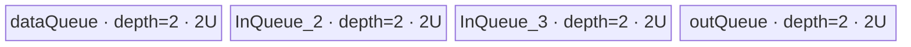
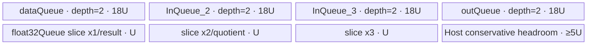

# ForeachAddcdivList A2/A3 ACLNN 算子知识

## 算子速览

| 项目 | 内容 |
|---|---|
| 实际入口 | `aclnnForeachAddcdivListGetWorkspaceSize` + `aclnnForeachAddcdivList`，公开两段式 ACLNN，无更高版本后缀 |
| 计算语义 | 对列表索引 `i` 和张量元素 `j`：`out[i][j] = x1[i][j] + (x2[i][j] / x3[i][j]) * scalars[i]` |
| 输入输出 | 三个等长 TensorList `x1/x2/x3`、一个逐 Tensor 标量 Tensor `scalars`、一个 TensorList `out`；ND；FP16/FP32/BF16 |
| 执行类型 | 单 Kernel，唯一 Device 节点为 `AIV_VECTOR`；只使用 GM/UB、DataCopy、Div、Axpy、Cast 与 Vector pipe barrier |
| Kernel 路线 | R-001 FP32 原生计算；R-002 FP16 原生计算；R-003 BF16 分块升 FP32 计算 |
| 核心资源 | 动态输入/输出地址表、四个 depth=2 Queue（x1/x2/x3/out）；BF16 另有一个 depth=1 FP32 Queue；Tiling 固定报告 32 B workspace，但 Kernel 不读 workspace |
| 来源闭包 | `source_closed`：公开 ACLNN 文档 → ACLNN 型 OpDef/自动连续化边界 → `ForeachCommonTiling` → dtype router → `ForeachOneScalarQuaternary`/两层公共基类 → `Div + Axpy` body → A2/A3 构建与 binary config 已闭合 |
| 验证状态 | 已完成源码闭包检查；本次知识提取未执行编译、真机、数值或性能测试。 |

## 接口与语义

### 计算语义

设三个输入列表长度均为 `n`，`scalars` 有 `n` 个元素。对每个列表位置 `i∈[0,n)`，`x1[i]`、`x2[i]`、`x3[i]` shape 相同；Kernel 只按 `x1[i]` 的元素数写有效输出：

```text
q[i][j]   = x2[i][j] / x3[i][j]
out[i][j] = x1[i][j] + scalars[i] * q[i][j]
```

源码顺序是先 `Div`、后 `Axpy`，不是代数重排后的其它顺序。FP16/FP32 Route 在各自 dtype 内计算；BF16 Route 把三路输入分块 Cast 为 FP32，完成 FP32 `Div + Axpy` 后以 `CAST_RINT` 降回 BF16。Host/Kernel 没有除数为零检查，结果遵循底层 `Div` primitive 的数值语义。

### 输入、输出与属性

| 参数 | shape/layout | dtype | 约束、默认值与语义 |
|---|---|---|---|
| `x1` | TensorList；各 Tensor 为 ND，rank 0–8 | FP16/FP32/BF16，列表内一致 | 支持非连续输入与空 Tensor；决定每个输出的有效元素数 |
| `x2` | 与 `x1` 同长度，逐位置 shape 相同；ND | 与 `x1` 一致 | 除法分子；支持非连续输入与空 Tensor |
| `x3` | 与 `x1` 同长度，逐位置 shape 相同；ND | 与 `x1` 一致 | 除法分母；支持非连续输入与空 Tensor |
| `scalars` | ND，rank≤8，元素数等于 TensorList 长度 | 与 `x1` 一致 | `scalars[i]` 广播到第 `i` 个 Tensor；不支持空 Tensor |
| `out` | TensorList；逐位置 storage size ≥ `x1`，公开接口要求连续；ND | 与 `x1` 一致 | Kernel 只写与 `x1[i]` 等量的前缀；图推理路径把 shape 精确设为 `x1[i]` |

无独立属性。公开文档的第一段接口还定义空指针、非法 dtype、shape/list dtype/rank Tiling 失败错误。

### 入口与版本

固定 Commit 只公开无版本后缀的 `aclnnForeachAddcdivListGetWorkspaceSize` 和 `aclnnForeachAddcdivList`。第一段返回 `workspaceSize` 与持有执行流程的 `aclOpExecutor`，第二段在调用方给定的 `aclrtStream` 上执行。仓内没有手写 ACLNN bridge；`op_host/CMakeLists.txt` 以 `ACLNNTYPE aclnn` 接入自动生成层，OpDef 的 `AutoContiguous()` 是输入前处理的框架边界。自动生成 bridge 的逐语句 executor 实现、临时连续 Tensor 的精确 owner/lifetime 在固定仓不可见，未推测补齐。

公开 ACLNN 文档明确支持 Atlas A2/A3，并明确不支持 Ascend 950；因此本卡只覆盖 A2/A3。算子 README、OpDef 与 950 构建虽有 Ascend 950 实现信号，也不能覆盖公开 ACLNN 的“不支持”结论。

## Host/Launcher 执行流程

### 参数校验与前处理

1. ACLNN 第一段按公开契约拒绝 `x1/x2/x3/scalars/out` 空指针，拒绝范围外或互不一致的 dtype。
2. OpDef 将 `x1/x2/x3/scalars/out` 定义为 ND FP16/FP32/BF16，并对每项设置 `AutoContiguous()`；公开契约只允许输入非连续，输出必须连续。生成式连续化/回写实现属于框架边界。
3. `ForeachCommonTiling::Init` 从动态输入 0 枚举 Tensor，记录 `tensorDataCountList[i]`、总元素数和 Tensor 数，并从 input desc 0 得到 dtype、字节数及 `elementsPerBlock=32/sizeof(dtype)`。
4. `CheckOpInfo` 校验三个动态输入列表实例数相同、逐位置 shape 相同、rank≤8、三个列表内及列表间 dtype 一致；`scalars` rank≤8 且元素数等于 Tensor 数；`out` dtype 相同且 storage size 不小于 `x1`。
5. 任一校验、platform/workspace 取值失败返回 `GRAPH_FAILED`，公开层映射为相应 ACLNN 参数或 inner tiling 错误；固定仓不公开更细的 bridge 映射代码。

### 参数、Workspace 与生命周期

Tiling 读取平台 AIV core 数和 UB 字节数，产生 dtype key、`blockDim`、每核 `[tensorStart,tensorEnd]` 与首尾元素 offset、每个 Tensor 元素数及单 Queue 容量 `U=inputsTensorUbSize`。`GetWorkspaceSizes(1)[0]` 固定写入 32 B；调用者根据第一段结果持有 workspace，executor 持有生成的算子计划，第二段把二者与 stream 交给框架。

Device entry 明确把 `userWS` 设为 `nullptr`，公共 Kernel 的 `workspace` 形参不参与计算。因此 32 B 是统一 Host/Tiling 预留，不存在本算子的语义 workspace slice、跨 Kernel 交接或多核同步区。workspace/executor 的释放时点遵循 ACLNN 框架，固定仓没有算子自有释放逻辑。

### 启动图与失败传播

```text
aclnnForeachAddcdivListGetWorkspaceSize
  -> 自动生成 ACLNN executor（固定仓框架边界）
  -> ForeachAddcdivList Tiling：校验、key、blockDim、POD、workspace=32 B

aclnnForeachAddcdivList(workspace, workspaceSize, executor, stream)
  -> [K-001, AIV_VECTOR, 单次同 stream 启动]
     foreach_addcdiv_list(x1AddrTable, x2AddrTable, x3AddrTable,
                          scalars, outAddrTable, workspace, tiling)
  -> out TensorList
```

| 节点/边 | Host/entry | blockDim/POD | 输入→输出/交接 | ordering、owner/lifetime 与失败 |
|---|---|---|---|---|
| K-001 | 生成式 launcher → `foreach_addcdiv_list` | `min(50, AIV核数, max(1,ceil(totalElems/(32/typeBytes))))`；`ForeachCommonTilingData` | 五个 GM 参数对象 → `out`；workspace 无语义 slice | 单 stream 单 Kernel，无节点间 event；launch 失败直接使第二段接口失败，之后无 consumer |
| Tiling→K-001 | runtime Tiling buffer | key 1/2/4 与全部 POD 字段 | Host 写 Tiling buffer，entry 以 `GET_TILING_DATA` 读取 | 框架保证 launch 前 Tiling 可见；固定仓未暴露 buffer owner 细节 |

## Route 与参数设计

### 分核与资源计算

令 `E=Σ_i numel(x1[i])`，`B=32/typeBytes`（FP16/BF16 为 16 元素，FP32 为 8 元素），平台 AIV 核数为 `Cplat`：

```text
blockCount = ceil(E / B)
blockDim0  = min(max(1, blockCount), Cplat)
blockDim   = min(blockDim0, 50)
baseElems  = floor(blockCount / blockDim) * B
extraBlock = blockCount % blockDim
core k elements = baseElems + (k < extraBlock ? B : 0)
```

`AssignDataToEachCore` 把整个 TensorList 视为按 Tensor 顺序连接的元素流，再以 32 B block 切给各核；一个核可跨多个 Tensor，一个 Tensor也可被首尾多个核切分。POD 用 inclusive 的 start/end Tensor 索引及 start/end 元素 offset 描述边界。每核再按 `maxDataCount` 切 tile。

令 `TD=ForeachCommonTilingData::GetDataSize()`，`UB` 为平台 UB 字节：

```text
FP16/FP32: U = floor_to_32((UB - TD) / 8)
BF16:      U = floor_to_64(((UB - TD) / 10) / 8)
```

`U` 单位为字节。FP16/FP32 的四个 depth=2 Queue 总计 `8U`。BF16 把每个输入/输出 Queue 的单 buffer 扩大到 `9U`，四个 depth=2 Queue 为 `72U`，另有 `3U` 的 FP32 暂存 Queue，总计 `75U`；Host 使用约 `80U≤UB-TD` 的保守除数。

### Route 选择

| 顺序 | Route | Key/模板 | 精确选择条件与优先级 | 不适用去向 |
|---:|---|---|---|---|
| 1 | R-001 FP32 原生 | key `2`；`<float,float,...,2,3>` | `dataType==DT_FLOAT` → `GetTilingKeyByDtypeOnly=2`；router 先判断 key 2 | key 不是 2 时判断 key 1 |
| 2 | R-002 FP16 原生 | key `1`；`<half,half,...,2,3>` | `dataType==DT_FLOAT16` → key 1；router 第二个分支 | key 不是 1 时进入受编译 guard 的 key 4 判断 |
| 3 | R-003 BF16→FP32 | key `4`；`<bfloat16_t,float,...,2,3>` | `dataType==DT_BF16` → key 4，且 `__CCE_AICORE__>=220` 且排除 NPU arch 3003/3113 | guard 不成立或未知 key：entry 无 body、无输出；公开 A2/A3 build/config 必须提供相容实例 |

```text
Tiling4ForeachAddcdivListTiling
  -> Tiling4ForeachAddcPointwiseList
  -> IsRegbaseSocVersion(A2/A3) == false
  -> ForeachCommonTiling::Init(opCode=10, TYPE_SCALARS_TENSOR)
  -> RunBigKernelTiling
     -> dtype FP32 ? key=2
        : dtype FP16 ? key=1
        : dtype BF16 ? key=4
        : key=0（OpDef/API 已限制，router 无分支）
```

### 模板/实现执行矩阵

| Route | key/selector | dtype/shape/platform 完整命中条件 | 执行拓扑与 Kernel 节点 | 实际模板/body | 内存与同步特征 | tail/fallback |
|---|---|---|---|---|---|---|
| R-001 FP32 原生 | 2 | A2/A3；全部输入/输出 FP32；列表/shape/rank/scalars 校验通过 | 单 K-001 AIV_VECTOR | `ForeachOneScalarQuaternary<float,float,AddcDivListFloatAdapter,2,3>` → FP32 `Div/Axpy` | 4×depth2 Queue，总 `8U`；Vector barrier 分隔 Div/Axpy/copy | GM tail 用 `DataCopyPad`；UB 内复制向上到 32 B；无其它 fallback |
| R-002 FP16 原生 | 1 | A2/A3；全部输入/输出 FP16；其余校验同上 | 单 K-001 AIV_VECTOR | `ForeachOneScalarQuaternary<half,half,...,2,3>` → FP16 `Div/Axpy` | 同为 `8U`，每 tile 元素数为 `U/2` | 同 R-001；不升精度 |
| R-003 BF16→FP32 | 4 | A2/A3；全部输入/输出 BF16；编译 guard 可用；其余校验同上 | 单 K-001 AIV_VECTOR | `ForeachOneScalarQuaternary<bfloat16_t,float,...,2,3>` → `InnerComputer` BF16 specialization | Queue 总 `75U`；每个 Cast chunk 使用 `3U` FP32 暂存；多次 `PIPE_V` barrier | 每 chunk 最多 `U/4` 元素；最后结果 `CAST_RINT`；guard 不满足无 body |

### 隐藏性能 Guard

| Guard | Host/Tiling 条件 | Device/资源原因 | 影响 Route | 不满足时去向 | 源码符号 |
|---|---|---|---|---|---|
| 最大 Tensor/核表容量 | `totalTensorCount` 枚举上限 50；`blockDim≤50` | POD 五组数组容量均为 50 | 全部 | 固定 Host 未找到显式 `listLength>50` 错误；不得假定安全扩展 | `ForeachCommonTiling::Init/RunBigKernelTiling` |
| 32 B 分核 | `B=32/typeBytes` | 避免每核常规块边界落在非 DMA block 位置 | 全部 | 总元素为 0 时仍置 `blockDim=1` | `GetNeedCoreNum/AssignDataToEachCore` |
| UB 容量 | `U=floor32((UB-TD)/8)` 或 BF16 的 `floor64(((UB-TD)/10)/8)` | 匹配四个双缓冲 Queue；BF16 还需 Cast 暂存并扩大队列 | 全部，BF16 特别保守 | 没有小 UB fallback；产生的 `U` 直接进入 POD | `DivideUbMemory3` |
| BF16 编译 guard | `__CCE_AICORE__>=220 && arch!=3003/3113` | BF16 Cast/Vector specialization 只在该 guard 下实例化 | R-003 | router 无输出分支 | `foreach_addcdiv_list`、`InnerComputer<bfloat16_t,float>` |
| 尾块 | `dataCount*sizeof(T)%32 != 0` | 普通 UB DataCopy 以 32 B block 为粒度 | 全部 | UB 内复制向上到整 block，最终 GM CopyOut 只提交有效字节 | `AddcDivListFloatAdapter`、`KernelForeachUnary::CopyIn/CopyOut` |
| 未知 key | key 不为 2/1/4 | entry 没有 `else` error/fallback | 全部 | Kernel 不执行、不写输出 | `foreach_addcdiv_list` |

### POD/ABI

`BEGIN_TILING_DATA_DEF`/`TILING_DATA_FIELD_DEF*` 的框架宏定义不在固定仓，因此下表能闭合字段顺序、源码类型、单位与 producer/consumer，但不能可靠给出 `sizeof/alignof/offsetof`；不得用普通 C struct 规则猜测序列化 ABI。

| 结构 | 字段 | 类型/位宽 | ABI 布局 | 单位 | Host/launcher producer | Device consumer | 边界 |
|---|---|---|---|---|---|---|---|
| `ForeachCommonTilingData` | `inputsTensorUbSize` | `uint64_t`/64 | 第1字段；精确 sizeof/alignof/offsetof 固定仓不可见 | 字节 | `DivideUbMemory3` → `FillTilingData::set_inputsTensorUbSize(U)` | `KernelForeachBase::ParseTilingData`；计算 Queue 容量、`maxDataCount`/`maxCastDataCount` | 所有 Route 活跃；必须满足对应 UB 账 |
| 同上 | `tensorDataCountList[50]` | `int64_t[50]`/每项64 | 第2字段；精确 offset 不可见 | 元素 | `Init`: `storageShape.GetShapeSize()` | `Process`: 各 Tensor 默认 `cursorEnd=count-1` | 仅 `[0,totalTensorCount)` 有效；空 Tensor 可为 0 |
| 同上 | `tensorStartList[50]` | `uint16_t[50]`/每项16 | 第3字段；精确 offset 不可见 | Tensor 索引 | `AssignDataToEachCore` | `ParseTilingData`: `[blockIdx]` | 仅 `[0,blockDim)` 读取 |
| 同上 | `tensorEndList[50]` | `uint16_t[50]`/每项16 | 第4字段；精确 offset 不可见 | Tensor 索引，inclusive | `AssignDataToEachCore` | `ParseTilingData`: `[blockIdx]` | 仅 `[0,blockDim)` 读取 |
| 同上 | `tensorStartOffsetList[50]` | `int64_t[50]`/每项64 | 第5字段；精确 offset 不可见 | 元素 | `AssignDataToEachCore` | `Process`: 首 Tensor `cursorStart` | inclusive；仅活动 core 读取 |
| 同上 | `tensorEndOffsetList[50]` | `int64_t[50]`/每项64 | 第6字段；精确 offset 不可见 | 元素 | `AssignDataToEachCore` | `Process`: 末 Tensor `cursorEnd` | inclusive；仅活动 core 读取 |

### Route 源码闭包

| Route | Key/selector | Host/Tiling producer | POD/参数 | Kernel entry/router 节点 | Kernel body/直接依赖 | 构建接线 |
|---|---|---|---|---|---|---|
| R-001 FP32 | key 2 | `foreach_tiling_func.cpp::Tiling4ForeachAddcPointwiseList`; `foreach_tiling_class.h::RunBigKernelTiling` | `ForeachCommonTilingData`，`U`、Tensor/core 边界 | `op_kernel/foreach_addcdiv_list.cpp::foreach_addcdiv_list` key 2 | `AddcDivListFloatAdapter<float>`；`ForeachOneScalarQuaternary`；`KernelForeachUnary/Base` | operator Host/Kernel CMake；ascend910b/ascend910_93 binary JSON |
| R-002 FP16 | key 1 | 同上 | 同上 | 同 entry key 1 | `AddcDivListFloatAdapter<half>` 与同一公共模板链 | 同上 |
| R-003 BF16 | key 4 | 同上；BF16 UB 分支 | 同结构，`U` 为 64 B 对齐 | 同 entry key 4 + compile guard | `InnerComputer<bfloat16_t,float>` → `AddcDivListFloatAdapter<float>` 与公共基类 | 同上，binary JSON 含 BF16 实例 |

## Kernel 实现

### 公共执行流程

五个 TensorList/标量对象以 GM 参数进入单个 AIV Kernel。动态 TensorList 不是连续数据拼接：`KernelForeachBase::GetTensorAddr` 把参数解释为 runtime 地址表，先读取表内偏移，再按 Tensor 索引取得真实 GM 地址。每核用 POD 找到首末 Tensor 和 offset，逐 Tensor 绑定三路输入/一路输出的 GM view，并读取 `scalars[i]`。

每个 Tensor 片段按 `maxDataCount` 切 tile。x1/x2/x3 依次进入三个 VECIN Queue；Compute 从 Queue 出队，把 `x2/x3` 原地变成商，再把 `scalar*商` 原地累加到 x1，最后把结果入 out Queue；CopyOut 仅把有效长度写回 GM。Queue 的 EnQue/DeQue/FreeTensor 形成 DMA 与 Vector 的 producer-consumer/lifetime 协议，算术内部再以 `PipeBarrier<PIPE_V>` 分隔依赖。

### Route R-001：FP32 原生计算

#### 适用条件

##### 选择证据

| 层级 | 文件 | 符号 | 源码谓词/参数 | 结果/下一跳 |
|---|---|---|---|---|
| API | `docs/aclnnForeachAddcdivList.md` | `aclnnForeachAddcdivListGetWorkspaceSize` | x1/x2/x3/scalars/out 均为 FLOAT32 且约束成立 | 进入 `ForeachAddcdivList` executor |
| Tiling | `foreach_tiling_class.h` | `GetTilingKeyByDtypeOnly`/`RunBigKernelTiling` | `dataType==DT_FLOAT` | key=2，生成公共 POD |
| Router | `op_kernel/foreach_addcdiv_list.cpp` | `foreach_addcdiv_list` | `TILING_KEY_IS(2)` | 实例化 `<float,float,...,2,3>` |

#### Device 数据流

##### 函数级调用链

```text
K-001 foreach_addcdiv_list(..., tiling)
  -> GET_TILING_DATA(ForeachCommonTilingData)
  -> ForeachOneScalarQuaternary<float,float,...>::Init
    -> KernelForeachUnary::Init -> KernelForeachBase::Init/ParseTilingData
  -> KernelForeachUnary::Process
    -> ProcessPlusInLoop: scalar[i] + x2/x3 GM bind
    -> SingleTensorProcess
      -> CopyIn(x1) + CopyInPlus(x2,x3)
      -> ForeachOneScalarQuaternary::Compute
        -> InnerComputer<float,float>::Compute
          -> AddcDivListFloatAdapter<float>: Div -> barrier -> Axpy -> barrier -> local copy
      -> KernelForeachUnary::CopyOut
```

##### 源码等价伪码

```text
# 伪码；所有 start/end offset 为 inclusive
core = GetBlockIdx()
for tensor i in [tensorStart[core], tensorEnd[core]]:
    begin = (i == tensorStart ? tensorStartOffset : 0)
    end   = (i == tensorEnd ? tensorEndOffset : tensorDataCount[i]-1)
    scalar = scalars[i]
    bind x1/x2/x3/out GM at tensorAddr(i) + begin
    count = end - begin + 1
    for tile in ceil(count / (U/4)):
        valid = min(U/4, count - tile*(U/4))
        CopyIn x1,x2,x3; tail uses valid*4-byte DataCopyPad
        q = x2 / x3                         # x2 Local 原地
        barrier V
        x1 = x1 + scalar*q                  # x1 Local 原地
        barrier V
        copy round_up(valid, 8) elements x1 -> out Local
        enqueue out; CopyOut valid elements only
```

#### 内存与数据搬运

##### 资源与搬运表

| 层级/缓冲区 | offset/地址公式 | extent/容量公式 | dtype/layout | producer | consumer | owner/lifetime | 对齐/复用 |
|---|---|---|---|---|---|---|---|
| x1/x2/x3 GM | `tensorAddr(i)+begin+tile*(U/4)` | `valid` 元素 | FP32/ND | runtime TensorList | 三个 VECIN Queue | 调用方；Kernel 只读 | full tile DataCopy；tail 按有效字节 DataCopyPad |
| scalars GM | `scalars+i` | 1 元素/Tensor | FP32/ND | 调用方 | `GetValue(i)` | 调用期有效 | 每 Tensor 读取一次并复用于全部 tile |
| `dataQueue` | Queue 管理 | depth2×U | FP32/VECIN | x1 CopyIn | Compute/Axpy | `TPipe`；Compute 后 Free | x1 在 Compute 内原地累加 |
| `InQueue_2` | Queue 管理 | depth2×U | FP32/VECIN | x2 CopyIn | Div/Axpy | `TPipe`；Compute 后 Free | x2 原地改写为商 |
| `InQueue_3` | Queue 管理 | depth2×U | FP32/VECIN | x3 CopyIn | Div | `TPipe`；Compute 后 Free | 只读 |
| `outQueue` | Queue 管理 | depth2×U | FP32/VECOUT | adapter local copy | GM CopyOut | `TPipe`；CopyOut 后 Free | tail 的 UB copy 向上到 32 B；GM 只写 valid |
| workspace | N/A | Host 固定 32 B；语义使用 0 B | byte | ACLNN 调用方 | 无 | 框架 owner | entry 用 `nullptr` 替代传入 workspace |

##### 分层内存布局



##### 字节账与复用顺序

```text
UB_total = 2U + 2U + 2U + 2U = 8U
U = floor_to_32((UB - TD) / 8)
UB_total <= UB - TD
dynamic_ub = N/A（AIV Queue 静态分配）
workspace_total = 32 B Host 预留；0 B 被 Kernel 消费
=> maxDataCount = U / 4 个 FP32 元素
```

| 复用子区 | 写入者 | 读取者/消费点 | 下一次覆盖 | 同步或释放依据 | 安全条件 |
|---|---|---|---|---|---|
| x2 Local | CopyIn | `Div` 读 x2/x3 并原地写商；随后 `Axpy` 读商 | `InQueue_2.FreeTensor` 后下一 tile | `PIPE_V` barrier + Queue lifetime | Axpy 必须在 Free 前完成 |
| x1 Local | CopyIn | `Axpy` 原地写结果；随后 local DataCopy | `dataQueue.FreeTensor` 后下一 tile | `PIPE_V` barrier 后复制，复制后 Free | out Local 与 x1 物理地址不同时执行复制 |
| out Local | adapter | CopyOut | `outQueue.FreeTensor` 后下一 tile | EnQue→DeQue→FreeTensor | GM tail 只提交 valid bytes |

#### 同步、精度与尾块

##### 同步与数值边界表

| 阶段 | primitive/机制 | producer | consumer/等待点 | 保护对象 | 精度/尾块 |
|---|---|---|---|---|---|
| GM→UB | Queue + DataCopy/DataCopyPad | GM | Compute DeQue | 三路输入 Local | FP32；tail copyParams.blockLen=`valid*4` 字节 |
| divide→axpy | `PipeBarrier<PIPE_V>` | `Div(x2,x2,x3,valid)` | `Axpy(x1,x2,scalar,valid)` | 原地 x2 商 | FP32 原生顺序，mask/有效 lane 由 `valid` 给出 |
| axpy→out Local | `PipeBarrier<PIPE_V>` | Axpy | DataCopy | 原地 x1 结果 | local tail copy 上取整到 8 个 FP32/32 B |
| UB→GM | Queue + DataCopyPad | out Local | GM | 仅有效输出前缀 | tail 只写 `valid*4` 字节，padding lane 不外泄 |

#### 关键实现

##### 符号证据表

| 阶段 | 文件 | 符号/模板实例 | 实现事实 |
|---|---|---|---|
| Host/Tiling producer | `foreach_utils/op_host/foreach_tiling_class.h` | `RunBigKernelTiling/AssignDataToEachCore/DivideUbMemory3` | key、core 边界、U、POD 与 workspace=32 B |
| Kernel entry/router | `foreach_addcdiv_list/op_kernel/foreach_addcdiv_list.cpp` | key 2 branch | FP32 模板实例与 `workspace→nullptr` |
| Device body/helper | `foreach_one_scalar_quaternary.h`；`kernel_foreach_unary.h`；`kernel_foreach_base.h` | `Compute/CopyInPlus`、`SingleTensorProcess`、`GetTensorAddr` | 三路 Queue、逐 Tensor/逐 tile 循环、地址表解析与 tail |
| Device body/helper | `foreach_addcdiv_list.cpp` | `AddcDivListFloatAdapter<float>` | FP32 Div→Axpy→对齐 local copy |

### Route R-002：FP16 原生计算

#### 适用条件

##### 选择证据

| 层级 | 文件 | 符号 | 源码谓词/参数 | 结果/下一跳 |
|---|---|---|---|---|
| API | `docs/aclnnForeachAddcdivList.md` | 第一段接口 | 全部数据对象为 FLOAT16 且约束成立 | 进入 executor |
| Tiling | `common_dtype.h` | `GetTilingKeyByDtypeOnly` | `DT_FLOAT16` | key=1 |
| Router | `op_kernel/foreach_addcdiv_list.cpp` | `foreach_addcdiv_list` | `TILING_KEY_IS(1)` | `<half,half,...,2,3>` |

#### Device 数据流

##### 函数级调用链

```text
foreach_addcdiv_list key=1
  -> ForeachOneScalarQuaternary<half,half,...>::Init/Process
  -> KernelForeachUnary::Process/SingleTensorProcess
  -> CopyIn x1/x2/x3
  -> InnerComputer<half,half>::Compute
     -> AddcDivListFloatAdapter<half>: half Div -> half Axpy -> local copy
  -> CopyOut
```

##### 源码等价伪码

```text
# core/Tensor 循环同 R-001
maxDataCount = U / 2
for each tile(valid):
    CopyIn three FP16 inputs
    x2_half = Div(x2_half, x3_half, valid)
    barrier V
    x1_half = Axpy(x1_half, x2_half, scalar_half, valid)
    barrier V
    copy round_up(valid, 16) half elements to out Local
    CopyOut exactly valid half elements
```

#### 内存与数据搬运

##### 资源与搬运表

| 层级/缓冲区 | offset/地址公式 | extent/容量公式 | dtype/layout | producer | consumer | owner/lifetime | 对齐/复用 |
|---|---|---|---|---|---|---|---|
| 三路 GM/out GM | `tensorAddr(i)+begin+tile*(U/2)` | valid | FP16/ND | 调用方/Kernel | Queue/调用方 | 调用期 | tail 按 `valid*2` 字节 |
| scalar GM | `scalars+i` | 1 | FP16 | 调用方 | 每 Tensor 全部 tile | 调用期 | Tensor 内广播复用 |
| 四个 Queue | Queue 管理 | 各 depth2×U | FP16 | CopyIn/Compute | Compute/CopyOut | TPipe | 总 `8U`；x1/x2 原地复用 |

##### 分层内存布局


##### 字节账与复用顺序

```text
UB_total = 8U
U = floor_to_32((UB - TD) / 8)
dynamic_ub = N/A
workspace_total = 32 B reserved / 0 B consumed
=> maxDataCount = U / 2 FP16 elements
```

| 复用子区 | 写入者 | 读取者/消费点 | 下一次覆盖 | 同步或释放依据 | 安全条件 |
|---|---|---|---|---|---|
| x2 Local | CopyIn | half Div 原地写商→half Axpy | Free 后下一 tile | V barrier + FreeTensor | 不得在 Axpy 前覆盖 |
| x1 Local | CopyIn | half Axpy 原地写→out copy | Free 后下一 tile | V barrier + Queue | local copy 完成后释放 |

#### 同步、精度与尾块

##### 同步与数值边界表

| 阶段 | primitive/机制 | producer | consumer/等待点 | 保护对象 | 精度/尾块 |
|---|---|---|---|---|---|
| CopyIn | DataCopy/Pad + Queue | GM | Compute | 三路 FP16 Local | tail 有效字节 |
| Compute | Div→V barrier→Axpy | x2/x3 | x1 result | x2/x1 原地区 | 全程 FP16，无 FP32 Cast |
| local/GM tail | 对齐 DataCopy + DataCopyPad | x1 result | out GM | out Local/GM | local 上取整至16元素，GM仅写 valid |

#### 关键实现

##### 符号证据表

| 阶段 | 文件 | 符号/模板实例 | 实现事实 |
|---|---|---|---|
| Host/Tiling producer | `common_dtype.h`；`foreach_tiling_class.h` | `GetTilingKeyByDtypeOnly`、公共 Tiling | FP16 key=1，U/分核同公共路径 |
| Kernel entry/router | `foreach_addcdiv_list.cpp` | `<half,half,...,2,3>` | FP16 原生模板 |
| Device body/helper | 同 R-001 三个公共 Kernel header | `InnerComputer<half,half>` 通用 specialization | 无 Cast，Queue/循环/tail 闭合 |

### Route R-003：BF16 分块升 FP32 计算

#### 适用条件

##### 选择证据

| 层级 | 文件 | 符号 | 源码谓词/参数 | 结果/下一跳 |
|---|---|---|---|---|
| API | `docs/aclnnForeachAddcdivList.md` | 第一段接口 | 全部数据对象 BFLOAT16 且约束成立 | 进入 executor |
| Tiling | `common_dtype.h`/`foreach_tiling_class.h` | `GetTilingKeyByDtypeOnly`/`DivideUbMemory3` | `DT_BF16` | key=4；U 经 `/10`、`/8`、64 B 向下对齐 |
| Router | `foreach_addcdiv_list.cpp` | key 4 branch | key=4 且 compile guard 成立 | `<bfloat16_t,float,...,2,3>` |

#### Device 数据流

##### 函数级调用链

```text
foreach_addcdiv_list key=4
  -> ForeachOneScalarQuaternary<bfloat16_t,float,...>::Init
     -> four Queue buffers use single-buffer size 9U
     -> float32Queue single buffer size 3U
  -> KernelForeachUnary::Process
  -> InnerComputer<bfloat16_t,float>::Compute
     -> for each maxCastDataCount=U/4 chunk
        Cast x1/x2/x3 BF16 -> three adjacent FP32 slices
        AddcDivListFloatAdapter<float>: Div -> Axpy
        Cast FP32 result -> BF16 with CAST_RINT
  -> CopyOut valid BF16 bytes
```

##### 源码等价伪码

```text
maxDataCount     = 9U / 2      # BF16 elements per GM tile
maxCastDataCount = U / 4       # FP32 elements per compute chunk
for each GM tile(valid):
    CopyIn x1/x2/x3 BF16 into 9U Queue buffers
    for chunk in ceil(valid / maxCastDataCount):
        active = min(maxCastDataCount, valid - chunk*maxCastDataCount)
        fp[0:U]   = Cast(x1_chunk, CAST_NONE, maxCastDataCount)
        fp[U:2U]  = Cast(x2_chunk, CAST_NONE, maxCastDataCount)
        fp[2U:3U] = Cast(x3_chunk, CAST_NONE, maxCastDataCount)
        fp_x2 = fp_x2 / fp_x3 for active lanes
        fp_x1 = fp_x1 + float(scalar_bf16)*fp_x2 for active lanes
        Cast(out_bf16_chunk, fp_x1, CAST_RINT, maxCastDataCount)
    CopyOut only valid BF16 bytes
```

Cast primitive 的长度固定为 `maxCastDataCount`，而 `Div/Axpy` 使用最后 chunk 的 `active`；扩大到 `9U` 的 BF16 Queue 保证这些对齐 Cast 仍落在已分配 Local 区内，最终 GM CopyOut 又只提交有效元素。

#### 内存与数据搬运

##### 资源与搬运表

| 层级/缓冲区 | offset/地址公式 | extent/容量公式 | dtype/layout | producer | consumer | owner/lifetime | 对齐/复用 |
|---|---|---|---|---|---|---|---|
| 三路 GM/out GM | `tensorAddr(i)+begin+tile*(9U/2)` | valid | BF16/ND | 调用方/Kernel | Queue/调用方 | 调用期 | tail `valid*2` 字节 |
| 四个 BF16 Queue | Queue 管理 | 每个 depth2×9U | BF16 | DMA/Compute | Cast/CopyOut | TPipe | 合计72U；为 chunk Cast 留足跨度 |
| `float32Queue` | slice 0、U、2U | depth1×3U | FP32 flat | 三次 Cast | FP32 Div/Axpy、降 Cast | Process 开始 DeQue，结束 Free | 三个等长 U-byte slice；slice0 原地变结果，slice1原地变商 |
| scalar GM | `scalars+i` | 1 | BF16 | 调用方 | `ToFloat(scalarVal)` | Tensor 内复用 | 计算前转 FP32 标量 |

##### 分层内存布局



##### 字节账与复用顺序

```text
BF16 Queue bytes = 4 * depth2 * 9U = 72U
FP32 temp bytes  = depth1 * 3U      = 3U
UB_total         = 75U
U = floor_to_64(((UB - TD) / 10) / 8)
75U <= 80U <= UB - TD（忽略向下对齐只会更保守）
dynamic_ub = N/A
workspace_total = 32 B reserved / 0 B consumed
```

| 复用子区 | 写入者 | 读取者/消费点 | 下一次覆盖 | 同步或释放依据 | 安全条件 |
|---|---|---|---|---|---|
| FP32 slice1 | Cast x1 | Axpy 原地结果→降 Cast | 下一 chunk Cast | 每步 `PIPE_V` barrier | 当前降 Cast 完成后才能覆盖 |
| FP32 slice2 | Cast x2 | Div 原地商→Axpy | 下一 chunk Cast | Div 后 V barrier | Axpy 消费商后覆盖 |
| FP32 slice3 | Cast x3 | Div | 下一 chunk Cast | V barrier | Div 完成后覆盖 |
| BF16 out Local | 降 Cast | out Queue/CopyOut | Free 后下一 tile | EnQue→DeQue→Free | GM 只写 valid |

#### 同步、精度与尾块

##### 同步与数值边界表

| 阶段 | primitive/机制 | producer | consumer/等待点 | 保护对象 | 精度/尾块 |
|---|---|---|---|---|---|
| 三次升 Cast | 每次后 `PIPE_V` barrier | BF16 Queue | 下一 Cast/Div | 三个 FP32 slice | `CAST_NONE`；每次长度 `U/4` |
| FP32 compute | Div→barrier→Axpy | slice2/3 | slice1 result | 原地 slice1/2 | 仅 `active` lanes 参与 |
| 降 Cast | compute 后 barrier | FP32 slice1 | BF16 out Local | 结果 | `CAST_RINT`，长度 `U/4`；无效 lane 不写 GM |
| GM tail | DataCopyPad | BF16 out Local | out GM | 有效前缀 | `valid*2` 字节 |

#### 关键实现

##### 符号证据表

| 阶段 | 文件 | 符号/模板实例 | 实现事实 |
|---|---|---|---|
| Host/Tiling producer | `foreach_tiling_class.h` | `DivideUbMemory3` BF16 branch | `/10`、`/8` 与64 B对齐的 U |
| Kernel entry/router | `foreach_addcdiv_list.cpp` | key4 + `<bfloat16_t,float,...>` | BF16→FP32模板选择和编译 guard |
| Device body/helper | `foreach_one_scalar_quaternary.h` | `InnerComputer<bfloat16_t,float>::Compute/ComputePerCast` | 三次升 Cast、FP32 op、RINT 降 Cast |
| Device body/helper | `kernel_foreach_unary.h`/`kernel_foreach_base.h` | BF16 Init/Process | `9U` Queue、`3U` float Queue、chunk 上界 |

## 算子特定优化

### Trick T-001：在输入 Local 上原地形成商与累加结果

#### 触发与源码依据

- 适用 Route：R-001、R-002；R-003 的 FP32 slice 内也使用相同机制。
- 触发条件：进入 `AddcDivListFloatAdapter<T>`，`uValue` 为当前有效元素数。
- Golden 来源：[`foreach_addcdiv_list.cpp:32-42`](../../../../../../../cann-ops-raw/ascendc/ops-nn/955f8b33985b6d72989ebff341bb9c2c564a51bc/foreach/foreach_addcdiv_list/op_kernel/foreach_addcdiv_list.cpp#L32-L42)

**官方源码（固定 Commit 连续逐字摘录）**：

```cpp
Div(tensor2Local, tensor2Local, tensor3Local, uValue);
PipeBarrier<PIPE_V>();
Axpy<T, T>(tensor1Local, tensor2Local, scalarVal, uValue);
if (dstLocal.GetPhyAddr() != tensor1Local.GetPhyAddr()) {
    PipeBarrier<PIPE_V>();
    if (uValue * sizeof(T) % ADDCDIV_LIST_BYTE_PER_BLOCK == 0) {
        DataCopy(dstLocal, tensor1Local, uValue);
    } else {
        int32_t dataCountInBlock = ADDCDIV_LIST_BYTE_PER_BLOCK / sizeof(T);
        DataCopy(dstLocal, tensor1Local, (uValue + dataCountInBlock - 1) / dataCountInBlock * dataCountInBlock);
    }
}
```

#### 机制与设计原因

`tensor2Local` 直接从分子变为商，`tensor1Local` 直接从加数变为最终结果，避免为 quotient 和 axpy result 再分配两个 TBuf。`PipeBarrier<PIPE_V>` 保证同一物理区的前一条 Vector 写对后一条可见。仅在输出 Local 与 x1 Local 不同址时才做一次 UB→UB copy；其长度按 32 B 上取整以满足普通 `DataCopy` block 粒度，最终 GM tail 仍只提交有效字节。

#### 迁移边界

- 适用：输入 Local 生命周期允许被破坏、最终只需输出结果的逐元素 `a + scalar*f(b,c)`。
- 前提：Queue consumer 不再需要原始 x1/x2；Vector barrier 可表达 RAW 依赖；out Queue 有至少对齐后的容量。
- 失效：若后续仍需原始 x1/x2，必须增加副本或改变计算顺序；若输出可真实别名 x1 Local，可跳过 local copy。
- 未验证：本次知识提取未执行编译、真机、数值或性能测试。

#### 错误做法

固定仓未提供可验证反例；但源码明确要求 Div→Axpy 与 Axpy→copy 的 Vector barrier，不得在复用同一 Local 时删除这些同步。

### Trick T-002：BF16 以固定 FP32 子块升精度复用单个暂存 Queue

#### 触发与源码依据

- 适用 Route：R-003。
- 触发条件：`T=bfloat16_t, P=float`，key=4 且 BF16 compile guard 成立。
- Golden 来源：[`foreach_one_scalar_quaternary.h:76-91`](../../../../../../../cann-ops-raw/ascendc/ops-nn/955f8b33985b6d72989ebff341bb9c2c564a51bc/foreach/foreach_utils/op_kernel/foreach_one_scalar_quaternary.h#L76-L91)

**官方源码（固定 Commit 连续逐字摘录）**：

```cpp
PipeBarrier<PIPE_V>();
Cast(float32Tensor, inLocal_1[index * maxCastDataCount], RoundMode::CAST_NONE, maxCastDataCount);
PipeBarrier<PIPE_V>();
Cast(
    float32Tensor[maxCastDataCount], inLocal_2[index * maxCastDataCount], RoundMode::CAST_NONE,
    maxCastDataCount);
PipeBarrier<PIPE_V>();
Cast(
    float32Tensor[maxCastDataCount * FACTOR_FOR_CAST], inLocal_3[index * maxCastDataCount],
    RoundMode::CAST_NONE, maxCastDataCount);
PipeBarrier<PIPE_V>();
op(float32Tensor, float32Tensor, float32Tensor[maxCastDataCount],
   float32Tensor[maxCastDataCount * FACTOR_FOR_CAST], ToFloat(scalarVal), dataCount);
PipeBarrier<PIPE_V>();
Cast(outLocal[index * maxCastDataCount], float32Tensor, RoundMode::CAST_RINT, maxCastDataCount);
PipeBarrier<PIPE_V>();
```

#### 机制与设计原因

一个 `3U` Queue 被静态切成三段，每段 `U` 字节，恰可容纳 `maxCastDataCount=U/4` 个 FP32。x2 slice 在 `Div` 后原地变 quotient，x1 slice在 `Axpy` 后原地变 result；因此升精度只需三路输入的 FP32 镜像，不再物化第四个 FP32 输出 slice。固定 chunk 长度让 Cast 保持规则对齐，`dataCount` 只控制当前 chunk 的有效算术 lane，最后用 `CAST_RINT` 明确降精度。

#### 迁移边界

- 适用：BF16 输入但核心除法/融合计算需要 FP32、且输出仍为 BF16 的逐元素链。
- 前提：为三段 FP32 slice 和扩大到 `9U` 的 BF16 Queue 预留 UB；最后只把有效 lane 写回 GM。
- 失效：UB 公式、输入路数或 Cast chunk 数变化时必须重算全部 `75U` 字节账，不能沿用 `/10/8` selector。
- 未验证：本次知识提取未执行编译、真机、数值或性能测试。

#### 错误做法

固定仓未提供可验证反例；不能把最后 chunk 的 Cast 长度误改写为 `dataCount` 而不同时复核对齐、Queue 容量与 primitive 约束。

### Trick T-003：单次 Kernel 跨 TensorList 连续分核

#### 触发与源码依据

- 适用 Route：全部 Route。
- 触发条件：Tiling 已把整个列表的总元素按 32 B block 分给最多 50 个 AIV core。
- Golden 来源：[`kernel_foreach_unary.h:113-129`](../../../../../../../cann-ops-raw/ascendc/ops-nn/955f8b33985b6d72989ebff341bb9c2c564a51bc/foreach/foreach_utils/op_kernel/kernel_foreach_unary.h#L113-L129)

**官方源码（固定 Commit 连续逐字摘录）**：

```cpp
for (uint16_t i = Base::tensorStart; i <= Base::tensorEnd; i++) {
    int64_t cursorStart = 0;
    int64_t cursorEnd = Base::tensorDataCountList[i] - 1;
    int64_t dataCount = 0;
    if (i == Base::tensorStart) {
        cursorStart = Base::tensorStartOffset;
    }
    if (i == Base::tensorEnd) {
        cursorEnd = Base::tensorEndOffset;
    }

    dataCount = cursorEnd - cursorStart + 1;

    inTensorsGM.SetGlobalBuffer(Base::GetTensorAddr(i, inTensorsPtr) + cursorStart);
    outTensorsGM.SetGlobalBuffer(Base::GetTensorAddr(i, outTensorsPtr) + cursorStart);
    ProcessPlusInLoop(i, cursorStart);
    SingleTensorProcess(dataCount, float32Tensor);
}
```

#### 机制与设计原因

Host 不为列表内每个 Tensor 分别发射 Kernel，而是生成每核首尾 Tensor/offset，单个 Kernel 内解析地址表并跨 Tensor 循环。这减少了列表粒度的 Device launch 数，并允许小 Tensor 共同填满一个核的 32 B block 配额。`scalars[i]` 在进入该 Tensor 时读取一次，随后供该 Tensor 的全部 tile 复用。

#### 迁移边界

- 适用：列表元素独立、共享 dtype/算式、每个 Tensor 有 runtime 地址表的 foreach 算子。
- 前提：POD 数组容量、列表顺序、首尾 inclusive offset 与地址表 ABI 完全一致。
- 失效：超过 50 个 Tensor 的显式拒绝/分批逻辑在固定 Host 中不可见；扩容必须同时改 Host POD、Device consumer 与序列化 ABI。
- 未验证：本次知识提取未执行编译、真机、数值或性能测试。

#### 错误做法

固定仓未提供可验证反例；不得把动态地址表误当成 Tensor 数据连续区，也不得把 inclusive `tensorEndOffset` 改成长度。

## 模板与实现对比

| 对比维度 | R-001 FP32 | R-002 FP16 | R-003 BF16→FP32 | 设计选择依据 |
|---|---|---|---|---|
| 命中条件/优先级 | dtype FP32/key2，router 第1分支 | dtype FP16/key1，第2分支 | dtype BF16/key4，第3分支+guard | Host key 只由 dtype 决定 |
| 模板与 dtype | `<float,float>` | `<half,half>` | `<bfloat16_t,float>` | 第二模板类型 `P` 决定核心计算 dtype |
| 循环与分核 | 32 B block；tile `U/4` | 32 B block；tile `U/2` | GM tile `9U/2`，compute chunk `U/4` | 元素字节数与 Cast 暂存不同 |
| Queue/TBuf/寄存器/dynamic UB/通信 window | 4个depth2 Queue；无额外 TBuf | 同左 | 4个depth2×9U Queue + depth1×3U FP32 Queue | 无 SIMT dynamic UB、NDDMA 或通信 window |
| 内存总占用与复用 | 8U；x1/x2原地 | 8U；x1/x2原地 | 75U；FP32 slice1/2原地 | Host selector分别使用8与约80的保守分母 |
| 搬运/Vector/SIMT/NDDMA/通信 API | DataCopy/Pad、Div、Axpy | 同左，half | 再加 Cast/ToFloat | 全部为 AIV_VECTOR 单节点 |
| 同步、精度与 tail | FP32；V barrier；32B tail | FP16原生；同 tail | FP32核心、RINT降 BF16；固定 Cast chunk | GM 永远只写 valid bytes |
| fallback/失败边界 | 未知 key 无输出 | 同左 | compile guard 不成立无输出 | OpDef/API 应阻止不可支持组合，entry本身无 error branch |

## 平台差异

| 项目 | A2 | A3 | 950 |
|---|---|---|---|
| 支持状态 | 公开 ACLNN 支持；`ascend910b` config | 公开 ACLNN 支持；`ascend910_93` config | 公开 ACLNN 文档明确不支持；不发布 `_950` 卡 |
| Host/Launcher | 共用非-regbase `ForeachCommonTiling` | 共用非-regbase `ForeachCommonTiling` | 源码存在 regbase 分支，但与公开 ACLNN 支持表冲突，不进入本卡实现正文 |
| Kernel/资源 | 共用 `op_kernel/foreach_addcdiv_list.cpp` | 共用同一 Kernel | 存在 arch35 Reg-VF 文件仅是实现信号，不能证明公开 ACLNN 可用 |

## 限制与失败边界

- 三个 TensorList 必须等长、逐位置 shape 相同、所有 Tensor dtype 一致；`scalars.numel` 必须等于列表长度；rank≤8；输出必须连续且每项 storage size 不小于对应 x1。
- 公共 Tiling/POD 的 Tensor 数与核边界数组容量均为 50，但固定 Host 没有找到 `listLength>50` 的显式错误终点；不得把大于 50 的行为推测为支持。
- 空 Tensor 在接口层受支持；`SingleTensorProcess(dataCount=0)` 不执行 tile。固定源码未单独定义列表本身为空时所有 POD 边界的高层语义，不推测补齐。
- `U` 由 `uint64_t UB` 经多次整数除法后写入 `uint64_t` POD；普通 Route 的 DMA tail byte count窄化为 `uint32_t`。固定 Host 未见独立的极大 Tensor/乘法溢出检查。
- 32 B workspace 是 Host 统一预留，Kernel 实际忽略；不能把它当作可复用的跨节点中间结果区。
- 未知 TilingKey 及 BF16 compile guard 不成立时 entry 没有 fallback/error 写出；公开 OpDef、binary config 与构建接线是可达性前提。
- ACLNN 自动生成 bridge、Contiguous 临时对象与 executor 内部 owner/lifetime 属于固定仓不可见框架边界；本次知识提取未执行编译、真机、数值或性能测试。

## 源码索引

### 链路索引

| 链路阶段 | 文件 | 关键符号 | 支撑内容 |
|---|---|---|---|
| 入口声明/约束 | `foreach/foreach_addcdiv_list/docs/aclnnForeachAddcdivList.md` | 两段式函数原型、产品表、参数/错误表 | A2/A3公开性、950明确不支持、接口约束 |
| 入口声明/约束 | `foreach/foreach_addcdiv_list/README.md` | 产品支持/功能/参数 | 逻辑算子语义与实现层平台信号 |
| 入口实现 | `foreach/foreach_addcdiv_list/op_host/foreach_addcdiv_list_def.cpp` | `ops::ForeachAddcdivList` | dtype/format、AutoContiguous、A2/A3 AICore config |
| Host推理 | `foreach/foreach_utils/op_host/foreach_infershape.cpp` | `InferShape4ForeachCommon`、`IMPL_OP_INFERSHAPE(ForeachAddcdivList)` | 输出数、shape、dtype 推理 |
| Host/Tiling | `foreach/foreach_utils/op_host/foreach_tiling_func.cpp` | `Tiling4ForeachAddcPointwiseList`、`IMPL_OP_OPTILING` | A2/A3选择公共 Tiling、workspace常量入口 |
| Host/Tiling | `foreach/foreach_utils/op_host/foreach_tiling_class.h` | `ForeachCommonTiling` 全部相关方法 | 校验、key、分核、UB、POD producer |
| POD | `foreach/foreach_utils/op_host/foreach_tiling_def.h` | `ForeachCommonTilingData` | 字段类型、顺序和数组容量 |
| Host helper | `foreach/foreach_utils/op_host/common_dtype.h` | `GetDataTypeSize/GetTilingKeyByDtypeOnly` | dtype字节与 key 映射 |
| Kernel entry/body | `foreach/foreach_addcdiv_list/op_kernel/foreach_addcdiv_list.cpp` | `foreach_addcdiv_list`、`AddcDivListFloatAdapter` | router、模板实例、Div/Axpy 与 tail local copy |
| Kernel body | `foreach/foreach_utils/op_kernel/foreach_one_scalar_quaternary.h` | `ForeachOneScalarQuaternary`、`InnerComputer` | 三路附加输入、BF16 Cast、scalar读取 |
| Kernel body | `foreach/foreach_utils/op_kernel/kernel_foreach_unary.h` | `KernelForeachUnary` | Queue分配、逐Tensor/tile流程、DMA tail |
| Kernel body | `foreach/foreach_utils/op_kernel/kernel_foreach_base.h` | `KernelForeachBase` | POD consumer、地址表解析、tile容量 |
| 构建接线 | `foreach/foreach_addcdiv_list/op_host/CMakeLists.txt` | `add_modules_sources(... ACLNNTYPE aclnn ...)` | ACLNN Host生成与foreach_utils依赖 |
| 构建接线 | `foreach/foreach_addcdiv_list/op_kernel/CMakeLists.txt` | `add_kernel_sources` | A2/A3 compute unit与默认Kernel选择 |
| binary config | `foreach/foreach_addcdiv_list/op_host/config/ascend910b/foreach_addcdiv_list_binary.json` | `ForeachAddcdivList` op_list | A2 FP16/FP32/BF16 binary实例 |
| binary config | `foreach/foreach_addcdiv_list/op_host/config/ascend910_93/foreach_addcdiv_list_binary.json` | `ForeachAddcdivList` op_list | A3 FP16/FP32/BF16 binary实例 |

### 实现复用检查

| 检查项 | 可复用事实 | 不得改变的约束 | 源码符号 |
|---|---|---|---|
| ABI/POD | 6字段公共 POD 可复用于相同 foreach 分核 | 字段顺序、位宽、50项容量、offset inclusive 语义不可改变 | `ForeachCommonTilingData`/`ParseTilingData` |
| 调用顺序 | 单 Kernel 内跨 Tensor、跨 tile 的 CopyIn→Compute→CopyOut | scalar 必须按 Tensor index 读取；三路地址表必须同 index | `KernelForeachUnary::Process/SingleTensorProcess` |
| workspace/内存 | 普通 Route `8U`，BF16 `75U` | depth=2、BF16 `9U` Queue、3U FP32 slice及Host selector必须联动 | 各 `InitBuffer`、`DivideUbMemory3` |
| 同步 | Queue协议与 `PIPE_V` barrier 可复用 | Div→Axpy→copy/Cast 的RAW顺序不可删除 | `AddcDivListFloatAdapter`、`ComputePerCast` |
| 精度与尾块 | FP16/FP32原生；BF16升FP32后RINT；GM仅写valid | BF16 Cast chunk、local 32B上取整、GM有效字节必须一致 | `InnerComputer`、`CopyIn/CopyOut` |
| 失败边界 | Host shape/dtype/list校验与未知key终点 | 不得宣称>50 Tensor、950 ACLNN或未知key fallback受支持 | `CheckOpInfo`、entry router、公开产品表 |
