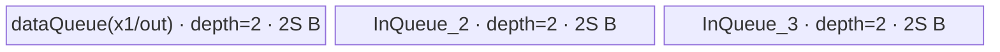

# ForeachAddcdivScalar A2/A3 ACLNN 算子知识

## 算子速览

| 项目 | 内容 |
|---|---|
| 实际入口 | `aclnnForeachAddcdivScalarV2GetWorkspaceSize` / `aclnnForeachAddcdivScalarV2`，公开 ACLNN 两段式接口；本卡只取版本族中更新的 V2。 |
| 计算语义 | 对三个等长 TensorList 逐项、逐元素计算 `y_i = x1_i + scalar * (x2_i / x3_i)`。 |
| 输入输出 | `x1/x2/x3/out` 为 ND、同列表长度、同位置 shape、统一 dtype；支持 FP16/FP32/BF16。V2 的 `scalar` 是 `aclScalar`，经 executor 转成 FP16/FP32 标量 Tensor。 |
| 执行类型 | 单 Kernel：`foreach_addcdiv_scalar`，`KERNEL_TYPE_AIV_ONLY`，AIV_VECTOR。 |
| Kernel 路线 | R-001 FP16 升精度；R-002 FP32 原 dtype；R-003 BF16 升精度。 |
| 核心资源 | GM TensorList 描述符；三条双缓冲 VECIN Queue；FP16/BF16 路线另有一个 FP32 VECIN Queue；无 VECOUT Queue，结果复用 x1 LocalTensor 后直写 GM；算子节点预留 32 B workspace。 |
| 来源闭包 | source_closed：公开 V2 → executor/Contiguous/Scalar 转换 → `ForeachAddcdivScalar` launcher → arch22 Tiling/POD → dtype router → 公共 foreach body/helper → A2/A3 构建接线已闭合。 |
| 验证状态 | 已完成源码闭包检查；本次知识提取未执行编译、真机、数值或性能测试。 |

## 接口与语义

### 计算语义

设三个 TensorList 长度均为 `n`，第 `i` 组 Tensor 的元素数为 `N_i`。对 `0 <= i < n`、`0 <= j < N_i`：

```text
y_i[j] = x1_i[j] + scalar * (x2_i[j] / x3_i[j])
```

源码计算顺序是先除法、再 `Axpy`。FP16/BF16 路线把三个输入分段升为 FP32，完成除法和乘加后以 `CAST_RINT` 降回输出 dtype；FP32 路线直接以 FP32 `Div` 和 `Axpy<float,float>` 计算。`x3 == 0` 的数值结果没有算子自定义处理，沿用底层浮点除法语义。

### 输入、输出与属性

| 参数 | shape/layout | dtype | 约束、默认值与语义 |
|---|---|---|---|
| `x1` | 每个 Tensor 0～8 维，公开格式 ND | FP16/FP32/BF16 | TensorList；V2 文档不支持空 Tensor；列表内 dtype 一致。空 TensorList 是单独的 Host 成功短路。 |
| `x2` | 与 `x1` 同位置 shape | 同 `x1` | 列表长度、每项 shape、dtype 均须匹配。 |
| `x3` | 与 `x1` 同位置 shape | 同 `x1` | 除数；列表长度、每项 shape、dtype 均须匹配。 |
| `scalar` | `aclScalar`，无 Tensor shape/layout | `x1=FP32/BF16` 时 FP32 或 DOUBLE；`x1=FP16` 时 FP16 或 DOUBLE | executor 将其转换为内部单元素 Tensor：BF16 数据路线转 FP32，其余转成 `x1` dtype。 |
| `out` | 与 `x1` 同位置 shape；公开格式 ND | 同 `x1` | 输出 TensorList；API 实现要求精确 shape 相等且拒绝私有格式。 |

### 入口与版本

公开版本族为 `aclnnForeachAddcdivScalar` 与 `aclnnForeachAddcdivScalarV2`。V2 把 `scalar` 从单元素 `aclTensor` 改为 `aclScalar`，是本固定仓中更新的公开入口；A2、A3、Ascend 950 的 V2 产品支持表均为支持。V2 实现最终仍注册内部算子类型 `ForeachAddcdivScalar`，不是另一个数学语义。A2/A3 分别由 `ascend910b` 与 `ascend910_93` 配置接到同一 `arch22` Tiling 和默认 Kernel 源。

## Host/Launcher 执行流程

### 参数校验与前处理

`ExecForeachAddcdivScalarV2GetWorkspaceSize` 依次执行：

1. 创建 executor；检查五个业务参数非空。
2. 仅允许当前架构为 `DAV_2201` 或 regbase；本卡的 A2/A3 由前者进入。检查 TensorList 数据为 FP16/FP32/BF16；检查 scalar 与数据 dtype 的合法组合；检查四个 TensorList 内所有项 dtype 一致。
3. 检查 `x1/x2/x3` 列表长度相同、同位置 shape 相同、维数不超过 8，并要求 `out[i]` 与 `x1[i]` shape 相同；拒绝私有 storage format。
4. 若任一输入列表长度为 0，设置 `workspaceSize=0`、交还 executor 并成功返回，不添加 Kernel。
5. 对 `x1/x2/x3` 每项调用框架 `l0op::Contiguous`，再组装三份 executor 所有的 TensorList。公开 V2 表声明非连续 Tensor 不支持；这里的 Contiguous 调用是固定源码中仍存在的框架边界。
6. 把 scalar 转成内部 Tensor：BF16 数据路线显式转 FP32，FP16/FP32 路线转成数据 dtype。
7. `l0op::ForeachAddcdivScalarV2` 通过 `ADD_TO_LAUNCHER_LIST_AICORE(ForeachAddcdivScalar, ...)` 添加一个节点；任一步空指针或 launcher 失败立即返回，后续执行不建立。

### 参数、Workspace 与生命周期

executor 拥有 Contiguous 结果、内部 scalar Tensor、TensorList 包装和 launcher 描述；第一段用 `GetWorkspaceSize()` 汇总框架前处理与算子节点空间，交由调用者分配。arch22 Tiling 对 `ForeachAddcdivScalar` 节点写 `workspaces[0]=32`，Kernel 明确把 `userWS` 设为空且不读 `workspace`，因此这 32 B 是预留而非节点中间量；若 Contiguous 引入额外任务，总 ACLNN workspace 由 executor 汇总，不能仅用 32 B 替代第一段返回值。第二段 `CommonOpExecutorRun` 在传入 stream 上执行整个序列，executor 有效期覆盖该调用。

### 启动图与失败传播

```text
V2 GetWorkspaceSize
  -> 0..3n 个框架 Contiguous 节点（仅框架决定是否实际搬运）
  -> ConvertToTensor(scalar)
  -> node K0: ForeachAddcdivScalar / foreach_addcdiv_scalar
       blockDim = needCoreNum
       tiling = ForeachCommonTilingData
       workspace slice = 节点预留 32 B，但 Kernel 不访问
  -> out TensorList
```

K0 是唯一算子 Device 节点。输入边为三份连续 TensorList 和单元素 scalar Tensor，输出边为调用者提供的 `out`；全部由同一 executor/stream 保序。任一 Contiguous、TensorList 分配、scalar 转换或 launcher 添加失败都会使第一段返回错误，不产生可执行的后续 K0。固定仓不展开 `CommonOpExecutorRun` 内部事件实现，stream 保序属于框架边界；算子 Kernel 内无跨核共享状态或跨 Kernel 边。

## Route 与参数设计

### 分核与资源计算

记 `s=sizeof(dtype)`、`E=32/s` 个元素/32 B block、`N=sum_i N_i`、平台 AIV 核数为 `Cplat`：

```text
needCoreNum = min(max(ceil(N / E), 1), Cplat, 50)
blockCount = ceil(N / E)
base = floor(blockCount / needCoreNum) * E
前 blockCount % needCoreNum 个核分配 base + E 个元素，其余分配 base
```

分配按 TensorList 顺序连续扫过，POD 为每核记录起止 Tensor 索引和首尾 Tensor 内元素 offset；最后未凑满 32 B block 的核以真实最后元素结束。设 `P=ForeachCommonTilingData::GetDataSize()`、`U=平台 UB 字节数`、`S=inputsTensorUbSize`：

```text
FP32:      S = align_down((U - P) / 8, 32 B)
FP16/BF16: S = align_down(((U - P) / 10) / 8, 64 B)
```

FP32 的 `maxDataCount=S/4`；FP16/BF16 的 `maxDataCount=9S/2`、`maxCastDataCount=S/4`。每核依次处理其 Tensor 片段，每片再按 `maxDataCount` 切 tile，尾 tile 使用按字节长度的 `DataCopyPad`。

### Route 选择

| 顺序 | Route | Key/模板 | 精确选择条件与优先级 | 不适用去向 |
|---:|---|---|---|---|
| 1 | R-001 FP16 升精度 | key 1；`ForeachOneScalarQuaternaryImplictOutput<half, AddcDivScalarAdapter<half>, 2, 3>` | `dataType == DT_FLOAT16`，`GetTilingKeyByDtypeOnly` 返回 1 | 检查下一 dtype；未知 key 无 body |
| 2 | R-002 FP32 原 dtype | key 2；`ForeachOneScalarQuaternaryImplictOutput<float, AddcDivScalarAdapterForFloat<float>, 2, 3>` | `dataType == DT_FLOAT`，返回 2 | 检查下一 dtype；未知 key 无 body |
| 3 | R-003 BF16 升精度 | key 4；`ForeachOneScalarQuaternaryImplictOutput<bfloat16_t, AddcDivScalarAdapter<bfloat16_t>, 2, 3>` | `dataType == DT_BF16` 且编译 guard `__CCE_AICORE__ >= 220` 且 NPU arch 非 3003/3113 | 不满足编译 guard 时 key 4 无 body |

```text
API dtype/arch check
  -> empty TensorList: workspace=0, success, no Kernel
  -> arch22 Tiling: key = FP16?1 : FP32?2 : BF16?4 : 0
       -> key 1: R-001
       -> key 2: R-002
       -> key 4 and compile guard: R-003
       -> otherwise: no Kernel branch
```

### 模板/实现执行矩阵

| Route | key/selector | dtype/shape/platform 完整命中条件 | 执行拓扑与 Kernel 节点 | 实际模板/body | 内存与同步特征 | tail/fallback |
|---|---|---|---|---|---|---|
| R-001 FP16 升精度 | 1 | A2/A3；非空列表；FP16；API/tiling shape 与列表检查通过 | 单 AIV Kernel K0 | implicit-output 模板；`AddcDivScalarAdapter<half>` → `ComputerPerCastForAddcDivScalar` | 3 个 depth=2 VECIN，每 buffer 9S；1 个 3S FP32 Queue；V/搬运硬事件 | tile 尾用 `DataCopyPad`；cast 子段尾用实际 `dataCount` |
| R-002 FP32 原 dtype | 2 | A2/A3；非空列表；FP32；检查通过 | 单 AIV Kernel K0 | implicit-output 模板；`AddcDivScalarAdapterForFloat<float>` | 3 个 depth=2、每 buffer S 的 VECIN；结果原地复用 x1 LocalTensor | tile 尾用 `DataCopyPad`；无 dtype fallback |
| R-003 BF16 升精度 | 4 | A2/A3；非空列表；BF16；检查通过；编译 guard 成立 | 单 AIV Kernel K0 | implicit-output 模板；`AddcDivScalarAdapter<bfloat16_t>` | 与 R-001 相同的 57S 账；scalar 内部 Tensor 为 FP32 | 同 R-001；guard 不成立无 key 4 body |

### 隐藏性能 Guard

| Guard | Host/Tiling 条件 | Device/资源原因 | 影响 Route | 不满足时去向 | 源码符号 |
|---|---|---|---|---|---|
| TensorList 上限 | `Init` 只扫描 `i < 50` | POD `tensorDataCountList` 仅 50 项 | 全部 | 公开 API 未显式声明该上限；超过 50 项的固定源码行为未闭合为受支持路径 | `foreach_tiling_class.h::ForeachCommonTiling::Init` |
| 核数组上限 | `needCoreNum=min(...,50)` | POD 每核数组均为 50 项 | 全部 | 截断到 50 AIV 核 | `RunBigScalarKernelTiling` |
| UB 可用量 | `U > P` 且上式得到 `S>0` | Queue 初始化与 `maxDataCount` 除法依赖正容量 | 全部 | 源码无显式失败 guard；资源过小时行为不应外推 | `DivideUbMemory1` |
| DMA 对齐 | 整 tile 用 `DataCopy(..., dataCount)`；尾 tile 标记 `isRemainder` | 非整 tile 以 `blockLen=dataCount*sizeof(T)` 的扩展搬运避免把 padding 写入输出 | 全部 | 尾 tile 走 `DataCopyPad` | `KernelForeachUnary::CopyIn`；implicit `Compute` |
| BF16 编译条件 | `__CCE_AICORE__ >= 220 && arch != 3003/3113` | key 4 body 受编译期能力约束 | R-003 | 无 else/fallback | `op_kernel/foreach_addcdiv_scalar.cpp::foreach_addcdiv_scalar` |
| 空列表 | API 中任一输入列表 size 为 0 | 避免生成无业务元素的 POD/Kernel | 全部 | Host 成功返回，workspace 0 | `ExecForeachAddcdivScalarV2GetWorkspaceSize` |

### POD/ABI

`ForeachCommonTilingData` 由 `BEGIN_TILING_DATA_DEF` 宏生成；固定仓未包含该框架宏定义，因此 `sizeof/alignof/offsetof` 不可见，不能按普通 C struct 推测。Host 与 Device 均使用同名注册结构，Host 通过 setter 和 `SaveToBuffer` 序列化，Device 通过 `GET_TILING_DATA` 解包。

| 结构 | 字段 | 类型/位宽 | ABI 布局 | 单位 | Host/launcher producer | Device consumer | 边界 |
|---|---|---|---|---|---|---|---|
| `ForeachCommonTilingData` | `inputsTensorUbSize` | `uint64_t`/64 | 宏展开不可见 | 字节/每个基础 buffer 参数 `S` | `DivideUbMemory1` 后 `FillTilingData::set_inputsTensorUbSize` | `KernelForeachBase::ParseTilingData`；各 Queue `InitBuffer` | FP16/BF16 再派生 `9S` 和 `S/4` |
| 同上 | `tensorDataCountList[50]` | `int64_t[50]` | 宏展开不可见 | 元素 | `Init` 从每项 storage shape 写入 | `Process` 决定非首尾 Tensor 的末 offset | 未使用项保持零 |
| 同上 | `tensorStartList[50]` | `uint16_t[50]` | 宏展开不可见 | Tensor 索引 | `AssignDataToEachCore` | `ParseTilingData` | 仅 `blockIdx < blockDim` 项有效 |
| 同上 | `tensorEndList[50]` | `uint16_t[50]` | 宏展开不可见 | Tensor 索引，闭区间 | `AssignDataToEachCore` | `Process` 循环上界 | 同上 |
| 同上 | `tensorStartOffsetList[50]` | `int64_t[50]` | 宏展开不可见 | 元素 | `AssignDataToEachCore` | `Process` 首 Tensor 起点 | 同上 |
| 同上 | `tensorEndOffsetList[50]` | `int64_t[50]` | 宏展开不可见 | 元素，闭区间 | `AssignDataToEachCore` | `Process` 末 Tensor 终点 | 同上 |

### Route 源码闭包

| Route | Key/selector | Host/Tiling producer | POD/参数 | Kernel entry/router 节点 | Kernel body/直接依赖 | 构建接线 |
|---|---|---|---|---|---|---|
| R-001 | key 1 | `arch22/foreach_addcdiv_scalar_tiling_arch22.cpp::Tiling4ForeachAddcdivScalarTiling`；`ForeachCommonTiling` | `ForeachCommonTilingData` | `op_kernel/foreach_addcdiv_scalar.cpp::foreach_addcdiv_scalar` | `ForeachOneScalarQuaternaryImplictOutput`；`KernelForeachUnary`; `AddcDivScalarAdapter<half>` | `op_host/CMakeLists.txt` arch22；`op_kernel/CMakeLists.txt` 默认源，A2/A3 |
| R-002 | key 2 | 同上 | 同上 | 同上 | `AddcDivScalarAdapterForFloat<float>` 与相同公共模板 | 同上 |
| R-003 | key 4 | 同上 | 同上 | 同上，受 BF16 编译 guard | `AddcDivScalarAdapter<bfloat16_t>` 与相同公共模板 | 同上 |

## Kernel 实现

### 公共执行流程

K0 读取 POD 后按 key 构造模板对象。对象从 TensorList 描述符取得每项 GM 地址；每核只访问 POD 指定的连续全局元素区间。对每个 Tensor 片段，`SingleTensorProcess` 按 `maxDataCount` 循环：x1 入队，x2/x3 入队，三路 DeQue，计算直接覆盖 x1 LocalTensor，等待 Vector→MTE3 后直写 `out`，再等待 MTE3→MTE2 后释放 x1 buffer。三路 Queue 的 EnQue/DeQue 提供 MTE2→Vector 数据依赖；显式硬事件保护原地结果写回和下一次复用。

### Route R-001：FP16 升精度

#### 适用条件

##### 选择证据

| 层级 | 文件 | 符号 | 源码谓词/参数 | 结果/下一跳 |
|---|---|---|---|---|
| API | `op_host/op_api/aclnn_foreach_addcdiv_scalar_v2.cpp` | `ForeachAddcdivScalarV2CheckDtypeValid` | self dtype FP16，scalar dtype FP16/DOUBLE | scalar 转 FP16 Tensor |
| Tiling | `foreach_utils/op_host/common_dtype.h` | `GetTilingKeyByDtypeOnly` | `DT_FLOAT16` | key 1 |
| Router | `op_kernel/foreach_addcdiv_scalar.cpp` | `foreach_addcdiv_scalar` | `TILING_KEY_IS(1)` | R-001 模板实例 |

#### Device 数据流

##### 函数级调用链

```text
ForeachAddcdivScalar launcher -> foreach_addcdiv_scalar(..., tiling)
  -> ForeachOneScalarQuaternaryImplictOutput<half, AddcDivScalarAdapter<half>,2,3>::Init
  -> Process
    -> KernelForeachUnary::SingleTensorProcess
      -> CopyIn(x1) + CopyInPlus(x2,x3)
      -> Compute -> AddcDivScalarAdapter<half>
        -> ComputerPerCastForAddcDivScalar<half>
      -> implicit Compute 内 DataCopy(x1Local -> yGM)
```

##### 源码等价伪码

```text
S = tiling.inputsTensorUbSize
for tensor i in [tensorStart, tensorEnd]:
  segment = [startOffset_if_first, endOffset_if_last]
  bind x1/x2/x3/y GM to segment start
  for tile t of at most 9*S/2 elements:
    CopyIn x1,x2,x3; tail uses byte-count DataCopyPad
    for cast chunk c of at most S/4 elements:
      fp32[0:S]   = cast(x2_chunk)
      fp32[S:2S]  = cast(x3_chunk)
      fp32[2S:3S] = cast(x1_chunk)
      fp32[0:S]   = fp32[0:S] / fp32[S:2S]
      fp32[2S:3S] += scalar_fp32 * fp32[0:S]
      x1Local_chunk = cast_rint(fp32[2S:3S])
    V_MTE3 event; CopyOut valid tile bytes from x1Local to yGM
    MTE3_MTE2 event; free x1Local
```

#### 内存与数据搬运

##### 资源与搬运表

| 层级/缓冲区 | offset/地址公式 | extent/容量公式 | dtype/layout | producer | consumer | owner/lifetime | 对齐/复用 |
|---|---|---|---|---|---|---|---|
| x1/x2/x3 GM | TensorList address + `cursorStart + tile*maxDataCount` | tile 有效元素数 | FP16/ND | caller/Contiguous | CopyIn | caller/executor；Kernel 只读 | 尾部按字节搬运 |
| y GM | TensorList address + 同上 | tile 有效元素数 | FP16/ND | implicit Compute CopyOut | caller | caller | 只写有效元素 |
| `dataQueue` | Queue 管理 | depth 2 × 每 buffer `9S` B | FP16 | x1 CopyIn | Compute/CopyOut | TPipe；跨 tile 循环复用 | 结果原地覆盖输入 buffer |
| `InQueue_2` | Queue 管理 | depth 2 × `9S` B | FP16 | x2 CopyIn | cast/Div | TPipe | Compute 后释放 |
| `InQueue_3` | Queue 管理 | depth 2 × `9S` B | FP16 | x3 CopyIn | cast/Div | TPipe | Compute 后释放 |
| `float32Queue` | 三个连续 `S` B 子区 | depth 1 × `3S` B | FP32 | 三次 Cast/Div/Axpy | Cast 回 x1Local | 整个 Process 持有 | 子段之间不别名；跨 cast chunk 覆盖 |
| workspace | 节点 slice offset 由 executor 决定 | 32 B 预留 | N/A | Host Tiling | Kernel 不读取 | executor | 无复用语义 |

##### 分层内存布局


##### 字节账与复用顺序

```text
UB_total = 2*9S + 2*9S + 2*9S + 1*3S = 57S
S = align_down(((U - P)/10)/8, 64 B)
UB_total <= U - P 是 Host 公式必须满足的保守资源条件
dynamic_ub = N/A（AIV Queue 路线）
workspace_total = 32 B 节点预留 + executor 可能加入的 Contiguous workspace
```

| 复用子区 | 写入者 | 读取者/消费点 | 下一次覆盖 | 同步或释放依据 | 安全条件 |
|---|---|---|---|---|---|
| x1 `dataQueue` buffer | MTE2 CopyIn，随后 Vector Cast 回写 | MTE3 CopyOut | depth=2 的后续 tile | Queue + `V_MTE3` + `MTE3_MTE2`，之后 FreeTensor | CopyOut 完成前不得复用 |
| FP32 三子区 | 每个 cast chunk 的三次 Cast/Div/Axpy | 最终 Cast 回 x1Local | 下一 cast chunk | 连续 `PIPE_V` barrier | `dataCount <= S/4` |

#### 同步、精度与尾块

##### 同步与数值边界表

| 阶段 | primitive/机制 | producer | consumer/等待点 | 保护对象 | 精度/尾块 |
|---|---|---|---|---|---|
| CopyIn→Compute | TQue EnQue/DeQue | MTE2 | Vector | 三路输入 Queue | 尾 tile `blockLen=dataCount*2` B |
| Cast/Div/Axpy | `PipeBarrier<PIPE_V>` | 每条 Vector 指令 | 下一 Vector 指令 | FP32 三子区与 x1Local | FP16→FP32；Div 后 Axpy；`CAST_RINT` 回 FP16 |
| Compute→CopyOut | `V_MTE3` flag/wait | Vector | MTE3 | 原地 x1Local 结果 | 仅写 `dataCount` 有效元素 |
| CopyOut→复用 | `MTE3_MTE2` flag/wait | MTE3 | Free/下一 MTE2 | x1Local 物理 buffer | 防止提前覆盖 |

#### 关键实现

##### 符号证据表

| 阶段 | 文件 | 符号/模板实例 | 实现事实 |
|---|---|---|---|
| Host/Tiling producer | `foreach_utils/op_host/foreach_tiling_class.h` | `RunBigScalarKernelTiling` / `DivideUbMemory1` | key、blockDim、POD、S 与 32 B workspace |
| Kernel entry/router | `foreach_addcdiv_scalar/op_kernel/foreach_addcdiv_scalar.cpp` | key 1 分支 | FP16 模板实例 |
| Device body/helper | `foreach_addcdiv_scalar/op_kernel/foreach_addcdiv_scalar.cpp` | `AddcDivScalarAdapter` / `ComputerPerCastForAddcDivScalar` | FP32 升精度与计算顺序 |
| Device body/helper | `foreach_utils/op_kernel/foreach_one_scalar_quaternary_implict_output.h` | `Process` / `Compute` | 多 Tensor/tile 循环、原地输出与事件 |

### Route R-002：FP32 原 dtype

#### 适用条件

##### 选择证据

| 层级 | 文件 | 符号 | 源码谓词/参数 | 结果/下一跳 |
|---|---|---|---|---|
| API | `op_host/op_api/aclnn_foreach_addcdiv_scalar_v2.cpp` | `ForeachAddcdivScalarV2CheckDtypeValid` | self FP32，scalar FP32/DOUBLE | scalar 转 FP32 Tensor |
| Tiling | `foreach_utils/op_host/common_dtype.h` | `GetTilingKeyByDtypeOnly` | `DT_FLOAT` | key 2 |
| Router | `op_kernel/foreach_addcdiv_scalar.cpp` | `foreach_addcdiv_scalar` | `TILING_KEY_IS(2)` | R-002 |

#### Device 数据流

##### 函数级调用链

```text
launcher -> foreach_addcdiv_scalar
  -> ForeachOneScalarQuaternaryImplictOutput<float, AddcDivScalarAdapterForFloat<float>,2,3>
    -> Process -> SingleTensorProcess
      -> CopyIn(x1,x2,x3)
      -> Div(x2Local,x2Local,x3Local)
      -> Axpy(x1Local,x2Local,scalar)
      -> implicit CopyOut(x1Local -> yGM)
```

##### 源码等价伪码

```text
for assigned tensor segments:
  for tile <= S/4 elements:
    load x1,x2,x3
    x2Local = x2Local / x3Local
    barrier V
    x1Local = x1Local + scalar * x2Local
    V_MTE3; write valid elements to y; MTE3_MTE2; free
```

#### 内存与数据搬运

##### 资源与搬运表

| 层级/缓冲区 | offset/地址公式 | extent/容量公式 | dtype/layout | producer | consumer | owner/lifetime | 对齐/复用 |
|---|---|---|---|---|---|---|---|
| GM x1/x2/x3/y | TensorList address + segment + tile offset | tile ≤ `S/4` 元素 | FP32/ND | caller/Kernel | Kernel/caller | caller | tail 按实际字节 |
| `dataQueue` | Queue | depth 2 × S B | FP32 | x1 CopyIn | Axpy/CopyOut | TPipe | x1 原地变 y |
| `InQueue_2` | Queue | depth 2 × S B | FP32 | x2 CopyIn | Div/Axpy | TPipe | Div 原地复用 |
| `InQueue_3` | Queue | depth 2 × S B | FP32 | x3 CopyIn | Div | TPipe | Compute 后释放 |
| workspace | executor slice | 32 B 预留 | N/A | Host | 未读 | executor | N/A |

##### 分层内存布局



##### 字节账与复用顺序

```text
UB_total = 2S + 2S + 2S = 6S
S = align_down((U-P)/8, 32 B)
dynamic_ub = N/A
workspace_total = 32 B 节点预留 + executor 前处理需求
```

| 复用子区 | 写入者 | 读取者/消费点 | 下一次覆盖 | 同步或释放依据 | 安全条件 |
|---|---|---|---|---|---|
| x2Local | CopyIn，随后 `Div` 原地写 | `Axpy` | Queue buffer 再分配 | V barrier + FreeTensor | Axpy 完成后才释放 |
| x1Local | CopyIn，随后 `Axpy` 原地写 | MTE3 CopyOut | 下一 tile | `V_MTE3` / `MTE3_MTE2` | CopyOut 完成前不覆盖 |

#### 同步、精度与尾块

##### 同步与数值边界表

| 阶段 | primitive/机制 | producer | consumer/等待点 | 保护对象 | 精度/尾块 |
|---|---|---|---|---|---|
| CopyIn | Queue | MTE2 | Vector DeQue | 三输入 | tail `DataCopyPad` |
| Div→Axpy | `PIPE_V` barrier | Div | Axpy | x2Local | 全程 FP32 |
| Axpy→CopyOut | `V_MTE3` | Vector | MTE3 | x1Local | 仅有效元素 |
| CopyOut→复用 | `MTE3_MTE2` | MTE3 | Free/下一搬运 | x1Local | 防提前覆盖 |

#### 关键实现

##### 符号证据表

| 阶段 | 文件 | 符号/模板实例 | 实现事实 |
|---|---|---|---|
| Host/Tiling producer | `foreach_utils/op_host/foreach_tiling_class.h` | `RunBigScalarKernelTiling` / `DivideUbMemory1` | key 2、S、分核 |
| Kernel entry/router | `foreach_addcdiv_scalar/op_kernel/foreach_addcdiv_scalar.cpp` | key 2 分支 | FP32 模板 |
| Device body/helper | 同文件 | `AddcDivScalarAdapterForFloat<float>` | x2 原地 Div，x1 原地 Axpy |
| Device body/helper | `foreach_utils/op_kernel/foreach_one_scalar_quaternary_implict_output.h` | `Compute` | 直写 GM 与硬事件 |

### Route R-003：BF16 升精度

#### 适用条件

##### 选择证据

| 层级 | 文件 | 符号 | 源码谓词/参数 | 结果/下一跳 |
|---|---|---|---|---|
| API | `op_host/op_api/aclnn_foreach_addcdiv_scalar_v2.cpp` | dtype check / scalar conversion | self BF16；scalar FP32/DOUBLE；内部转 FP32 Tensor | 进入 BF16 数据路线 |
| Tiling | `foreach_utils/op_host/common_dtype.h` | `GetTilingKeyByDtypeOnly` | `DT_BF16` | key 4 |
| Router | `op_kernel/foreach_addcdiv_scalar.cpp` | key 4 分支 | key 4 且编译 guard 成立 | R-003；否则无 body |

#### Device 数据流

##### 函数级调用链

```text
launcher -> foreach_addcdiv_scalar
  -> ForeachOneScalarQuaternaryImplictOutput<bfloat16_t, AddcDivScalarAdapter<bfloat16_t>,2,3>
    -> Process -> SingleTensorProcess -> CopyIn三路
    -> AddcDivScalarAdapter -> ComputerPerCastForAddcDivScalar<bfloat16_t>
    -> implicit CopyOut复用的x1Local
```

##### 源码等价伪码

```text
与 R-001 相同的 9S/2 元素 tile 和 S/4 元素 cast chunk；
BF16 x1/x2/x3 -> FP32，FP32 Div/Axpy，CAST_RINT -> BF16，
scalar 从 DTYPE_SCALAR（binary config 为 FP32）读取为 float。
```

#### 内存与数据搬运

##### 资源与搬运表

| 层级/缓冲区 | offset/地址公式 | extent/容量公式 | dtype/layout | producer | consumer | owner/lifetime | 对齐/复用 |
|---|---|---|---|---|---|---|---|
| GM inputs/y | 与 R-001 相同 | tile ≤ `9S/2` 元素 | BF16/ND | caller/Kernel | Kernel/caller | caller | tail 字节数 `2*dataCount` |
| 三个数据 Queue | Queue | 各 depth 2 × 9S B | BF16 | CopyIn | Cast/CopyOut | TPipe | x1 复用为输出 |
| FP32 Queue | 0、S、2S 子区 | depth 1 × 3S B | FP32 | Cast/Div/Axpy | Cast 回 BF16 | Process | 跨 chunk 复用 |
| scalar GM | offset 0 | 1×FP32 | FP32 | executor ConvertToTensor | `inScalarGM.GetValue(0)` | executor | 转为 C++ float |

##### 分层内存布局


##### 字节账与复用顺序

```text
UB_total = 57S
S = align_down(((U-P)/10)/8, 64 B)
dynamic_ub = N/A
workspace_total = 32 B 节点预留 + executor 前处理需求
```

| 复用子区 | 写入者 | 读取者/消费点 | 下一次覆盖 | 同步或释放依据 | 安全条件 |
|---|---|---|---|---|---|
| x1Local | MTE2，后由 Cast 回写 BF16 | MTE3 | 下一 tile | V/MTE3 与 MTE3/MTE2 事件 | 与 R-001 相同 |
| FP32 三子区 | Cast/Div/Axpy | Cast 回 | 下一 chunk | `PIPE_V` barriers | chunk ≤ S/4 |

#### 同步、精度与尾块

##### 同步与数值边界表

| 阶段 | primitive/机制 | producer | consumer/等待点 | 保护对象 | 精度/尾块 |
|---|---|---|---|---|---|
| 三路加载 | Queue | MTE2 | Vector | BF16 LocalTensor | tail padded load |
| 数值流水 | `PIPE_V` barrier | Cast/Div/Axpy | 下一 Vector op | FP32 子区 | BF16→FP32→BF16，降精度 `CAST_RINT` |
| 写回 | `V_MTE3` / `MTE3_MTE2` | Vector/MTE3 | MTE3/复用 | x1Local | 仅写有效 tail |

#### 关键实现

##### 符号证据表

| 阶段 | 文件 | 符号/模板实例 | 实现事实 |
|---|---|---|---|
| Host/Tiling producer | `foreach_utils/op_host/foreach_tiling_class.h` | `RunBigScalarKernelTiling` | key 4、POD、分核 |
| Kernel entry/router | `foreach_addcdiv_scalar/op_kernel/foreach_addcdiv_scalar.cpp` | key 4 编译 guard | BF16 body 可达条件 |
| Device body/helper | 同文件 | `AddcDivScalarAdapter<bfloat16_t>` | FP32 中间计算 |
| Device body/helper | `foreach_utils/op_kernel/foreach_one_scalar_quaternary_implict_output.h` | `Init` / `Process` | FP32 scalar、Queue 与原地输出 |

## 算子特定优化

### Trick T-001：复用 x1 LocalTensor 直接生成并提交输出

#### 触发与源码依据

- 适用 Route：R-001、R-002、R-003。
- 触发条件：全部非空 Device 路线；模板参数 `needCopyOut=false`。
- Golden 来源：[`foreach_one_scalar_quaternary_implict_output.h:73-95`](../../../../../../../cann-ops-raw/ascendc/ops-nn/955f8b33985b6d72989ebff341bb9c2c564a51bc/foreach/foreach_utils/op_kernel/foreach_one_scalar_quaternary_implict_output.h#L73-L95)

**官方源码（固定 Commit 连续逐字摘录）**：

```cpp
LocalTensor<T> inLocal_1 = Base::dataQueue.template DeQue<T>();
LocalTensor<T> inLocal_2 = InQueue_2.DeQue<T>();
LocalTensor<T> inLocal_3 = InQueue_3.DeQue<T>();

InnerComputer<T, op> computer;
computer.Compute(inLocal_1, inLocal_2, inLocal_3, float32Tensor, scalarVal, Base::maxCastDataCount, dataCount);

InQueue_2.FreeTensor(inLocal_2);
InQueue_3.FreeTensor(inLocal_3);

event_t eventIDVToMTE3 = static_cast<event_t>(GetTPipePtr()->FetchEventID(HardEvent::V_MTE3));
SetFlag<HardEvent::V_MTE3>(eventIDVToMTE3);
WaitFlag<HardEvent::V_MTE3>(eventIDVToMTE3);
```

#### 机制与设计原因

计算 adapter 的第一个 LocalTensor 既装载 x1，又作为 `Axpy`/最终 Cast 的目的；implicit-output 模板不分配 VECOUT Queue，而是在 Vector→MTE3 事件后直接将该 buffer 写到 y。这样源码可证明省去一份输出 UB 物化和一次 UB 内拷贝。`needCopyOut=false` 使基类不再重复走常规 outQueue 路径；MTE3→MTE2 事件保证直写完成后才能释放并复用 x1 buffer。

#### 迁移边界

- 适用：输出可完全由某一输入 tile 覆盖、且该输入的后续计算不再需要原值的逐元素算子。
- 前提：计算结果 dtype/layout 与输出相同；具备明确的 Vector→CopyOut 和 CopyOut→下一 CopyIn 依赖。
- 失效：需要保留 x1 原值、输出 dtype/layout 不同或存在多消费者时，必须分配独立输出 buffer/Queue。
- 未验证：本次知识提取未执行编译、真机、数值或性能测试。

#### 错误做法

若删除 `V_MTE3` 或 `MTE3_MTE2` 依赖即提前写出/覆盖同一 buffer，会破坏源码明确建立的生产者—消费者顺序；固定仓未提供可验证的性能反例。

## 模板与实现对比

| 对比维度 | R-001 FP16 | R-002 FP32 | R-003 BF16 | 设计选择依据 |
|---|---|---|---|---|
| 命中条件/优先级 | key 1 | key 2 | key 4 + 编译 guard | Host 按数据 dtype 唯一映射 |
| 模板与 dtype | `half` + FP32 adapter | `float` + direct adapter | `bfloat16_t` + FP32 adapter | 低精度路线升精度 |
| 循环与分核 | 32 B block 分核；9S/2 tile；S/4 cast chunk | 32 B block；S/4 tile | 同 FP16 | UB 结构决定 tile |
| Queue/TBuf/寄存器/dynamic UB/通信 window | 3×depth2×9S + 3S FP32 | 3×depth2×S | 同 FP16 | 无 TBuf/dynamic UB/通信 window |
| 内存总占用与复用 | 57S；x1 输出复用 | 6S；x1/x2 原地复用 | 57S；x1 输出复用 | 避免 VECOUT |
| 搬运/Vector/SIMT/NDDMA/通信 API | DataCopy(Pad), Cast, Div, Axpy | DataCopy(Pad), Div, Axpy | 同 FP16 | 均为 AIV Vector |
| 同步、精度与 tail | PIPE_V；FP32 中间；CAST_RINT | PIPE_V；FP32 原 dtype | PIPE_V；FP32 中间；CAST_RINT | 尾 tile 只写有效字节 |
| fallback/失败边界 | 未知 key 无 body | 同左 | guard 不成立无 body | API 先限制 dtype/平台 |

## 平台差异

| 项目 | A2 | A3 | 950 |
|---|---|---|---|
| 支持状态 | V2 公开支持；`ascend910b` | V2 公开支持；`ascend910_93` | V2 公开支持，详见独立 `_950` 卡 |
| Host/Launcher | arch22 `ForeachCommonTiling` | 与 A2 共用 arch22 | 独立 arch35 POD/Tiling |
| Kernel/资源 | 默认 AIV Vector Kernel | 与 A2 共用 | SIMT VF，直接 GM，无 AIV Queue |

## 限制与失败边界

- V2 文档不支持空 Tensor，但 API 对空 TensorList 明确成功短路；这不等同于支持列表中的空 Tensor。
- 公开文档写 ND；API 的格式检查实际只拒绝私有 storage format。复用时按公开 ND 约束，不把实现的宽松检查扩展为公开契约。
- 通用 Tiling 的固定数组仅容纳 50 个 Tensor/50 个核，`Init` 也只扫描前 50 项；公开文档未给出列表长度上限，超过 50 的行为不可据此宣称受支持。
- `ForeachCommonTilingData` 宏的底层 `sizeof/alignof/offsetof` 在固定仓不可见；不得手工重排或跨 ABI 复制。
- `U <= P` 或计算出 `S=0` 时源码没有显式失败 guard；不能推测此资源边界可运行。
- key 未知时 Kernel 没有 error/fallback 分支；正常公开调用依靠 API/Host dtype 校验阻止该状态。
- scalar 为 DOUBLE 时由 executor 转到目标内部 dtype；转换的舍入细节属于框架边界，固定仓未展开。
- 本次知识提取未执行编译、真机、数值或性能测试。

## 源码索引

### 链路索引

| 链路阶段 | 文件 | 关键符号 | 支撑内容 |
|---|---|---|---|
| 入口声明/约束 | `foreach/foreach_addcdiv_scalar/docs/aclnnForeachAddcdivScalarV2.md` | V2 原型、产品支持表 | 最新公开入口、API 约束与平台 |
| 入口实现 | `foreach/foreach_addcdiv_scalar/op_host/op_api/aclnn_foreach_addcdiv_scalar_v2.cpp` | `ExecForeachAddcdivScalarV2GetWorkspaceSize` | 校验、Contiguous、scalar 转换、executor |
| 入口实现 | `foreach/foreach_addcdiv_scalar/op_host/op_api/foreach_addcdiv_scalar_v2.cpp` | `l0op::ForeachAddcdivScalarV2` | 单节点 launcher |
| Host/Tiling/Launcher | `foreach/foreach_addcdiv_scalar/op_host/arch22/foreach_addcdiv_scalar_tiling_arch22.cpp` | `Tiling4ForeachAddcdivScalarTiling` | A2/A3 注册入口 |
| Host/Tiling/Launcher | `foreach/foreach_utils/op_host/foreach_tiling_class.h` | `ForeachCommonTiling` | 校验、分核、UB、POD/workspace |
| Host/Tiling/Launcher | `foreach/foreach_utils/op_host/foreach_tiling_def.h` | `ForeachCommonTilingData` | POD 字段与注册 |
| Host/Tiling/Launcher | `foreach/foreach_utils/op_host/common_dtype.h` | `GetTilingKeyByDtypeOnly` | dtype→key 与数据字节数 |
| Kernel entry/body | `foreach/foreach_addcdiv_scalar/op_kernel/foreach_addcdiv_scalar.cpp` | `foreach_addcdiv_scalar` / adapters | key router 与计算 |
| Kernel entry/body | `foreach/foreach_utils/op_kernel/foreach_one_scalar_quaternary_implict_output.h` | implicit-output 模板 | Queue、循环、直写与同步 |
| Kernel entry/body | `foreach/foreach_utils/op_kernel/kernel_foreach_unary.h` | `KernelForeachUnary` | tile、CopyIn、tail |
| Kernel entry/body | `foreach/foreach_utils/op_kernel/kernel_foreach_base.h` | `KernelForeachBase` | POD 解析与 TensorList GM 地址解析 |
| 构建接线 | `foreach/foreach_addcdiv_scalar/op_kernel/CMakeLists.txt` | `add_kernel_sources` | A2/A3 默认源与 950 分源 |
| 构建接线 | `foreach/foreach_addcdiv_scalar/op_host/CMakeLists.txt` | `SUPPORT_COMPUTE_UNIT` / `SUPPORT_TILING_DIR` | A2/A3→arch22 |
| 构建接线 | `foreach/foreach_addcdiv_scalar/op_host/config/ascend910b/foreach_addcdiv_scalar_binary.json` | `op_list` | 三个 dtype 组合及 BF16 scalar=FP32 |

### 实现复用检查

| 检查项 | 可复用事实 | 不得改变的约束 | 源码符号 |
|---|---|---|---|
| ABI/POD | 六字段 foreach 分核描述 | 字段顺序、位宽、50 项数组、宏序列化 | `ForeachCommonTilingData`; `FillTilingData` |
| 调用顺序 | 校验→Contiguous→scalar Tensor→launcher→stream run | 失败必须阻断后续节点 | `ExecForeachAddcdivScalarV2GetWorkspaceSize` |
| workspace/内存 | 节点 32 B 预留；三输入 Queue；低精度 3S FP32 区 | executor 总 workspace 不等于固定 32 B；depth 必须计入 | `RunBigScalarKernelTiling`; implicit `Init` |
| 同步 | Queue + V/MTE3 + MTE3/MTE2 | 原地 buffer 写回前后不可删事件 | implicit `Compute` |
| 精度与尾块 | FP16/BF16 升 FP32、Div→Axpy→CAST_RINT；尾部按有效字节 | 不得改计算顺序/round mode | adapters；`KernelForeachUnary::CopyIn` |
| 失败边界 | API dtype/shape/format；BF16 编译 guard；未知 key 无 body | 不把宽松实现检查当公开支持 | dtype check；router |