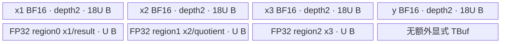

# ForeachAddcdivScalarList A2/A3 ACLNN 算子知识

## 算子速览

| 项目 | 内容 |
|---|---|
| 实际入口 | `aclnnForeachAddcdivScalarListGetWorkspaceSize` + `aclnnForeachAddcdivScalarList`，无版本后缀的公开 ACLNN 两段式接口 |
| 计算语义 | 对列表下标 `i` 与张量元素 `j` 计算 `y_i[j] = x1_i[j] + (x2_i[j] / x3_i[j]) * scalars[i]` |
| 输入输出 | 三个等长动态 TensorList、一个标量 Tensor、一个动态输出 TensorList；ND；FP16/FP32/BF16；同一位置的 `x1/x2/x3` shape 相同 |
| 执行类型 | 单 Kernel：`AIV_VECTOR`；没有 Cube/AIC、MIX_CV、SIMT 或 NDDMA 节点 |
| Kernel 路线 | R-001 FP16 原生 Vector；R-002 FP32 原生 Vector；R-003 BF16 分段升精度 Vector |
| 核心资源 | ListTensor GM 指针表；4 个 depth=2 的 TQue；BF16 额外 1 个 depth=1 FP32 Queue；Tiling 请求 32 B workspace，但 Kernel 将用户 workspace 置空且不访问 |
| 来源闭包 | source_closed：公开接口契约、生成式 ACLNN→OpDef 框架边界、公共 InferShape、arch22 Tiling/POD、全部 dtype router/body/helper 与 A2/A3 构建接线已闭合。 |
| 验证状态 | 已完成源码闭包检查；本次知识提取未执行编译、真机、数值或性能测试。 |

## 接口与语义

### 计算语义

设列表长度为 `n`，`x1_i/x2_i/x3_i` 是第 `i` 个同 shape 张量，`scalars[i]` 是该张量共享的标量。有效输出域严格是 `x1_i.numel` 个元素，运算顺序由 Device body 固定为先 `x2/x3`，再用 `Axpy` 完成 `x1 + scalar * quotient`。不做广播，不把原地、Grad 或量化变体并入本算子。

### 输入、输出与属性

| 参数 | shape/layout | dtype | 约束、默认值与语义 |
|---|---|---|---|
| `x1` | 动态 TensorList；每项 0–8 维，ND | FP16/FP32/BF16，列表内一致 | 可含空 Tensor；加法左输入；非连续输入由 `AutoContiguous` 框架边界处理。 |
| `x2` | 与 `x1` 等长；同位置 shape 相同，ND | 与 `x1` 一致 | 除法分子；可含空 Tensor。 |
| `x3` | 与 `x1` 等长；同位置 shape 相同，ND | 与 `x1` 一致 | 除法分母；源码没有除零特判。 |
| `scalars` | 元素数等于列表长度；0–8 维，ND | 与 `x1` 一致 | 每个列表项一个标量；公开文档标为非空 Tensor。 |
| `out` | 动态 TensorList；公共 InferShape 复制 `x1` 的逐项 shape，ND | 与 `x1` 一致 | 列表长度等于 `x1`；公开接口不支持非连续输出。 |

### 入口与版本

固定仓公开的最新且唯一版本是无后缀 `aclnnForeachAddcdivScalarList`。第一段接口校验参数并返回 `workspaceSize/executor`，第二段接口在指定 `stream` 上执行。固定仓未提交 `aclnnop/aclnn_foreach_addcdiv_scalar_list.h/.cpp` 生成物，因此 ACLNN inner bridge 的逐语句实现、executor 内部节点封装和因输入连续化增加的 workspace 公式不可见；该生成式 bridge 按框架边界处理。其落点由 `ForeachAddcdivScalarList` OpDef、InferShape/Tiling 注册和 Kernel target 闭合。

公开产品表明确支持 Atlas A2、A3，OpDef 同时注册 `ascend910b` 与 `ascend910_93`，Host CMake 将二者都映射到 `arch22`，Kernel CMake 为二者选择默认 Kernel，因此不存在“文档不支持、实现接线支持”的发布冲突。

## Host/Launcher 执行流程

### 参数校验与前处理

1. ACLNN 第一段检查五个主参数非空、dtype 在 FP16/FP32/BF16 且相互一致；文档给出的失败包括空指针 `161001`、dtype 错误 `161002` 和 shape/dim Tiling 错误 `561002`。
2. OpDef 将 `x1/x2/x3/scalars` 标成 `AutoContiguous`；输出公开约束是不支持非连续 Tensor。连续化节点属于生成式 executor，固定仓不可见。
3. `InferShape4ForeachCommon` 要求动态输出数等于 `x1` 实例数，并逐项复制 `x1` shape；`InferDataType4ForeachCommon` 复制逐项 dtype。
4. `ForeachCommonTiling::Init` 遍历最多 50 个 `x1` 实例，记录 `tensorDataCountList[i]`、总元素数、dtype 字节数与每 32 B block 元素数。
5. `CheckOpInfo` 顺序检查三个 TensorList 长度一致、同位置 shape 一致且维数不超过 8、`scalars.numel == tensorCount` 且维数不超过 8、输出 dtype/容量，以及所有 TensorList 项 dtype 一致；失败返回 `GRAPH_FAILED`，阻止 launch。

### 参数、Workspace 与生命周期

Host 读取 AIV core 数和 UB 大小。令 `S = sizeof(dtype)`、`E = 32/S`、`N = Σ_i numel_i`、`Cplat = GetCoreNumAiv()`：`blockCount = ceil(N/E)`，`needCoreNum = min(max(blockCount,1), Cplat,50)`。各核获得概念拼接 TensorList 上按 32 B block 划分的一段，再转成 `tensorStart/End` 和首尾 offset。

令 `P = ForeachCommonTilingData::GetDataSize()`、`B = UB_platform - P`。FP32 使用 `U = floor((B/8)/32)*32`；FP16/BF16 先保守取 `B/10`，再用 `U = floor(((B/10)/8)/64)*64`。`U` 写入 `inputsTensorUbSize`。Tiling 固定请求 `workspaces[0]=32` B；Kernel entry 随即令 `userWS=nullptr`，所有 body 均不访问 workspace。公开 ACLNN 第一段返回的总 workspace 还可能包含框架连续化空间，其公式固定仓不可见。executor 持有 launch 与临时对象，workspace 由调用方保有至第二段入 stream；精确释放时点属于 ACLNN runtime 边界。

### 启动图与失败传播

单节点启动图：

```text
aclnnForeachAddcdivScalarListGetWorkspaceSize
  -> [生成式 ACLNN bridge / AutoContiguous，固定仓不可见]
  -> ForeachAddcdivScalarList Tiling4ForeachAddcdivScalarListTiling
     -> ForeachCommonTiling::Init(FOREACH_POINTWISE_OP_CODE, TYPE_SCALARS_TENSOR)
     -> ForeachCommonTiling::RunBigKernelTiling
  -> executor 记录单节点 N1
aclnnForeachAddcdivScalarList(workspace, workspaceSize, executor, stream)
  -> N1: foreach_addcdiv_scalar_list<<<blockDim=needCoreNum, stream>>>
```

N1 输入是五个 GM 对象（四个输入加输出 ListTensor 描述）、`workspace` 与序列化 `ForeachCommonTilingData`；输出直接写 `out`。没有 Kernel 间 edge。Tiling 任一校验失败时 executor 无可执行节点；第二段 launch/runtime 错误经 ACLNN status 返回。stream 内可见性由 ACLNN runtime 保证，固定仓不展示底层 launch 调用与 event。

## Route 与参数设计

### 分核与资源计算

Host 将所有张量视为一个按逻辑元素拼接的域，但不真的拼接 GM。前 `blockCount % needCoreNum` 个核多处理一个 32 B block；POD 为每核给出 `[tensorStart,tensorEnd]` 及首尾 inclusive offset。Device 对本核覆盖的每个 tensor 单独绑定真实 ListTensor 地址，数据块长度为 `maxDataCount=U/S`（BF16 为 `9U/2`），循环数 `ceil(local_numel/maxDataCount)`，尾块只搬运和提交有效字节。

### Route 选择

| 顺序 | Route | Key/模板 | 精确选择条件与优先级 | 不适用去向 |
|---:|---|---|---|---|
| 1 | R-001 FP16 原生 Vector | key `1`; `ForeachOneScalarQuaternary<half,half,...,2,3>` | `dataType == DT_FLOAT16`，`GetTilingKeyByDtypeOnly` 返回 1；router 首分支 | 条件假则检查 key 2 |
| 2 | R-002 FP32 原生 Vector | key `2`; `ForeachOneScalarQuaternary<float,float,...,2,3>` | `dataType == DT_FLOAT`，返回 2；router 第二分支 | 条件假则检查 key 4 |
| 3 | R-003 BF16 升精度 Vector | key `4`; `ForeachOneScalarQuaternary<bfloat16_t,float,...,2,3>` | `dataType == DT_BF16` 且 `__CCE_AICORE__ >= 220`、非 NPU arch 3003/3113 | 未命中无 body；正常公开入口已由 dtype/platform guard 排除 |

```text
if dtype == FP16: key=1 -> R-001
else if dtype == FP32: key=2 -> R-002
else if dtype == BF16: key=4 -> R-003
else: key=0 -> router 无分支（公开入口应先失败）
```

### 模板/实现执行矩阵

| Route | key/selector | dtype/shape/platform 完整命中条件 | 执行拓扑与 Kernel 节点 | 实际模板/body | 内存与同步特征 | tail/fallback |
|---|---|---|---|---|---|---|
| R-001 FP16 原生 Vector | 1 | FP16；三个列表逐项同 shape；标量/输出同 dtype；A2/A3 | 单 AIV N1 | `ForeachOneScalarQuaternary<half,half,AddcDivListFloatAdapter,2,3>` | 4×depth2 Queue；Div→barrier→Axpy→barrier→拷贝 | `DataCopyPad` 精确尾输入/输出，内部拷贝向 32 B 上取整 |
| R-002 FP32 原生 Vector | 2 | 同上，dtype FP32 | 单 AIV N1 | `ForeachOneScalarQuaternary<float,float,...,2,3>` | 与 R-001 同拓扑，元素容量按 4 B | 同 R-001 |
| R-003 BF16 升精度 Vector | 4 | 同上，dtype BF16；编译 guard 满足 | 单 AIV N1 | `ForeachOneScalarQuaternary<bfloat16_t,float,...,2,3>` + `InnerComputer` 特化 | 四个 Queue 的每槽容量扩到 `9U`，额外 `3U` FP32 Queue；每段 Cast→计算→RINT Cast | 按 `maxCastDataCount=U/4` 分段；尾 GM 提交仍精确 |

### 隐藏性能 Guard

| Guard | Host/Tiling 条件 | Device/资源原因 | 影响 Route | 不满足时去向 | 源码符号 |
|---|---|---|---|---|---|
| 列表静态容量 | `Init` 仅循环 `i<MAX_TENSOR_CONT(50)` | POD 的逐 tensor 数组只有 50 项 | 全部 | 固定仓没有显式 `tensorCount>50` 错误；不得复用到更长列表 | `foreach_tiling_def.h::MAX_TENSOR_CONT`; `ForeachCommonTiling::Init` |
| 核数上限 | `needCoreNum<=50` | POD 每核数组为 50 项 | 全部 | 截断到 50 核 | `RunBigKernelTiling` |
| UB 分配 | FP32 `U=floor((UB-P)/8,32B)`；FP16/BF16 再先除 10，按 64 B 对齐 | 4 个双缓冲 Queue；BF16 还有扩展槽与 FP32 Queue | 全部，尤其 R-003 | 没有替代 Route；过小 `U` 的显式失败固定仓不可见 |
| BF16 编译 guard | `__CCE_AICORE__>=220 && arch!=3003/3113` | 需要 BF16/FP32 Cast 特化 | R-003 | router 不编译 key 4 body |
| 空域 | `needCoreNum` 至少 1 | Host 保证可 launch；950 有显式 skip，arch22 无全空专门分支 | 全部 | 全列表为空时 POD 零初始化会令核 0 的首尾均为 0，源码未证明安全的一元素访问规避 |
| 尾 DMA | `valid_bytes % 32 != 0` | 普通 `DataCopy` 要求 block 对齐 | 全部 | 输入/输出改用 `DataCopyPad`; adapter 内部复制按元素向 32 B 上取整 |

### POD/ABI

| 结构 | 字段 | 类型/位宽 | ABI 布局 | 单位 | Host/launcher producer | Device consumer | 边界 |
|---|---|---|---|---|---|---|---|
| `ForeachCommonTilingData` | `inputsTensorUbSize` | `uint64_t`/64 | 字段顺序可见；`sizeof/alignof/offsetof` 依赖仓外 `TILING_DATA_FIELD_DEF` 宏实现，固定仓不可见 | 字节/每 Queue 槽基准 `U` | `FillTilingData: set_inputsTensorUbSize(U)` | `KernelForeachBase::ParseTilingData`; 初始化 Queue、算 `maxDataCount` | 必须非零且满足 Queue 总账；Host 未显式检查 |
| 同上 | `tensorDataCountList[50]` | `int64_t[50]` | 同上 | 元素 | `Init: shape.GetShapeSize()` | `Process` 设置每个 tensor 的默认尾 offset | 未用元素为 0；列表容量 50 |
| 同上 | `tensorStartList[50]` | `uint16_t[50]` | 同上 | tensor 下标 | `AssignDataToEachCore` | `ParseTilingData: tensorStartList[blockIdx]` | active core 才读取 |
| 同上 | `tensorEndList[50]` | `uint16_t[50]` | 同上 | tensor 下标，inclusive | `AssignDataToEachCore` | `ParseTilingData` | active core 才读取 |
| 同上 | `tensorStartOffsetList[50]` | `int64_t[50]` | 同上 | 元素，inclusive | `AssignDataToEachCore` | `ParseTilingData` | 相对起始 tensor |
| 同上 | `tensorEndOffsetList[50]` | `int64_t[50]` | 同上 | 元素，inclusive | `AssignDataToEachCore` | `ParseTilingData` | 相对结束 tensor |

### Route 源码闭包

| Route | Key/selector | Host/Tiling producer | POD/参数 | Kernel entry/router 节点 | Kernel body/直接依赖 | 构建接线 |
|---|---|---|---|---|---|---|
| R-001 FP16 | 1 | `arch22/...tiling_arch22.cpp::Tiling4...`; `ForeachCommonTiling` | `ForeachCommonTilingData`, `U`, per-core slice | `op_kernel/foreach_addcdiv_scalar_list.cpp::foreach_addcdiv_scalar_list` | `KernelForeachBase`; `KernelForeachUnary`; `ForeachOneScalarQuaternary`; `AddcDivListFloatAdapter<half>` | Host/Kernel CMake + ascend910b/ascend910_93 binary JSON |
| R-002 FP32 | 2 | 同上 | 同上 | 同上 router key 2 | 同上，`AddcDivListFloatAdapter<float>` | 同上 |
| R-003 BF16 | 4 | 同上 | 同上 | 同上 router key 4 + compile guard | 同上，`InnerComputer<bfloat16_t,float>` | 同上 |

## Kernel 实现

### 公共执行流程

所有 Route 都只有 N1。entry 解析 POD、把传入 workspace 丢弃，然后按 key 实例化模板。`KernelForeachBase` 用 `GetBlockIdx()` 取本核 POD slice，并通过 ListTensor 描述首个 64-bit offset 找到指针表，再取第 `i` 个真实 GM 地址。`KernelForeachUnary::Process` 遍历本核覆盖的 tensor；每个 tile 依次搬入 `x1`、派生类搬入 `x2/x3`、读取一次 `scalars[i]`、计算并写回 `y`。Queue 的 `EnQue/DeQue/FreeTensor` 建立 MTE/VEC 阶段所有权；显式 `PipeBarrier<PIPE_V>` 保护连续 Vector 指令与内部拷贝。

### Route R-001：FP16 原生 Vector

#### 适用条件

##### 选择证据

| 层级 | 文件 | 符号 | 源码谓词/参数 | 结果/下一跳 |
|---|---|---|---|---|
| Host | `foreach_utils/op_host/common_dtype.h` | `GetTilingKeyByDtypeOnly` | `DT_FLOAT16` | key 1 |
| Tiling | `foreach_tiling_class.h` | `RunBigKernelTiling` | 校验成功后 `SetTilingKey(1)` | `blockDim=needCoreNum` |
| Router | `op_kernel/foreach_addcdiv_scalar_list.cpp` | `foreach_addcdiv_scalar_list` | `TILING_KEY_IS(1)` | `ForeachOneScalarQuaternary<half,half,...,2,3>` |

#### Device 数据流

##### 函数级调用链

```text
foreach_addcdiv_scalar_list(..., tiling)
  -> ForeachOneScalarQuaternary<half,half,...>::Init
     -> KernelForeachUnary::Init -> KernelForeachBase::Init/ParseTilingData
  -> KernelForeachUnary::Process
     -> ProcessPlusInLoop -> CopyIn(x1) + CopyInPlus(x2,x3)
     -> ForeachOneScalarQuaternary::Compute
        -> InnerComputer<half,half>::Compute
        -> AddcDivListFloatAdapter<half>
     -> KernelForeachUnary::CopyOut(y)
```

##### 源码等价伪码

```text
core = GetBlockIdx()
for tensor i in [start[core], end[core]]:
  lo = (i == start ? startOffset : 0)
  hi = (i == end ? endOffset : numel[i]-1)
  scalar = scalars[i]
  bind x1_i/x2_i/x3_i/y_i at +lo
  for tile in ceil((hi-lo+1)/(U/2)):
    valid = min(U/2, remaining)
    DMA x1,x2,x3 -> three VECIN queues (tail uses exact-byte DataCopyPad)
    q = x2 / x3                       # half
    PIPE_V barrier
    x1 = Axpy(x1, q, scalar, valid)   # half
    PIPE_V barrier
    copy rounded-to-32B x1 -> VECOUT
    DMA only valid bytes VECOUT -> y
```

#### 内存与数据搬运

##### 资源与搬运表

| 层级/缓冲区 | offset/地址公式 | extent/容量公式 | dtype/layout | producer | consumer | owner/lifetime | 对齐/复用 |
|---|---|---|---|---|---|---|---|
| GM `x1_i/x2_i/x3_i/y_i` | ListTensor pointer-table entry `i` + `lo + tile*U/2` | `valid` elements | half/ND-flat | framework / prior op | CopyIn / CopyOut | caller owns through stream completion | full tile `DataCopy`; tail exact-byte `DataCopyPad` |
| `dataQueue` | Queue slot | depth 2 × `U` B | half | CopyIn x1 | Compute | TPipe; free after Compute | 32/64 B Host alignment |
| `InQueue_2` | Queue slot | depth 2 × `U` B | half | CopyInPlus x2 | Div/Axpy | 同上 | tensor2 local 被 quotient 原地覆盖 |
| `InQueue_3` | Queue slot | depth 2 × `U` B | half | CopyInPlus x3 | Div | 同上 | 只读后释放 |
| `outQueue` | Queue slot | depth 2 × `U` B | half | adapter copy | CopyOut | CopyOut 后释放 | 只向 GM 提交 valid bytes |
| workspace | N/A | Tiling 32 B，但 Device 访问 0 B | N/A | Host | 无 consumer | 调用方/executor | entry 强制 `userWS=nullptr` |

##### 分层内存布局


##### 字节账与复用顺序

```text
UB_total = 2U + 2U + 2U + 2U = 8U
U = floor((((UB_platform - POD_bytes)/10)/8)/64B)*64B
UB_total <= (UB_platform - POD_bytes)/10 <= UB_platform - POD_bytes
dynamic_ub = N/A（AIV TPipe 静态 Queue 路径）
workspace_total = 32 B requested, 0 B consumed by Device
```

| 复用子区 | 写入者 | 读取者/消费点 | 下一次覆盖 | 同步或释放依据 | 安全条件 |
|---|---|---|---|---|---|
| `InQueue_2` 当前槽 | CopyInPlus 写 x2；`Div` 原地写 quotient | `Axpy` | `FreeTensor` 后下一 tile | Queue + `PIPE_V` barrier | Axpy 完成前不得覆盖 |
| `dataQueue` 当前槽 | CopyIn 写 x1；`Axpy` 原地写结果 | adapter 拷入 outQueue | `FreeTensor` 后下一 tile | Queue + adapter barrier | out copy 完成前不得释放 |

#### 同步、精度与尾块

##### 同步与数值边界表

| 阶段 | primitive/机制 | producer | consumer/等待点 | 保护对象 | 精度/尾块 |
|---|---|---|---|---|---|
| GM→UB | TQue EnQue/DeQue | MTE CopyIn | Compute | 三个输入槽 | FP16 原样；tail exact bytes + UB padding |
| Div→Axpy | `PipeBarrier<PIPE_V>` | `Div` | `Axpy` | quotient | FP16 除法与 Axpy；无除零分支 |
| Axpy→local copy | `PipeBarrier<PIPE_V>` | Axpy | DataCopy | x1/result | 拷贝长度向 32 B 上取整，最终 GM 仅 valid bytes |
| UB→GM | VECOUT Queue | Compute | CopyOut | 输出槽 | tail `DataCopyPad` 精确写有效域 |

#### 关键实现

##### 符号证据表

| 阶段 | 文件 | 符号/模板实例 | 实现事实 |
|---|---|---|---|
| Host/Tiling producer | `foreach_utils/op_host/foreach_tiling_class.h` | `RunBigKernelTiling/AssignDataToEachCore/DivideUbMemory1` | key、核切分、U、workspace 生产 |
| Kernel entry/router | `foreach_addcdiv_scalar_list/op_kernel/foreach_addcdiv_scalar_list.cpp` | key 1 branch | FP16 模板实例 |
| Device body/helper | `foreach_utils/op_kernel/foreach_one_scalar_quaternary.h` + `kernel_foreach_unary.h` | `Compute/CopyInPlus/Process` | 三路搬运、Queue 生命周期、tile/tail |
| Device math | `foreach_addcdiv_scalar_list.cpp` | `AddcDivListFloatAdapter<half>` | Div→Axpy→conditional copy |

### Route R-002：FP32 原生 Vector

#### 适用条件

##### 选择证据

| 层级 | 文件 | 符号 | 源码谓词/参数 | 结果/下一跳 |
|---|---|---|---|---|
| Host | `common_dtype.h` | `GetTilingKeyByDtypeOnly` | `DT_FLOAT` | key 2 |
| Tiling | `foreach_tiling_class.h` | `DivideUbMemory1` | FP32 不执行 `/10`，按 32 B 对齐 U | blockDim + POD |
| Router | `op_kernel/foreach_addcdiv_scalar_list.cpp` | key 2 branch | `TILING_KEY_IS(2)` | `<float,float,...,2,3>` |

#### Device 数据流

##### 函数级调用链

```text
entry key 2 -> ForeachOneScalarQuaternary<float,float,...>::Init/Process
  -> KernelForeachUnary::Process/SingleTensorProcess
  -> CopyIn x1,x2,x3 -> AddcDivListFloatAdapter<float> -> CopyOut y
```

##### 源码等价伪码

```text
沿用 R-001 的 core/tensor/tile 地址图；maxDataCount=U/4。
每 tile: q=float(x2)/float(x3); barrier; result=Axpy(float x1,q,float scalar,valid);
若 outLocal 与 x1Local 不同，按 32 B 对齐复制到 outQueue；tail 仅提交 valid*4 B。
```

#### 内存与数据搬运

##### 资源与搬运表

| 层级/缓冲区 | offset/地址公式 | extent/容量公式 | dtype/layout | producer | consumer | owner/lifetime | 对齐/复用 |
|---|---|---|---|---|---|---|---|
| GM 四路 tensor | 同 R-001，tile 步长 `U/4` | valid float | FP32/ND-flat | framework | Kernel | caller | 32 B tail |
| 3×VECIN Queue | 每槽 | 每个 depth2×U B | FP32 | CopyIn | Div/Axpy | TPipe | x2、x1 原地复用 |
| VECOUT Queue | 每槽 | depth2×U B | FP32 | adapter | CopyOut | TPipe | valid bytes 输出 |
| workspace | N/A | 0 B consumed | N/A | Host | 无 | caller | 同 R-001 |

##### 分层内存布局


##### 字节账与复用顺序

```text
UB_total = 8U
U = floor(((UB_platform - POD_bytes)/8)/32B)*32B
UB_total <= UB_platform - POD_bytes
dynamic_ub = N/A
workspace_total = 32 B requested, 0 B consumed
```

| 复用子区 | 写入者 | 读取者/消费点 | 下一次覆盖 | 同步或释放依据 | 安全条件 |
|---|---|---|---|---|---|
| x2 Queue 槽 | CopyIn→Div 原地 quotient | Axpy | Free 后 | Queue + PIPE_V | 同 R-001 |
| x1 Queue 槽 | CopyIn→Axpy 原地 result | local copy | Free 后 | PIPE_V | 同 R-001 |

#### 同步、精度与尾块

##### 同步与数值边界表

| 阶段 | primitive/机制 | producer | consumer/等待点 | 保护对象 | 精度/尾块 |
|---|---|---|---|---|---|
| CopyIn/Compute | Queue | MTE | VEC | input slots | FP32；tail exact input bytes |
| Div/Axpy | PIPE_V barriers | Div | Axpy/copy | quotient/result | 全程 FP32 |
| CopyOut | Queue | adapter | MTE | output | exact valid bytes |

#### 关键实现

##### 符号证据表

| 阶段 | 文件 | 符号/模板实例 | 实现事实 |
|---|---|---|---|
| Host/Tiling producer | `common_dtype.h`; `foreach_tiling_class.h` | key 2; `DivideUbMemory1` | FP32 key/U |
| Kernel entry/router | `op_kernel/foreach_addcdiv_scalar_list.cpp` | key 2 | float/float 模板 |
| Device body/helper | 同 R-001 | `AddcDivListFloatAdapter<float>` | FP32 Div/Axpy 与 tail |

### Route R-003：BF16 分段升精度 Vector

#### 适用条件

##### 选择证据

| 层级 | 文件 | 符号 | 源码谓词/参数 | 结果/下一跳 |
|---|---|---|---|---|
| Host | `common_dtype.h` | `GetTilingKeyByDtypeOnly` | `DT_BF16` | key 4 |
| Router | `op_kernel/foreach_addcdiv_scalar_list.cpp` | guarded key 4 branch | CCE≥220 且 arch 非 3003/3113 | `<bfloat16_t,float,...>` |
| Body | `foreach_one_scalar_quaternary.h` | `InnerComputer<bfloat16_t,float,op>` | `T=bfloat16_t,P=float` | 分段 FP32 compute |

#### Device 数据流

##### 函数级调用链

```text
entry key 4
  -> ForeachOneScalarQuaternary<bfloat16_t,float,...>::Init
     -> allocate 9U BF16 slots + 3U FP32 queue
  -> KernelForeachUnary::Process
     -> InnerComputer<bfloat16_t,float>::Compute
        -> ComputePerCast: Cast x1/x2/x3 BF16->FP32
        -> AddcDivListFloatAdapter<float>
        -> Cast result FP32->BF16 CAST_RINT
     -> CopyOut valid BF16 bytes
```

##### 源码等价伪码

```text
maxDataCount = 9U/2; maxCastDataCount = U/4
for each GM tile of at most maxDataCount BF16:
  DMA x1,x2,x3 into 9U-byte Queue slots
  for chunk in ceil(valid/(U/4)):
    cast maxCastDataCount lanes of x1,x2,x3 to three adjacent FP32 regions
    compute only chunk_valid lanes: q=x2/x3; result=x1+scalar*q
    cast maxCastDataCount lanes result to BF16 with CAST_RINT
  CopyOut only GM-valid BF16 bytes
```

#### 内存与数据搬运

##### 资源与搬运表

| 层级/缓冲区 | offset/地址公式 | extent/容量公式 | dtype/layout | producer | consumer | owner/lifetime | 对齐/复用 |
|---|---|---|---|---|---|---|---|
| 3×VECIN Queue | 每槽 | 每个 depth2×`9U` B | BF16 | CopyIn | Cast | TPipe | 9 倍基准容纳一 GM tile |
| VECOUT Queue | 每槽 | depth2×`9U` B | BF16 | downcast | CopyOut | TPipe | GM 仅写 valid bytes |
| `float32Queue` | region 0/U/2U | depth1×`3U` B | FP32 | 三次 Cast；adapter 原地更新 region0/1 | downcast | 整个 Process 持有，末尾释放 | 三个 `U` 字节 FP32 子区；region1 原地 quotient，region0 原地 result |
| workspace | N/A | 0 B consumed | N/A | Host | 无 | caller | 固定 32 B request 不使用 |

##### 分层内存布局



##### 字节账与复用顺序

```text
UB_total = 4*(2*9U) + 1*(3U) = 75U
U = floor((((UB_platform-POD_bytes)/10)/8)/64B)*64B
75U <= 75/80*(UB_platform-POD_bytes)
dynamic_ub = N/A
workspace_total = 32 B requested, 0 B consumed
```

| 复用子区 | 写入者 | 读取者/消费点 | 下一次覆盖 | 同步或释放依据 | 安全条件 |
|---|---|---|---|---|---|
| FP32 region1 | Cast x2；Div 原地 quotient | Axpy | 下一 cast chunk | 每步 PIPE_V barrier | Axpy 完成后才覆盖 |
| FP32 region0 | Cast x1；Axpy 原地 result | BF16 downcast | 下一 cast chunk | PIPE_V barrier | downcast 完成后才覆盖 |
| BF16 Queue slots | GM CopyIn / downcast | Cast / CopyOut | Free 后下一 tile | TQue ownership | 当前 consumer 完成 |

#### 同步、精度与尾块

##### 同步与数值边界表

| 阶段 | primitive/机制 | producer | consumer/等待点 | 保护对象 | 精度/尾块 |
|---|---|---|---|---|---|
| BF16→FP32 | Cast + PIPE_V | three casts | adapter | 3 FP32 regions | `CAST_NONE`; Cast API 长度用 `maxCastDataCount`，计算用 chunk valid |
| FP32 math | Div + Axpy + barriers | Div | Axpy/downcast | quotient/result | FP32 中间 |
| FP32→BF16 | Cast | adapter | CopyOut | BF16 out slot | `CAST_RINT`; padded lanes不写 GM |
| tail output | DataCopyPad | VECOUT | GM | y valid域 | 精确 `valid*sizeof(BF16)` |

#### 关键实现

##### 符号证据表

| 阶段 | 文件 | 符号/模板实例 | 实现事实 |
|---|---|---|---|
| Host/Tiling producer | `foreach_tiling_class.h` | `DivideUbMemory1` | BF16 `/10`、`/8`、64 B 对齐 U |
| Kernel entry/router | `op_kernel/foreach_addcdiv_scalar_list.cpp` | key 4 guarded branch | BF16→float 模板 |
| Device body/helper | `foreach_one_scalar_quaternary.h` | BF16 `InnerComputer::ComputePerCast` | 分块 cast、FP32 adapter、RINT downcast |
| Queue/base | `kernel_foreach_base.h`; `kernel_foreach_unary.h` | BF16 branches | 9U slots、3U FP32 Queue、tile 长度 |

## 算子特定优化

### Trick T-001：以输入 Queue 原地承载 quotient/result，输出仅做一次对齐拷贝

#### 触发与源码依据

- 适用 Route：R-001、R-002；R-003 的 FP32 子区采用同一 adapter。
- 触发条件：每个非空 tile 进入 `AddcDivListFloatAdapter<T>`；当前模板 `needCopyOut=true`，`dstLocal` 与 `tensor1Local` 为不同 Queue 槽。
- Golden 来源：[`foreach_addcdiv_scalar_list.cpp:32-42`](../../../../../../../cann-ops-raw/ascendc/ops-nn/955f8b33985b6d72989ebff341bb9c2c564a51bc/foreach/foreach_addcdiv_scalar_list/op_kernel/foreach_addcdiv_scalar_list.cpp#L32-L42)

**官方源码（固定 Commit 连续逐字摘录）**：

```cpp
    Div(tensor2Local, tensor2Local, tensor3Local, uValue);
    PipeBarrier<PIPE_V>();
    Axpy<T, T>(tensor1Local, tensor2Local, scalarVal, uValue);
    if (dstLocal.GetPhyAddr() != tensor1Local.GetPhyAddr()) {
        PipeBarrier<PIPE_V>();
        if (uValue * sizeof(T) % ADDCDIV_SCALAR_LIST_BYTE_PER_BLOCK == 0) {
            DataCopy(dstLocal, tensor1Local, uValue);
        } else {
            int32_t dataCountInBlock = ADDCDIV_SCALAR_LIST_BYTE_PER_BLOCK / sizeof(T);
            DataCopy(dstLocal, tensor1Local, (uValue + dataCountInBlock - 1) / dataCountInBlock * dataCountInBlock);
        }
```

#### 机制与设计原因

`Div(dst=tensor2Local, src=tensor2Local, src=tensor3Local)` 把分子槽直接改写为 quotient；`Axpy(dst=tensor1Local, src=tensor2Local, alpha=scalarVal, count=uValue)` 又把 x1 槽直接改写为最终结果。因此没有为 quotient 或 result 另建 TBuf。只有因为模板要求独立 VECOUT Queue 时才复制一次；拷贝计数由 `uValue` 和 `sizeof(T)` 计算，并向 32 B block 上取整以满足 UB 内部 `DataCopy`，最终 CopyOut 仍只提交有效字节。

#### 迁移边界

- 适用：三输入逐元素表达式，允许消费输入 UB 副本且最终结果可由 Axpy 形态表达。
- 前提：输入 GM 不与 UB 槽混淆；Div→Axpy→copy 的 PIPE_V barrier 保留；输出 Queue 容量容纳上取整长度。
- 失效：若后续仍需原始 x1/x2、输出 dtype/layout 不同或计算不能原地执行，必须增设缓冲或改写生命周期。
- 未验证：本次知识提取未执行编译、真机、数值或性能测试。

#### 错误做法

固定仓未提供可验证反例；源码明确表明删除两处 PIPE_V barrier 或在 Axpy 消费 quotient 前复用 `tensor2Local` 会破坏依赖。

### Trick T-002：BF16 以固定 FP32 三分区分段升精度

#### 触发与源码依据

- 适用 Route：R-003。
- 触发条件：`T=bfloat16_t,P=float` 且 key 4 编译 guard 成立。
- Golden 来源：[`foreach_one_scalar_quaternary.h:76-91`](../../../../../../../cann-ops-raw/ascendc/ops-nn/955f8b33985b6d72989ebff341bb9c2c564a51bc/foreach/foreach_utils/op_kernel/foreach_one_scalar_quaternary.h#L76-L91)

**官方源码（固定 Commit 连续逐字摘录）**：

```cpp
        PipeBarrier<PIPE_V>();
        Cast(float32Tensor, inLocal_1[index * maxCastDataCount], RoundMode::CAST_NONE, maxCastDataCount);
        PipeBarrier<PIPE_V>();
        Cast(
            float32Tensor[maxCastDataCount], inLocal_2[index * maxCastDataCount], RoundMode::CAST_NONE,
            maxCastDataCount);
        PipeBarrier<PIPE_V>();
        Cast(
            float32Tensor[maxCastDataCount * FACTOR_FOR_CAST], inLocal_3[index * maxCastDataCount],
            RoundMode::CAST_NONE, maxCastDataCount);
        PipeBarrier<PIPE_V>();
        op(float32Tensor, float32Tensor, float32Tensor[maxCastDataCount],
           float32Tensor[maxCastDataCount * FACTOR_FOR_CAST], ToFloat(scalarVal), dataCount);
        PipeBarrier<PIPE_V>();
        Cast(outLocal[index * maxCastDataCount], float32Tensor, RoundMode::CAST_RINT, maxCastDataCount);
```

#### 机制与设计原因

一个 `3U` FP32 Queue 被定长切成 x1/result、x2/quotient、x3 三区；每次只升精度 `U/4` 个元素，并在同三区内完成除、缩放加和降精度。这把 FP32 临时空间限制为 `3U`，同时维持 BF16 GM tile 的较大顺序搬运。`CAST_NONE` 保留扩展值，最终 `CAST_RINT` 明确降精度舍入。

#### 迁移边界

- 适用：低精度输入、多个 FP32 中间可按固定分区复用的 pointwise 链。
- 前提：`maxCastDataCount=U/4`、三分区不重叠、所有 PIPE_V barrier 与最终 RINT 保留。
- 失效：平台不支持该 BF16 guard 时没有 arch22 fallback body；应由 Host/产品支持约束拒绝。
- 未验证：本次知识提取未执行编译、真机、数值或性能测试。

#### 错误做法

固定仓未提供可验证反例；不得把 tail 的 `dataCount` 同 Cast 的分配容量混用来缩小物理子区，否则会改变已证明的固定分区 ABI/内存上界。

## 模板与实现对比

| 对比维度 | R-001 FP16 | R-002 FP32 | R-003 BF16 | 设计选择依据 |
|---|---|---|---|---|
| 命中条件/优先级 | key1 | key2 | key4 + CCE guard | dtype-only selector |
| 模板与 dtype | `<half,half>` | `<float,float>` | `<bf16,float>` | BF16 需要 FP32 中间 |
| 循环与分核 | 概念拼接域、`U/2` tile | 同，`U/4` tile | `9U/2` GM tile + `U/4` cast chunk | dtype 字节数/升精度容量 |
| Queue/TBuf/寄存器/dynamic UB/通信 window | 四个 depth2 Queue | 同 | 四个 9U depth2 Queue + 3U FP32 Queue | R-003 独有 Cast 空间 |
| 内存总占用与复用 | 8U；x2/x1 原地 | 8U；同 | 75U；FP32 region1/0 原地 | Host 各自保守 U 公式 |
| 搬运/Vector/SIMT/NDDMA/通信 API | DataCopy(Pad), Div, Axpy | 同 | 加 Cast/CAST_RINT | 全部是 AIV Vector |
| 同步、精度与 tail | FP16，PIPE_V，精确 GM tail | FP32 | BF16→FP32→BF16，精确 GM tail | 精度语义不同故不合并 Route |
| fallback/失败边界 | 无下一 Device fallback | 同 | guard 不满足无 body | Host 正常限制 dtype/platform |

## 平台差异

| 项目 | A2 | A3 | 950 |
|---|---|---|---|
| 支持状态 | 公开支持 | 公开支持 | 公开支持，见 `_950` 卡 |
| Host/Launcher | `ascend910b`→arch22 公共 `ForeachCommonTiling` | `ascend910_93`→同一 arch22 路径 | arch35 独立 Tiling；最多 256 Tensor；workspace 0 |
| Kernel/资源 | 默认 AIV Kernel，POD 每 tensor/core 50 项 | 与 A2 相同 | 独立 SIMT-VF Kernel，512 threads；无 AIV Queue |

## 限制与失败边界

- 公开接口限制 dtype 为 FP16/FP32/BF16、维数最多 8、三个输入列表长度/逐项 shape/dtype 一致、`scalars.numel` 等于列表长度；`x3==0` 没有源码特判，遵循硬件浮点除法语义。
- arch22 Tiling/POD 的数组容量为 50，但固定源码没有 `tensorCount>50` 的显式拒绝；工程复用必须在入口增加 `1..50` guard，不能依赖静默截断。
- 公开文档支持空 Tensor；混合空/非空时 Device 的 `dataCount=0` 自然跳过 tile。全列表为空时 Host 强制至少一核且 POD 首尾零初始化，固定源码未展示专门空域终点，不能据此声称全空路径已做越界保护。
- `ForeachCommonTilingData` 的字段宏调用可见，但宏定义来自仓外 CANN 头；精确 `sizeof/alignof/offsetof` 固定仓不可见。Host/Device 使用同名生成结构与相同字段顺序。
- ACLNN inner bridge、公开头生成物、总 executor workspace 公式、底层 stream launch/error 清理固定仓不可见；算子拥有的 OpDef、Tiling、POD、Kernel 与构建接线均已闭合。
- 本次知识提取未执行编译、真机、数值或性能测试。

## 源码索引

### 链路索引

| 链路阶段 | 文件 | 关键符号 | 支撑内容 |
|---|---|---|---|
| 入口声明/约束 | `foreach/foreach_addcdiv_scalar_list/docs/aclnnForeachAddcdivScalarList.md` | 两段式原型、产品表、错误表 | ACLNN 公开性、平台、接口约束 |
| 入口实现 | `foreach/foreach_addcdiv_scalar_list/op_host/foreach_addcdiv_scalar_list_def.cpp` | `ForeachAddcdivScalarList` / `OP_ADD` | 生成式 bridge 落点、dtype/layout/AutoContiguous、平台注册 |
| Host Infer | `foreach/foreach_utils/op_host/foreach_infershape.cpp` | `InferShape4ForeachCommon`; `IMPL_OP_INFERSHAPE(ForeachAddcdivScalarList)` | 输出 shape/dtype 与列表数 |
| Host/Tiling | `foreach/foreach_addcdiv_scalar_list/op_host/arch22/foreach_addcdiv_scalar_list_tiling_arch22.cpp` | `Tiling4ForeachAddcdivScalarListTiling` | 公共 Tiling 实例化 |
| Host/Tiling | `foreach/foreach_utils/op_host/foreach_tiling_class.h` | `ForeachCommonTiling` | 校验、分核、UB、workspace、POD producer |
| POD | `foreach/foreach_utils/op_host/foreach_tiling_def.h` | `ForeachCommonTilingData` | 字段、容量、注册 |
| dtype selector | `foreach/foreach_utils/op_host/common_dtype.h` | `GetTilingKeyByDtypeOnly` | key 1/2/4 |
| Kernel entry/body | `foreach/foreach_addcdiv_scalar_list/op_kernel/foreach_addcdiv_scalar_list.cpp` | entry；`AddcDivListFloatAdapter` | router 与数学 body |
| Kernel body | `foreach/foreach_utils/op_kernel/kernel_foreach_base.h` | `KernelForeachBase` | POD consumer、ListTensor 地址 |
| Kernel body | `foreach/foreach_utils/op_kernel/kernel_foreach_unary.h` | `Process/SingleTensorProcess/CopyIn/CopyOut` | core/tensor/tile、Queue、tail |
| Kernel body | `foreach/foreach_utils/op_kernel/foreach_one_scalar_quaternary.h` | `ForeachOneScalarQuaternary`; `InnerComputer` | 三路输入、BF16 Cast、UB 初始化 |
| 构建接线 | `foreach/foreach_addcdiv_scalar_list/op_host/CMakeLists.txt` | `SUPPORT_COMPUTE_UNIT/TILING_DIR` | A2/A3→arch22 Host |
| 构建接线 | `foreach/foreach_addcdiv_scalar_list/op_kernel/CMakeLists.txt` | `add_kernel_sources` | A2/A3 默认 Kernel |
| 构建接线 | `foreach/foreach_addcdiv_scalar_list/op_host/config/ascend910b/foreach_addcdiv_scalar_list_binary.json` | `op_list` | A2 dtype binaries |
| 构建接线 | `foreach/foreach_addcdiv_scalar_list/op_host/config/ascend910_93/foreach_addcdiv_scalar_list_binary.json` | `op_list` | A3 dtype binaries |

### 实现复用检查

| 检查项 | 可复用事实 | 不得改变的约束 | 源码符号 |
|---|---|---|---|
| ABI/POD | 六字段公共 POD 与 ListTensor 指针表解析 | 数组容量 50、字段顺序、offset 为 inclusive 元素下标 | `ForeachCommonTilingData`; `ParseTilingData` |
| 调用顺序 | Init→Process；每 tile CopyIn三路→Compute→CopyOut | Div→Axpy→local copy 顺序 | `KernelForeachUnary::SingleTensorProcess`; adapter |
| workspace/内存 | Device 不使用 workspace；四个双缓冲 Queue | depth 必须计入；BF16 是 75U 而非逻辑有效字节 | entry；各 `InitBuffer` |
| 同步 | Queue ownership + PIPE_V | 不能删除依赖 barrier 或提前 Free | `Compute`; adapter |
| 精度与尾块 | FP16/FP32 原生；BF16 FP32 中间 RINT；GM tail 精确 | BF16 固定三分区和 Cast 顺序；内部 32 B 对齐 copy | `InnerComputer`; `CopyIn/CopyOut` |
| 失败边界 | Host 校验阻断 launch | 列表>50、全空域与生成式 ACLNN bridge 不得推测补齐 | `CheckOpInfo`; `Init`; ACLNN 文档 |