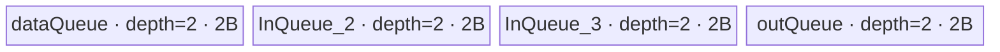
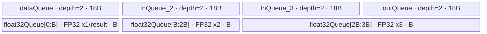

# ForeachAddcmulList A2/A3 ACLNN 算子知识

## 算子速览

| 项目 | 内容 |
|---|---|
| 实际入口 | `aclnnForeachAddcmulListGetWorkspaceSize` + `aclnnForeachAddcmulList`，公开两段式 ACLNN；固定仓只公开文档原型，inner bridge 由 ACLNN 构建框架生成。 |
| 计算语义 | 对列表位置 `i` 和该 Tensor 的有效元素 `j`，`y_i[j] = x1_i[j] + scalars[i] * x2_i[j] * x3_i[j]`。 |
| 输入输出 | 三个等长、逐位置 shape/dtype 相同的 ND TensorList，标量 Tensor `scalars` 含列表长度个元素；输出为同 dtype 的 ND TensorList。支持 FP16、FP32、INT32、BF16。 |
| 执行类型 | 单 Kernel：`foreach_addcmul_list`，`AIV_VECTOR`；全部可达节点均为 Vector/DMA，没有 Cube/AIC 或 `MIX_CV`。 |
| Kernel 路线 | R-001 FP16 native Axpy；R-002 FP32 native Axpy；R-003 INT32 Mul-Muls-Add；R-004 BF16→FP32 分片计算→BF16。 |
| 核心资源 | 动态 TensorList GM 指针表、三路 VECIN 双缓冲、一路 VECOUT 双缓冲；BF16 另有单深度 FP32 scratch queue；算子 Kernel 不消费 workspace。 |
| 来源闭包 | `source_closed`：公开 ACLNN 文档/生成边界→OpDef/InferShape→A2/A3 `ForeachCommonTiling`→`ForeachCommonTilingData`→entry/router→CRTP body/helper→构建与 binary config 已闭合。 |
| 验证状态 | 已完成源码闭包检查；本次知识提取未执行编译、真机、数值或性能测试。 |

## 接口与语义

### 计算语义

设列表长度为 `L`，逐位置 Tensor 元素数为 `N_i`。接口对 `0 <= i < L`、`0 <= j < N_i` 计算：

```text
tmp_i[j] = x2_i[j] * x3_i[j]
y_i[j]   = x1_i[j] + scalars[i] * tmp_i[j]
```

运算不做跨 Tensor 归约；Host 仅把各 Tensor 视作一个按列表顺序拼接的逻辑一维域来分核，Device 在进入每个 Tensor 时重新取 `scalars[i]`。输出只提交每个输入 Tensor 的 `N_i` 个有效元素。FP16/FP32 使用 `Mul` 后 `Axpy`，INT32 使用 `Mul`、`Muls`、`Add`，BF16 先升为 FP32、按上述顺序计算后以 `CAST_RINT` 降回 BF16。

### 输入、输出与属性

| 参数 | shape/layout | dtype | 约束、默认值与语义 |
|---|---|---|---|
| `x1` | TensorList；每个 Tensor 为 ND、rank 0–8，可为空 | FP16/FP32/INT32/BF16 | 加法左输入；列表内 dtype 一致；非连续输入由 OpDef `AutoContiguous` 进入框架连续化边界。 |
| `x2` | 与 `x1` 等长，逐位置 storage shape 相同，ND | 与 `x1` 相同 | 第一个乘法输入；列表内及跨列表 dtype 一致。 |
| `x3` | 与 `x1` 等长，逐位置 storage shape 相同，ND | 与 `x1` 相同 | 第二个乘法输入；列表内及跨列表 dtype 一致。 |
| `scalars` | 必需 Tensor，元素数等于列表长度，rank 0–8，ND | 与 `x1` 相同 | `scalars[i]` 只作用于第 `i` 个 Tensor。公开 A2/A3 ACLNN 文档要求同 dtype。 |
| `out` | TensorList，ND；逐位置容量不得小于 `x1_i` | 与 `x1` 相同 | 输出；公开 ACLNN 文档标记不支持非连续 Tensor。图侧 `InferShape4ForeachCommon` 直接复制 `x1_i` shape。 |
| `workspaceSize` | 标量 Host 输出 | `uint64_t` | 第一段接口返回。算子 Tiling 固定登记 32 B，但生成 executor/连续化的总 workspace 组合规则固定仓不可见。 |
| `executor` | Host 对象 | `aclOpExecutor **` | 第一段接口生成；拥有计算流程，传给第二段。 |
| `workspace`/`stream` | Device 地址/运行时 stream | 不适用 | 第二段执行；Kernel entry 收到 workspace 但显式改为 `nullptr`，不读写这 32 B。 |

### 入口与版本

固定 Commit 只公开一个版本族 `aclnnForeachAddcmulList`，没有 V2 或更新公开版本。公开文档定义 `GetWorkspaceSize`/执行两段式接口，并明确 Atlas A2、Atlas A3 支持且默认确定性实现。`op_host/CMakeLists.txt` 以 `ACLNNTYPE aclnn` 接入生成式 ACLNN；生成出的声明头、inner bridge、executor 编排源码不在固定仓，作为框架边界，不补造其内部符号。

`ForeachAddcmulList` OpDef 为 A2 对应的 `ascend910b` 与 A3 对应的 `ascend910_93` 注册 AICore 配置；两套 binary config 均列出 FP16、FP32、INT32、BF16 四个动态 TensorList binary 组合。A2/A3 共用同一 Host Tiling 与非 `arch35` Kernel body。

## Host/Launcher 执行流程

### 参数校验与前处理

1. 公开第一段 ACLNN 对空指针及受支持 dtype 做 API 校验；固定仓未公开生成 bridge 的逐行实现。
2. OpDef 将 `x1/x2/x3/scalars` 标记 `AutoContiguous`；输入连续化节点及其 workspace 属于框架生成边界。公开接口明确 `out` 不支持非连续 Tensor。
3. `InferShape4ForeachCommon` 要求动态输入 0 的实例数等于输出数，逐输出复制 `x1_i` shape/dtype。
4. `ForeachCommonTiling::Init` 最多扫描 50 个 `x1` Tensor，记录每个 storage shape 元素数、总元素数、公共 dtype 与 `sizeof(dtype)`。
5. `CheckOpInfo` 依次检查三组 TensorList 长度一致、逐位置 storage shape 一致、rank 不超过 8、`scalars` 元素数等于 Tensor 数、输出 dtype 相同且容量不小于输入、所有列表 Tensor dtype 一致；任一失败返回 `GRAPH_FAILED`，ACLNN 对外映射为文档列出的参数或 inner tiling 错误。
6. A2/A3 不是 regbase SoC，`Tiling4ForeachAddcPointwiseList` 构造 `ForeachCommonTiling`，以 `FOREACH_POINTWISE_LIST_OP_CODE=10`、`TYPE_SCALARS_TENSOR` 运行 `RunBigKernelTiling`。

### 参数、Workspace 与生命周期

令 `S = sizeof(T)`、`E = 32/S` 个元素/32 B block、`N = sum_i N_i`，平台 AIV 核数为 `C_platform`：

```text
C_need = min(C_platform, ceil(N / E), 50)；当 N=0 时先把 ceil 值改成 1
blockCount = ceil(N / E)
baseElementsPerCore = floor(blockCount / C_need) * E
extraBlocks = blockCount mod C_need
core c 的目标元素额度 = baseElementsPerCore + (c < extraBlocks ? E : 0)
```

`AssignDataToEachCore` 让每核额度跨越 Tensor 边界，用 `tensorStartList/tensorEndList` 和首尾 offset 描述闭区间。`DivideUbMemory` 对 op code 10 计算 tile 字节 `B=inputsTensorUbSize`：

```text
FP16/FP32/INT32: B = floor(((UB_platform - POD_bytes) / 8) / 32) * 32
BF16:            B = floor((((UB_platform - POD_bytes) / 10) / 8) / 64) * 64
```

随后写 POD、`blockDim=C_need` 和 `workspaces[0]=32`。这 32 B 的 owner 是 executor/runtime，生命周期覆盖第二段 launch；Kernel 内将 `userWS=nullptr`，所以没有算子拥有的 workspace slice 或跨 Kernel 交接。生成 executor 可能因输入连续化扩大总 workspace，但固定仓不可见。

### 启动图与失败传播

```text
aclnnForeachAddcmulListGetWorkspaceSize(...)       # 生成桥固定仓不可见
  -> 输入连续化/参数检查框架边界
  -> ForeachAddcmulList InferShape/OpDef
  -> Tiling4ForeachAddcmulListTiling
     -> Tiling4ForeachAddcPointwiseList
        -> ForeachCommonTiling::Init(10, TYPE_SCALARS_TENSOR)
        -> ForeachCommonTiling::RunBigKernelTiling
  -> executor + workspaceSize

aclnnForeachAddcmulList(workspace, workspaceSize, executor, stream)
  -> node K0: foreach_addcmul_list<<<blockDim=C_need, stream>>>
     inputs: x1/x2/x3 TensorList GM pointer packages, scalars GM, POD
     output: out TensorList GM pointer package
     workspace slice: none consumed (entry passes nullptr)
```

这是单 Kernel launch graph，没有 Device 节点间 edge。K0 内各 block 处理 Host 分配的互斥拼接区间，因此无跨核原子或 barrier。Host Tiling 失败时不生成可执行 launch；第二段 launch 的 stream 排序、错误码转换和 executor 清理由 ACLNN 框架负责，固定仓不可见。Kernel router 对未知 key 没有显式错误分支，会直接结束且不写输出，故 Host dtype/key 校验是必要前置条件。

## Route 与参数设计

### 分核与资源计算

分核只依赖 `N`、`S`、平台 AIV 核数和 `MAX_CORE_CONT=50`，不按 Tensor 单独 launch。每核可横跨多个 Tensor，但首尾用元素 offset 截断；中间 Tensor 全量处理。每个 Tensor 内再按 `maxDataCount` 切 tile：原生路线 `maxDataCount=B/S`，BF16 路线 `maxDataCount=9B/2`，BF16 每个大 tile 内再以 `maxCastDataCount=B/4` 个元素分片升精度。

原生路线真实 UB 分配为四个 depth=2、单槽 `B` 字节的 queue，`UB_total=8B`。BF16 的四个数据 queue 单槽为 `9B`，另有单槽 `3B` 的 FP32 queue，`UB_total=75B`。Host 的 `/8` 与 BF16 额外 `/10` 保守因子分别保证上述真实分配不超过 `UB_platform-POD_bytes`；BF16 `B` 还按 64 B 向下对齐。

### Route 选择

| 顺序 | Route | Key/模板 | 精确选择条件与优先级 | 不适用去向 |
|---:|---|---|---|---|
| 1 | R-001 FP16 native Axpy | key 1；`ForeachOneScalarQuaternary<half, half, AddcMulListFloatAdapter, 2, 3>` | OpDef/binary 命中 FP16，Host `GetTilingKeyByDtypeOnly(DT_FLOAT16)==1`，router 首个 `if TILING_KEY_IS(1)` | key 不为 1 时检查 R-002。 |
| 2 | R-002 FP32 native Axpy | key 2；`ForeachOneScalarQuaternary<float, float, AddcMulListFloatAdapter, 2, 3>` | dtype 为 FP32，Host key 2，router `else if key 2` | key 不为 2 时检查 R-003。 |
| 3 | R-003 INT32 Mul-Muls-Add | key 3；`ForeachOneScalarQuaternary<int, int, AddcMulListNormalAdapter, 2, 3>` | dtype 为 INT32，Host key 3，且编译 guard `__CCE_AICORE__ >= 220` | key 不为 3 时检查 R-004；guard 不满足则该 body 不编译。 |
| 4 | R-004 BF16 FP32 scratch | key 4；`ForeachOneScalarQuaternary<bfloat16_t, float, AddcMulListFloatAdapter, 2, 3>` | dtype 为 BF16，Host key 4，`__CCE_AICORE__ >=220` 且 NPU arch 不是 3003/3113 | 不满足为 unsupported；未知 key 无显式报错并无输出。 |

```text
dtype == FP16  -> key 1 -> R-001
else dtype == FP32  -> key 2 -> R-002
else dtype == INT32 -> key 3 -> R-003  [__CCE_AICORE__ >= 220]
else dtype == BF16  -> key 4 -> R-004  [>=220 and arch != 3003/3113]
else -> key 0/unknown -> router 无分支，Host/API 应先失败
```

### 模板/实现执行矩阵

| Route | key/selector | dtype/shape/platform 完整命中条件 | 执行拓扑与 Kernel 节点 | 实际模板/body | 内存与同步特征 | tail/fallback |
|---|---|---|---|---|---|---|
| R-001 FP16 native Axpy | 1 | FP16；三列表等长/同 shape；scalars 长度相同；A2/A3 | 单 K0 AIV_VECTOR | `<half,half,AddcMulListFloatAdapter,2,3>`；CRTP `KernelForeachUnary` | `8B` UB；Queue producer/consumer；Mul→barrier→Axpy→条件 copy | GM tail 用 `DataCopyPad`；只提交有效字节。 |
| R-002 FP32 native Axpy | 2 | 同上，dtype FP32 | 单 K0 AIV_VECTOR | `<float,float,AddcMulListFloatAdapter,2,3>` | 同 R-001，元素容量为 `B/4` | 同 R-001。 |
| R-003 INT32 Mul-Muls-Add | 3 | 同上，dtype INT32，CCE >=220 | 单 K0 AIV_VECTOR | `<int,int,AddcMulListNormalAdapter,2,3>` | `8B`；Mul→barrier→Muls→barrier→Add 直写 out queue | GM tail 用 pad copy；无 dtype fallback。 |
| R-004 BF16 FP32 scratch | 4 | 同上，dtype BF16，CCE >=220，arch 非 3003/3113 | 单 K0 AIV_VECTOR | `<bfloat16_t,float,AddcMulListFloatAdapter,2,3>` + specialized `InnerComputer` | `75B`；三段 FP32 scratch；每个 cast/vector 阶段有 V barrier | 大 tile 内 cast tail；最终 `CAST_RINT`，GM 仅写有效字节。 |

### 隐藏性能 Guard

| Guard | Host/Tiling 条件 | Device/资源原因 | 影响 Route | 不满足时去向 | 源码符号 |
|---|---|---|---|---|---|
| Tensor/Core 上限 | `MAX_TENSOR_CONT=50`、`MAX_CORE_CONT=50` | POD 数组固定长度，Host 最多扫描 50 Tensor/分配 50 core | 全部 | 固定源码没有显式“大于 50”错误分支；不得复用时扩大。 | `foreach_tiling_def.h` 常量；`ForeachCommonTiling::Init` |
| 32 B 分核粒度 | `E=32/sizeof(T)`，`ceil(N/E)` | GM 搬运的标准 block 粒度；尾 tile 改用字节数 `DataCopyPad` | 全部 | 尾部走 pad copy，不另选 Route。 | `GetNeedCoreNum`、`AssignDataToEachCore` |
| UB 八分 | `B=floor(((UB-POD)/8)/32)*32` | 四个 depth-2 queue 合计 `8B` | R-001/2/3 | 没有更小 UB fallback；若无法形成有效 B，固定仓无显式 guard。 | `DivideUbMemory3`、各 `InitBuffer` |
| BF16 UB 保守因子 | 先 `(UB-POD)/10`，再 `/8`，`B` 按 64 B | 四个 depth-2 `9B` queue + `3B` scratch 合计 `75B` | R-004 | 不另选 Route。 | `DivideUbMemory3`、`KernelForeachBase::Init`、`KernelForeachUnary::Init` |
| BF16/INT 编译门 | `__CCE_AICORE__ >=220`；BF16 另排除 arch 3003/3113 | 对应 int/BF16 Vector 与 cast body 只在 guard 内存在 | R-003/4 | body 不编译；OpDef/config 必须阻止不可达组合。 | `foreach_addcmul_list` router |
| 整数窄化 | UB 余量先转 `uint32_t`；`ceil(totalDataCount/E)` 也转 `uint32_t` | B、blockDim 的中间量位宽受限 | 全部 | 固定仓没有溢出检查或 fallback；调用规模必须使转换保值。 | `DivideUbMemory3`、`GetNeedCoreNum` |
| 输出容量 | `out_i.size >= x1_i.size` 且 dtype 相同 | Kernel 按输入有效长度写出，不能写入更小输出 | 全部 | `GRAPH_FAILED` | `CheckOutputShapeAndDtype` |
| 空域 | `N==0 -> blockDim=1`；单 Tensor `dataCount==0 -> copyTimes=0` | 保留合法 launch，tile 循环不搬运/计算 | 全部 | 正常空输出 | `GetNeedCoreNum`、`SingleTensorProcess` |

### POD/ABI

`BEGIN_TILING_DATA_DEF` 的宏实现位于仓外框架头，固定仓可证明字段声明顺序、C++ 源类型与元素个数，但不能证明生成结构的 `sizeof/alignof/offsetof`；因此 ABI 布局栏不猜测 offset。

| 结构 | 字段 | 类型/位宽 | ABI 布局 | 单位 | Host/launcher producer | Device consumer | 边界 |
|---|---|---|---|---|---|---|---|
| `ForeachCommonTilingData` | `inputsTensorUbSize` | `uint64_t`/64 bit | `sizeof/alignof/offsetof` 固定仓不可见 | 字节，单 queue 槽基准 `B` | `DivideUbMemory3` 后 `FillTilingData::set_inputsTensorUbSize` | `KernelForeachBase::ParseTilingData`；计算 `maxDataCount/maxCastDataCount`，驱动 `InitBuffer` | 原生 32 B 对齐；BF16 64 B 对齐；所有 Route 活跃。 |
| `ForeachCommonTilingData` | `tensorDataCountList` | `int64_t[50]`，每项 64 bit | 同上 | 元素/每 Tensor | `Init` 取 storage shape size，`FillTilingData` 整数组写入 | `Process` 计算默认 `cursorEnd` | 仅 `[0,totalTensorCount)` 有效；可为 0。 |
| `ForeachCommonTilingData` | `tensorStartList` | `uint16_t[50]`，每项 16 bit | 同上 | Tensor 索引/每 core | `AssignDataToEachCore` | `ParseTilingData[blockIdx]`→`Process` 循环起点 | 仅 `[0,blockDim)` 活跃。 |
| `ForeachCommonTilingData` | `tensorEndList` | `uint16_t[50]`，每项 16 bit | 同上 | Tensor 索引/每 core | `AssignDataToEachCore` | `ParseTilingData[blockIdx]`→`Process` 循环终点（含） | 仅 `[0,blockDim)` 活跃。 |
| `ForeachCommonTilingData` | `tensorStartOffsetList` | `int64_t[50]`，每项 64 bit | 同上 | 元素 offset/每 core | `AssignDataToEachCore` | 首 Tensor 的 `cursorStart` | 0 或首 Tensor 内 offset；仅活动 core 读取。 |
| `ForeachCommonTilingData` | `tensorEndOffsetList` | `int64_t[50]`，每项 64 bit | 同上 | 元素 offset/每 core | `AssignDataToEachCore` | 尾 Tensor 的 `cursorEnd`（含） | 空域可形成 `-1`；仅活动 core 读取。 |

### Route 源码闭包

| Route | Key/selector | Host/Tiling producer | POD/参数 | Kernel entry/router 节点 | Kernel body/直接依赖 | 构建接线 |
|---|---|---|---|---|---|---|
| R-001 FP16 native Axpy | key 1 | `foreach_tiling_func.cpp::Tiling4ForeachAddcmulListTiling`；`ForeachCommonTiling::{Init,RunBigKernelTiling}` | `ForeachCommonTilingData`，`B`、列表/core 区间 | `foreach_addcmul_list.cpp::foreach_addcmul_list` key 1 | `ForeachOneScalarQuaternary<half,...>`；`AddcMulListFloatAdapter`；`KernelForeachUnary/Base` | op/kernel CMake + ascend910b/910_93 binary json |
| R-002 FP32 native Axpy | key 2 | 同上，`GetTilingKeyByDtypeOnly(DT_FLOAT)` | 同上 | entry key 2 | `<float,float,...>` 及共享 body | 同上 |
| R-003 INT32 Mul-Muls-Add | key 3 | 同上，`GetTilingKeyByDtypeOnly(DT_INT32)` | 同上 | entry key 3 + CCE guard | `<int,int,AddcMulListNormalAdapter,...>` 及共享 body | 同上 |
| R-004 BF16 FP32 scratch | key 4 | 同上，`GetTilingKeyByDtypeOnly(DT_BF16)` | 同一 POD；`B` 用 `/10` 和 64 B 对齐 | entry key 4 + CCE/NPU arch guard | `<bfloat16_t,float,...>`；specialized `InnerComputer`；共享 body | 同上 |

## Kernel 实现

### 公共执行流程

entry 用 `GET_TILING_DATA` 解析 `ForeachCommonTilingData`，按 key 构造唯一模板实例，依次 `Init`、`Process`。所有 Route 都是单个 AIV Kernel：`KernelForeachBase` 取 `blockIdx` 和该核的 Tensor 首尾区间；`KernelForeachUnary::Process` 遍历区间内 Tensor，解引用动态 TensorList GM 指针表，给 x1/out 绑定 `cursorStart` 后的地址；派生类同步绑定 x2/x3 并读取 `scalars[i]`。每个 Tensor 再切为若干 UB tile，顺序执行三路 CopyIn、计算、CopyOut。

动态 TensorList 地址包的解引用协议为：包首个 `uint64_t` 是指向地址表的字节 offset，右移 3 转为 `uint64_t` 索引，再取表中第 `i` 个真实 Tensor GM 地址。这个 ABI 由 ACLNN/GE 框架生成并持有；Kernel 只读地址表。workspace 参数不参与公共数据流。

### Route R-001：FP16 native Axpy

#### 适用条件

##### 选择证据

| 层级 | 文件 | 符号 | 源码谓词/参数 | 结果/下一跳 |
|---|---|---|---|---|
| API/OpDef | `foreach_addcmul_list_def.cpp` | `ForeachAddcmulList::ForeachAddcmulList` | dtype 集含 `DT_FLOAT16`，平台注册 ascend910b/910_93 | 允许 Host Tiling。 |
| Host/Tiling | `common_dtype.h` | `GetTilingKeyByDtypeOnly` | `DT_FLOAT16` | key 1。 |
| Router | `op_kernel/foreach_addcmul_list.cpp` | `foreach_addcmul_list` | `TILING_KEY_IS(1)`，判断顺序第一 | 实例化 `<half,half,AddcMulListFloatAdapter,2,3>`。 |

#### Device 数据流

##### 函数级调用链

```text
Tiling4ForeachAddcmulListTiling -> ForeachCommonTiling::RunBigKernelTiling
  -> foreach_addcmul_list(..., key=1)
    -> ForeachOneScalarQuaternary<half,half,...>::Init
      -> KernelForeachUnary::Init -> KernelForeachBase::Init/ParseTilingData
    -> KernelForeachUnary::Process
      -> ProcessPlusInLoop: scalarVal=scalars[t], bind x2_t/x3_t
      -> SingleTensorProcess
        -> KernelForeachUnary::CopyIn(x1)
        -> ForeachOneScalarQuaternary::CopyInPlus(x2,x3)
        -> ForeachOneScalarQuaternary::Compute
          -> InnerComputer<half,half>::Compute -> AddcMulListFloatAdapter
        -> KernelForeachUnary::CopyOut(y)
```

##### 源码等价伪码

```text
# 伪码；t 为当前列表索引，k 为 tile 索引
for t in [tensorStart[blockIdx], tensorEnd[blockIdx]]:
    begin = (t == tensorStart ? tensorStartOffset : 0)
    end   = (t == tensorEnd ? tensorEndOffset : N_t - 1)
    scalar = scalars[t]
    bind x1/x2/x3/y at tensor_addr(t) + begin
    for k in [0, ceil((end-begin+1)/maxDataCount)):
        valid = min(maxDataCount, end-begin+1-k*maxDataCount)
        CopyIn x1/x2/x3; tail uses DataCopyPad(valid*sizeof(half))
        x2_ub[0:valid] = Mul(x2_ub, x3_ub)
        PipeBarrier<PIPE_V>()
        x1_ub[0:valid] = Axpy(x1_ub, x2_ub, scalar)
        if out_ub physical address != x1_ub:
            PipeBarrier<PIPE_V>()
            DataCopy(out_ub, x1_ub, ceil(valid*sizeof(half)/32)*32 bytes)
        enqueue out; free three inputs
        CopyOut only valid*sizeof(half) bytes; tail uses DataCopyPad
```

#### 内存与数据搬运

##### 资源与搬运表

| 层级/缓冲区 | offset/地址公式 | extent/容量公式 | dtype/layout | producer | consumer | owner/lifetime | 对齐/复用 |
|---|---|---|---|---|---|---|---|
| x1/x2/x3 GM | `GetTensorAddr(t, ptr)+begin+k*(B/2)` | `valid` FP16 | FP16/ND logical flat | ACLNN input | CopyIn | caller；覆盖 launch | tail 字节搬运。 |
| scalars GM | `scalars+t` | 1 FP16/Tensor | FP16 | caller | `GetValue(t)` | caller；覆盖 launch | 每 Tensor 读一次。 |
| `dataQueue` | queue slot | depth 2 × `B` | FP16 | x1 CopyIn | Axpy dst/src | Kernel `TPipe` | Axpy 原地覆盖 x1。 |
| `InQueue_2` | queue slot | depth 2 × `B` | FP16 | x2 CopyIn | Mul/Axpy | Kernel `TPipe` | Mul 原地覆盖 x2。 |
| `InQueue_3` | queue slot | depth 2 × `B` | FP16 | x3 CopyIn | Mul | Kernel `TPipe` | 读后释放。 |
| `outQueue` | queue slot | depth 2 × `B` | FP16 | 条件 DataCopy | CopyOut | Kernel `TPipe` | 仅有效字节出 GM。 |
| out GM | `GetTensorAddr(t,out)+begin+k*(B/2)` | `valid` FP16 | FP16/ND | CopyOut | caller | caller | 不写超出有效范围。 |
| workspace | N/A | 0 consumed | N/A | N/A | N/A | runtime 的 32 B 不被 Kernel 引用 | entry 将其替换为 nullptr。 |

##### 分层内存布局


##### 字节账与复用顺序

```text
UB_total = 2B + 2B + 2B + 2B = 8B
B = floor(((UB_platform - POD_bytes)/8)/32)*32
UB_total <= UB_platform - POD_bytes
dynamic_ub = N/A
workspace_total = 0 B consumed by K0（Tiling 登记 32 B runtime workspace）
=> maxDataCount = B/2 FP16 elements
```

| 复用子区 | 写入者 | 读取者/消费点 | 下一次覆盖 | 同步或释放依据 | 安全条件 |
|---|---|---|---|---|---|
| x2 queue slot | CopyIn x2 | `Mul` 后 `Axpy` | `FreeTensor` 后后续 tile CopyIn | V barrier + FreeTensor | Axpy 完成前不得释放。 |
| x1 queue slot | CopyIn x1；Axpy 原地写 | 条件 UB copy | `FreeTensor` 后复用 | Axpy 后 barrier；copy 后 FreeTensor | out 与 x1 地址不同时必须执行 copy。 |
| out queue slot | 条件 UB copy | GM CopyOut | `FreeTensor` 后复用 | EnQue/DeQue/FreeTensor | CopyOut 只提交 valid。 |

#### 同步、精度与尾块

##### 同步与数值边界表

| 阶段 | primitive/机制 | producer | consumer/等待点 | 保护对象 | 精度/尾块 |
|---|---|---|---|---|---|
| CopyIn→Compute | TQue EnQue/DeQue | 三路 DMA | Vector compute | 三个 input slot | tail 按有效字节 DataCopyPad。 |
| Mul→Axpy | `PipeBarrier<PIPE_V>` | `Mul` 写 x2 | `Axpy` 读 x2 | x2 local | FP16 原生乘与融合 scale-add 顺序。 |
| Axpy→UB copy | 地址比较 + V barrier | Axpy 写 x1 | DataCopy 读 x1 | x1/out local | copy 长度上取整到 32 B；GM 只写 valid。 |
| Compute→CopyOut | out EnQue/DeQue | UB copy | GM DMA | out slot | 无效对齐 lane 不提交。 |

#### 关键实现

##### 符号证据表

| 阶段 | 文件 | 符号/模板实例 | 实现事实 |
|---|---|---|---|
| Host/Tiling producer | `foreach_tiling_class.h` | `RunBigKernelTiling`、`AssignDataToEachCore`、`DivideUbMemory3` | key、blockDim、跨 Tensor 分核、B 与 workspace。 |
| Kernel entry/router | `foreach_addcmul_list.cpp` | key 1 branch | FP16 完整模板实例。 |
| Device body/helper | `foreach_one_scalar_quaternary.h`；`kernel_foreach_unary.h` | `Compute/CopyInPlus/ProcessPlusInLoop`；`SingleTensorProcess` | 三路搬运、每 Tensor scalar、tile/tail/queue 生命周期。 |
| Device body/helper | `foreach_addcmul_list.cpp` | `AddcMulListFloatAdapter<half>` | Mul→Axpy→条件对齐 copy。 |

### Route R-002：FP32 native Axpy

#### 适用条件

##### 选择证据

| 层级 | 文件 | 符号 | 源码谓词/参数 | 结果/下一跳 |
|---|---|---|---|---|
| API/OpDef | `foreach_addcmul_list_def.cpp` | constructor | dtype 集含 `DT_FLOAT`，A2/A3 config | Host 可达。 |
| Host/Tiling | `common_dtype.h` | `GetTilingKeyByDtypeOnly` | `DT_FLOAT` | key 2。 |
| Router | `foreach_addcmul_list.cpp` | entry | `else if TILING_KEY_IS(2)` | `<float,float,AddcMulListFloatAdapter,2,3>`。 |

#### Device 数据流

##### 函数级调用链

```text
RunBigKernelTiling -> foreach_addcmul_list(key=2)
  -> ForeachOneScalarQuaternary<float,float,...>::Init/Process
    -> KernelForeachUnary::Process -> SingleTensorProcess
      -> CopyIn(x1,x2,x3) -> InnerComputer<float,float>::Compute
      -> AddcMulListFloatAdapter<float> -> CopyOut(y)
```

##### 源码等价伪码

```text
# 伪码；分核、Tensor 遍历与 FP16 相同
valid = min(B/4, remaining)
CopyIn x1/x2/x3 as FP32
x2 = Mul(x2,x3,valid); V_barrier
x1 = Axpy(x1,x2,scalars[t],valid)
if out.addr != x1.addr:
    V_barrier
    DataCopy(out,x1,ceil(valid*4/32)*8 FP32 elements)
CopyOut exactly valid*4 bytes
```

#### 内存与数据搬运

##### 资源与搬运表

| 层级/缓冲区 | offset/地址公式 | extent/容量公式 | dtype/layout | producer | consumer | owner/lifetime | 对齐/复用 |
|---|---|---|---|---|---|---|---|
| x1/x2/x3 GM | TensorList address + `begin+k*(B/4)` | valid | FP32/ND | caller | CopyIn | caller | tail byte copy。 |
| three VECIN queues | each slot local | each depth 2 × B | FP32 | CopyIn | Mul/Axpy | `TPipe` | x2、x1 原地复用。 |
| VECOUT queue | slot local | depth 2 × B | FP32 | aligned local copy | CopyOut | `TPipe` | FreeTensor 后复用。 |
| out GM | TensorList address + tile offset | valid | FP32/ND | CopyOut | caller | caller | valid only。 |
| workspace | N/A | 0 consumed | N/A | N/A | N/A | runtime | entry 不使用。 |

##### 分层内存布局



##### 字节账与复用顺序

```text
UB_total = 8B
B = floor(((UB_platform-POD_bytes)/8)/32)*32
dynamic_ub = N/A
workspace_total = 0 B consumed
=> maxDataCount = B/4 FP32 elements
```

| 复用子区 | 写入者 | 读取者/消费点 | 下一次覆盖 | 同步或释放依据 | 安全条件 |
|---|---|---|---|---|---|
| x2 slot | CopyIn；Mul 原地写 | Axpy | Free 后下 tile | V barrier/FreeTensor | Axpy 消费完成。 |
| x1 slot | CopyIn；Axpy 原地写 | local copy | Free 后下 tile | V barrier/FreeTensor | local copy 完成。 |
| out slot | local copy | GM DMA | Free 后下 tile | Queue lifecycle | GM tail 仅 valid。 |

#### 同步、精度与尾块

##### 同步与数值边界表

| 阶段 | primitive/机制 | producer | consumer/等待点 | 保护对象 | 精度/尾块 |
|---|---|---|---|---|---|
| DMA/Vector | queue | GM CopyIn | DeQue | input slots | tail 字节长度为 `valid*4`。 |
| Vector chain | V barrier | Mul | Axpy | x2 | FP32 原生计算，不 cast。 |
| Vector/local copy | V barrier | Axpy | DataCopy | x1/out | local copy 上取整 32 B，GM 不提交 padding。 |
| Output | queue | local copy | GM CopyOut | out | disjoint per-core range。 |

#### 关键实现

##### 符号证据表

| 阶段 | 文件 | 符号/模板实例 | 实现事实 |
|---|---|---|---|
| Host/Tiling producer | `common_dtype.h`；`foreach_tiling_class.h` | key mapper；`RunBigKernelTiling` | key 2、B/blockDim/POD。 |
| Kernel entry/router | `foreach_addcmul_list.cpp` | key 2 | FP32 模板。 |
| Device body/helper | `foreach_addcmul_list.cpp`；`foreach_one_scalar_quaternary.h` | `AddcMulListFloatAdapter<float>`；CRTP body | native FP32 Mul/Axpy、queue 与 tail。 |

### Route R-003：INT32 Mul-Muls-Add

#### 适用条件

##### 选择证据

| 层级 | 文件 | 符号 | 源码谓词/参数 | 结果/下一跳 |
|---|---|---|---|---|
| API/OpDef | `foreach_addcmul_list_def.cpp` | constructor | dtype 集含 `DT_INT32` | A2/A3 binary 可达。 |
| Host/Tiling | `common_dtype.h` | key mapper | `DT_INT32` | key 3。 |
| Router | `foreach_addcmul_list.cpp` | entry | `__CCE_AICORE__ >=220 && TILING_KEY_IS(3)` | `<int,int,AddcMulListNormalAdapter,2,3>`。 |

#### Device 数据流

##### 函数级调用链

```text
RunBigKernelTiling -> foreach_addcmul_list(key=3)
  -> ForeachOneScalarQuaternary<int,int,AddcMulListNormalAdapter,2,3>
    -> KernelForeachUnary::Process/SingleTensorProcess
      -> CopyIn x1/x2/x3
      -> InnerComputer<int,int>::Compute
        -> AddcMulListNormalAdapter<int>
      -> CopyOut y
```

##### 源码等价伪码

```text
# 伪码
valid = min(B/4, remaining)
CopyIn x1,x2,x3
x2 = Mul(x2,x3,valid)
V_barrier
x2 = Muls(x2,scalars[t],valid)
V_barrier
out = Add(x1,x2,valid)
CopyOut valid*4 bytes; tail uses DataCopyPad
```

#### 内存与数据搬运

##### 资源与搬运表

| 层级/缓冲区 | offset/地址公式 | extent/容量公式 | dtype/layout | producer | consumer | owner/lifetime | 对齐/复用 |
|---|---|---|---|---|---|---|---|
| x1/x2/x3 GM | TensorList address + tile offset | valid | INT32/ND | caller | CopyIn | caller | tail byte copy。 |
| `dataQueue` | slot | depth 2 × B | INT32 | x1 CopyIn | Add | `TPipe` | read-only compute input。 |
| `InQueue_2` | slot | depth 2 × B | INT32 | x2 CopyIn | Mul/Muls/Add | `TPipe` | 两次原地覆盖。 |
| `InQueue_3` | slot | depth 2 × B | INT32 | x3 CopyIn | Mul | `TPipe` | Mul 后可释放但实现于 Compute 后统一释放。 |
| `outQueue` | slot | depth 2 × B | INT32 | Add | GM CopyOut | `TPipe` | 直接物化最终结果，无额外 local copy。 |
| workspace | N/A | 0 consumed | N/A | N/A | N/A | runtime | 无 workspace edge。 |

##### 分层内存布局


##### 字节账与复用顺序

```text
UB_total = 8B
B = floor(((UB_platform-POD_bytes)/8)/32)*32
dynamic_ub = N/A
workspace_total = 0 B consumed
=> maxDataCount = B/4 INT32 elements
```

| 复用子区 | 写入者 | 读取者/消费点 | 下一次覆盖 | 同步或释放依据 | 安全条件 |
|---|---|---|---|---|---|
| x2 slot | CopyIn→Mul→Muls | Add | Compute 后 Free | 两个 V barrier | 每次原地覆盖前前序完成。 |
| out slot | Add | CopyOut | Free 后下一 tile | EnQue/DeQue/FreeTensor | CopyOut 完成。 |

#### 同步、精度与尾块

##### 同步与数值边界表

| 阶段 | primitive/机制 | producer | consumer/等待点 | 保护对象 | 精度/尾块 |
|---|---|---|---|---|---|
| Mul→Muls | V barrier | Mul | Muls | x2 | INT32 native；固定仓未说明溢出饱和规则，遵循 primitive。 |
| Muls→Add | V barrier | Muls | Add | x2/out | INT32 native，无升精度。 |
| Input/output DMA | queue + DataCopyPad | GM/local | compute/GM | valid interval | tail 仅有效 4-byte 元素。 |

#### 关键实现

##### 符号证据表

| 阶段 | 文件 | 符号/模板实例 | 实现事实 |
|---|---|---|---|
| Host/Tiling producer | `common_dtype.h`；`foreach_tiling_class.h` | key mapper；`RunBigKernelTiling` | key 3、资源/分核。 |
| Kernel entry/router | `foreach_addcmul_list.cpp` | guarded key 3 branch | INT32 模板可达性。 |
| Device body/helper | `foreach_addcmul_list.cpp` | `AddcMulListNormalAdapter<int>` | Mul/Muls/Add 与 barriers。 |
| Device body/helper | `kernel_foreach_unary.h` | `SingleTensorProcess/CopyOut` | tile、tail 和输出 queue 生命周期。 |

### Route R-004：BF16 FP32 scratch

#### 适用条件

##### 选择证据

| 层级 | 文件 | 符号 | 源码谓词/参数 | 结果/下一跳 |
|---|---|---|---|---|
| API/OpDef | `foreach_addcmul_list_def.cpp` | constructor | dtype 集含 `DT_BF16` | A2/A3 binary 可达。 |
| Host/Tiling | `common_dtype.h` | key mapper | `DT_BF16` | key 4。 |
| Router | `foreach_addcmul_list.cpp` | entry | `__CCE_AICORE__>=220`、arch 非 3003/3113、key 4 | `<bfloat16_t,float,AddcMulListFloatAdapter,2,3>`。 |

#### Device 数据流

##### 函数级调用链

```text
RunBigKernelTiling -> foreach_addcmul_list(key=4)
  -> ForeachOneScalarQuaternary<bfloat16_t,float,...>::Init
    -> KernelForeachUnary::Init: 9B data queues + 3B float32Queue
  -> KernelForeachUnary::Process
    -> SingleTensorProcess(maxDataCount=9B/2)
      -> CopyIn BF16 x1/x2/x3
      -> InnerComputer<bfloat16_t,float>::Compute
        -> repeated ComputePerCast(maxCastDataCount=B/4)
          -> 3 Cast BF16→FP32 -> AddcMulListFloatAdapter<float>
          -> Cast FP32→BF16(CAST_RINT)
      -> CopyOut BF16 y
```

##### 源码等价伪码

```text
# 伪码
for each BF16 big tile of at most 9B/2 elements:
    CopyIn x1/x2/x3 to three 9B queue slots
    for p in chunks of at most B/4 elements:
        fp[0:B/4]       = Cast(x1_chunk, CAST_NONE, physical_count=B/4)
        fp[B/4:2B/4]    = Cast(x2_chunk, CAST_NONE, physical_count=B/4)
        fp[2B/4:3B/4]   = Cast(x3_chunk, CAST_NONE, physical_count=B/4)
        fp_x2 = Mul(fp_x2, fp_x3, valid_chunk)
        fp_x1 = Axpy(fp_x1, fp_x2, ToFloat(scalars[t]), valid_chunk)
        out_bf16_chunk = Cast(fp_x1, CAST_RINT, physical_count=B/4)
        # 每个 Cast、adapter 前后均有 PIPE_V barrier
    CopyOut only big_tile_valid BF16 elements
```

最后一个 cast chunk 的 `Cast` 物理 count 仍是 `maxCastDataCount`，但算术 adapter 只处理 `castTimesRemainder` 个有效元素，GM CopyOut 也只提交大 tile 的有效字节；padding lane 不进入输出有效域。

#### 内存与数据搬运

##### 资源与搬运表

| 层级/缓冲区 | offset/地址公式 | extent/容量公式 | dtype/layout | producer | consumer | owner/lifetime | 对齐/复用 |
|---|---|---|---|---|---|---|---|
| x1/x2/x3 GM | TensorList address + `begin+k*(9B/2)` | big tile valid | BF16/ND | caller | CopyIn | caller | tail byte copy。 |
| three VECIN queues | slot local | each depth 2 × `9B` | BF16 | CopyIn | Cast | `TPipe` | `COPY_SPACE_MULTIPLE=9`。 |
| FP32 queue | contiguous slot | depth 1 × `3B` | FP32 | three Cast | float adapter | `TPipe` | 三个 `B` 字节子区；第一子区原地成为结果。 |
| VECOUT queue | slot local | depth 2 × `9B` | BF16 | FP32→BF16 Cast | CopyOut | `TPipe` | 大 tile 输出。 |
| scalar GM | `scalars+t` | 1 BF16 | BF16 | caller | `ToFloat` | caller | 每 Tensor 一次。 |
| workspace | N/A | 0 consumed | N/A | N/A | N/A | runtime | 无交接。 |

##### 分层内存布局



##### 字节账与复用顺序

```text
three VECIN queues = 3 * (depth 2 * 9B) = 54B
VECOUT queue        = depth 2 * 9B      = 18B
FP32 queue          = depth 1 * 3B      = 3B
UB_total = 75B
B = floor((((UB_platform-POD_bytes)/10)/8)/64)*64
75B <= 75/80 * (UB_platform-POD_bytes) <= UB_platform-POD_bytes
dynamic_ub = N/A
workspace_total = 0 B consumed
=> maxDataCount=9B/2 BF16 elements; maxCastDataCount=B/4 FP32 elements
```

| 复用子区 | 写入者 | 读取者/消费点 | 下一次覆盖 | 同步或释放依据 | 安全条件 |
|---|---|---|---|---|---|
| FP32 `[0,B)` | x1 Cast；Axpy 原地写 | BF16 Cast | 下一 cast chunk | PIPE_V barriers；queue 持有到 Process 结束 | 降精度 Cast 完成后才覆盖。 |
| FP32 `[B,2B)` | x2 Cast；Mul 原地写 | Axpy | 下一 chunk | PIPE_V barriers | Axpy 读取完成。 |
| FP32 `[2B,3B)` | x3 Cast | Mul | 下一 chunk | PIPE_V barriers | Mul 读取完成。 |
| BF16 out slot | 降精度 Cast | GM CopyOut | Free 后下 tile | EnQue/DeQue/FreeTensor | GM 仅写有效大 tile。 |

#### 同步、精度与尾块

##### 同步与数值边界表

| 阶段 | primitive/机制 | producer | consumer/等待点 | 保护对象 | 精度/尾块 |
|---|---|---|---|---|---|
| BF16→FP32 | `Cast(...,CAST_NONE)` + V barrier | 三路 BF16 local | FP32 Mul/Axpy | 三个 scratch 子区 | physical count 为 B/4，算术 count 为 chunk valid。 |
| FP32 compute | adapter 内 V barriers | Mul | Axpy | FP32 x2/x1 子区 | scalar 经 `ToFloat`；FP32 运算。 |
| FP32→BF16 | `Cast(...,CAST_RINT)` + V barrier | FP32 result | BF16 out | first scratch/out slot | RINT 舍入；padding 不提交 GM。 |
| Output | Queue + DataCopyPad | BF16 out slot | GM | valid bytes | 最后一大 tile按有效字节写出。 |

#### 关键实现

##### 符号证据表

| 阶段 | 文件 | 符号/模板实例 | 实现事实 |
|---|---|---|---|
| Host/Tiling producer | `foreach_tiling_class.h` | `DivideUbMemory3` | BF16 `/10`、`/8`、64 B 对齐 B。 |
| Kernel entry/router | `foreach_addcmul_list.cpp` | guarded key 4 branch | BF16→FP32 模板实例与平台 guard。 |
| Device body/helper | `kernel_foreach_base.h`；`kernel_foreach_unary.h` | `KernelForeachBase::Init`；`KernelForeachUnary::Init` | `9B` queue、`3B` scratch、maxData/maxCast。 |
| Device body/helper | `foreach_one_scalar_quaternary.h` | specialized `InnerComputer<bfloat16_t,float>` | 三路 Cast、FP32 adapter、RINT 降精度与 barrier。 |

## 算子特定优化

### Trick T-001：用 Mul + Axpy 与输入 Queue 原地累加减少中间物化

#### 触发与源码依据

- 适用 Route：R-001、R-002；R-004 的每个 FP32 cast chunk 也复用同一 adapter。
- 触发条件：`AddcMulListFloatAdapter<T>` 被选中；`T` 为 half/float，或 BF16 specialization 将 `P` 设为 float。
- Golden 来源：[`foreach/foreach_addcmul_list/op_kernel/foreach_addcmul_list.cpp:40-55`](../../../../../../../cann-ops-raw/ascendc/ops-nn/955f8b33985b6d72989ebff341bb9c2c564a51bc/foreach/foreach_addcmul_list/op_kernel/foreach_addcmul_list.cpp#L40-L55)

**官方源码（固定 Commit 连续逐字摘录）**：

```cpp
__aicore__ void AddcMulListFloatAdapter(
    const LocalTensor<T>& dstLocal, const LocalTensor<T>& tensor1Local, const LocalTensor<T>& tensor2Local,
    const LocalTensor<T>& tensor3Local, const T& scalarVal, const int32_t& uValue)
{
    Mul(tensor2Local, tensor2Local, tensor3Local, uValue);
    PipeBarrier<PIPE_V>();
    Axpy<T, T>(tensor1Local, tensor2Local, scalarVal, uValue);
    if (dstLocal.GetPhyAddr() != tensor1Local.GetPhyAddr()) {
        PipeBarrier<PIPE_V>();
        if (uValue * sizeof(T) % ADDCMUL_LIST_BYTE_PER_BLOCK == 0) {
            DataCopy(dstLocal, tensor1Local, uValue);
        } else {
            int32_t dataCountInBlock = ADDCMUL_LIST_BYTE_PER_BLOCK / sizeof(T);
            DataCopy(dstLocal, tensor1Local, (uValue + dataCountInBlock - 1) / dataCountInBlock * dataCountInBlock);
        }
    }
}
```

#### 机制与设计原因

`Mul` 直接覆盖 x2 的 queue slot；`Axpy(dst=x1, src=x2, scalar, count)` 把 scale 与 add 合并并直接覆盖 x1 slot，避免单独物化 `scalar*x2*x3` 的额外 TBuf。只有输出 slot 与 x1 slot 物理地址不同才做本地 copy；copy 的元素数按 32 B block 向上取整，满足 DMA 粒度，而后续 GM CopyOut 仍按有效字节裁尾。`uValue` 来自当前 tile 的 `valid`，scalar 来自 `scalars[t]`，不是全列表共享常量。

#### 迁移边界

- 适用：三元逐元素乘积再按每 Tensor scalar 融合加法，且输入 queue 允许在消费后原地覆盖。
- 前提：保留 Mul→V barrier→Axpy→必要时 V barrier/copy 顺序；输出 queue 与 x1 queue 的物理别名必须运行时检查；GM tail 只写有效字节。
- 失效：INT32 路线使用 R-003 的 Mul/Muls/Add；不能把该 adapter 无证据地替换为 Axpy。BF16 必须先进入 R-004 的 FP32 scratch。
- 未验证：本次知识提取未执行编译、真机、数值或性能测试。

#### 错误做法

固定仓提供的真实边界是：若 `dstLocal` 与 `tensor1Local` 不同却省略本地 copy，`outQueue` 不会得到最终值；若 tail 本地 copy 不按 32 B 上取整，则不满足该实现的 DMA block 处理。固定仓未提供其它可验证反例。

### Trick T-002：BF16 三段共享 FP32 scratch，分片升精度后 RINT 回写

#### 触发与源码依据

- 适用 Route：R-004。
- 触发条件：`T=bfloat16_t`、`P=float`，key 4 且编译 guard 成立。
- Golden 来源：[`foreach/foreach_utils/op_kernel/foreach_one_scalar_quaternary.h:71-91`](../../../../../../../cann-ops-raw/ascendc/ops-nn/955f8b33985b6d72989ebff341bb9c2c564a51bc/foreach/foreach_utils/op_kernel/foreach_one_scalar_quaternary.h#L71-L91)

**官方源码（固定 Commit 连续逐字摘录）**：

```cpp
__aicore__ inline void ComputePerCast(
    LocalTensor<bfloat16_t>& inLocal_1, LocalTensor<bfloat16_t>& inLocal_2, LocalTensor<bfloat16_t>& inLocal_3,
    LocalTensor<bfloat16_t>& outLocal, LocalTensor<float>& float32Tensor, bfloat16_t scalarVal,
    uint32_t maxCastDataCount, uint32_t index, int64_t dataCount)
{
    PipeBarrier<PIPE_V>();
    Cast(float32Tensor, inLocal_1[index * maxCastDataCount], RoundMode::CAST_NONE, maxCastDataCount);
    PipeBarrier<PIPE_V>();
    Cast(
        float32Tensor[maxCastDataCount], inLocal_2[index * maxCastDataCount], RoundMode::CAST_NONE,
        maxCastDataCount);
    PipeBarrier<PIPE_V>();
    Cast(
        float32Tensor[maxCastDataCount * FACTOR_FOR_CAST], inLocal_3[index * maxCastDataCount],
        RoundMode::CAST_NONE, maxCastDataCount);
    PipeBarrier<PIPE_V>();
    op(float32Tensor, float32Tensor, float32Tensor[maxCastDataCount],
       float32Tensor[maxCastDataCount * FACTOR_FOR_CAST], ToFloat(scalarVal), dataCount);
    PipeBarrier<PIPE_V>();
    Cast(outLocal[index * maxCastDataCount], float32Tensor, RoundMode::CAST_RINT, maxCastDataCount);
    PipeBarrier<PIPE_V>();
}
```

#### 机制与设计原因

单个 `float32Queue` 被切成 x1/x2/x3 三个 `B` 字节子区，避免为每路 FP32 中间值建立独立 Queue；adapter 又把第一、第二子区原地改成结果与乘积。`maxCastDataCount=B/sizeof(float)` 来自 POD 的 B，外层在 `9B/2` BF16 大 tile 内反复使用这三段。计算在 FP32 完成，最后固定 `CAST_RINT` 降精度；源码可证明的是内存复用与精度顺序，不声称实测收益。

#### 迁移边界

- 适用：BF16 三输入逐元素计算，可按固定等长 chunk 升为 FP32 且结果可覆盖第一子区。
- 前提：Host 保留 `/10`、`/8` 和 64 B 对齐的 B 预算；Device 保留 `9B` 数据 queue、`3B` FP32 scratch、每阶段 V barrier 和有效 count 裁尾。
- 失效：FP16/FP32 不需要该 scratch；INT32 不得套用浮点 cast。编译 guard 不成立时不存在该 Route。
- 未验证：本次知识提取未执行编译、真机、数值或性能测试。

#### 错误做法

若在 FP32→BF16 Cast 完成前覆盖 scratch 第一子区，输出失效；若把 `CAST_RINT` 改成其它 round mode，会改变固定源码的数值语义。固定仓未提供其它可验证反例。

## 模板与实现对比

| 对比维度 | R-001 FP16 | R-002 FP32 | R-003 INT32 | R-004 BF16 | 设计选择依据 |
|---|---|---|---|---|---|
| 命中条件/优先级 | key 1，首分支 | key 2，第二 | key 3 + CCE guard | key 4 + CCE/NPU guard | Host dtype-only key 与 router 顺序。 |
| 模板与 dtype | `<half,half,FloatAdapter>` | `<float,float,FloatAdapter>` | `<int,int,NormalAdapter>` | `<bf16,float,FloatAdapter>` | P 决定计算 dtype。 |
| 循环与分核 | 拼接域分核；B/2 tile | 同；B/4 | 同；B/4 | 同；9B/2 大 tile、B/4 cast chunk | dtype size 与 BF16 scratch。 |
| Queue/TBuf/寄存器/dynamic UB/通信 window | 4 个 depth-2 queue | 同 | 同 | 4 个 depth-2 `9B` queue + depth-1 `3B` FP32 queue | 无 TBuf、通信或 dynamic UB。寄存器占用固定仓不可见。 |
| 内存总占用与复用 | 8B；x2/x1 原地 | 8B；同 | 8B；x2 两次原地 | 75B；三段 scratch 原地 | Host UB divider 与 body 一致。 |
| 搬运/Vector/SIMT/NDDMA/通信 API | DataCopy(Pad), Mul, Axpy | 同 | DataCopy(Pad), Mul, Muls, Add | DataCopy(Pad), Cast, Mul, Axpy, Cast | 全部 AIV Vector；无 SIMT/NDDMA/通信。 |
| 同步、精度与 tail | V barrier；FP16 native | V barrier；FP32 native | 两个 V barrier；INT32 native | 多个 V barrier；BF16→FP32→RINT | GM tail 按有效字节。 |
| fallback/失败边界 | 无 dtype fallback | 无 | guard 外无 body | guard 外无 body | unknown key 无显式 error。 |

## 平台差异

| 项目 | A2 | A3 | 950 |
|---|---|---|---|
| 支持状态 | 公开 ACLNN 文档支持；`ascend910b` 注册/config/build 完整。 | 公开 ACLNN 文档支持；`ascend910_93` 注册/config/build 完整。 | 公开 ACLNN 文档明确不支持；虽然固定实现出现 `ascend950` 接线，但构成发布冲突，本卡不覆盖。 |
| Host/Launcher | 共用非 regbase `ForeachCommonTiling`。 | 共用非 regbase `ForeachCommonTiling`。 | 实现信号改走 regbase template，但不能作为公开 ACLNN 发布依据。 |
| Kernel/资源 | 非 arch35 AIV Vector，四 dtype Route。 | 同 A2。 | arch35 Reg-VF body 存在；因公开入口不支持，不进入本卡 Route。 |

## 限制与失败边界

- 公开 API 仅支持 FP16、FP32、INT32、BF16 和 ND；三组列表必须等长，逐位置 shape/dtype 一致，scalars 元素数等于 Tensor 数，rank 不超过 8，输出 dtype 相同且容量不小于输入。
- 固定 Host POD 容量是 50 Tensor/50 core；源码没有对“列表长度超过 50”给出可验证的显式错误分支，工程复用不得擅自扩大。
- `totalDataCount` 用 `int64_t` 累加，但核数计算窄化为 `uint32_t`；UB 余量也窄化为 `uint32_t`，固定仓没有相应溢出 guard。复用时必须保证这些转换保值。
- Kernel router 对未知 key、以及编译 guard 下不存在的 key 没有显式错误返回；必须保留 OpDef/binary/Host 的 dtype 与平台约束。
- 算子 Tiling 登记 32 B workspace，但 Kernel 显式不消费。ACLNN 生成 bridge、输入连续化的额外 workspace 组合、executor owner/cleanup 和 stream launch 代码固定仓不可见。
- `ForeachCommonTilingData` 的字段类型、顺序与数组长度可见；定义宏来自仓外，精确 `sizeof/alignof/offsetof` 固定仓不可见。
- Vector primitive 的 INT32 溢出/饱和细节、FP16 `Axpy` 的硬件内部舍入细节和寄存器占用固定仓不可见；本卡仅记录固定源码显式的调用与 cast 顺序。
- Ascend 950 的公开 ACLNN 文档与实现接线冲突，因此未生成 `_950` 正式卡。
- 本次知识提取未执行编译、单元测试、真机、数值或性能测试。

## 源码索引

### 链路索引

| 链路阶段 | 文件 | 关键符号 | 支撑内容 |
|---|---|---|---|
| 入口声明/约束 | `foreach/foreach_addcmul_list/docs/aclnnForeachAddcmulList.md` | 两段式原型、产品表、参数/错误/确定性说明 | 公开 ACLNN 与 A2/A3 支持。 |
| 入口实现 | `foreach/foreach_addcmul_list/op_host/CMakeLists.txt` | `add_modules_sources(... ACLNNTYPE aclnn ...)` | 生成式 ACLNN bridge 接线；生成源码固定仓不可见。 |
| Host/平台注册 | `foreach/foreach_addcmul_list/op_host/foreach_addcmul_list_def.cpp` | `ForeachAddcmulList`、`OP_ADD` | dtype/layout/AutoContiguous 与 ascend910b/910_93 配置。 |
| Host/InferShape | `foreach/foreach_utils/op_host/foreach_infershape.cpp` | `InferShape4ForeachCommon`、`IMPL_OP_INFERSHAPE(ForeachAddcmulList)` | 输出列表数、shape、dtype 推导。 |
| Host/Tiling | `foreach/foreach_utils/op_host/foreach_tiling_func.cpp` | `Tiling4ForeachAddcPointwiseList`、`Tiling4ForeachAddcmulListTiling` | A2/A3 选择 Common Tiling 与注册。 |
| Host/Tiling | `foreach/foreach_utils/op_host/foreach_tiling_class.h` | `ForeachCommonTiling` | 校验、分核、UB、POD、blockDim/workspace。 |
| POD | `foreach/foreach_utils/op_host/foreach_tiling_def.h` | `ForeachCommonTilingData` | 字段/数组声明与注册。 |
| key | `foreach/foreach_utils/op_host/common_dtype.h` | `GetTilingKeyByDtypeOnly` | dtype→1/2/3/4。 |
| Kernel entry/body | `foreach/foreach_addcmul_list/op_kernel/foreach_addcmul_list.cpp` | entry、两个 adapter | key router 与算术序列。 |
| Kernel body | `foreach/foreach_utils/op_kernel/foreach_one_scalar_quaternary.h` | `ForeachOneScalarQuaternary`、`InnerComputer` | x2/x3/scalar、三输入 compute、BF16 cast。 |
| Kernel body | `foreach/foreach_utils/op_kernel/kernel_foreach_unary.h` | `KernelForeachUnary` | Queue、Tensor/tile 循环、CopyIn/Out 与 tail。 |
| Kernel body | `foreach/foreach_utils/op_kernel/kernel_foreach_base.h` | `KernelForeachBase`、`GetTensorAddr` | POD parse、tile 容量、TensorList 地址包 ABI。 |
| 构建接线 | `foreach/foreach_addcmul_list/op_kernel/CMakeLists.txt` | `add_kernel_sources` | A2/A3 使用默认 kernel、`AUTO_SYNC false`。 |
| binary config | `foreach/foreach_addcmul_list/op_host/config/ascend910b/foreach_addcmul_list_binary.json` | 四个 `bin_filename` 条目 | A2 四 dtype 动态输入输出实例。 |
| binary config | `foreach/foreach_addcmul_list/op_host/config/ascend910_93/foreach_addcmul_list_binary.json` | 四个 `bin_filename` 条目 | A3 四 dtype 动态输入输出实例。 |

### 实现复用检查

| 检查项 | 可复用事实 | 不得改变的约束 | 源码符号 |
|---|---|---|---|
| ABI/POD | 六字段 Common POD 可复用 | 字段顺序、位宽、数组长度 50、元素/字节单位及仅活动 core 读取规则 | `ForeachCommonTilingData`、`ParseTilingData` |
| 调用顺序 | 单 Kernel、每核按 Tensor 顺序、每 Tensor 按 tile 顺序 | CopyIn 三路→Compute→CopyOut；scalar 必须在 Tensor 粒度读取 | `Process`、`SingleTensorProcess`、`ProcessPlusInLoop` |
| workspace/内存 | 原生 `8B`、BF16 `75B` 真实分配公式 | depth 必须计入；BF16 `9B/3B`、Host `/10`/`/8`/64 B 对齐不可拆开修改 | `DivideUbMemory3`、各 `InitBuffer` |
| 同步 | Queue 与 `PIPE_V` barriers 可复用 | Mul→后继、Axpy→copy、各 BF16 Cast/compute 的 producer→consumer 顺序 | 两个 adapter、specialized `InnerComputer` |
| 精度与尾块 | FP16/FP32 native、INT32 native、BF16 FP32+RINT | 不改变 BF16 cast/round；local pad lane 不得写入 GM 有效域 | `InnerComputer`、`CopyIn/CopyOut` |
| 失败边界 | Host shape/dtype/list/scalars/output 检查 | 未知 key 无 kernel error、>50 无显式 guard、950 公开冲突不得发布 | `CheckOpInfo`、entry router、公开产品表 |
