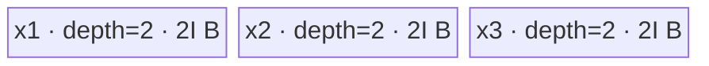

# ForeachAddcmulScalar A2/A3 ACLNN 算子知识

## 算子速览

| 项目 | 内容 |
|---|---|
| 实际入口 | `aclnnForeachAddcmulScalarV2GetWorkspaceSize` / `aclnnForeachAddcmulScalarV2`，公开 ACLNN V2 两段式接口 |
| 计算语义 | 对列表位置 `i` 与元素 `j`，`out_i[j] = x1_i[j] + scalar * x2_i[j] * x3_i[j]` |
| 输入输出 | 三个等长 TensorList，逐位置 shape/dtype 一致；`FLOAT16/FLOAT32/BFLOAT16/INT32`，ND；一个 `aclScalar`；输出与 `x1` 同 dtype/shape |
| 执行类型 | 单 Kernel：`foreach_addcmul_scalar`，`KERNEL_TYPE_AIV_ONLY`，AIV_VECTOR |
| Kernel 路线 | R-001 FP16/BF16 升精度；R-002 FP32 原生；R-003 INT32 整数 |
| 核心资源 | TensorList GM 描述符、三路双缓冲 VECIN Queue；FP16/BF16 另有单深度 FP32 Queue；无算子临时 workspace |
| 来源闭包 | `source_closed`：V2 ACLNN→L0 launcher→共享 membase Tiling/POD→dtype router→公共 foreach 循环与算子 adapter→构建配置闭合 |
| 验证状态 | 已完成源码闭包检查；本次知识提取未执行编译、真机、数值或性能测试。 |

## 接口与语义

### 计算语义

三个 TensorList 的列表长度相同。对每个列表位置 `i`，`x1_i`、`x2_i`、`x3_i` 的 storage shape 相同，输出继承 `x1_i` 的 shape 与 dtype；Device 按 `x2*x3`、再乘标量并加 `x1` 的顺序计算。V2 与旧接口数学语义相同，差异仅是标量从 `aclTensor*` 改为 `aclScalar*`。

### 输入、输出与属性

| 参数 | shape/layout | dtype | 约束、默认值与语义 |
|---|---|---|---|
| `x1` | TensorList；每个 Tensor 0–8 维；ND/非私有格式 | FP16/FP32/BF16/INT32 | 列表内 dtype 一致；与 `x2/x3/out` 等长 |
| `x2` | 与同位置 `x1` shape 相同 | 同 `x1` | 乘法第一路 |
| `x3` | 与同位置 `x1` shape 相同 | 同 `x1` | 乘法第二路 |
| `scalar` | `aclScalar`，第一段转成单元素 Tensor | FP16/FP32/DOUBLE/INT32/INT64，组合受限 | FP32/BF16→FP32；FP16→FP16/DOUBLE；INT32→INT32/INT64；最终转换成 Kernel binary 要求的 scalar dtype |
| `out` | TensorList；逐位置与 `x1` shape 相同 | 同 `x1` | 输出不可依赖 ViewCopy 回写；V2 公开表将非连续输入/输出标为不支持 |

### 入口与版本

固定仓同时公开 `aclnnForeachAddcmulScalar` 和 `aclnnForeachAddcmulScalarV2`；V2 的 `aclScalar` 入口是版本族最新接口，且公开产品表明确支持 Atlas A2 与 A3。V2 第一段自行校验并把 scalar 转成单元素 Tensor，随后与旧语义共享内部算子 `ForeachAddcmulScalar`。A2/A3 API dtype gate 为 `DAV_2201`，不使用 950 的 `IsRegbase()` FP16+FP32 scalar 扩展。

## Host/Launcher 执行流程

### 参数校验与前处理

`ExecForeachAddcmulScalarV2GetWorkspaceSize` 依次执行：非空指针；平台和 dtype 组合；三个输入列表与输出列表等长、列表元素非空、逐位置 shape 相同、维数不超过 8；拒绝 private storage format。空 TensorList 直接返回 workspace 0，不添加 Kernel。非空路径对 `x1/x2/x3` 每个 Tensor 调用框架 `l0op::Contiguous`，再构造连续 TensorList。BF16 scalar 转 FP32；其余 A2/A3 scalar 转为 `x1` dtype。任一步返回空指针或失败即停止构建 executor。

### 参数、Workspace 与生命周期

`l0op::ForeachAddcmulScalarV2` 通过 `ADD_TO_LAUNCHER_LIST_AICORE` 添加一个 `ForeachAddcmulScalar` 节点。共享 Tiling 将 workspace size 写为固定 32 字节，但 Kernel entry 明确把 `userWS` 置空，故这是框架预留而非算子中间数据。第一段返回 workspace 大小和 executor；第二段 `CommonOpExecutorRun` 在调用者给定 stream 上运行。连续化结果、标量 Tensor、launcher 参数由 executor 持有至第二段完成。

### 启动图与失败传播

```text
aclnnForeachAddcmulScalarV2GetWorkspaceSize
  -> Contiguous(x1/x2/x3) + ConvertToTensor(scalar)
  -> ADD_TO_LAUNCHER_LIST_AICORE(ForeachAddcmulScalar)
  -> Tiling4ForeachAddcmulScalarTiling
     -> ForeachAddcmulScalarMembaseTiling(priority=10000)
  -> executor
aclnnForeachAddcmulScalarV2(workspace, executor, stream)
  -> foreach_addcmul_scalar<<<blockDim, stream>>>
```

唯一 Device 节点输入为三组 TensorList GM 描述符和标量 Tensor，输出为 TensorList；POD 为 `ForeachCommonTilingData`，`blockDim=needCoreNum`。没有 Kernel 间边。Host 校验、连续化、launcher 添加、Tiling 或 launch 任一失败均阻断该节点；固定源码未公开 executor 内部清理实现，生命周期边界止于框架 executor。

## Route 与参数设计

### 分核与资源计算

Host 以 `elementsPerBlock=32/sizeof(T)` 个元素为一个 32B 分配块，`needCoreNum=min(ceil(totalDataCount/elementsPerBlock), AIV核数, 50)`，零总元素时取 1。前 `blockCount % needCoreNum` 个核多一个 32B 块；`tensorStart/End` 与相应 offset 允许一个核跨多个列表 Tensor。`inputsTensorUbSize` 的单位是字节：先扣除 POD 序列化大小；FP16/BF16 再除 10；随后除 `FOREACH_POINTWISE_DIVIDER=8`，最后向下对齐到 64B；FP32/INT32 直接除 8 并向下对齐到 32B。

### Route 选择

| 顺序 | Route | Key/模板 | 精确选择条件与优先级 | 不适用去向 |
|---:|---|---|---|---|
| 1 | R-001 FP16/BF16 升精度 | key 1/4；`ForeachOneScalarQuaternaryImplictOutput<T, AddcMulScalarAdapter<T>,2,3>` | 非 regbase 平台，dtype=FP16 或 BF16；BF16 还要求 `__CCE_AICORE__>=220` 且非 3003/3113 | dtype 继续匹配 R-002/R-003；未知 key 无 body |
| 2 | R-002 FP32 原生 | key 2；`ForeachOneScalarQuaternaryImplictOutput<float, AddcMulScalarAdapterForFloat<float>,2,3>` | 非 regbase 平台且 dtype=FP32 | 继续 R-003 |
| 3 | R-003 INT32 整数 | key 3；`ForeachOneScalarQuaternaryImplictOutput<int, AddcMulScalarAdapterForInt<int>,2,3>` | 非 regbase 平台、dtype=INT32、`__CCE_AICORE__>=220` | 未知 key 无 body |

```text
TilingRegistry(priority 10000, IsCapable = !IsRegbaseSocVersion)
  -> dtype FP16 -> key 1 -> R-001
  -> dtype FP32 -> key 2 -> R-002
  -> dtype INT32 -> key 3 -> R-003
  -> dtype BF16 -> key 4 -> R-001
```

### 模板/实现执行矩阵

| Route | key/selector | dtype/shape/platform 完整命中条件 | 执行拓扑与 Kernel 节点 | 实际模板/body | 内存与同步特征 | tail/fallback |
|---|---|---|---|---|---|---|
| R-001 | 1/4 | A2/A3；FP16/BF16；API/Host shape gate 通过 | 单 AIV Kernel | `AddcMulScalarAdapter<T>`→`ComputerPerCastForAddcMulScalar` | 三路 VECIN 双缓冲 + FP32 TQue；Cast/Mul/Axpy/Cast，V pipe barrier | tile tail 用字节长度 `DataCopyPad`；cast tail 单独调用 |
| R-002 | 2 | A2/A3；FP32 | 单 AIV Kernel | `AddcMulScalarAdapterForFloat<float>` | 三路 VECIN 双缓冲；Mul→barrier→Axpy，x1 buffer 原地出结果 | tile tail 用 `DataCopyPad` |
| R-003 | 3 | A2/A3；INT32；CCE≥220 | 单 AIV Kernel | `AddcMulScalarAdapterForInt<int>` | 三路 VECIN 双缓冲；Mul→Muls→Add，两个 V barrier | tile tail 用 `DataCopyPad` |

### 隐藏性能 Guard

| Guard | Host/Tiling 条件 | Device/资源原因 | 影响 Route | 不满足时去向 | 源码符号 |
|---|---|---|---|---|---|
| 平台模板 | `!IsRegbaseSocVersion(context_)` | A2/A3 使用 membase POD/key 1–4 | 全部 | regbase 高优先级模板 | `MEMBASE_TILING` / `IsCapable` |
| 列表/核上限 | `needCoreNum<=50`，POD 列表数组 50 | 固定数组 ABI | 全部 | Tiling 失败或核数截断 | `MAX_TENSOR_CONT/MAX_CORE_CONT` |
| FP16/BF16 UB | `I=floor_align64((UB-POD)/10/8)` 字节 | 三个 9I 双缓冲区和 3I FP32 区 | R-001 | 无备用 Route；资源不足导致不可用 | `DivideUbMemory1` |
| FP32/INT32 UB | `I=floor_align32((UB-POD)/8)` 字节 | 三路双缓冲共 6I 字节 | R-002/R-003 | 无备用 Route | `DivideUbMemory1` |
| INT/BF16 编译 guard | `__CCE_AICORE__>=220`；BF16 另排除 3003/3113 | 对应 dtype body 的编译可达性 | R-001/R-003 | entry 不执行任何 body | `foreach_addcmul_scalar` |

### POD/ABI

| 结构 | 字段 | 类型/位宽 | ABI 布局 | 单位 | Host/launcher producer | Device consumer | 边界 |
|---|---|---|---|---|---|---|---|
| `ForeachCommonTilingData` | `inputsTensorUbSize` | `uint64_t`/64 | 宏生成结构；固定仓未展开 `sizeof/offsetof` | 字节 | `DivideUbMemory1` | `ParseTilingData`，决定 Queue 容量 | 32/64B 向下对齐 |
| 同上 | `tensorDataCountList[50]` | `int64_t[50]` | 序列化字段顺序可见，精确 offset 固定仓不可见 | 元素 | `Init`/`FillTilingData` | 每 Tensor 的 `cursorEnd` | 每项为 storage shape size |
| 同上 | `tensorStartList[50]` | `uint16_t[50]` | 同上 | Tensor 索引 | `AssignDataToEachCore` | 每核循环起点 | blockIdx 有效域 `<blockDim` |
| 同上 | `tensorEndList[50]` | `uint16_t[50]` | 同上 | Tensor 索引 | `AssignDataToEachCore` | 每核循环终点 | 含终点 |
| 同上 | `tensorStartOffsetList[50]` | `int64_t[50]` | 同上 | 元素 | `AssignDataToEachCore` | 首 Tensor GM base 偏移 | 含起点 |
| 同上 | `tensorEndOffsetList[50]` | `int64_t[50]` | 同上 | 元素 | `AssignDataToEachCore` | 尾 Tensor 有效终点 | 含终点 |

### Route 源码闭包

| Route | Key/selector | Host/Tiling producer | POD/参数 | Kernel entry/router 节点 | Kernel body/直接依赖 | 构建接线 |
|---|---|---|---|---|---|---|
| R-001 | 1/4 | `foreach_tiling_func.cpp::Tiling4ForeachAddcmulScalarTiling`；`ForeachCommonTiling` | `ForeachCommonTilingData` | `op_kernel/foreach_addcmul_scalar.cpp::foreach_addcmul_scalar` | `ForeachOneScalarQuaternaryImplictOutput`；`AddcMulScalarAdapter` | `op_kernel/CMakeLists.txt::add_kernel_sources` A2/A3 units |
| R-002 | 2 | 同上 | 同上 | 同上 | `AddcMulScalarAdapterForFloat` | 同上 |
| R-003 | 3 | 同上 | 同上 | 同上 | `AddcMulScalarAdapterForInt` | 同上 |

## Kernel 实现

### 公共执行流程

entry 将 task type 固定为 AIV_ONLY，解析 POD，并按 key 构造一个模板实例。每个核根据 POD 得到其跨 Tensor 的连续逻辑区间；TensorList 地址由描述符首个 uint64 offset 定位指针表，再按列表索引取真实 GM 地址。每个 Tensor 分成 `maxDataCount` tile：三路依次搬入 Queue，计算结果原地写在 x1 的 LocalTensor，等待 V→MTE3 后写回输出，随后等待 MTE3→MTE2 才释放/复用 x1 buffer。无 Kernel 间 workspace 或同步边。

### Route R-001：FP16/BF16 升精度

#### 适用条件

##### 选择证据

| 层级 | 文件 | 符号 | 源码谓词/参数 | 结果/下一跳 |
|---|---|---|---|---|
| Tiling | `foreach_utils/op_host/foreach_tiling_class.h` | `RunBigScalarKernelTiling` | dtype FP16/BF16 | key 1/4 |
| Router | `foreach_addcmul_scalar/op_kernel/foreach_addcmul_scalar.cpp` | `foreach_addcmul_scalar` | `TILING_KEY_IS(1/4)` | `AddcMulScalarAdapter<T>` |

#### Device 数据流

##### 函数级调用链

```text
foreach_addcmul_scalar
  -> ForeachOneScalarQuaternaryImplictOutput<T,AddcMulScalarAdapter<T>,2,3>::Init/Process
    -> KernelForeachUnary::SingleTensorProcess
      -> CopyIn(x1) + CopyInPlus(x2,x3)
      -> AddcMulScalarAdapter<T>
        -> ComputerPerCastForAddcMulScalar
      -> DataCopy/DataCopyPad(x1Local -> outGM)
```

##### 源码等价伪码

```text
for tensor i in [tensorStart, tensorEnd]:
  bind x1/x2/x3/out GM at cursorStart
  for tile k of at most maxDataCount = 9*I/sizeof(T):
    copy valid x1,x2,x3 elements to three queues
    for chunk c of at most maxCastDataCount = I/sizeof(float):
      f2=cast_fp32(x2[c]); f3=cast_fp32(x3[c]); f1=cast_fp32(x1[c])
      f2=f2*f3; f1=f1+scalar*f2; x1[c]=cast_rint_T(f1)
    wait V->MTE3; copy valid x1Local to out; wait MTE3->MTE2; free x1Local
```

#### 内存与数据搬运

##### 资源与搬运表

| 层级/缓冲区 | offset/地址公式 | extent/容量公式 | dtype/layout | producer | consumer | owner/lifetime | 对齐/复用 |
|---|---|---|---|---|---|---|---|
| GM `x*` | TensorList pointer[i]+cursor+tile*maxDataCount | valid `dataCount` | T/ND | framework | CopyIn | caller | tail 按字节搬运 |
| `dataQueue` | queue slot | depth 2 × 9I bytes | T | CopyIn x1 | Compute/CopyOut | TPipe | x1 原地结果 |
| `InQueue_2/_3` | 各自 slot | 各 depth 2 × 9I bytes | T | CopyInPlus | Compute | TPipe | Compute 后释放 |
| `float32Queue` | 0/I/2I 三段 | depth 1 × 3I bytes | FP32 | 三次 Cast | Mul/Axpy/Cast | TPipe，整核复用 | 固定三段原地复用 |

##### 分层内存布局


##### 字节账与复用顺序

```text
I = inputsTensorUbSize (bytes)
UB_total = 3*(2*9I) + 1*(3I) = 57I bytes
I = floor_align64((UB - POD_bytes)/10/8)
dynamic_ub = N/A
workspace_total = 32 bytes framework reserve; kernel userWS=null
```

| 复用子区 | 写入者 | 读取者/消费点 | 下一次覆盖 | 同步或释放依据 | 安全条件 |
|---|---|---|---|---|---|
| x1 queue slot | CopyIn | Cast；最终 CopyOut | 下个 tile | V_MTE3、MTE3_MTE2、FreeTensor | 写回完成后才回收 |
| FP32 三段 | 三次 Cast/Mul/Axpy | 最终 Cast | 下个 cast chunk | 连续 `PipeBarrier<PIPE_V>` | chunk 不超过 `I/4` 元素 |

#### 同步、精度与尾块

##### 同步与数值边界表

| 阶段 | primitive/机制 | producer | consumer/等待点 | 保护对象 | 精度/尾块 |
|---|---|---|---|---|---|
| Cast→Mul→Axpy→Cast | `PipeBarrier<PIPE_V>` | 前一 Vector op | 后一 Vector op | FP32 三段/x1Local | FP16/BF16 升 FP32；落回 `CAST_RINT` |
| Compute→CopyOut | `V_MTE3` flag | Vector | MTE3 | x1Local | 仅 `dataCount` 有效元素 |
| CopyOut→复用 | `MTE3_MTE2` flag | MTE3 | 下一次 MTE2/Free | x1 slot | tail 用 `DataCopyPad` 精确字节数 |

#### 关键实现

##### 符号证据表

| 阶段 | 文件 | 符号/模板实例 | 实现事实 |
|---|---|---|---|
| Host/Tiling producer | `foreach_utils/op_host/foreach_tiling_class.h` | `DivideUbMemory1` | FP16/BF16 `/10/8` 与 64B 对齐 |
| Kernel entry/router | `foreach_addcmul_scalar/op_kernel/foreach_addcmul_scalar.cpp` | key 1/4 | 映射 half/BF16 adapter |
| Device body/helper | `foreach_utils/op_kernel/foreach_one_scalar_quaternary_implict_output.h` | `Compute/CopyInPlus` | 三路 Queue、同步和原地输出 |

### Route R-002：FP32 原生

#### 适用条件

##### 选择证据

| 层级 | 文件 | 符号 | 源码谓词/参数 | 结果/下一跳 |
|---|---|---|---|---|
| Tiling | `foreach_utils/op_host/common_dtype.h` | `GetTilingKeyByDtypeOnly` | `DT_FLOAT` | key 2 |
| Router | `foreach_addcmul_scalar/op_kernel/foreach_addcmul_scalar.cpp` | `foreach_addcmul_scalar` | `TILING_KEY_IS(2)` | float adapter |

#### Device 数据流

##### 函数级调用链

```text
foreach_addcmul_scalar -> common foreach Process -> CopyIn(x1,x2,x3)
  -> AddcMulScalarAdapterForFloat -> Mul(x2,x2,x3) -> Axpy(x1,x2,scalar)
  -> CopyOut(x1Local)
```

##### 源码等价伪码

```text
for each assigned tile: load x1,x2,x3; x2=x2*x3; barrier; x1=x1+scalar*x2;
wait V->MTE3; store exactly valid elements; wait MTE3->MTE2; free.
```

#### 内存与数据搬运

##### 资源与搬运表

| 层级/缓冲区 | offset/地址公式 | extent/容量公式 | dtype/layout | producer | consumer | owner/lifetime | 对齐/复用 |
|---|---|---|---|---|---|---|---|
| 三路 VECIN Queue | tile index × `I/sizeof(float)` | 各 depth 2 × I bytes | FP32 | CopyIn | Mul/Axpy | TPipe | x1 slot 兼作输出 |
| GM out | pointer[i]+cursor+tile offset | valid elements | FP32/ND | CopyOut | caller | caller | tail byte copy |

##### 分层内存布局



##### 字节账与复用顺序

```text
UB_total = 6I bytes
I = floor_align32((UB-POD_bytes)/8)
dynamic_ub = N/A
workspace_total = 32 bytes reserve
```

| 复用子区 | 写入者 | 读取者/消费点 | 下一次覆盖 | 同步或释放依据 | 安全条件 |
|---|---|---|---|---|---|
| x2 slot | CopyIn | Mul/Axpy | Queue 再分配 | DeQue/FreeTensor | Axpy 已消费 |
| x1 slot | CopyIn/Axpy | CopyOut | 下一 tile | MTE3_MTE2 后 FreeTensor | 输出搬运完成 |

#### 同步、精度与尾块

##### 同步与数值边界表

| 阶段 | primitive/机制 | producer | consumer/等待点 | 保护对象 | 精度/尾块 |
|---|---|---|---|---|---|
| Mul→Axpy | V barrier | Mul | Axpy | x2Local | 全程 FP32 |
| output | V_MTE3/MTE3_MTE2 | Axpy/MTE3 | CopyOut/复用 | x1Local | tail 精确字节 |

#### 关键实现

##### 符号证据表

| 阶段 | 文件 | 符号/模板实例 | 实现事实 |
|---|---|---|---|
| Host/Tiling producer | `foreach_utils/op_host/foreach_tiling_class.h` | `RunBigScalarKernelTiling` | key、blockDim、POD |
| Kernel entry/router | `foreach_addcmul_scalar/op_kernel/foreach_addcmul_scalar.cpp` | key 2 | float specialization |
| Device body/helper | 同上 | `AddcMulScalarAdapterForFloat` | Mul+Axpy，x1 原地 |

### Route R-003：INT32 整数

#### 适用条件

##### 选择证据

| 层级 | 文件 | 符号 | 源码谓词/参数 | 结果/下一跳 |
|---|---|---|---|---|
| Tiling | `foreach_utils/op_host/common_dtype.h` | `GetTilingKeyByDtypeOnly` | `DT_INT32` | key 3 |
| Router | `foreach_addcmul_scalar/op_kernel/foreach_addcmul_scalar.cpp` | `foreach_addcmul_scalar` | CCE≥220 且 key 3 | int adapter |

#### Device 数据流

##### 函数级调用链

```text
foreach_addcmul_scalar -> common foreach Process -> CopyIn(x1,x2,x3)
  -> AddcMulScalarAdapterForInt -> Mul(x2,x2,x3) -> Muls(x2,int32(scalar)) -> Add(x1,x1,x2)
  -> CopyOut(x1Local)
```

##### 源码等价伪码

```text
for each assigned tile: load int32 x1,x2,x3; x2=x2*x3; barrier;
x2=x2*int32(scalarVal); barrier; x1=x1+x2; store valid x1 elements.
```

#### 内存与数据搬运

##### 资源与搬运表

| 层级/缓冲区 | offset/地址公式 | extent/容量公式 | dtype/layout | producer | consumer | owner/lifetime | 对齐/复用 |
|---|---|---|---|---|---|---|---|
| 三路 VECIN Queue | tile index × `I/4` | 各 depth 2 × I bytes | INT32 | CopyIn | Mul/Muls/Add | TPipe | x1/x2 原地 |
| GM out | descriptor pointer + element offset | valid elements | INT32/ND | CopyOut | caller | caller | tail byte copy |

##### 分层内存布局


##### 字节账与复用顺序

```text
UB_total = 6I bytes
I = floor_align32((UB-POD_bytes)/8)
dynamic_ub = N/A
workspace_total = 32 bytes reserve
```

| 复用子区 | 写入者 | 读取者/消费点 | 下一次覆盖 | 同步或释放依据 | 安全条件 |
|---|---|---|---|---|---|
| x2 slot | CopyIn/Mul/Muls | Add | 下个 tile | Vector barriers + FreeTensor | Add 后释放 |
| x1 slot | CopyIn/Add | CopyOut | 下个 tile | V_MTE3/MTE3_MTE2 | store 完成后复用 |

#### 同步、精度与尾块

##### 同步与数值边界表

| 阶段 | primitive/机制 | producer | consumer/等待点 | 保护对象 | 精度/尾块 |
|---|---|---|---|---|---|
| Mul→Muls→Add | 两次 V barrier | 每个前序 Vector op | 后序 op | x2/x1 | INT32 运算；固定仓未声明溢出饱和语义 |
| output | V_MTE3/MTE3_MTE2 | Add/MTE3 | CopyOut/复用 | x1Local | tail 精确字节 |

#### 关键实现

##### 符号证据表

| 阶段 | 文件 | 符号/模板实例 | 实现事实 |
|---|---|---|---|
| Host/Tiling producer | `foreach_utils/op_host/foreach_tiling_class.h` | `GetTilingKeyByDtypeOnly` | INT32→3 |
| Kernel entry/router | `foreach_addcmul_scalar/op_kernel/foreach_addcmul_scalar.cpp` | key 3 | CCE guard |
| Device body/helper | 同上 | `AddcMulScalarAdapterForInt` | Mul/Muls/Add 顺序 |

## 算子特定优化

### Trick T-001：x1 LocalTensor 原地承载最终输出

#### 触发与源码依据

- 适用 Route：R-001、R-002、R-003
- 触发条件：membase 单 Kernel 路径，模板参数 `needCopyOut=false`
- Golden 来源：[`foreach/foreach_utils/op_kernel/foreach_one_scalar_quaternary_implict_output.h:70-95`](../../../../../../../cann-ops-raw/ascendc/ops-nn/955f8b33985b6d72989ebff341bb9c2c564a51bc/foreach/foreach_utils/op_kernel/foreach_one_scalar_quaternary_implict_output.h#L70-L95)

**官方源码（固定 Commit 连续逐字摘录）**：

```cpp
LocalTensor<T> inLocal_1 = Base::dataQueue.template DeQue<T>();
LocalTensor<T> inLocal_2 = InQueue_2.DeQue<T>();
LocalTensor<T> inLocal_3 = InQueue_3.DeQue<T>();

InnerComputer<T, op> computer;
computer.Compute(inLocal_1, inLocal_2, inLocal_3, float32Tensor, scalarVal, Base::maxCastDataCount, dataCount);

InQueue_2.FreeTensor(inLocal_2);
InQueue_3.FreeTensor(inLocal_3);
```

#### 机制与设计原因

adapter 把最终结果写回 `inLocal_1`，随后 Compute 直接从该 buffer 搬到 GM；模板以 `needCopyOut=false` 避免初始化独立 VECOUT Queue。这样少物化一份 tile 输出，并以显式 V_MTE3/MTE3_MTE2 事件保证同一 x1 slot 在写回完成前不被重用。

#### 迁移边界

- 适用：输入值在本 tile 后不再需要、输出 shape/dtype 与输入一致的逐元素融合。
- 前提：输出不能与仍需读取的别名产生覆盖冲突；必须保留 MTE3 完成到 Queue 复用的同步。
- 失效：需要保留 x1 原值、多输出或输出 dtype/layout 不同，应恢复独立 output Queue。
- 未验证：本次知识提取未执行编译、真机、数值或性能测试。

#### 错误做法

固定仓未提供可验证反例；不可删除 V_MTE3/MTE3_MTE2 依赖后提前释放 x1 slot。

## 模板与实现对比

| 对比维度 | R-001 FP16/BF16 | R-002 FP32 | R-003 INT32 | 设计选择依据 |
|---|---|---|---|---|
| 命中条件/优先级 | key 1/4 | key 2 | key 3 | dtype 单层分发 |
| 模板与 dtype | `AddcMulScalarAdapter<T>` | float adapter | int adapter | 精度/指令不同 |
| 循环与分核 | 公共 32B 分核与 tile 循环 | 同左 | 同左 | POD 相同 |
| Queue/TBuf/寄存器/dynamic UB/通信 window | 三 Queue + FP32 Queue | 三 Queue | 三 Queue | 仅低精度需升精度区 |
| 内存总占用与复用 | 57I，x1 原地 | 6I，x1/x2 原地 | 6I，x1/x2 原地 | Host 留资源余量 |
| 搬运/Vector/SIMT/NDDMA/通信 API | Cast/Mul/Axpy/Cast | Mul/Axpy | Mul/Muls/Add | 均为 AIV Vector |
| 同步、精度与 tail | FP32 中间，RINT | FP32 | INT32 | tail 均 DataCopyPad |
| fallback/失败边界 | 无备用 key | 无备用 key | 无备用 key | 未知 key 无计算 |

## 平台差异

| 项目 | A2 | A3 | 950 |
|---|---|---|---|
| 支持状态 | V2 公开支持 | V2 公开支持 | 公开支持，但见 `_950` 卡 |
| Host/Launcher | 共用 membase priority 10000 | 共用 membase priority 10000 | regbase priority 30000 |
| Kernel/资源 | key 1–4，旧 TensorList 描述符，AIV_ONLY | 同左 | key 10001–10004，ListTensorDesc+MicroAPI |

## 限制与失败边界

- V2 公开约束为 TensorList 逐位置 shape 相同、列表 dtype 一致、维数不超过 8；公开表把非连续 V2 Tensor 标为不支持，尽管实现仍存在 `Contiguous` 框架前处理，复用时应以公开约束为准。
- API 接受 DOUBLE/INT64 scalar 仅作为 Host 标量输入，执行前会窄化到对应 Kernel scalar Tensor dtype；固定仓未给出超范围转换的额外错误语义。
- Tiling POD 固定容纳 50 个 Tensor 和 50 个核；精确宏展开后的 `sizeof/alignof/offsetof` 不在固定仓内公开。
- unknown key、编译 guard 未覆盖的 dtype 不进入任何 body；无 Device fallback。
- 固定仓未公开框架 TensorList 描述符构造和 executor stream 内部实现；这些仅作为框架边界。本次未执行运行验证。

## 源码索引

### 链路索引

| 链路阶段 | 文件 | 关键符号 | 支撑内容 |
|---|---|---|---|
| 入口声明/约束 | `foreach/foreach_addcmul_scalar/docs/aclnnForeachAddcmulScalarV2.md` | V2 原型/产品表 | 最新公开入口与 A2/A3 支持 |
| 入口实现 | `foreach/foreach_addcmul_scalar/op_host/op_api/aclnn_foreach_addcmul_scalar_v2.cpp` | `ExecForeachAddcmulScalarV2GetWorkspaceSize` | 校验、Contiguous、scalar 转 Tensor、executor |
| L0 launcher | `foreach/foreach_addcmul_scalar/op_host/op_api/foreach_addcmul_scalar_v2.cpp` | `ForeachAddcmulScalarV2` | 单 AICore launcher 节点 |
| 平台注册 | `foreach/foreach_addcmul_scalar/op_host/foreach_addcmul_scalar_def.cpp` | `ForeachAddcmulScalar` | ascend910b/ascend910_93 dtype 与 AICore config |
| Host/Tiling/Launcher | `foreach/foreach_utils/op_host/foreach_tiling_func.cpp` | `Tiling4ForeachAddcmulScalarTiling` | 模板注册与入口 |
| Host/Tiling/Launcher | `foreach/foreach_utils/op_host/foreach_tiling_class.h` | `ForeachCommonTiling` | 分核、UB、key、workspace |
| POD | `foreach/foreach_utils/op_host/foreach_tiling_def.h` | `ForeachCommonTilingData` | 字段布局与注册 |
| Host helper | `foreach/foreach_utils/op_host/common_dtype.h` | `GetTilingKeyByDtypeOnly` | dtype 到 key 1–4 |
| Kernel entry/body | `foreach/foreach_addcmul_scalar/op_kernel/foreach_addcmul_scalar.cpp` | `foreach_addcmul_scalar`/adapters | key router 与算术顺序 |
| Kernel body | `foreach/foreach_utils/op_kernel/foreach_one_scalar_quaternary_implict_output.h` | 模板 `Init/Process/Compute` | 三路 Queue、cast、同步 |
| Kernel body | `foreach/foreach_utils/op_kernel/kernel_foreach_unary.h` | `SingleTensorProcess/CopyIn` | tile、tail、Queue 生命周期 |
| Kernel helper | `foreach/foreach_utils/op_kernel/kernel_foreach_base.h` | `ParseTilingData/GetTensorAddr` | POD 消费与 TensorList 地址解析 |
| 构建接线 | `foreach/foreach_addcmul_scalar/op_host/config/ascend910b/foreach_addcmul_scalar_binary.json` | `op_list` | A2 dtype binary |
| 构建接线 | `foreach/foreach_addcmul_scalar/op_host/config/ascend910_93/foreach_addcmul_scalar_binary.json` | `op_list` | A3 dtype binary |
| 构建接线 | `foreach/foreach_addcmul_scalar/op_kernel/CMakeLists.txt` | `add_kernel_sources` | A2/A3 compute units |

### 实现复用检查

| 检查项 | 可复用事实 | 不得改变的约束 | 源码符号 |
|---|---|---|---|
| ABI/POD | 每核 Tensor 起止区间描述 | 字段顺序、数组上限、字节/元素单位 | `ForeachCommonTilingData` |
| 调用顺序 | Contiguous→scalar Tensor→launcher→单 Kernel | 任一步失败必须阻断 | `ExecForeachAddcmulScalarV2GetWorkspaceSize` |
| workspace/内存 | 32B 仅框架预留；x1 Local 原地输出 | Queue depth、I/9I/3I 容量 | `Init`/`DivideUbMemory1` |
| 同步 | V op barrier、V_MTE3、MTE3_MTE2 | 不得提前覆盖 x1/FP32 区 | `Compute` |
| 精度与尾块 | FP16/BF16 用 FP32 中间并 RINT | cast 顺序与有效 `dataCount` | `ComputerPerCastForAddcMulScalar` |
| 失败边界 | dtype/shape/platform/key 均无 Device fallback | 不得把 unknown key 当成功计算 | API/Tiling/router guards |