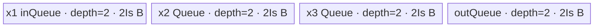
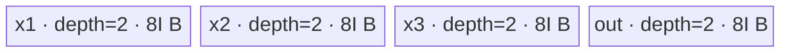

# ForeachAddcmulScalar 950 ACLNN 算子知识

## 算子速览

| 项目 | 内容 |
|---|---|
| 实际入口 | `aclnnForeachAddcmulScalarV2GetWorkspaceSize` / `aclnnForeachAddcmulScalarV2`，公开 ACLNN V2 两段式接口 |
| 计算语义 | `out_i[j] = x1_i[j] + scalar * x2_i[j] * x3_i[j]` |
| 输入输出 | 最多 50 个 Tensor；三列表逐位置 shape/dtype 一致；FP16/FP32/BF16/INT32，ND；输出与 x1 同 dtype/shape |
| 执行类型 | 单 Kernel AIV_VECTOR；950 body 使用 RegBase MicroAPI，没有 Cube/AIC/MIX_CV |
| Kernel 路线 | R-001 浮点 FP32 寄存器融合；R-002 INT32 寄存器整数链 |
| 核心资源 | `ListTensorDesc` GM、四个深度 2 的 Queue、RegTensor/MaskReg；无 dynamic UB、无算子临时 workspace |
| 来源闭包 | `source_closed`：V2 ACLNN→L0 launcher→高优先级 regbase Tiling/POD→key 10001–10004 router→Ternary 基类+MicroAPI body→950 binary/CMake 闭合 |
| 验证状态 | 已完成源码闭包检查；本次知识提取未执行编译、真机、数值或性能测试。 |

## 接口与语义

### 计算语义

对三个 TensorList 的每个位置和每个有效元素，先算 `x2*x3`，再乘 `scalar`，最后加 `x1`。950 浮点路线把 FP16/BF16 输入解包并转换到 FP32 RegTensor 后融合计算，输出时按 RINT 转回；FP32 直接在 FP32 RegTensor 计算。INT32 路线保持整数 RegTensor 运算。

### 输入、输出与属性

| 参数 | shape/layout | dtype | 约束、默认值与语义 |
|---|---|---|---|
| `x1` | TensorList，1–50 个；每 Tensor 0–8 维，ND | FP16/FP32/BF16/INT32 | 列表内 dtype 一致；逐维非负；与其他列表等长 |
| `x2` | 逐位置元素数与 `x1` 相同 | 同 `x1` | 950 Tiling 比较 storage shape size；ACLNN 前置比较完整 shape |
| `x3` | 逐位置元素数与 `x1` 相同 | 同 `x1` | 同上 |
| `scalar` | `aclScalar`，转换为单元素 Tensor | FP16/FP32/DOUBLE/INT32/INT64 | FP16 x1 支持 FP16/FP32/DOUBLE；BF16/FP32 支持 FP32/DOUBLE；INT32 支持 INT32/INT64 |
| `out` | TensorList，逐位置与 x1 相同 | 同 `x1` | 950 binary config 覆盖五种 x/scalar 组合 |

### 入口与版本

固定仓公开的 V2 是该 API 版本族最新接口，区别于旧接口的 `aclTensor* scalar`。公开产品表明确支持 Ascend 950PR/950DT，OpDef 注册 `ascend950` regbase config，binary config 和 CMake 又分别闭合 dtype binary 与 `arch35` Kernel，因此无平台发布冲突。950 `IsRegbase()` 使 FP16 scalar 额外支持 FP32/DOUBLE；DOUBLE/INT64 在 ACLNN executor 中先转成 binary 要求的单元素 Tensor。

## Host/Launcher 执行流程

### 参数校验与前处理

第一段先校验所有顶层指针；950 通过 `IsRegbase()` 进入 dtype 支持分支。它校验列表等长、各列表内部 dtype 一致、三输入逐位置完整 shape 相同、输出 shape 与 x1 相同、维数≤8、非 private format。空列表直接返回 workspace 0。非空时对三路输入逐 Tensor 调用 `l0op::Contiguous`。scalar 转换规则为：BF16→FP32；FP16 且原 scalar 为 FP32/DOUBLE→FP32；否则→x1 dtype。之后只添加一个内部 `ForeachAddcmulScalar` AICore launcher。

### 参数、Workspace 与生命周期

高优先级 `ForeachRegbaseTilingTernaryScalar` 写固定 32B workspace reserve；Kernel 的 Ternary 基类接收 workspace 但不读取它。真实中间态只在每核 UB Queue 和寄存器内。executor 拥有连续化 TensorList、scalar Tensor 和 launch node，直至第二段 `CommonOpExecutorRun` 在用户 stream 上完成。

### 启动图与失败传播

```text
V2 GetWorkspaceSize
  -> CheckParams -> Contiguous*3 -> ConvertToTensor(scalar)
  -> l0op::ForeachAddcmulScalarV2
  -> ADD_TO_LAUNCHER_LIST_AICORE(ForeachAddcmulScalar)
  -> TilingRegistry
     -> ForeachRegbaseTilingTernaryScalar(priority=30000, IsRegbase=true)
  -> executor/workspaceSize
V2 phase-2
  -> foreach_addcmul_scalar<<<numBlocks, stream>>>
     -> one RegBase AIV node
```

单节点 POD 为 `ForeachSoloTilingDataRegbase`；输入/输出通过 `ListTensorDesc` 取 GM 地址；无节点间 edge。API、L0 launcher、Tiling、launch 的失败均阻断后续执行；unknown key 不调用 body，固定 Kernel entry 内没有 fallback。

## Route 与参数设计

### 分核与资源计算

Tiling 先统计 `totalDataCount`，要求 Tensor 数在 `[1,50]`、维度≤8、各维非负。分配粒度为 `elementsPerBlock=4096/sizeof(T)` 个元素；`numBlocks=min(AIV核数,80,ceil(totalDataCount/elementsPerBlock))`，零元素总量特判为一个核且 `endOffset=-1`。余数块由低 blockIdx 核多领一个。UB tile 字段单位是元素：

```text
ubSizePerNumber = sizeof(T) * 2 * 3 inputs + sizeof(T) * 2 * 1 output = 8*sizeof(T)
inputsTensorUbSize = floor_align(UB / ubSizePerNumber * sizeof(T), ubBlockSize) / sizeof(T)
```

Device 四个 Queue 每个 depth=2、每 slot `inputsTensorUbSize*sizeof(T)` 字节，字节账恰为 Host 使用的 `8*I*sizeof(T)`。

### Route 选择

| 顺序 | Route | Key/模板 | 精确选择条件与优先级 | 不适用去向 |
|---:|---|---|---|---|
| 1 | R-001 浮点 FP32 寄存器融合 | 10001 FP16、10002 FP32、10004 BF16；`ForeachAddcmulScalarRegbase<T,ScalarT,ForeachSoloTilingDataRegbase>` | `IsRegbaseSocVersion=true`，priority 30000；dtype 为 FP16/FP32/BF16，scalar 组合命中 binary | INT32 转 R-002；其他 dtype Tiling 失败/key 0 |
| 2 | R-002 INT32 寄存器整数链 | 10003；`ForeachAddcmulScalarRegbase<int,int,ForeachSoloTilingDataRegbase>` | 同平台模板，dtype=INT32、scalar Tensor=INT32 | key 0/未知 key 无 body |

```text
TilingRegistry priority 30000
  IsRegbaseSocVersion?
    no -> membase priority 10000
    yes -> GetTilingKey:
      FP16 10001 -> R-001
      FP32 10002 -> R-001
      INT32 10003 -> R-002
      BF16 10004 -> R-001
```

### 模板/实现执行矩阵

| Route | key/selector | dtype/shape/platform 完整命中条件 | 执行拓扑与 Kernel 节点 | 实际模板/body | 内存与同步特征 | tail/fallback |
|---|---|---|---|---|---|---|
| R-001 | 10001/10002/10004 | 950；三列表 1–50；shape size 相等；FP16/FP32/BF16；scalar 组合有效 | 单 AIV Kernel | `ForeachRegbaseTernary<T,ForeachSoloTilingDataRegbase,Predicate>` + `ForeachAddcmulScalarRegbase<T,ScalarT>::Compute` | 四双缓冲 Queue；MaskReg；三 FP32 RegTensor；Queue 隐式同步 | tile 全部使用按字节 `DataCopyPad`；MicroAPI mask 保护尾 lane |
| R-002 | 10003 | 同上但 INT32/INT32 scalar | 单 AIV Kernel | 同基类；Compute 的 `else` 整数分支 | 四双缓冲 Queue；三个 INT32 RegTensor；MaskReg | 同上；无 fallback |

### 隐藏性能 Guard

| Guard | Host/Tiling 条件 | Device/资源原因 | 影响 Route | 不满足时去向 | 源码符号 |
|---|---|---|---|---|---|
| 模板优先级 | regbase priority 30000 > membase 10000 | 950 必须匹配 POD/key 1000x 与 arch35 body | 全部 | 非 regbase 才落 membase | `REGISTER_OPS_TILING_TEMPLATE` |
| Tensor/核上限 | `1<=totalTensorCount<=50`；`numBlocks<=80` | POD 固定数组 50/80 | 全部 | Tiling 失败/截断核数 | `GetShapeAttrsInfo`/`DoOpTiling` |
| UB 对齐 | `I=floor_align((UB/(8s))*s,ubBlockSize)/s` | 四个 depth2 Queue 必须整体容纳 | 全部 | 无资源 fallback | `ForeachRegbaseTilingTernaryScalar::DoOpTiling` |
| scalar dtype | `{F32/F32,F16/F16,F16/F32,BF16/F32,I32/I32}` | `ScalarT` 由 binary specialization 固化 | 全部 | Tiling 失败 | `CheckScalar`/binary JSON |
| MicroAPI tail | `repeatTimes=ceil(dataCount/(VL_SIZE/4))`；`UpdateMask<float>(sreg)` | 每轮只处理剩余有效 lane | 全部 | N/A，最后一轮 mask | `Compute` |

### POD/ABI

| 结构 | 字段 | 类型/位宽 | ABI 布局 | 单位 | Host/launcher producer | Device consumer | 边界 |
|---|---|---|---|---|---|---|---|
| `ForeachSoloTilingDataRegbase` | `inputsTensorUbSize` | `uint32_t`/32 | 宏生成结构；固定仓未展开 `sizeof/offsetof` | 元素 | Ternary `DoOpTiling` | 基类 `Init/ParseTilingData` | 先按字节 floor-align 再除 sizeof(T) |
| 同上 | `tensorDataCountList[50]` | `int64_t[50]` | 字段顺序可见；精确 offset 固定仓不可见 | 元素 | `GetShapeAttrsInfo` | `Process` | storage shape size |
| 同上 | `tensorStartList[80]` | `uint16_t[80]` | 同上 | Tensor 索引 | `AssignDataToEachCore` | `Process` | 含起点 |
| 同上 | `tensorEndList[80]` | `uint16_t[80]` | 同上 | Tensor 索引 | 同上 | `Process` | 含终点 |
| 同上 | `tensorStartOffsetList[80]` | `int64_t[80]` | 同上 | 元素 | 同上 | 首 Tensor GM offset | 含起点 |
| 同上 | `tensorEndOffsetList[80]` | `int64_t[80]` | 同上 | 元素 | 同上 | 尾 Tensor `cursorEnd` | 零域可为 -1 |

### Route 源码闭包

| Route | Key/selector | Host/Tiling producer | POD/参数 | Kernel entry/router 节点 | Kernel body/直接依赖 | 构建接线 |
|---|---|---|---|---|---|---|
| R-001 | 10001/10002/10004 | `foreach_regbase_tiling.cpp::ForeachRegbaseTilingTernaryScalar` | `ForeachSoloTilingDataRegbase` | `arch35/foreach_addcmul_scalar.cpp::foreach_addcmul_scalar` | `ForeachRegbaseTernary::Process`；浮点 `Compute`；load/store helper | ascend950 binary JSON + arch35 CMake |
| R-002 | 10003 | 同上 | 同上 | 同上 | `ForeachRegbaseTernary::Process`；整数 `Compute` | 同上 |

## Kernel 实现

### 公共执行流程

entry 在栈上创建 `TPipe`，按 key 选择 `<T,ScalarT>`，解析 POD 后初始化四个 Queue。`ListTensorDesc::GetDataPtr(index)` 给出每个列表 Tensor 的真实 GM 指针。每核遍历其 `[tensorStart,tensorEnd]`，对首尾 Tensor 套用 element offset，再以 `I=inputsTensorUbSize` 为 tile 上限。每 tile 同步搬入 x1/x2/x3，Compute 消费三输入并产出独立 out Queue，CopyOut 按有效字节写 GM。Queue 的 EnQue/DeQue/FreeTensor 构成 MTE2→V→MTE3 生命周期；源码没有额外 event、atomic 或跨核同步。

### Route R-001：浮点 FP32 寄存器融合

#### 适用条件

##### 选择证据

| 层级 | 文件 | 符号 | 源码谓词/参数 | 结果/下一跳 |
|---|---|---|---|---|
| API | `op_host/op_api/aclnn_foreach_addcmul_scalar_v2.cpp` | `ForeachAddcMulScalarV2CheckDtypeValid` | regbase FP16 scalar 可为 FP16/FP32/DOUBLE；BF16/FP32 scalar 为 FP32/DOUBLE | scalar 转 binary dtype |
| Tiling | `foreach_utils/op_host/foreach_regbase_tiling.cpp` | `GetTilingKey` | FP16/FP32/BF16 | 10001/10002/10004 |
| Router | `op_kernel/arch35/foreach_addcmul_scalar.cpp` | `foreach_addcmul_scalar` | key 10001/10002/10004 | `<half,DTYPE_SCALAR>`、`<float,float>`、`<bf16,float>` |

#### Device 数据流

##### 函数级调用链

```text
foreach_addcmul_scalar
  -> ForeachAddcmulScalarImpl<T,ScalarT>
    -> ForeachAddcmulScalarRegbase::Init
      -> ForeachRegbaseTernary::Init
    -> ForeachRegbaseTernary::Process
      -> SingleTensorProcess -> CopyIn -> Compute -> CopyOut
        -> ForeachAddcmulScalarRegbase::Compute
          -> LoadOneTensorForDtypeT<T>*3 -> Mul -> Axpy -> StoreOneTensorForDtypeT<T>
```

##### 源码等价伪码

```text
scalarVal = float(scalarGM[0]) for FP16/BF16, else float scalar directly
for tensor i assigned to blockIdx:
  bind four GM tensors at per-core cursorStart
  for tile k, count=min(I, remaining):
    DataCopyPad count*sizeof(T) for x1,x2,x3 -> three VECIN queues
    outLocal = outQueue.AllocTensor
    sreg=count; repeat=ceil(count/(VL_SIZE/sizeof(float)))
    for r in repeat:
      mask=UpdateMask<float>(sreg)
      a,b,c = load T and widen/unpack to FP32 RegTensor under mask
      b=b*c; a=a+scalarVal*b
      store a to T under mask (FP16/BF16 use RINT pack)
    enqueue out; DataCopyPad valid bytes to outGM; free queue slots
```

#### 内存与数据搬运

##### 资源与搬运表

| 层级/缓冲区 | offset/地址公式 | extent/容量公式 | dtype/layout | producer | consumer | owner/lifetime | 对齐/复用 |
|---|---|---|---|---|---|---|---|
| GM list tensors | `desc.GetDataPtr<T>(i)+cursorStart+k*I` | `currentDataCount` | T/ND | caller | CopyIn | caller/executor | tail exact bytes |
| `inQueue_` | Queue slot | depth 2 × I×s bytes | T | CopyIn x1 | Compute | TPipe | Compute 后释放 |
| `tensorOneQueue_` | Queue slot | depth 2 × I×s | T | CopyIn x2 | Compute | TPipe | 同上 |
| `tensorTwoQueue_` | Queue slot | depth 2 × I×s | T | CopyIn x3 | Compute | TPipe | 同上 |
| `outQueue_` | Queue slot | depth 2 × I×s | T | Compute | CopyOut | TPipe | CopyOut 后释放 |
| RegTensor | 每轮 offset `r*(VL_SIZE/4)` | 三个 FP32 register vectors | FP32 | load helper | Mul/Axpy/store | Vector scope | mask zeroing/有效 lane |

##### 分层内存布局



##### 字节账与复用顺序

```text
I = inputsTensorUbSize elements; s=sizeof(T)
UB_total = 4*(2*I*s) = 8Is bytes
I = floor_align((UB/(8s))*s, ubBlockSize)/s
dynamic_ub = N/A
workspace_total = 32 bytes framework reserve; no kernel consumer
```

| 复用子区 | 写入者 | 读取者/消费点 | 下一次覆盖 | 同步或释放依据 | 安全条件 |
|---|---|---|---|---|---|
| 三输入 Queue slot | `CopyIn` | `Compute` | 下一 tile allocation | EnQue→DeQue→FreeTensor | Compute 完成后释放 |
| out Queue slot | `Compute` | `CopyOut` | 下一 tile allocation | EnQue→DeQue→FreeTensor | GM 搬运提交后释放 |
| RegTensor | load/Mul/Axpy | store helper | 下一 repeat | 单 Vector scope 与 mask | `UpdateMask` 覆盖剩余有效元素 |

#### 同步、精度与尾块

##### 同步与数值边界表

| 阶段 | primitive/机制 | producer | consumer/等待点 | 保护对象 | 精度/尾块 |
|---|---|---|---|---|---|
| GM→UB→V | Queue protocol | DataCopyPad/EnQue | DeQue | 三输入 slot | blockLen=`count*s` bytes |
| Vector | MaskReg | `UpdateMask<float>` | load/Mul/Axpy/store | RegTensor lanes | FP16/BF16 widen FP32；tail lane 不写 |
| FP32→T | `castTraitB322B16` | FP32 Axpy result | packed store | outLocal | FP16/BF16 `NO_SAT + CAST_RINT + ZEROING` |
| UB→GM | Queue protocol | EnQue out | CopyOut/Free | out slot | DataCopyPad 精确有效字节 |

#### 关键实现

##### 符号证据表

| 阶段 | 文件 | 符号/模板实例 | 实现事实 |
|---|---|---|---|
| Host/Tiling producer | `foreach_utils/op_host/foreach_regbase_tiling.cpp` | `DoOpTiling/GetTilingKey/PostTiling` | I、blockDim、key、POD、32B reserve |
| Kernel entry/router | `foreach_addcmul_scalar/op_kernel/arch35/foreach_addcmul_scalar.cpp` | `ForeachAddcmulScalarImpl` | key 到 `<T,ScalarT>` |
| Device body/helper | `foreach_addcmul_scalar/op_kernel/arch35/foreach_addcmul_scalar_regbase.h` | 浮点 `Compute` 分支 | FP32 RegTensor Mul/Axpy |
| Device body/helper | `common/inc/op_kernel/load_store_utils.h` | load/store helpers | B16 解包、FP32 转回 RINT |

### Route R-002：INT32 寄存器整数链

#### 适用条件

##### 选择证据

| 层级 | 文件 | 符号 | 源码谓词/参数 | 结果/下一跳 |
|---|---|---|---|---|
| API | `op_host/op_api/aclnn_foreach_addcmul_scalar_v2.cpp` | dtype check/ConvertToTensor | x1 INT32，aclScalar INT32/INT64 | scalar Tensor INT32 |
| Tiling | `foreach_utils/op_host/foreach_regbase_tiling.cpp` | `GetTilingKey` | `DT_INT32` | 10003 |
| Router | `op_kernel/arch35/foreach_addcmul_scalar.cpp` | key 10003 | `<int,int>` | integer Compute branch |

#### Device 数据流

##### 函数级调用链

```text
foreach_addcmul_scalar -> ForeachAddcmulScalarImpl<int,int>
  -> ForeachRegbaseTernary::Process/CopyIn
  -> ForeachAddcmulScalarRegbase<int,int>::Compute
     -> DataCopy RegTensor*3 -> Mul -> Muls -> Add -> DataCopy outLocal
  -> ForeachRegbaseTernary::CopyOut
```

##### 源码等价伪码

```text
scalarVal=int32(scalarGM[0]);
for each valid tile and masked repeat:
  load int32 a=x1,b=x2,c=x3;
  b=b*c; b=b*scalarVal; a=a+b;
  masked store a to outLocal;
copy count*4 valid bytes to outGM.
```

#### 内存与数据搬运

##### 资源与搬运表

| 层级/缓冲区 | offset/地址公式 | extent/容量公式 | dtype/layout | producer | consumer | owner/lifetime | 对齐/复用 |
|---|---|---|---|---|---|---|---|
| four Queue buffers | 同 R-001 | each depth 2 × I×4 bytes | INT32 | CopyIn/Compute | Compute/CopyOut | TPipe | Queue protocol |
| INT32 RegTensor | repeat offset `r*(VL_SIZE/4)` | three vector registers | INT32 | DataCopy | Mul/Muls/Add | Vector scope | mask protects tail |

##### 分层内存布局



##### 字节账与复用顺序

```text
UB_total = 8*I*4 = 32I bytes
I = floor_align((UB/32)*4, ubBlockSize)/4
dynamic_ub = N/A
workspace_total = 32 bytes reserve
```

| 复用子区 | 写入者 | 读取者/消费点 | 下一次覆盖 | 同步或释放依据 | 安全条件 |
|---|---|---|---|---|---|
| input slots | CopyIn | integer Compute | next tile | Queue FreeTensor | Compute 已完成 |
| out slot | Compute | CopyOut | next tile | Queue FreeTensor | GM copy 已提交 |

#### 同步、精度与尾块

##### 同步与数值边界表

| 阶段 | primitive/机制 | producer | consumer/等待点 | 保护对象 | 精度/尾块 |
|---|---|---|---|---|---|
| GM/UB | Queue | MTE2 | Vector/CopyOut | slots | byte-accurate `DataCopyPad` |
| Vector | `MaskReg` | `UpdateMask<float>` | Mul/Muls/Add/DataCopy | INT32 lanes | 固定仓未声明算术溢出饱和语义；tail masked |

#### 关键实现

##### 符号证据表

| 阶段 | 文件 | 符号/模板实例 | 实现事实 |
|---|---|---|---|
| Host/Tiling producer | `foreach_utils/op_host/foreach_regbase_tiling.cpp` | `CheckScalar/GetTilingKey` | INT32/INT32 与 key 10003 |
| Kernel entry/router | `foreach_addcmul_scalar/op_kernel/arch35/foreach_addcmul_scalar.cpp` | `<int,int>` | specialization |
| Device body/helper | `foreach_addcmul_scalar/op_kernel/arch35/foreach_addcmul_scalar_regbase.h` | integer `else` | Mul/Muls/Add 与 mask |

## 算子特定优化

### Trick T-001：浮点 RegTensor 中融合乘加并只在边界转换

#### 触发与源码依据

- 适用 Route：R-001
- 触发条件：950 regbase key 10001/10002/10004，浮点模板分支
- Golden 来源：[`foreach/foreach_addcmul_scalar/op_kernel/arch35/foreach_addcmul_scalar_regbase.h:67-85`](../../../../../../../cann-ops-raw/ascendc/ops-nn/955f8b33985b6d72989ebff341bb9c2c564a51bc/foreach/foreach_addcmul_scalar/op_kernel/arch35/foreach_addcmul_scalar_regbase.h#L67-L85)

**官方源码（固定 Commit 连续逐字摘录）**：

```cpp
__VEC_SCOPE__
{
    MaskReg maskReg;
    if constexpr (
        IsSameType<T, bfloat16_t>::value || IsSameType<T, half>::value || IsSameType<T, float>::value) {
        RegTensor<float> inRegToFloat;
        RegTensor<float> tensorOneRegToFloat;
        RegTensor<float> tensorTwoRegToFloat;
        for (uint16_t i = 0; i < (uint16_t)repeatTimes; i++) {
            maskReg = UpdateMask<float>(sreg);
            ops::LoadOneTensorForDtypeT<T>(inUbAddr, inRegToFloat, maskReg, i * dataCountPerLoop);
            ops::LoadOneTensorForDtypeT<T>(tensorOneUbAddr, tensorOneRegToFloat, maskReg, i * dataCountPerLoop);
            ops::LoadOneTensorForDtypeT<T>(tensorTwoUbAddr, tensorTwoRegToFloat, maskReg, i * dataCountPerLoop);

            Mul(tensorOneRegToFloat, tensorOneRegToFloat, tensorTwoRegToFloat, maskReg);
            Axpy(inRegToFloat, tensorOneRegToFloat, scalarVal, maskReg);
```

#### 机制与设计原因

三个输入每个 repeat 只从 UB 载入一次；FP16/BF16 在 load 边界解包并升到 FP32，`Mul` 与 `Axpy` 连续留在寄存器，最终一次 store 才按 RINT 降回 T。该结构避免把 `x2*x3` 中间结果物化到 UB，同时让 `UpdateMask` 同时约束 load、计算和 store 的尾 lane。

#### 迁移边界

- 适用：逐元素三输入融合、输出与 x1 同 shape，且 MicroAPI 支持目标 dtype 的 unpack/pack。
- 前提：950 RegBase；scalar 可转换为 FP32；尾 mask 必须覆盖全链。
- 失效：INT32 必须改用 R-002；若算法要求中间结果可见或不同舍入点，不能沿用一次边界转换。
- 未验证：本次知识提取未执行编译、真机、数值或性能测试。

#### 错误做法

固定仓未提供可验证反例；不能把 FP16/BF16 的 Mul 提前降精度后再 Axpy，否则改变源码确定的数值顺序。

## 模板与实现对比

| 对比维度 | R-001 浮点 | R-002 INT32 | 设计选择依据 |
|---|---|---|---|
| 命中条件/优先级 | key 10001/2/4，priority 30000 | key 10003，同优先级 | dtype key |
| 模板与 dtype | `<half,DTYPE_SCALAR>`/`<float,float>`/`<bf16,float>` | `<int,int>` | scalar binary 与计算类型 |
| 循环与分核 | 4096B 粒度分核，I 元素 tile | 同左 | 公共 Ternary 基类 |
| Queue/TBuf/寄存器/dynamic UB/通信 window | 4 Queue + 3 FP32 RegTensor | 4 Queue + 3 INT32 RegTensor | 无 TBuf/dynamic UB |
| 内存总占用与复用 | 8Is，寄存器不物化中间 | 32I bytes，x2 RegTensor 原地 | UB 公式相同 |
| 搬运/Vector/SIMT/NDDMA/通信 API | unpack/Cast/Mul/Axpy/RINT-pack | DataCopy/Mul/Muls/Add | 均为 AIV MicroAPI |
| 同步、精度与 tail | Queue + Mask；FP32 中间 | Queue + Mask；INT32 | tail 统一 masked/byte copy |
| fallback/失败边界 | 无 Device fallback | 无 Device fallback | unknown key 无 body |

## 平台差异

| 项目 | A2 | A3 | 950 |
|---|---|---|---|
| 支持状态 | 公开支持，见无后缀卡 | 公开支持，见无后缀卡 | V2 公开支持 |
| Host/Launcher | membase priority 10000 | membase priority 10000 | regbase priority 30000；FP16 scalar 支持 FP32 |
| Kernel/资源 | key 1–4，公共 Vector adapter | 同左 | key 10001–10004，ListTensorDesc、MicroAPI、80 核 POD |

## 限制与失败边界

- 950 公开上限为每个 TensorList 50 个 Tensor；Tiling 明确拒绝 0 个或超过 50 个。维数上限 8，负维失败。
- ACLNN 前置要求逐位置完整 shape 相同；950 Tiling 的内部二次检查只比较 shape size，不能独立替代 ACLNN gate。
- V2 公开表将输入/输出非连续 Tensor 标为不支持；实现虽调用 `Contiguous`，正式复用仍应遵循公开约束。
- DOUBLE/INT64 scalar 会在 executor 构建期窄化；固定仓没有超范围转换的附加语义或真机验证。
- POD 宏的精确 `sizeof/alignof/offsetof`、框架 `ListTensorDesc` ABI 构造与 executor stream 细节在固定仓不可见；不得自行补齐。
- unknown key 不执行 body；无 SIMT/NDDMA/AICPU 或其他 fallback。本次未执行运行验证。

## 源码索引

### 链路索引

| 链路阶段 | 文件 | 关键符号 | 支撑内容 |
|---|---|---|---|
| 入口声明/约束 | `foreach/foreach_addcmul_scalar/docs/aclnnForeachAddcmulScalarV2.md` | 产品表/V2 原型 | 950 公开支持、dtype/数量约束 |
| 入口实现 | `foreach/foreach_addcmul_scalar/op_host/op_api/aclnn_foreach_addcmul_scalar_v2.cpp` | `ExecForeachAddcmulScalarV2GetWorkspaceSize` | API gate、scalar 转换、executor |
| L0 launcher | `foreach/foreach_addcmul_scalar/op_host/op_api/foreach_addcmul_scalar_v2.cpp` | `ForeachAddcmulScalarV2` | 单 launcher 节点 |
| 平台注册 | `foreach/foreach_addcmul_scalar/op_host/foreach_addcmul_scalar_def.cpp` | `ForeachAddcmulScalar` | ascend950 regbase dtype/scalar config |
| Host/Tiling/Launcher | `foreach/foreach_utils/op_host/foreach_tiling_func.cpp` | `Tiling4ForeachAddcmulScalarTiling` | TilingRegistry 入口 |
| Host/Tiling/Launcher | `foreach/foreach_utils/op_host/foreach_regbase_tiling.cpp` | `ForeachRegbaseTilingTernaryScalar` | shape/dtype、分核、UB、key、POD |
| POD | `foreach/foreach_utils/op_host/foreach_tiling_def.h` | `ForeachSoloTilingDataRegbase` | 50/80 数组 ABI |
| Kernel entry/body | `foreach/foreach_addcmul_scalar/op_kernel/arch35/foreach_addcmul_scalar.cpp` | entry/impl | key router 与模板实例 |
| Kernel body | `foreach/foreach_addcmul_scalar/op_kernel/arch35/foreach_addcmul_scalar_regbase.h` | `Init/Compute` | scalar load、MicroAPI 算术 |
| Kernel body | `foreach/foreach_utils/op_kernel/arch35/foreach_regbase_ternary.h` | `Process/CopyIn/CopyOut` | Queue、tile、地址、tail |
| Kernel helper | `common/inc/op_kernel/load_store_utils.h` | load/store helper | FP16/BF16 cast trait |
| 构建接线 | `foreach/foreach_addcmul_scalar/op_host/config/ascend950/foreach_addcmul_scalar_binary.json` | five binaries | 950 dtype/scalar binary |
| 构建接线 | `foreach/foreach_addcmul_scalar/op_kernel/CMakeLists.txt` | arch35 target | ascend950 Kernel source/options |

### 实现复用检查

| 检查项 | 可复用事实 | 不得改变的约束 | 源码符号 |
|---|---|---|---|
| ABI/POD | 50 Tensor/80 核的起止区间 | 字段类型、数组上限、I 的元素单位 | `ForeachSoloTilingDataRegbase` |
| 调用顺序 | API gate→Contiguous→scalar Tensor→单 launcher | 失败必须阻断 | `ExecForeachAddcmulScalarV2GetWorkspaceSize` |
| workspace/内存 | 四个 depth2 Queue；32B reserve 无消费 | `UB_total=8Is` 与 ubBlock 对齐 | Ternary `Init`/Tiling `DoOpTiling` |
| 同步 | Queue EnQue/DeQue/FreeTensor | 不得在消费前复用 slot | `ForeachRegbaseTernary` |
| 精度与尾块 | FP16/BF16 边界升降，FP32 中间，RINT；Mask tail | cast trait、`UpdateMask` 和 byte count | `Compute`/load-store helper |
| 失败边界 | platform/dtype/shape/key 均无 Device fallback | 不得把 arch35 存在当作独立公开支持证据 | docs/OpDef/Tiling/router/config |