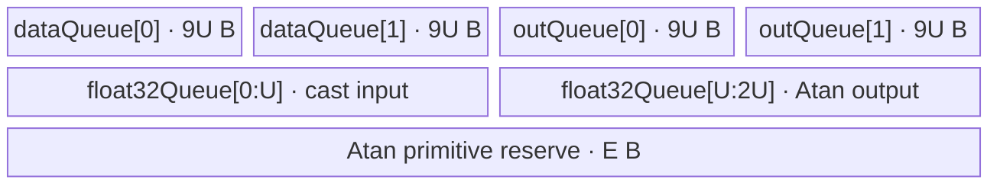

# ForeachAtan A2/A3 ACLNN 算子知识

## 算子速览

| 项目 | 内容 |
|---|---|
| 实际入口 | `aclnnForeachAtanGetWorkspaceSize` + `aclnnForeachAtan`，公开两段式 ACLNN，无更高版本入口 |
| 计算语义 | 对 TensorList 中每个张量逐元素计算 `y_i[j] = atan(x_i[j])` |
| 输入输出 | `x`/`out` 均为动态 TensorList、ND，支持 FP16/FP32/BF16；同一列表及输入输出 dtype 一致；每项输出容量不小于对应输入 |
| 执行类型 | 单 Kernel：`AIV_VECTOR` |
| Kernel 路线 | R-001 FP16 直接 Atan；R-002 FP32 直接 Atan；R-003 BF16→FP32→Atan→BF16 |
| 核心资源 | TensorList 指针表、GM 输入/输出、双缓冲 `VECIN/VECOUT` Queue；BF16 另有单槽 FP32 Queue；Kernel 不使用用户 workspace |
| 来源闭包 | `source_closed`：公开 ACLNN 声明/约束、ACLNN 构建接线、OpDef、arch22 Tiling/POD、dtype router、公共 Vector body 与 A2/A3 binary 接线闭合；自动生成 ACLNN bridge 与 AscendC `Atan` primitive 内部作为框架边界 |
| 验证状态 | 已完成源码闭包检查；本次知识提取未执行编译、真机、数值或性能测试。 |

## 接口与语义

### 计算语义

设输入列表为 `x = [x_0, ..., x_(L-1)]`。对每个列表项 `i` 和其输入有效线性区间 `0 <= j < numel(x_i)`，输出满足：

```text
out_i[j] = atan(x_i[j])
```

Kernel 以 storage shape 的元素数作为 `numel`，把每个 ND 张量视为连续一维元素区间。若调用者给出的 `out_i` shape 不同但元素数更大，Tiling 允许该情况，Kernel 只写前 `numel(x_i)` 个元素；额外输出区间不属于有效结果，固定源码没有初始化它。

### 输入、输出与属性

| 参数 | shape/layout | dtype | 约束、默认值与语义 |
|---|---|---|---|
| `x` | TensorList；每个 Tensor 0–8 维；ND | FP16、FP32、BF16 | 指针非空；支持空 Tensor；同一列表所有 Tensor dtype 一致；输入可非连续，OpDef 使用 `AutoContiguous()` |
| `out` | TensorList；每个 Tensor 0–8 维；ND | 与 `x` 相同 | 指针非空；列表项与输入一一对应；每项元素数必须 `>= numel(x_i)`；公开接口不支持非连续输出 |
| `workspaceSize` | 标量输出 | `uint64_t*` | 第一段接口返回 Device workspace 大小；arch22 Tiling 固定写 `32` 字节，Kernel 明确忽略用户 workspace |
| `executor` | Host 对象输出 | `aclOpExecutor**` | 第一段接口生成并持有计算流程，供第二段接口消费 |
| `workspace` | Device 地址 | `void*` | 由调用者按第一段返回值分配；本 Kernel 的 `workspace` 形参不参与计算 |
| `stream` | Runtime stream | `aclrtStream` | 第二段接口在该 stream 上提交单 Kernel |

无算子属性。公开文档声明默认确定性实现。

### 入口与版本

固定 Commit 公开的最新入口就是 `aclnnForeachAtanGetWorkspaceSize`/`aclnnForeachAtan`，没有可见的 V2 或其它版本族。`docs/aclnnForeachAtan.md` 给出原型和错误语义；`op_host/CMakeLists.txt` 以 `ACLNNTYPE aclnn` 接入生成式 ACLNN bridge。bridge 的生成函数体与 executor 内部序列化在固定仓不可见，但算子拥有的 `ForeachAtan` OpDef、Tiling、POD producer、Kernel router/body 和构建选择均已追到固定 Commit。

公开产品表同时明确支持 Atlas A2 与 Atlas A3；OpDef 分别注册 `ascend910b`、`ascend910_93`，Host CMake 将两者都映射到 `arch22`，Kernel CMake 与各自 binary config 均接入同一 Vector 源码，因此本文件覆盖 A2/A3 的共同最新实现。

## Host/Launcher 执行流程

### 参数校验与前处理

公开 ACLNN 第一段先检查 `x/out` 非空、支持 dtype 和输入输出 dtype 一致；公开错误表还列出 shape 不满足、列表内部 dtype 不一致及 rank 超过 8 的 Tiling 错误。生成式 ACLNN 检查代码固定仓不可见，仓内可见的后续链路如下：

1. `ForeachAtan` OpDef 把 `x/y` 声明为动态 ND TensorList，允许 FP16/FP32/BF16，并为输入、输出配置 `AutoContiguous()`；公开 API 仍以“输入可非连续、输出不可非连续”为调用约束。
2. `ForeachCommonTiling::Init(FOREACH_ATAN_OP_CODE)` 最多扫描 `MAX_TENSOR_CONT=50` 个动态输入；取第一个输入描述的 dtype，要求已扫描输入 dtype 一致，累计每个 storage-shape 元素数。
3. `RunBigKernelTiling()` 调用 `CheckOpInfo()`：输入列表项数量关系、每项 rank `<=8`、输出 dtype 与输入一致、输出元素数不小于输入、列表内部 dtype 一致，否则 `GRAPH_FAILED`。
4. 生成 key、分核范围、UB tile 和 POD；最后设置 `blockDim` 与 workspace。

`InferShape4ForeachCommon` 的图侧推导把输出项数量和 shape/dtype设为输入同项；ACLNN 允许调用者传入更大输出容量，实际 Tiling 以“输出元素数不小于输入”校验。

### 参数、Workspace 与生命周期

令 `N = sum_i numel(x_i)`，`d = sizeof(dtype)`，`e = 32/d` 个元素/32B block，平台 AIV 核数为 `C_hw`：

```text
B = ceil(N / e)
C = min(max(1, B), C_hw, 50)
base = floor(B / C) * e
extra_blocks = B mod C
core k quota = base + (k < extra_blocks ? e : 0)
```

`AssignDataToEachCore` 沿 TensorList 拼接后的线性元素序列推进，把每核起止 Tensor 索引和 Tensor 内 offset 写入 POD；最后一个核按真实末元素收口，不把 32B 对齐 padding 写入输出。

令 `P = tilingData.GetDataSize()`（字段布局对应 1408 字节），平台 UB 为 `M`。Atan primitive 预留初值 `E` 为 FP16/BF16 的 `10*2*1024*8=163840` 字节、FP32 的 `4*4*1024*8=131072` 字节；当 `M <= P+E` 时循环令 `E=floor(E/2)`，直至可容纳。随后：

```text
S = M - P - E
FP16/FP32: U = floor_to_32((S / 4))
BF16:      U = floor_to_64(((S / 10) / 4))
```

`U=inputsTensorUbSize`，单位是字节。Tiling workspace 固定 `32` 字节，Kernel 入口却将 `userWS=nullptr`，因此这是 executor/runtime 生命周期内的保留区，不是 Kernel 节点间交接空间。第一段创建的 executor 必须保持有效直到第二段提交；workspace 由调用者持有至 stream 上任务完成。

### 启动图与失败传播

```text
aclnnForeachAtanGetWorkspaceSize(x, out)
  -> generated ACLNN bridge（固定仓不可见）
  -> ForeachAtan OpDef / Tiling4ForeachAtanTiling
  -> ForeachCommonTiling::Init + RunBigKernelTiling
  -> executor: foreach_atan<<<blockDim=C, stream>>>(xList, outList, workspace, tiling)

aclnnForeachAtan(workspace, workspaceSize, executor, stream)
  -> 提交上述单一 AIV_VECTOR Kernel
```

| 节点/边 | entry/介质 | extent、layout | ordering 与 owner/lifetime | 失败传播 |
|---|---|---|---|---|
| Node K0 | `foreach_atan(x,y,workspace,tiling)` | `blockDim=C`；POD 为 `ForeachCommonTilingData` | executor 在调用 stream 上提交；输入/输出和 workspace 由调用者持有 | 第一段校验/Tiling 失败则不生成可执行流程；launch 错误由第二段 ACLNN 返回 |
| `x/out` 边 | TensorList GM 对象 | 首字为到指针数组的字节偏移，随后是每项 64 位 GM 地址 | 调用者拥有；K0 完成前不得覆盖/释放 | 无后继 Kernel；K0 失败时结果不可用 |
| workspace 边 | 32B Device 区 | 无算子数据、无 slice | 调用者拥有至 stream 完成；K0 不读取 | 不存在 producer→consumer 交接 |

单 Kernel 内使用 Queue/pipe 建立 GM→UB→Vector→UB→GM 的可见性；没有跨 Kernel event、atomic 或 workspace 边。

## Route 与参数设计

### 分核与资源计算

三条 Route 共用上述 32B block 分核。每核用 `tensorStart/End` 与 `tensorStartOffset/EndOffset` 把配额投影回各 Tensor；每项内部再以 `maxDataCount` 分 tile：FP16/FP32 为 `U/d`，BF16 为 `9U/2`。最后一个不足 tile 使用 `DataCopyPad` 的精确字节长度，整 tile 使用 `DataCopy`。

BF16 的 `maxCastDataCount=U/4`；一个 GM tile 可大于 FP32 cast scratch，因此 `InnerComputer<bfloat16_t,float,...>` 再把 tile 切成多个 cast 子块。

### Route 选择

| 顺序 | Route | Key/模板 | 精确选择条件与优先级 | 不适用去向 |
|---:|---|---|---|---|
| 1 | R-001 FP16 直接 Atan | key `1`; `ForeachTriangle<half,half,Atan<half,false>>` | `dataType == ge::DT_FLOAT16` | 检查 FP32 |
| 2 | R-002 FP32 直接 Atan | key `2`; `ForeachTriangle<float,float,Atan<float,false>>` | `dataType == ge::DT_FLOAT` | 检查 BF16 |
| 3 | R-003 BF16 升精度 Atan | key `4`; `ForeachTriangle<bfloat16_t,float,Atan<float,false>>` | `dataType == ge::DT_BF16` 且非 `__NPU_ARCH__==3003/3113` 编译分支 | unsupported/unknown key，无 body |

```text
if dtype == FLOAT16: key=1 -> R-001
else if dtype == FLOAT: key=2 -> R-002
else if dtype == BF16: key=4 -> R-003
else: GetTilingKeyByDtypeOnly 返回其它/0；OpDef 或 Tiling 校验失败，不存在 Atan fallback
```

### 模板/实现执行矩阵

| Route | key/selector | dtype/shape/platform 完整命中条件 | 执行拓扑与 Kernel 节点 | 实际模板/body | 内存与同步特征 | tail/fallback |
|---|---|---|---|---|---|---|
| R-001 FP16 | 1 | FP16、ND、rank<=8、列表 dtype 一致、输出同 dtype 且容量足够、A2/A3 | 单 K0 AIV_VECTOR | `ForeachTriangle<half,half,Atan<half,false>>`→`KernelForeachUnary` | 双槽 input/output Queue，各槽 U；Queue + `PIPE_V` barrier | 尾 tile `DataCopyPad`; 无 fallback |
| R-002 FP32 | 2 | 同上但 FP32 | 单 K0 AIV_VECTOR | `ForeachTriangle<float,float,Atan<float,false>>` | 与 R-001 同布局，Atan primitive 预留 E 不同 | 同 R-001 |
| R-003 BF16 | 4 | 同上但 BF16；A2/A3 build 支持 BF16 | 单 K0 AIV_VECTOR | `ForeachTriangle<bfloat16_t,float,Atan<float,false>>`→特化 `InnerComputer` | input/output 每槽 9U；单槽 FP32 Queue 2U；Cast/Atan/Cast 间 `PIPE_V` | GM 尾同上；cast 子块有 remainder；无 fallback |

### 隐藏性能 Guard

| Guard | Host/Tiling 条件 | Device/资源原因 | 影响 Route | 不满足时去向 | 源码符号 |
|---|---|---|---|---|---|
| TensorList 固定容量 | `Init` 循环 `i<50` | POD 各 tensor 数组固定 50 项 | 全部 | 固定仓未见对 `>50` 的显式报错；超界语义不可复用 | `foreach_tiling_class.h::ForeachCommonTiling::Init` |
| 每核表容量 | `C<=MAX_CORE_CONT(50)` | POD 每核起止表仅 50 项 | 全部 | 直接钳制为 50 核 | `RunBigKernelTiling` |
| 32B 分核/搬运 | `e=32/d`, `B=ceil(N/e)` | 整 tile `DataCopy` 需要 block 对齐；尾部走 pad API | 全部 | 尾块 `DataCopyPad`，不是另一 Route | `GetNeedCoreNum`, `AssignDataToEachCore`, `CopyIn/CopyOut` |
| Atan scratch 可容纳 | `while (M<=P+E) E/=2` | 为 AscendC `Atan` primitive 留出实现空间；primitive 内部分配固定仓不可见 | 全部 | 缩小预留量后继续；若 `M<=P`，E 归零后条件仍为真，源码没有失败出口 | `DivideUbMemory5` |
| BF16 额外缩减 | `S=(M-P-E)/10`，U 再除 4 并 64B 对齐 | Device 建立 9U 双缓冲输入/输出和 2U FP32 Queue | R-003 | 无其它 Route | `DivideUbMemory5`, `KernelForeachBase::Init`, `KernelForeachUnary::Init` |
| dtype 编译 guard | BF16 body 排除 `__NPU_ARCH__==3003/3113` | 这些架构不实例化 BF16 cast/Atan 分支 | R-003 | unknown key 无执行体 | `foreach_atan.cpp`, `foreach_triangle.h` |
| 空 Tensor | `dataCount==0` 时 tile 次数为 0 | 避免 DMA/Vector 调用 | 全部 | 跳过该项；空列表整体行为固定仓未完整定义 | `SingleTensorProcess` |

### POD/ABI

`ForeachCommonTilingData` 由 tiling-data 宏按声明顺序序列化；下列 offset 由固定字段类型、数组长度及自然对齐闭合，`sizeof=1408`、`alignof=8`。

| 结构 | 字段 | 类型/位宽 | ABI 布局 | 单位 | Host/launcher producer | Device consumer | 边界 |
|---|---|---|---|---|---|---|---|
| `ForeachCommonTilingData` | `inputsTensorUbSize` | `uint64_t`/64 | offset 0，size 8 | 字节 | `DivideUbMemory5`→`FillTilingData` | `KernelForeachBase::ParseTilingData`; 求 `maxDataCount/maxCastDataCount` 与 Queue 容量 | 32B 对齐；BF16 为 64B 对齐 |
| 同上 | `tensorDataCountList` | `int64_t[50]`/每项64 | offset 8，size 400 | 元素/每 Tensor | `Init`: `storageShape.GetShapeSize()` | `Process` 计算每 Tensor 默认末 offset | 未使用项为 0；列表实现容量 50 |
| 同上 | `tensorStartList` | `uint16_t[50]`/每项16 | offset 408，size 100 | Tensor 索引/每核 | `AssignDataToEachCore` | `ParseTilingData[blockIdx]` | core 索引必须 <50，Tensor 索引发生 16 位窄化 |
| 同上 | `tensorEndList` | `uint16_t[50]`/每项16 | offset 508，size 100 | Tensor 索引/每核 | `AssignDataToEachCore` | `ParseTilingData[blockIdx]` | 同上 |
| 同上 | `tensorStartOffsetList` | `int64_t[50]`/每项64 | offset 608，size 400 | 元素 offset/每核 | `AssignDataToEachCore` | `ParseTilingData[blockIdx]`→GM base | inclusive 起点；inactive core 为 0 |
| 同上 | `tensorEndOffsetList` | `int64_t[50]`/每项64 | offset 1008，size 400 | 元素 offset/每核 | `AssignDataToEachCore` | `ParseTilingData[blockIdx]`→有效长度 | inclusive 终点；inactive core 为 0 |

Kernel 不读取 `workspace`；TensorList 指针表 ABI 由 `GetTensorAddr` 解释为“首 uint64 是指针数组相对基址的字节 offset，随后每项是 uint64 GM 地址”。该 TensorList 容器的生成代码在固定仓不可见。

### Route 源码闭包

| Route | Key/selector | Host/Tiling producer | POD/参数 | Kernel entry/router 节点 | Kernel body/直接依赖 | 构建接线 |
|---|---|---|---|---|---|---|
| R-001 FP16 | key 1 | `arch22/foreach_atan_tiling_arch22.cpp::Tiling4ForeachAtanTiling`; `foreach_tiling_class.h::RunBigKernelTiling` | `ForeachCommonTilingData`; U/core range | `op_kernel/foreach_atan.cpp::foreach_atan` key 1 | `ForeachTriangle<half,...>`; `KernelForeachUnary/Base` | Host/Kernel CMake + ascend910b/ascend910_93 binary JSON |
| R-002 FP32 | key 2 | 同上；`common_dtype.h::GetTilingKeyByDtypeOnly` | 同上，FP32 U/E | entry key 2 | `ForeachTriangle<float,...>`; 公共 base | 同上 |
| R-003 BF16 | key 4 | 同上；BF16 `/10` 资源分支 | 同 POD；BF16 U/cast 子块 | entry key 4 + 编译 guard | BF16 `InnerComputer` 特化；公共 base | 同上 |

## Kernel 实现

### 公共执行流程

K0 从 POD 取本 `blockIdx` 的 Tensor 起止项/offset，沿其负责的 Tensor 区间循环。`GetTensorAddr` 解析 TensorList 指针表；每个 Tensor 绑定从 `cursorStart` 开始的 GM view，再按 `maxDataCount` 切 tile。整 tile 使用 `DataCopy`，最后不对齐 tile 使用精确字节数的 `DataCopyPad`；输入 Queue `EnQue` 后 Compute `DeQue`，输出 Queue `EnQue` 后 CopyOut `DeQue`，形成单 Kernel pipeline。三条 Route 无跨核归约、atomic 或共享 workspace。

### Route R-001：FP16 直接 Atan

#### 适用条件

##### 选择证据

| 层级 | 文件 | 符号 | 源码谓词/参数 | 结果/下一跳 |
|---|---|---|---|---|
| API | `docs/aclnnForeachAtan.md` | `aclnnForeachAtan*` | x/out dtype 支持 FP16 且一致 | 进入 ForeachAtan |
| Host | `common_dtype.h` | `GetTilingKeyByDtypeOnly` | `DT_FLOAT16` | key 1 |
| Tiling | `foreach_tiling_class.h` | `DivideUbMemory5` | `dataTypeSize==2`，非 BF16 | `E=163840` 初值，`U=floor32((M-P-E)/4)` |
| Router | `op_kernel/foreach_atan.cpp` | `foreach_atan` | `TILING_KEY_IS(1)` | 实例化 FP16 body |

#### Device 数据流

##### 函数级调用链

```text
Tiling4ForeachAtanTiling
  -> ForeachCommonTiling::Init(18)
  -> RunBigKernelTiling
Host launch K0: foreach_atan(x,y,workspace,tiling)
  -> ForeachTriangle<half,half,Atan<half,false>>::Init
    -> KernelForeachBase::Init/ParseTilingData
    -> KernelForeachUnary::InitBuffer(dataQueue,outQueue)
  -> ForeachTriangle::Process
    -> KernelForeachUnary::Process/SingleTensorProcess
      -> CopyIn -> ForeachTriangle::Compute -> InnerComputer::Compute -> Atan<half,false>
      -> KernelForeachUnary::CopyOut
```

##### 源码等价伪码

```text
# 伪码
k = GetBlockIdx()
for tensor i in POD.tensorStart[k] .. POD.tensorEnd[k]:
    begin = (i == start ? startOffset : 0)
    end   = (i == end ? endOffset : tensorNumel[i]-1)
    bind xGM/yGM to TensorList[i] + begin
    for tile q over count=(end-begin+1), capacity=U/2:
        n = min(U/2, remaining)
        xLocal = inputQ.alloc(); DataCopy or DataCopyPad(xLocal, xGM[q*U/2], n); inputQ.enque()
        xLocal = inputQ.deque(); yLocal = outputQ.alloc()
        PipeBarrier(V); Atan<half,false>(yLocal, xLocal, n); PipeBarrier(V)
        inputQ.free(xLocal); outputQ.enque(yLocal)
        yLocal = outputQ.deque(); DataCopy or DataCopyPad(yGM[q*U/2], yLocal, n); outputQ.free(yLocal)
```

#### 内存与数据搬运

##### 资源与搬运表

| 层级/缓冲区 | offset/地址公式 | extent/容量公式 | dtype/layout | producer | consumer | owner/lifetime | 对齐/复用 |
|---|---|---|---|---|---|---|---|
| GM `x_i` | TensorList pointer[i] + `(cursorStart + q*U/2)*2` bytes | `n*2` bytes | FP16/linear ND | caller | CopyIn | caller；K0 全程有效 | 整 tile U bytes；尾部精确字节 |
| `dataQueue` | pipe 分配 | depth 2 × U bytes | FP16 | CopyIn | Atan | K0；Alloc→EnQue→DeQue→Free | 32B U；双缓冲 |
| `outQueue` | pipe 分配 | depth 2 × U bytes | FP16 | Atan | CopyOut | K0；Alloc→EnQue→DeQue→Free | 32B U；双缓冲 |
| GM `out_i` | TensorList pointer[i] + 同输入元素 offset | `n*2` bytes | FP16/linear ND | CopyOut | caller | caller；stream 完成后可读 | 超出输入 numel 区域不写 |
| Atan primitive reserve | 固定仓不可见 | E bytes Host 预留 | primitive internal | `Atan` | `Atan` | K0 调用期间 | E 可按 Host 循环减半 |

##### 分层内存布局


##### 字节账与复用顺序

```text
queue_bytes = 2U + 2U = 4U
UB_total_reserved = P + E + 4U <= M（另有向下对齐余量）
dynamic_ub = N/A；AIV Queue 使用静态 UB 配额
workspace_total = 32 B runtime reserve；Kernel 数据 workspace = 0
=> U=floor_to_32((M-P-E)/4)
```

| 复用子区 | 写入者 | 读取者/消费点 | 下一次覆盖 | 同步或释放依据 | 安全条件 |
|---|---|---|---|---|---|
| `dataQueue` slot | CopyIn | Atan | `FreeTensor` 后的后续 tile | EnQue→DeQue + `FreeTensor` | depth 2，未消费槽不可覆盖 |
| `outQueue` slot | Atan | CopyOut | `FreeTensor` 后的后续 tile | EnQue→DeQue + `FreeTensor` | CopyOut 完成后方可复用 |

#### 同步、精度与尾块

##### 同步与数值边界表

| 阶段 | primitive/机制 | producer | consumer/等待点 | 保护对象 | 精度/尾块 |
|---|---|---|---|---|---|
| GM→UB | Queue + `DataCopy/DataCopyPad` | CopyIn | Compute DeQue | input slot | FP16；尾部 `blockLen=n*2` bytes，无 padding value参与 Atan |
| Compute | `PipeBarrier<PIPE_V>` | input ready | Atan/后续输出 | Vector pipeline | `Atan<half,false>` 内部近似/round 细节固定仓不可见；有效 count=n |
| UB→GM | Queue + `DataCopy/DataCopyPad` | Atan EnQue | CopyOut DeQue | output slot | 只提交 n 个 FP16 元素 |

#### 关键实现

##### 符号证据表

| 阶段 | 文件 | 符号/模板实例 | 实现事实 |
|---|---|---|---|
| Host/Tiling producer | `foreach_utils/op_host/foreach_tiling_class.h` | `RunBigKernelTiling/AssignDataToEachCore/DivideUbMemory5` | 生成 key、核区间、U、workspace |
| Kernel entry/router | `foreach_atan/op_kernel/foreach_atan.cpp` | key 1 branch | 映射到 half 模板 |
| Device body/helper | `foreach_utils/op_kernel/foreach_triangle.h` | `ForeachTriangle`/通用 `InnerComputer` | barrier 包围 Atan，结果直入 outQueue |
| Device body/helper | `foreach_utils/op_kernel/kernel_foreach_unary.h` | `Process/CopyIn/CopyOut` | TensorList/tile 循环、DMA、Queue 生命周期和 tail |

### Route R-002：FP32 直接 Atan

#### 适用条件

##### 选择证据

| 层级 | 文件 | 符号 | 源码谓词/参数 | 结果/下一跳 |
|---|---|---|---|---|
| API | `docs/aclnnForeachAtan.md` | `aclnnForeachAtan*` | FP32 且输入输出一致 | 进入 ForeachAtan |
| Host | `common_dtype.h` | `GetTilingKeyByDtypeOnly` | `DT_FLOAT` | key 2 |
| Tiling | `foreach_tiling_class.h` | `DivideUbMemory5` | `dataTypeSize==4` | `E=131072` 初值，U 32B 对齐 |
| Router | `op_kernel/foreach_atan.cpp` | `TILING_KEY_IS(2)` | key 2 | `ForeachTriangle<float,float,...>` |

#### Device 数据流

##### 函数级调用链

```text
foreach_atan key 2
  -> ForeachTriangle<float,float,Atan<float,false>>::Init/Process
    -> KernelForeachUnary::Process
      -> CopyIn<float> -> InnerComputer<float,float>::Compute -> Atan<float,false>
      -> CopyOut<float>
```

##### 源码等价伪码

```text
# 伪码；核/Tensor/tile 循环与 R-001 相同
capacity = U/4
for each owned FP32 tile with n elements:
    CopyIn n FP32 -> PipeBarrier(V) -> Atan<float,false>(dst,src,n) -> PipeBarrier(V)
    CopyOut exactly n FP32
```

#### 内存与数据搬运

##### 资源与搬运表

| 层级/缓冲区 | offset/地址公式 | extent/容量公式 | dtype/layout | producer | consumer | owner/lifetime | 对齐/复用 |
|---|---|---|---|---|---|---|---|
| GM x/y | TensorList[i] + element offset | n×4 bytes | FP32/linear ND | caller/CopyOut | CopyIn/caller | stream 生命周期 | 整 tile U，尾部 n×4 |
| `dataQueue` | pipe | depth 2 × U | FP32 | CopyIn | Atan | tile 生命周期 | 双缓冲、32B |
| `outQueue` | pipe | depth 2 × U | FP32 | Atan | CopyOut | tile 生命周期 | 双缓冲、32B |
| Atan reserve | 固定仓不可见 | E（初值 131072） | internal | Atan | Atan | 调用期间 | Host 可减半 |

##### 分层内存布局


##### 字节账与复用顺序

```text
UB_total_reserved = P + E + 4U <= M
dynamic_ub = N/A
workspace_total = 32 B runtime reserve；Kernel 数据 workspace = 0
```

| 复用子区 | 写入者 | 读取者/消费点 | 下一次覆盖 | 同步或释放依据 | 安全条件 |
|---|---|---|---|---|---|
| input/output Queue slots | CopyIn/Atan | Atan/CopyOut | `FreeTensor` 后 | Queue EnQue/DeQue/FreeTensor | 与 R-001 相同 |

#### 同步、精度与尾块

##### 同步与数值边界表

| 阶段 | primitive/机制 | producer | consumer/等待点 | 保护对象 | 精度/尾块 |
|---|---|---|---|---|---|
| CopyIn/Out | Queue + DMA | GM/Atan | Atan/GM | Queue slot | FP32；尾部精确 `n*4` bytes |
| Compute | `Atan<float,false>` + `PIPE_V` barriers | input Queue | output Queue | Vector pipeline | 无显式 cast；primitive 内部算法固定仓不可见 |

#### 关键实现

##### 符号证据表

| 阶段 | 文件 | 符号/模板实例 | 实现事实 |
|---|---|---|---|
| Host/Tiling producer | `foreach_utils/op_host/common_dtype.h` | `GetTilingKeyByDtypeOnly` | FLOAT→2 |
| Kernel entry/router | `foreach_atan/op_kernel/foreach_atan.cpp` | key 2 branch | FP32 模板 |
| Device body/helper | `foreach_triangle.h`, `kernel_foreach_unary.h` | 通用 `InnerComputer`; `CopyIn/Out` | 直接 FP32 Atan 与 tail DMA |

### Route R-003：BF16 升精度 Atan

#### 适用条件

##### 选择证据

| 层级 | 文件 | 符号 | 源码谓词/参数 | 结果/下一跳 |
|---|---|---|---|---|
| API/OpDef | docs + `foreach_atan_def.cpp` | dtype table | BF16 且 A2/A3 | 支持 |
| Host | `common_dtype.h` | `GetTilingKeyByDtypeOnly` | `DT_BF16` | key 4 |
| Tiling | `DivideUbMemory5` | BF16 branch | `(M-P-E)/10/4`，64B 对齐 | U |
| Router | `foreach_atan.cpp` | key 4 branch | 非 arch 3003/3113 | BF16→FP32 body |

#### Device 数据流

##### 函数级调用链

```text
foreach_atan key 4
  -> ForeachTriangle<bfloat16_t,float,Atan<float,false>>::Init
    -> dataQueue/outQueue(depth=2, slot=9U), float32Queue(depth=1, slot=2U)
  -> Process
    -> CopyIn<bf16>
    -> InnerComputer<bfloat16_t,float>::Compute
      -> ComputePerCast: Cast BF16→FP32 -> Atan<float,false> -> Cast FP32→BF16(CAST_RINT)
    -> CopyOut<bf16>
```

##### 源码等价伪码

```text
# 伪码
tile_capacity = 9U/2 BF16 elements
cast_capacity = U/4 FP32 elements
for each owned tile n:
    CopyIn n BF16
    for sub s over n, each m<=cast_capacity:
        Cast(fp32[0:m], bf16[s:s+m], CAST_NONE)
        Atan<float,false>(fp32[cast_capacity:cast_capacity+m], fp32[0:m], m)
        Cast(bf16Out[s:s+m], fp32[cast_capacity:...], CAST_RINT)
    CopyOut n BF16
```

#### 内存与数据搬运

##### 资源与搬运表

| 层级/缓冲区 | offset/地址公式 | extent/容量公式 | dtype/layout | producer | consumer | owner/lifetime | 对齐/复用 |
|---|---|---|---|---|---|---|---|
| GM x/y | TensorList[i]+element offset | n×2 bytes | BF16 | caller/CopyOut | CopyIn/caller | stream 生命周期 | 尾部精确字节 |
| `dataQueue` | pipe | depth 2 × 9U | BF16 | CopyIn | Cast | tile 生命周期 | 64B-derived U；双缓冲 |
| `outQueue` | pipe | depth 2 × 9U | BF16 | final Cast | CopyOut | tile 生命周期 | 双缓冲 |
| `float32Queue` | 单物理槽 | depth 1 × 2U | FP32 | first Cast/Atan | Atan/final Cast | Kernel 全 Process；开始 DeQue，结束 Free | 前 U 字节为输入 cast，后 U 字节为 Atan 输出 |
| Atan reserve | 固定仓不可见 | E | primitive internal | Atan | Atan | sub-tile 调用期间 | 与 FP16 同初值 |

##### 分层内存布局



##### 字节账与复用顺序

```text
queue_bytes = 2*9U + 2*9U + 1*2U = 38U
Host bound: U <= floor_to_64((M-P-E)/40)
UB_total_reserved = P + E + 38U <= M（保留至少约 2U 与对齐余量）
dynamic_ub = N/A
workspace_total = 32 B runtime reserve；Kernel 数据 workspace = 0
```

| 复用子区 | 写入者 | 读取者/消费点 | 下一次覆盖 | 同步或释放依据 | 安全条件 |
|---|---|---|---|---|---|
| FP32 前半 U | BF16→FP32 Cast | Atan src | 下一 cast 子块 | Cast 后 `PIPE_V` barrier；Atan 后 barrier | 当前 Atan 完成后才覆盖 |
| FP32 后半 U | Atan dst | FP32→BF16 Cast | 下一 Atan 子块 | Atan 后 barrier；final Cast 后 barrier | `paramsCount=2` 确保与前半不别名 |
| BF16 Queue slots | CopyIn/final Cast | first Cast/CopyOut | FreeTensor 后 | Queue 协议 | 双槽未消费前不覆盖 |

#### 同步、精度与尾块

##### 同步与数值边界表

| 阶段 | primitive/机制 | producer | consumer/等待点 | 保护对象 | 精度/尾块 |
|---|---|---|---|---|---|
| BF16→FP32 | `Cast(...CAST_NONE)` + `PIPE_V` | input Queue | Atan | FP32 前半 | 每 sub-tile m，最后 remainder 单独处理 |
| Atan | `Atan<float,false>` + barriers | FP32 cast | final Cast | FP32 后半 | 在 FP32 域计算 |
| FP32→BF16 | `Cast(...CAST_RINT)` + barrier | Atan | output Queue | BF16 result | 明确 RINT 降精度 |
| DMA tail | `DataCopyPad` | GM/Queue | Queue/GM | 最后 tile | 只处理真实 n 个元素 |

#### 关键实现

##### 符号证据表

| 阶段 | 文件 | 符号/模板实例 | 实现事实 |
|---|---|---|---|
| Host/Tiling producer | `foreach_utils/op_host/foreach_tiling_class.h` | `DivideUbMemory5` | BF16 `/10`、U `/4` 与 64B 对齐 |
| Kernel entry/router | `foreach_atan/op_kernel/foreach_atan.cpp` | key 4 branch | BF16 输入、float 计算模板 |
| Device body/helper | `foreach_utils/op_kernel/foreach_triangle.h` | BF16 `InnerComputer::ComputePerCast` | 双区 FP32 scratch、CAST_NONE/Atan/CAST_RINT |
| Device body/helper | `kernel_foreach_base.h` | BF16 `Init` | `totalTensorUbSize=9U`, `maxCastDataCount=U/4` |

## 算子特定优化

### Trick T-001：跨 TensorList 的 32B 块级连续分核

#### 触发与源码依据

- 适用 Route：R-001、R-002、R-003
- 触发条件：所有非失败输入；`needCoreNum` 由总元素的 32B block 数决定
- Golden 来源：[`foreach/foreach_utils/op_host/foreach_tiling_class.h:635-685`](../../../../../../../cann-ops-raw/ascendc/ops-nn/955f8b33985b6d72989ebff341bb9c2c564a51bc/foreach/foreach_utils/op_host/foreach_tiling_class.h#L635-L685)

**官方源码（固定 Commit 连续逐字摘录）**：

```cpp
uint32_t GetNeedCoreNum(uint32_t coreNumPlatform)
{
    uint32_t tempCoreNum = static_cast<uint32_t>(CeilA2B(totalDataCount, elementsPerBlock));
    if (tempCoreNum == 0U) {
        tempCoreNum = static_cast<uint32_t>(1);
    }
    if (tempCoreNum < coreNumPlatform) {
        return tempCoreNum;
    } else {
        return coreNumPlatform;
    }
}
```

#### 机制与设计原因

Host 不为每个列表项单独启动 Kernel，而把所有输入元素按 Tensor 顺序视为连续工作域，以 32B 元素块计算核数和配额，再把每核区间编码为“起/止 Tensor + 项内 offset”。这减少了列表项级 launch，并允许一个核跨越多个小 Tensor；同时分割点保持 32B 粒度，使绝大多数内部 tile 使用普通 `DataCopy`，只有真实末 tile 走 pad 版本。

#### 迁移边界

- 适用：动态 TensorList 的逐元素、各项互不依赖且输出可按同顺序写回的算子。
- 前提：TensorList 指针表 ABI 相同；每项 dtype 相同；POD 能表示起止项和 offset；核数不超过表容量 50。
- 失效：需要逐 Tensor 状态、跨项归约、不同 dtype/layout 或输出重排时必须重新设计 Route/POD。
- 未验证：本次知识提取未执行编译、真机、数值或性能测试。

#### 错误做法

固定仓未提供可验证反例。

### Trick T-002：BF16 分段升精度并复用单个双区 FP32 Queue

#### 触发与源码依据

- 适用 Route：R-003
- 触发条件：dtype BF16；`maxCastDataCount=U/4`；`paramsCount=2`
- Golden 来源：[`foreach/foreach_utils/op_kernel/foreach_triangle.h:64-75`](../../../../../../../cann-ops-raw/ascendc/ops-nn/955f8b33985b6d72989ebff341bb9c2c564a51bc/foreach/foreach_utils/op_kernel/foreach_triangle.h#L64-L75)

**官方源码（固定 Commit 连续逐字摘录）**：

```cpp
PipeBarrier<PIPE_V>();
Cast(float32Tensor, x1Local[index * maxCastDataCount], RoundMode::CAST_NONE, dataCount);
PipeBarrier<PIPE_V>();
uint32_t offset = (paramsCount == 1) ? 0 : maxCastDataCount;
op(float32Tensor[offset], float32Tensor, dataCount);
PipeBarrier<PIPE_V>();
Cast(yLocal[index * maxCastDataCount], float32Tensor[offset], RoundMode::CAST_RINT, dataCount);
PipeBarrier<PIPE_V>();
```

#### 机制与设计原因

BF16 输入先分成不超过 `U/4` 元素的子块；同一 `float32Queue` 前半承载升精度输入、后半承载 `Atan<float,false>` 输出，并在最终 `CAST_RINT` 后被下一子块覆盖。这样在保证 Atan 位于 FP32 域的同时，只物化当前 cast 子块，而不为整个 GM tile 建立完整 FP32 副本。四个 `PIPE_V` barrier 锁定前后半区的覆盖顺序。

#### 迁移边界

- 适用：低精度输入、FP32 primitive 计算、可按子块独立降精度的逐元素算子。
- 前提：两段 scratch 各至少 `U` 字节，Queue 生命周期覆盖整个 `Process`，子块之间没有依赖。
- 失效：需要跨子块状态/归约时不可直接复用；不满足 BF16 编译 guard 时无该 Route。
- 未验证：本次知识提取未执行编译、真机、数值或性能测试。

#### 错误做法

固定仓未提供可验证反例。

## 模板与实现对比

| 对比维度 | R-001 FP16 | R-002 FP32 | R-003 BF16 | 设计选择依据 |
|---|---|---|---|---|
| 命中条件/优先级 | key1 | key2 | key4 + 编译 guard | dtype 唯一分流，无 shape fallback |
| 模板与 dtype | half→half Atan | float→float Atan | BF16→float Atan→BF16 | BF16 显式升精度 |
| 循环与分核 | 总元素 32B block；tile U/2 | 同；tile U/4 | 同；GM tile 9U/2，再按 U/4 cast | dtype size/precision决定容量 |
| Queue/TBuf/寄存器/dynamic UB/通信 window | 2×input + 2×output，4U | 同，4U | 36U BF16 Queue +2U FP32 Queue | BF16 cast 空间换精度 |
| 内存总占用与复用 | P+E+4U | P+E+4U | P+E+38U | Host U 公式分别保证上界 |
| 搬运/Vector/SIMT/NDDMA/通信 API | DataCopy(Pad)+Atan half | DataCopy(Pad)+Atan float | DataCopy(Pad)+Cast/Atan/Cast | 均为 AIV_VECTOR |
| 同步、精度与 tail | Queue+2 barriers；half | 同；float | Queue+每子块4 barriers；RINT | tail 都只写真实元素 |
| fallback/失败边界 | 无 fallback | 无 fallback | 无 fallback | unsupported dtype/key 不执行 body |

## 平台差异

| 项目 | A2 | A3 | 950 |
|---|---|---|---|
| 支持状态 | 公开支持 | 公开支持 | 公开支持，另见 `_950` 卡 |
| Host/Launcher | `ascend910b`→arch22 公共 Tiling | `ascend910_93`→arch22 公共 Tiling | arch35 独立 Tiling，最多 256 项、每核至少约 1024 元素 |
| Kernel/资源 | 公共 AIV_VECTOR，binary 支持 FP16/FP32/BF16 | 与 A2 同实现族 | SIMT VF，1024 threads/block，直接 GM grid-stride，无 AIV Queue |

## 限制与失败边界

- 公开 ACLNN 约束：`x/out` 不得为空指针；dtype 仅 FP16/FP32/BF16且输入输出一致；每项 rank `<=8`；输出不支持非连续 Tensor；空 Tensor 支持。
- arch22 `ForeachCommonTilingData` 仅容纳 50 个 Tensor 和 50 个 core；核数显式钳制到 50，但固定仓未见对 TensorList 长度 `>50` 的显式失败，因此超过 50 项不可按本卡复用。
- 输出容量可大于输入，但仅前 `numel(x_i)` 个元素由 Kernel 写入；额外区域固定仓未定义。
- `WORK_SPACE_SIZE=32`，但 Kernel 丢弃 workspace；不得把这 32B 当成算子中间数据。
- `DivideUbMemory5` 的 E 减半循环要求 `M>P`；当平台 UB 不大于 POD 字节数时，E 归零后循环仍不能退出，固定源码没有显式错误终点。
- `AssignDataToEachCore` 把 Tensor 索引窄化为 `uint16_t`；实际 50 项容量先于该位宽成为边界。
- 自动生成 ACLNN bridge/executor body、TensorList 容器构造、AscendC `Atan<T,false>` primitive 内部近似/临时布局、runtime launch 错误细节在固定仓不可见。
- 本次知识提取未执行编译、真机、数值或性能测试。

## 源码索引

### 链路索引

| 链路阶段 | 文件 | 关键符号 | 支撑内容 |
|---|---|---|---|
| 入口声明/约束 | `foreach/foreach_atan/docs/aclnnForeachAtan.md` | `aclnnForeachAtanGetWorkspaceSize`, `aclnnForeachAtan` | 原型、dtype/shape/layout、错误与产品支持 |
| 入口实现 | `foreach/foreach_atan/op_host/foreach_atan_def.cpp` | `ForeachAtan`, `OP_ADD` | 动态输入输出、dtype、AutoContiguous、A2/A3 注册 |
| Host/Tiling/Launcher | `foreach/foreach_atan/op_host/arch22/foreach_atan_tiling_arch22.cpp` | `Tiling4ForeachAtanTiling` | Atan opCode 接入公共 Tiling |
| Host/Tiling/Launcher | `foreach/foreach_utils/op_host/foreach_tiling_class.h` | `ForeachCommonTiling` | 校验、分核、UB、POD、workspace |
| Host/Tiling/Launcher | `foreach/foreach_utils/op_host/foreach_tiling_def.h` | `ForeachCommonTilingData` | POD 字段与 ForeachAtan 注册 |
| Host/Tiling/Launcher | `foreach/foreach_utils/op_host/common_dtype.h` | `GetTilingKeyByDtypeOnly` | dtype→key |
| Kernel entry/body | `foreach/foreach_atan/op_kernel/foreach_atan.cpp` | `foreach_atan` | key router 与模板实例 |
| Kernel entry/body | `foreach/foreach_utils/op_kernel/foreach_triangle.h` | `ForeachTriangle`, `InnerComputer` | Atan 管线与 BF16 特化 |
| Kernel entry/body | `foreach/foreach_utils/op_kernel/kernel_foreach_unary.h` | `KernelForeachUnary` | Queue、Tensor/tile 循环、CopyIn/Out |
| Kernel entry/body | `foreach/foreach_utils/op_kernel/kernel_foreach_base.h` | `KernelForeachBase` | POD 解析、TensorList 地址、tile 上限 |
| 构建接线 | `foreach/foreach_atan/op_host/CMakeLists.txt` | `SUPPORT_COMPUTE_UNIT/TILING_DIR` | 910b/910_93→arch22、ACLNN 接线 |
| 构建接线 | `foreach/foreach_atan/op_kernel/CMakeLists.txt` | `add_kernel_sources` | A2/A3 Kernel target |
| 构建接线 | `foreach/foreach_atan/op_host/config/ascend910b/foreach_atan_binary.json` | `op_list` | A2 三 dtype binary |
| 构建接线 | `foreach/foreach_atan/op_host/config/ascend910_93/foreach_atan_binary.json` | `op_list` | A3 三 dtype binary |

### 实现复用检查

| 检查项 | 可复用事实 | 不得改变的约束 | 源码符号 |
|---|---|---|---|
| ABI/POD | 1408B 公共 POD、六字段固定顺序 | 数组长度50、offset/位宽/单位、inclusive end 不变 | `ForeachCommonTilingData`, `ParseTilingData` |
| 调用顺序 | 单 K0；每 tile CopyIn→Compute→CopyOut | executor/stream 生命周期与 Queue 顺序不变 | ACLNN docs, `SingleTensorProcess` |
| workspace/内存 | workspace 32B但 Kernel 数据为0；U 由 M/P/E 计算 | BF16 38U 实际 Queue 账、双缓冲 depth 必须计入 | `DivideUbMemory5`, `InitBuffer` |
| 同步 | Queue 协议；Atan/Cast 周围 `PIPE_V` | 未 Free/未 barrier 前不得覆盖 | `InnerComputer`, `KernelForeachUnary` |
| 精度与尾块 | FP16/FP32 直接；BF16 FP32 Atan + RINT；尾部精确字节 | cast 顺序、offset=`maxCastDataCount`、有效 n 不变 | `ComputePerCast`, `CopyIn/CopyOut` |
| 失败边界 | dtype/rank/output/list一致性失败，无 fallback | 不得把 unknown key 或 >50 项补成可用 Route | `CheckOpInfo`, router |