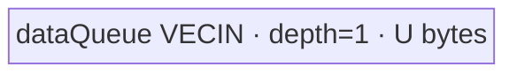

# ForeachCopy A2 ACLNN 算子知识

## 算子速览

| 项目 | 内容 |
|---|---|
| 实际入口 | `aclnnForeachCopyGetWorkspaceSize` + `aclnnForeachCopy`，公开两段式 ACLNN；固定仓未出现带版本后缀的新入口。 |
| 计算语义 | 对张量列表逐项复制：对每个 `i`，将 `x_i` 的全部有效元素写到 `out_i` 的同索引前缀；允许四种浮点转换。 |
| 输入输出 | `x`/`out` 均为动态 TensorList、ND；单 Tensor 0～8 维，支持空 Tensor；输入可非连续，输出必须连续。 |
| 执行类型 | 单 Kernel `foreach_copy`；所有 Route 均为 `AIV_VECTOR`。同 dtype 路线只搬运，异 dtype 路线执行 Vector `Cast`；无 Cube/AIC/MIX_CV。 |
| Kernel 路线 | R-001 同 dtype 复制（key 1～12）；R-002 扩展到 FP32（key 14/16）；R-003 FP32 窄化（key 13/15）。 |
| 核心资源 | GM TensorList 地址表；R-001 一个 `VECIN` TQue；R-002/R-003 一个 `VECIN` TQue + 一个 `VECOUT` TQue；Kernel 不消费 user workspace。 |
| 来源闭包 | `source_closed`：公开 ACLNN 文档/生成接线 → `ForeachCopy` OpDef → `Tiling4ForeachCopyTiling`/`ForeachCommonTilingData` → `foreach_copy` router → `ForeachCopyND`/`ForeachCastND` → A2 binary/Kernel 构建接线。ACLNN inner bridge 是仓内生成框架边界。 |
| 验证状态 | 已完成源码闭包检查；本次知识提取未执行编译、真机、数值或性能测试。 |

## 接口与语义

### 计算语义

令 `x=[x_0,...,x_(n-1)]`、`out=[out_0,...,out_(n-1)]`。对每个列表位置 `i` 和输入存储线性索引 `j∈[0,numel(x_i))`：

```text
同 dtype: out_i[j] = x_i[j]
FP16/BF16 -> FP32: out_i[j] = Cast(x_i[j], CAST_NONE)
FP32 -> FP16/BF16: out_i[j] = Cast(x_i[j], CAST_RINT)
```

Tiling 只要求 `numel(out_i) >= numel(x_i)`；Kernel 仅写前 `numel(x_i)` 个线性元素，较大的输出尾部不在该算子的写入域中。每个输入 Tensor 按 storage shape 展平，跨 Tensor 不改变列表顺序。

### 输入、输出与属性

| 参数 | shape/layout | dtype | 约束、默认值与语义 |
|---|---|---|---|
| `x` | 动态 TensorList；各 Tensor 为 ND，0～8 维 | FP32、FP16、BF16、INT8、UINT8、INT16、UINT16、INT32、UINT32、INT64、DOUBLE、BOOL | 非空指针；同一列表全部 Tensor dtype 一致；支持空 Tensor；ACLNN 文档允许非连续输入，OpDef 标记 `AutoContiguous`。 |
| `out` | 动态 TensorList；ND；每项 `numel(out_i) >= numel(x_i)` | 同 dtype，或 FP32→FP16/BF16、FP16/BF16→FP32 | 非空指针；全部输出 dtype 一致；输出不支持非连续 Tensor；固定 Kernel 只覆盖输入长度。 |
| 属性 | N/A | N/A | 无属性。 |

### 入口与版本

公开文档声明两段式 `aclnnForeachCopyGetWorkspaceSize(x,out,workspaceSize,executor)` 和 `aclnnForeachCopy(workspace,workspaceSize,executor,stream)`。第一段完成参数校验、生成执行器并返回 workspace；第二段把执行图提交到指定 stream。固定仓的 `op_host/CMakeLists.txt` 以 `ACLNNTYPE aclnn` 为 `ForeachCopy` 生成 ACLNN 接线，显式 inner bridge 源码不在仓内，属于允许的框架边界；算子拥有的 OpDef、Tiling、POD、router/body 和构建接线均已闭合。

A2 的公开支持由 README/API 产品表给出，`ascend910b` 同时出现在 OpDef、Host CMake、binary config 和 Kernel CMake。实现接线还出现 `ascend910_93`，但官方表明确 A3 不支持；按公开文档优先级，本卡只标记 A2，且不使用 `ascend910_93` 接线外推 A3。

## Host/Launcher 执行流程

### 参数校验与前处理

1. ACLNN 第一段拒绝 `x`/`out` 空指针、不支持 dtype、列表内 dtype 不一致、维数超过 8 或输出元素数不足。
2. 输入非连续由生成的 ACLNN/`AutoContiguous` 框架边界转换；输出必须由调用者提供连续存储。
3. `Tiling4ForeachCopyTiling` 构造 `ForeachCommonTiling`，以 `FOREACH_COPY_OP_CODE=32` 调用 `Init`，再调用 `RunBigKernelTiling`。
4. `Init` 最多扫描 `MAX_TENSOR_CONT=50` 项，记录每项 storage `numel`、总元素数、输入 dtype/字节宽度和输出 dtype；`CheckOpInfo` 校验输出、列表 shape/dtype 和维数。
5. `GetTilingKeyForForeachCopy` 产生 key 1～16；非法 dtype 组合在校验阶段失败，不进入 Kernel。

### 参数、Workspace 与生命周期

记平台 AIV 核数为 `Cplat`、输入元素字节数为 `s`、`E=32/s`、总输入元素数为 `N`、序列化 POD 字节数为 `P=tilingData.GetDataSize()`、平台 UB 字节数为 `Uplat`：

```text
blockCount = ceil(N / E)              # 32-byte block 数
blockDim = min(max(1, blockCount), Cplat, 50)
baseElemsPerCore = floor(blockCount / blockDim) * E
前 blockCount % blockDim 个 core 再分配 E 个元素

同 dtype: U = floor((Uplat - P) / 32) * 32
异 dtype: U = floor((Uplat - P) / 32) * 32 / 2
```

Host Tiling 固定设置 `workspaces[0]=32` 字节；Kernel entry 把 `userWS` 强制置空，两个 body 的 `workspace` 形参均未消费。因此这 32 字节是运行时/算子 launch 预留，不形成 Kernel 节点间边。公开 ACLNN 返回的总 workspace 还可能包含输入连续化框架开销，其总公式在固定仓的生成 bridge 中不可见；owner 是调用者，生命周期从第二段提交开始到 stream 完成。

### 启动图与失败传播

```text
aclnnForeachCopyGetWorkspaceSize
  -> 生成 ACLNN bridge（固定仓不可见的框架边界）
  -> ForeachCopy OpDef / Tiling4ForeachCopyTiling
     -> ForeachCommonTiling::Init/CheckOpInfo/RunBigKernelTiling
     -> key + blockDim + ForeachCommonTilingData + workspace[0]=32
aclnnForeachCopy(workspace, workspaceSize, executor, stream)
  -> 单节点 K1: foreach_copy(x_addr_table, out_addr_table, workspace, tiling)
     -> R-001 ForeachCopyND<T> 或 R-002/R-003 ForeachCastND<Tin,Tout>
```

| 节点/边 | producer | consumer | 介质与范围 | ordering / owner / 失败传播 |
|---|---|---|---|---|
| K1 | ACLNN executor | `foreach_copy` | `x`/`y` GM 地址表、POD；`blockDim` 如上 | 指定 ACL stream 提交；失败状态由执行框架返回。 |
| workspace | 第一段 workspace 规划 | Kernel 不读取 | Tiling 声明 32 字节；ACLNN 总 workspace 可能另含 contiguous 临时区 | 调用者分配并保持到 stream 完成；无跨 Kernel consumer。 |
| 输出提交 | K1 MTE3 | `out_i` GM | 每项前 `numel(x_i)` 个输出元素 | 同一 Kernel 内由 queue/event 保序；无后续 Device 节点。 |

Tiling 任一校验失败返回 `GRAPH_FAILED`，阻断 K1。Router 对未知 key 没有显式 else/error，仅不调用 body；合法入口由 Host 校验保证 key 1～16。

## Route 与参数设计

### 分核与资源计算

Host 先把总输入按 32 字节逻辑 block 均分到最多 50 个 AIV core。`AssignDataToEachCore` 以 `(tensorStart, tensorStartOffset)` 和 `(tensorEnd, tensorEndOffset)` 描述每核在 TensorList 线性序列中的闭区间；一个 core 可以跨多个 Tensor，一个 Tensor 也可在 core 边界被切开。各 body 再以 `maxDataCount` 切 UB tile：R-001 为 `U/sizeof(T)` 元素，R-002/R-003 固定为 `U/sizeof(float)=U/4` 元素。完整 tile 使用 `DataCopy`，最后非整 tile 使用单 blockCount 的 `DataCopyPad`，`blockLen=dataCount*sizeof(dtype)` 字节。

### Route 选择

| 顺序 | Route | Key/模板 | 精确选择条件与优先级 | 不适用去向 |
|---:|---|---|---|---|
| 1 | R-001 同 dtype 复制 | 1 FP16；2 FP32；3 INT32；4 BF16；5 INT16；6 UINT16；7 INT8；8 UINT8；9 UINT32；10 INT64；11 DOUBLE；12 BOOL | `dataType == dstDataType`，再按 `GetTilingKeyByDtypeOnly(dataType)` 映射 | dtype 不同则继续转换映射；不支持 dtype 在 Host 失败。 |
| 2 | R-002 扩展到 FP32 | 14 `half,float`；16 `bfloat16_t,float` | `(x=FP16 && y=FP32) \|\| (x=BF16 && y=FP32)` | 其它不等 dtype 继续 R-003 或 Host 失败。 |
| 3 | R-003 FP32 窄化 | 13 `float,half`；15 `float,bfloat16_t` | `(x=FP32 && y=FP16) \|\| (x=FP32 && y=BF16)` | 其它组合 Host `CheckForeachCopyDtype` 失败。 |

```text
if x.dtype == out.dtype:
    key = dtype-only key 1..12 -> R-001
else if x=FP32 and out=FP16: key=13 -> R-003
else if x=FP16 and out=FP32: key=14 -> R-002
else if x=FP32 and out=BF16: key=15 -> R-003
else if x=BF16 and out=FP32: key=16 -> R-002
else: Host validation fails; K1 is not launched
```

### 模板/实现执行矩阵

| Route | key/selector | dtype/shape/platform 完整命中条件 | 执行拓扑与 Kernel 节点 | 实际模板/body | 内存与同步特征 | tail/fallback |
|---|---|---|---|---|---|---|
| R-001 同 dtype 复制 | 1～12 | A2；列表 dtype 同构；每项 output 容量不小于 input | 单 K1 AIV | `ForeachCopyND<half/float/int/bfloat16_t/int16_t/uint16_t/int8_t/uint8_t/uint32_t/uint64_t/double/bool>::Process` | `VECIN` queue depth 1、U 字节；MTE2→queue→MTE3；显式 V→MTE3、MTE3→MTE2 event | 非整 tile 走 `DataCopyPad`；无其它 fallback。 |
| R-002 扩展到 FP32 | 14/16 | A2；FP16/BF16→FP32；shape 约束同上 | 单 K1 AIV | `ForeachCastND<half,float>` / `<bfloat16_t,float>` | 输入/输出 queue 各 U 字节；`Cast(...CAST_NONE,count)`；V barrier + event | 非整 tile按输入/输出真实字节分别 pad-copy。 |
| R-003 FP32 窄化 | 13/15 | A2；FP32→FP16/BF16；shape 约束同上 | 单 K1 AIV | `ForeachCastND<float,half>` / `<float,bfloat16_t>` | 两个 queue 各 U；`Cast(...CAST_RINT,count)`；V barrier + event | 非整 tile pad-copy；其它 dtype 对失败。 |

### 隐藏性能 Guard

| Guard | Host/Tiling 条件 | Device/资源原因 | 影响 Route | 不满足时去向 | 源码符号 |
|---|---|---|---|---|---|
| 32 字节分核 | `elementsPerBlock=32/s`；`blockDim<=ceil(N/E)` | 防止正常分核产生小于一个硬件 block 的 core 区间 | 全部 | `N=0` 时强制 1 core | `foreach_tiling_class.h::GetNeedCoreNum/AssignDataToEachCore` |
| UB POD 预留 | `Uplat > P` 是公式可用前提；源码以无符号减法计算 | Host 公式先从 UB 预算扣除序列化 Tiling 数据大小，再规划 queue；固定仓未展开该预留的底层物理映射 | 全部 | 固定源码没有显式资源不足错误分支 | `ForeachCommonTiling::DivideUbMemory9` |
| 转换双缓冲区 | `x.dtype != y.dtype` 时 `U=floor32(Uplat-P)/2` | `ForeachCastND` 同时分配 input/output queue，各为 U 字节 | R-002/R-003 | 同 dtype 不除 2，进入 R-001 | `DivideUbMemory9`；`ForeachCastND::Init` |
| 列表/核上限 | 扫描与 POD 均为 50 项/50 core | `ForeachCommonTilingData` 固定数组 | 全部 | 大于 50 的显式拒绝逻辑在固定源码不可见，不能外推支持 | `MAX_TENSOR_CONT/MAX_CORE_CONT` |
| 输出连续 | API 明确 `out` 非连续=不支持 | Device 以线性 GM 地址 + 元素 offset 写出 | 全部 | ACLNN 第一段失败/不支持 | `docs/aclnnForeachCopy.md`；`Process` |
| key 可达性 | 仅 1～16；A2 可编译 BF16 key | Router 无 unknown-key 报错 | 全部 | Host dtype 校验失败；若绕过 Host，Kernel 不写输出 | `GetTilingKeyForForeachCopy`；`foreach_copy` |

### POD/ABI

`ForeachCommonTilingData` 由 tilingdata 宏声明；宏展开实现不在固定仓，因此 `sizeof/alignof/offsetof` 不作推测。字段顺序、类型、数组长度、producer 和 consumer 可闭合：

| 结构 | 字段 | 类型/位宽 | ABI 布局 | 单位 | Host/launcher producer | Device consumer | 边界 |
|---|---|---|---|---|---|---|---|
| `ForeachCommonTilingData` | `inputsTensorUbSize` | `uint64_t`/64 | 首字段；精确 offset/总 `sizeof` 固定仓不可见 | 字节 | `DivideUbMemory9`，`FillTilingData::set_inputsTensorUbSize` | 两 body `ParseTilingData`；`InitBuffer`、`maxDataCount` | 32 字节对齐；转换路线再除 2。 |
| 同上 | `tensorDataCountList` | `int64_t[50]` | 第二字段；offset 不可见 | 元素/每 Tensor | `Init`: `storageShape.GetShapeSize()` | `Process`: 初始 `cursorEnd` | 仅扫描到 `totalTensorCount`。 |
| 同上 | `tensorStartList` | `uint16_t[50]` | 第三字段；offset 不可见 | Tensor 索引/core | `AssignDataToEachCore` | `ParseTilingData[blockIdx]` | 有效 core `<blockDim<=50`。 |
| 同上 | `tensorEndList` | `uint16_t[50]` | 第四字段；offset 不可见 | Tensor 索引/core | `AssignDataToEachCore` | `ParseTilingData[blockIdx]` | 与 start 构成闭区间。 |
| 同上 | `tensorStartOffsetList` | `int64_t[50]` | 第五字段；offset 不可见 | 元素/core | `AssignDataToEachCore` | `ParseTilingData[blockIdx]` | 相对该 core 首 Tensor。 |
| 同上 | `tensorEndOffsetList` | `int64_t[50]` | 第六字段；offset 不可见 | 元素/core，闭区间末端 | `AssignDataToEachCore` | `ParseTilingData[blockIdx]` | 相对该 core 末 Tensor。 |

### Route 源码闭包

| Route | Key/selector | Host/Tiling producer | POD/参数 | Kernel entry/router 节点 | Kernel body/直接依赖 | 构建接线 |
|---|---|---|---|---|---|---|
| R-001 | 1～12 | `foreach_copy_tiling_arch22.cpp::Tiling4ForeachCopyTiling`；`ForeachCommonTiling`；`common_dtype.h` | `ForeachCommonTilingData` 六字段 | `foreach_copy.cpp::foreach_copy` | `foreach_copy.h::ForeachCopyND::{Init,Process,SingleTensorProcess,CopyIn,ComputeAndCopyOut,GetTensorAddr}` | Host/Kernel CMake + `ascend910b` binary JSON |
| R-002 | 14/16 | 同上 | 同上 | 同上 | `foreach_cast.h::ForeachCastND<half,float>/<bfloat16_t,float>` 全方法 | 同上 |
| R-003 | 13/15 | 同上 | 同上 | 同上 | `foreach_cast.h::ForeachCastND<float,half>/<float,bfloat16_t>` 全方法 | 同上 |

## Kernel 实现

### 公共执行流程

K1 解析同一个 POD，router 按 key 实例化一个 body。每个 AIV core 从 TensorList GM 地址表解析每个 Tensor 的真实 GM 指针：地址表首 `uint64_t` 给出指针数组相对表首地址的字节偏移，右移 3 转成 `uint64_t` 索引，然后读取第 `i` 个 64 位地址。core 遍历自己的 `[tensorStart,tensorEnd]`，首/末 Tensor 分别裁剪 start/end offset；每个 Tensor 区间再按 UB 容量串行切 tile。单节点没有 workspace 交接或跨 Kernel 同步。

### Route R-001：同 dtype 直接复制

#### 适用条件

##### 选择证据

| 层级 | 文件 | 符号 | 源码谓词/参数 | 结果/下一跳 |
|---|---|---|---|---|
| Host | `foreach_utils/op_host/common_dtype.h` | `GetTilingKeyForForeachCopy` | `dataType==dstDataType` | 交给 dtype-only 映射，key 1～12。 |
| Tiling | `foreach_utils/op_host/foreach_tiling_class.h` | `RunBigKernelTiling` | `opCode==FOREACH_COPY_OP_CODE` | 写 key、blockDim、POD、32-byte workspace。 |
| Router | `foreach_copy/op_kernel/foreach_copy.cpp` | `foreach_copy` | `TILING_KEY_IS(1..12)` | 实例化对应 `ForeachCopyND<T>`。 |

#### Device 数据流

##### 函数级调用链

```text
Tiling4ForeachCopyTiling
  -> ForeachCommonTiling::Init(32)
  -> RunBigKernelTiling
ACLNN stream launch foreach_copy(x, y, workspace, tiling)
  -> GET_TILING_DATA
  -> ForeachCopyND<T>::Init
  -> ForeachCopyND<T>::Process
     -> GetTensorAddr
     -> SingleTensorProcess
        -> CopyIn -> ComputeAndCopyOut
```

##### 源码等价伪码

```text
# 伪码
U = tiling.inputsTensorUbSize
core = GetBlockIdx()
InitBuffer(dataQueue[VECIN], depth=1, bytes=U)
M = U / sizeof(T)
for tensor i in [start[core], end[core]]:
    lo = (i == start ? startOffset[core] : 0)
    hi = (i == end ? endOffset[core] : tensorCount[i]-1)
    bind inGM/outGM to tensorAddr(i) + lo
    count = hi-lo+1
    for tile in [0, ceil(count/M)):
        valid = min(M, count-tile*M)
        if valid == M: DataCopy(UB, inGM[tile*M], valid)
        else: DataCopyPad(UB, inGM[tile*M], blockCount=1, blockLen=valid*sizeof(T))
        EnQue; DeQue
        SetFlag/WaitFlag(V_MTE3)
        if valid == M: DataCopy(outGM[tile*M], UB, valid)
        else: DataCopyPad(outGM[tile*M], UB, blockCount=1, blockLen=valid*sizeof(T))
        SetFlag/WaitFlag(MTE3_MTE2)
        FreeTensor
```

#### 内存与数据搬运

##### 资源与搬运表

| 层级/缓冲区 | offset/地址公式 | extent/容量公式 | dtype/layout | producer | consumer | owner/lifetime | 对齐/复用 |
|---|---|---|---|---|---|---|---|
| x GM TensorList | `addrTable[(baseOffset>>3)+i] + lo + tile*M` | `valid` 元素 | T/ND linear storage | ACLNN input | MTE2 `CopyIn` | caller；stream 完成前有效 | full tile 对齐；tail 精确字节。 |
| `dataQueue` | queue 管理 | U 字节，depth 1 | T/VECIN | MTE2 | MTE3 | `TPipe`/一次 tile；`FreeTensor` 后复用 | 32-byte U；同物理区串行复用。 |
| out GM | `outAddr(i)+lo+tile*M` | `valid` 元素 | T/ND linear storage | MTE3 | caller | caller | 只写 input 有效前缀。 |

##### 分层内存布局



##### 字节账与复用顺序

```text
U = floor((Uplat - P) / 32) * 32
UB_total = 1 * U
UB_total <= Uplat - P
dynamic_ub = N/A（AIV TPipe 静态 queue）
workspace_total = 32 bytes Tiling 预留；Kernel userWS=null，不消费
=> M = U / sizeof(T)
```

| 复用子区 | 写入者 | 读取者/消费点 | 下一次覆盖 | 同步或释放依据 | 安全条件 |
|---|---|---|---|---|---|
| `dataQueue` 全区 | `CopyIn`/MTE2 | `ComputeAndCopyOut`/MTE3 | 下一 tile `AllocTensor` | `DeQue`；MTE3→MTE2 event；`FreeTensor` | 必须等当前 MTE3 完成后再让 MTE2 覆盖。 |

#### 同步、精度与尾块

##### 同步与数值边界表

| 阶段 | primitive/机制 | producer | consumer/等待点 | 保护对象 | 精度/尾块 |
|---|---|---|---|---|---|
| GM→UB | `AllocTensor/DataCopy/EnQue` | MTE2 | `DeQue` | `dataQueue` tile | 位级复制，无算术。 |
| UB→GM 前 | `SetFlag/WaitFlag<V_MTE3>` | V pipe 阶段 | MTE3 | queue tile | 即使本路线无 Vector 计算，也显式建立 V→MTE3 顺序。 |
| queue 复用 | `SetFlag/WaitFlag<MTE3_MTE2>` | MTE3 | 下一 MTE2 | 同一 depth-1 queue | 防止提前覆盖。 |
| tail | `DataCopyPad` + `blockLen=valid*sizeof(T)` | 当前 tile | GM output | 最后不足 M 个元素 | 不把 padding lane 写成有效输出。 |

#### 关键实现

##### 符号证据表

| 阶段 | 文件 | 符号/模板实例 | 实现事实 |
|---|---|---|---|
| Host/Tiling producer | `foreach_utils/op_host/foreach_tiling_class.h` | `GetNeedCoreNum/AssignDataToEachCore/DivideUbMemory9/FillTilingData` | 32-byte 分核、U、POD 与 blockDim。 |
| Kernel entry/router | `foreach_copy/op_kernel/foreach_copy.cpp` | `foreach_copy` key 1～12 | key 到全部同 dtype模板映射，workspace 被置空。 |
| Device body/helper | `foreach_copy/op_kernel/foreach_copy.h` | `ForeachCopyND<T>` 全方法 | 地址表解析、跨 Tensor 循环、tile DMA、event 与 tail。 |

### Route R-002：FP16/BF16 扩展到 FP32

#### 适用条件

##### 选择证据

| 层级 | 文件 | 符号 | 源码谓词/参数 | 结果/下一跳 |
|---|---|---|---|---|
| Host | `common_dtype.h` | `GetTilingKeyForForeachCopy` | FP16→FP32 或 BF16→FP32 | key 14 或 16。 |
| Tiling | `foreach_tiling_class.h` | `DivideUbMemory9` | `dataType != dstDataType` | U 在 32-byte floor 后除 2。 |
| Router | `foreach_copy.cpp` | `foreach_copy` | key 14/16 | `ForeachCastND<half,float>` / `<bfloat16_t,float>`。 |

#### Device 数据流

##### 函数级调用链

```text
foreach_copy
  -> ForeachCastND<Tin,float>::Init
     -> InitBuffer(dataQueue,U); InitBuffer(outQueue,U)
  -> Process -> GetInputTensorAddr/GetOutputTensorAddr
     -> SingleTensorProcess -> CopyIn
     -> ComputeAndCopyOut
        -> Cast(outLocal,dataLocal,CAST_NONE,valid)
        -> DataCopy/DataCopyPad -> out GM
```

##### 源码等价伪码

```text
# 伪码；core/Tensor 区间同 R-001
M = U/4
for each tile(valid <= M):
    copy valid Tin elements GM -> dataQueue
    DeQue input; Alloc outQueue<float>
    PipeBarrier(V)
    Cast(outLocal, dataLocal, CAST_NONE, valid)
    PipeBarrier(V); event V_MTE3
    copy valid float elements outQueue -> GM
    event MTE3_MTE2
    Free input and output tensors
```

#### 内存与数据搬运

##### 资源与搬运表

| 层级/缓冲区 | offset/地址公式 | extent/容量公式 | dtype/layout | producer | consumer | owner/lifetime | 对齐/复用 |
|---|---|---|---|---|---|---|---|
| input GM | `inAddr+lo+tile*M` | valid Tin 元素 | FP16/BF16 | caller | MTE2 | caller | tail blockLen=`valid*2`。 |
| `dataQueue` | queue 管理 | U bytes, depth 1 | Tin/VECIN | MTE2 | Vector Cast | TPipe/tile | 实际有效最多 `2*M` 字节，容量仍按 U 计。 |
| `outQueue` | queue 管理 | U bytes, depth 1 | FP32/VECOUT | Vector Cast | MTE3 | TPipe/tile | 有效 `4*M<=U`。 |
| output GM | `outAddr+lo+tile*M` | valid FP32 | FP32 | MTE3 | caller | caller | tail blockLen=`valid*4`。 |

##### 分层内存布局


##### 字节账与复用顺序

```text
U = floor((Uplat - P) / 32) * 32 / 2
UB_total = U + U = 2U <= floor32(Uplat-P) <= Uplat-P
dynamic_ub = N/A
workspace_total = 32-byte launch reserve; Kernel does not consume
=> M=U/4 elements, chosen by largest conversion-side element width (FP32)
```

| 复用子区 | 写入者 | 读取者/消费点 | 下一次覆盖 | 同步或释放依据 | 安全条件 |
|---|---|---|---|---|---|
| input queue | MTE2 | Vector `Cast` | 下一 tile MTE2 | DeQue + MTE3→MTE2 event + Free | 当前 conversion/output 必须结束。 |
| output queue | Vector `Cast` | MTE3 | 下一 tile Vector | V barrier、V→MTE3 event、Free | MTE3 完成后复用。 |

#### 同步、精度与尾块

##### 同步与数值边界表

| 阶段 | primitive/机制 | producer | consumer/等待点 | 保护对象 | 精度/尾块 |
|---|---|---|---|---|---|
| Cast | `PipeBarrier<PIPE_V>` | input queue | Vector Cast / MTE3 | input/output LocalTensor | `CAST_NONE` 精确扩展 FP16/BF16 到 FP32。 |
| output | V→MTE3 event | Vector | MTE3 | outQueue | 只提交 valid 元素。 |
| reuse | MTE3→MTE2 event | MTE3 | next MTE2 | 两 depth-1 queue | 串行 tile。 |
| tail | in/out `DataCopyPad` | MTE2/Vector | MTE3/GM | 最后 tile | 输入按 2 字节、输出按 4 字节计算 blockLen。 |

#### 关键实现

##### 符号证据表

| 阶段 | 文件 | 符号/模板实例 | 实现事实 |
|---|---|---|---|
| Host/Tiling producer | `common_dtype.h`; `foreach_tiling_class.h` | `GetTilingKeyForForeachCopy`; `DivideUbMemory9` | key 14/16 与两 queue UB 预算。 |
| Kernel entry/router | `foreach_copy.cpp` | `ForeachCastND<half,float>/<bfloat16_t,float>` | 模板实例可达。 |
| Device body/helper | `foreach_cast.h` | `ForeachCastND::{Init,Process,CopyIn,ComputeAndCopyOut}` | `CAST_NONE`、M=U/4、DMA 与同步。 |

### Route R-003：FP32 窄化到 FP16/BF16

#### 适用条件

##### 选择证据

| 层级 | 文件 | 符号 | 源码谓词/参数 | 结果/下一跳 |
|---|---|---|---|---|
| Host | `common_dtype.h` | `GetTilingKeyForForeachCopy` | FP32→FP16 或 FP32→BF16 | key 13 或 15。 |
| Tiling | `foreach_tiling_class.h` | `DivideUbMemory9` | dtype 不同 | U 除 2，满足双 queue 总账。 |
| Router | `foreach_copy.cpp` | `foreach_copy` | key 13/15 | `ForeachCastND<float,half>` / `<float,bfloat16_t>`。 |

#### Device 数据流

##### 函数级调用链

```text
foreach_copy
  -> ForeachCastND<float,Tout>::Init
  -> Process -> SingleTensorProcess -> CopyIn
  -> ComputeAndCopyOut
     -> Cast(outLocal,dataLocal,CAST_RINT,valid)
     -> output DMA -> GM
```

##### 源码等价伪码

```text
# 伪码；分核和地址解析同 R-001
M=U/4
for tile(valid<=M):
    copy valid float GM -> dataQueue
    Cast(outQueue<Tout>, dataQueue<float>, CAST_RINT, valid)
    after V barrier/event, copy valid Tout -> output GM
    use DataCopyPad when valid<M; then event and FreeTensor
```

#### 内存与数据搬运

##### 资源与搬运表

| 层级/缓冲区 | offset/地址公式 | extent/容量公式 | dtype/layout | producer | consumer | owner/lifetime | 对齐/复用 |
|---|---|---|---|---|---|---|---|
| input GM | `inAddr+lo+tile*M` | valid FP32 | FP32 | caller | MTE2 | caller | tail blockLen=`valid*4`。 |
| `dataQueue` | queue 管理 | U bytes, depth 1 | FP32/VECIN | MTE2 | Cast | TPipe/tile | `4*M=U`。 |
| `outQueue` | queue 管理 | U bytes, depth 1 | FP16/BF16/VECOUT | Cast | MTE3 | TPipe/tile | 实际有效至多 `2*M`，分配容量仍为 U。 |
| output GM | `outAddr+lo+tile*M` | valid Tout | FP16/BF16 | MTE3 | caller | caller | tail blockLen=`valid*2`。 |

##### 分层内存布局


##### 字节账与复用顺序

```text
U=floor32(Uplat-P)/2
UB_total=U+U=2U<=Uplat-P
dynamic_ub=N/A
workspace_total=32-byte launch reserve, not consumed by K1
=> M=U/4 FP32 input elements
```

| 复用子区 | 写入者 | 读取者/消费点 | 下一次覆盖 | 同步或释放依据 | 安全条件 |
|---|---|---|---|---|---|
| input queue | MTE2 | Cast | next MTE2 | DeQue/event/Free | 不在 Cast 完成前覆盖。 |
| output queue | Cast | MTE3 | next Cast | V barrier + V→MTE3 + Free | 不在 MTE3 完成前覆盖。 |

#### 同步、精度与尾块

##### 同步与数值边界表

| 阶段 | primitive/机制 | producer | consumer/等待点 | 保护对象 | 精度/尾块 |
|---|---|---|---|---|---|
| Cast | `Cast(...RoundMode::CAST_RINT,valid)` | FP32 input | FP16/BF16 output queue | valid lanes | 按源码使用 `CAST_RINT`；固定仓未给出更高层数值误差界。 |
| barrier | `PipeBarrier<PIPE_V>` | Vector steps | V/MTE3 | outLocal | 确保 Cast 完成。 |
| events | V→MTE3、MTE3→MTE2 | V/MTE3 | MTE3/next MTE2 | depth-1 queues | 串行安全复用。 |
| tail | `DataCopyPad` | MTE2/MTE3 | UB/GM | final tile | 输入输出 blockLen 分别按 4/2 字节。 |

#### 关键实现

##### 符号证据表

| 阶段 | 文件 | 符号/模板实例 | 实现事实 |
|---|---|---|---|
| Host/Tiling producer | `common_dtype.h`; `foreach_tiling_class.h` | key selector；`DivideUbMemory9` | key 13/15、U/2。 |
| Kernel entry/router | `foreach_copy.cpp` | `ForeachCastND<float,half>/<float,bfloat16_t>` | 窄化模板映射。 |
| Device body/helper | `foreach_cast.h` | `ComputeAndCopyOut` | `CAST_RINT`、同步、tail 与释放。 |

## 算子特定优化

### Trick T-001：把 TensorList 串联域按 32 字节 block 均分到 AIV core

#### 触发与源码依据

- 适用 Route：R-001、R-002、R-003。
- 触发条件：所有非失败输入；`elementsPerBlock=32/sizeof(input dtype)`，`blockDim=min(ceil(total/E), platformAivCores, 50)`。
- Golden 来源：[`foreach/foreach_utils/op_host/foreach_tiling_class.h:653-660`](../../../../../../../cann-ops-raw/ascendc/ops-nn/955f8b33985b6d72989ebff341bb9c2c564a51bc/foreach/foreach_utils/op_host/foreach_tiling_class.h#L653-L660)

**官方源码（固定 Commit 连续逐字摘录）**：

```cpp
// Kernel the input data according to 32 byte alignment.
int64_t blockCount = CeilA2B(totalDataCount, elementsPerBlock);
// Divisible, representing the amount of data each core needs to process.
if (needCoreNum == 0) {
    needCoreNum = 1;
}
int64_t tempPerCoreCount = blockCount / needCoreNum * static_cast<int64_t>(elementsPerBlock);
int64_t remainderCount = blockCount % needCoreNum; // remainder.
```

#### 机制与设计原因

Host 不逐 Tensor 启动 Kernel，而把所有 Tensor 的线性有效元素视为一个串联域，以 32 字节为最小分配粒度一次分给多个 AIV core，再用四组 start/end POD 数组恢复 Tensor 边界。这样单次 launch 可覆盖整个列表，并允许大 Tensor 跨核、小 Tensor 在同一核连续处理；源码可证明减少了逐 Tensor launch 物化。每核多出来的一块只分给前 `remainderCount` 个 core，保持负载差不超过一个 32-byte block。

#### 迁移边界

- 适用：可按线性 storage 元素独立处理、能够用地址表解析每个 Tensor 的 foreach 算子。
- 前提：输入 TensorList dtype 一致；输出可按同一元素偏移定位；POD 能容纳每核首末 Tensor 与 offset。
- 失效：需要跨 Tensor 归约/依赖、输出非线性布局或列表超过固定 50 项时不能直接复用。
- 未验证：本次知识提取未执行编译、真机、数值或性能测试。

#### 错误做法

固定仓未提供可验证反例。

### Trick T-002：按是否 Cast 在 Host 端切换一队列/两队列 UB 预算

#### 触发与源码依据

- 适用 Route：R-001、R-002、R-003。
- 触发条件：`opCode==FOREACH_COPY_OP_CODE`；同 dtype 保留全部可用 UB，异 dtype 对 U 除 2。
- Golden 来源：[`foreach/foreach_utils/op_host/foreach_tiling_class.h:1153-1162`](../../../../../../../cann-ops-raw/ascendc/ops-nn/955f8b33985b6d72989ebff341bb9c2c564a51bc/foreach/foreach_utils/op_host/foreach_tiling_class.h#L1153-L1162)

**官方源码（固定 Commit 连续逐字摘录）**：

```cpp
} else if (opCode == FOREACH_COPY_OP_CODE) {
    // The remaining UB size is one buffer enabled, and rounded down 32 bytes.
    // foreach_copy
    uint32_t totalSize = uint32_t(ubSizePlatForm - tilingData.GetDataSize());

    uint32_t canUseUbSize = totalSize;
    inputsTensorUbSize = static_cast<uint64_t>(canUseUbSize / BYTE_BLOCK * BYTE_BLOCK);
    if (dataType != dstDataType) {
        inputsTensorUbSize /= BUFFER_ATTENUATION;
    }
```

#### 机制与设计原因

Host 先扣除 `P` 并向下对齐 32 字节；这描述的是源码中的资源预算公式，不把 POD 的底层物理驻留位置外推为 UB。

R-001 只有一个 depth-1 input queue，U 可占满扣除 POD 后的 32-byte 对齐 UB；转换路线同时存在 input/output queue，Host 把相同 POD 字段 U 减半，Device 再各分配 U，严格形成 `2U<=Uplat-P`。这不是运行时动态探测，而是 key/dtype 已知后的 Host specialization，既避免 R-001 为不存在的输出 queue 预留空间，也防止 Cast 路线双 queue 超预算。

#### 迁移边界

- 适用：同一入口根据是否需要中间输出 buffer 选择不同 LocalTensor 图的算子。
- 前提：Host dtype 判定与 Device router 模板严格一致；所有 queue 的真实 depth 和字节容量纳入总账。
- 失效：新增临时 TBuf、double buffer 或更大 dtype 时必须重算，不能继续只除 2。
- 未验证：本次知识提取未执行编译、真机、数值或性能测试。

#### 错误做法

固定仓的真实失败边界是：若异 dtype 仍使用同 dtype 的 U，Device `ForeachCastND::Init` 会申请两个各 U 的 queue，源码字节账将超过 `Uplat-P`；固定仓未提供对应可运行反例。

## 模板与实现对比

| 对比维度 | R-001 同 dtype | R-002 扩展到 FP32 | R-003 FP32 窄化 | 设计选择依据 |
|---|---|---|---|---|
| 命中条件/优先级 | dtype 相同，key 1～12 | FP16/BF16→FP32，key 14/16 | FP32→FP16/BF16，key 13/15 | Host dtype pair 唯一映射。 |
| 模板与 dtype | `ForeachCopyND<T>` | `ForeachCastND<Tin,float>` | `ForeachCastND<float,Tout>` | 是否需要 Cast 与输出类型决定。 |
| 循环与分核 | 共享 32-byte Host 分核；M=U/sizeof(T) | 共享分核；M=U/4 | 共享分核；M=U/4 | 转换以 FP32 侧宽度限制 tile。 |
| Queue/TBuf/寄存器/dynamic UB/通信 window | 1×VECIN U；无有效计算 TBuf | VECIN U + VECOUT U | VECIN U + VECOUT U | LocalTensor 图不同。 |
| 内存总占用与复用 | U，depth 1 串行复用 | 2U，两个 depth 1 queue | 2U，两个 depth 1 queue | Host 同/异 dtype UB specialization。 |
| 搬运/Vector/SIMT/NDDMA/通信 API | `DataCopy/DataCopyPad` | 同 + `Cast(CAST_NONE)` | 同 + `Cast(CAST_RINT)` | 精度方向不同。 |
| 同步、精度与 tail | event；位级复制 | V barrier/event；无舍入扩展 | V barrier/event；RINT 窄化 | 都只写 valid tail。 |
| fallback/失败边界 | 不支持 dtype 失败 | 其它输入到 FP32 失败 | FP32 到其它输出失败 | 无 Device fallback。 |

## 平台差异

| 项目 | A2 | A3 | 950 |
|---|---|---|---|
| 支持状态 | 官方公开支持；本卡平台。 | 官方 README/API 明确不支持；不得以相似硬件或目录外推。 | 官方公开支持；另见 `_950` 卡。 |
| Host/Launcher | 公开 A2 支持与活动 `ascend910b -> arch22` 接线闭合，最多 50 core。 | `ascend910_93` 虽有实现接线，但与公开“不支持 A3”冲突，不能发布 A3 实现结论。 | 同一 `arch22` Tiling 和 `ForeachCommonTilingData`，仍在本实现中截断到 50 core。 |
| Kernel/资源 | 同一 AIV source，A2 binary config 16 个 dtype pair。 | N/A。 | 同一 AIV source；`ascend950` OpDef/config/CMake 接线；无独立 arch35 body。 |

## 限制与失败边界

- 官方 API 的输入/输出维数上限为 8；输出必须连续；每个输出 storage 元素数不得小于对应输入；输出多出来的尾部不被 Kernel 写入。
- 所有输入 dtype 必须一致，所有输出 dtype 必须一致；只接受同 dtype、FP32↔FP16 和 FP32↔BF16。
- 同一 API 文档的详细参数表明确允许上述四种浮点转换，README、OpDef、Tiling selector 和 binary config 也闭合这些组合；但返回码表另有“x 和 out 的数据类型不一致”即报错的宽泛措辞。固定实现只支持本文列出的四种异 dtype pair，不把返回码表措辞扩展成“禁止全部转换”，也不外推更多组合。
- `MAX_TENSOR_CONT=50`、`MAX_CORE_CONT=50` 是当前 Host/POD 的固定容量；固定源码没有对列表长度大于 50 的明确报错，因此不能把它表述为受支持范围。
- 当 `Uplat<=P` 时 `uint32_t(Uplat-P)` 的资源不足保护在固定源码不可见；正常平台配置必须保证 POD 后仍有正的、可形成 tile 的 UB。
- Router 未对未知 key 报 Device 错误；只在合法 Host 路径闭合。BF16 的编译排除只针对 NPU arch 3003/3113，不影响本卡 A2。
- ACLNN inner bridge 和输入 contiguous 临时区总 workspace 公式由仓外生成框架持有；算子 Tiling 可见部分固定为 32 字节，Kernel 显式不消费。
- 本次知识提取未执行编译、真机、数值或性能测试。

## 源码索引

### 链路索引

| 链路阶段 | 文件 | 关键符号 | 支撑内容 |
|---|---|---|---|
| 入口声明/约束 | `foreach/foreach_copy/docs/aclnnForeachCopy.md` | 两段式函数原型、产品表、参数/错误码 | 公开 ACLNN 与 A2/A3/950 支持边界。 |
| 入口声明/约束 | `foreach/foreach_copy/README.md` | 产品支持、公式、dtype、连续性 | 语义和平台交叉证据。 |
| 入口实现 | `foreach/foreach_copy/op_host/CMakeLists.txt` | `ACLNNTYPE aclnn`、`SUPPORT_COMPUTE_UNIT` | 生成 ACLNN bridge 到 ForeachCopy Host；A2/950 接线。 |
| Host/Launcher | `foreach/foreach_copy/op_host/foreach_copy_def.cpp` | `ForeachCopy::ForeachCopy` | dtype pair、AutoContiguous、A2/950 OpDef config。 |
| Host/Launcher | `foreach/foreach_copy/op_host/arch22/foreach_copy_tiling_arch22.cpp` | `Tiling4ForeachCopyTiling` | ForeachCopy 专属 Tiling 注册入口。 |
| Host/Launcher | `foreach/foreach_utils/op_host/foreach_tiling_class.h` | `ForeachCommonTiling` | 校验、分核、UB、POD、blockDim/workspace。 |
| POD | `foreach/foreach_utils/op_host/foreach_tiling_def.h` | `ForeachCommonTilingData` | 六字段 ABI 声明和固定数组容量。 |
| Host selector | `foreach/foreach_utils/op_host/common_dtype.h` | `GetTilingKeyForForeachCopy` | key 1～16 与 dtype pair。 |
| Kernel entry/body | `foreach/foreach_copy/op_kernel/foreach_copy.cpp` | `foreach_copy` | router、模板实例、workspace 不消费。 |
| Kernel entry/body | `foreach/foreach_copy/op_kernel/foreach_copy.h` | `ForeachCopyND<T>` | R-001 完整 body。 |
| Kernel entry/body | `foreach/foreach_copy/op_kernel/foreach_cast.h` | `ForeachCastND<Tin,Tout>` | R-002/R-003 完整 body。 |
| 构建接线 | `foreach/foreach_copy/op_kernel/CMakeLists.txt` | `add_kernel_sources` | A2/950 Kernel 编译、`AUTO_SYNC false`。 |
| 构建接线 | `foreach/foreach_copy/op_host/config/ascend910b/foreach_copy_binary.json` | `ForeachCopy` 16 个 binary entry | A2 dtype pair binary 可达性。 |

### 实现复用检查

| 检查项 | 可复用事实 | 不得改变的约束 | 源码符号 |
|---|---|---|---|
| ABI/POD | 六字段共同描述 UB 和每核 Tensor 区间 | 字段顺序/位宽、50 项容量、闭区间语义不能变 | `ForeachCommonTilingData`；`FillTilingData/ParseTilingData` |
| 调用顺序 | 单 launch，core→Tensor→tile | 先解析地址表和首末 offset，再切 tile | `Process/SingleTensorProcess` |
| workspace/内存 | 同 dtype U；异 dtype 2U | 必须扣除 `P`、32-byte floor，并按真实 queue 数计账 | `DivideUbMemory9`；两个 `Init` |
| 同步 | queue + V/MTE3 + MTE3/MTE2 | depth-1 buffer 不能在 consumer 完成前覆盖 | 两个 `ComputeAndCopyOut` |
| 精度与尾块 | 扩展 `CAST_NONE`，窄化 `CAST_RINT`；tail 精确 blockLen | 不能互换 round mode；不能把 padding lane 写出 | `ForeachCastND::ComputeAndCopyOut/CopyIn` |
| 失败边界 | Host 拦截 dtype/shape/list inconsistency | 不能依赖 unknown-key Device fallback；A3 不支持 | `CheckOpInfo/CheckForeachCopyDtype`；公开产品表 |