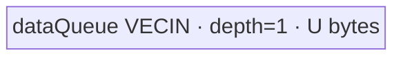

# ForeachCopy 950 ACLNN 算子知识

## 算子速览

| 项目 | 内容 |
|---|---|
| 实际入口 | `aclnnForeachCopyGetWorkspaceSize` + `aclnnForeachCopy`，公开两段式 ACLNN；固定仓无更高版本后缀入口。 |
| 计算语义 | 对 TensorList 逐项复制，支持同 dtype 位级搬运，以及 FP32↔FP16、FP32↔BF16 的逐元素 Cast。 |
| 输入输出 | 动态 ND TensorList；每项 0～8 维；输入可非连续、输出必须连续；`numel(out_i)>=numel(x_i)`。 |
| 执行类型 | 单 Kernel `foreach_copy`；R-001/R-002/R-003 全为 `AIV_VECTOR`，无 Cube/AIC/MIX_CV。950 没有独立 arch35 body，复用活动 `arch22` Host 与公共 AIV source。 |
| Kernel 路线 | R-001 同 dtype key 1～12；R-002 FP16/BF16→FP32 key 14/16；R-003 FP32→FP16/BF16 key 13/15。 |
| 核心资源 | GM 地址表；R-001 一个 depth-1 `VECIN` queue；转换路线各一个 depth-1 `VECIN/VECOUT` queue；Kernel 不消费 workspace。 |
| 来源闭包 | `source_closed`：公开 950 API 产品表 → `ascend950` OpDef/ACLNN Host 接线与 binary config → `arch22` Tiling/POD → `foreach_copy` router → 全部 AIV body → `ascend950` Kernel CMake。生成 ACLNN bridge 为明确框架边界。 |
| 验证状态 | 已完成源码闭包检查；本次知识提取未执行编译、真机、数值或性能测试。 |

## 接口与语义

### 计算语义

对于 `x=[x_0,...,x_(n-1)]` 和 `out=[out_0,...,out_(n-1)]`，每个列表位置独立处理：

```text
for i in [0,n):
  for j in [0,numel(x_i)):
    out_i[j] = x_i[j]                                      # 同 dtype
    out_i[j] = Cast(x_i[j], CAST_NONE)                     # FP16/BF16 -> FP32
    out_i[j] = Cast(x_i[j], CAST_RINT)                     # FP32 -> FP16/BF16
```

Host 使用 storage shape 的元素数并把每项线性化；若 output 容量更大，Kernel 只写输入长度的前缀，额外尾部不属于有效写域。

### 输入、输出与属性

| 参数 | shape/layout | dtype | 约束、默认值与语义 |
|---|---|---|---|
| `x` | 动态 TensorList；ND；0～8 维 | FP32、FP16、BF16、INT8、UINT8、INT16、UINT16、INT32、UINT32、INT64、DOUBLE、BOOL | 非空指针；同一列表 dtype 一致；支持空 Tensor；API 允许非连续输入，OpDef 为 `AutoContiguous`。 |
| `out` | 动态 TensorList；ND；每项容量不小于对应输入 | 同 dtype，或 FP32→FP16/BF16、FP16/BF16→FP32 | 非空指针；列表内 dtype 一致；不支持非连续输出；仅前 `numel(x_i)` 个元素被写。 |
| 属性 | N/A | N/A | 无属性。 |

### 入口与版本

公开入口由第一段 `aclnnForeachCopyGetWorkspaceSize` 和第二段 `aclnnForeachCopy` 组成。第一段校验并创建 executor/workspace 规划，第二段在调用者 stream 上提交。仓内没有显式生成后的 inner bridge 文件；`op_host/CMakeLists.txt` 的 `ACLNNTYPE aclnn` 是生成接线，按 Skill 作为框架边界。OpDef、Tiling selector、POD producer、entry/router、两个 body 和 950 构建配置均可见。

README 与 API 产品表明确 `Ascend 950PR/Ascend 950DT` 支持；`ForeachCopy` OpDef 注册 `ascend950`，Host CMake 将其映射到 `arch22`，950 binary JSON 枚举 16 个 dtype pair，Kernel CMake 编译 `ascend950`。这是公开性→注册→Host→binary→Kernel 的完整 950 证据链。

## Host/Launcher 执行流程

### 参数校验与前处理

1. ACLNN 第一段检查空指针、dtype 范围/组合、列表内 dtype 一致、维数不超过 8 和输出容量。
2. 非连续 `x` 经 `AutoContiguous` 生成框架前处理；`out` 必须已连续。
3. `Tiling4ForeachCopyTiling` 以 `FOREACH_COPY_OP_CODE=32` 初始化 `ForeachCommonTiling` 并执行 `RunBigKernelTiling`。
4. `Init` 扫描最多 50 项，记录每项 storage `numel`、总元素数、输入/输出 dtype；`CheckOpInfo` 逐项校验。
5. `GetTilingKeyForForeachCopy` 产生 key，随后生成 core 区间、UB tile、POD、blockDim 与 workspace。

### 参数、Workspace 与生命周期

定义 `s=sizeof(input dtype)`、`E=32/s`、`N=Σnumel(x_i)`、`Cplat=A5 AIV core count`、`P=tilingData.GetDataSize()`、`Uplat=A5 UB bytes`：

```text
B = ceil(N/E)
blockDim = min(max(1,B), Cplat, 50)
base = floor(B/blockDim)*E elements/core
前 B%blockDim 个 core 多 E 个元素

R-001: U = floor((Uplat-P)/32)*32
R-002/R-003: U = floor((Uplat-P)/32)*32/2
```

虽然 `ForeachSoloTilingDataRegbase` 有 80-core 数组，ForeachCopy 的 950 活动 Host 入口使用 `ForeachCommonTilingData` 与 `RunBigKernelTiling`，并显式 `min(...,MAX_CORE_CONT=50)`；不能把 950 上限外推到 80 core。

Tiling 设置 `workspaces[0]=32`。Device router 把 `userWS=nullptr`，两个 body 的 workspace 参数未用。因此 K1 没有 workspace 数据边；公开 ACLNN 总 workspace 仍可能包含 contiguous 框架临时区，其公式在生成 bridge 边界不可见。workspace 由调用者持有到 stream 完成。

### 启动图与失败传播

```text
aclnnForeachCopyGetWorkspaceSize
  -> generated ACLNN bridge / optional input contiguous
  -> ForeachCopy(ascend950) OpDef
  -> Tiling4ForeachCopyTiling
     -> ForeachCommonTiling::Init(32)
     -> CheckOpInfo -> key/blockDim/ForeachCommonTilingData/workspace[0]=32
aclnnForeachCopy(...,stream)
  -> K1 foreach_copy(xTable,yTable,workspace,tiling) [AIV_VECTOR]
     -> exactly one of ForeachCopyND<T> / ForeachCastND<Tin,Tout>
```

| 节点/边 | producer | consumer | 交接介质 | ordering、owner/lifetime、失败传播 |
|---|---|---|---|---|
| Host→K1 | Tiling/executor | `foreach_copy` | GM 地址表、key、blockDim、POD | ACL stream 顺序；Tiling 失败阻断 launch。 |
| K1 workspace | Tiling 声明 32 bytes | 无 Device consumer | 无有效数据边 | 调用者/框架持有；K1 显式忽略。 |
| K1→out | MTE3 | caller/后续 stream op | out GM 前缀 | queue/event 保证 K1 内可见性；stream 保证后续顺序。 |

Router 对 unknown key 无显式错误分支，仅不调用任何 body；合法 ACLNN 路径由 Host 校验保证 key 1～16。

## Route 与参数设计

### 分核与资源计算

`GetNeedCoreNum` 以输入 dtype 的 `E=32/s` 把总域转成 32-byte block 数，0 元素仍用 1 core。`AssignDataToEachCore` 生成每核首末 Tensor 索引与闭区间 offset，支持一个 core 跨多个 Tensor或一个 Tensor 跨 core。Device 再切 tile：R-001 `M=U/sizeof(T)`，转换路线 `M=U/4`。完整 tile 用 `DataCopy`；尾 tile用 `DataCopyPad`，其 `blockCount=1`、`blockLen=valid*sizeof(route dtype)`、stride/padding 均 0。

### Route 选择

| 顺序 | Route | Key/模板 | 精确选择条件与优先级 | 不适用去向 |
|---:|---|---|---|---|
| 1 | R-001 同 dtype | 1 FP16；2 FP32；3 INT32；4 BF16；5 INT16；6 UINT16；7 INT8；8 UINT8；9 UINT32；10 INT64；11 DOUBLE；12 BOOL | `dataType==dstDataType` 后调用 dtype-only selector | dtype 不同继续 pair selector；不支持 dtype 失败。 |
| 2 | R-002 扩展到 FP32 | 14 `<half,float>`；16 `<bfloat16_t,float>` | `(x=FP16,y=FP32)\|\|(x=BF16,y=FP32)` | 不满足继续 R-003 或失败。 |
| 3 | R-003 FP32 窄化 | 13 `<float,half>`；15 `<float,bfloat16_t>` | `(x=FP32,y=FP16)\|\|(x=FP32,y=BF16)` | 其它不等 dtype 组合失败。 |

```text
same dtype -> dtype-only key 1..12 -> R-001
FP32->FP16 -> 13 -> R-003
FP16->FP32 -> 14 -> R-002
FP32->BF16 -> 15 -> R-003
BF16->FP32 -> 16 -> R-002
otherwise -> CheckForeachCopyDtype returns GRAPH_FAILED
```

### 模板/实现执行矩阵

| Route | key/selector | dtype/shape/platform 完整命中条件 | 执行拓扑与 Kernel 节点 | 实际模板/body | 内存与同步特征 | tail/fallback |
|---|---|---|---|---|---|---|
| R-001 | 1～12 | 950/950；同 dtype；output 容量足够 | 单 K1 AIV | `ForeachCopyND<T>` 全方法 | 1×U `VECIN`, depth 1；V→MTE3、MTE3→MTE2 event | 最后 tile pad-copy；Host failure，无 Device fallback。 |
| R-002 | 14/16 | 950；FP16/BF16→FP32 | 单 K1 AIV | `ForeachCastND<half,float>`/`<bfloat16_t,float>` | 2×U queues；`Cast(CAST_NONE)`；V barrier/event | 输入 2-byte、输出 4-byte tail。 |
| R-003 | 13/15 | 950；FP32→FP16/BF16 | 单 K1 AIV | `ForeachCastND<float,half>`/`<float,bfloat16_t>` | 2×U queues；`Cast(CAST_RINT)`；V barrier/event | 输入 4-byte、输出 2-byte tail。 |

### 隐藏性能 Guard

| Guard | Host/Tiling 条件 | Device/资源原因 | 影响 Route | 不满足时去向 | 源码符号 |
|---|---|---|---|---|---|
| 950 仍限 50 core | `min(GetNeedCoreNum(Cplat),MAX_CORE_CONT)`，`MAX_CORE_CONT=50` | 活动 POD 是 `ForeachCommonTilingData` 的 50 项 core 数组 | 全部 | 不使用 80-core regbase POD | `RunBigKernelTiling`; `foreach_tiling_def.h` |
| 32-byte 分核 | `E=32/s`，按 `ceil(N/E)` 分核 | 正常 core 区间至少一个搬运 block | 全部 | N=0 强制 1 core | `GetNeedCoreNum/AssignDataToEachCore` |
| UB/POD | `Uplat-P` 后 floor 32 | Host 公式先从 UB 预算扣除序列化 Tiling 数据大小，再规划 queue；底层物理映射不在固定仓展开 | 全部 | 资源不足显式错误在固定源码不可见 | `DivideUbMemory9` |
| 两队列 | dtype 不同则 U 除 2 | `ForeachCastND::Init` 同时申请 input/output queue | R-002/R-003 | 同 dtype 进入 R-001 | `DivideUbMemory9`; `ForeachCastND::Init` |
| output continuous | ACLNN `out` 非连续不支持 | 线性 GM 指针 + 元素 offset | 全部 | API 参数失败/不支持 | API doc；body `Process` |
| key 编译 | 950 不命中 arch 3003/3113 BF16 排除 guard | key 4/15/16 的 bfloat16 模板必须存在 | 含 BF16 Route | 仅 Kirin guard 排除；950 可达 | `foreach_copy.cpp` preprocessor guard |

### POD/ABI

宏生成的具体 C++ layout 实现不在固定仓，故不猜测 `sizeof/alignof/offsetof`；字段声明和消费闭合如下：

| 结构 | 字段 | 类型/位宽 | ABI 布局 | 单位 | Host/launcher producer | Device consumer | 边界 |
|---|---|---|---|---|---|---|---|
| `ForeachCommonTilingData` | `inputsTensorUbSize` | uint64/64 | 第 1 字段；精确 offset/sizeof 不可见 | 字节 | `DivideUbMemory9`/`FillTilingData` | 两 body `ParseTilingData/Init` | 32-byte floor；转换路线除 2。 |
| 同上 | `tensorDataCountList` | int64[50] | 第 2 字段；offset 不可见 | 元素/Tensor | `Init` | `Process` | storage shape numel。 |
| 同上 | `tensorStartList` | uint16[50] | 第 3 字段；offset 不可见 | Tensor index/core | `AssignDataToEachCore` | `ParseTilingData[blockIdx]` | 950 活动 blockDim≤50。 |
| 同上 | `tensorEndList` | uint16[50] | 第 4 字段；offset 不可见 | Tensor index/core | 同上 | 同上 | 闭区间。 |
| 同上 | `tensorStartOffsetList` | int64[50] | 第 5 字段；offset 不可见 | 元素/core | 同上 | 同上 | 相对首 Tensor。 |
| 同上 | `tensorEndOffsetList` | int64[50] | 第 6 字段；offset 不可见 | 元素/core | 同上 | 同上 | 相对末 Tensor，包含端点。 |

### Route 源码闭包

| Route | Key/selector | Host/Tiling producer | POD/参数 | Kernel entry/router 节点 | Kernel body/直接依赖 | 构建接线 |
|---|---|---|---|---|---|---|
| R-001 | 1～12 | `Tiling4ForeachCopyTiling`→`ForeachCommonTiling`→`GetTilingKeyForForeachCopy` | `ForeachCommonTilingData` | `foreach_copy` | `ForeachCopyND<T>` 全方法 | Host/Kernel CMake `ascend950`; 950 binary JSON |
| R-002 | 14/16 | 同上 | 同上 | 同上 | `ForeachCastND<half,float>/<bfloat16_t,float>` 全方法 | 同上 |
| R-003 | 13/15 | 同上 | 同上 | 同上 | `ForeachCastND<float,half>/<float,bfloat16_t>` 全方法 | 同上 |

## Kernel 实现

### 公共执行流程

所有 Route 共享 K1、POD 和 core→Tensor→tile 三层循环。地址参数并非平铺 Tensor 数据，而是 GM TensorList 地址描述：body 把表首解释为 `uint64_t*`，读取首值作为指针数组相对表首的字节偏移，右移 3 得到 64-bit 索引，再取第 `i` 个真实 Tensor GM 地址。首/末 Tensor 以 POD offset 裁剪，完整中间 Tensor 全量处理。单 Kernel 没有中间 workspace 边、event 跨节点边或 Cube 调用。

### Route R-001：同 dtype 直接复制

#### 适用条件

##### 选择证据

| 层级 | 文件 | 符号 | 源码谓词/参数 | 结果/下一跳 |
|---|---|---|---|---|
| Host | `foreach_utils/op_host/common_dtype.h` | `GetTilingKeyForForeachCopy` | `dataType==dstDataType` | key 1～12。 |
| Tiling | `foreach_utils/op_host/foreach_tiling_class.h` | `RunBigKernelTiling/DivideUbMemory9` | copy opcode；dtype 相同 | 全可用 U 给单 queue。 |
| Router | `foreach_copy/op_kernel/foreach_copy.cpp` | `foreach_copy` | `TILING_KEY_IS(1..12)` | `ForeachCopyND<T>`。 |

#### Device 数据流

##### 函数级调用链

```text
Host Tiling -> ACLNN stream launch foreach_copy
  -> GET_TILING_DATA
  -> ForeachCopyND<T>::Init
  -> Process
     -> GetTensorAddr
     -> SingleTensorProcess
        -> CopyIn
        -> ComputeAndCopyOut
```

##### 源码等价伪码

```text
# 伪码
U=tiling.inputsTensorUbSize; M=U/sizeof(T)
InitBuffer(dataQueue,depth=1,U)
for i in [tensorStart[core],tensorEnd[core]]:
  lo = first ? startOffset : 0
  hi = last ? endOffset : tensorCount[i]-1
  bind inGM/outGM = tensorAddress(i)+lo
  for t in [0,ceil((hi-lo+1)/M)):
    valid=min(M,hi-lo+1-t*M)
    GM->UB via DataCopy, or DataCopyPad(blockCount=1,blockLen=valid*sizeof(T)) for tail
    EnQue/DeQue; event V_MTE3
    UB->GM using the same valid range
    event MTE3_MTE2; FreeTensor
```

#### 内存与数据搬运

##### 资源与搬运表

| 层级/缓冲区 | offset/地址公式 | extent/容量公式 | dtype/layout | producer | consumer | owner/lifetime | 对齐/复用 |
|---|---|---|---|---|---|---|---|
| input GM | `inAddr(i)+lo+t*M` | valid T elements | T/linear ND | caller | MTE2 | caller/stream | tail exact bytes。 |
| `dataQueue` | TPipe queue | U bytes, depth 1 | T/VECIN | MTE2 | MTE3 | tile lifetime | U 32-byte aligned；串行复用。 |
| output GM | `outAddr(i)+lo+t*M` | valid T elements | T/linear ND | MTE3 | caller | caller | extra output tail untouched。 |

##### 分层内存布局



##### 字节账与复用顺序

```text
U=floor((Uplat-P)/32)*32
UB_total=1*U<=Uplat-P
dynamic_ub=N/A（AIV TPipe）
workspace_total=32 bytes reserved, K1 does not consume
M=U/sizeof(T)
```

| 复用子区 | 写入者 | 读取者/消费点 | 下一次覆盖 | 同步或释放依据 | 安全条件 |
|---|---|---|---|---|---|
| dataQueue 全区 | MTE2 `CopyIn` | MTE3 output | 下一 tile MTE2 | EnQue/DeQue、MTE3→MTE2 event、Free | 当前 MTE3 完成后覆盖。 |

#### 同步、精度与尾块

##### 同步与数值边界表

| 阶段 | primitive/机制 | producer | consumer/等待点 | 保护对象 | 精度/尾块 |
|---|---|---|---|---|---|
| load | queue protocol | MTE2 | DeQue | input tile | 位级搬运。 |
| store | V→MTE3 event | queue/V stage | MTE3 | input tile | 无 Cast。 |
| reuse | MTE3→MTE2 event | MTE3 | next MTE2 | depth-1 queue | 防止覆盖。 |
| tail | `DataCopyPad` | MTE2/MTE3 | UB/GM | valid lanes | blockLen=`valid*sizeof(T)`，stride 0。 |

#### 关键实现

##### 符号证据表

| 阶段 | 文件 | 符号/模板实例 | 实现事实 |
|---|---|---|---|
| Host/Tiling producer | `foreach_tiling_class.h` | `GetNeedCoreNum/AssignDataToEachCore/DivideUbMemory9` | core 区间、U、blockDim。 |
| Kernel entry/router | `foreach_copy.cpp` | key 1～12 branches | 12 个同 dtype模板实例。 |
| Device body/helper | `foreach_copy.h` | `ForeachCopyND<T>` 全方法 | 地址、tile DMA、tail、events。 |

### Route R-002：FP16/BF16 扩展到 FP32

#### 适用条件

##### 选择证据

| 层级 | 文件 | 符号 | 源码谓词/参数 | 结果/下一跳 |
|---|---|---|---|---|
| Host | `common_dtype.h` | `GetTilingKeyForForeachCopy` | FP16/BF16→FP32 | key 14/16。 |
| Tiling | `foreach_tiling_class.h` | `DivideUbMemory9` | dtype 不同 | U 除 2。 |
| Router | `foreach_copy.cpp` | key 14/16 branches | 950 不受 Kirin BF16 guard 排除 | 两个 widening 模板。 |

#### Device 数据流

##### 函数级调用链

```text
foreach_copy
  -> ForeachCastND<Tin,float>::Init
  -> Process -> GetInputTensorAddr/GetOutputTensorAddr
  -> SingleTensorProcess -> CopyIn
  -> ComputeAndCopyOut -> Cast(CAST_NONE) -> output DMA
```

##### 源码等价伪码

```text
# 伪码；core/Tensor loop 同 R-001
InitBuffer(inQ,U); InitBuffer(outQ,U); M=U/4
for tile(valid<=M):
  copy valid Tin (2 bytes each) GM->inQ
  DeQue/Alloc outQ; PipeBarrier(V)
  Cast(floatOut,TinIn,CAST_NONE,valid); PipeBarrier(V)
  V_MTE3 event; copy valid float outQ->GM
  MTE3_MTE2 event; Free both tensors
```

#### 内存与数据搬运

##### 资源与搬运表

| 层级/缓冲区 | offset/地址公式 | extent/容量公式 | dtype/layout | producer | consumer | owner/lifetime | 对齐/复用 |
|---|---|---|---|---|---|---|---|
| input GM | `inAddr+lo+t*M` | valid Tin | FP16/BF16 | caller | MTE2 | caller | tail `blockLen=2*valid`。 |
| inQ | TPipe | U, depth 1 | Tin/VECIN | MTE2 | Cast | tile | 有效最多 U/2 bytes，容量按 U。 |
| outQ | TPipe | U, depth 1 | FP32/VECOUT | Cast | MTE3 | tile | 有效最多 U bytes。 |
| output GM | `outAddr+lo+t*M` | valid FP32 | FP32 | MTE3 | caller | caller | tail `blockLen=4*valid`。 |

##### 分层内存布局


##### 字节账与复用顺序

```text
U=floor32(Uplat-P)/2
UB_total=U+U=2U<=Uplat-P
dynamic_ub=N/A
workspace_total=32 bytes reserved, not consumed
M=U/4 elements
```

| 复用子区 | 写入者 | 读取者/消费点 | 下一次覆盖 | 同步或释放依据 | 安全条件 |
|---|---|---|---|---|---|
| inQ | MTE2 | Cast | next MTE2 | queue/event/Free | Cast 与 output 阶段结束。 |
| outQ | Cast | MTE3 | next Cast | V barrier、V_MTE3、Free | store 完成。 |

#### 同步、精度与尾块

##### 同步与数值边界表

| 阶段 | primitive/机制 | producer | consumer/等待点 | 保护对象 | 精度/尾块 |
|---|---|---|---|---|---|
| Cast | `CAST_NONE` + V barrier | Tin | float outQ | valid lanes | 无窄化舍入。 |
| store | V→MTE3 | Vector | MTE3 | outQ | valid only。 |
| reuse | MTE3→MTE2 | MTE3 | next load | both queues | depth-1 safety。 |
| tail | input/output `DataCopyPad` | DMA | UB/GM | last tile | 2-byte input、4-byte output。 |

#### 关键实现

##### 符号证据表

| 阶段 | 文件 | 符号/模板实例 | 实现事实 |
|---|---|---|---|
| Host/Tiling producer | `common_dtype.h`; `foreach_tiling_class.h` | key 14/16；`DivideUbMemory9` | selector 与双 queue U。 |
| Kernel entry/router | `foreach_copy.cpp` | `<half,float>`/`<bfloat16_t,float>` | 950 widening 可达。 |
| Device body/helper | `foreach_cast.h` | `ForeachCastND` 全方法 | CAST_NONE、M=U/4、tail/events。 |

### Route R-003：FP32 窄化到 FP16/BF16

#### 适用条件

##### 选择证据

| 层级 | 文件 | 符号 | 源码谓词/参数 | 结果/下一跳 |
|---|---|---|---|---|
| Host | `common_dtype.h` | `GetTilingKeyForForeachCopy` | FP32→FP16/BF16 | key 13/15。 |
| Tiling | `foreach_tiling_class.h` | `DivideUbMemory9` | dtype different | U/2。 |
| Router | `foreach_copy.cpp` | key 13/15 | 950 BF16 branch compiled | narrowing templates。 |

#### Device 数据流

##### 函数级调用链

```text
foreach_copy
  -> ForeachCastND<float,Tout>::Init/Process
  -> SingleTensorProcess -> CopyIn
  -> ComputeAndCopyOut -> Cast(CAST_RINT) -> output DMA
```

##### 源码等价伪码

```text
# 伪码
M=U/4
for each core Tensor interval and each tile:
  copy valid FP32 GM->inQ
  Cast(outQ<Tout>,inQ<float>,CAST_RINT,valid)
  after barriers/events, copy valid Tout outQ->GM
  tail uses input blockLen=4*valid and output blockLen=2*valid
```

#### 内存与数据搬运

##### 资源与搬运表

| 层级/缓冲区 | offset/地址公式 | extent/容量公式 | dtype/layout | producer | consumer | owner/lifetime | 对齐/复用 |
|---|---|---|---|---|---|---|---|
| input GM | `inAddr+lo+t*M` | valid FP32 | FP32 | caller | MTE2 | caller | tail 4*valid bytes。 |
| inQ | TPipe | U, depth 1 | FP32/VECIN | MTE2 | Cast | tile | full U useful。 |
| outQ | TPipe | U, depth 1 | FP16/BF16/VECOUT | Cast | MTE3 | tile | valid at most U/2 bytes；capacity U。 |
| output GM | `outAddr+lo+t*M` | valid Tout | FP16/BF16 | MTE3 | caller | caller | tail 2*valid bytes。 |

##### 分层内存布局


##### 字节账与复用顺序

```text
U=floor32(Uplat-P)/2
UB_total=2U<=Uplat-P
dynamic_ub=N/A
workspace_total=32-byte reserve, no K1 consumer
M=U/4 FP32 elements
```

| 复用子区 | 写入者 | 读取者/消费点 | 下一次覆盖 | 同步或释放依据 | 安全条件 |
|---|---|---|---|---|---|
| inQ | MTE2 | Cast | next MTE2 | DeQue/event/Free | conversion complete。 |
| outQ | Cast | MTE3 | next Cast | barrier/V_MTE3/Free | store complete。 |

#### 同步、精度与尾块

##### 同步与数值边界表

| 阶段 | primitive/机制 | producer | consumer/等待点 | 保护对象 | 精度/尾块 |
|---|---|---|---|---|---|
| Cast | `CAST_RINT` | FP32 | FP16/BF16 | valid lanes | 源码指定 RINT；固定仓无误差上界。 |
| Vector order | `PipeBarrier<PIPE_V>` | load/Cast | Cast/MTE3 | LocalTensor | 完成后提交。 |
| reuse | events + Free | V/MTE3 | MTE3/next MTE2 | two queues | no early overwrite。 |
| tail | `DataCopyPad` | DMA | UB/GM | last valid elements | no padding output。 |

#### 关键实现

##### 符号证据表

| 阶段 | 文件 | 符号/模板实例 | 实现事实 |
|---|---|---|---|
| Host/Tiling producer | `common_dtype.h`; `foreach_tiling_class.h` | key 13/15；U split | selector/resources。 |
| Kernel entry/router | `foreach_copy.cpp` | `<float,half>`/`<float,bfloat16_t>` | 950 narrowing templates。 |
| Device body/helper | `foreach_cast.h` | `ComputeAndCopyOut` | CAST_RINT、DMA、events、tail。 |

## 算子特定优化

### Trick T-001：跨 Tensor 串联分核以保持单 Kernel launch

#### 触发与源码依据

- 适用 Route：R-001、R-002、R-003。
- 触发条件：任意通过校验的输入；按 `elementsPerBlock=32/sizeof(input dtype)` 计算 core 域。
- Golden 来源：[`foreach/foreach_utils/op_host/foreach_tiling_class.h:653-660`](../../../../../../../cann-ops-raw/ascendc/ops-nn/955f8b33985b6d72989ebff341bb9c2c564a51bc/foreach/foreach_utils/op_host/foreach_tiling_class.h#L653-L660)

**官方源码（固定 Commit 连续逐字摘录）**：

```cpp
// Kernel the input data according to 32 byte alignment.
int64_t blockCount = CeilA2B(totalDataCount, elementsPerBlock);
// Divisible, representing the amount of data each core needs to process.
if (needCoreNum == 0) {
    needCoreNum = 1;
}
int64_t tempPerCoreCount = blockCount / needCoreNum * static_cast<int64_t>(elementsPerBlock);
int64_t remainderCount = blockCount % needCoreNum; // remainder.
```

#### 机制与设计原因

Host 将 TensorList 的总元素域按 32-byte block 均分，一次 K1 launch 覆盖所有 Tensor。四组 POD 数组在 Device 恢复每核首末 Tensor/offset，因此无需为每个 Tensor 各建 launch。前 `remainderCount` 个 core 只多一个 32-byte block，源码可证明 core 负载差被限制在一个 block。950 虽可能有更多物理核，当前 ABI 最多使用 50 core。

#### 迁移边界

- 适用：逐元素独立且可将列表看成线性串联域的 foreach 实现。
- 前提：统一输入 dtype/元素宽度，地址表协议一致，POD 容量足够。
- 失效：跨 Tensor 数据依赖、非线性 output、列表或活跃核数需要超过 50 时须重设 ABI/算法。
- 未验证：本次知识提取未执行编译、真机、数值或性能测试。

#### 错误做法

固定仓未提供可验证反例。

### Trick T-002：Host 按 body 的真实 queue 图缩放 UB tile

#### 触发与源码依据

- 适用 Route：R-001、R-002、R-003。
- 触发条件：copy opcode；`dataType==dstDataType` 选择单 queue，否则选择双 queue。
- Golden 来源：[`foreach/foreach_utils/op_host/foreach_tiling_class.h:1153-1162`](../../../../../../../cann-ops-raw/ascendc/ops-nn/955f8b33985b6d72989ebff341bb9c2c564a51bc/foreach/foreach_utils/op_host/foreach_tiling_class.h#L1153-L1162)

**官方源码（固定 Commit 连续逐字摘录）**：

```cpp
} else if (opCode == FOREACH_COPY_OP_CODE) {
    // The remaining UB size is one buffer enabled, and rounded down 32 bytes.
    // foreach_copy
    uint32_t totalSize = uint32_t(ubSizePlatForm - tilingData.GetDataSize());

    uint32_t canUseUbSize = totalSize;
    inputsTensorUbSize = static_cast<uint64_t>(canUseUbSize / BYTE_BLOCK * BYTE_BLOCK);
    if (dataType != dstDataType) {
        inputsTensorUbSize /= BUFFER_ATTENUATION;
    }
```

#### 机制与设计原因

Host 先扣除 `P` 并向下对齐 32 字节；这是源码可见的资源预算公式，不据此推测 POD 的底层物理驻留位置。

直接 copy body 只有一个 queue，因此使用整个 U；Cast body 同时分配两个各 U 的 queue，因此先除 2。selector 和 LocalTensor 图以同一个 dtype pair 绑定，使 `R-001 UB=U`、`R-002/R-003 UB=2U` 都不超过 `Uplat-P`，同时不让直接 copy 为不存在的 outQueue 浪费一半 tile。

#### 迁移边界

- 适用：Host 可在 launch 前确定不同模板的 queue/TBuf 数量。
- 前提：`InitBuffer` 的 depth/容量与 Host 除数严格一致；新增任何 buffer 都必须更新总账。
- 失效：若引入 double buffer、临时 Cast buffer 或更宽中间 dtype，固定除 2 不再充分。
- 未验证：本次知识提取未执行编译、真机、数值或性能测试。

#### 错误做法

异 dtype 若不除 2，`ForeachCastND::Init` 的两个 U-byte queue 会使源码级 UB 总账超过 `Uplat-P`；固定仓未提供可运行反例。

## 模板与实现对比

| 对比维度 | R-001 同 dtype | R-002 扩展到 FP32 | R-003 FP32 窄化 | 设计选择依据 |
|---|---|---|---|---|
| 命中条件/优先级 | dtype 相同，key 1～12 | FP16/BF16→FP32，14/16 | FP32→FP16/BF16，13/15 | Host pair selector。 |
| 模板与 dtype | `ForeachCopyND<T>` | `ForeachCastND<Tin,float>` | `ForeachCastND<float,Tout>` | output dtype 决定 Cast mode。 |
| 循环与分核 | 共享 32-byte/≤50 core；M=U/s | 同分核；M=U/4 | 同分核；M=U/4 | FP32 宽度限制 conversion tile。 |
| Queue/TBuf/寄存器/dynamic UB/通信 window | one VECIN U | VECIN U + VECOUT U | VECIN U + VECOUT U | 无 dynamic UB/通信。 |
| 内存总占用与复用 | U，depth 1 | 2U，depth 1 each | 2U，depth 1 each | Host UB specialization。 |
| 搬运/Vector/SIMT/NDDMA/通信 API | DataCopy/Pad | + Cast NONE | + Cast RINT | 单 AIV，无其它执行族。 |
| 同步、精度与 tail | events/bit copy | barriers/events/exact widening | barriers/events/rounded narrowing | tail exact valid bytes。 |
| fallback/失败边界 | unsupported dtype Host fail | other→FP32 fail | FP32→other fail | unknown key no Device error。 |

## 平台差异

| 项目 | A2 | A3 | 950 |
|---|---|---|---|
| 支持状态 | 官方支持；无后缀卡记录。 | 官方明确不支持。 | 官方 Ascend 950PR/950DT 支持；本卡平台。 |
| Host/Launcher | `ascend910b/910_93` 复用 arch22。 | 不发布。 | `ascend950` 仍映射 `arch22`；活动 common POD/Host 上限为 50 core，不使用 80-core regbase POD。 |
| Kernel/资源 | 公共 AIV body。 | N/A。 | 公共 AIV body；950 OpDef、binary JSON 与 Kernel CMake 均活动；无独立 arch35 body。 |

## 限制与失败边界

- 950 正式支持来自公开产品表与完整构建接线，不是仅凭 `ascend950` 目录推断。
- 单 Tensor 维数≤8；输出连续且容量≥输入；额外输出尾部保持未写。
- dtype 只允许同构、FP32↔FP16、FP32↔BF16；列表内 dtype 必须一致。
- API 详细参数表、README、OpDef、selector 和 950 binary config 均支持上述四种浮点转换；同一 API 返回码表却有“x 和 out 的数据类型不一致”即报错的宽泛措辞。本文以固定源码闭合的四种 pair 为边界，不解释为禁止全部转换，也不扩展到其它 pair。
- 当前 950 路径最多扫描 50 个 Tensor、最多 launch 50 个 AIV core；仓内没有大于 50 项列表的明确错误分支，不能宣称支持。
- `Uplat<=P`、U 过小导致 `maxDataCount=0` 的显式保护在固定源码不可见；平台正常资源配置是必要前提。
- unknown key 不显式报错；只保证公开 Host 可达 key。950 BF16 路线可编译，arch 3003/3113 guard 与 950 无关。
- 生成 ACLNN inner bridge、contiguous 临时内存公式不可见；可见 Tiling workspace 为 32 字节且 K1 不消费。
- 本次知识提取未执行编译、真机、数值或性能测试。

## 源码索引

### 链路索引

| 链路阶段 | 文件 | 关键符号 | 支撑内容 |
|---|---|---|---|
| 入口声明/约束 | `foreach/foreach_copy/docs/aclnnForeachCopy.md` | ACLNN 原型/产品表/约束 | 公开 950 支持与 API 语义。 |
| 入口声明/约束 | `foreach/foreach_copy/README.md` | support/公式/连续性 | 公开性复核。 |
| 入口实现 | `foreach/foreach_copy/op_host/CMakeLists.txt` | `ACLNNTYPE aclnn`; `ascend950 -> arch22` | 生成 bridge 与 950 Host 接线。 |
| Host/Launcher | `foreach/foreach_copy/op_host/foreach_copy_def.cpp` | `ForeachCopy`; `AddConfig("ascend950")` | dtype pairs、AutoContiguous、950 注册。 |
| Host/Launcher | `foreach/foreach_copy/op_host/arch22/foreach_copy_tiling_arch22.cpp` | `Tiling4ForeachCopyTiling` | 950 实际复用的 Tiling 入口。 |
| Host/Launcher | `foreach/foreach_utils/op_host/foreach_tiling_class.h` | `ForeachCommonTiling` | 校验、selector、分核、UB、POD/workspace。 |
| POD | `foreach/foreach_utils/op_host/foreach_tiling_def.h` | `ForeachCommonTilingData` | 950 活动六字段 POD 与 50-core ABI。 |
| Host selector | `foreach/foreach_utils/op_host/common_dtype.h` | `GetTilingKeyForForeachCopy` | 16 个 key。 |
| Kernel entry/body | `foreach/foreach_copy/op_kernel/foreach_copy.cpp` | `foreach_copy` | router/模板/950 BF16 guard 结论。 |
| Kernel entry/body | `foreach/foreach_copy/op_kernel/foreach_copy.h` | `ForeachCopyND<T>` | R-001。 |
| Kernel entry/body | `foreach/foreach_copy/op_kernel/foreach_cast.h` | `ForeachCastND<Tin,Tout>` | R-002/R-003。 |
| 构建接线 | `foreach/foreach_copy/op_kernel/CMakeLists.txt` | `COMPUTE_UNITS ... ascend950` | 950 Kernel 编译，AUTO_SYNC false。 |
| 构建接线 | `foreach/foreach_copy/op_host/config/ascend950/foreach_copy_binary.json` | 16 entries | 950 dtype pair binaries。 |

### 实现复用检查

| 检查项 | 可复用事实 | 不得改变的约束 | 源码符号 |
|---|---|---|---|
| ABI/POD | 六字段描述每核列表切片 | 必须使用 common POD 的 uint64 U 与 50 项数组；不能误换 80-core regbase POD | `ForeachCommonTilingData`; `Fill/ParseTilingData` |
| 调用顺序 | 单 K1，core→Tensor→tile | 地址表相对 offset 协议和闭区间 offset 不变 | `Get*TensorAddr`; `Process` |
| workspace/内存 | R-001 U；转换 2U | 扣 P、floor32、真实 queue depth/capacity | `DivideUbMemory9`; `InitBuffer` |
| 同步 | queue、V barrier、V_MTE3、MTE3_MTE2 | depth-1 buffer 不得早覆盖 | 两个 `ComputeAndCopyOut` |
| 精度与尾块 | widening NONE，narrowing RINT，tail exact bytes | round mode、M=U/4 和输入/输出字节宽度不能互换 | `ForeachCastND` |
| 失败边界 | Host 校验构造唯一合法 key | 不依赖 Device fallback；A3 不支持；950 仅 50 active cores | `CheckOpInfo`; router; products table |