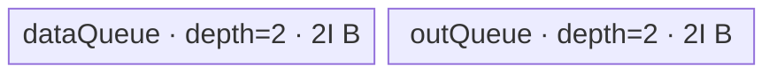

# ForeachCos A2/A3 ACLNN 算子知识

## 算子速览

| 项目 | 内容 |
|---|---|
| 实际入口 | `aclnnForeachCosGetWorkspaceSize` + `aclnnForeachCos`，公开两段式 ACLNN；固定仓只公开该版本，无更高版本入口。 |
| 计算语义 | 对 TensorList 中每个张量逐元素计算 `y[t][i] = cos(x[t][i])`。 |
| 输入输出 | 动态输入/输出 TensorList；各 Tensor 为 ND，支持 `FLOAT16/FLOAT32/BFLOAT16`，输出与输入逐项同 dtype，输出 storage 元素数不得小于输入。 |
| 执行类型 | 单 Kernel：`foreach_cos`，`AIV_VECTOR`；无 Cube/AIC/MIX_CV 可达节点。 |
| Kernel 路线 | R-001 FP16 原生 Vector；R-002 FP32 原生 Vector；R-003 BF16→FP32→BF16 Vector。 |
| 核心资源 | GM TensorList 指针表；双缓冲 `VECIN`/`VECOUT`；BF16 另有单缓冲 FP32 Queue；32 B ACLNN workspace 合同，但 Kernel 将用户 workspace 置空。 |
| 来源闭包 | source_closed：公开 ACLNN 文档→`ForeachCos` OpDef/公共 infer→arch22 Tiling/POD→dtype key→`foreach_cos` router→`ForeachTriangle`/`KernelForeachUnary`/`KernelForeachBase`→A2/A3 构建与二进制配置闭合；生成式 ACLNN inner bridge 作为框架边界。 |
| 验证状态 | 已完成源码闭包检查；本次知识提取未执行编译、真机、数值或性能测试。 |

## 接口与语义

### 计算语义

令输入 TensorList 为 `x = [x_0, ..., x_{m-1}]`。对每个列表下标 `t` 和 `0 <= i < numel(x_t)`，输出为 `y_t[i] = cos(x_t[i])`。公共 infer 将 `y_t` 的 shape 和 dtype 设置为 `x_t`；Host Tiling 允许调用者提供 storage 元素数更大的输出，但 Kernel 只写输入有效元素对应的前缀。接口文档声明默认确定性实现，功能精度保证值域为 `[-65504, 65504]`。

### 输入、输出与属性

| 参数 | shape/layout | dtype | 约束、默认值与语义 |
|---|---|---|---|
| `x` | TensorList；每个 Tensor 0–8 维、ND；可含空 Tensor；输入可非连续，OpDef 标记 `AutoContiguous()` | `FLOAT16/FLOAT32/BFLOAT16` | 非空指针；列表内 dtype 一致；A2/A3 binary config 三种 dtype 均有条目。 |
| `out` | TensorList；每个 Tensor 0–8 维、ND；输出不支持非连续 Tensor | 与 `x` 相同 | 非空指针；列表项数由公共 infer 要求与输入相等；Tiling 要求逐项 dtype 相同，且当 storage shape 不同时 `numel(out_t) >= numel(x_t)`。 |
| `workspaceSize` | 标量输出 | `uint64_t*` | 第一段接口返回 Device workspace 大小；arch22 Tiling 写入 32 B。 |
| `executor` | Host 对象输出 | `aclOpExecutor**` | 第一段接口创建并持有计算流程，第二段接口消费。 |
| `workspace` | Device 地址 | `void*` | 调用者按第一段结果分配；当前 Kernel 明确不使用并把 `userWS` 设为 `nullptr`。 |
| `stream` | 运行时 stream | `aclrtStream` | 第二段接口在该 stream 上提交执行；精确生成式 launcher 固定仓不可见。 |

### 入口与版本

固定 Commit 公开 `aclnnForeachCosGetWorkspaceSize(const aclTensorList*, const aclTensorList*, uint64_t*, aclOpExecutor**)` 和 `aclnnForeachCos(void*, uint64_t, aclOpExecutor*, aclrtStream)`，未公开 `V2` 或其他版本。README/API 产品表同时声明 Atlas A2 与 A3 支持；`ForeachCos` OpDef 注册 `ascend910b`、`ascend910_93`，Host CMake 将二者映射到 `arch22`，两份 binary config 都列出 FP16/FP32/BF16。仓内没有手写 ACLNN inner bridge；由 `ACLNNTYPE aclnn` 构建规则生成的桥接、executor 壳及其精确符号属于框架边界，不补造实现。

## Host/Launcher 执行流程

### 参数校验与前处理

1. 公开 ACLNN 第一段接口检查 `x/out` 非空、支持 dtype、输入输出 dtype 一致、列表内 dtype 一致、维数不超过 8、shape 约束；对应错误为 `161001/161002/561002`。
2. OpDef 为输入与输出声明动态 ND Tensor，并对两者启用 `AutoContiguous()`；公开文档明确输入可非连续而输出不可非连续。生成式 Contiguous/桥接的具体函数固定仓不可见。
3. `InferShape4ForeachCommon` 要求动态输入实例数等于输出数，并逐项复制 shape；`InferDataType4ForeachCommon` 逐项复制 dtype。
4. `Tiling4ForeachCosTiling` 构造 `ForeachCommonTiling(context)`，以 `FOREACH_COS_OP_CODE=5` 初始化。`Init` 最多扫描 50 个动态输入，记录 storage 元素数、总元素数、首个 dtype、dtype 字节数和每 32 B 元素数。
5. `RunBigKernelTiling` 再校验输入列表数量/shape/dtype、输出 shape/dtype，并生成 key、分核、UB 和 POD；任何空 descriptor/shape、校验失败或 workspace 指针为空均返回 `GRAPH_FAILED`。

### 参数、Workspace 与生命周期

记平台 UB 字节数为 `U`，序列化 POD 字节数为 `P=tilingData.GetDataSize()`，输入 dtype 字节数为 `s`。`elementsPerBlock=32/s`；总元素 `N=sum(tensorDataCountList)`；`blockCount=ceil(N/elementsPerBlock)`；`needCoreNum=min(AIVCoreNum, blockCount, 50)`，当 `N=0` 时强制为 1。余数 block 按 core index 从小到大各多分一个 32 B block，再由 `AssignDataToEachCore` 把扁平区间映射成 `tensorStart/End` 与首尾 offset。

`FOREACH_COS_OP_CODE` 的 UB producer 为：FP32 时 `reserve=1024*4*4=16384 B`，FP16 时 `reserve=1024*6*2=12288 B`；`I=floor_32((U-P-reserve)/4)`。BF16 先令 `total=floor((U-P-12288)/10)`，再 `I=floor_64(total/4)`。`I` 写入 `inputsTensorUbSize`。第一段返回的 workspace slice 为 `[0,32)`，由调用者持有到第二段 stream 工作完成；Kernel 参数仍携带该地址，但 entry 不向 Device body 转交。

### 启动图与失败传播

```text
aclnnForeachCosGetWorkspaceSize(x, out)
  -> 生成式 ACLNN bridge / ForeachCos executor（固定仓不可见）
    -> InferShape4ForeachCommon / InferDataType4ForeachCommon
    -> Tiling4ForeachCosTiling
       -> ForeachCommonTiling::Init(5)
       -> ForeachCommonTiling::RunBigKernelTiling()
  -> workspaceSize = 32, executor
aclnnForeachCos(workspace, 32, executor, stream)
  -> 单节点 foreach_cos<<<blockDim=needCoreNum, stream>>>(xList, yList, workspace, tiling)
```

唯一 Device 节点的输入是框架编码的 `x/y` TensorList GM 地址和 `ForeachCommonTilingData`；输出直接写各 `y_t` GM，无 Kernel 间边。workspace owner 是 ACLNN 调用者，生命周期覆盖第二段提交直至 stream 完成，但 Kernel 内 `userWS=nullptr`，因此没有 producer/consumer。Tiling 失败阻断 launch；生成式 launcher 的精确返回传播和 cleanup 固定仓不可见。

## Route 与参数设计

### 分核与资源计算

每核获得一段按 32 B block 均分的逻辑扁平区间，POD 再把它表达为 `[tensorStart:tensorStartOffset, tensorEnd:tensorEndOffset]`。Kernel 对此范围内每个 Tensor 分别绑定 GM，单 Tensor 内以 `maxDataCount` 分 tile。FP16/FP32 的 `maxDataCount=I/s`；BF16 的 `totalTensorUbSize=9I`、`maxDataCount=9I/2`、`maxCastDataCount=I/4`。完整 tile 使用 `DataCopy(..., dataCount)`；最后非整 tile 使用 `DataCopyPad` 且 `blockLen=dataCount*sizeof(T)` 字节，只提交有效元素。

### Route 选择

| 顺序 | Route | Key/模板 | 精确选择条件与优先级 | 不适用去向 |
|---:|---|---|---|---|
| 1 | R-001 FP16 原生 Vector | key `1`；`ForeachTriangle<half, half, Cos<half,false>>` | `GetTilingKeyByDtypeOnly(DT_FLOAT16)==1`，router 首先判断 `TILING_KEY_IS(1)` | 判断 key 2 |
| 2 | R-002 FP32 原生 Vector | key `2`；`ForeachTriangle<float,float,Cos<float,false>>` | `GetTilingKeyByDtypeOnly(DT_FLOAT)==2`，router 第二判断 | 判断 key 4 |
| 3 | R-003 BF16 升精度 Vector | key `4`；`ForeachTriangle<bfloat16_t,float,Cos<float,false>>` | `GetTilingKeyByDtypeOnly(DT_BF16)==4`，且 A2/A3 编译不命中排除宏 | 结束；未知 key 无计算、无显式错误 |

```text
dtype == FLOAT16 -> key 1 -> R-001
else dtype == FLOAT32 -> key 2 -> R-002
else dtype == BFLOAT16 -> key 4 -> R-003
else -> key 0（OpDef/API 正常入口不应产生；router 无输出）
```

### 模板/实现执行矩阵

| Route | key/selector | dtype/shape/platform 完整命中条件 | 执行拓扑与 Kernel 节点 | 实际模板/body | 内存与同步特征 | tail/fallback |
|---|---|---|---|---|---|---|
| R-001 FP16 | 1 | FP16、ND、逐项 shape/dtype 校验通过、A2/A3 | 单 AIV Kernel | `ForeachTriangle<half,half,Cos<half,false>>`→`KernelForeachUnary` | depth-2 input/output Queue；`Cos` 前后 `PIPE_V` barrier | `DataCopyPad` 精确字节尾块；未知 key 无写出 |
| R-002 FP32 | 2 | FP32，其余同 R-001 | 单 AIV Kernel | `ForeachTriangle<float,float,Cos<float,false>>`→`KernelForeachUnary` | 同 R-001，但每元素 4 B、reserve 16384 B | 同 R-001 |
| R-003 BF16 | 4 | BF16，其余同 R-001；A2/A3 不命中 Kirin 排除 guard | 单 AIV Kernel | `ForeachTriangle<bfloat16_t,float,Cos<float,false>>`→BF16 `InnerComputer` | depth-2 BF16 input/output + depth-1 FP32 Queue；Cast/Cos/Cast 间 `PIPE_V` barrier | 每个 tile 再按 `I/4` 元素切 cast 子块；末尾均以实际 `dataCount` 保护 |

### 隐藏性能 Guard

| Guard | Host/Tiling 条件 | Device/资源原因 | 影响 Route | 不满足时去向 | 源码符号 |
|---|---|---|---|---|---|
| 32 B 分核 | `elementsPerBlock=32/s`，`needCoreNum<=ceil(N/elementsPerBlock)` | 保证除全局末端外的 core 边界按 DMA block 粒度切分 | 全部 | `N=0` 强制 1 core | `ForeachCommonTiling::GetNeedCoreNum/AssignDataToEachCore` |
| TensorList 上限 | `Init` 循环 `i<MAX_TENSOR_CONT(50)` | POD 的张量长度数组仅 50 项 | 全部 | 固定实现未对第 51 项显式报错，不能安全迁移到更长列表 | `ForeachCommonTiling::Init` |
| core POD 上限 | `needCoreNum=min(needCoreNum,50)` | 每个 start/end/offset 数组只有 50 项 | 全部 | 截到 50 core | `RunBigKernelTiling` |
| BF16 UB 衰减 | dtype BF16 时 `(U-P-reserve)` 先除 10，`I` 再按 64 B 向下对齐 | BF16 路线显式分配 38I B Queue，并需为 Cos primitive 留 reserve | R-003 | dtype 路由改走 FP16/FP32；无资源 fallback | `DivideUbMemory2`、`KernelForeachUnary::Init` |
| dtype 编译 guard | `__CCE_AICORE__>=220` 且 NPU arch 非 3003/3113 | BF16 Cast/FP32 临时路线只在该 guard 内编译 | R-003 | A2/A3 构建支持；被排除平台无 BF16 router 分支 | `foreach_cos`、`InnerComputer<bfloat16_t,...>` |
| 输出容量 | shape 不同且 `numel(x)>numel(y)` 则失败 | CopyOut 写输入有效元素数 | 全部 | `GRAPH_FAILED` | `CheckOutputShapeAndDtype` |

### POD/ABI

`ForeachCommonTilingData` 由仓外 `register/tilingdata_base.h` 宏生成；固定仓可见字段顺序、元素类型和数组长度，但宏展开后的 `sizeof/alignof/offsetof` 不可见，以下不臆测偏移。

| 结构 | 字段 | 类型/位宽 | ABI 布局 | 单位 | Host/launcher producer | Device consumer | 边界 |
|---|---|---|---|---|---|---|---|
| `ForeachCommonTilingData` | `inputsTensorUbSize` | `uint64_t`/64 | 宏生成，精确 `sizeof/alignof/offsetof` 固定仓不可见 | 字节/Queue 单槽基础容量 | `DivideUbMemory2`→`FillTilingData::set_inputsTensorUbSize(I)` | `KernelForeachBase::ParseTilingData`；派生 `maxDataCount/maxCastDataCount` 与 InitBuffer | 32 B 对齐；BF16 为 64 B 对齐 |
| `ForeachCommonTilingData` | `tensorDataCountList` | `int64_t[50]`/每项64 | 同上 | 元素/张量 | `Init`: `shape.GetShapeSize()` | `KernelForeachUnary::Process` 计算每个 Tensor 当前 core 有效范围 | 最多 50 项；空 Tensor 值 0 |
| `ForeachCommonTilingData` | `tensorStartList` | `uint16_t[50]`/每项16 | 同上 | TensorList 下标/core | `AssignDataToEachCore` | `ParseTilingData[blockIdx]` | `blockDim<=50` |
| `ForeachCommonTilingData` | `tensorEndList` | `uint16_t[50]`/每项16 | 同上 | TensorList 下标/core | `AssignDataToEachCore` | `ParseTilingData[blockIdx]` | inclusive end |
| `ForeachCommonTilingData` | `tensorStartOffsetList` | `int64_t[50]`/每项64 | 同上 | 元素/core | `AssignDataToEachCore` | `ParseTilingData[blockIdx]`→首 Tensor GM base | inclusive start；非首 Tensor 为 0 |
| `ForeachCommonTilingData` | `tensorEndOffsetList` | `int64_t[50]`/每项64 | 同上 | 元素/core | `AssignDataToEachCore` | `ParseTilingData[blockIdx]`→尾 Tensor cursor end | inclusive end；空域可为 -1 |

### Route 源码闭包

| Route | Key/selector | Host/Tiling producer | POD/参数 | Kernel entry/router 节点 | Kernel body/直接依赖 | 构建接线 |
|---|---|---|---|---|---|---|
| R-001 FP16 | key 1 | `foreach_cos_tiling_arch22.cpp::Tiling4ForeachCosTiling`；`ForeachCommonTiling::{Init,RunBigKernelTiling}` | `ForeachCommonTilingData`，`I` 与每核范围 | `op_kernel/foreach_cos.cpp::foreach_cos` | `ForeachTriangle<half,...>`；`KernelForeachUnary`；`KernelForeachBase` | kernel/host CMake；ascend910b/ascend910_93 binary config |
| R-002 FP32 | key 2 | 同上 | 同上，FP32 `I` | 同上 | `ForeachTriangle<float,...>` 及公共基类 | 同上 |
| R-003 BF16 | key 4 | 同上 | 同上，BF16 `I/maxCastDataCount` | 同上，受编译 guard | BF16 `InnerComputer` 及公共基类 | 同上 |

## Kernel 实现

### 公共执行流程

`foreach_cos` 解析 POD、忽略传入 workspace，并按 key 构造一个 `ForeachTriangle`。`KernelForeachBase::Init` 用 `GetBlockIdx()` 读取当前 core 的张量首尾范围；TensorList GM 首字保存指针数组相对首地址的字节 offset，右移 3 后得到 `uint64_t` 指针表起点。`KernelForeachUnary::Process` 遍历当前 core 跨越的 Tensor，对首尾 Tensor 裁切 offset，再以 `maxDataCount` 做 `CopyIn→Compute→CopyOut`。所有路线都是单 Kernel，输出直接落 GM。

### Route R-001：FP16 原生 Vector

#### 适用条件

##### 选择证据

| 层级 | 文件 | 符号 | 源码谓词/参数 | 结果/下一跳 |
|---|---|---|---|---|
| API | `docs/aclnnForeachCos.md` | `aclnnForeachCos*` | `x/out` FP16、ND 且约束通过 | 进入 `ForeachCos` executor |
| Host/Tiling | `foreach_utils/op_host/common_dtype.h` | `GetTilingKeyByDtypeOnly` | `dataType==DT_FLOAT16` | key 1 |
| Router | `foreach_cos/op_kernel/foreach_cos.cpp` | `foreach_cos` | `TILING_KEY_IS(1)`（第一优先） | `ForeachTriangle<half,half,Cos<half,false>>` |

#### Device 数据流

##### 函数级调用链

```text
Tiling4ForeachCosTiling -> ForeachCommonTiling::RunBigKernelTiling
  -> foreach_cos(xList,yList,workspace,tiling), blockDim=needCoreNum
    -> ForeachTriangle<half,...>::Init -> KernelForeachBase::Init/ParseTilingData
    -> ForeachTriangle<half,...>::Process -> KernelForeachUnary::Process
      -> SingleTensorProcess -> CopyIn -> ForeachTriangle::Compute
         -> InnerComputer<half,half>::Compute -> Cos<half,false>
      -> KernelForeachUnary::CopyOut
```

##### 源码等价伪码

```text
core = GetBlockIdx(); load I and this core's inclusive tensor/offset range
for t in tensorStart..tensorEnd:
  begin = (t==tensorStart ? startOffset : 0)
  end   = (t==tensorEnd ? endOffset : tensorElements[t]-1)
  bind xGM/yGM to pointer_table[t] + begin
  valid = end-begin+1
  for tile in ceil(valid/(I/2)):
    n = min(I/2, remaining)
    CopyIn: full -> DataCopy(n); tail -> DataCopyPad(blockLen=n*2 B)
    out = Cos<half,false>(in, n), with PIPE_V barrier before/after
    CopyOut: full -> DataCopy(n); tail -> DataCopyPad(blockLen=n*2 B)
```

#### 内存与数据搬运

##### 资源与搬运表

| 层级/缓冲区 | offset/地址公式 | extent/容量公式 | dtype/layout | producer | consumer | owner/lifetime | 对齐/复用 |
|---|---|---|---|---|---|---|---|
| input GM | `TensorListPtrTable[t] + begin + tile*(I/2)` | `n` elements | FP16/ND | caller | `CopyIn` | caller；整次 stream | 指针表由首字 offset 定位 |
| `dataQueue` | Queue slot | depth 2 × `I` B | FP16 | `CopyIn` | `ForeachTriangle::Compute` | `TPipe`；Alloc→EnQue→DeQue→Free | 32 B 的 `I`；双缓冲 |
| `outQueue` | Queue slot | depth 2 × `I` B | FP16 | `Compute` | `CopyOut` | `TPipe`；Alloc→EnQue→DeQue→Free | 同上 |
| output GM | `TensorListPtrTable[t] + begin + tile*(I/2)` | `n` elements | FP16/ND | `CopyOut` | caller | caller | 尾块只写 `n*2` B |
| workspace | `[0,32)` | 32 B | opaque | caller | 无 Device consumer | 至 stream 完成 | Kernel 置 `userWS=nullptr` |

##### 分层内存布局



##### 字节账与复用顺序

```text
reserve = 12288 B
I = floor_32((U-P-reserve)/4)
UB_queues = 2I + 2I = 4I
UB_queues + P + reserve <= U
dynamic_ub = N/A（AIV Queue 路线）
workspace_total = 32 B（Device body 不消费）
```

| 复用子区 | 写入者 | 读取者/消费点 | 下一次覆盖 | 同步或释放依据 | 安全条件 |
|---|---|---|---|---|---|
| `dataQueue` slot | `CopyIn` | `Compute` DeQue | `FreeTensor` 后后续 tile Alloc | Queue EnQue/DeQue/Free | depth 2 生命周期不交叉覆盖 |
| `outQueue` slot | `Compute` | `CopyOut` DeQue | `FreeTensor` 后后续 tile Alloc | Queue EnQue/DeQue/Free | CopyOut 完成前不得复用 |

#### 同步、精度与尾块

##### 同步与数值边界表

| 阶段 | primitive/机制 | producer | consumer/等待点 | 保护对象 | 精度/尾块 |
|---|---|---|---|---|---|
| GM→UB | `dataQueue` EnQue/DeQue | `DataCopy/DataCopyPad` | `Compute` | input slot | tail 的 `blockLen=n*2 B`，不读 padding lane |
| Vector | `PipeBarrier<PIPE_V>` | input ready | `Cos<half,false>` 前后 | Vector pipeline | FP16 原生 Cos；计数为实际 `n` |
| UB→GM | `outQueue` EnQue/DeQue | `Compute` | `CopyOut` | output slot | tail 精确写 `n*2 B` |

#### 关键实现

##### 符号证据表

| 阶段 | 文件 | 符号/模板实例 | 实现事实 |
|---|---|---|---|
| Host/Tiling producer | `foreach_utils/op_host/foreach_tiling_class.h` | `RunBigKernelTiling/DivideUbMemory2/AssignDataToEachCore` | key 1、32 B 分核、FP16 UB 公式、workspace 32 B |
| Kernel entry/router | `foreach_cos/op_kernel/foreach_cos.cpp` | `foreach_cos`, key 1 branch | 映射到 FP16 `ForeachTriangle` |
| Device body/helper | `foreach_utils/op_kernel/{kernel_foreach_base.h,kernel_foreach_unary.h,foreach_triangle.h}` | `ParseTilingData/Process/CopyIn/CopyOut/InnerComputer` | 指针表解析、循环、DMA tail、Cos 与 Queue 生命周期 |

### Route R-002：FP32 原生 Vector

#### 适用条件

##### 选择证据

| 层级 | 文件 | 符号 | 源码谓词/参数 | 结果/下一跳 |
|---|---|---|---|---|
| API | `docs/aclnnForeachCos.md` | `aclnnForeachCos*` | `x/out` FP32、ND 且约束通过 | 进入 executor |
| Host/Tiling | `foreach_utils/op_host/common_dtype.h` | `GetTilingKeyByDtypeOnly` | `dataType==DT_FLOAT` | key 2 |
| Router | `foreach_cos/op_kernel/foreach_cos.cpp` | `foreach_cos` | key 1 未命中且 `TILING_KEY_IS(2)` | `ForeachTriangle<float,float,Cos<float,false>>` |

#### Device 数据流

##### 函数级调用链

```text
foreach_cos -> ForeachTriangle<float,float,Cos<float,false>>::Init/Process
  -> KernelForeachBase::ParseTilingData
  -> KernelForeachUnary::Process/SingleTensorProcess
    -> CopyIn -> InnerComputer<float,float>::Compute -> Cos<float,false>
    -> CopyOut
```

##### 源码等价伪码

```text
按 POD 的张量首尾范围遍历；每个 Tensor 绑定 x/y 指针表项
tileElems = I/4
for each tile:
  n = min(tileElems, remaining)
  DMA x[off:off+n] -> input Queue（tail blockLen=n*4 B）
  PIPE_V barrier; Cos<float,false>(out,in,n); PIPE_V barrier
  DMA output Queue -> y[off:off+n]（tail blockLen=n*4 B）
```

#### 内存与数据搬运

##### 资源与搬运表

| 层级/缓冲区 | offset/地址公式 | extent/容量公式 | dtype/layout | producer | consumer | owner/lifetime | 对齐/复用 |
|---|---|---|---|---|---|---|---|
| input/output GM | `ptr[t]+coreBegin+tile*(I/4)` | 每次 `n<=I/4` | FP32/ND | caller/CopyOut | CopyIn/caller | caller | tail 精确 `n*4 B` |
| `dataQueue` | slot | depth 2 × `I` B | FP32 | CopyIn | Compute | `TPipe` | 32 B；双缓冲 |
| `outQueue` | slot | depth 2 × `I` B | FP32 | Compute | CopyOut | `TPipe` | 32 B；双缓冲 |
| workspace | `[0,32)` | 32 B | opaque | caller | 无 | caller | 不参与计算 |

##### 分层内存布局


##### 字节账与复用顺序

```text
reserve = 16384 B
I = floor_32((U-P-reserve)/4)
UB_queues = 4I
UB_queues + P + reserve <= U
dynamic_ub = N/A
workspace_total = 32 B
```

| 复用子区 | 写入者 | 读取者/消费点 | 下一次覆盖 | 同步或释放依据 | 安全条件 |
|---|---|---|---|---|---|
| `dataQueue` slot | CopyIn | Cos Compute | Free 后下一 tile | Queue protocol | DeQue/Free 完成后覆盖 |
| `outQueue` slot | Cos Compute | CopyOut | Free 后下一 tile | Queue protocol | GM copy 完成后覆盖 |

#### 同步、精度与尾块

##### 同步与数值边界表

| 阶段 | primitive/机制 | producer | consumer/等待点 | 保护对象 | 精度/尾块 |
|---|---|---|---|---|---|
| CopyIn | Queue + `DataCopyPad` | GM | Compute | input slot | FP32，tail `n*4 B` |
| Compute | `PIPE_V` barrier + `Cos<float,false>` | input Queue | output Queue | Vector pipeline | FP32 直接计算；有效 count `n` |
| CopyOut | Queue + `DataCopyPad` | output Queue | GM | output slot | 只写有效元素 |

#### 关键实现

##### 符号证据表

| 阶段 | 文件 | 符号/模板实例 | 实现事实 |
|---|---|---|---|
| Host/Tiling producer | `foreach_utils/op_host/foreach_tiling_class.h` | `DivideUbMemory2` | FP32 reserve 与 `I` 公式 |
| Kernel entry/router | `foreach_cos/op_kernel/foreach_cos.cpp` | key 2 branch | FP32 模板实例 |
| Device body/helper | `foreach_utils/op_kernel/foreach_triangle.h` | generic `InnerComputer<float,float,...>` | barrier→Cos→barrier；公共基类负责 DMA |

### Route R-003：BF16 升精度 Vector

#### 适用条件

##### 选择证据

| 层级 | 文件 | 符号 | 源码谓词/参数 | 结果/下一跳 |
|---|---|---|---|---|
| API | `docs/aclnnForeachCos.md` | `aclnnForeachCos*` | BF16 且接口约束通过 | 进入 executor |
| Host/Tiling | `common_dtype.h` | `GetTilingKeyByDtypeOnly` | `dataType==DT_BF16` | key 4 |
| Router | `foreach_cos/op_kernel/foreach_cos.cpp` | key 4 branch | 前两 key 未命中；编译 guard 允许 | `ForeachTriangle<bfloat16_t,float,Cos<float,false>>` |

#### Device 数据流

##### 函数级调用链

```text
foreach_cos -> ForeachTriangle<bfloat16_t,float,Cos<float,false>>::Init
  -> KernelForeachBase::Init: totalTensorUbSize=9I, maxCastDataCount=I/4
  -> KernelForeachUnary::Init: BF16 queues + float32Queue
-> Process -> SingleTensorProcess -> CopyIn
  -> BF16 InnerComputer::Compute -> ComputePerCast
     -> Cast BF16->FP32 -> Cos<float,false> -> Cast FP32->BF16(CAST_RINT)
  -> CopyOut
```

##### 源码等价伪码

```text
tileElems = 9I/2
for each BF16 tile of actual n elements:
  DMA BF16 input to dataQueue
  for j in 0 .. n/(I/4), plus remainder:
    k = min(I/4, remaining)
    Cast(floatBuf[0:k], bf16In[j*k:j*k+k], CAST_NONE)
    Cos<float,false>(floatBuf[I/4:I/4+k], floatBuf[0:k], k)
    Cast(bf16Out[j*k:j*k+k], floatBuf[I/4:I/4+k], CAST_RINT)
    PIPE_V barrier between every stage
  DMA actual n BF16 outputs to GM
```

#### 内存与数据搬运

##### 资源与搬运表

| 层级/缓冲区 | offset/地址公式 | extent/容量公式 | dtype/layout | producer | consumer | owner/lifetime | 对齐/复用 |
|---|---|---|---|---|---|---|---|
| input/output GM | `ptr[t]+coreBegin+tile*(9I/2)` | `n<=9I/2` | BF16/ND | caller/CopyOut | CopyIn/caller | caller | tail `n*2 B` |
| `dataQueue` | slot | depth 2 × `9I` B | BF16 | CopyIn | Compute | `TPipe` | 双缓冲 |
| `outQueue` | slot | depth 2 × `9I` B | BF16 | Compute | CopyOut | `TPipe` | 双缓冲 |
| `float32Queue` | `[0,I)` input；`[I,2I)` output | depth 1 × `2I` B | FP32 | Cast/Cos | Cos/Cast | 从 Process 开始 DeQue，所有 Tensor 完成后 Free | 两个不重叠 slice；每 slice `I/4` float |
| workspace | `[0,32)` | 32 B | opaque | caller | 无 | caller | 不消费 |

##### 分层内存布局


##### 字节账与复用顺序

```text
reserve = 12288 B
I = floor_64(floor((U-P-reserve)/10)/4)
UB_queues = 2*(9I) + 2*(9I) + 2I = 38I
38I + P + reserve <= U（Host 以约 40I 的保守除数约束）
dynamic_ub = N/A
workspace_total = 32 B
```

| 复用子区 | 写入者 | 读取者/消费点 | 下一次覆盖 | 同步或释放依据 | 安全条件 |
|---|---|---|---|---|---|
| float input slice `[0,I)` | BF16→FP32 Cast | FP32 Cos | 下一 cast 子块 | Cast 后、Cos 前后 `PIPE_V` barrier | `k<=I/4` float |
| float output slice `[I,2I)` | FP32 Cos | FP32→BF16 Cast | 下一 Cos 子块 | Cos 后、Cast 后 `PIPE_V` barrier | 与 input slice 不重叠 |
| BF16 Queue slots | CopyIn/Compute | Compute/CopyOut | Free 后 | Queue protocol | depth 2 容量按 `9I` B 而非逻辑 `I` |

#### 同步、精度与尾块

##### 同步与数值边界表

| 阶段 | primitive/机制 | producer | consumer/等待点 | 保护对象 | 精度/尾块 |
|---|---|---|---|---|---|
| CopyIn | Queue + DataCopyPad | GM | BF16 Cast | BF16 input slot | actual `n` elements |
| 升精度 | `Cast(...,CAST_NONE)` + `PIPE_V` | BF16 input | FP32 Cos | float input slice | 子块 `k<=I/4` |
| Cos | `Cos<float,false>` + `PIPE_V` | float input | downcast | float output slice | FP32 计算 |
| 降精度 | `Cast(...,CAST_RINT)` + `PIPE_V` | float output | output Queue | BF16 output | RINT；最后子块用 remainder |
| CopyOut | Queue + DataCopyPad | BF16 output | GM | output slot | tail 只写 `n*2 B` |

#### 关键实现

##### 符号证据表

| 阶段 | 文件 | 符号/模板实例 | 实现事实 |
|---|---|---|---|
| Host/Tiling producer | `foreach_utils/op_host/foreach_tiling_class.h` | `DivideUbMemory2` | BF16 `/10`、`/4`、64 B 对齐 UB 预算 |
| Kernel entry/router | `foreach_cos/op_kernel/foreach_cos.cpp` | key 4 branch | BF16→float 模板实例及平台 guard |
| Device body/helper | `foreach_utils/op_kernel/{kernel_foreach_base.h,kernel_foreach_unary.h,foreach_triangle.h}` | BF16 specialization | `9I` tile、`I/4` cast chunk、Cast/Cos/Cast 与 barriers |

## 算子特定优化

### Trick T-001：按 Cos 临时区与 dtype 反推单槽 UB

#### 触发与源码依据

- 适用 Route：R-001、R-002、R-003。
- 触发条件：`opCode == FOREACH_COS_OP_CODE`；BF16 额外命中 `/UB_DIVIDER_FOR_TEMP_CASTING` 与 64 B 对齐。
- Golden 来源：[`foreach_tiling_class.h:789-801`](../../../../../../../cann-ops-raw/ascendc/ops-nn/955f8b33985b6d72989ebff341bb9c2c564a51bc/foreach/foreach_utils/op_host/foreach_tiling_class.h#L789-L801)

**官方源码（固定 Commit 连续逐字摘录）**：

```cpp
if (opCode == FOREACH_COS_OP_CODE) { // foreach_cos
    uint32_t tilingConstant = 6;
    if (dataTypeSize == BYTE_LEN_4) {
        tilingConstant = TILING_FLOAT_N_SCALAR;
    }
    uint32_t reserveUbSize = BYTE_BASIC_BLOCK * tilingConstant * dataTypeSize;
    uint32_t totalSize = uint32_t(ubSizePlatForm - tilingData.GetDataSize() - reserveUbSize);
    if (dataType == ge::DT_BF16) {
        totalSize = totalSize / UB_DIVIDER_FOR_TEMP_CASTING;
    }
    uint32_t canUseUbSize = totalSize / FOREACH_COS_DIVIDER;
```

#### 机制与设计原因

Host 先扣除序列化 POD 和 Cos primitive 的 dtype 特定 reserve，再按两条 depth-2 Queue 的四份容量反推 `I`；BF16 因显式 Cast 临时区与扩大到 `9I` 的双 Queue，再用 `/10` 保守缩小。这样 tile 上界在 launch 前固定，Device 循环无需动态探测 UB。Cos primitive reserve 的内部使用细节位于仓外 AscendC 库，固定仓不可见。

#### 迁移边界

- 适用：同样由两个 depth-2 Queue 驱动、且数学 primitive 需要预留临时 UB 的逐元素算子。
- 前提：保持 POD 大小、dtype 字节数、primitive reserve 常数、BF16 buffer 放大倍数和对齐不变。
- 失效：改变 Queue depth、Cast 切片或 primitive 临时区时必须重新推导；当前实现无资源 fallback。
- 未验证：本次知识提取未执行编译、真机、数值或性能测试。

#### 错误做法

固定仓未提供可验证反例；但源码明确要求先扣 `reserveUbSize`，不能把全部 `U-P` 直接均分给 Queue。

### Trick T-002：BF16 用固定双切片 FP32 缓冲分段计算

#### 触发与源码依据

- 适用 Route：R-003。
- 触发条件：`T=bfloat16_t`，编译 guard 允许；`paramsCount=2` 令 output slice offset 为 `maxCastDataCount`。
- Golden 来源：[`foreach_triangle.h:68-75`](../../../../../../../cann-ops-raw/ascendc/ops-nn/955f8b33985b6d72989ebff341bb9c2c564a51bc/foreach/foreach_utils/op_kernel/foreach_triangle.h#L68-L75)

**官方源码（固定 Commit 连续逐字摘录）**：

```cpp
PipeBarrier<PIPE_V>();
Cast(float32Tensor, x1Local[index * maxCastDataCount], RoundMode::CAST_NONE, dataCount);
PipeBarrier<PIPE_V>();
uint32_t offset = (paramsCount == 1) ? 0 : maxCastDataCount;
op(float32Tensor[offset], float32Tensor, dataCount);
PipeBarrier<PIPE_V>();
Cast(yLocal[index * maxCastDataCount], float32Tensor[offset], RoundMode::CAST_RINT, dataCount);
```

#### 机制与设计原因

每次仅将 `I/4` 个 BF16 元素提升到 FP32，输入和 Cos 输出分别占 FP32 Queue 的两个 `I` 字节子区；计算后立即 RINT 降回 BF16。它避免按整个 `9I/2` 元素 tile 物化两份 FP32 张量，同时保持 Cos 在 FP32 中执行。barrier 保证同一单缓冲子区覆盖前，前一 Vector 阶段已完成。

#### 迁移边界

- 适用：低精度输入、FP32 数学 primitive、可分段且逐元素独立的 unary 运算。
- 前提：`float32Queue` 至少 `2I` B，`maxCastDataCount=I/4`，输入/输出 slice 不重叠，保留每阶段 barrier。
- 失效：需要跨元素状态、改变 `paramsCount` 或使用原地输出 slice 时不能照搬该 offset 规则。
- 未验证：本次知识提取未执行编译、真机、数值或性能测试。

#### 错误做法

固定仓未提供可验证反例。

## 模板与实现对比

| 对比维度 | R-001 FP16 | R-002 FP32 | R-003 BF16 | 设计选择依据 |
|---|---|---|---|---|
| 命中条件/优先级 | key 1，第一判断 | key 2，第二判断 | key 4，第三判断 | dtype 唯一决定 key |
| 模板与 dtype | `<half,half,Cos<half,false>>` | `<float,float,Cos<float,false>>` | `<bf16,float,Cos<float,false>>` | BF16 不直接调用 BF16 Cos |
| 循环与分核 | 32 B 分核，tile `I/2` | 32 B 分核，tile `I/4` | 32 B 分核，tile `9I/2`，cast 子块 `I/4` | dtype 与 UB 结构决定元素上限 |
| Queue/TBuf/寄存器/dynamic UB/通信 window | 2×input + 2×output | 同左 | 2×9I input + 2×9I output + 2I float | 无 TBuf/dynamic UB/通信 window |
| 内存总占用与复用 | 4I + reserve + P | 4I + reserve + P | 38I + reserve + P | Host 公式确保上界 |
| 搬运/Vector/SIMT/NDDMA/通信 API | DataCopy(Pad)+FP16 Cos | DataCopy(Pad)+FP32 Cos | DataCopy(Pad)+Cast/Cos/Cast | 均为 AIV Vector |
| 同步、精度与 tail | Queue+PIPE_V；FP16 | Queue+PIPE_V；FP32 | 多级 PIPE_V；FP32 算、RINT 回 BF16 | actual count 保护 tail |
| fallback/失败边界 | 未知 key 无写出 | 同左 | 编译 guard/未知 key 无写出 | 无 Device fallback |

## 平台差异

| 项目 | A2 | A3 | 950 |
|---|---|---|---|
| 支持状态 | 支持；README/API、`ascend910b` 注册与 config 一致 | 支持；README/API、`ascend910_93` 注册与 config 一致 | 支持，但使用独立 `_950` 卡 |
| Host/Launcher | arch22 `ForeachCommonTiling` | 与 A2 共用 arch22 | arch35 独立 Tiling，workspace 0 |
| Kernel/资源 | AIV Vector、双 Queue，BF16 有 FP32 Queue | 与 A2 相同 | SIMT VF、512 threads，无 AIV Queue |

## 限制与失败边界

- 公开接口支持每个 Tensor 0–8 维、ND、FP16/FP32/BF16，输入可非连续，输出不可非连续；值域超出 `[-65504,65504]` 时文档不保证功能精度。
- 公共 Tiling 的 POD 只容纳 50 个 Tensor 和 50 个 core；core 数显式截到 50，但输入列表超过 50 时没有显式失败，固定实现仅扫描前 50 项，不能将更长列表视为已支持。
- `totalDataCount` 为 `int64_t`，各 shape size 求和没有显式溢出检查；`DataCopyPad.blockLen` 将 `dataCount*sizeof(T)` 窄化为 `uint32_t`，实际 tile 上界由 UB 限制。
- unknown TilingKey 的 Kernel entry 没有错误分支，只是不写输出；正常公开入口的 dtype 校验与 key producer应阻止该状态。
- 生成式 ACLNN bridge/executor/launcher、`BEGIN_TILING_DATA_DEF` 宏展开后的精确 ABI，以及 AscendC `Cos<T,false>` primitive 内部算法和 reserve 使用方式在固定仓不可见；这些是框架/库边界。
- 本次知识提取未执行编译、单元测试、真机、数值或性能测试。

## 源码索引

### 链路索引

| 链路阶段 | 文件 | 关键符号 | 支撑内容 |
|---|---|---|---|
| 入口声明/约束 | `foreach/foreach_cos/docs/aclnnForeachCos.md` | `aclnnForeachCosGetWorkspaceSize/aclnnForeachCos` | 两段式原型、平台、dtype/shape/错误与精度约束 |
| 入口实现 | `foreach/foreach_cos/op_host/foreach_cos_def.cpp` | `ops::ForeachCos` | 动态 ND I/O、AutoContiguous、A2/A3 注册 |
| Host/Tiling/Launcher | `foreach/foreach_utils/op_host/foreach_infershape.cpp` | `InferShape4ForeachCommon/InferDataType4ForeachCommon` | 列表数、shape、dtype 推导 |
| Host/Tiling/Launcher | `foreach/foreach_cos/op_host/arch22/foreach_cos_tiling_arch22.cpp` | `Tiling4ForeachCosTiling` | ForeachCos Tiling 注册与 op code |
| Host/Tiling/Launcher | `foreach/foreach_utils/op_host/foreach_tiling_class.h` | `ForeachCommonTiling` | 校验、分核、UB、POD、workspace |
| Host/Tiling/Launcher | `foreach/foreach_utils/op_host/foreach_tiling_def.h` | `ForeachCommonTilingData` | POD 字段与 ForeachCos 注册 |
| Host/Tiling/Launcher | `foreach/foreach_utils/op_host/common_dtype.h` | `GetTilingKeyByDtypeOnly` | dtype→key |
| Kernel entry/body | `foreach/foreach_cos/op_kernel/foreach_cos.cpp` | `foreach_cos` | key router 与模板实例 |
| Kernel entry/body | `foreach/foreach_utils/op_kernel/foreach_triangle.h` | `ForeachTriangle/InnerComputer` | Cos、BF16 Cast 和 barriers |
| Kernel entry/body | `foreach/foreach_utils/op_kernel/kernel_foreach_unary.h` | `KernelForeachUnary` | Queue、Tensor/tile 循环、DMA 与 tail |
| Kernel entry/body | `foreach/foreach_utils/op_kernel/kernel_foreach_base.h` | `KernelForeachBase` | POD 解析、TensorList 指针与 tile 上界 |
| 构建接线 | `foreach/foreach_cos/op_kernel/CMakeLists.txt` | `add_kernel_sources` | A2/A3 默认 kernel 与 950 arch35 分流 |
| 构建接线 | `foreach/foreach_cos/op_host/CMakeLists.txt` | `SUPPORT_COMPUTE_UNIT/SUPPORT_TILING_DIR` | ascend910b/910_93→arch22 |
| 构建接线 | `foreach/foreach_cos/op_host/config/ascend910b/foreach_cos_binary.json` | `op_list` | A2 三 dtype binary |
| 构建接线 | `foreach/foreach_cos/op_host/config/ascend910_93/foreach_cos_binary.json` | `op_list` | A3 三 dtype binary |

### 实现复用检查

| 检查项 | 可复用事实 | 不得改变的约束 | 源码符号 |
|---|---|---|---|
| ABI/POD | 六字段 common POD 驱动 TensorList 分核 | 字段顺序、50 项数组、元素/字节单位；精确宏 ABI 不可假设 | `ForeachCommonTilingData`、`ParseTilingData` |
| 调用顺序 | `Init→Process→CopyIn→Compute→CopyOut` | 每个 Tensor 的首尾 inclusive offset 与 tile 顺序 | `foreach_cos`、`KernelForeachUnary::Process` |
| workspace/内存 | 32 B workspace 不被 Kernel 使用；Queue 容量从 `I` 导出 | depth 必须计入；BF16 是 38I 而非 4I | `RunBigKernelTiling`、`KernelForeachUnary::Init` |
| 同步 | Queue 协议加 Cos/Cast 间 `PIPE_V` | Free/覆盖前必须完成 consumer，BF16 barriers 不可省 | `InnerComputer::Compute/ComputePerCast` |
| 精度与尾块 | FP16/FP32 原生；BF16 在 FP32 中 Cos 后 RINT | `dataCount` 必须用实际尾长；GM tail 按字节 | `SingleTensorProcess/CopyIn/CopyOut` |
| 失败边界 | Host 校验失败阻断 launch | 50 Tensor 上限、unknown key 无输出、外部 bridge 不可臆造 | `CheckOpInfo`、`foreach_cos` |