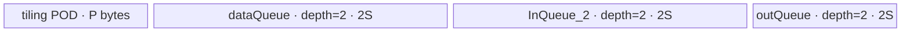
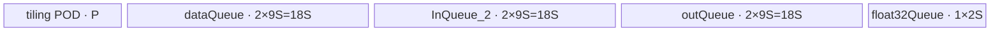

# ForeachDivList A2/A3 ACLNN 算子知识

## 算子速览

| 项目 | 内容 |
|---|---|
| 实际入口 | `aclnnForeachDivListGetWorkspaceSize` + `aclnnForeachDivList`，公开 ACLNN，无带版本号的新入口。 |
| 计算语义 | 对两个等长 TensorList 的同位置 Tensor 做逐元素 `y_i[j] = x1_i[j] / x2_i[j]`。 |
| 输入输出 | `x1`、`x2`、`out` 均为动态 TensorList，ND；每个列表内部 dtype 一致，三者 dtype 一致，支持 FP16/FP32/BF16；输入可非连续并由 `AutoContiguous` 处理，输出必须连续。 |
| 执行类型 | 单 Device 节点，`AIV_VECTOR`；R-001 为 FP16/FP32 原生 `Div`，R-002 为 BF16→FP32→`Div`→BF16。 |
| Kernel 路线 | R-001：key 1/2；R-002：key 4。 |
| 核心资源 | TensorList 地址表位于 GM；每核使用双缓冲 `VECIN`×2、双缓冲 `VECOUT`×1，BF16 另有 FP32 临时 Queue；Host 请求 32 B workspace，但 Kernel 将用户 workspace 置空且不访问。 |
| 来源闭包 | `source_closed`：公开接口/约束→生成式 ACLNN 框架边界→`ForeachDivList` OpDef/推形→arch22 Tiling→`ForeachCommonTilingData`→`foreach_div_list` router→公共 Vector body→构建接线闭合。 |
| 验证状态 | 已完成源码闭包检查；本次知识提取未执行编译、真机、数值或性能测试。 |

## 接口与语义

### 计算语义

设 `x1=[x1_0,...,x1_(n-1)]`、`x2=[x2_0,...,x2_(n-1)]`，输出 `y=[y_0,...,y_(n-1)]`。对每个 `i∈[0,n)` 以及 `j∈[0,numel(x1_i))`，计算 `y_i[j]=x1_i[j]/x2_i[j]`。同位置 `x1_i` 与 `x2_i` 的 storage shape 必须相同。Kernel 只写 `numel(x1_i)` 个输出元素；若调用侧提供更大的 `out_i`，额外区域不由本 Kernel 写入。公开文档声明默认确定性实现。

### 输入、输出与属性

| 参数 | shape/layout | dtype | 约束、默认值与语义 |
|---|---|---|---|
| `x1` | TensorList；每个 Tensor 0–8 维，ND | FP16/FP32/BF16 | 可含空 Tensor；列表内 dtype 一致；非连续输入由 OpDef `AutoContiguous()` 转成连续执行输入。 |
| `x2` | TensorList；逐项 storage shape 与 `x1` 相同，ND | 与 `x1` 相同 | Tensor 数与 `x1` 相等；可含空 Tensor；同样允许非连续输入并自动连续化。 |
| `out` | TensorList；项数由公共推形要求与 `x1` 相等，ND | 与 `x1` 相同 | 输出不支持非连续 Tensor；Tiling 接受每项元素数大于等于 `x1_i`，但公共推形默认直接复制 `x1_i` shape。 |
| `workspaceSize` | 标量输出 | `uint64_t*` | 第一段接口返回 Device workspace 大小；arch22 Tiling 将算子 workspace 槽写为 32 B。 |
| `executor` | 执行器输出 | `aclOpExecutor**` | 第一段接口保存连续化、算子节点及执行参数；具体生成代码固定仓不可见。 |
| `workspace`,`stream` | Device 地址、执行流 | 指针/handle | 第二段接口在指定 stream 提交 executor；调用方持有 workspace，直至该 stream 中任务完成。 |

### 入口与版本

固定仓只公开 `aclnnForeachDivListGetWorkspaceSize`/`aclnnForeachDivList` 这一版本族，故它是 A2/A3 的最新公开入口。`README.md` 与 API 文档均明确支持 Atlas A2、Atlas A3；`ForeachDivList` OpDef 注册 `ascend910b` 与 `ascend910_93`，Host CMake 将两者映射到 `arch22`，Kernel CMake 也为两计算单元选用默认 `foreach_div_list.cpp`，不存在文档与实现接线冲突。公开头文件与 ACLNN inner bridge 由构建框架生成，固定仓未保存其实现；这是允许的框架边界，算子自有 Host/Tiling/POD/Kernel 已继续闭合。

## Host/Launcher 执行流程

### 参数校验与前处理

1. 公开第一段接口检查 `x1/x2/out` 空指针、支持 dtype 与三者 dtype 一致性；文档列出的失败码为 `ACLNN_ERR_PARAM_NULLPTR`、`ACLNN_ERR_PARAM_INVALID` 与 Tiling 失败 `ACLNN_ERR_INNER_TILING_ERROR`。
2. OpDef 为三路动态 TensorList 指定 FP16/FP32/BF16、ND、`AutoContiguous()`；因此不连续 `x1/x2` 属于生成 executor 的框架连续化边界，`out` 必须连续。
3. 公共推形 `InferShape4ForeachCommon` 要求动态输入 0 的实例数等于输出数，逐项复制 `x1` shape；推 dtype 逐项复制 `x1` dtype。
4. `ForeachCommonTiling::Init(BINARY_LIST_OP_CODE)` 最多枚举 50 个 `x1` Tensor，记录每项 storage numel、总元素数和首项 dtype。`CheckOpInfo` 再依次检查两个输入列表项数相等、逐项 shape 相同、维数不超过 8、输出 dtype/容量，以及所有输入 Tensor 的 dtype 一致。
5. 任一上下文、描述、shape、workspace-size 指针缺失或上述检查失败，Tiling 返回 `GRAPH_FAILED`；executor 不应继续启动 Kernel。

### 参数、Workspace 与生命周期

令 `N=Σ_i numel(x1_i)`，`e=32/sizeof(T)`（FP16/BF16 为 16 元素，FP32 为 8 元素），`Cplat=GetCoreNumAiv()`，`P=ForeachCommonTilingData::GetDataSize()`，`U=平台 UB 字节数`。Host 产生 `needCoreNum=min(max(1,ceil(N/e)),Cplat,50)`，按 32 B block 将拼接后的列表元素域分给各核，并将每核首尾 Tensor 与元素 offset 写入 POD。

Tiling 请求 `workspaces[0]=32` B；但 Kernel entry 明确令 `userWS=nullptr`，`ForeachNoScalarBinary` 及基类也不解引用 workspace，因此这 32 B 对算子 body 是保留量。公开 ACLNN 返回的总 workspace 是否还含框架系统区，生成 bridge 在固定仓不可见。调用方拥有 ACLNN 返回的 workspace，从第二段提交到 stream 完成前不可释放；executor 的销毁规则同样位于 ACLNN 框架边界。

### 启动图与失败传播

```text
aclnnForeachDivListGetWorkspaceSize
  -> [生成式 ACLNN bridge：校验/AutoContiguous/executor，固定仓不可见]
  -> ForeachDivList Tiling4ForeachDivListTiling
     -> ForeachCommonTiling::Init(BINARY_LIST_OP_CODE)
     -> ForeachCommonTiling::RunBigKernelTiling
  -> workspaceSize（算子槽 32 B）+ executor
aclnnForeachDivList(workspace, workspaceSize, executor, stream)
  -> node K0: foreach_div_list<<<blockDim=needCoreNum, stream>>>
     inputs_1/x2/outputs：TensorList GM 描述；POD：ForeachCommonTilingData
     workspace slice：不访问（entry 将 userWS 设为 nullptr）
```

这是单 Kernel 图，没有 Kernel 间 workspace 边。K0 内各 AIV 核依据 POD 的独占 `[tensorStart,tensorEnd]` 与 offset 区间写各自输出，Queue 的 EnQue/DeQue 只约束本核流水。Tiling 失败阻止 K0 入队；第二段提交错误通过 `aclnnStatus` 返回。stream 内提交顺序与完成可见性由 ACLNN runtime 保证，具体 bridge 源码固定仓不可见。

## Route 与参数设计

### 分核与资源计算

`blockCount=ceil(N/e)`。先令 `base=floor(blockCount/needCoreNum)*e`、`rem=blockCount mod needCoreNum`；核 `c<rem` 的目标份额为 `base+e`，其余为 `base`。`AssignDataToEachCore` 在 TensorList 上顺序游标扫描，生成 `tensorStartList[c]`、`tensorStartOffsetList[c]`、`tensorEndList[c]`、`tensorEndOffsetList[c]`，所以一核可跨多个 Tensor，一 Tensor 也可由相邻核在不同 offset 处分割。最后核以真实 Tensor 尾元素收口，不把 32 B 对齐填充写回 GM。

对 FP16/FP32，`S=floor_32((U-P)/6)`；对 BF16，`S=floor_64(floor((U-P)/10)/6)`。`S` 是单个输入/输出 Queue slot 的 Host 基准字节数。FP16/FP32 每 tile 最大元素数 `M=S/sizeof(T)`；BF16 的数据 Queue slot 扩为 `9S`，故 `M=9S/2`，而每次 BF16→FP32 子段最多 `Mc=S/4` 元素。每 Tensor 的每核片段用 `ceil(dataCount/M)` 个 tile，末 tile 使用按字节的 `DataCopyPad`。

### Route 选择

| 顺序 | Route | Key/模板 | 精确选择条件与优先级 | 不适用去向 |
|---:|---|---|---|---|
| 1 | R-001 原生 Vector 除法 | key 1：`ForeachNoScalarBinary<half,half,Div>`；key 2：`<float,float,Div>` | `GetTilingKeyByDtypeOnly(DT_FLOAT16)=1` 或 `DT_FLOAT=2`；router 先查 key 1，再查 key 2。 | key 4 时进入 R-002；其它 key 无 body。 |
| 2 | R-002 BF16 升精度除法 | key 4：`ForeachNoScalarBinary<bfloat16_t,float,Div>` | dtype 为 BF16，且编译 guard `__CCE_AICORE__>=220` 且 NPU arch 不是 3003/3113。 | Host/OpDef 不生成其它支持 key；guard 不满足时该分支不编译。 |

```text
dtype == FLOAT16 -> key 1 -> R-001/half
else dtype == FLOAT32 -> key 2 -> R-001/float
else dtype == BFLOAT16 -> key 4 -> R-002（受编译 guard）
else -> Tiling key 0；公开接口/OpDef 应先拒绝，Kernel router 无输出分支
```

### 模板/实现执行矩阵

| Route | key/selector | dtype/shape/platform 完整命中条件 | 执行拓扑与 Kernel 节点 | 实际模板/body | 内存与同步特征 | tail/fallback |
|---|---|---|---|---|---|---|
| R-001 原生 Vector 除法 | 1 / 2 | FP16 或 FP32；两列表等长、逐项 shape 相同、列表内及三路 dtype 一致、每项≤8维；A2/A3 arch22 | 单 K0 `foreach_div_list`，`blockDim=needCoreNum` | `ForeachNoScalarBinary<T,T,Div>::Init/Process`→`KernelForeachUnary`→通用 `InnerComputer<T,T,Div>` | 三个 depth=2 Queue，共 `6S`；Queue 同步，`Div(out,in1,in2,count)` 前后 `PIPE_V` barrier | 末 tile 用 `DataCopyPad`；未知 key 无 body。 |
| R-002 BF16 升精度除法 | 4 | BF16 与 R-001 相同 shape/list 条件；A2/A3 且编译 guard 有效 | 单 K0，同上 | `ForeachNoScalarBinary<bfloat16_t,float,Div>`→BF16 `InnerComputer` | 三个 depth=2、slot=`9S` 的 BF16 Queue，加一个 depth=1、`2S` FP32 Queue；每子段 cast/div/cast 之间 `PIPE_V` barrier | tile 尾同 R-001；cast 子段尾按 `dataCount%Mc`；guard 不满足无 BF16 body。 |

### 隐藏性能 Guard

| Guard | Host/Tiling 条件 | Device/资源原因 | 影响 Route | 不满足时去向 | 源码符号 |
|---|---|---|---|---|---|
| Tensor 数上限 | `Init` 只循环 `i<MAX_TENSOR_CONT(50)` | POD 中逐 Tensor、逐 core 数组均固定 50 项 | 全部 | 固定仓未显式对第 51 项报错；超限输入不应依赖截断行为 | `foreach_tiling_class.h::ForeachCommonTiling::Init` |
| 32 B 分核 | `e=32/sizeof(T)`，`ceil(N/e)` | 非尾 `DataCopy` 走元素计数且核心分片以 DMA block 对齐 | 全部 | 末尾真实不足一 block 由 tail path 处理 | `GetNeedCoreNum`、`AssignDataToEachCore` |
| UB 六分 | FP16/FP32 `S=floor_32((U-P)/6)` | x1/x2/y 三路均 depth=2 | R-001 | 无替代 Route；平台 UB 信息异常会产生不可用参数 | `DivideUbMemory1` |
| BF16 保守 UB | `S=floor_64(floor((U-P)/10)/6)` | 三路 9×扩容及两份 FP32 临时子区；64 B 对齐 | R-002 | 无 fallback | `DivideUbMemory1`、`KernelForeachBase::Init`、各 `InitBuffer` |
| BF16 编译架构 | `__CCE_AICORE__>=220 && arch!=3003/3113` | BF16 cast 路线和扩容只在该 guard 下存在 | R-002 | Kernel 不含 key 4 body | `foreach_div_list.cpp::foreach_div_list` |
| 空域 | `N=0` 时 `needCoreNum=1` | 防止 blockDim=0；但 A2/A3 body 仍可能读取 TensorList 第 0 地址 | 全部 | “空 Tensor”可由单项 numel=0 安全跳过 tile；“空 TensorList”行为固定仓未闭合 | `GetNeedCoreNum`、`KernelForeachUnary::Process` |

### POD/ABI

`ForeachCommonTilingData` 由 tiling-data 宏生成。固定仓给出字段声明顺序和类型，但宏的最终 packing/`sizeof`/`alignof`/`offsetof` 实现在外部依赖中不可见，因此不把按自然对齐推算值当成 ABI 事实。

| 结构 | 字段 | 类型/位宽 | ABI 布局 | 单位 | Host/launcher producer | Device consumer | 边界 |
|---|---|---|---|---|---|---|---|
| `ForeachCommonTilingData` | `inputsTensorUbSize` | `uint64_t`/64 | 第 1 字段；精确 offset/总大小固定仓不可见 | 字节/Queue slot 基准 | `DivideUbMemory1`→`FillTilingData::set_inputsTensorUbSize(S)` | `KernelForeachBase::ParseTilingData`，用于 Queue 容量、`maxDataCount`/`maxCastDataCount` | 32 B 对齐；BF16 为 64 B 对齐；必须非零 |
| 同上 | `tensorDataCountList[50]` | `int64_t[50]` | 第 2 字段；精确 offset 固定仓不可见 | 元素/每 Tensor | `Init`: `shape.GetShapeSize()` | `KernelForeachUnary::Process` 计算每核 Tensor 片段 | 仅前 `totalTensorCount` 项有效；计数可为 0 |
| 同上 | `tensorStartList[50]` | `uint16_t[50]` | 第 3 字段；精确 offset 固定仓不可见 | Tensor 索引/每 core | `AssignDataToEachCore` | `ParseTilingData[blockIdx]` | core≤50 |
| 同上 | `tensorEndList[50]` | `uint16_t[50]` | 第 4 字段；精确 offset 固定仓不可见 | Tensor 索引/每 core | `AssignDataToEachCore` | `ParseTilingData[blockIdx]` | 含尾端点 |
| 同上 | `tensorStartOffsetList[50]` | `int64_t[50]` | 第 5 字段；精确 offset 固定仓不可见 | 元素 offset/每 core | `AssignDataToEachCore` | `ParseTilingData[blockIdx]` | 相对 `tensorStart` 的首元素 |
| 同上 | `tensorEndOffsetList[50]` | `int64_t[50]` | 第 6 字段；精确 offset 固定仓不可见 | 元素 offset/每 core | `AssignDataToEachCore` | `ParseTilingData[blockIdx]` | 含尾 offset；末核按真实 Tensor 尾收口 |

### Route 源码闭包

| Route | Key/selector | Host/Tiling producer | POD/参数 | Kernel entry/router 节点 | Kernel body/直接依赖 | 构建接线 |
|---|---|---|---|---|---|---|
| R-001 原生 Vector 除法 | key 1/2 | `op_host/arch22/foreach_div_list_tiling_arch22.cpp::Tiling4ForeachDivListTiling`；`foreach_tiling_class.h::RunBigKernelTiling` | `foreach_tiling_def.h::ForeachCommonTilingData` | `op_kernel/foreach_div_list.cpp::foreach_div_list` | `foreach_no_scalar_binary.h::ForeachNoScalarBinary/InnerComputer`；`kernel_foreach_unary.h::Process/SingleTensorProcess/CopyIn/CopyOut` | `op_kernel/CMakeLists.txt::add_kernel_sources(ascend910b,ascend910_93)` |
| R-002 BF16 升精度除法 | key 4 | 同上，`DivideUbMemory1` 的 BF16 分支 | 同上 | 同一 entry 的编译 guard/key 4 分支 | BF16 `InnerComputer::ComputePerCast`；同一公共基类 | 同上；binary config 为 A2/A3 列出 BF16 实例 |

## Kernel 实现

### 公共执行流程

K0 从 TensorList GM 描述首字取得地址表相对 offset，再按 Tensor 索引加载真实 GM 地址。每核只读取自己的 POD 范围；对范围内每个 Tensor，先绑定 `x1/x2/y` 到 `tensorAddr+cursorStart`，再按 `maxDataCount` 切 tile。每 tile 依次执行 x1 CopyIn、x2 CopyIn、Compute、CopyOut。完整 tile 用 `DataCopy(...,dataCount)`，末 tile 用 `DataCopyPad` 且 `blockCount=1`、`blockLen=dataCount*sizeof(T)` 字节、两侧 stride 为 0、不填充；输出只提交同样的有效字节数。

### Route R-001：原生 FP16/FP32 Vector 除法

#### 适用条件

##### 选择证据

| 层级 | 文件 | 符号 | 源码谓词/参数 | 结果/下一跳 |
|---|---|---|---|---|
| API | `foreach/foreach_div_list/docs/aclnnForeachDivList.md` | 两段式接口 | dtype∈{FP16,FP32,BF16}，输入逐项同 shape | FP16/FP32 进入本 Route |
| Host/Tiling | `foreach/foreach_utils/op_host/common_dtype.h` | `GetTilingKeyByDtypeOnly` | `DT_FLOAT16→1`，`DT_FLOAT→2` | key 1/2 |
| Router | `foreach/foreach_div_list/op_kernel/foreach_div_list.cpp` | `foreach_div_list` | `TILING_KEY_IS(1)` 优先；否则 `TILING_KEY_IS(2)` | 实例化 half 或 float body |

#### Device 数据流

##### 函数级调用链

```text
foreach_div_list(inputs_1, inputs_2, outputs, workspace, tiling)
  -> GET_TILING_DATA(ForeachCommonTilingData)
  -> ForeachNoScalarBinary<T,T,Div>::Init
     -> KernelForeachUnary::Init -> KernelForeachBase::Init/ParseTilingData
     -> InitBuffer(dataQueue[2], S), InitBuffer(outQueue[2], S), InitBuffer(InQueue_2[2], S)
  -> KernelForeachUnary::Process
     -> per assigned Tensor: ProcessPlusInLoop -> SingleTensorProcess
        -> CopyIn(x1) -> CopyInPlus(x2) -> ForeachNoScalarBinary::Compute
           -> InnerComputer<T,T,Div>::Compute -> Div(out,x1,x2,dataCount)
        -> KernelForeachUnary::CopyOut
```

##### 源码等价伪码

```text
# 伪码；c = GetBlockIdx()
range = POD[c]: (startTensor,startOffset) .. (endTensor,endOffset)
for tensor i in inclusive range:
    begin = (i==startTensor ? startOffset : 0)
    end   = (i==endTensor ? endOffset : tensorDataCountList[i]-1)
    count = end-begin+1
    bind x1GM/x2GM/yGM = tensor_list_addr(i)+begin
    for tile k in [0, ceil(count/M)):
        valid = (last partial tile ? count%M : M)
        copy x1GM[k*M : +valid] -> dataQueue[k%2]
        copy x2GM[k*M : +valid] -> InQueue_2[k%2]
        dequeue both; allocate outQueue[k%2]
        PIPE_V barrier; Div(out,in1,in2,valid); PIPE_V barrier
        free both inputs; enqueue output
        dequeue output; copy valid elements -> yGM[k*M]; free output
```

#### 内存与数据搬运

##### 资源与搬运表

| 层级/缓冲区 | offset/地址公式 | extent/容量公式 | dtype/layout | producer | consumer | owner/lifetime | 对齐/复用 |
|---|---|---|---|---|---|---|---|
| TensorList GM 地址表 | `base + ((*reinterpret_cast<uint64*>(base))>>3) + i` | 每项 64-bit 地址 | 描述/GM | ACLNN runtime | `GetTensorAddr` | runtime；覆盖整个 K0 | 相对 offset 以 8 B word 换算 |
| x1 GM slice | `addr(x1_i)+cursorStart+k*M` | `valid` 元素 | T/ND | 调用方 | `CopyIn` | 调用方；只读 | 完整 tile 普通 DataCopy，tail 按字节 Pad API |
| x2 GM slice | 同上 | `valid` 元素 | T/ND | 调用方 | `CopyInPlus` | 调用方；只读 | 同上 |
| y GM slice | `addr(y_i)+cursorStart+k*M` | `valid` 元素 | T/ND | `CopyOut` | 调用方后续 | 调用方；K0 写 | 只写有效长度 |
| `dataQueue` | UB 独立区 | depth 2 × `S` B | T/VECIN | `CopyIn` | `Compute` | K0/每核；tile 出队后释放 | 32 B 对齐 |
| `InQueue_2` | UB 独立区 | depth 2 × `S` B | T/VECIN | `CopyInPlus` | `Compute` | 同上 | 32 B 对齐 |
| `outQueue` | UB 独立区 | depth 2 × `S` B | T/VECOUT | `Compute` | `CopyOut` | 同上 | 32 B 对齐 |
| workspace | 不绑定 | Host 请求 32 B | N/A | Host | 无 consumer | 调用方到 stream 完成 | 不参与算法 |

##### 分层内存布局



##### 字节账与复用顺序

```text
S = floor_32((U-P)/6)
UB_queue_total = 2S + 2S + 2S = 6S
UB_total = P + 6S <= U
dynamic_ub = N/A（AIV Queue 由 TPipe::InitBuffer 静态切分）
workspace_total = 32 B requested；0 B read/write by Kernel body
=> M = S/sizeof(T)，每 tile 满载不超过 M，尾 tile 走按字节 DataCopyPad
```

| 复用子区 | 写入者 | 读取者/消费点 | 下一次覆盖 | 同步或释放依据 | 安全条件 |
|---|---|---|---|---|---|
| `dataQueue[k%2]` | x1 `CopyIn` | `Compute` DeQue | 两轮后的 x1 CopyIn | EnQue→DeQue→FreeTensor | depth=2，消费后方可覆盖 |
| `InQueue_2[k%2]` | x2 `CopyInPlus` | `Compute` DeQue | 两轮后的 x2 CopyIn | 同上 | 同上 |
| `outQueue[k%2]` | `Div` | `CopyOut` DeQue | 两轮后的 Compute | Alloc→EnQue→DeQue→FreeTensor | 只在 GM copy 完成后释放 |

#### 同步、精度与尾块

##### 同步与数值边界表

| 阶段 | primitive/机制 | producer | consumer/等待点 | 保护对象 | 精度/尾块 |
|---|---|---|---|---|---|
| GM→VECIN | TQue EnQue/DeQue | `CopyIn`/`CopyInPlus` | `Compute` | 两路输入 slot | FP16/FP32 保持原 dtype；tail 仅搬有效字节 |
| Vector | `PipeBarrier<PIPE_V>` | 两输入已出队 | `Div` 前后 | Vector 指令依赖 | `Div(...,dataCount)` 的 count 就是当前有效元素数，无 padding lane 提交 |
| VECOUT→GM | TQue EnQue/DeQue | `Compute` | `CopyOut` | 输出 slot | 完整 tile普通 copy；tail 用 `blockLen=valid*sizeof(T)` |
| 核间 | 地址域互斥，无显式 barrier/atomic | Host 分核 POD | 各核 | y 的不相交区间 | 最后核按真实 tensorEndOffset 收口 |

#### 关键实现

##### 符号证据表

| 阶段 | 文件 | 符号/模板实例 | 实现事实 |
|---|---|---|---|
| Host/Tiling producer | `foreach/foreach_utils/op_host/foreach_tiling_class.h` | `RunBigKernelTiling`、`AssignDataToEachCore`、`DivideUbMemory1` | key、blockDim、32 B 分核与 `S` 公式 |
| Kernel entry/router | `foreach/foreach_div_list/op_kernel/foreach_div_list.cpp` | `foreach_div_list` key 1/2 | key 到 half/float 实例映射，workspace 明确置空 |
| Device body/helper | `foreach/foreach_utils/op_kernel/kernel_foreach_unary.h` | `Process`、`SingleTensorProcess`、`CopyIn/CopyOut` | 跨 Tensor/跨 tile 循环、地址与 tail copy |
| Device body/helper | `foreach/foreach_utils/op_kernel/foreach_no_scalar_binary.h` | 通用 `InnerComputer::Compute` | `Div` 前后 Vector barrier，三 Queue 生命周期 |

### Route R-002：BF16 升精度 Vector 除法

#### 适用条件

##### 选择证据

| 层级 | 文件 | 符号 | 源码谓词/参数 | 结果/下一跳 |
|---|---|---|---|---|
| API | `foreach/foreach_div_list/docs/aclnnForeachDivList.md` | 参数表 | BF16，三路一致 | 候选 R-002 |
| Host/Tiling | `foreach/foreach_utils/op_host/common_dtype.h` | `GetTilingKeyByDtypeOnly` | `DT_BF16→4` | key 4 |
| Router | `foreach/foreach_div_list/op_kernel/foreach_div_list.cpp` | `foreach_div_list` | key 4 且 `__CCE_AICORE__>=220`、arch 非 3003/3113 | `ForeachNoScalarBinary<bfloat16_t,float,Div>` |

#### Device 数据流

##### 函数级调用链

```text
foreach_div_list(..., key=4)
  -> ForeachNoScalarBinary<bfloat16_t,float,Div>::Init
     -> KernelForeachBase::Init: totalTensorUbSize=9S, maxDataCount=9S/2, maxCastDataCount=S/4
     -> dataQueue[2]、InQueue_2[2]、outQueue[2] each slot=9S
     -> float32Queue[1] slot=2S
  -> KernelForeachUnary::Process/SingleTensorProcess
     -> BF16 InnerComputer::Compute
        -> repeated ComputePerCast: Cast x1→fp32; Cast x2→fp32; Div fp32; Cast_RINT→bf16
     -> CopyOut valid BF16 bytes
```

##### 源码等价伪码

```text
# 外层 core/Tensor/tile 与 R-001 相同；M=9S/2，Mc=S/4
for each BF16 tile of valid elements:
    copy x1/x2 BF16 into independent 9S Queue slots
    for sub k in [0, valid/Mc):
        n = min(Mc, valid-k*Mc)
        barrier; Cast(fp32[0:Mc], x1_bf16[k*Mc:], CAST_NONE, n)
        barrier; Cast(fp32[Mc:2Mc], x2_bf16[k*Mc:], CAST_NONE, n)
        barrier; Div(fp32[0:Mc], fp32[0:Mc], fp32[Mc:2Mc], n)  # x1 子区原地覆盖
        barrier; Cast(out_bf16[k*Mc:], fp32[0:Mc], CAST_RINT, n)
    enqueue output; copy only valid BF16 bytes to GM
```

#### 内存与数据搬运

##### 资源与搬运表

| 层级/缓冲区 | offset/地址公式 | extent/容量公式 | dtype/layout | producer | consumer | owner/lifetime | 对齐/复用 |
|---|---|---|---|---|---|---|---|
| x1/x2/y GM | 与 R-001 相同 | `valid≤9S/2` 元素/tile | BF16/ND | 调用方/Kernel | Kernel/调用方 | K0 | tail 按有效字节 |
| `dataQueue` | UB 独立区 | depth 2 × `9S` B | BF16/VECIN | x1 CopyIn | BF16 Compute | K0/每核 | `9S` slot |
| `InQueue_2` | UB 独立区 | depth 2 × `9S` B | BF16/VECIN | x2 CopyIn | BF16 Compute | 同上 | 同上 |
| `outQueue` | UB 独立区 | depth 2 × `9S` B | BF16/VECOUT | final cast | CopyOut | 同上 | 同上 |
| `float32Queue` | 单一 UB 子区 | depth 1 × `2S` B | FP32 | 两次 Cast | FP32 Div/final Cast | 整个 `Process` 中 DeQue 一次，结束 Free | 前 `S` B 为 x1/result，后 `S` B 为 x2 |
| workspace | 不绑定 | 请求 32 B | N/A | Host | 无 consumer | 调用方 | 不参与算法 |

##### 分层内存布局



##### 字节账与复用顺序

```text
S = floor_64(floor((U-P)/10)/6)
UB_queue_total = 18S + 18S + 18S + 2S = 56S
UB_total = P + 56S <= U（由 S <= (U-P)/60 保守满足）
dynamic_ub = N/A
workspace_total = 32 B requested；0 B consumed
=> BF16 tile M=9S/2 elements；FP32 sub-tile Mc=S/4 elements
```

| 复用子区 | 写入者 | 读取者/消费点 | 下一次覆盖 | 同步或释放依据 | 安全条件 |
|---|---|---|---|---|---|
| FP32 `[0,Mc)` | x1 Cast | FP32 Div 的 src0，并被 Div dst 原地覆盖 | 下一 BF16 子段 x1 Cast | 每步之间 `PIPE_V` barrier | Div 必须支持 dst/src0 同址；源码直接采用该别名 |
| FP32 `[Mc,2Mc)` | x2 Cast | FP32 Div src1 | 下一 BF16 子段 x2 Cast | barrier | 当前 Div 消费结束后才覆盖 |
| 三个双缓冲 Queue | 与 R-001 相同 | 对应 Compute/CopyOut | 两轮后覆盖 | Queue 生命周期 | 每 slot 容量为 9S 而非逻辑有效字节 |

#### 同步、精度与尾块

##### 同步与数值边界表

| 阶段 | primitive/机制 | producer | consumer/等待点 | 保护对象 | 精度/尾块 |
|---|---|---|---|---|---|
| BF16→FP32 | `Cast(...,CAST_NONE)` + `PIPE_V` | BF16 Queue | FP32 Div | 两个 FP32 子区 | 每子段 `n≤Mc`，尾子段为 `valid%Mc` |
| FP32 Div | 原地 `Div(dst=src0,src0,src1,n)` | 两次 Cast | final Cast | FP32 `[0,Mc)` | 除法在 FP32 完成 |
| FP32→BF16 | `Cast(...,CAST_RINT)` | FP32 Div | BF16 outQueue | 输出有效 lane | round-to-nearest-integer mode 名为 `CAST_RINT`；具体硬件 tie 语义属 primitive 边界 |
| GM tail | `DataCopyPad` | Queue | GM | 最后 tile | 只提交 `valid*sizeof(bfloat16_t)` 字节 |

#### 关键实现

##### 符号证据表

| 阶段 | 文件 | 符号/模板实例 | 实现事实 |
|---|---|---|---|
| Host/Tiling producer | `foreach/foreach_utils/op_host/foreach_tiling_class.h` | `DivideUbMemory1` BF16 branch | `/10`、`/6` 与 64 B 对齐产生 S |
| Kernel entry/router | `foreach/foreach_div_list/op_kernel/foreach_div_list.cpp` | key 4 branch | 编译 guard 与 BF16/FP32 模板映射 |
| Device body/helper | `foreach/foreach_utils/op_kernel/kernel_foreach_base.h` | `KernelForeachBase::Init` | `9S`、`M=9S/2`、`Mc=S/4` |
| Device body/helper | `foreach/foreach_utils/op_kernel/foreach_no_scalar_binary.h` | BF16 `InnerComputer::ComputePerCast` | 两次升精度、FP32 原地 Div、`CAST_RINT` 降精度 |

## 算子特定优化

### Trick T-001：拼接逻辑域按 32 B block 跨 Tensor 分核

#### 触发与源码依据

- 适用 Route：R-001、R-002。
- 触发条件：任意非空 TensorList；`needCoreNum=min(ceil(N/e),Cplat,50)`。
- Golden 来源：[`foreach_tiling_class.h:635-660`](../../../../../../../cann-ops-raw/ascendc/ops-nn/955f8b33985b6d72989ebff341bb9c2c564a51bc/foreach/foreach_utils/op_host/foreach_tiling_class.h#L635-L660)

**官方源码（固定 Commit 连续逐字摘录）**：

```cpp
uint32_t GetNeedCoreNum(uint32_t coreNumPlatform)
{
    uint32_t tempCoreNum = static_cast<uint32_t>(CeilA2B(totalDataCount, elementsPerBlock));
    if (tempCoreNum == 0U) {
        tempCoreNum = static_cast<uint32_t>(1);
    }
    if (tempCoreNum < coreNumPlatform) {
        return tempCoreNum;
    } else {
        return coreNumPlatform;
    }
}
```

#### 机制与设计原因

分核单位不是“一个 Tensor 一核”，而是把全部 Tensor 视作一个逻辑元素流，以 `elementsPerBlock=32/sizeof(T)` 计算可用核数，再用首尾 Tensor/offset 描述每核连续份额。这样一个大 Tensor 可跨核，小 Tensor 也可聚合到同一核，且大多数核边界落在 32 B 上；最后真实尾段仍由 Pad copy 处理。其作用可由源码证明为提高列表元素域的核级并行度并避免为每个小 Tensor 固定占用一个核，未声称实测收益。

#### 迁移边界

- 适用：能把多个独立 Tensor 的同构逐元素计算拼成逻辑流的 foreach 算子。
- 前提：输出区间互斥；POD 能携带每核首尾 Tensor 与 offset；Tensor 数/core 数不超过 50。
- 失效：跨 Tensor 运算、需要 Tensor 级归约/同步，或地址布局不能按索引读取时必须改写分核模型。
- 未验证：本次知识提取未执行编译、真机、数值或性能测试。

#### 错误做法

固定仓未提供可验证反例。

### Trick T-002：BF16 复用一个双子区 FP32 Queue 做升精度除法

#### 触发与源码依据

- 适用 Route：R-002。
- 触发条件：dtype=BF16、key=4，且 BF16 编译 guard 生效。
- Golden 来源：[`foreach_no_scalar_binary.h:64-75`](../../../../../../../cann-ops-raw/ascendc/ops-nn/955f8b33985b6d72989ebff341bb9c2c564a51bc/foreach/foreach_utils/op_kernel/foreach_no_scalar_binary.h#L64-L75)

**官方源码（固定 Commit 连续逐字摘录）**：

```cpp
PipeBarrier<PIPE_V>();
Cast(float32Tensor, inLocal_1[index * maxCastDataCount], RoundMode::CAST_NONE, dataCount);
PipeBarrier<PIPE_V>();
Cast(float32Tensor[maxCastDataCount], inLocal_2[index * maxCastDataCount], RoundMode::CAST_NONE, dataCount);
PipeBarrier<PIPE_V>();
op(float32Tensor, float32Tensor, float32Tensor[maxCastDataCount], dataCount);
PipeBarrier<PIPE_V>();
Cast(outLocal[index * maxCastDataCount], float32Tensor, RoundMode::CAST_RINT, dataCount);
```

#### 机制与设计原因

`float32Queue` 仅分配 `2S`：前半区先保存 x1 FP32，后半区保存 x2 FP32；`Div` 将结果原地覆盖前半区，随后立即降回 BF16 输出 Queue。关键参数 `maxCastDataCount=S/4` 来自 POD 的 `inputsTensorUbSize`，第二输入偏移正是 `maxCastDataCount`。因此无需第三个 FP32 结果区，源码可证明减少一个 FP32 中间物化，同时保持除法在 FP32 执行。

#### 迁移边界

- 适用：两个低精度输入、一个低精度输出且 Vector primitive 允许结果覆盖 src0 的逐元素二元算子。
- 前提：按 `PIPE_V` barrier 严格排序；FP32 两子区均至少容纳当前子段；最终 cast mode 满足目标精度语义。
- 失效：primitive 禁止 dst/src0 别名、后续仍需原始 x1 FP32，或需要第三个同时存活中间量时必须增加缓冲。
- 未验证：本次知识提取未执行编译、真机、数值或性能测试。

#### 错误做法

固定仓未提供可验证反例。

## 模板与实现对比

| 对比维度 | R-001 原生 FP16/FP32 | R-002 BF16 升精度 | 设计选择依据 |
|---|---|---|---|
| 命中条件/优先级 | key 1/2，router 前两分支 | key 4，最后且受 guard | dtype 唯一决定 |
| 模板与 dtype | `<half,half,Div>` / `<float,float,Div>` | `<bfloat16_t,float,Div>` | 第二模板类型 P 决定实际 Div 精度 |
| 循环与分核 | 32 B 拼接域分核，tile=`S/sizeof(T)` | 同分核，tile=`9S/2`、cast 子段=`S/4` | BF16 需要 FP32 临时空间 |
| Queue/TBuf/寄存器/dynamic UB/通信 window | 三个 depth=2 Queue；无显式 TBuf/dynamic UB/通信 | 三个 depth=2×9S Queue + depth=1 FP32 Queue | 编译期条件分配 BF16 临时区 |
| 内存总占用与复用 | `P+6S` | `P+56S`，FP32 前半原地结果 | Host 对 BF16 用更保守的 S |
| 搬运/Vector/SIMT/NDDMA/通信 API | `DataCopy/Pad` + native `Div` | `DataCopy/Pad` + Cast/FP32 Div/Cast | A2/A3 均为 AIV Vector |
| 同步、精度与 tail | Queue + Div 前后 barrier；原 dtype | 每 Cast/Div 间 barrier；`CAST_RINT`；双层 tail | 精度路线不同，不能合并 |
| fallback/失败边界 | 未知 key 无输出 | guard 不满足无 BF16 body | OpDef/API 必须在 launch 前过滤 |

## 平台差异

| 项目 | A2 | A3 | 950 |
|---|---|---|---|
| 支持状态 | 支持；公开文档、`ascend910b` OpDef/config/CMake 一致 | 支持；公开文档、`ascend910_93` OpDef/config/CMake 一致 | 支持，但使用独立 `_950` 卡 |
| Host/Launcher | arch22 `ForeachCommonTiling` | 与 A2 共用 arch22 | arch35 独立 Tiling，key 编号变为 0/1/2 |
| Kernel/资源 | 默认 AIV Vector body | 与 A2 共用 | SIMT `VF_CALL`，以 GM workspace 暂存列表元数据，无 AIV Queue |

## 限制与失败边界

- 两输入 TensorList 项数必须一致；同位置 storage shape 必须相同；三路与列表内 dtype 必须一致；每个输入 Tensor 维数≤8；输出必须连续。
- arch22 固定数组只覆盖 50 个 Tensor/core，且源码没有对超过 50 项显式报错；工程复用必须在进入该 Tiling 前限制 TensorList 长度≤50。
- `totalDataCount` 为 `int64_t`，但 `GetNeedCoreNum` 将 `ceil(N/e)` 窄化为 `uint32_t`；固定仓没有超大元素数溢出 guard。
- 输入允许空 Tensor。单项空 Tensor 会得到 `dataCount=0`，tile 循环不执行；完全空 TensorList 的 Device 地址读取边界未由固定仓闭合，不应从“支持空 Tensor”推导为“支持空列表”。
- 公开 ACLNN 生成头、inner bridge、executor 实现、系统 workspace 叠加量与 stream 提交实现固定仓不可见；卡片仅将其作为框架边界，不推测内部布局。
- `Div`、`DataCopy`、`Cast` 的硬件异常标志、NaN/Inf 细节和 `CAST_RINT` tie 规则属于 AscendC primitive 外部边界；固定仓未进一步展开。

## 源码索引

### 链路索引

| 链路阶段 | 文件 | 关键符号 | 支撑内容 |
|---|---|---|---|
| 入口声明/约束 | `foreach/foreach_div_list/docs/aclnnForeachDivList.md` | `aclnnForeachDivListGetWorkspaceSize`、`aclnnForeachDivList` | 公开原型、参数、错误、两段式调用与确定性 |
| 入口声明/平台 | `foreach/foreach_div_list/README.md` | 产品支持表、功能/参数/调用说明 | A2/A3 支持、公式、dtype/layout |
| Host/OpDef | `foreach/foreach_div_list/op_host/foreach_div_list_def.cpp` | `ops::ForeachDivList` | 动态 TensorList、dtype、AutoContiguous 与平台注册 |
| Host/Tiling | `foreach/foreach_div_list/op_host/arch22/foreach_div_list_tiling_arch22.cpp` | `Tiling4ForeachDivListTiling` | BINARY_LIST op code 与公共 Tiling 注册 |
| 构建接线 | `foreach/foreach_div_list/op_host/CMakeLists.txt` | `SUPPORT_COMPUTE_UNIT`、`SUPPORT_TILING_DIR` | A2/A3 Host 映射到 arch22，依赖 foreach_utils |
| Binary config | `foreach/foreach_div_list/op_host/config/ascend910b/foreach_div_list_binary.json` | `op_list` | A2 的 FP16/FP32/BF16 二进制实例 |
| Binary config | `foreach/foreach_div_list/op_host/config/ascend910_93/foreach_div_list_binary.json` | `op_list` | A3 的 FP16/FP32/BF16 二进制实例 |
| Host/推形 | `foreach/foreach_utils/op_host/foreach_infershape.cpp` | `InferShape4ForeachCommon`、`InferDataType4ForeachCommon`、ForeachDivList 注册 | 输出项数、shape 与 dtype 推导 |
| Host/Tiling | `foreach/foreach_utils/op_host/foreach_tiling_class.h` | `ForeachCommonTiling` | 校验、分核、UB、workspace、POD producer |
| POD/ABI | `foreach/foreach_utils/op_host/foreach_tiling_def.h` | `ForeachCommonTilingData` | 字段类型、顺序、数组上限与注册 |
| Host/Tiling | `foreach/foreach_utils/op_host/common_dtype.h` | `GetDataTypeSize`、`GetTilingKeyByDtypeOnly` | dtype 字节数、key 1/2/4 |
| Kernel entry/body | `foreach/foreach_div_list/op_kernel/foreach_div_list.cpp` | `foreach_div_list` | key router、模板实例、BF16 guard |
| Kernel body | `foreach/foreach_utils/op_kernel/foreach_no_scalar_binary.h` | `ForeachNoScalarBinary`、`InnerComputer` | x2 Queue、Div、BF16 cast 与复用 |
| Kernel body | `foreach/foreach_utils/op_kernel/kernel_foreach_unary.h` | `KernelForeachUnary` | Queue 初始化、Tensor/tile 循环、copy/tail |
| Kernel body | `foreach/foreach_utils/op_kernel/kernel_foreach_base.h` | `KernelForeachBase`、`GetTensorAddr` | POD 解析、BF16 tile 尺寸与 TensorList 地址 ABI |
| 构建接线 | `foreach/foreach_div_list/op_kernel/CMakeLists.txt` | `add_kernel_sources` | A2/A3 选用默认 arch22 Kernel、`AUTO_SYNC false` |

### 实现复用检查

| 检查项 | 可复用事实 | 不得改变的约束 | 源码符号 |
|---|---|---|---|
| ABI/POD | 六字段描述 UB slot 与每核首尾范围 | 字段顺序/位宽、50 项上限、offset 为元素单位 | `ForeachCommonTilingData`、`ParseTilingData` |
| 调用顺序 | 每 tile x1 CopyIn→x2 CopyIn→Compute→CopyOut | 两输入必须在 Div 前同时存活；tail count 贯穿全链 | `SingleTensorProcess` |
| workspace/内存 | 算子 workspace body 不使用；Queue 按 S 切分 | depth=2 必须计入；BF16 slot=9S、FP32 queue=2S | 各 `InitBuffer` |
| 同步 | Queue 生命周期与 `PIPE_V` barrier | BF16 每次 Cast/Div/Cast 间不得删 barrier；释放后才能覆盖 | `InnerComputer::Compute/ComputePerCast` |
| 精度与尾块 | FP16/FP32 原生；BF16 经 FP32 + `CAST_RINT` | `maxCastDataCount=S/4`、只写有效 tail 字节 | BF16 `ComputePerCast`、`CopyOut` |
| 失败边界 | Host 检查列表/shape/dtype/维度并以 `GRAPH_FAILED` 终止 | 不得让未知 key、>50 Tensor 或未闭合空列表进入 body | `CheckOpInfo`、entry router |