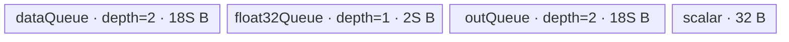

# ForeachDivScalar A2/A3 ACLNN 算子知识

## 算子速览

| 项目 | 内容 |
|---|---|
| 实际入口 | `aclnnForeachDivScalarV2GetWorkspaceSize` / `aclnnForeachDivScalarV2`，公开 ACLNN V2；旧版 `aclnnForeachDivScalar` 是同语义、`scalar` 为 `aclTensor` 的较早接口。 |
| 计算语义 | 对列表中每个张量逐元素计算 `out[i][j] = x[i][j] / scalar`。 |
| 输入输出 | `x/out` 为 ND TensorList，元素 dtype 为 FP16、FP32 或 BF16；V2 的 `scalar` 是 `aclScalar`，进入 L0 前转成单元素 Tensor。 |
| 执行类型 | 单节点 `AIV_VECTOR`；没有可达 Cube/AIC、MIX_CV、SIMT 或 NDDMA 节点。 |
| Kernel 路线 | R-001 FP32（key 2）、R-002 FP16（key 1）、R-003 BF16（key 4）。 |
| 核心资源 | TensorList GM 描述符、双缓冲 VECIN/VECOUT、FP16/BF16 的单缓冲 FP32 cast 区、32 B scalar 广播 TBuf；Foreach Kernel 不消费 user workspace。 |
| 来源闭包 | `source_closed`：公开 V2 API → `l0op::ForeachDivScalarV2` → `ForeachDivScalar` OpDef/Tiling → `foreach_div_scalar` router → `ForeachOneScalarBinaryLevelZeroApi`/`KernelForeachUnary`。 |
| 验证状态 | 已完成源码闭包检查；本次知识提取未执行编译、真机、数值或性能测试。 |

## 接口与语义

### 计算语义

设 `x = [x_0, ..., x_(n-1)]`，标量为 `s`，则每个输出张量的有效元素域为 `y_i[p] = x_i[p] / s`。各 Tensor 可以有不同 shape，但列表内 dtype 一致；Kernel 按每个 Tensor 的线性 storage 元素域处理。输出列表与输入列表逐项对应，L0 推形把每个输入 shape 和 dtype复制到对应输出。

### 输入、输出与属性

| 参数 | shape/layout | dtype | 约束、默认值与语义 |
|---|---|---|---|
| `x` | TensorList；每个 Tensor 为 ND，0–8 维 | FP16/FP32/BF16 | 列表内 dtype 一致；公开 V2 文档不支持非连续 Tensor，API 实现仍显式调用框架 `Contiguous`；支持元素数为 0 的 Tensor。 |
| `scalar` | `aclScalar`，无 Tensor shape | FP16/FP32/DOUBLE | FP16 `x` 接受 FP16/DOUBLE，FP32/BF16 `x` 接受 FP32/DOUBLE；API 将其转成单元素 Tensor：BF16 路线为 FP32，其余为 `x` dtype。 |
| `out` | TensorList；ND，0–8 维 | 与 `x` 相同 | 列表内 dtype 一致；公开契约不支持非连续输出。ACLNN `CheckShape` 要求逐项 shape 相同，正常推形也复制输入 shape；底层 Tiling 的检查更宽松，但不扩大 ACLNN 有效域。 |
| `workspaceSize` | 标量 Host 输出 | `uint64_t` | executor 全流程 workspace，由框架汇总；Foreach 节点的 Tiling 固定登记 32 B，但 Kernel 明确把 user workspace 置空。 |
| `executor` | Host 对象 | `aclOpExecutor**` | 第一段创建并移交；第二段由 `CommonOpExecutorRun` 在指定 stream 上执行。 |

### 入口与版本

公开文档同时列出 `aclnnForeachDivScalar` 与 `aclnnForeachDivScalarV2`；V2 明确说明相对旧版把 `scalar` 从 `aclTensor` 改为 `aclScalar`，因此本卡逐架构选择 V2。V2 第一段经 `ExecForeachDivScalarV2GetWorkspaceSize` 校验、连续化并把 scalar 转 Tensor，然后调用 `l0op::ForeachDivScalarV2`；该 L0 函数把同一个内部算子 `ForeachDivScalar` 加入 AICore launcher。A2/A3 的公开产品表均为支持，OpDef 同时注册 `ascend910b` 与 `ascend910_93`，Kernel CMake 也为两者构建普通实现。

## Host/Launcher 执行流程

### 参数校验与前处理

调用顺序为：

1. `CheckNotNull` 检查 `x/scalar/out` 指针。
2. `GetDtypeSupportList` 仅接受 `DAV_2201` 或 Regbase 架构；A2/A3 命中 `DAV_2201`。`CheckDtypeValid` 校验列表内 dtype、输出 dtype，以及 FP16↔FP16/DOUBLE、FP32/BF16↔FP32/DOUBLE 的 scalar 组合。
3. `CheckShape` 限制输入 Tensor 不超过 8 维，并逐项检查 `x/out` shape；`CheckFormat` 拒绝私有 storage format。
4. 空 TensorList（`x->Size()==0`）直接返回 `workspaceSize=0`，不创建 Foreach launch 节点。
5. 对每个 `x[i]` 调用框架 `l0op::Contiguous`，聚合成新的 TensorList。V2 公开契约本身标记输入非连续不支持，因此该调用不扩大公开有效域。
6. `ConvertToTensor` 把 `aclScalar` 物化为单元素 Tensor；BF16 `x` 指定 FP32，其余指定 `x[0]` dtype。
7. `l0op::ForeachDivScalarV2` 通过 `ADD_TO_LAUNCHER_LIST_AICORE(ForeachDivScalar, OP_INPUT(x, scalar), OP_OUTPUT(out))` 添加单节点；任一步失败立即返回对应 ACLNN 错误。

### 参数、Workspace 与生命周期

executor 持有 Contiguous 结果、scalar Tensor 与 Foreach launcher，`GetWorkspaceSize` 汇总其 workspace 并在第一段移交给调用者；第二段要求同一 executor 和至少该大小的 Device workspace。框架生成的 executor 内部分片在固定仓不可见。Foreach Tiling 节点自身写 `workspaces[0]=32`，注释说明该 Vector Kernel 不需要临时 workspace；entry 中进一步令 `userWS=nullptr`，body 不读取 `workspace`。所有节点在第二段传入的同一 `stream` 上由 `CommonOpExecutorRun` 调度，框架保证 executor 中节点顺序，具体 stream/event 封装属于固定仓外框架边界。

### 启动图与失败传播

```text
aclnnForeachDivScalarV2GetWorkspaceSize
  -> [框架边界] Contiguous(x[i])，逐项，任一失败终止
  -> [框架边界] ConvertToTensor(scalar)，失败终止
  -> l0op::ForeachDivScalarV2
       -> 单节点 N1: ForeachDivScalar / foreach_div_scalar
          inputs = contiguous TensorList descriptor + scalar Tensor
          output = caller-owned out TensorList descriptor
          blockDim = needCoreNum
          tiling = ForeachCommonTilingData
          node workspace = 32 B reserved, Device 未消费
aclnnForeachDivScalarV2
  -> CommonOpExecutorRun(workspace, workspaceSize, executor, stream)
```

N1 是唯一 Device 节点，无跨 Kernel workspace 边。输入、输出 GM 由调用方/框架持有，直到 stream 完成前均须有效；executor 第一段产生、第二段消费。L0 添加失败返回空指针并映射为 ACLNN 内部空指针错误；Tiling 校验、raw tiling buffer 或 workspace 数组获取失败会阻断 launch；router 对未知 key 无分支、不会写输出。

## Route 与参数设计

### 分核与资源计算

令 `E = Σ tensorDataCountList[i]`，`s = sizeof(T)`，`B = 32/s` 个元素/32 B block，平台 AIV 核数为 `Cplat`：

```text
needCoreNum = min(max(ceil(E / B), 1), Cplat, 50)
blocks = ceil(E / B)
base = floor(blocks / needCoreNum) * B
rem = blocks % needCoreNum
core k elements = base + (k < rem ? B : 0)
```

`AssignDataToEachCore` 在 TensorList 的拼接线性域上游走，但把每核边界保存为 `(tensorStart, tensorStartOffset, tensorEnd, tensorEndOffset)`，所以 Kernel 不需要物化拼接。每核再以 `maxDataCount` 分 tile。

令 `U` 为平台 UB 字节数，`D = ForeachCommonTilingData::GetDataSize()`，`S = inputsTensorUbSize`（A2/A3 POD 中单位为字节）：

```text
FP32: S = floor_align((U - D - 32) / 4, 32)
FP16/BF16: S = floor_align(((U - D - 32) / 10) / 4, 64)
FP32 maxDataCount = S / 4
FP16/BF16 totalTensorUbSize = 9S
FP16/BF16 maxDataCount = 9S / 2
FP16/BF16 maxCastDataCount = S / 4
```

FP16/BF16 的 `/10` 是 Host 为 cast 临时空间作的保守衰减，`/4` 对应 input/output 双缓冲；64 B 对齐来自 `BYTE_BLOCK_FOR_BF16`。所有整数除法向下取整。固定源码未在减法前显式验证 `U > D+32`，依赖受支持平台资源成立。

### Route 选择

| 顺序 | Route | Key/模板 | 精确选择条件与优先级 | 不适用去向 |
|---:|---|---|---|---|
| 1 | R-001 FP32 Level-Zero Div | key 2；`ForeachOneScalarBinaryLevelZeroApi<float,float,Div,2,1>` | 非 Regbase 平台且 `x` dtype FP32；scalar Tensor dtype FP32 | dtype 非 FP32 时检查下一 key |
| 2 | R-002 FP16→FP32→FP16 Div | key 1；`ForeachOneScalarBinaryLevelZeroApi<half,float,Div,2,1>` | 非 Regbase 平台且 `x` dtype FP16；V2 scalar 已转 FP16 Tensor，Device 读后转 FP32 | dtype 非 FP16 时检查下一 key |
| 3 | R-003 BF16→FP32→BF16 Div | key 4；`ForeachOneScalarBinaryLevelZeroApi<bfloat16_t,float,Div,2,1>` | 非 Regbase 平台、`x` dtype BF16，且编译 guard `__CCE_AICORE__ >= 220` 且非 NPU arch 3003/3113；scalar Tensor FP32 | 未知/未编译 key：无输出 |

```text
TilingRegistry priority 30000 Regbase template: IsCapable = false on A2/A3
  -> priority 10000 ForeachDivScalarMembaseTiling: IsCapable = !IsRegbase = true
       -> dtype FP16 => key 1 => R-002
       -> dtype FP32 => key 2 => R-001
       -> dtype BF16 => key 4 => R-003
       -> other dtype => key 0 / API 或 Tiling 失败
```

### 模板/实现执行矩阵

| Route | key/selector | dtype/shape/platform 完整命中条件 | 执行拓扑与 Kernel 节点 | 实际模板/body | 内存与同步特征 | tail/fallback |
|---|---|---|---|---|---|---|
| R-001 FP32 | 2 | A2/A3；FP32；TensorList/shape/scalar/output 校验通过 | 单 N1 AIV | `InnerComputer<float,float,Div,1>` | input/output 各 depth 2；32 B scalar TBuf；Queue 隐式同步 | tile tail 用 `DataCopyPad`；Vector tail 用单 repeat mask；未知 key 无输出 |
| R-002 FP16 | 1 | A2/A3；FP16；scalar Tensor FP16 | 单 N1 AIV | `InnerComputer<half,float,Div,1>` specialization | input/output 各 depth 2、容量 9S；FP32 TQue 容量 S；V pipe barrier + V→MTE3/MTE3→MTE2 event | cast chunk、repeat batch、最终 byte tail 三层保护 |
| R-003 BF16 | 4 | A2/A3；BF16；scalar Tensor FP32；编译 guard 成立 | 单 N1 AIV | `InnerComputer<bfloat16_t,float,Div,1>` specialization | 与 R-002 同布局；FP32 中计算后 RINT 回 BF16 | 与 R-002 相同；guard 不成立则 router 不实例化 |

### 隐藏性能 Guard

| Guard | Host/Tiling 条件 | Device/资源原因 | 影响 Route | 不满足时去向 | 源码符号 |
|---|---|---|---|---|---|
| 模板平台优先级 | `ForeachRegbaseTiling::IsCapable()==false` 且 Membase `IsCapable()==true` | A2/A3 必须使用普通 POD/key 与普通 body | 全部 | 无匹配模板则 Tiling 失败 | `foreach_regbase_tiling.h::IsCapable`；`foreach_tiling_def.h::MEMBASE_TILING` |
| 列表静态容量 | `ForeachCommonTiling::Init` 只扫描前 50 个 Tensor，POD数组亦为50；固定实现未见 `>50` 的显式报错 | 防止 POD越界，公开调用不得超过可表示容量 | 全部 | 没有安全 fallback；视为不支持边界 | `ForeachCommonTiling::Init`；`MAX_TENSOR_CONT` |
| 核上限 | `needCoreNum <= 50` | start/end 数组仅 50 项 | 全部 | 截断到 50 核 | `RunBigScalarKernelTiling` |
| 32 B 分核 | `elementsPerBlock=32/s` | 核间切分边界按 DMA block 对齐 | 全部 | 无备用 Route | `GetNeedCoreNum` / `AssignDataToEachCore` |
| FP16/BF16 UB 衰减 | `totalSize=(U-D-32)/10` | 9S input/output tile 与 FP32 cast queue 需要额外空间 | R-002/R-003 | tile 变小；无备用 Route | `ForeachCommonTiling::DivideUbMemory9` |
| repeat 上限 | 完整 repeat 每批最多 255 | Level-Zero Vector API `repeatTimes` 位宽/约束 | 全部 | 分成多个 255-repeat batch | `InnerComputer::Compute` / `ComputePerCast` |
| BF16 编译 guard | `__CCE_AICORE__ >= 220` 且 arch 非 3003/3113 | BF16 template/API 仅在 guard 内可用 | R-003 | router 不执行任何 body | `op_kernel/foreach_div_scalar.cpp::foreach_div_scalar` |
| 空 TensorList | API `x->Size()==0` | 避免访问 `x[0]` 和无意义 launch | 全部 | workspace 0，直接成功 | `ExecForeachDivScalarV2GetWorkspaceSize` |

### POD/ABI

| 结构 | 字段 | 类型/位宽 | ABI 布局 | 单位 | Host/launcher producer | Device consumer | 边界 |
|---|---|---|---|---|---|---|---|
| `ForeachCommonTilingData` | `inputsTensorUbSize` | `uint64_t`/64 | 由 Tiling 宏生成；固定仓未展开 `sizeof/alignof/offsetof` | 字节 | `DivideUbMemory9` 后 `FillTilingData` | `KernelForeachBase::ParseTilingData`；决定 Queue/tile 容量 | 32/64 B 向下对齐；不得按元素解释 |
| 同上 | `tensorDataCountList[50]` | `int64_t[50]` | 同上 | 元素 | `Init`: 每个 storage shape size | `Process`：每 Tensor 默认末端 | 有效项 `[0,totalTensorCount)`；totalTensorCount 未单独进 POD |
| 同上 | `tensorStartList[50]` | `uint16_t[50]` | 同上 | Tensor 索引 | `AssignDataToEachCore` | 当前 block 的循环起点 | 仅 `[0,blockDim)` 有效 |
| 同上 | `tensorEndList[50]` | `uint16_t[50]` | 同上 | Tensor 索引（含） | `AssignDataToEachCore` | 当前 block 的循环终点 | 仅 `[0,blockDim)` 有效 |
| 同上 | `tensorStartOffsetList[50]` | `int64_t[50]` | 同上 | 元素 | `AssignDataToEachCore` | 首 Tensor GM base 偏移 | 非负；相对对应 Tensor |
| 同上 | `tensorEndOffsetList[50]` | `int64_t[50]` | 同上 | 元素（含） | `AssignDataToEachCore` | 尾 Tensor 有效末端 | 空数据时形成 `-1` 语义由分核路径保护 |

### Route 源码闭包

| Route | Key/selector | Host/Tiling producer | POD/参数 | Kernel entry/router 节点 | Kernel body/直接依赖 | 构建接线 |
|---|---|---|---|---|---|---|
| R-001 FP32 | key 2 | `foreach_tiling_func.cpp::Tiling4ForeachDivScalarTiling`；`ForeachDivScalarMembaseTiling`；`RunBigScalarKernelTiling` | `ForeachCommonTilingData` | `op_kernel/foreach_div_scalar.cpp::foreach_div_scalar` | `ForeachOneScalarBinaryLevelZeroApi<float,...>`；`KernelForeachUnary` | `op_kernel/CMakeLists.txt::add_kernel_sources(ascend910b,ascend910_93,...)` |
| R-002 FP16 | key 1 | 同上 | 同上 | 同上 | `InnerComputer<half,float,...>::ComputePerCast` | 同上 |
| R-003 BF16 | key 4 | 同上 | 同上 | 同上，带 BF16 guard | `InnerComputer<bfloat16_t,float,...>::ComputePerCast` | 同上 |

## Kernel 实现

### 公共执行流程

entry 解析 `ForeachCommonTilingData` 后按 key 实例化一个 `ForeachOneScalarBinaryLevelZeroApi`，调用 `Init/Process`。`Process` 取当前 block 的 Tensor 起止范围；每个 Tensor 绑定输入/输出 GM 指针并调用 `SingleTensorProcess`。后者按 `maxDataCount` 切 tile，严格执行 `CopyIn → Compute → CopyOut`。scalar 只从 GM 读取一次，转成 FP32 值并 `Duplicate` 到 32 B TBuf；所有 tile 复用该块。普通完整 tile 使用 `DataCopy`，末 tile 使用单 block 的 `DataCopyPad`，仅搬运 `dataCount*sizeof(T)` 有效字节。

### Route R-001：FP32 Level-Zero Div

#### 适用条件

##### 选择证据

| 层级 | 文件 | 符号 | 源码谓词/参数 | 结果/下一跳 |
|---|---|---|---|---|
| API | `op_api/aclnn_foreach_div_scalar_v2.cpp` | `GetDtypeSupportList` / `CheckDtypeValid` | A2/A3 架构，`x=FP32`，scalar=FP32/DOUBLE，out=FP32 | scalar 转 FP32 Tensor并进入 L0 |
| Tiling | `foreach_tiling_def.h` / `foreach_tiling_class.h` | `ForeachDivScalarMembaseTiling` / `GetTilingKeyByDtypeOnly` | 非 Regbase且 dtype FP32 | key 2 |
| Router | `op_kernel/foreach_div_scalar.cpp` | `foreach_div_scalar` | `TILING_KEY_IS(2)` | FP32 模板实例 |

#### Device 数据流

##### 函数级调用链

```text
ForeachDivScalar launch -> foreach_div_scalar(x, scalar, y, workspace, tiling)
  -> ForeachOneScalarBinaryLevelZeroApi<float,float,Div,2,1>::Init
     -> KernelForeachUnary::Init + scalar Duplicate
  -> ForeachOneScalarBinaryLevelZeroApi::Process
     -> KernelForeachUnary::Process
        -> SingleTensorProcess
           -> CopyIn
           -> InnerComputer<float,float,Div,1>::Compute
           -> specialized CopyOut
```

##### 源码等价伪码

```text
S = tiling.inputsTensorUbSize; maxDataCount = S / 4
scalarBlock[0:8] = scalarGM[0]
for tensor i in [tensorStart, tensorEnd]:
  begin/end = POD offsets for boundary tensors, otherwise full tensor
  bind inGM/outGM at begin
  for tile t over dataCount with capacity maxDataCount:
    valid = min(maxDataCount, remaining)
    CopyIn valid FP32 elements
    for each 255 full 256-byte repeats:
      Div(out, in, scalarBlock, mask=64 FP32, repeats=255, strides={1,1,0,8,8,0})
    run remaining full repeats, then one masked repeat for remaining elements
    CopyOut exactly valid*4 bytes
```

#### 内存与数据搬运

##### 资源与搬运表

| 层级/缓冲区 | offset/地址公式 | extent/容量公式 | dtype/layout | producer | consumer | owner/lifetime | 对齐/复用 |
|---|---|---|---|---|---|---|---|
| input GM | `tensorAddr(i)+cursorStart+t*maxDataCount` | `valid` elements | FP32 linear ND | caller/Contiguous | `CopyIn` | caller/executor 至 stream 完成 | full tile DMA；tail byte copy |
| `dataQueue` | Queue slot | depth 2 × `S` B | FP32 | `CopyIn` | `InnerComputer` | `TPipe`，tile 内 | double buffer |
| `outQueue` | Queue slot | depth 2 × `S` B | FP32 | `InnerComputer` | `CopyOut` | `TPipe`，tile 内 | double buffer |
| `scalarOneBlockBuf` | 0 | 32 B | FP32×8 | `Duplicate` | `Div` src1 | 整个 Kernel | src repeat stride 0，跨 repeat/tile复用 |
| output GM | `tensorAddr(i)+cursorStart+t*maxDataCount` | `valid` elements | FP32 linear ND | `CopyOut` | caller | caller | 只写有效字节 |

##### 分层内存布局


##### 字节账与复用顺序

```text
UB_total = 2S + 2S + 32 = 4S + 32
S = floor_align((U - D - 32)/4, 32)
UB_total <= U - D（由该向下取整式保证）
dynamic_ub = N/A
workspace_total = 32 B reserved；Kernel 实际 userWS = nullptr
```

| 复用子区 | 写入者 | 读取者/消费点 | 下一次覆盖 | 同步或释放依据 | 安全条件 |
|---|---|---|---|---|---|
| `dataQueue` slot | `CopyIn` | `DeQue` 后 `Div` | `FreeTensor` 后下一 tile | Queue EnQue/DeQue/FreeTensor | 不在消费前复用 slot |
| `outQueue` slot | `Div` | `CopyOut` | `FreeTensor` 后下一 tile | EnQue/DeQue + V→MTE3 event | MTE3 读取完成后才释放 |
| scalar TBuf | Kernel `Init` | 所有 `Div` | Kernel 结束 | 初始化先于 `Process`；只读 | scalar 在 launch 期间不变 |

#### 同步、精度与尾块

##### 同步与数值边界表

| 阶段 | primitive/机制 | producer | consumer/等待点 | 保护对象 | 精度/尾块 |
|---|---|---|---|---|---|
| GM→UB | TQue | MTE2 `CopyIn` | Vector `DeQue` | input slot | tail `DataCopyPad` 仅 valid bytes |
| Vector | `Div` Level-Zero | input Queue | output Queue | FP32 lanes | 64 FP32/256 B repeat；最后一次用 `totalRepeatCntRemainder` mask |
| UB→GM | `V_MTE3` flag/wait | `Div` | `DataCopy/Pad` | output slot | 写 `valid` elements |
| slot reuse | `MTE3_MTE2` flag/wait | output DMA | 下一输入 DMA | Queue物理区 | 防止流水覆盖冲突 |

#### 关键实现

##### 符号证据表

| 阶段 | 文件 | 符号/模板实例 | 实现事实 |
|---|---|---|---|
| Host/Tiling producer | `foreach_utils/op_host/foreach_tiling_class.h` | `RunBigScalarKernelTiling` / `DivideUbMemory9` | key、blockDim、S 与 32 B workspace |
| Kernel entry/router | `foreach_div_scalar/op_kernel/foreach_div_scalar.cpp` | `TILING_KEY_IS(2)` | key 2 → FP32 模板 |
| Device body/helper | `foreach_utils/op_kernel/foreach_one_scalar_binary_level_zero_api.h` | generic `InnerComputer::Compute` | 255-repeat batching、stride 与 masked tail |

### Route R-002：FP16→FP32→FP16 Div

#### 适用条件

##### 选择证据

| 层级 | 文件 | 符号 | 源码谓词/参数 | 结果/下一跳 |
|---|---|---|---|---|
| API | `op_api/aclnn_foreach_div_scalar_v2.cpp` | `CheckDtypeValid` / `ConvertToTensor` | `x=FP16`，scalar=FP16/DOUBLE | scalar Tensor dtype FP16 |
| Tiling | `foreach_tiling_class.h` | `GetTilingKeyByDtypeOnly` | dtype FP16 | key 1，cast 衰减 UB 公式 |
| Router | `foreach_div_scalar.cpp` | `TILING_KEY_IS(1)` | key 1 | `<half,float,Div,2,1>` |

#### Device 数据流

##### 函数级调用链

```text
foreach_div_scalar
  -> ForeachOneScalarBinaryLevelZeroApi<half,float,Div,2,1>::Init
  -> specialized Process
     -> KernelForeachUnary::SingleTensorProcess
        -> CopyIn<half>
        -> InnerComputer<half,float,Div,1>::Compute
           -> ComputePerCast: Cast half→float; Div in-place FP32; Cast RINT float→half
        -> CopyOut<half>
```

##### 源码等价伪码

```text
tileCapacity = 9S/2; castCapacity = S/4; scalarFP32 = float(scalarGM[0])
for each assigned tensor and tile:
  CopyIn valid FP16
  for castChunk of at most castCapacity elements:
    Cast FP16 -> float32Buf
    Div float32Buf in-place by scalarFP32, batches <=255 repeats of 64 lanes
    final repeat uses valid-lane mask
    Cast float32Buf -> FP16 with CAST_RINT
  CopyOut valid FP16 bytes
```

#### 内存与数据搬运

##### 资源与搬运表

| 层级/缓冲区 | offset/地址公式 | extent/容量公式 | dtype/layout | producer | consumer | owner/lifetime | 对齐/复用 |
|---|---|---|---|---|---|---|---|
| input/output GM | per Tensor + tile offset | valid elements | FP16 | caller/Kernel | Kernel/caller | stream | tail byte-accurate |
| `dataQueue` | slot | depth 2 × `9S` B | FP16 | CopyIn | Cast | TPipe | double buffer |
| `outQueue` | slot | depth 2 × `9S` B | FP16 | Cast RINT | CopyOut | TPipe | double buffer |
| `float32Queue` | 0 | `2S` B | FP32 | FP16→FP32 Cast | in-place Div、FP32→FP16 Cast | Kernel；单 slot | 每 cast chunk覆盖同一区 |
| scalar TBuf | 0 | 32 B | FP32×8 | Duplicate | Div | Kernel | broadcast stride 0 |

##### 分层内存布局



##### 字节账与复用顺序

```text
UB_total = 2*(9S) + 2S + 2*(9S) + 32 = 38S + 32
S = floor_align(((U-D-32)/10)/4, 64)
38S + 32 <= U-D（Host 以 40S+32 的保守预算选择 S）
dynamic_ub = N/A
workspace_total = 32 B reserved，Device 不使用
```

| 复用子区 | 写入者 | 读取者/消费点 | 下一次覆盖 | 同步或释放依据 | 安全条件 |
|---|---|---|---|---|---|
| FP32 Queue | half→float Cast | in-place Div；float→half Cast | 下一 cast chunk | 每个 Vector阶段间 `PipeBarrier<PIPE_V>` | 降精度完成前不得覆盖 |
| input/output slot | DMA/Vector | Vector/DMA | `FreeTensor` 后 | Queue + hard event | 同 R-001 |

#### 同步、精度与尾块

##### 同步与数值边界表

| 阶段 | primitive/机制 | producer | consumer/等待点 | 保护对象 | 精度/尾块 |
|---|---|---|---|---|---|
| cast in | `PipeBarrier<PIPE_V>` + `Cast(...CAST_NONE)` | input Queue | Div | FP32 cast区 | 每次最多 `S/4` 元素 |
| divide | `Div` 原地 | cast FP32 | cast out | 同一 FP32区 | FP32 计算；repeat tail mask |
| cast out | barriers + `CAST_RINT` | Div | output Queue | FP16结果 | round-to-nearest 降精度 |
| copy out | V→MTE3 / MTE3→MTE2 | output Queue | GM / 下 tile | output slot | 仅 valid bytes |

#### 关键实现

##### 符号证据表

| 阶段 | 文件 | 符号/模板实例 | 实现事实 |
|---|---|---|---|
| Host/Tiling producer | `foreach_tiling_class.h` | `DivideUbMemory9` | `/10` 衰减、双缓冲与 64 B 对齐 |
| Kernel entry/router | `foreach_div_scalar.cpp` | key 1 template | FP16→FP32 模板 |
| Device body/helper | `foreach_one_scalar_binary_level_zero_api.h` | `InnerComputer<half,...>::ComputePerCast` | Cast、原地 Div、RINT、barrier |

### Route R-003：BF16→FP32→BF16 Div

#### 适用条件

##### 选择证据

| 层级 | 文件 | 符号 | 源码谓词/参数 | 结果/下一跳 |
|---|---|---|---|---|
| API | `aclnn_foreach_div_scalar_v2.cpp` | `CheckDtypeValid` / `ConvertToTensor` | `x=BF16`，scalar=FP32/DOUBLE | scalar Tensor dtype FP32 |
| Tiling | `foreach_tiling_class.h` | `GetTilingKeyByDtypeOnly` | dtype BF16 | key 4 |
| Router | `foreach_div_scalar.cpp` | BF16 compile guard + key 4 | guard 成立 | BF16 specialization |

#### Device 数据流

##### 函数级调用链

```text
foreach_div_scalar
  -> ForeachOneScalarBinaryLevelZeroApi<bfloat16_t,float,Div,2,1>::Init
  -> InnerComputer<bfloat16_t,float,Div,1>::ComputePerCast
     -> Cast BF16→FP32 -> in-place FP32 Div -> CAST_RINT FP32→BF16
```

##### 源码等价伪码

```text
与 R-002 相同的 Tensor/core/tile/castChunk/repeat 循环；
唯一 dtype 差异是输入 Cast 源为 BF16、输出 RINT 目标为 BF16，scalar Tensor 本身为 FP32。
```

#### 内存与数据搬运

##### 资源与搬运表

| 层级/缓冲区 | offset/地址公式 | extent/容量公式 | dtype/layout | producer | consumer | owner/lifetime | 对齐/复用 |
|---|---|---|---|---|---|---|---|
| input/output GM | per Tensor + tile | valid | BF16 | caller/Kernel | Kernel/caller | stream | byte tail |
| input/output Queue | slot | 各 depth 2 × `9S` B | BF16 | DMA/Vector | Vector/DMA | TPipe | double buffer |
| FP32 Queue | 0 | `2S` B | FP32 | BF16 Cast | Div/降精度 Cast | Kernel | 原地复用 |
| scalar TBuf | 0 | 32 B | FP32×8 | Duplicate | Div | Kernel | broadcast |

##### 分层内存布局


##### 字节账与复用顺序

```text
UB_total = 38S + 32；S 的 Host 公式与 R-002 相同
dynamic_ub = N/A
workspace_total = 32 B reserved，Device 不使用
```

| 复用子区 | 写入者 | 读取者/消费点 | 下一次覆盖 | 同步或释放依据 | 安全条件 |
|---|---|---|---|---|---|
| FP32 cast区 | BF16→FP32 | Div + FP32→BF16 | 下一 chunk | `PipeBarrier<PIPE_V>` | 当前 chunk 降精度完成 |

#### 同步、精度与尾块

##### 同步与数值边界表

| 阶段 | primitive/机制 | producer | consumer/等待点 | 保护对象 | 精度/尾块 |
|---|---|---|---|---|---|
| BF16 load/cast | Queue + Vector barrier | MTE2/Cast | Div | input/cast区 | FP32 中间值 |
| Div/store | 原地 Div + RINT | FP32 cast | BF16 output | FP32/BF16 | mask 与 R-002 相同 |
| DMA | hard events | Vector | GM/下 tile | Queue slot | valid byte tail |

#### 关键实现

##### 符号证据表

| 阶段 | 文件 | 符号/模板实例 | 实现事实 |
|---|---|---|---|
| Host/Tiling producer | `foreach_tiling_class.h` | BF16 key + `DivideUbMemory9` | key 4 和资源上界 |
| Kernel entry/router | `foreach_div_scalar.cpp` | key 4 guard | BF16 路线的编译可达性 |
| Device body/helper | `foreach_one_scalar_binary_level_zero_api.h` | BF16 `ComputePerCast` | FP32 升精度 Div 与 RINT |

## 算子特定优化

### Trick T-001：scalar 单次装载并以 stride 0 广播复用

#### 触发与源码依据

- 适用 Route：R-001、R-002、R-003
- 触发条件：所有有效非空 V2 调用；`scalar` 已物化为单元素 Tensor。
- Golden 来源：[`foreach_one_scalar_binary_level_zero_api.h:331-335`](../../../../../../../cann-ops-raw/ascendc/ops-nn/955f8b33985b6d72989ebff341bb9c2c564a51bc/foreach/foreach_utils/op_kernel/foreach_one_scalar_binary_level_zero_api.h#L331-L335)

**官方源码（固定 Commit 连续逐字摘录）**：

```cpp
Base::pipe.InitBuffer(scalarOneBlockBuf, BYTES_PER_BLOCK);
inScalarGM.SetGlobalBuffer((__gm__ DTYPE_SCALAR*)scalar, 1);
scalarValue = P(inScalarGM.GetValue(0));
scalarOneBlockLM = scalarOneBlockBuf.Get<P>();
Duplicate(scalarOneBlockLM, scalarValue, BYTES_PER_BLOCK / sizeof(P));
```

#### 机制与设计原因

Kernel 初始化阶段只读取一次 scalar GM，并把 FP32 值扩成一个 32 B Vector block。后续所有 `Div` 调用的 binary repeat 参数使用 scalar block stride 0（`{1,1,0,8,8,0}`），所以一个 scalar block跨 repeat、tile 和 Tensor复用，避免为每个输入元素或每个 tile重复从 GM 搬运 scalar。

#### 迁移边界

- 适用：第二操作数在整个 Kernel launch 内恒定的逐元素二元算子。
- 前提：scalar 生命周期覆盖 launch；Vector API支持第二源 repeat stride 0；POD/模板 dtype 转换一致。
- 失效：每 Tensor 或每元素 scalar 必须改用 scalar-list/二元 Tensor Route，不能复用单一块。
- 未验证：本次知识提取未执行编译、真机、数值或性能测试。

#### 错误做法

固定仓未提供可验证反例。

### Trick T-002：FP16/BF16 在单一 FP32 子区中原地 Div

#### 触发与源码依据

- 适用 Route：R-002、R-003
- 触发条件：`T` 为 `half` 或 `bfloat16_t`，每个 cast chunk 不超过 `maxCastDataCount=S/4`。
- Golden 来源：[`foreach_one_scalar_binary_level_zero_api.h:127-151`](../../../../../../../cann-ops-raw/ascendc/ops-nn/955f8b33985b6d72989ebff341bb9c2c564a51bc/foreach/foreach_utils/op_kernel/foreach_one_scalar_binary_level_zero_api.h#L127-L151)

**官方源码（固定 Commit 连续逐字摘录）**：

```cpp
for (uint32_t i = 0; i < repeatBatchCnt; i++) {
    PipeBarrier<PIPE_V>();
    op(float32Tensor[offset], float32Tensor[offset], oneBlockData, elementsPerRepeat, MAX_REPEATS,
       {1, 1, 0, 8, 8, 0});
    PipeBarrier<PIPE_V>();
    offset += MAX_REPEATS * elementsPerRepeat;
}
```

#### 机制与设计原因

输入只物化一份 FP32 cast 区，`Div` 的 dst 与第一个 src 指向同一 offset，随后直接从该区 RINT cast 到 output Queue。这样避免额外 FP32 result buffer；barrier 划定 Cast、原地 Div、降精度 Cast 的覆盖边界。`MAX_REPEATS=255` 把过长 tile拆成合法 Vector 调用，末尾再以 mask处理不足一个 256 B repeat 的元素。

#### 迁移边界

- 适用：允许 `dst==src0` 的逐元素 Level-Zero API，且输入可安全升到 FP32计算。
- 前提：UB 预算包含 FP32区；每阶段有 V pipe barrier；降精度 round mode与目标语义一致。
- 失效：不支持原地的 Vector primitive或需要同时保留原输入时必须分配独立输出区。
- 未验证：本次知识提取未执行编译、真机、数值或性能测试。

#### 错误做法

固定仓未提供可验证反例。

## 模板与实现对比

| 对比维度 | R-001 FP32 | R-002 FP16 | R-003 BF16 | 设计选择依据 |
|---|---|---|---|---|
| 命中条件/优先级 | key 2 | key 1 | key 4 + compile guard | dtype-only key；Membase template只在非 Regbase 命中 |
| 模板与 dtype | `<float,float,Div>` | `<half,float,Div>` | `<bfloat16_t,float,Div>` | 计算 P 均为 FP32 |
| 循环与分核 | Tensor→tile→repeat batch | Tensor→tile→cast chunk→repeat batch | 同 R-002 | 低精度需限制 cast区 |
| Queue/TBuf/寄存器/dynamic UB/通信 window | 2S input +2S output +32 | 18S input +2S FP32 +18S output +32 | 同 R-002 | FP16/BF16 以空间换 FP32计算 |
| 内存总占用与复用 | `4S+32` | `38S+32`，FP32原地 | 同 R-002 | Host 对低精度按 40S保守预算 |
| 搬运/Vector/SIMT/NDDMA/通信 API | DataCopy(Pad)+Div | +Cast/Div/Cast | +Cast/Div/Cast | 均无 SIMT/NDDMA/通信 |
| 同步、精度与 tail | Queue + hard event；FP32 | 额外 V barrier；RINT到 FP16 | RINT到 BF16 | dtype语义不同不能合并 Route |
| fallback/失败边界 | 未知 key无输出 | 同左 | guard 不成立无 body | 无 Device fallback |

## 平台差异

| 项目 | A2 | A3 | 950 |
|---|---|---|---|
| 支持状态 | 公开支持；`ascend910b` | 公开支持；`ascend910_93` | 公开支持；见 `_950` 卡 |
| Host/Launcher | 共用 priority 10000 Membase Tiling、普通 key 1/2/4 | 同 A2 | priority 30000 Regbase Tiling、key 10001/10002/10004 |
| Kernel/资源 | Level-Zero `Div`；低精度有 UB FP32 cast buffer | 同 A2 | MicroAPI 寄存器 FP32 reciprocal+`Muls`；UB 仅 input/output Queue |

## 限制与失败边界

- 公开 V2 文档支持 A2/A3，且只发布较新的 `aclScalar` V2；旧版 `aclTensor scalar` 未另建 Route。
- 列表内 dtype 必须一致，输入最多 8 维，scalar dtype 组合必须符合 API；固定 API代码未在 `CheckParams` 中显式检查 `x->Size()==out->Size()`，最终仍由 shape访问、推形/Tiling与 launcher约束，调用方不得依赖未校验行为。
- 非空列表不得超过50个 Tensor：普通 Tiling/POD只能表示50项，固定实现对 `>50` 未见显式报错或安全 fallback。ACLNN `CheckShape` 要求输出逐项同 shape；不得利用底层 Tiling 较宽松的元素数检查。
- V2 公开契约不支持非连续 `x/out`；实现中的 `Contiguous(x)` 不应被解释为放宽契约，输出没有 ViewCopy修复路径。
- `ForeachCommonTilingData` 的宏展开 ABI（精确 `sizeof/alignof/offsetof`）在固定仓源码中不可见；Host 与 Device使用同名注册结构，字段顺序必须保持定义顺序。
- `workspaceSize` 的完整 executor 公式属于框架边界；可证明的是 Foreach 节点固定登记 32 B、Kernel 不消费它。
- router 没有 unknown-key fallback；BF16 编译 guard 不成立或 key 0 时不写输出。本次知识提取未执行编译、真机、数值或性能测试。

## 源码索引

### 链路索引

| 链路阶段 | 文件 | 关键符号 | 支撑内容 |
|---|---|---|---|
| 入口声明/约束 | `foreach/foreach_div_scalar/docs/aclnnForeachDivScalarV2.md` | V2 原型、产品表、参数表 | V2公开性、A2/A3/950支持、dtype/shape/非连续约束 |
| 入口实现 | `foreach/foreach_div_scalar/op_host/op_api/aclnn_foreach_div_scalar_v2.cpp` | `CheckParams`、`ExecForeachDivScalarV2GetWorkspaceSize` | 校验、Contiguous、scalar Tensor转换、executor |
| 入口实现 | `foreach/foreach_div_scalar/op_host/op_api/foreach_div_scalar_v2.cpp` | `l0op::ForeachDivScalarV2` | 单 AICore launcher节点 |
| Host 定义 | `foreach/foreach_div_scalar/op_host/foreach_div_scalar_def.cpp` | `ops::ForeachDivScalar` | dtype、AutoContiguous、平台注册 |
| Host/Tiling | `foreach/foreach_utils/op_host/foreach_tiling_func.cpp` | `Tiling4ForeachDivScalarTiling`、注册模板 | selector、priority、Tiling注册、workspace |
| Host/Tiling | `foreach/foreach_utils/op_host/foreach_tiling_class.h` | `RunBigScalarKernelTiling`、`AssignDataToEachCore`、`DivideUbMemory9` | 分核、POD producer、UB公式 |
| Host/Tiling | `foreach/foreach_utils/op_host/common_dtype.h` | `GetTilingKeyByDtypeOnly` | dtype到普通key 1/2/4 |
| Host/Tiling | `foreach/foreach_utils/op_host/foreach_regbase_tiling.h` | `ForeachRegbaseTiling::IsCapable` | A2/A3排除Regbase模板 |
| Host/Tiling | `foreach/foreach_utils/op_host/foreach_regbase_tiling.cpp` | Regbase模板注册 | priority 30000候选与平台guard |
| POD | `foreach/foreach_utils/op_host/foreach_tiling_def.h` | `ForeachCommonTilingData`、`MEMBASE_TILING` | 字段、数组上限、非 Regbase selector |
| Kernel entry/body | `foreach/foreach_div_scalar/op_kernel/foreach_div_scalar.cpp` | `foreach_div_scalar` | key→模板映射与 BF16 guard |
| Kernel body | `foreach/foreach_utils/op_kernel/foreach_one_scalar_binary_level_zero_api.h` | `ForeachOneScalarBinaryLevelZeroApi`、`InnerComputer` | scalar广播、Div、cast、repeat、同步 |
| Kernel body | `foreach/foreach_utils/op_kernel/kernel_foreach_unary.h` | `KernelForeachUnary` | Queue、Tensor/tile循环、CopyIn/Out |
| Kernel body | `foreach/foreach_utils/op_kernel/kernel_foreach_base.h` | `KernelForeachBase` | POD解析、TensorList地址解引用、tile容量 |
| binary config | `foreach/foreach_div_scalar/op_host/config/ascend910b/foreach_div_scalar_binary.json` | `op_list` | A2 FP16/FP32/BF16与scalar实例 |
| binary config | `foreach/foreach_div_scalar/op_host/config/ascend910_93/foreach_div_scalar_binary.json` | `op_list` | A3 FP16/FP32/BF16与scalar实例 |
| 构建接线 | `foreach/foreach_div_scalar/op_kernel/CMakeLists.txt` | `add_kernel_sources` | A2/A3普通 Kernel与 950 arch35分流 |

### 实现复用检查

| 检查项 | 可复用事实 | 不得改变的约束 | 源码符号 |
|---|---|---|---|
| ABI/POD | 六字段可复用到相同 foreach普通基类 | `inputsTensorUbSize` 是字节；数组容量50；字段顺序/位宽不变 | `ForeachCommonTilingData` |
| 调用顺序 | `Contiguous → scalar ConvertToTensor → Foreach launch`；Device `CopyIn→Compute→CopyOut` | 错误必须阻断后续；空列表不得访问 `x[0]` | `ExecForeachDivScalarV2GetWorkspaceSize`；`SingleTensorProcess` |
| workspace/内存 | 32 B节点保留；scalar 32 B TBuf；Queue 双缓冲 | FP16/BF16 的 9S/2S布局与 Host `/10` 预算配套 | `DivideUbMemory9`；`Init` |
| 同步 | Queue协议、V barrier、V→MTE3/MTE3→MTE2事件 | 原地 FP32区和 Queue slot不得提前覆盖 | `ComputePerCast`；`CopyOut` |
| 精度与尾块 | 低精度升 FP32 Div，RINT回写；byte tail + repeat mask | scalar dtype转换、round mode和 valid byte数不变 | `InnerComputer`；`DataCopyPad` |
| 失败边界 | Tiling/API失败停止；unknown key无 body | 不得臆造 fallback或把实现内部 Contiguous当公开支持 | `CheckParams`；`foreach_div_scalar` |