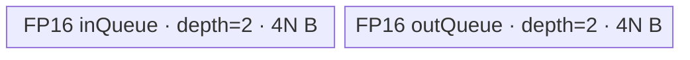

# ForeachDivScalar 950 ACLNN 算子知识

## 算子速览

| 项目 | 内容 |
|---|---|
| 实际入口 | `aclnnForeachDivScalarV2GetWorkspaceSize` / `aclnnForeachDivScalarV2`，公开 ACLNN V2。 |
| 计算语义 | TensorList 内逐元素 `out[i][j] = x[i][j] / scalar`。 |
| 输入输出 | ND TensorList；`x/out` 为 FP16、FP32、BF16；V2 `scalar` 是 `aclScalar`，L0 前物化为一个 Tensor。 |
| 执行类型 | 单节点 `AIV_VECTOR`（950 Regbase/MicroAPI）；没有可达 Cube/AIC、MIX_CV、SIMT 或 NDDMA。 |
| Kernel 路线 | R-001 FP32（key 10002）、R-002 FP16（key 10001）、R-003 BF16（key 10004）。 |
| 核心资源 | TensorList GM 描述符、VECIN/VECOUT 各 depth 2、FP32 RegTensor 与 MaskReg；没有 FP32 UB cast buffer，Foreach Kernel不消费 workspace。 |
| 来源闭包 | `source_closed`：公开 V2 API → L0 launcher → Regbase Tiling/POD → arch35 router → `ForeachRegbaseUnary` → `ForeachDivScalarRegbase::Compute` 与 load/store helper。 |
| 验证状态 | 已完成源码闭包检查；本次知识提取未执行编译、真机、数值或性能测试。 |

## 接口与语义

### 计算语义

设 `x=[x_0,...,x_(n-1)]`、标量为 `s`，则每个 Tensor 的 storage 线性有效域逐元素执行 `y_i[p]=x_i[p]/s`。各 Tensor shape 可以不同，但列表内 dtype一致；正常推形逐项复制输入 shape/dtype到输出。

### 输入、输出与属性

| 参数 | shape/layout | dtype | 约束、默认值与语义 |
|---|---|---|---|
| `x` | TensorList；ND，单 Tensor 0–8维 | FP16/FP32/BF16 | 列表内 dtype一致；公开 V2 文档不支持非连续 Tensor；支持元素数为0的 Tensor。 |
| `scalar` | `aclScalar` | FP16/FP32/DOUBLE | FP16 x接受 FP16/DOUBLE；FP32/BF16 x接受 FP32/DOUBLE。物化后 FP16路线为 FP16 Tensor，FP32/BF16路线为 FP32 Tensor。 |
| `out` | TensorList；ND，0–8维 | 与 x相同 | 列表内 dtype一致且公开契约要求连续；逐项对应 x。 |
| `workspaceSize` | Host 输出 | `uint64_t` | executor 全流程大小；Foreach节点固定登记32 B，Kernel不读取。 |
| `executor` | Host对象 | `aclOpExecutor**` | 第一段创建/移交，第二段在指定 stream消费。 |

### 入口与版本

V2 文档明确相对 `aclnnForeachDivScalar` 把 scalar 从 `aclTensor` 改为 `aclScalar`，因此本卡取版本族中较新的 V2。公开产品表明确支持 Ascend 950PR/950DT；OpDef注册 `ascend950`，binary config包含 FP16/FP32/BF16 三个实例，Kernel CMake只为 `ascend950` 选择 `arch35/foreach_div_scalar.cpp`。V2 与旧入口最终都复用内部 `ForeachDivScalar` 语义体。

## Host/Launcher 执行流程

### 参数校验与前处理

1. `CheckNotNull` 检查 `x/scalar/out`；`GetDtypeSupportList` 通过 `IsRegbase(curArch)` 接受 950。
2. `CheckDtypeValid` 校验 x列表同 dtype、out同 dtype及 scalar组合；`CheckShape` 限制输入最多8维并检查 x/out；`CheckFormat` 拒绝私有格式。
3. 空 TensorList 直接返回 `workspaceSize=0`，不访问 `x[0]`。
4. 对每个 x 调用框架 `Contiguous`；公开 V2 契约仍不支持非连续输入，该步骤不扩大公开范围。
5. `ConvertToTensor` 将 scalar物化；BF16 x指定 FP32，其他使用 x dtype。
6. `l0op::ForeachDivScalarV2` 通过 `ADD_TO_LAUNCHER_LIST_AICORE` 加入唯一的 `ForeachDivScalar` 节点；失败立即返回。

### 参数、Workspace 与生命周期

executor 持有 Contiguous结果、scalar Tensor与 launcher。第一段的 `GetWorkspaceSize` 由框架汇总全流程，固定仓没有其精确分片公式。内部 Tiling 的 `GetWorkspaceSize/PostTiling` 为 Foreach节点登记32 B，arch35 body收到 workspace但不读取。输入、scalar、输出与用户 workspace都必须至少存活到第二段 stream执行完成；executor由第一段移交，第二段传给 `CommonOpExecutorRun`。

### 启动图与失败传播

```text
V2 phase 1
  -> Contiguous(x[i]) [框架边界]
  -> ConvertToTensor(scalar) [框架边界]
  -> l0op::ForeachDivScalarV2
       -> N1 ForeachDivScalar / foreach_div_scalar (arch35)
          blockDim = numBlocks_
          POD = ForeachSoloTilingDataRegbase
          inputs = ListTensorDesc(x) + scalar Tensor
          output = ListTensorDesc(out)
          workspace = 32 B reserved, Device忽略
V2 phase 2 -> CommonOpExecutorRun(..., stream)
```

这是单 Kernel launch graph，无节点间 workspace/GM交接边。框架按 executor顺序在同一 stream调度前处理与 N1；具体内部 event封装固定仓不可见。API校验、Contiguous、scalar转换、launcher添加、Tiling上下文/POD保存任一失败都会阻止 N1；router未知 key不执行 body。

## Route 与参数设计

### 分核与资源计算

令 `E=Σ count[i]`，`s=sizeof(T)`，950 AIV核数 `Cplat`，`Q=4096/s` 个元素：

```text
numBlocks = min(Cplat, 80, ceil(E/Q))
E == 0 时 numBlocks=1，start=end=0，startOffset=0，endOffset=-1
blocks = ceil(E/Q)
base = floor(blocks/numBlocks)*Q
rem = blocks % numBlocks
core k负责 base + (k<rem ? Q : 0) 个拼接线性域元素
```

`AssignDataToEachCore` 将每核拼接区间还原成 Tensor索引和首尾元素 offset。每个 Tensor区间再按 `N=inputsTensorUbSize` 元素切 tile。

令 `U` 是可用 UB、blockSize=32 B：

```text
perElemBudget = 4*s + (T是FP16或BF16 ? 4 : 0)
N = floor_align(floor(U/perElemBudget)*s, 32) / s
实际已分配 UB = inputQueue 2*N*s + outputQueue 2*N*s = 4*N*s
```

低精度额外4 B/元素是 Host保守资源预算；实际 FP32中间量位于寄存器，不分配独立 UB。`PostTiling` 写 `blockDim=numBlocks_`、32 B workspace和 POD。

### Route 选择

| 顺序 | Route | Key/模板 | 精确选择条件与优先级 | 不适用去向 |
|---:|---|---|---|---|
| 1 | R-001 FP32 reciprocal+Muls | 10002；`ForeachDivScalarRegbase<float,float,...>` | priority 30000 Regbase template，950，x/scalar Tensor均FP32 | dtype不符检查下一 key |
| 2 | R-002 FP16→Reg FP32→FP16 | 10001；`ForeachDivScalarRegbase<half,half,...>` | 950，x FP16；V2物化 scalar Tensor FP16 | dtype不符检查下一 key |
| 3 | R-003 BF16→Reg FP32→BF16 | 10004；`ForeachDivScalarRegbase<bfloat16_t,float,...>` | 950，x BF16、scalar Tensor FP32 | 未知 key：无输出 |

```text
TilingRegistry priority 30000 ForeachRegbaseTilingUnaryScalar
  IsCapable = IsRegbaseSocVersion(context) = true on A5
  -> FP16 => 10001 / R-002
  -> FP32 => 10002 / R-001
  -> BF16 => 10004 / R-003
priority 10000 Membase template is not capable on A5
```

### 模板/实现执行矩阵

| Route | key/selector | dtype/shape/platform 完整命中条件 | 执行拓扑与 Kernel 节点 | 实际模板/body | 内存与同步特征 | tail/fallback |
|---|---|---|---|---|---|---|
| R-001 FP32 | 10002 | 950 Regbase；FP32；列表1–50、shape/scalar/out校验通过 | 单 N1 AIV | `ForeachDivScalarRegbase<float,float,...>::Compute` | input/output各 depth2；FP32 RegTensor；Queue同步 | UpdateMask按剩余元素；GM tail字节搬运 |
| R-002 FP16 | 10001 | 950；FP16；scalar Tensor FP16 | 单 N1 AIV | `<half,DTYPE_SCALAR>`，binary config令 scalar FP16 | UB同双 Queue；load helper升FP32寄存器，store RINT回FP16 | 同上；normal FP16 scalar不做 Newton步 |
| R-003 BF16 | 10004 | 950；BF16；scalar Tensor FP32 | 单 N1 AIV | `<bfloat16_t,float>` | UB同双 Queue；FP32寄存器；Newton reciprocal | 同上 |

### 隐藏性能 Guard

| Guard | Host/Tiling 条件 | Device/资源原因 | 影响 Route | 不满足时去向 | 源码符号 |
|---|---|---|---|---|---|
| Regbase selector | `IsRegbaseSocVersion(context_)` | arch35 POD/key/body必须成套使用 | 全部 | priority 10000仅非 Regbase可用；950异常则 Tiling失败 | `ForeachRegbaseTiling::IsCapable`；`MEMBASE_TILING` |
| 列表数量 | `1 <= totalTensorCount_ <= 50` | POD Tensor数组容量50 | 全部 | Tiling失败；API空列表已提前返回 | `ForeachRegbaseTiling::GetShapeAttrsInfo` |
| 核上限 | `numBlocks_ <= 80` | 950 core数组容量80 | 全部 | 截断到80 | `DoOpTiling`；`MAX_CORE_CONT_950` |
| 4096 B分核粒度 | `Q=4096/s` | Host按固定字节块均衡拼接域 | 全部 | 无备用 Route | `SINGLE_CORE_PROCESS_DATA` / `DoOpTiling` |
| UB对齐 | `N*s` 向下对齐32 B | 双 Queue DMA容量与 UB block对齐 | 全部 | tile缩小；无备用 Route | `ForeachRegbaseTilingUnaryScalar::DoOpTiling` |
| 低精度预算 | dtype FP16/BF16时 perElem再加4 B | 为 FP32计算路径保守留资源 | R-002/R-003 | tile缩小 | 同上 |
| scalar特殊值 | scalar为 ±0、±Inf | 普通 reciprocal路径需显式保持符号/无穷边界 | 全部 | 选择特殊 inv值，不换 Route | `ForeachDivScalarRegbase::Compute` |
| Newton修正 | `ScalarT` 精确为 `float` 且 scalar有限非零 | 改善一次 reciprocal近似后再乘 | R-001/R-003 | FP16 scalar仅用 `1/scalar` | 同上 |

### POD/ABI

| 结构 | 字段 | 类型/位宽 | ABI 布局 | 单位 | Host/launcher producer | Device consumer | 边界 |
|---|---|---|---|---|---|---|---|
| `ForeachSoloTilingDataRegbase` | `inputsTensorUbSize` | `uint32_t`/32 | Tiling宏生成；固定仓未展开 `sizeof/alignof/offsetof` | 元素 | `ForeachRegbaseTilingUnaryScalar::DoOpTiling` | `ForeachRegbaseUnary::ParseTilingData` | `N*s` 32 B向下对齐 |
| 同上 | `tensorDataCountList[50]` | `int64_t[50]` | 同上 | 元素 | `GetShapeAttrsInfo` | Tensor默认末端与循环 | 每项shape各维非负 |
| 同上 | `tensorStartList[80]` | `uint16_t[80]` | 同上 | Tensor索引 | `AssignDataToEachCore` | 当前block起始Tensor | `[0,blockDim)`有效 |
| 同上 | `tensorEndList[80]` | `uint16_t[80]` | 同上 | Tensor索引（含） | 同上 | 当前block末Tensor | 空域 block 0值 |
| 同上 | `tensorStartOffsetList[80]` | `int64_t[80]` | 同上 | 元素 | 同上 | 首Tensor GM偏移 | 非负 |
| 同上 | `tensorEndOffsetList[80]` | `int64_t[80]` | 同上 | 元素（含） | 同上 | 末Tensor有效终点 | E=0时为-1，使 dataCount=0 |

### Route 源码闭包

| Route | Key/selector | Host/Tiling producer | POD/参数 | Kernel entry/router 节点 | Kernel body/直接依赖 | 构建接线 |
|---|---|---|---|---|---|---|
| R-001 FP32 | 10002 | `ForeachRegbaseTilingUnaryScalar::{GetShapeAttrsInfo,DoOpTiling}` | `ForeachSoloTilingDataRegbase` | arch35 `foreach_div_scalar` → `ForeachDivScalarImpl<float,DTYPE_SCALAR>` | `ForeachRegbaseUnary`；`ForeachDivScalarRegbase::Compute`；load/store helper | `op_kernel/CMakeLists.txt` ascend950 arch35 source |
| R-002 FP16 | 10001 | 同上 | 同上 | `ForeachDivScalarImpl<half,DTYPE_SCALAR>` | 同上，half load/store cast | 同上；ascend950 binary FP16实例 |
| R-003 BF16 | 10004 | 同上 | 同上 | `ForeachDivScalarImpl<bfloat16_t,DTYPE_SCALAR>` | 同上，BF16 load/store cast | 同上；ascend950 binary BF16/FP32 scalar实例 |

## Kernel 实现

### 公共执行流程

arch35 entry创建一个 `TPipe`，按 key调用 `ForeachDivScalarImpl<T,ScalarT>`；helper解析 Regbase POD、构造 CRTP body、`Init` 后 `Process`，最后销毁 pipe。基类把 TensorList参数解释成 `ListTensorDesc`，为 input/output各初始化 depth=2、单 slot `N*sizeof(T)` 的 Queue。每核按 POD的 Tensor边界循环，每 Tensor按 N元素切 tile，执行 byte-accurate `DataCopyPad GM→UB`、寄存器 `Compute`、`DataCopyPad UB→GM`。Queue的 `Alloc/EnQue/DeQue/FreeTensor` 提供 MTE/Vector阶段有序性；代码没有额外 event、atomic或跨核同步。

### Route R-001：FP32 reciprocal+Muls

#### 适用条件

##### 选择证据

| 层级 | 文件 | 符号 | 源码谓词/参数 | 结果/下一跳 |
|---|---|---|---|---|
| API | `aclnn_foreach_div_scalar_v2.cpp` | `GetDtypeSupportList` / `CheckDtypeValid` | Regbase arch；x/out FP32；scalar FP32/DOUBLE | 转 FP32 scalar Tensor |
| Tiling | `foreach_regbase_tiling.cpp` | `ForeachRegbaseTiling::GetTilingKey` | `dataType_==DT_FLOAT` | 10002 |
| Router | `arch35/foreach_div_scalar.cpp` | `TILING_KEY_IS(FOREACH_TILING_KEY_FLOAT)` | key 10002 | `ForeachDivScalarImpl<float,DTYPE_SCALAR>` |

#### Device 数据流

##### 函数级调用链

```text
ForeachDivScalar launch -> arch35 foreach_div_scalar
  -> ForeachDivScalarImpl<float,float>
     -> ForeachDivScalarRegbase::Init
        -> ForeachRegbaseUnary::Init
     -> ForeachRegbaseUnary::Process
        -> SingleTensorProcess
           -> CopyIn -> ForeachDivScalarRegbase::Compute -> CopyOut
              -> LoadOneTensorForDtypeT<float>
              -> MicroAPI::Muls
              -> StoreOneTensorForDtypeT<float>
```

##### 源码等价伪码

```text
for tensor i assigned to block:
  bind input/output ListTensorDesc data ptr + boundary offset
  for tile t of <=N elements:
    CopyIn blockCount=1, blockLen=valid*4 B
    scalar = float(scalarGM[0])
    if scalar == ±0: inv = sign(1/scalar) * Inf
    else if scalar == +Inf: inv=+0
    else if scalar == -Inf: inv=-0
    else: inv=1/scalar; inv=inv*(2-scalar*inv)
    for r in [0,ceil(valid/(VL_SIZE/4))):
      mask = UpdateMask<float>(remaining)
      load FP32 reg; Muls(reg, inv, mask); store FP32 reg
    CopyOut blockCount=1, blockLen=valid*4 B
```

#### 内存与数据搬运

##### 资源与搬运表

| 层级/缓冲区 | offset/地址公式 | extent/容量公式 | dtype/layout | producer | consumer | owner/lifetime | 对齐/复用 |
|---|---|---|---|---|---|---|---|
| input GM | `ListTensorDesc[i] + cursorStart + t*N` | valid | FP32 linear ND | caller/Contiguous | CopyIn | stream | byte tail |
| `inQueue` | slot | depth2 × `4N` B | FP32 | CopyIn | Compute | TPipe | double buffer |
| RegTensor input/result | Vector register | `VL_SIZE/4` lanes | FP32 | load/Muls | store | 单 Vector迭代 | `outReg`独立于输入reg |
| `outQueue` | slot | depth2 × `4N` B | FP32 | store | CopyOut | TPipe | double buffer |
| scalar GM | index0 | 4 B | FP32 | scalar Tensor | 每 tile Compute | executor | 不占 UB；每 tile重读 |
| output GM | `ListTensorDesc[i]+...` | valid | FP32 | CopyOut | caller | stream | 只写有效字节 |

##### 分层内存布局


##### 字节账与复用顺序

```text
UB_total = 2*N*4 + 2*N*4 = 16N B
N = floor_align(floor(U/16)*4,32)/4
UB_total <= U
register_bytes = 固定仓不公开物理寄存器分配；生命周期为单 MicroAPI循环迭代
dynamic_ub = N/A
workspace_total = 32 B reserved，Kernel不读取
```

| 复用子区 | 写入者 | 读取者/消费点 | 下一次覆盖 | 同步或释放依据 | 安全条件 |
|---|---|---|---|---|---|
| input Queue slot | CopyIn | DeQue/Load | FreeTensor后下 tile | Queue协议 | load完成才释放 |
| output Queue slot | Store | DeQue/CopyOut | FreeTensor后下 tile | Queue协议 | DMA完成才释放 |
| RegTensor | Load/Muls | Store | 下个repeat | `__VEC_SCOPE__`顺序和mask | 当前 Store完成 |

#### 同步、精度与尾块

##### 同步与数值边界表

| 阶段 | primitive/机制 | producer | consumer/等待点 | 保护对象 | 精度/尾块 |
|---|---|---|---|---|---|
| GM→UB→Vector | TQue EnQue/DeQue | DataCopyPad | Load | input slot | blockLen=valid*4 B |
| reciprocal | scalar分支 + Newton一步 | scalar GM | Muls | FP32 inv | ±0/±Inf显式；有限 FP32修正一次 |
| Vector | `UpdateMask` + `Muls` | Load | Store | valid lanes | `ceil(valid/(VL_SIZE/4))`，末迭代mask |
| UB→GM | TQue | Store | CopyOut | output slot | blockLen=valid*4 B |

#### 关键实现

##### 符号证据表

| 阶段 | 文件 | 符号/模板实例 | 实现事实 |
|---|---|---|---|
| Host/Tiling producer | `foreach_utils/op_host/foreach_regbase_tiling.cpp` | base与 UnaryScalar `DoOpTiling` | blockDim、N、workspace、key |
| Kernel entry/router | `foreach_div_scalar/op_kernel/arch35/foreach_div_scalar.cpp` | key FLOAT分支 | 10002→FP32 body |
| Device body/helper | `foreach_div_scalar_regbase.h` | `Compute` | special reciprocal、Newton、mask、Muls |

### Route R-002：FP16→Reg FP32→FP16

#### 适用条件

##### 选择证据

| 层级 | 文件 | 符号 | 源码谓词/参数 | 结果/下一跳 |
|---|---|---|---|---|
| API | `aclnn_foreach_div_scalar_v2.cpp` | `ConvertToTensor` | x FP16 | scalar Tensor FP16 |
| Tiling | `ForeachRegbaseTiling::GetTilingKey` | dtype FP16 | key10001 | low-precision UB预算 |
| Router | arch35 `foreach_div_scalar` | HALF分支 | key10001 | `<half,DTYPE_SCALAR>` |

#### Device 数据流

##### 函数级调用链

```text
arch35 foreach_div_scalar -> ForeachDivScalarImpl<half,half>
  -> ForeachRegbaseUnary<half>::CopyIn
  -> LoadOneTensorForDtypeT<half>: unpack B16 + Cast to FP32 RegTensor
  -> Muls FP32 RegTensor by reciprocal
  -> StoreOneTensorForDtypeT<half>: CAST_RINT + pack B32
  -> CopyOut
```

##### 源码等价伪码

```text
与 R-001 相同的 core/Tensor/tile/repeat循环；
scalar先从 FP16转float，有限非零值只执行 inv=1/scalar（ScalarT不是float，不做Newton）；
每次load把FP16升到FP32寄存器，Muls后以RINT降回FP16并只存mask有效lane。
```

#### 内存与数据搬运

##### 资源与搬运表

| 层级/缓冲区 | offset/地址公式 | extent/容量公式 | dtype/layout | producer | consumer | owner/lifetime | 对齐/复用 |
|---|---|---|---|---|---|---|---|
| input/output GM | per Tensor + tile | valid | FP16 | caller/Kernel | Kernel/caller | stream | byte tail |
| input/output Queue | slot | 各 depth2 × `2N` B | FP16 | DMA/Store | Load/DMA | TPipe | double buffer |
| RegTensor | repeat-local | `VL_SIZE/4` FP32 lanes | FP32 | unpack+Cast | Muls/RINT store | Vector迭代 | 无 UB cast区 |
| scalar GM | 0 | 2 B | FP16 | scalar Tensor | Compute | executor | 转 float后求倒数 |

##### 分层内存布局



##### 字节账与复用顺序

```text
Host perElemBudget = 4*2 + 4 = 12 B
N = floor_align(floor(U/12)*2,32)/2
实际 UB_total = 2*N*2 + 2*N*2 = 8N B <= U
额外4N预算没有对应 UB分配，FP32中间量在寄存器
dynamic_ub = N/A；workspace_total=32 B reserved
```

| 复用子区 | 写入者 | 读取者/消费点 | 下一次覆盖 | 同步或释放依据 | 安全条件 |
|---|---|---|---|---|---|
| Queue slot | DMA/Store | Load/DMA | FreeTensor后 | Queue协议 | 同 R-001 |
| FP32 RegTensor | FP16 load cast | Muls/store cast | 下 repeat | mask与程序顺序 | store完成 |

#### 同步、精度与尾块

##### 同步与数值边界表

| 阶段 | primitive/机制 | producer | consumer/等待点 | 保护对象 | 精度/尾块 |
|---|---|---|---|---|---|
| load | `DIST_UNPACK_B16` + ZEROING Cast | UB | Muls | FP32 reg | mask使无效lane清零/不提交 |
| compute | FP32 `Muls` | load | store | FP32 reg | reciprocal源于FP16 scalar转float，无Newton |
| store | NO_SAT + `CAST_RINT` + packed DataCopy | Muls | output Queue | FP16 lanes | 仅mask有效lane |
| DMA | Queue + DataCopyPad | Queue | GM | valid bytes | 无对齐外写 |

#### 关键实现

##### 符号证据表

| 阶段 | 文件 | 符号/模板实例 | 实现事实 |
|---|---|---|---|
| Host/Tiling producer | `foreach_regbase_tiling.cpp` | `DoOpTiling` / UnaryScalar `DoOpTiling` | 低精度N公式、key10001 |
| Kernel entry/router | arch35 `foreach_div_scalar.cpp` | HALF分支 | FP16模板 |
| Device body/helper | `common/inc/op_kernel/load_store_utils.h` | `LoadOneTensorForDtypeT<half>` / Store | FP32升降精度与RINT |

### Route R-003：BF16→Reg FP32→BF16

#### 适用条件

##### 选择证据

| 层级 | 文件 | 符号 | 源码谓词/参数 | 结果/下一跳 |
|---|---|---|---|---|
| API | `aclnn_foreach_div_scalar_v2.cpp` | BF16分支 `ConvertToTensor(...DT_FLOAT)` | x BF16 | scalar Tensor FP32 |
| Tiling | `ForeachRegbaseTiling::GetTilingKey` | dtype BF16 | key10004 | low-precision预算 |
| Router | arch35 `foreach_div_scalar` | BF16分支 | key10004 | `<bfloat16_t,float>` |

#### Device 数据流

##### 函数级调用链

```text
arch35 foreach_div_scalar -> ForeachDivScalarImpl<bfloat16_t,float>
  -> BF16 CopyIn
  -> LoadOneTensorForDtypeT<bfloat16_t> -> FP32 RegTensor
  -> FP32 reciprocal（含Newton）+ Muls
  -> StoreOneTensorForDtypeT<bfloat16_t> RINT
  -> BF16 CopyOut
```

##### 源码等价伪码

```text
循环、mask、地址与 R-002相同；
scalar为FP32，有限非零值执行Newton一步；输入BF16在load时升FP32，结果RINT降BF16。
```

#### 内存与数据搬运

##### 资源与搬运表

| 层级/缓冲区 | offset/地址公式 | extent/容量公式 | dtype/layout | producer | consumer | owner/lifetime | 对齐/复用 |
|---|---|---|---|---|---|---|---|
| input/output GM | per Tensor+tile | valid | BF16 | caller/Kernel | Kernel/caller | stream | byte tail |
| input/output Queue | slot | 各 depth2×`2N` B | BF16 | DMA/Store | Load/DMA | TPipe | double buffer |
| RegTensor | repeat-local | `VL_SIZE/4` lanes | FP32 | BF16 cast | Muls/BF16 cast | Vector迭代 | 无 UB FP32区 |
| scalar GM | 0 | 4 B | FP32 | scalar Tensor | Compute | executor | Newton reciprocal |

##### 分层内存布局


##### 字节账与复用顺序

```text
Host perElemBudget=12 B；实际 UB_total=8N B
N=floor_align(floor(U/12)*2,32)/2
register_bytes=固定仓不可见；dynamic_ub=N/A；workspace_total=32 B reserved
```

| 复用子区 | 写入者 | 读取者/消费点 | 下一次覆盖 | 同步或释放依据 | 安全条件 |
|---|---|---|---|---|---|
| Queue/RegTensor | 与R-002相同 | 与R-002相同 | FreeTensor/下repeat | Queue与Vector顺序 | 当前消费完成 |

#### 同步、精度与尾块

##### 同步与数值边界表

| 阶段 | primitive/机制 | producer | consumer/等待点 | 保护对象 | 精度/尾块 |
|---|---|---|---|---|---|
| BF16 load | unpack B16 + Cast | UB | Muls | FP32 reg | mask tail |
| reciprocal/Muls | FP32 + Newton | scalar/input reg | store | FP32 reg | ±0/±Inf显式 |
| BF16 store | NO_SAT、RINT、pack B32 | Muls | output Queue | BF16 | mask tail |
| DMA | Queue/DataCopyPad | output Queue | GM | valid bytes | 无无效外写 |

#### 关键实现

##### 符号证据表

| 阶段 | 文件 | 符号/模板实例 | 实现事实 |
|---|---|---|---|
| Host/Tiling producer | `foreach_regbase_tiling.cpp` | BF16 key/UB公式 | key10004、N、blockDim |
| Kernel entry/router | arch35 `foreach_div_scalar.cpp` | BF16分支 | BF16/FP32 scalar模板 |
| Device body/helper | `foreach_div_scalar_regbase.h` + `load_store_utils.h` | `Compute` / BF16 load/store | Newton、Muls、RINT与mask |

## 算子特定优化

### Trick T-001：除法改写为一次标量倒数与逐 lane Muls

#### 触发与源码依据

- 适用 Route：R-001、R-002、R-003
- 触发条件：每个 tile进入 `ForeachDivScalarRegbase::Compute`；scalar在当前 launch内恒定。
- Golden 来源：[`foreach_div_scalar_regbase.h:63-82`](../../../../../../../cann-ops-raw/ascendc/ops-nn/955f8b33985b6d72989ebff341bb9c2c564a51bc/foreach/foreach_div_scalar/op_kernel/arch35/foreach_div_scalar_regbase.h#L63-L82)

**官方源码（固定 Commit 连续逐字摘录）**：

```cpp
} else if (scalarValue == INFINITY) {
    invScalarVal = 0.0f;
} else if (scalarValue == -INFINITY) {
    invScalarVal = -0.0f;
} else {
    invScalarVal = 1.0f / scalarValue;
    if constexpr (IsSameType<ScalarT, float>::value) {
        invScalarVal = invScalarVal * (2.0f - scalarValue * invScalarVal);
    }
}
```

#### 机制与设计原因

每个 tile只对 scalar求一次 FP32倒数，随后对所有有效 lane调用 `MicroAPI::Muls`，避免逐元素 Vector除法。±0通过 `1/scalar` 的符号决定±Inf，±Inf显式映射为±0，防止改写破坏边界符号。scalar Tensor是 FP32时，有限非零倒数再做一次 `r*(2-s*r)` Newton修正；FP16 scalar不执行该步。关键 `Muls` 参数由 `invScalarVal` 与 `UpdateMask<float>(sreg)` 产生，offset为 `i*(VL_SIZE/4)`。

#### 迁移边界

- 适用：同一个 scalar广播到大量元素、目标语义允许 FP32 reciprocal乘法实现的逐元素除法。
- 前提：必须保留±0、±Inf分支；低精度输入按相同 load/store cast与round协议；Newton条件由 scalar storage dtype决定。
- 失效：scalar逐元素变化时不能跨 lane复用；要求完全遵循另一种除法舍入路径时需重新验证数值边界。
- 未验证：本次知识提取未执行编译、真机、数值或性能测试。

#### 错误做法

固定仓提供的真实边界是：不处理±0/±Inf而直接统一求倒数会失去源码显式维护的符号/无穷语义；不得删除这些分支。

### Trick T-002：低精度只在寄存器升 FP32，不物化 FP32 UB Tensor

#### 触发与源码依据

- 适用 Route：R-002、R-003
- 触发条件：模板 T为 `half` 或 `bfloat16_t`。
- Golden 来源：[`load_store_utils.h:60-74`](../../../../../../../cann-ops-raw/ascendc/ops-nn/955f8b33985b6d72989ebff341bb9c2c564a51bc/common/inc/op_kernel/load_store_utils.h#L60-L74)

**官方源码（固定 Commit 连续逐字摘录）**：

```cpp
if constexpr (IsSameType<T, half>::value) {
    MicroAPI::RegTensor<half> xFp16;
    DataCopy<half, MicroAPI::LoadDist::DIST_UNPACK_B16>(xFp16, ((__local_mem__ half *)(input) + (offset)));
    Cast<float, half, castTraitB162B32>(dst, xFp16, preg);
} else if constexpr (IsSameType<T, bfloat16_t>::value) {
```

#### 机制与设计原因

UB只保留原 dtype的 input/output双 Queue；每个 Vector repeat在 load helper内解包并 cast到 FP32 RegTensor，Muls后由 store helper使用 `CAST_RINT` 直接打包回目标 dtype。因此没有 A2/A3实现中的 FP32 UB cast区，减少中间物化；MaskReg同时限制末 repeat的 load、计算和 store。

#### 迁移边界

- 适用：Regbase/MicroAPI支持寄存器 cast且中间值不需跨 repeat保存的逐元素管线。
- 前提：load/store distribution、ZEROING merge、NO_SAT与RINT必须保持；Host UB预算和实际 Queue容量需匹配。
- 失效：中间 FP32值需跨 tile/阶段共享时必须引入有生命周期证明的存储。
- 未验证：本次知识提取未执行编译、真机、数值或性能测试。

#### 错误做法

固定仓未提供可验证反例。

## 模板与实现对比

| 对比维度 | R-001 FP32 | R-002 FP16 | R-003 BF16 | 设计选择依据 |
|---|---|---|---|---|
| 命中条件/优先级 | key10002 | key10001 | key10004 | Regbase template priority30000 |
| 模板与 dtype | `<float,float>` | `<half,half>` | `<bfloat16_t,float>` | binary config与 V2 scalar物化 dtype |
| 循环与分核 | 4096 B粒度→Tensor→tile→reg repeat | 同左 | 同左 | 公共基类 |
| Queue/TBuf/寄存器/dynamic UB/通信 window | 双 Queue+FP32 regs | 双低精度Queue+FP32 regs | 同 R-002 | 均无 TBuf/dynamic UB/通信 |
| 内存总占用与复用 | 16N B | 实际8N B；Host按12N预算 | 同 R-002 | 低精度FP32中间量只在寄存器 |
| 搬运/Vector/SIMT/NDDMA/通信 API | DataCopyPad+Muls | unpack/cast+Muls+RINT pack | 同左 | 无 SIMT/NDDMA/通信 |
| 同步、精度与 tail | Queue；FP32；Newton | Queue；FP32 compute→FP16 RINT；无Newton | FP32 compute→BF16 RINT；Newton | ScalarT与目标dtype差异 |
| fallback/失败边界 | unknown key无输出 | 同左 | 同左 | 无 Device fallback |

## 平台差异

| 项目 | A2 | A3 | 950 |
|---|---|---|---|
| 支持状态 | 公开支持；见无后缀卡 | 公开支持；见无后缀卡 | 公开支持 |
| Host/Launcher | priority10000 Membase，普通POD/key | 同 A2 | priority30000 Regbase，80核POD/key1000x |
| Kernel/资源 | Level-Zero Div；低精度FP32 UB cast区 | 同 A2 | reciprocal+Muls；FP32中间量仅寄存器 |

## 限制与失败边界

- V2 是版本族中较新的公开入口；旧版 Tensor scalar不单独展开。950公开支持由产品表、OpDef、binary config与arch35构建接线共同证明。
- 非空列表长度必须为1–50；每个输入/输出最多8维且所有 shape维非负。API在空列表时提前成功，Regbase Tiling本身拒绝0个实例。
- 公开 V2契约不支持非连续 x/out；实现的输入 Contiguous不扩大该契约，输出没有 ViewCopy回写路径。
- 正常推形逐项复制 shape；内部 Tiling只在输出 shape不同且元素数更小时失败，调用方不得利用这一实现宽松处偏离公开契约。
- `ForeachSoloTilingDataRegbase` 由宏生成，固定仓未展开精确 `sizeof/alignof/offsetof`；Host/Device字段名、顺序、位宽必须成套复用。
- `DTYPE_SCALAR` 是构建生成宏：固定 binary config证明 FP16路线为FP16、FP32路线为FP32、BF16路线为FP32；不得在复用时任意替换。
- reciprocal+Muls是源码实现事实，不等同于已验证的逐 bit除法；本次未执行数值或真机测试。unknown key无 fallback，不写输出。

## 源码索引

### 链路索引

| 链路阶段 | 文件 | 关键符号 | 支撑内容 |
|---|---|---|---|
| 入口声明/约束 | `foreach/foreach_div_scalar/docs/aclnnForeachDivScalarV2.md` | 产品表、V2原型/参数 | 950公开支持、版本与约束 |
| 入口实现 | `foreach/foreach_div_scalar/op_host/op_api/aclnn_foreach_div_scalar_v2.cpp` | `CheckParams`、`ExecForeachDivScalarV2GetWorkspaceSize` | 校验、前处理、scalar转换、executor |
| 入口实现 | `foreach/foreach_div_scalar/op_host/op_api/foreach_div_scalar_v2.cpp` | `l0op::ForeachDivScalarV2` | 单 launcher节点 |
| Host定义 | `foreach/foreach_div_scalar/op_host/foreach_div_scalar_def.cpp` | `ops::ForeachDivScalar` | ascend950配置与 dtype |
| Host/Tiling | `foreach/foreach_utils/op_host/foreach_tiling_func.cpp` | `Tiling4ForeachDivScalarTiling`、模板注册 | TilingRegistry与优先级接线 |
| Host/Tiling | `foreach/foreach_utils/op_host/foreach_regbase_tiling.h` | `ForeachRegbaseTilingUnaryScalar` | Regbase selector与类层次 |
| Host/Tiling | `foreach/foreach_utils/op_host/foreach_regbase_tiling.cpp` | `GetShapeAttrsInfo`、`DoOpTiling`、`PostTiling`、`GetTilingKey` | 校验、分核、UB、POD与key |
| POD | `foreach/foreach_utils/op_host/foreach_tiling_def.h` | `ForeachSoloTilingDataRegbase` | 六字段与50/80容量 |
| Kernel entry | `foreach/foreach_div_scalar/op_kernel/arch35/foreach_div_scalar.cpp` | `foreach_div_scalar` / `ForeachDivScalarImpl` | key→模板、TPipe生命周期 |
| Kernel body | `foreach/foreach_div_scalar/op_kernel/arch35/foreach_div_scalar_regbase.h` | `ForeachDivScalarRegbase::Compute` | scalar特殊值、Newton、Muls、mask |
| Kernel body | `foreach/foreach_utils/op_kernel/arch35/foreach_regbase_unary.h` | `ForeachRegbaseUnary` | Queue、Tensor/tile循环、DMA |
| Kernel helper | `common/inc/op_kernel/load_store_utils.h` | `LoadOneTensorForDtypeT` / `StoreOneTensorForDtypeT` | 寄存器cast、round与pack |
| Kernel helper | `common/inc/op_kernel/platform.h` | `platform::GetVRegSize` | 950 Vector寄存器宽度来源 |
| binary config | `foreach/foreach_div_scalar/op_host/config/ascend950/foreach_div_scalar_binary.json` | `op_list` | FP16/FP32/BF16及对应scalar实例 |
| 构建接线 | `foreach/foreach_div_scalar/op_kernel/CMakeLists.txt` | ascend950 `KERNEL_SRC arch35/...` | 950实际编译选择 |

### 实现复用检查

| 检查项 | 可复用事实 | 不得改变的约束 | 源码符号 |
|---|---|---|---|
| ABI/POD | Regbase六字段布局语义可复用 | `inputsTensorUbSize` 是元素且uint32；Tensor数组50、core数组80 | `ForeachSoloTilingDataRegbase` |
| 调用顺序 | API前处理→单Foreach launch；Device CopyIn→Compute→CopyOut | 错误阻断、TPipe Init/Destroy与Queue生命周期 | `ExecForeachDivScalarV2GetWorkspaceSize`；arch35 entry/base |
| workspace/内存 | Foreach节点32 B保留；双 Queue | 低精度Host 12 B/元素预算、实际8 B/元素Queue；不伪造FP32 UB区 | UnaryScalar `DoOpTiling`；`ForeachRegbaseUnary::Init` |
| 同步 | Queue EnQue/DeQue/FreeTensor | input消费与output DMA完成前不得复用 | `ForeachRegbaseUnary` |
| 精度与尾块 | FP32 reciprocal/Muls；低精度RINT；UpdateMask与byte tail | ±0/±Inf分支、Newton条件、mask和ScalarT不变 | `Compute`；load/store helper |
| 失败边界 | 校验/Tiling失败不launch；unknown key无body | 不添加不存在的fallback，不把内部宽松条件当公开支持 | API/Tiling/router |